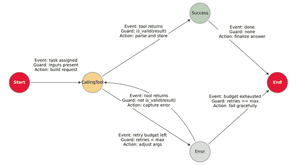
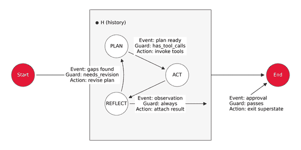
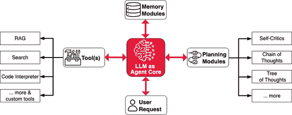
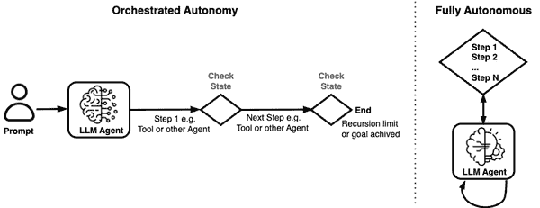
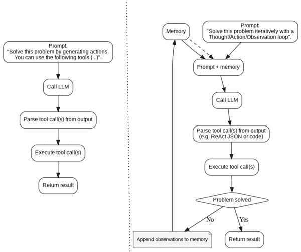
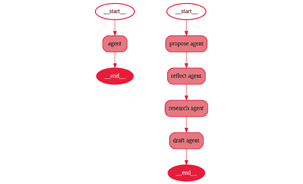
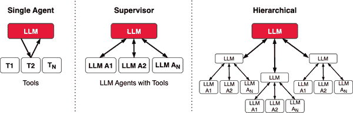
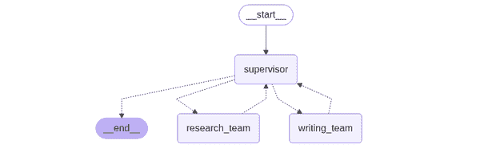
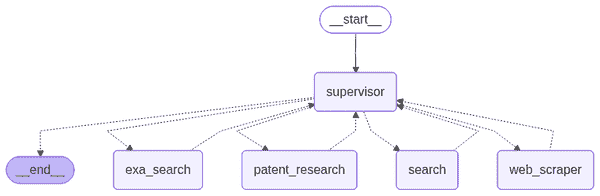
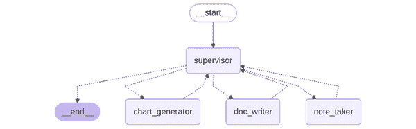

# AI智能体权威指南

# 第 1 章 从 LLM 到智能体：基础蓝图

人类智能的一个显著特征，是我们将内在推理与具体行动相结合的方式，而这与大型语言模型（LLM）智能体在配合工具时的运作方式惊人地相似。以构建编程项目的过程为例。作为人类开发者，你从一个提示（即客户的需求）开始。首先是推理，你会勾勒出如何处理它的计划。然后是行动，例如搜索文档、编写函数或调试错误。当测试失败、同行评审指出漏洞或客户测试应用程序时，反馈便进入循环。每一步都不是静态的，而是迭代的，推理会适应新的见解，行动也会随之改变。

单个 LLM 智能体也是如此。面对一项任务，智能体首先会推理缺少什么或下一步该做什么，然后通过调用工具来检索数据、运行代码或检查结果。与开发者的反馈循环类似，环境会提供错误、缺失或确认等信号，指引下一次迭代。代码库或文档等外部支持，对应检索系统或网页搜索等工具，这些工具能够超越模型自身的原始能力来优化输出。

LLM 智能体是一个嵌入在推理、行动和反馈循环中的大型语言模型，它能够调用外部工具并根据结果调整自身行为。与局限于静态文本生成的独立 LLM 不同，智能体作为工作流中的决策实体运作。在本书中，我将交替使用"AI 智能体"、"智能体"和"LLM 智能体"这些术语。严格来说，AI 智能体或智能体根本不需要涉及语言模型。例如，在纯强化学习中，智能体通过与环境进行试错交互来直接训练。使用 LLM 的优势在于它带来了强大的泛化、推理和自然语言能力，这使得智能体的行为更加灵活，适用范围远超狭义的特定环境。

正如个人技能终有其极限，单个智能体也只能将工作流推进到一定程度，之后复杂度的增加便需要协调。想一想，在一家小公司里，一个独立贡献者可能端到端地处理所有事情：设计、编码、测试和部署。但随着项目的发展，团队需要扩张。有人可能专注于后端，有人负责前端，还有人负责测试。为了保持一切协同一致，技术负责人或工程副总裁会介入，协调工作量、分配任务并整合结果。独立贡献者与协同团队之间的差异，直接映射到单个智能体与多智能体系统（MAS）之间的差异。正如技术负责人协调多个贡献者一样，监督智能体可以编排多个专业智能体协作解决复杂目标。

同样重要的是要认识到，无论是人类还是智能体，都无法完全自主地运作。开发者受编码标准、项目要求和组织流程的引导，他们的自由度受到这些结构的约束。智能体同样受其工作流的限制，只能在所提供的工具、权限和安全保障范围内运作。这种缺乏完全自主性的特点非但不是弱点，反而正是这两个系统能够可行的原因。对人类而言，结构确保了代码质量、可维护性和客户满意度。对智能体而言，约束确保了安全性、可靠性以及与开发者和用户设定目标的一致性。

这种相似性揭示了为什么将纯 LLM 与工具结合是合理的。语言模型本身就像一个与 StackOverflow、IDE 或 GitHub 等资源隔绝的开发者，虽有推理能力，却无法在没有外部帮助的情况下收集新数据、验证结果或改进任务输出。正如软件团队通过添加更好的工具、资源和领导力来扩展自身能力，LLM 在被嵌入智能体工作流、甚至 MAS 中的多个专业智能体时，也能扩展自身能力。若没有这些升级，两者都将囿于初始训练的限制，面对复杂任务时很快就会不堪重负。有了工具、反馈和分治法，LLM 可以迭代式地改进、适应并解决那些原本超出其独立能力的复杂任务。


我假设你在阅读本书时已经具备大语言模型（LLM）的基础知识。也许你读过《[动手学大语言模型](https://learning.oreilly.com/library/view/hands-on-large-language/9781098150952//)》这本书，或者类似的著作。你不需要知道如何部署 LLM 就能让你的智能体运行起来，因为我将在后续章节中逐步指导你完成这些步骤。不过，我希望你具备扎实的 Python 编码技能，也就是说你了解类和函数是什么，并且熟悉核心的机器学习和深度学习概念，如神经网络、训练循环和反向传播。具备线性代数和微积分的实用知识也很有帮助，因为它们是现代深度学习的重要基础。如果你了解 Transformer 如何处理序列，并且对嵌入的工作原理或向量存储如何支持检索有基本的认识，那也会很有用。

如果你有一段时间没接触这些主题了，不要惊慌！就像《银河系漫游指南》建议的那样，不要惊慌，我在本书中也会这样说。话虽如此，书中的每个概念都会以代码为基础，因此你的知识会重新变得可用，而无需翻出旧教材。而且，在你问之前——不，关于 AI 智能体的所有问题的答案并不是 42，但我保证你会在本书中找到答案。

## 本书代码

本书的所有代码示例都可以在[配套的 GitHub 仓库](https://github.com/Nicolepcx/ai-agents-the-definitive-guide)中找到。该仓库按章节组织，因此你可以轻松找到属于每个部分的代码。

如果你想深入了解不同领域的 Transformer，以及嵌入如何用于文本和其他模态，我的另一本书《[Transformer：权威指南](https://learning.oreilly.com/library/view/transformers-the-definitive/9781098167004/)》可以作为补充阅读材料。它还解释了强化学习的基础知识，这将帮助你为理解本书后面介绍的进阶智能体概念打下更坚实的基础。

因此，本书是为那些不满足于好奇心、希望更进一步了解的读者而写的，这也是理解这些基础知识之所以重要的原因。这包括数据科学家、正在构建生产环境真实系统的软件工程师和机器学习工程师，以及需要理解其中权衡、成本和护栏的技术领导者。本书不是从零开始解释 LLM，也不是关于抽象承诺或思想实验。它讲的是构建和运行 AI 智能体的实际现实，这些智能体能够在 PowerPoint 演示或实验室演示之外真正发挥作用并产生实用价值。

本章解释了 LLM 如何从静态提示演变为动态的智能体系统，为什么工具使用至关重要，以及在现代 AI 智能体的设计中，有状态（stateful）和自主（autonomous）的真正含义是什么。

## 有限状态机和层次状态机：智能体的基础范式

[LangGraph](https://langchain-ai.github.io/langgraph/concepts/why-langgraph/)、[CrewAI](https://www.crewai.com/) 等类似框架都建立在状态机（state machine）的概念之上。从高层来看，*状态机*是一种计算模型，它在任何给定时间都处于有限数量状态中的一种状态。它会根据特定事件或输入在状态之间转换，下一个状态由当前状态和输入共同决定。

本节旨在通过展示状态机如何构成现代 AI 智能体框架的基础，帮助你建立智能体的心智模型。简单来说，可以把它理解为结构化转换，这是一种长期以来在编译器、GUI、嵌入式系统和网络协议中使用的模式，如今被应用于基于 LLM 的智能体中的推理和工具使用。

我先让你在有限状态机（FSM）和层次状态机（HSM）的基础上建立理解，这不仅仅是一个松散的类比。我想为你提供一份构建健壮、可靠且适应性强的 LLM 智能体的蓝图。这将使你不仅能够理解这些概念，还能在后续学习更复杂主题时有效地应用它们。不过，如果你最近没有接触过状态机，也不用担心。你会看到这些模式如何直接体现在代码示例中。

### 有限状态机

*有限状态机*拥有一个小的词汇表，它定义了系统可以处于的模式、可以执行的操作以及它们之间允许的转换。每次转换由一个事件触发，可选地由一个谓词作为守卫，并且可能会执行更新状态的动作。起始和结束是具有特殊含义的区分状态。核心词汇如下：

- **状态**：一个紧凑的快照，捕捉系统在给定时刻所知道的信息。对于智能体来说，这可能是消息列表、路由提示或进度标记。
- **事件**：自上次决策以来发生的事情，例如工具被调用或返回结果。
- **守卫**：一种检查，根据当前状态和最新事件决定采取哪种转换。
- **动作**：在转换过程中执行的工作，例如调用工具、追加消息、保存检查点或请求人工输入。
- **终止**：表示过程已到达结束的条件。

图 1-1 展示了用于工具使用的有限状态机。每次转换都由一个事件、一个守卫和一个动作定义。



#### 图 1-1：用于工具使用的有限状态机高层概览。

当行为在少数稳定模式之间交替且可恢复性很重要时，FSM 是理想的选择，因为你可以在每个节点上设置检查点，并在崩溃后从最后一个已完成的状态恢复。

从状态的角度思考，可以将复杂任务分解为不同的步骤。例如，与其用一个单一的提示词来"写一篇博客文章"，你可以定义诸如主题构思、大纲生成、草稿撰写、编辑和 SEO 优化等状态。每个状态都可以关联到你的智能体将使用的特定工具。

*转换*让你明确一个任务交接给下一个任务的条件。例如，大纲生成状态的什么输出会触发草稿撰写状态。这种结构可以应对非结构化的、一次性的提示词，因为仅靠 LLM 处理这类提示词往往会导致结果不一致。

一旦你添加更多模式，如规划、反思、审批门控和重试，FSM 就可能造成重复或产生混乱的"意大利面条式"路由。你需要控制这些边（edge），因为它们是决策点：每条边都编码了驱动功能的事件、守卫和动作。这就是层次结构发挥作用的地方。

### 层次状态机

*层次状态机*允许状态包含其他状态。超状态（superstate）捕获共享的进入/退出行为和共享的守卫。子状态（substate）继承这些规则并添加自己的规则。历史节点会记住你离开时处于哪个子状态，以便之后精确地从那里恢复。状态机的这些新增功能说明如下。

- **超状态**：一种状态，用于分组一组子状态及其公共策略。进入超状态时运行一次共享逻辑；退出时运行一次共享清理。
- **子状态**：存在于超状态内部的具象模式。它有自己的边，但继承超状态的守卫和动作。
- **历史**：一个"记住我在哪里"的标记。浅历史从最后一个活跃的子状态恢复；深历史在嵌套的孙状态内部恢复。用智能体的术语来说，这是图的一部分的检查点。
- **并行区域**：超状态的两个或多个子区域，可以独立推进。适用于扇出工具调用或智能体角色，然后再汇合。


图 1-2 展示了一个带有 `WORKING` 超状态的分层状态机。`PLAN`、`ACT` 和 `REFLECT` 是子状态。`H` 是一个浅层历史标记，用于记录最后活跃的子状态，以便在重新进入超状态时从中断处继续执行。



**图 1-2.** 带有历史标记的分层状态机概览，该标记记录最后活跃的子状态。

HSM 特别适用于更高级的 MAS。HSM 允许“状态内嵌状态”，从而减少重复并使策略清晰可见。例如，你可以将速率限制、安全过滤器或熔断器附加到 `WORKING` 超状态上，这样规划、执行和反思都会继承相同的保护措施。你只需定义一次守卫或路由器，并在多个节点间复用。考虑一个研究型代理。与其将研究视为单一的 monolithic 步骤，你可以将其分解为一个子机器，包含搜索关键词、收集 URL、抓取数据和总结发现等状态。这些状态中的每一个甚至可以映射到具有自身能力的专用代理，从而为更大的代理团队做出贡献。这种嵌套结构有助于管理复杂性、保持策略一致性，并使整个系统更易于推理和维护。

### 将 FSM/HSM 映射到代理框架

`LangGraph` 已经使用了状态机和层次结构的语言。你可以通过子图和共享键来实现。选择下一个动作（例如调用下一个代理或工具）的路由器或决策代理，类似于经典状态机中的事件处理器。它是系统中接收当前状态和 LLM 输出（事件或负载）并确定下一个逻辑步骤的部分。直接映射如下所示。

**状态模式**：父图的 `TypedDict` 定义了共享的“总线”。子图声明它们读取和写入的键。重叠的键是超状态的接口。

```
class State(TypedDict):
    messages: List[BaseMessage]
    working_last: str | None
```

- ：父图和子图之间的共享总线。
- ：可选的浅层历史标记。

**节点和子图**：子图是一个 HSM 超状态。其内部节点是子状态。进入子图会运行其入口节点；离开子图会通过其出口边返回到父图。

```
def plan_node(state: State) -> State:
    ai = AIMessage(content="Plan next step")
    return {"messages": [ai], "working_last": "plan"}

def act_node(state: State) -> State:
    ai = AIMessage(content="Act on plan")
    return {"messages": [ai], "working_last": "act"}

subgraph_builder = StateGraph(State)
subgraph_builder.add_node("PLAN", plan_node)
subgraph_builder.add_node("ACT", act_node)
subgraph_builder.add_edge(START, "PLAN")
subgraph = subgraph_builder.compile()
```

- ：子图就是超状态。

**守卫和条件边**：父级守卫强制执行全局策略（预算、安全）。子级守卫在 `PLAN`/`ACT`/`REFLECT` 之间路由。由于守卫是纯 Python 代码，它们保持确定性和可审计性。

```
def route_within_working(state: State):
    last = state.get("working_last")
    return "ACT" if last == "plan" else END

subgraph_builder.add_conditional_edges("PLAN",
                route_within_working, {"ACT": "ACT", END: END})

parent = StateGraph(State)
parent.add_node("WORKING", subgraph)

def global_guard(state: State):
    tail = "".join([
            getattr(m, "content", "") for m in state["messages"][-3:]
            ]).lower()
    return END if "stop" in tail else "WORKING"

parent.add_edge(START, "WORKING")
parent.add_conditional_edges("WORKING", global_guard,
                            {"WORKING": "WORKING", END: END})
```

- ：在子图内添加条件边。
- ：带有全局守卫的父图。
- ：示例策略：如果用户说“停止”则结束。

**历史和检查点**：`MemorySaver` 为你免费提供浅层和深层历史：恢复线程会从最后完成的节点重新创建子图。如果你想要显式的“返回到我在 `WORKING` 内部的位置”，持久化一个小标记（例如 `state["working_last"] = "reflect"`），并在重新进入时根据它进行分支。

```
def reflect_node(state: State) -> State:
    ai = AIMessage(content="Reflect on result")
    return {"messages": [ai], "working_last": "reflect"}

checkpointer = MemorySaver()
app = parent.compile(checkpointer=checkpointer)

cfg = {"configurable": {"thread_id": "session-1"}}
app.invoke({"messages": [HumanMessage(content="start")],
                        "working_last": None}, config=cfg)
```

- ：子状态在退出时设置 `working_last`。
- ：使用检查点进行编译。
- ：在线程中运行。`MemorySaver` 会在恢复时还原最后完成的节点。

FSM 让你能够将任务结构化为稳定、可恢复的步骤。HSM 在此基础上通过减少重复并在工作流变得复杂时集中策略来扩展这一能力。这两种模式都为你的下一步做好准备：将静态的 LLM 预测转化为动态的、有状态的代理。

## 基础：从静态模型到动态代理

正如你在前一节中看到的，添加状态和控制流对于自动化至关重要。同样的原理也适用于代理。要从静态的 LLM 使用转向代理系统，你需要显式的状态和控制流。状态将一次性的工具调用转变为具有记忆的过程。控制流添加守卫和转换，以决定何时规划、何时行动以及何时停止。

将此添加到 LLM 的原因很简单：LLM 是静态预测器。它们根据提示生成下一个 token，仅利用训练数据中编码的模式。这使得它们成为强大的推理者，但仅限于它们已知的内容。它们无法更新知识、验证声明或与外部环境交互。

*代理性* 在推理与行动相结合时出现。*推理* 是规划或决定下一步的内部过程。*行动* 通过调用工具、检索数据、执行代码或调用外部服务来扩展。它们共同形成一个迭代循环：推理、行动、接收反馈、调整。这个循环是代理行为的基础。

表 1-1 对比了静态 LLM 与代理系统。这些对比不仅说明了为什么需要代理，还展示了它们的设计如何将传统机器学习工作流转变为动态的、增强工具的系统。

**表 1-1. 静态 LLM 与代理系统的对比**

| 静态 LLM（传统用法） | 代理系统 |
| --- | --- |
| 单次传递的 token 生成器 | 迭代推理–行动–反馈系统 |
| 局限于训练数据 | 可以检索、验证和更新知识 |
| 无记忆，无状态 | 有状态，具备短期和长期记忆 |
| 线性提示–响应 | 迭代和自适应工作流 |
| 无工具使用 | 增强工具（检索、代码、API） |
| 对提示的固定解释 | 可以动态细化或重新解释目标 |
| 无外部验证 | 主动检查、纠正和改进输出 |


图 1-3 说明了模块如何将静态 LLM 转化为动态智能体。用户请求进入核心，规划与记忆塑造其推理，工具则使其能够采取具体行动。推理、行动和适应的循环正是由这些元素的协调而涌现。



**图 1-3.** 基准智能体架构：单独的 LLM 只能预测文本，但借助规划、记忆和工具，它就会变成可用的智能体系统。

规划模块引导智能体的推理，从简单的思维链^(1)轨迹到更高级的方法，如思维树^(2)或自我批判。记忆模块提供连续性，使智能体能够回忆过去的步骤、复用先验知识或在会话之间持久化信息。工具将智能体与外部环境连接起来，无论是通过搜索、检索、代码执行还是自定义 API。

此外，传统 LLM 用法与智能体系统之间的一个关键区别在于工作流是无状态还是有状态。*无状态调用*将模型视为黑盒：它接收提示词，预测下一个词元，并返回结果。不会记住任何内容，不会采取任何操作，也不存在反馈循环。示例 1-1 演示了一个无状态 LLM 调用。

### 示例 1-1. 使用 LangChain 的无状态 LLM 调用

```
llm = ChatOpenAI(model="gpt-5-mini")
response = llm.invoke("What are AI agents?")
print(response.content)
```

此外，当你需要训练数据之外的事实，或者希望模型采取行动（搜索、计算）时，就需要引入工具。

下面的代码（示例 1-2 至示例 1-4）演示了一个极简的无状态工具使用运行流程：先把两个工具绑定到 LLM，然后运行一个微型循环来执行模型为完成任务所需的任何工具调用。在此之前，你需要先定义工具。示例 1-2 给出了工具的实现。

### 示例 1-2. 为无状态运行定义工具

```
@tool("internet_search")
def internet_search(query: str) -> str:
    """Search Google via SerpAPI for up to date information."""
    serp_api_key = os.environ["SERPAPI_API_KEY"]
    params = {"engine": "google", "gl": "us", "hl": "en"}
    search = SerpAPIWrapper(params=params, serpapi_api_key=serp_api_key)
    return search.run(query)

@tool("calculator")
def calculator(expression: str) -> str:
    """Evaluate a single line mathematical expression with numexpr."""
    local_dict = {"pi": math.pi, "e": math.e}
    out = numexpr.evaluate(
        expression.strip(),
        global_dict={},
        local_dict=local_dict,
    )
    return str(out)

tools = [internet_search, calculator]
tool_map: Dict[str, Any] = {t.name: t for t in tools}
```

1. LangChain 的`@tool`装饰器使用函数名、类型签名和 docstring 来构建模型所见的 schema。
2. docstring 是必需的：如果缺失，LangChain 在构造工具 schema 或将工具绑定到模型时会抛出错误。
3. 约束计算：拒绝全局变量，只暴露你希望暴露的常量。这保证了计算器的确定性和安全性。

使用 LangChain 的`@tool`装饰器时，函数签名和 docstring 用于构建模型所见的 schema。你需要让这些内容精确、一致，并尽可能具有解释性，以便高效完成任务。docstring 充当工具描述，是 LangChain 的硬性要求，如果缺失就会出现错误。此外，如果 docstring 含糊不清，模型更有可能产生无效调用。

### 示例 1-3. 将工具绑定到 LLM

```
llm = ChatOpenAI(model="gpt-4o", temperature=0,
                max_tokens=800).bind_tools(tools, tool_choice="auto")
```

1. 将工具绑定到模型。`tool_choice="auto"`让模型决定是否调用工具以及调用哪个工具。

## 现代 LLM 是为智能体任务而打造的

现代 LLM 不仅能够调用工具，而且日益专门针对智能体任务进行训练和优化。例如，[Kimi K2](https://moonshotai.github.io/Kimi-K2/)和[Llama 4](https://www.llama.com/docs/model-cards-and-prompt-formats/llama4/)等模型就明确针对编码、工具使用和驱动智能体系统进行了调优。这些模型不止于在聊天窗口中回答问题。它们经过指令调优而能够采取行动，调用 API、运行代码或检索数据已成为其核心设计的一部分。

绑定工具后，你就可以运行一个极简的无状态工具循环。示例 1-4 中的代码会执行模型请求的任何工具调用，将观察结果反馈回模型，并强制进行一次简短的收尾，以确保即使在最后一步以工具观察结束时，也能返回最终答案。

### 示例 1-4. 带工具循环的无状态单次运行

```
def run_once(prompt: str, max_steps: int = 8) -> str:
    messages: List[HumanMessage | AIMessage | ToolMessage] = [
    HumanMessage(content=prompt)]
    last_ai: AIMessage | None = None

    for _ in range(max_steps):
        ai: AIMessage = llm.invoke(messages)
        messages.append(ai)
        last_ai = ai

        calls = getattr(ai, "tool_calls", None) or []
        if not calls:
            return messages[-1].content

        for call in calls:
            name = call["name"]
            args = call.get("args", {}) or {}
            result = tool_map[name].invoke(args)
            messages.append(ToolMessage(
                content=str(result),
                name=name,
                tool_call_id=call.get("id")
            ))

    messages.append(HumanMessage(content="""
Finish now. Give a short final answer in this exact format:

Current temperature:
Square of current temperature:
""".strip()))
    final_ai: AIMessage = llm.invoke(messages)
    return final_ai.content

print(run_once("""Two step task.

Step 1: Use internet_search to get the current air temperature in New York City
today. Show the exact query you used, the top source title and snippet, and
extract a numeric temperature in Celsius. Return this temperature as feedback
for Step 2.

Step 2: Using the Celsius value from Step 1, compute its square with calculator.
Show the exact expression you used and the numeric result.

Important: Give a short final answer in this format:
Current temperature:
Square of current temperature:"""))
```

1. 仅用于本次运行的本地短期记忆。这使工作流在不同运行之间保持无状态。
2. 一个简单的步数上限可防止失控循环：LLMs 不断循环而不终止。
3. 一次模型步骤。助手可以选择调用工具。
4. 读取结构化工具调用。
5. 将观察结果与匹配的`tool_call_id`一起附加，以便模型将结果与调用对应起来。


工具循环可以以一次观察结果作为结束。这条最终指令确保以你要求的格式生成一条收尾的助手消息。

## 为 LLM 赋予状态

将 LLM 转变为智能体的第一步是让它具备状态。为你的 LLM 提供一个状态，记录它处于工作流中的哪个位置。基于输入和逻辑，它会转换到下一个状态，而每个状态都关联着一个函数或行为。在 LangGraph 中，这可以是任何 Python 类型，但通常是 `TypedDict` 或 [Pydantic](https://docs.pydantic.dev/latest/api/base_model/) `BaseModel`。下面概述了 LangGraph 用于构建有状态、可适应的 AI 智能体的关键概念。

`State`
: 一种共享数据结构，表示应用的当前快照。它可以是任何 Python 类型，但通常是 `TypedDict` 或 `Pydantic BaseModel`。

`Nodes`
: 对智能体逻辑进行编码的函数。它们接收当前状态，执行计算或副作用，并返回更新后的状态。

`Edges`
: 根据当前状态选择下一个节点的规则。它们可以是条件分支或固定转换，并且还应当检测是否满足结束条件。

`Command`
: 一个将控制流与状态更新相结合、以支持多智能体通信的对象。节点可以通过返回 `Command` 来同时更新状态并选择下一个节点。

到目前为止，你之前创建的工具仅被用于*无状态循环*中。每次运行都是独立的：模型可以调用工具、获取答案并收尾，但一旦运行结束，所有上下文都会丢失。现在，如果你想结合 LangGraph 的概念来构建有状态的智能体，就需要将工具嵌入到有状态的工作流中。不要在每一轮之后丢弃消息，而是将它们保存在结构化的状态中。这使得系统具备了智能体特性：

- LLM 节点推理下一步骤。
- 工具节点执行外部操作。
- 边根据是否请求了工具来路由控制流。
- 记忆检查点持久化对话，以便智能体可以在后续轮次中复用之前的结果。

这将工具的使用从一次性的辅助手段转变为持续的推理–行动–适应循环。在接下来的代码清单（示例 1-5 – 示例 1-13）中，你将使用 LangGraph 构建这样一个有状态的智能体，从 示例 1-3 - 示例 1-4 中引入的相同工具和 `llm` 绑定开始。

示例 1-5 展示了如何在 LangGraph 中实现一个状态对象来承载对话并协调控制流。你可以复用 示例 1-3 中的工具和已绑定的 `llm`，只需添加新的部分：一个类型化状态、一个追加助手消息的 LLM 节点、一个执行调用的工具节点，以及一个根据工具调用决定继续还是停止的路由器。

### 示例 1-5. 使用状态、节点和路由构建一个最小的 LangGraph

```python
class AgentState(TypedDict):
    messages: Annotated[List[BaseMessage], add_messages]

def llm_node(state: AgentState) -> AgentState:
    ai = llm.invoke(state["messages"])
    return {"messages": [ai]}

tool_node = ToolNode(tools=tools)

graph = StateGraph(AgentState)
graph.add_node("llm", llm_node)
graph.add_node("tools", tool_node)
graph.add_edge(START, "llm")

def route(state: AgentState):
    last = state["messages"][-1]
    calls = getattr(last, "tool_calls", None) or []
    return "tools" if calls else END

graph.add_conditional_edges("llm", route, {"tools": "tools", END: END})
graph.add_edge("tools", "llm")
```

- : 状态以消息列表的形式承载对话。`add_messages` 负责在节点更新之间安全地合并消息。
- : 核心推理节点。它接收当前状态并返回一条新的助手消息。
- : 用于执行助手发出的工具调用的预构建节点。
- : 节点和边的图容器。
- : 路由器。如果最后一轮助手请求了工具，则转到工具节点，否则结束。

定义好图之后，你需要让它可运行且可持久化。示例 1-6 使用内存检查点编译该图，并分配一个线程 ID。检查点会在每一轮恢复之前的消息，以便智能体可以复用之前的结果。线程 ID 将各个分支分隔开，这样你就可以并行运行多个对话而互不干扰。

### 示例 1-6. 使用内存检查点编译并配置线程

```python
checkpointer = MemorySaver()
app = graph.compile(checkpointer=checkpointer)

cfg = {"configurable": {"thread_id": "nyc-weather-session"}}
```

- : 轻量级的按线程检查点机制，可在各轮之间持久化状态。
- : 生成一个知道如何保存和加载状态的可运行应用。
- : 线程 ID 标识一个对话分支。新的 ID 会创建新的分支。

一旦你有了可运行的应用和就绪的检查点，下一步就是让它的执行过程可观测。你想看到图正在做什么、哪些消息在流动，以及工具输出如何接入。示例 1-7 介绍了一个简洁的辅助函数，它可以将消息格式化为一行可读文本，让你更容易跟踪执行轨迹，而不会被大量日志淹没。

### 示例 1-7. 跟踪执行过程并检查状态与记忆

```python
def _short(msg: BaseMessage, max_len: int = 140) -> str:
    """Compact one-line view of a message."""
    role = type(msg).__name__.replace("Message", "").lower()
    content = getattr(msg, "content", "")
    if isinstance(content, list):
        # some tool outputs can be list payloads
        try:
            content = json.dumps(content)
        except Exception:
            content = str(content)
    text = str(content).replace("\n", " ").strip()
    if len(text) > max_len:
        text = text[: max_len - 3] + "..."
    if hasattr(msg, "tool_calls") and getattr(msg, "tool_calls"):
        tnames = [tc.get("name", "tool") for tc in msg.tool_calls]
        return f"{role}: tool_calls -> {tnames}"
    if isinstance(msg, ToolMessage):
        return f"{role}({msg.name}): {text}"
    return f"{role}: {text}"
```

- : 在可用时包含工具名称或函数调用信息。

示例 1-8 会打印消息和路由提示的简明视图。两者共同帮助你验证工具输出是否正确接入、状态转换是否符合预期。

### 示例 1-8. 跟踪执行过程并检查状态与记忆

```python
def print_state_snapshot(app, config, title: str):
    """Print current graph state and memory for a given thread."""
    snap = app.get_state(config)
    values = snap.values or {}
    msgs: List[BaseMessage] = values.get("messages", [])
    print(f"\n=== {title} | state snapshot ===")
    print(f"messages: {len(msgs)} total")
    for i, m in enumerate(msgs[-5:], start=max(0, len(msgs)-5) + 1):
        print(f"  {i:>3}: {_short(m)}")

    nxt = getattr(snap, "next", None)
    tasks = getattr(snap, "tasks", None)
    if nxt:
        print(f"next nodes: {list(nxt)}")
    if tasks:
        print(f"queued tasks: {tasks}")
    print("memory: in-memory checkpoint present for this thread")
```


: 读取某个线程的最新状态。

: 打印消息的简洁尾部，让日志保持可读。

: 显示路由信息以及排队的任务（如果存在）。

示例 1-9 流式输出节点更新，让你看到图执行的每一步。

### 示例 1-9：跟踪执行并检查状态与记忆

```python
def run_with_tracing(app, input_state: AgentState, config, title: str):
    """Run the graph while printing per-node updates and final memory."""
    print(f"\n=== {title} | execution trace ===")
    final = None
    for event in app.stream(input_state, config=config, stream_mode="updates"): 
        for node, upd in event.items():
            keys = list(upd.keys()) 
            print(f"[enter {node}] updated: {keys}")
            # if messages updated, print the last one briefly
            msgs = upd.get("messages") or []
            if msgs:
                print(f"  {_short(msgs[-1])}")
            print(f"[leave {node}]")
            final = upd
    print_state_snapshot(app, config, title=f"{title} | after run") 
    snap = app.get_state(config)
    msgs = snap.values.get("messages", [])
    return msgs[-1].content if msgs else ""
```

: 流式输出节点更新，以查看图中确切的流程。

: `upd` 是一个类似 `{"messages": [<new msg>]}` 或工具结果的字典。

: 从 `app.get_state` 显示最终的助手消息。

示例 1-10 要求获取纽约市当前以摄氏度为单位的空气温度。跟踪显示图进入 LLM 节点，在需要时发起工具调用，并返回最终的助手消息。状态快照确认结果已保存在该线程的记忆中。

### 示例 1-10：第 1 轮：获取纽约市当前以摄氏度为单位的空气温度

```python
turn1_answer = run_with_tracing(
    app,
    {"messages": [HumanMessage(content="Get the current air temperature in New York
    City in Celsius.")]},
    config={**cfg, "recursion_limit": 20},
    title="TURN 1",
)
print("\nTURN 1 (final assistant):\n", turn1_answer)
```

这会产生以下模型输出：

```text
TURN 1 (final assistant):
The current air temperature in New York City is 18°C.
```

你在同一个线程中继续。示例 1-11 要求对之前获取的温度求平方。由于线程 id 未变，`app` 会恢复之前的消息，让助手无需你在提示中重复即可使用先前的结果。

### 示例 1-11：第 2 轮：在同一个线程中对该温度求平方

```python
turn2_answer = run_with_tracing(
    app,
    {"messages": [HumanMessage(content="Now compute the square of that
    temperature.")]},
    config={**cfg, "recursion_limit": 20},
    title="TURN 2",
)
print("\nTURN 2 (final assistant):\n", turn2_answer)
```

现在将计算平方，模型返回：

```text
TURN 2 (final assistant):
The square of the temperature, 18°C, is 324.
```

代理经常需要在不丢失进度的情况下探索替代方案。示例 1-12 通过使用不同的线程 id 启动一个独立分支，并请求一个不同的后续问题。这会创建一个可以与主路径分叉的隔离对话，同时保持主线程记忆完整无损。

### 示例 1-12：为不同的后续问题分支一个并行线程

```python
branch_answer = run_with_tracing(
    app,
    {"messages": [HumanMessage(content="Instead of squaring, convert it to
    Fahrenheit and report both.")]},
    config=cfg_branch,
    title="BRANCH",
)
print("\nBRANCH (final assistant):\n", branch_answer)
```

最后，你可以检查每个分支记住了什么。示例 1-13 为主线程和分支打印紧凑的快照。将它们并排比较，可以确认状态在线程内部持久化、在线程之间相互隔离，这是可靠的多步骤、多分支代理工作流的基础。

### 示例 1-13：查看两个线程的快照

```python
print_state_snapshot(app, cfg, title="MAIN THREAD memory view")
print_state_snapshot(app, cfg_branch, title="BRANCH THREAD memory view")
```

通过这个小型实现，你现在可以清楚地看到图记住了什么、它是如何路由的，以及每个分支的最新助手状态。

## 机械降神：现在可能实现什么？

一旦你把代理视为带状态的分层状态机（HSM），自主性谱系就变成了你在超状态中放入多少选择的问题。路由器是带单一守卫的单边有限状态机（FSM）。工具调用代理是带有 WORKING 超状态的分层状态机，该超状态在 PLAN、ACT 和 REFLECT 之间循环。多智能体系统（MAS）在监督者超状态之下组合多个子图，有时带有并行区域。系统仍然在显式状态和守卫内运行，所感知到的“自主性”只是边界良好的区域内更丰富的选择。

在古希腊戏剧中，*机械降神*（deus ex machina）是指神明突然出现，以解决无法化解的冲突或问题。人们很容易以同样的方式想象 AI 代理：一台机器突然以完全的自主性和智能行动，解决你所有的问题。但这不是当下所能实现的——代理是工程化系统。它们的力量不来自隐藏的魔法，而来自精心设计的工作流、定义良好的工具，以及让它们保持安全可用的边界。话虽如此，代理仍然受限于你给予它们的工具、你强制执行的安全保障，以及你允许它们运行的工作流。正是这些约束让代理在当下切实可行：部署安全、行为可预测、与预期目标保持一致。

当前系统展示的是一种编排式自主性。正如你之前在 LangGraph 示例（示例 1-5）中看到的，代理可以有条件地分支、调用工具，或决定是否继续某个工作流。这看起来已经与静态的提示–响应调用大不相同，但它仍然是有界的。编排逻辑是固定的；在其中，LLM 可以做出选择，但不能重新定义自身的架构。表 1-2 简要概述了代理目前能做些什么。

**表 1-2 代理当前的自主性：可以实现什么 vs. 仍然无法做到什么**

| 代理可以做什么 | 代理尚不能做什么 |
| --- | --- |
| 在预定义路径之间路由（例如路由器节点） | 重新设计或重新连接自己的控制图 |
| 选择调用哪些工具或子代理 | 动态生成并验证新的图拓扑 |
| 判断完成前是否还需要更多步骤 | 持续评估工具有效性，或自主创建新工具 |
| 在边界内修改自己的提示或工具集 | 在执行中途转变策略时保证对齐与连贯性 |
| 编写并运行小段代码以确定后续步骤 | 作为完全自我导向的系统运行，独立于编排框架 |


智能体在运行时进行适配，但仅限于你设计的框架之内。将它视为一个频谱会很有帮助。一端是路由器，从一组固定选项中做出单一决策；中间是支持多步推理、反思和记忆的工具调用型智能体；另一端则是多智能体系统（MAS），专业化的智能体在监督者协调下协作，将决策分布到不同角色中。图 1-4 展示了自治程度的频谱，从简单的路由决策到完全自主执行的理念。实际上，几乎所有现实世界的系统都落在中间地带：它们是智能体系统，而不是真正的自主智能体。它们的自主性是被编排出来的，而非自我进化；决策发生在预定义状态、转换和工具集的框架之内，即使智能体能在运行时从中进行适应性选择。



### 图 1-4：在编排式自主中，决策点在流程中被预定义。在完全自主中，大语言模型（LLM）可以生成新的工具、动作或决策路径来实现目标。

智能体可以在 LangGraph 等框架内借助反思、规划和结构化输出来模拟灵活性。然而，我们尚未拥有能够自由重新定义自身架构，或以稳健且通用的方式对其目标进行推理的系统。

如你现在所理解的，当今的智能体并非“机械降神”式的解决方案，而是经过精心编排的系统，以结构、工具和反馈循环扩展了大语言模型。它们的自主性受设计约束，而这正是让它们实用、安全且可部署的原因。尽管它们仍有局限，但其能力已令人印象深刻，它们能以远超静态大语言模型的方式推理、行动和适应。

## 结论

在本章中，你学习了大语言模型如何通过添加状态、控制流和工具使用，从静态预测器演变为动态智能体。通过将推理嵌入行动与反馈的循环中，大语言模型获得了适应结果的能力，并将自身能力扩展到远远超出仅靠提示-响应的交互所能达到的范围。

有限状态机和层次状态机为智能体设计提供了概念基础。FSM 让你可以将工作流组织为可恢复的步骤，而 HSM 则减少了重复并集中化复杂多步骤任务的策略。这些抽象直接映射到 LangGraph 等现代框架中，在这些框架中，状态、节点和路由规则定义了智能体在时间上如何推理和行动。

现在你也能更恰当地理解自主性。你明白了当今的智能体运行在边界明确的工作流中，在预定义路径之间进行选择、调用工具并反思结果，而不是重新设计自己的架构。这种编排式自主不是弱点，而是优势，因为约束使智能体变得安全、可预测且易于部署。AI Scientist v2 的例子既展示了这种方法的潜力，也展示了其局限性，说明智能体已经能够生成并测试假设，但仍然需要人类监督来确保严谨性和深度。

^(1) Jason Wei 等，[“思维链提示激发大语言模型的推理能力。”](https://arxiv.org/abs/2201.11903)，(2023)。

^(2) Shunyu Yao 等，[“思维树：利用大语言模型进行审慎的问题解决。”](https://arxiv.org/abs/2305.10601)，(2023)。

^(3) Yutaro Yamada 等，[“AI 科学家 v2：通过智能体树搜索实现研讨会级别的自动化科学发现。”](https://arxiv.org/abs/2504.08066)，(2025)。

# 第 2 章 架构与模式：规划、反应性与多智能体系统

你现在已经知道，AI 智能体并非魔法。它们是工程化系统，其力量来自架构的战略性配置。通过结合推理循环、工具、有状态设计和自适应控制，大语言模型可以超越静态提示，演化为能够实时规划、反应和反思的多智能体系统（MAS）。本章探讨了使这一切成为可能的架构，从思维链、思维树和 ReAct 等结构化推理方法，到监督者智能体和层次智能体等架构范式。在此过程中，你将更深入地理解推理流程，并看到包括审批门、修正和中止在内的“人在回路”机制如何让这些系统保持可靠、对齐且安全。

当你比较一个简单的单步智能体与一个多步智能体如何处理任务时，智能体架构的重要性就显而易见了。单步智能体接收请求，在内部规划一切，一次性执行，并在返回结果时从不重新审视中间步骤。相比之下，多步智能体在迭代循环中交替进行推理和行动，根据部分结果或工作中的新观察调整其计划。正是这种灵活性让智能体能够动态优化输出，并应对来自环境的不确定性或反馈。这种对比如图 2-1 所示，表 2-1 则展示了两种方法在相同任务上逐步展开的过程。

表 2-1. 示例：任务“总结文档并创建关键统计数据的柱状图”的单步执行与多步（ReAct）执行

| 步骤 | 单步智能体 | 多步（ReAct）智能体 |
| --- | --- | --- |
| 1 | 只读取一次请求 | 读取请求并对第一个动作形成初步想法（提取统计数据） |
| 2 | 在内部规划整个序列 | 动作：执行提取；观察：将提取的数据存储在内存中 |
| 3 | 一次生成摘要和图表 | 思考：规划下一步动作，从提取的数据生成摘要 |
| 4 | 返回输出，不重新审视中间结果 | 动作：生成摘要；观察：将输出存储在内存中 |
| 5 | 无执行中调整 | 思考：规划最终动作以创建柱状图；动作：创建图表；观察：复审输出 |
| 6 | — | 如果中间结果不完整，则重复循环直到满意，然后返回最终输出 |

虽然表格逐步展示了差异，图 2-1 则对整体工作流进行了并排说明。单步智能体遵循从提示到结果的线性流水线，而多步智能体将推理、行动和记忆嵌入到一个迭代循环中，该循环会持续运行，直到问题解决或计算预算耗尽。



## 图 2-1：单步（左）与 ReAct（右）智能体工作流。

## 结构化推理与行动

赋予智能体不同的角色人设（有时称为拟人化）可以锐化它们的推理，并使它们的贡献更加聚焦。一个被设定为有条不紊的战略家的规划智能体，与被设定为评估者的批评智能体，处理问题的方式会不同。当每个智能体都被赋予清晰的角色和思维模式时，它们的推理链往往更加连贯，它们在多智能体系统（MAS）中的交互也更有目的性。这种一致性提升了协作效率，因为每个智能体都知道自己应该贡献哪类知识。

然而，定义角色只是事情的一半。要让智能体更高效，你可能还需要塑造智能体的思考方式。这就是思维链、思维树和 ReAct 等结构化推理方法发挥作用的地方。

### 让 AI 智能体出声思考


*思维链提示*（CoT）^(1)受人类思维过程的启发，该技术先解决中间步骤，再得出最终答案。虽然 CoT 常被作为一种提示技巧来介绍，但在 AI 智能体的语境中，CoT 可以作为额外的推理步骤来引导控制流。通过强制模型生成中间步骤，你可以获得对推理过程更高的透明度。它通常能提高可靠性，并帮助较小的模型执行原本需要更大模型才能完成的任务。这既降低了成本，又能更清晰地洞察智能体如何得出其决策。表 2-2 为你提供了常见场景的提示词思路，你可根据需要进行调整。

表 2-2. 示例：按场景划分的思维链提示词

| 场景 | CoT 提示词示例 |
| --- | --- |
| 规划 | “逐步规划，创建一周的博客日程。解释每个选择背后的理由。” |
| 数据分析 | “首先描述数据集。接着突出模式或趋势。最后以清晰的见解总结收尾。” |
| 数学问题 | “将问题分解成小块。逐块求解并给出解释。然后将结果合并为最终答案。” |
| 研究任务 | “先列出核心问题。逐一调查。最后给出综合总结。” |
| 调试 | “先列出可能的原因。逐一测试每个原因。排除不吻合的并解释原因，直到找到修复方案。” |
| 决策制定 | “列出所有可用选项。逐步权衡利弊。选择最符合标准的选项并解释原因。” |

为了更明确说明你可能希望如何将其融入工作流程，让我们看一个用于数据分析的智能体。由于 CoT 智能体的核心在于能够通过一系列逻辑化的中间步骤进行推理，因此这是一个完美的例子。你可以指示智能体一步一步地思考，让它先描述数据集，再突出显示模式或趋势。示例 2-1 展示了一个可用于此类智能体的通用系统提示词。为简洁起见，我省略了其余代码，但你可以在[本书的代码仓库](https://github.com/Nicolepcx/ai-agents-the-definitive-guide)中找到完整的可运行实现。

#### 示例 2-1. CoT 提示词

```
SYSTEM_INSTRUCTIONS = """You are a careful data analysis assistant. Think step by
step and be explicit.
Begin by describing the dataset.
Next highlight patterns or trends.
Conclude with a clear summary of insights.
When you need to compute metrics or create a chart, call the python_repl tool with
code that:
1. Loads the CSV from the dataset path
2. Prints descriptive statistics
3. If a target column exists, creates one bar chart of mean values grouped by the
target and saves it to a file
4. Prints key results
Return FINAL ANSWER only after you have executed your analysis."""
```

现在，要将该提示词与你的智能体一起使用，只需创建一个智能体，如示例 2-2 所示。请注意，为简洁起见，在示例 2-2 中我使用了 LangChain 的 `AgentExecutor` 以及 LangGraph。但在随附的笔记本中，你还会找到更细粒度的 LangGraph 接线，其中模型与工具之间的路由是显式的。

两种方法产生相同的结果。然而，在生产环境中通常更倾向于使用 `AgentExecutor`，因为它能让代码保持简洁，而细粒度图则对调试以及理解消息、工具调用和控制流在底层如何运作很有价值。

#### 示例 2-2. CoT 智能体

```
def create_agent(llm: ChatOpenAI, tools: list, system_prompt: str) -> AgentExecutor:
    prompt = ChatPromptTemplate.from_messages(
        [
            ("system", system_prompt + """Work autonomously using the available
            tools."""),
            MessagesPlaceholder(variable_name="messages"),
            MessagesPlaceholder(variable_name="agent_scratchpad"),
        ]
    )
    agent = create_openai_functions_agent(llm, tools, prompt)
    executor = AgentExecutor(
        agent=agent,
        tools=tools,
        return_intermediate_steps=True,
        handle_parsing_errors=True,
        verbose=False,
    )
    return executor
```

当我运行这段代码时，智能体生成了对演示数据集的正确描述、对模式和趋势的准确分析，以及一张条形图和一份见解总结。此外，借助所给代码，你可以检查中间的工具步骤，例如：

```
(AgentActionMessageLog(tool='python_repl', tool_input={'code': "import pandas
as pd\n\ndf = pd.read_csv('demo.csv')\n\ndf.describe()"})
```

或

```
AgentActionMessageLog(tool='python_repl', tool_input={'code': 'df.describe()'})
```

这个示例展示了 CoT 如何让智能体的推理过程可见且可验证。如果你使用该示例中的代码，基本上就是强制智能体将其中间步骤外部化，这样你不仅对结果更有信心，还能就结论如何得出创建一条透明的审计追踪。

## 生成可能性之树

现在设想一个场景：你有一个更复杂的任务，但不想使用推理模型或完整的多人智能体架构。然而，需要一种更具探索性和战略性的方法。在这种情况下，你可以使用*思维树提示*（ToT）^(2)。ToT 将 CoT 推理扩展为分支搜索过程，在决定最佳下一步之前，会探索并评估多条推理路径。

在代码示例（示例 2-3 到 示例 2-5）中，我将展示如何实现 ToT。核心思想是让一个较小的单一 AI 智能体生成多条潜在路径（即“树”），让另一个智能体评估并选择最佳路径，然后再用另一个模型执行所选路径。简化的 ToT 方法在简单的 ReAct 循环（参见“如何让你的智能体采取行动并反思”）与更基于树搜索的算法的完整计算复杂度之间，提供了一种务实的中间方案。下一章将介绍这些算法。

### ToT 作为工程捷径

一种轻量级 ToT 设置——由较小的模型提出分支、较强的模型进行评估——有时可以取代对完整多人智能体架构的需求。这简化了设计，并且当较小的设置已经能提供可靠结果时，避免反复调用大型推理模型，从而节省金钱和时间。

你首先创建一棵“可能性之树”。示例 2-3 中的 `propose_options` 节点是第一步。它不是生成单一线性输出，而是使用一个较小的 LLM 为一篇博客文章生成三种不同的方案。这三个选项代表了智能体可以探索的分支路径，即“思维”。这就是 ToT 的核心原则：超越单链过程，走向多路径探索。

#### 示例 2-3. 思维生成

```
def propose_options(state: BlogState) -> BlogState:
    """Generator (small): propose 3 creative approaches (ToT-style branching)."""
    proposer = gen_llm.with_structured_output(OptionsPayload)
    prompt = (
        "Generate exactly 3 distinct approaches for a developer-focused blog on:\n"
        f"{state['topic']}\n\nFor each option, provide: title, audience, angle, "
        "a 5-bullet outline, and a concise rationale."
    )
    payload: OptionsPayload = proposer.invoke(prompt)
    state["options_json"] = payload.model_dump_json()
    state["messages"].append(AIMessage(content=state["options_json"]))
    return state
```


## 思维树（ToT）

然后，你可以让智能体进行反思和选择（示例 2-4），从而对树进行剪枝。在这里，一个更强大的 LLM 对三个提议的选项进行评估。可以指示模型根据清晰度和原创性等标准对每个选项进行评判，然后选择最佳的一个。这一步在 ToT 中至关重要，因为它确保智能体不会简单地采用第一个想法，而是批判性地评估备选方案，并选择最有希望推进的路径。

### 示例 2-4. 剪枝节点

```python
def reflect_and_select(state: BlogState) -> BlogState:
    """Judge (stronger): critique options and select best one."""
    chooser = judge_llm.with_structured_output(ChoicePayload)
    eval_prompt = (
        "Evaluate the 3 approaches for clarity, originality, developer relevance, "
        "and feasibility under time constraints. Pick ONE by index 0..2 and justify."
        f"Options JSON:\n{state['options_json']}"
    )
    choice: ChoicePayload = chooser.invoke(eval_prompt)
    opts = json.loads(state["options_json"])["options"]
    idx = max(0, min(choice.choice_index, len(opts)-1))
    choice.choice_index = idx
    state["choice_json"] = choice.model_dump_json()
    state["messages"].append(AIMessage(content=state["choice_json"]))
    return state
```

和之前一样，为了简洁，我省略了其他节点的其余代码，但你可以在[书籍仓库](https://github.com/Nicolepcx/ai-agents-the-definitive-guide)中找到完整的实现。这里我想展示的是如何在 LangGraph 中将所有内容组合在一起，以及我建议使用哪些类型的 LLM。这里的一个重要范式是交接。*交接*定义了控制如何在智能体之间转移：谁接下来发言，谁接下来行动，以及在什么条件下。在 LangGraph 中，节点对智能体的逻辑进行编码，而边代表交接。通过将多个节点连接在一起，你实际上可以在单个图内构建一个 MAS。共享状态是记忆和上下文，所有节点都在其上操作。这种连接在 ToT 中的实际形态见示例 2-5。

### 示例 2-5. 为 ToT 创建图

```python
graph = StateGraph(BlogState)
graph.add_node("propose", propose_options) 
graph.add_node("reflect", reflect_and_select) 
graph.add_node("research", research_with_tools) 
graph.add_node("draft", draft_outline_and_intro) 

graph.add_edge(START, "propose")
graph.add_edge("propose", "reflect")
graph.add_edge("reflect", "research")
graph.add_edge("research", "draft")
graph.add_edge("draft", END)

checkpointer = MemorySaver()
app = graph.compile(checkpointer=checkpointer)
```

: 小型创意生成 LLM。

: 更强的评判/反思 LLM。

: 使用工具的研究者。

: 小型写作模型。

当你运行代码时，你会看到不同的主题被提出，其中包括参考链接。为了进一步优化结果，你可以实现一个“人在回路”（“设计人在回路工作流”）交互，以审查和批准操作。

人们很容易将 CoT 和 ToT 仅仅视为巧妙的提示技巧，但你已经看到它们也可以成为强大的工程工具。图 2-2 对这两种方法进行了对比：左边是使用 CoT 推理的单一智能体，右边是不同角色协作探索、反思并完善以模仿 ToT 的多智能体设置。



**图 2-2.** 对比 CoT 和 ToT 的控制流图。

它们共同展示了结构化推理如何从中间步骤的线性链延伸到探索与选择的分支过程。两者都强调，当智能体被引导分阶段思考时，无论是作为单一声音还是作为协调团队，其结果都更加深思熟虑和可靠。

## 如何让你的智能体采取行动并反思

在上一节中，你已经看到 CoT 和 ToT 对推理是有帮助的，但仅靠推理是不够的。一个只进行推理的智能体永远停留在纸面上，而一个只行动的智能体无法从自己的决定中学习。要将两者结合起来，你需要使用 ReAct，它代表推理与行动。

从数学上讲，你可以把这看作是将上下文 `c[t]` 映射到动作空间 `Â = A ∪ L` 中的动作 `a[t]`。这里 `A` 是影响环境的特定任务动作集合，而 `L` 是基于语言的推理痕迹或思想集合。因此，每一步动作不仅产生任务动作 `a[t]`，还产生一条推理痕迹 `â[t]`。

这些痕迹被折回智能体的状态中，因此上下文演变为：

`c[t + 1] = (c[t], â[t])`

此外，你遵循以下策略：

`π(a[t]|c[t])`

这里，`c[t] = (o[1], a[1], ..., o[t − 1], a[t − 1], o[t])`。换句话说，智能体不仅仅把已经做过的事情带向未来，也把它选择该路径的原因带向未来。这种递归结构正是反思得以实现的基础：智能体未来的决策既参考其历史行动，也参考其积累的推理。图 2-3 中的流程图展示了在 LangGraph 中实现的最小智能体循环。


**图 2-3.** ReAct 智能体的控制流图。该循环是策略 `π(a[t]|c[t])` 的操作形式。

该过程从 `__start__` 开始，将控制权交给智能体，然后根据结果进行分支：

- 如果智能体决定已经得出结论，它会发出一个结束信号并移动到 `__end__`。
- 如果需要更多推理或行动，智能体会发出继续信号，并可能调用工具来收集更多信息或执行操作。
- 与工具交互后，控制权流回智能体，使其能够在决定继续还是停止之前整合结果并进行反思。

这个循环就是 ReAct 的本质：在迭代循环中结合推理、行动与反思。ReAct 不仅仅是“模型先思考，再行动”。推理痕迹本身会成为不断演化状态的一部分。也就是说，ReAct 智能体在推理痕迹和工具输出之间交替切换，而这些痕迹会反馈回上下文。

虽然这个例子是在单一智能体的背景下，但同样的结构可以自然地扩展到更大的 MAS。每个智能体都可以维持自己的推理和行动循环，并且智能体之间共享或交换推理痕迹。这使得 ReAct 不仅是为个体决策服务的工具，也成为更复杂的智能体场景中协作与反思的基础。

让我们把数学和图表落到实处，看看它们如何真正映射到代码。下面的代码清单将 ReAct 方程转化为代码。和之前一样，注意我这里只展示重要的部分，但完整可运行的实现将在随附的笔记本中。

在进入代码清单之前，请记住其意图：我们携带不断增长的对话状态 `c[t]`，同时模型在语言痕迹 `L` 和任务动作 `A` 之间交替。每一步都会将想法、动作或工具观察结果追加回状态。代码就是这个循环的镜像。因此，你要先为图创建状态，如示例 2-6 所示。

### 示例 2-6. 创建 ReAct 状态

```python
class AgentState(TypedDict): 
    messages: Annotated[Sequence[BaseMessage], add_messages] 
```


 ：代理的状态。

 ：上下文 `c[t]` 是消息流。

现在，你通过 示例 2-7 赋予模型两种能力。它可以生成作为思想 `L` 的语言标记，也可以请求结构化的工具调用 `A`。绑定工具使得这些动作成为一流输出，供运行时调度。

### 示例 2-7. 初始化 LLM

```
model = ChatOpenAI(model="gpt-4o-mini", temperature=0)
model = model.bind_tools(TOOLS)
```

 ：将工具绑定到模型上，将动作空间扩展为 `Â = A ∪ L`。

示例 2-8 是策略步骤。它读取完整的消息历史，应用系统规则，并产生唯一结果：要么是思想，要么是工具调用请求，要么两者兼有。你不在此处分支，只需返回模型决定的结果。

### 示例 2-8. 调用模型

```
def call_model(state: AgentState, config: RunnableConfig) -> Dict[str, Any]:
    response = model.invoke([SYSTEM_PROMPT] + state["messages"], config)
    return {"messages": [response]}
```

 ：策略 `π(c[t]) → a[t]` 是对当前上下文执行 `model.invoke`。

 ：归约器追加新消息，实现 `c[t + 1] = (c[t], a[t])`。

在 示例 2-9 中，你将意图转化为效果。每个请求的工具调用都会确定性执行，其结果被封装为一条消息。通过将观察结果推入同一消息流，你让下一步策略能够在没有特殊处理的情况下基于新证据进行推理。

### 示例 2-9. 执行工具调用

```
def tool_node(state: AgentState) -> Dict[str, Any]:

    last = state["messages"][-1]
    outputs: list[ToolMessage] = []
    for tc in getattr(last, "tool_calls", []) or []:
        name = tc.get("name")
        args = tc.get("args") or {}
        tool_fn = TOOLS_BY_NAME.get(name)
        if not tool_fn:
            result = json.dumps({"error": f"Unknown tool {name}"})
        else:
            result = tool_fn.invoke(args)
        outputs.append(
            ToolMessage(
                content=result,
                name=name,
                tool_call_id=tc.get("id"),
            )
        )
    return {"messages": outputs}
```

 ：如果模型选择了动作 `a[t] ∈ A`，则执行该工具。

 ：工具输出是通知下一步的观测。

示例 2-10 中的停止规则很简单。如果模型请求了工具，它必须先完成该效果才能再次请求。如果没有，则假设它产生了最终答案。这使循环可预测，并避免孤儿动作。

### 示例 2-10. 停止条件

```
def should_continue(state: AgentState) -> str:
    last = state["messages"][-1]
    if getattr(last, "tool_calls", None):
        return "continue"
    return "end"
```

 ：停止测试读取最后一条 AI 消息来决定 `continue` 或 `end`。

现在，你将各组件连接成一个小型状态机，如 示例 2-11 所示。边编码了镜像 ReAct 图表的控制流。策略节点先运行。如果它发出动作，则路由到工具节点，然后返回策略。如果它只发出思想或最终答案，则终止。

### 示例 2-11. 构建工作流图

```
workflow = StateGraph(AgentState)
workflow.add_node("agent", call_model)
workflow.add_node("tools", tool_node)
workflow.set_entry_point("agent")

workflow.add_conditional_edges(
    "agent",
    should_continue,
    {"continue": "tools", "end": END},
)

workflow.add_edge("tools", "agent")
graph = workflow.compile()
```

在运行时，图一次推进一条边。条件边决定下一跳是 `tools` 还是 `END`。从 `tools` 回到 `agent` 的固定边完成了思考-行动循环。

为了演示运行过程，我提了一个问题：苏黎世今天天气如何。LLM 先决定调用哪个工具来最好地回答，然后工具返回证据，模型根据证据写出最终答案。由于每一步都记录在消息流中，推理过程可检索：

````
> 进入新的 ReAct 轨迹...
问题：苏黎世今天天气如何？

最终答案：苏黎世今天天气如何？

> 轨迹结束。

推理摘要：根据查询选择工具
动作：
```

{

  "action": "internet_search",

  "action_input": {

    "query": "Zurich weather today"

  }

}

```

观察：
```

{

  "title": "Zurich, Zurich, Switzerland Weather Forecast",

  "snippet": "Hourly Weather \u00b7 1 PM 74\u00b0. rain drop 0% \u00b7 2 PM

  80\u00b0. rain drop 0% \u00b7 3 PM 82\u00b0. rain drop 0% \u00b7 4 PM

  83\u00b0. rain drop 0% \u00b7 5 PM 84\u00b0. rain drop 0% \u00b7 6 PM ...

```

最终答案：今天苏黎世天气以晴为主，最高气温 82°F（约 28°C），最低气温 62°F（约 17°C）。西南风轻微，风速 6 英里/小时。

更多详情，可查看完整预报
[此处](https://www.accuweather.com/en/ch/zurich/316622/weather-forecast/316622)。

> 轨迹结束。
````

现在你明白 ReAct 为何如此强大了。它不仅是代理在思考和行动之间交替，更在于推理本身成为状态的一部分。这种递归过程使代理能够适应、改进策略并解释其选择。在实践中，它甚至能让相对较小的模型更可靠地完成复杂任务，同时使其决策过程透明化。

总而言之，CoT、ToT 和 ReAct 展示了不同的推理策略如何塑造代理的智能。每种方法都有优势：CoT 提供透明度和可靠性，ToT 在提交前探索多种替代方案，而 ReAct 通过结合推理和工具使用来闭环。表 2-3 提供了这些推理模式的汇总，以及何时最有效的提示。

表 2-3. 模式总结：结构化推理方法（CoT、ToT、ReAct）

| 方法 | 应用场景 | 优势 | 权衡 |
| --- | --- | --- | --- |
| 思维链（CoT） | 数学、规划、分析中的逐步推理 | 提高可靠性和透明度；使较小的模型也能处理更难的任务 | 输出较慢、冗长；有时冗余 |
| 思维树（ToT） | 具有多条解决方案路径的探索性任务（创意写作、策略搜索） | 探索多种替代方案；减少“首答偏见” | 计算成本更高；需要编排（选择和剪枝） |
| ReAct | 需要推理和工具使用的任务（研究、编程、API） | 融合推理与行动；创建审计追踪；自适应反馈 | 更复杂的状态管理；过度调用工具的风险 |

这凸显了这些方法一旦整合到整体智能体工作流中，如何成为强大的构建模块。

## 你肯定是在开玩笑，AI 智能体！


有时，智能体的行为会很有趣。它可能调用错误的工具、无休止地循环，或者产生古怪而富有创意的回应。在那些时刻，你可能会笑着对 AI 智能体说：“你在开玩笑吧？”但当同样的不可预测性波及访问控制、财务操作或客户数据时，这就不再是玩笑了。在错误的时间或在错误的系统上执行操作可能会带来严重后果。这就是 *人在回路*（HITL）存在的原因。HITL 允许智能体在关键节点暂停，请求你的批准，只有在确保安全后才继续执行。

HITL 不仅是为了在错误发生前将其捕获。它还提供了问责制和透明性。通过在智能体的工作流中插入检查点，你可以确保不可逆的操作经过审查、决策可追溯，并且敏感操作始终处于人类控制之下。这种监督非但不会拖慢系统，反而会让智能体更值得信赖，也更容易在生产环境中采用。

### 设计人在回路工作流

在使用 HITL 工作流时，你可以执行几种不同的中断操作。最常见的有以下几种。

- **批准或拒绝**：在关键步骤（如 API 调用）之前暂停图，以审查并批准该操作。如果操作被拒绝，你可以阻止图执行该步骤，并可能采取替代操作。这种模式通常涉及根据人工输入对图进行路由。
- **审查并编辑**：暂停图以审查和编辑图的状态。这对于纠正错误或用附加信息更新状态很有用。
- **审查工具调用**：如果工具调用可能影响外部系统，请在执行前检查其参数。例如，在预订旅行之前，你可以确认预订详情。
- **验证人工输入**：在图的特定步骤明确请求人工输入。这对于收集附加信息或上下文以支持智能体的决策过程，或支持多轮对话非常有用。

LangGraph 提供了[详尽的文档](https://langchain-ai.github.io/langgraph/how-tos/human_in_the_loop/add-human-in-the-loop/)，介绍如何在你的应用程序中应用这些模式。此外，[本书的代码仓库](https://github.com/Nicolepcx/ai-agents-the-definitive-guide)包含了六种不同模式的完整可运行示例。你可以通过一个 `main()` 函数在它们之间进行选择，如示例 2-12 所示。

#### 示例 2-12. HITL 模式演示的主函数

```
def main():
    menu = """
Pick a demo
1. Human feedback loop for writing
2. Approval gate before API call
3. Review and edit state
4. Parallel interrupts with resume map
5. Tool call review in a tiny ReAct loop
6. Static interrupts for debugging
q. Quit
> """
```

在接下来的代码示例（示例 2-13 - 示例 2-20）中，我将解释如何实现上面涉及的模式，并介绍在实现时需要注意的要点。

### LangGraph 中的 Command

`Command` 结合了控制流（边）和状态更新（节点）。它促进了多参与者（或多智能体）之间的通信。例如，一个节点可以更新其状态并决定下一个要访问的节点。LangGraph 通过从节点函数返回 `Command` 对象来实现这一点。

当你想要对类似 HTTP 调用这样具有副作用的步骤设置门控时，可以使用批准或拒绝模式。

示例 2-13 让 LLM 生成请求计划，并将其存储在 `proposed_request` 中。

#### 示例 2-13. 使用 LLM 提出请求

```
def b_propose(state: BState) -> BState:
    prompt = "Return only JSON with keys url and params for GET to
              https://httpbin.org/get using q and limit."
    text = LLM.invoke(prompt).content 
    m = re.search(r"\{.*\}", text, re.S)
    data = {"url": "https://httpbin.org/get", "params":
           {"q": "fallback", "limit": 1}} 
    if m:
        try:
            data = json.loads(m.group(0)) 
        except Exception:
            pass
    return {"proposed_request": data} 
```

：让 LLM 生成结构化计划。

：如果解析失败，则回退到默认请求。

：尝试从模型输出中解析 JSON。

：将结果存储在状态的 `proposed_request` 下。

示例 2-14 调用 `interrupt(…)` 来暂停并请求人工批准或修改。

#### 示例 2-14. 请求的批准门控

```
def b_gate(state: BState) -> Command[Literal["b_call", "b_propose"]]:
    v = interrupt({ 
        "question": "Approve or revise request",
        "proposed_request": state["proposed_request"], 
        "schema": {
            "type": "object",
            "properties": {
                "action": {"enum": ["approve", "revise"]}, 
                "update": {"type": "object"}
            },
            "required": ["action"]
        }
    })
    action = v.get("action")
    if action == "approve":
        return Command(goto="b_call", update={"decision": "approved"}) 
    upd = v.get("update") or {}
    new_req = state["proposed_request"].copy()
    if "url" in upd:
        new_req["url"] = upd["url"]
    if isinstance(upd.get("params"), dict):
        new_req.setdefault("params", {}).update(upd["params"])
    return Command(goto="b_gate", update={"proposed_request": new_req,
    "decision": "revised"}) 
```

：暂停执行并等待人工决策。

：展示拟定的请求以供检查。

：强制使用结构化的批准/修改模式。

：批准后，路由到调用步骤。

：修改后，使用更新后的请求循环回到门控。

在 `resume` 时，你可以传递 `Command(resume={"action": "approve"})` 来继续，或传递 `{"action": "revise", "update": {...}}` 来合并修改并循环回到门控。

示例 2-15 仅在获得批准后才执行 HTTP 调用，并将结果存储在 `api_result` 中。你可以拒绝以阻止执行，路由则取决于人工输入。

#### 示例 2-15. 执行已批准的 HTTP 调用

```
def b_call(state: BState) -> BState:
    import requests
    r = requests.get(state["proposed_request"]["url"],
    params=state["proposed_request"]["params"], timeout=10) 
    return {"api_result": {"status_code": r.status_code, "url": r.url}} 
```

：仅在批准后执行外部请求。

：将结果存储在状态的 `api_result` 下。

你可以使用“审查并编辑”模式，通过直接写入状态来纠正或改进模型输出。这里，示例 2-16 使用 LLM 生成一段简短摘要，并将其存储在 `summary` 中。


#### 示例 2-16. 生成摘要文本

```python
def c_write(state: CState) -> CState:
    text = LLM.invoke("Write 2 sentences about why human
                     in the loop matters for agents").content 
    return {"summary": text} 
```

1. : 让 LLM 生成一份候选摘要。
2. : 将 `summary` 存储到状态中，以便稍后审查。

示例 2-17 通过 `interrupt(...)` 暂停执行，其中包含一个请求 `edited_text` 的 JSON 模式。

#### 示例 2-17. 中断以进行人工编辑

```python
def c_edit(state: CState) -> CState:
    res = interrupt({ 
        "task": "Edit the summary text",
        "summary": state["summary"], 
        "schema": {
            "type": "object",
            "properties": {"edited_text": {"type": "string"}}, 
            "required": ["edited_text"]
        }
    })
    return {"summary": res["edited_text"]} 
```

1. : 暂停并请求人工提供编辑输入。
2. : 提供生成的摘要以供检查。
3. : 将编辑限制为字符串字段。
4. : 用人工修订版本覆盖 `summary`。

你可以使用 `Command(resume={"edited_text": "your revision"})` 恢复执行。节点会重新启动，并返回你的编辑内容而不再暂停，然后图会用人工版本更新 `summary`。也就是说，你实际上是暂停下来审查，然后用编辑后的内容覆盖图中的状态。

当工具可能影响外部系统且需要检查参数时，你会使用审查工具调用。示例 2-18 将任何工具包装在 `interrupt([...])` 中。中断的有效负载会请求接受、编辑或响应。

#### 示例 2-18. 用审查门包装工具

```python
def add_hitl(tool_obj: BaseTool | Any) -> BaseTool:
    if not isinstance(tool_obj, BaseTool):
        tool_obj = tool(tool_obj)

    @tool(tool_obj.name,description=tool_obj.description,
    args_schema=tool_obj.args_schema)
    def wrapped(**tool_input):
        request = [{ 
            "action_request": {"action": tool_obj.name, "args": tool_input}, 
            "config": {"allow_accept": True, "allow_edit":
                       True, "allow_respond": True}, 
            "description": "Review this tool call"
        }]
        response = interrupt(request)[0] 
        if response["type"] == "accept":
            return tool_obj.invoke(tool_input) 
        if response["type"] == "edit":
            new_args = response["args"]["args"]
            return tool_obj.invoke(new_args) 
        if response["type"] == "response":
            return response["args"] 
        raise ValueError("Unsupported interrupt response type")
    return wrapped
```

1. : 将原始工具调用包装在审查请求中。
2. : 传递工具名称和参数以便检查。
3. : 允许人工接受、编辑或响应。
4. : 暂停，直到收到决定。
5. : 如果被接受，则执行原始工具调用。
6. : 使用修订后的参数执行工具。
7. : 用人工响应替换工具输出。

你可以使用以下任一方式恢复：

```json
{"type": "accept"}
{"type": "edit", "args": {"args": {"query": "weather in NY"}}}
{"type": "response", "args": "Skip the tool right now"}
```

该包装器要么执行原始工具调用，要么使用编辑后的参数执行，要么返回人工消息而不调用工具。这样一来，你可以在工具调用到达外部世界之前对其进行检查和批准。

### 中断与副作用

切勿将有副作用的代码（API 调用、数据库写入）与 `interrupt(...)` 放在同一个节点中。一定要先暂停，只有在获得明确批准后才执行副作用，以免在恢复时重复执行。

有时候，你可能还想通过一次恢复获得并行输入。示例 2-19 展示了如何实现这一点。

#### 示例 2-19. 并行人工中断

```python
class DState(TypedDict, total=False):
    text_1: str
    text_2: str

def d_h1(state: DState):
    v = interrupt({"text_to_revise": state["text_1"]}) 
    return {"text_1": v} 

def d_h2(state: DState): 
    v = interrupt({"text_to_revise": state["text_2"]})
    return {"text_2": v} 

def build_graph_D():
    g = StateGraph(DState)
    g.add_node("d_h1", d_h1) 
    g.add_node("d_h2", d_h2)
    g.add_edge(START, "d_h1") 
    g.add_edge(START, "d_h2")
    g.add_edge("d_h1", END)
    g.add_edge("d_h2", END)
    return g.compile(checkpointer=CHECKPOINTER) 
```

1. : 中断以获取第一个文本输入。
2. : 使用修订后的 `text_1` 更新状态。
3. : 中断以获取第二个文本输入。
4. : 使用修订后的 `text_2` 更新状态。
5. : 将两个节点都添加到图中。
6. : 两个节点都直接从 `START` 分支。
7. : 使用 `checkpointer` 编译，使两个中断都可以恢复。

这里，两个节点都从 `START` 开始，并且每个节点都调用 `interrupt(...)`。你可以使用 示例 2-20 构建一个将 `interrupt_id` 映射到其值的字典，然后使用 `Command(resume=that_map)` 恢复执行。

#### 示例 2-20. 恢复多个中断


```
def wait_for_interrupt_and_prompt(app, cfg):
    state = app.get_state(cfg)
    ints = getattr(state, "interrupts", []) or []
    if not ints:
        print("No interrupts pending")
        return None

    if len(ints) > 1:
        print("\nMultiple interrupts pending:")
        for i, it in enumerate(ints, 1):
            print(f"[{i}] id={it.interrupt_id} value={jdump(it.value)}")
        print("Enter values per interrupt. Leave blank to echo original.")
        resume_map = {}
        for it in ints:
            val = input(f"Value for {it.interrupt_id}: ").strip()
            if val:
                try:
                    resume_map[it.interrupt_id] = json.loads(val)
                except Exception:
                    resume_map[it.interrupt_id] = val
            else:
                resume_map[it.interrupt_id] = it.value
        return Command(resume=resume_map)
```

- : 从状态中收集所有待处理的中断。
- : 一次处理多个中断。
- : 打印每个中断的 ID 及其当前值。
- : 针对每个中断，向人工请求新值。
- : 尝试将其解析为 JSON，以进行结构化编辑。
- : 如果没有输入，则保留原始值。
- : 使用完整的更新值映射恢复执行。

正如你所看到的，添加人工监督并没有一种唯一“正确”的方法。你可以根据任务的敏感度以及你想要保留的控制程度，从不同的模式中进行选择。我鼓励你在提供的 notebook 中尝试这些模式，因为这样可以更容易地看到人工监督如何从简单的审批门控演变为人类与智能体之间更丰富的协作。

## 高级智能体范式：监督者与层级智能体

如果你的任务开始比你目前见过的更复杂，或者你发现智能体难以胜任，那么将任务分解成更小的子任务会有所帮助。可以把它想象成组建一个团队：每个人都有不同的技能，共同解决更大的挑战。

同理，你可以引入更小、独立的智能体，构成一个多智能体系统（MAS）。一种常见的设置是*监督者架构*，其中每个智能体都向一个决定下一步该由谁执行的监督者汇报。更高级的版本是*层级架构*，你不只有一个监督者，而是有监督者的监督者。这种泛化允许更灵活的控制流。

图 2-4 中的图表展示了单智能体设置与这两种多智能体模式的对比。



**图 2-4.** 单一智能体、监督者与层级智能体架构的对比。

使用多智能体系统（MAS）的主要优势在于其模块化、专门化和可控性。通过在各个智能体之间划分功能，你可以让整个系统更易于开发、测试和维护。每个智能体都可以被设计为领域专家，从而提升系统的整体性能。与简单的函数调用不同，多智能体设置还为你提供了对智能体之间通信方式的显式控制。

### 构建层级研究团队

为了将监督者和子智能体的概念具体化，让我们通过一个示例来构建一个层级研究团队。我将使用 LangGraph 预构建的、可复用的 `create_react_agent` 组件来快速实现 ReAct 智能体。然后，每个工作智能体都会有明确的角色：有些专注于网络搜索，有些负责抓取页面，查询 [Exa](https://exa.ai/) 以获取更结构化的搜索结果，甚至可以在 Google 上查找专利。一个监督者智能体位于顶层，协调这些专家并决定下一步由谁执行。最终目标是组建一个市场研究团队。图 2-5 展示了你正在构建的最终应用。



**图 2-5.** 采用层级架构的最终应用。

但在那之前，你会从一个更小的起点开始：构建你的第一个监督者设置——研究团队。你可以在图 2-6 中看到你所创建团队的概览。一旦完成这一步，第二步就是添加一个写作团队。这个团队将获取研究团队的输出，并将其作为简单文本文件保存到你的文件系统。



**图 2-6.** 研究团队的流程图。

我将略过如何创建工具的细节，因为你已经在第一章（示例 1-2）中学过这部分内容。

你需要的第一样东西是一个用于创建监督者的辅助函数（示例 2-21）。该函数充当路由器（参见“将 FSM/HSM 映射到智能体框架”），决定下一步应由哪个工作智能体执行，或者流程是否应该结束。

#### 示例 2-21. 监督者的辅助函数

```
class State(MessagesState):
    next: str

def make_supervisor_node(llm: BaseChatModel, members: list[str]) -> str:
    options = ["FINISH"] + members
    system_prompt = (
        "You are a supervisor tasked with managing a conversation between the"
        f" following workers: {members}. Given the following user request,"
        " respond with the worker to act next. Each worker will perform a"
        " task and respond with their results and status. When finished,"
        " respond with FINISH."
    )

    class Router(TypedDict):
        """Worker to route to next. If no workers needed, route to FINISH."""

        next: Literal[*options]

    def supervisor_node(state: State) -> Command[Literal[*members, "__end__"]]:
        """An LLM-based router."""
        messages = [
            {"role": "system", "content": system_prompt},
        ] + state["messages"]
        response = llm.with_structured_output(Router).invoke(messages)
        goto = response["next"]
        if goto == "FINISH":
            goto = END

        return Command(goto=goto, update={"next": goto})

    return supervisor_node
```

- : 创建状态以跟踪下一个工作智能体。
- : 定义一个辅助函数，为任意智能体集合构建监督者节点。
- : 提供系统提示，告知 LLM 如何扮演监督者角色。
- : 使用结构化输出，可靠地决定下一步调用哪个工作智能体。
- :


当主管发出 `FINISH` 指令时，让工作流干净地终止。

接下来，你需要一个辅助函数来创建你的工作节点，其实现方式见示例 2-22。这使得配置简洁且可复用，这样你每次添加新代理时就不必重复相同的样板代码。

#### 示例 2-22. 创建节点的辅助函数

```
def make_react_worker_node(
    *,
    llm: ChatOpenAI,
    name: str,
    tools: list,
    prompt: str | None = None,
    goto: str = "supervisor",
):
    agent = create_react_agent(llm, tools=tools, prompt=prompt) 

    def node(state: State) -> Command[Literal["supervisor"]]:
        result: Dict[str, Any] = agent.invoke(state) 
        msgs: Sequence[BaseMessage] = result.get("messages", [])
        content = getattr(msgs[-1], "content", "") if msgs else ""
        return Command( 
            update={"messages": [HumanMessage(content=content, name=name)]},
            goto=goto,
        )

    return node
```

- : 创建一个带有工具和角色提示的专业 ReAct 代理。
- : 使用当前状态调用代理。
- : 将代理的最新输出传回状态，并返回给主管。

一旦有了这些辅助函数，就可以继续定义你的代理了。为每个代理指定具体角色会很有帮助。由于这里的目标是构建一个市场调研团队，因此角色应非常有针对性。我的角色提示见示例 2-23。

#### 示例 2-23. 为研究代理分配角色

```
SEARCH_PROMPT = """Role: Web researcher. Use the search tool and return a
concise research note with sources. No follow-up questions."""

SCRAPER_PROMPT = """Role: Web scraper. Use the scraping tool to fetch details
from given URLs and summarize key findings. No follow-up questions."""

EXA_PROMPT = """Role: Research assistant. You can search for all recent info
on Exa Search. Your response should clearly articulate the key points you found."""

PATENT_PROMPT = """Role: Market researcher with 20 years of experience.
You are very knowledgeable in patent research and in finding up-to-date info
about patents using the Google Patents API."""
```

现在，让我们创建代理。使用示例 2-22 中的辅助函数，你可以实例化每个工作节点，并为其分配适当的角色和工具。具体实现见示例 2-24。

#### 示例 2-24. 创建研究代理

```
specs = [
    dict(
        name="search",
        tools=[tavily_tool],
        prompt=SEARCH_PROMPT,
    ), 
    dict(
        name="web_scraper",
        tools=[scrape_webpages],
        prompt=SCRAPER_PROMPT,
    ),
    dict(
        name="exa_search",
        tools=[exa_search_tool],
        prompt=EXA_PROMPT,
    ),
    dict(
        name="patent_research",
        tools=[patent_search],
        prompt=PATENT_PROMPT,
    ),
]

nodes = {s["name"]: make_react_worker_node(llm=llm, **s) for s in specs} 

search_node = nodes["search"]
web_scraper_node = nodes["web_scraper"]
exa_search_node = nodes["exa_search"]
patent_research_node = nodes["patent_research"]
```

- : 为每个工作节点定义其工具和角色。
- : 使用辅助函数实例化所有工作节点，无需重复样板代码。

为了完善主管架构，我们需要设置一个能够协调所有四个研究代理的主管。这确保工作流不会停滞，并且每个代理都能在适当的时候发挥作用。具体实现见示例 2-25。

#### 示例 2-25. 创建研究主管节点

```
research_supervisor_node = make_supervisor_node(
    llm, ["search", "web_scraper", "exa_search", "patent_research"]
) 
```

- : 创建一个协调所有四个研究代理的主管。

最后，我们需要通过注册节点和连接边来构建实际的图，这些边定义了节点之间的控制流。这样就得到了一个功能完整的研究团队图，如示例 2-26 所示。

#### 示例 2-26. 构建研究团队图

```
research_builder = StateGraph(State)

research_builder.add_node("supervisor", research_supervisor_node) 
research_builder.add_node("search", search_node)
research_builder.add_node("web_scraper", web_scraper_node)
research_builder.add_node("exa_search", exa_search_node)
research_builder.add_node("patent_research", patent_research_node)

research_builder.add_edge(START, "supervisor") 
research_builder.add_edge("search", "supervisor")
research_builder.add_edge("web_scraper", "supervisor")
research_builder.add_edge("exa_search", "supervisor")
research_builder.add_edge("patent_research", "supervisor")

research_graph = research_builder.compile() 
```

- : 注册主管和工作节点。
- : 连接边，使所有工作节点都路由回主管。
- : 将图编译为可执行的工作流。

要测试此设置，你可以运行示例 2-27 中的代码。

#### 示例 2-27. 使用提示运行研究团队

```
for s in research_graph.stream(
    {"messages": [("user", """What are AI agents? Are there any patents out there
                              about LLM agents?""")]}, 
    {"recursion_limit": 100},
):
    print(s)
    print("---")
```

- : 在查询上运行研究图；主管协调哪些代理执行操作。

这将返回关于 AI 代理的简短描述，然后使用专利工具检查最近的专利。步骤看起来像这样（为简洁起见，我省略了代理之间的实际消息）：

```
{'supervisor': {'next': 'search'}}
{'supervisor': {'next': 'patent_research'}}
{'supervisor': {'next': '__end__'}}
```

你可以用同样的方式设置你的写作团队。本节的笔记本包含完整可运行的代码，但图 2-7 快速展示了写作团队的样貌。



**图 2-7. 写作团队的流程图。**

这种模块化方法使逐步构建能力越来越强的多智能体系统（MAS）变得容易：首先连接专门的工作节点，然后将整个团队组合成更大的图。在实践中，这意味着你可以从小处着手——比如在研究团队中加入搜索、抓取和专利查询，然后将其接入写作团队，形成完整的端到端流水线，或者通过内部数据以及图表编写和绘图代理进一步扩展。

要从单个团队过渡到合适的层级结构，你需要构建另一个图来将所有内容紧密连接起来。可以把这个图看作是你的“超级图”，如示例 2-28 所示。


#### 示例 2-28. 构建分层架构

```
super_builder = StateGraph(State)
super_builder.add_node("supervisor", teams_supervisor_node)
super_builder.add_node("research_team", call_research_team)
super_builder.add_node("writing_team", call_paper_writing_team)

super_builder.add_edge(START, "supervisor")
super_graph = super_builder.compile()
```

一旦就绪，你就可以按照示例 2-29 所示来提示你的分层 MAS。

#### 示例 2-29. 运行分层 MAS

```
TARGET_FILE = "semiconductor_whitepaper.txt"

TASK_MSG = f"""
Write an 800-word research report white paper on semiconductor development.
Start with an executive summary of your findings.
Search for relevant recent patents and include links to them.
IMPORTANT: Provide links to all your sources.
Finally, save the full report to disk as a .txt file using the write_document tool.
Use file_name="{TARGET_FILE}".
"""

for step in super_graph.stream(
    {
        "messages": [
            ("user", TASK_MSG.strip())
        ],
    },
    {"recursion_limit": 150},
):
    print(step)
    print("---")
```

运行此设置将产生以下监督者决策序列（消息同样省略）：

```
{'supervisor': {'next': 'research_team'}}
{'supervisor': {'next': 'writing_team'}}
{'supervisor': {'next': 'writing_team'}}
{'supervisor': {'next': '__end__'}}
```

运行结束时，报告被成功保存到 `semiconductor_whitepaper.txt`。在实践中，此工作流只需大约两分钟即可收集研究资料、生成文本并将所有内容写入文件。

### 开发智能体群

另一个重要范式是群架构。在这里，智能体根据各自的专长动态地相互交接控制权。与严格的层级结构不同，智能体群强调点对点协作。系统会跟踪最后活跃的智能体，以便后续交互与正确的智能体无缝衔接。这种来回交互使工作能够在智能体之间自然传递，例如当研究员收集到资料来源后将其交给写作智能体，而写作智能体在完成综合前可能会请求更多数据。图 2-8 展示了这种连续流程。


#### 图 2-8. 智能体群之间的交接流程

LangGraph 提供了一个[开源库](https://github.com/langchain-ai/langgraph-swarm-py)，用于快速推进智能体群的开发。默认情况下，群中的智能体使用由预构建的 `create_handoff_tool` 创建的交接工具。你也可以创建自己的自定义交接工具，以更好地适应工作流程。例如，你可以：

*   更改工具名称或描述，使交接目的更清晰。
*   添加供 LLM 填写的工具调用参数，例如给下一个智能体的具体任务描述。
*   控制传递给下一个智能体的数据。默认情况下，`create_handoff_tool` 会传递完整的消息历史（所有先前的智能体消息）以及一条确认交接的工具消息，但你可以选择仅发送过滤后的上下文子集。

在搭建完整的智能体群之前，你需要首先定义交接辅助函数，如示例 2-30 所示。这些工具充当信号，让一个智能体将控制权传递给另一个智能体。在下面的示例中，研究助理在收集到足够多的资料来源后可以交接给写作助理，而写作助理在需要更多证据时可以将控制权交回。

#### 示例 2-30. 创建交接工具

```
to_writer = create_handoff_tool( 
    agent_name="writer_assistant",
    description="""Transfer to the writing assistant to synthesize sources into
                an answer.""",
)
to_research = create_handoff_tool( 
    agent_name="research_assistant",
    description="""Return to the research assistant to fetch or scrape more
                sources.""",
)
```


: 定义一个工具，让研究助理可以交接给写作助理。


: 定义反向工具，使写作助理可以将控制权交还给研究助理。

一旦交接辅助函数就绪，你就可以继续定义自己的智能体。保持角色非常清晰是很有帮助的。在这种设置中，你希望一个智能体专注于研究，另一个专注于写作。交接工具确保工作流在需要更多资料来源或需要综合时能够来回切换。角色如示例 2-31 所示。

#### 示例 2-31. 为研究和写作助理分配角色

```
research_assistant = create_react_agent( 
    model=llm,
    tools=[tavily_tool, scrape_webpages, to_writer], 
    prompt=(
        """You are a research assistant. Search the web with Tavily.
        When you have 3 to 5 solid sources, scrape key pages for details,
        then hand off to the writer assistant."""
    ),
    name="research_assistant",
)

writer_assistant = create_react_agent( 
    model=llm,
    tools=[to_research], 
    prompt=(
        """You are a writing assistant. Read the provided Documents and messages.
        Synthesize a concise answer with citations by site name in brackets. If
        sources are thin or unclear, hand back to research with a short request."""
    ),
    name="writer_assistant",
)
```


: 定义研究助理，负责网络搜索和页面抓取。


: 授予研究助理访问其工具的权限，包括交接给写作助理的工具。


: 定义写作助理，负责综合和引用。


: 如果需要更多证据，允许写作助理将控制权交还给研究助理。

既然两个角色都已定义，我们就可以将它们接入一个智能体群。该智能体群提供了协调机制：默认从研究助理开始，但允许交接给写作助理，并在任务完成前不断来回切换。具体实现见示例 2-32。

#### 示例 2-32. 构建研究-写作智能体群

```
swarm = create_swarm(
    agents=[research_assistant, writer_assistant],
    default_active_agent="research_assistant",
).compile()
```

要测试该系统，你可以运行下面的示例提示。在这里，我请求了瑞士金融科技牌照的摘要。智能体群首先搜索资料来源，然后交接给写作助理进行综合，如果有需要，会返回研究助理获取更多数据。提示见示例 2-33。

#### 示例 2-33. 运行研究-写作智能体群

```
user_request = { 
    "messages": [
        {
            "role": "user",
            "content": (
                """Find the current Swiss fintech licensing options for small
                 startups. Gather authoritative sources and produce a short
                 summary with three bullet points and references."""
            ),
        }
    ]
}

for chunk in swarm.stream(user_request): 
    print(chunk)
    print()
```


: 定义一个用户提示，要求提供瑞士金融科技牌照的详细信息。


流式传输来自群体（swarm）的结果，展示了实际运行中由交接驱动的工作流。

此次运行生成了三个简洁的要点，并附有引用，引用了瑞士官方监管机构页面和可信的金融来源。然而，如果撰写者发现证据过于单薄，它可以触发一次返回到研究（research）的交接。整个周期只需大约 30 秒即可收集信息并生成最终的结构化输出。

本节中的监督者（supervisor）、层级（hierarchical）和群体（swarm）架构展示了不同的协调策略如何影响多智能体系统（MAS）。监督者提供集中控制，层级允许可扩展地组织为团队的团队，群体则强调灵活的同伴间协作。表 2-4 对这些模式进行了比较，并重点说明了每种模式的适用场景。

表 2-4. 模式总结：多智能体协调策略

| 架构 | 适用场景 | 优势 | 权衡 |
| --- | --- | --- | --- |
| 监督者 | 任务边界清晰的小型智能体团队 | 设置简单；控制力强；避免死锁 | 集中式瓶颈；单点故障 |
| 层级 | 需要可扩展性的较大型、多团队工作流 | 模块化；可扩展；反映组织结构 | 调试较困难；需要精心设计 |
| 群体 | 同伴之间的动态协作（例如，研究 ↔︎ 撰写者） | 灵活；自然的来回交互流程 | 可预测性较低；需要稳健的交接设计 |

这表明每种协调模式都支持不同规模和风格的智能体协作。通过混合搭配它们，你可以在整体 MAS 设计中塑造出兼顾控制力、可扩展性和适应性的智能体工作流。

## 结论

本章的重要启示是：AI 智能体的智能不仅来自其所使用的 LLM，也来自其架构。正因如此，你探索了架构模式如何塑造 AI 智能体的智能和可靠性。通过超越单步执行，你看到了 CoT、ToT 和 ReAct 等推理循环如何将结构嵌入智能体的思维过程，使输出更加深思熟虑和透明。

同样重要的是，你看到了人在回路（human-in-the-loop）如何让智能体更加安全。中断、审批门控和审查步骤展示了护栏（guardrails）如何使智能体在错误会带来实际后果的真实场景中值得信赖。自主性与监督之间的平衡是现代智能体设计的一个核心主题。

你还学习了这些推理方法如何扩展到 MAS 中。监督者和层级架构将任务分配给专门的工作者，而群体设置则支持同伴之间灵活交接。总而言之，这些范式表明，智能体的智能不只是关于更强的模型，更在于如何将这些模型编排成能够规划、行动和反思的系统。

有了这些基础，你就可以进入更高的层次。在下一章中，你将探索高级范式，这些范式将这些架构延伸至可扩展执行、更深入的规划策略以及更复杂的推理方法。这将向你展示如何设计这样的智能体：它们不仅能反应和反思，还能进行大规模规划，并在更大的系统中协调复杂工作流。

^(1) Jason Wei 等人. “思维链提示可引发大型语言模型中的推理”, [*https://arxiv.org/abs/2201.11903*](https://arxiv.org/abs/2201.11903) (2023).

^(2) Shunyu Yao 等人. “思维树：利用大型语言模型进行深思熟虑的问题求解.”, [*https://arxiv.org/abs/2305.10601*](https://arxiv.org/abs/2305.10601) (2023).

# 关于作者

**Nicole Koenigstein**是深科技公司的创始人、首席执行官兼联合首席 AI 官，该公司专注于大型语言模型（LLM）系统和复杂多智能体架构。她是 LLM 和智能体架构领域全球公认的思想领袖，尤其关注其在量化金融中的变革性应用。Nicole 曾担任欧盟委员会在 LLM 研究资助方面的外部专家，以及国际证监会组织（IOSCO）的外部专家，就受监管行业中生成式 AI（GenAI）的采用提供建议。她还是 QuantMinds International 和 QuantStrats 的顾问委员会成员，这两场会议均属于全球规模最大、最具影响力的金融科技、人工智能和量化策略会议。在过去两年半中，Nicole 已在全球发表了超过 50 场受邀演讲、主题演讲和技术研讨会，包括在牛津大学、康奈尔大学、美国银行、摩根大通和国际金融学院，以及诸如 European Women in Technology、ACM Tech Talk 和 ODSC Europe 等国际活动上。

Nicole 是纽约人工智能金融研究所（Artificial Intelligence in Finance Institute）的教员，负责教授关于`Python`、机器学习、深度学习、大语言模型和智能体 AI（agentic AI）的编程课程。她是*机器学习数学*和*Transformers 实战*（Manning Publications）的作者，她的新书*Transformers：权威指南*将由 O’Reilly Media 出版。

