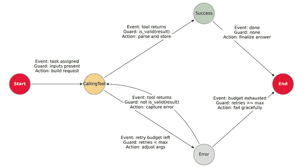
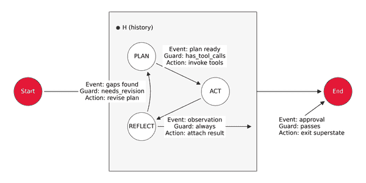
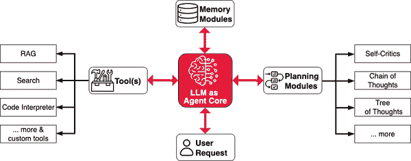
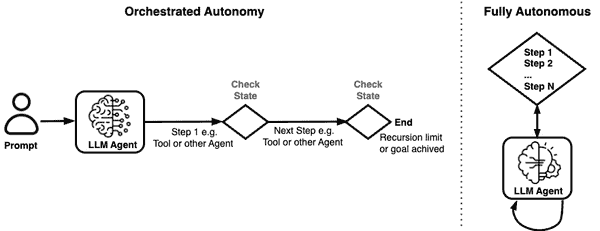

## 第 1 章 从 LLM 到智能体：基础蓝图

人类智能的一个显著特征，是我们将内在推理与具体行动相结合的方式，而这与大型语言模型（LLM）智能体在配合工具时的运作方式惊人地相似。以构建编程项目的过程为例。作为人类开发者，你从一个提示（即客户的需求）开始。首先是推理，你会勾勒出如何处理它的计划。然后是行动，例如搜索文档、编写函数或调试错误。当测试失败、同行评审指出漏洞或客户测试应用程序时，反馈便进入循环。每一步都不是静态的，而是迭代的，推理会适应新的见解，行动也会随之改变。

单个 LLM 智能体也是如此。面对一项任务，智能体首先会推理缺少什么或下一步该做什么，然后通过调用工具来检索数据、运行代码或检查结果。与开发者的反馈循环类似，环境会提供错误、缺失或确认等信号，指引下一次迭代。代码库或文档等外部支持，对应检索系统或网页搜索等工具，这些工具能够超越模型自身的原始能力来优化输出。

LLM 智能体是一个嵌入在推理、行动和反馈循环中的大型语言模型，它能够调用外部工具并根据结果调整自身行为。与局限于静态文本生成的独立 LLM 不同，智能体作为工作流中的决策实体运作。在本书中，我将交替使用“AI 智能体”、“智能体”和“LLM 智能体”这些术语。严格来说，AI 智能体或智能体根本不需要涉及语言模型。例如，在纯强化学习中，智能体通过与环境进行试错交互来直接训练。使用 LLM 的优势在于它带来了强大的泛化、推理和自然语言能力，这使得智能体的行为更加灵活，适用范围远超狭义的特定环境。

正如个人技能终有其极限，单个智能体也只能将工作流推进到一定程度，之后复杂度的增加便需要协调。想一想，在一家小公司里，一个独立贡献者可能端到端地处理所有事情：设计、编码、测试和部署。但随着项目的发展，团队需要扩张。有人可能专注于后端，有人负责前端，还有人负责测试。为了保持一切协同一致，技术负责人或工程副总裁会介入，协调工作量、分配任务并整合结果。独立贡献者与协同团队之间的差异，直接映射到单个智能体与多智能体系统（MAS）之间的差异。正如技术负责人协调多个贡献者一样，监督智能体可以编排多个专业智能体协作解决复杂目标。

同样重要的是要认识到，无论是人类还是智能体，都无法完全自主地运作。开发者受编码标准、项目要求和组织流程的引导，他们的自由度受到这些结构的约束。智能体同样受其工作流的限制，只能在所提供的工具、权限和安全保障范围内运作。这种缺乏完全自主性的特点非但不是弱点，反而正是这两个系统能够可行的原因。对人类而言，结构确保了代码质量、可维护性和客户满意度。对智能体而言，约束确保了安全性、可靠性以及与开发者和用户设定目标的一致性。

这种相似性揭示了为什么将纯 LLM 与工具结合是合理的。语言模型本身就像一个与 StackOverflow、IDE 或 GitHub 等资源隔绝的开发者，虽有推理能力，却无法在没有外部帮助的情况下收集新数据、验证结果或改进任务输出。正如软件团队通过添加更好的工具、资源和领导力来扩展自身能力，LLM 在被嵌入智能体工作流、甚至 MAS 中的多个专业智能体时，也能扩展自身能力。若没有这些升级，两者都将囿于初始训练的限制，面对复杂任务时很快就会不堪重负。有了工具、反馈和分治法，LLM 可以迭代式地改进、适应并解决那些原本超出其独立能力的复杂任务。

我假设你在阅读本书时已经具备大语言模型（LLM）的基础知识。也许你读过《[动手学大语言模型](https://learning.oreilly.com/library/view/hands-on-large-language/9781098150952//)》这本书，或者类似的著作。你不需要知道如何部署 LLM 就能让你的智能体运行起来，因为我将在后续章节中逐步指导你完成这些步骤。不过，我希望你具备扎实的 Python 编码技能，也就是说你了解类和函数是什么，并且熟悉核心的机器学习和深度学习概念，如神经网络、训练循环和反向传播。具备线性代数和微积分的实用知识也很有帮助，因为它们是现代深度学习的重要基础。如果你了解 Transformer 如何处理序列，并且对嵌入的工作原理或向量存储如何支持检索有基本的认识，那也会很有用。

如果你有一段时间没接触这些主题了，不要惊慌！就像《银河系漫游指南》建议的那样，不要惊慌，我在本书中也会这样说。话虽如此，书中的每个概念都会以代码为基础，因此你的知识会重新变得可用，而无需翻出旧教材。而且，在你问之前——不，关于 AI 智能体的所有问题的答案并不是 42，但我保证你会在本书中找到答案。

### 本书代码

本书的所有代码示例都可以在[配套的 GitHub 仓库](https://github.com/Nicolepcx/ai-agents-the-definitive-guide)中找到。该仓库按章节组织，因此你可以轻松找到属于每个部分的代码。

如果你想深入了解不同领域的 Transformer，以及嵌入如何用于文本和其他模态，我的另一本书《[Transformer：权威指南](https://learning.oreilly.com/library/view/transformers-the-definitive/9781098167004/)》可以作为补充阅读材料。它还解释了强化学习的基础知识，这将帮助你为理解本书后面介绍的进阶智能体概念打下更坚实的基础。

因此，本书是为那些不满足于好奇心、希望更进一步了解的读者而写的，这也是理解这些基础知识之所以重要的原因。这包括数据科学家、正在构建生产环境真实系统的软件工程师和机器学习工程师，以及需要理解其中权衡、成本和护栏的技术领导者。本书不是从零开始解释 LLM，也不是关于抽象承诺或思想实验。它讲的是构建和运行 AI 智能体的实际现实，这些智能体能够在 PowerPoint 演示或实验室演示之外真正发挥作用并产生实用价值。

本章解释了 LLM 如何从静态提示演变为动态的智能体系统，为什么工具使用至关重要，以及在现代 AI 智能体的设计中，有状态（stateful）和自主（autonomous）的真正含义是什么。

## 有限状态机和层次状态机：智能体的基础范式

[LangGraph](https://langchain-ai.github.io/langgraph/concepts/why-langgraph/)、[CrewAI](https://www.crewai.com/) 等类似框架都建立在状态机（state machine）的概念之上。从高层来看，*状态机*是一种计算模型，它在任何给定时间都处于有限数量状态中的一种状态。它会根据特定事件或输入在状态之间转换，下一个状态由当前状态和输入共同决定。

本节旨在通过展示状态机如何构成现代 AI 智能体框架的基础，帮助你建立智能体的心智模型。简单来说，可以把它理解为结构化转换，这是一种长期以来在编译器、GUI、嵌入式系统和网络协议中使用的模式，如今被应用于基于 LLM 的智能体中的推理和工具使用。

我先让你在有限状态机（FSM）和层次状态机（HSM）的基础上建立理解，这不仅仅是一个松散的类比。我想为你提供一份构建健壮、可靠且适应性强的 LLM 智能体的蓝图。这将使你不仅能够理解这些概念，还能在后续学习更复杂主题时有效地应用它们。不过，如果你最近没有接触过状态机，也不用担心。你会看到这些模式如何直接体现在代码示例中。

### 有限状态机

*有限状态机*拥有一个小的词汇表，它定义了系统可以处于的模式、可以执行的操作以及它们之间允许的转换。每次转换由一个事件触发，可选地由一个谓词作为守卫，并且可能会执行更新状态的动作。起始和结束是具有特殊含义的区分状态。核心词汇如下：

- **状态**：一个紧凑的快照，捕捉系统在给定时刻所知道的信息。对于智能体来说，这可能是消息列表、路由提示或进度标记。

- **事件**：自上次决策以来发生的事情，例如工具被调用或返回结果。

- **守卫**：一种检查，根据当前状态和最新事件决定采取哪种转换。

- **动作**：在转换过程中执行的工作，例如调用工具、追加消息、保存检查点或请求人工输入。

- **终止**：表示过程已到达结束的条件。

图 1-1 展示了用于工具使用的有限状态机。每次转换都由一个事件、一个守卫和一个动作定义。



#### 图 1-1：用于工具使用的有限状态机高层概览。

当行为在少数稳定模式之间交替且可恢复性很重要时，FSM 是理想的选择，因为你可以在每个节点上设置检查点，并在崩溃后从最后一个已完成的状态恢复。

从状态的角度思考，可以将复杂任务分解为不同的步骤。例如，与其用一个单一的提示词来“写一篇博客文章”，你可以定义诸如主题构思、大纲生成、草稿撰写、编辑和 SEO 优化等状态。每个状态都可以关联到你的智能体将使用的特定工具。

*转换*让你明确一个任务交接给下一个任务的条件。例如，大纲生成状态的什么输出会触发草稿撰写状态。这种结构可以应对非结构化的、一次性的提示词，因为仅靠 LLM 处理这类提示词往往会导致结果不一致。

一旦你添加更多模式，如规划、反思、审批门控和重试，FSM 就可能造成重复或产生混乱的“意大利面条式”路由。你需要控制这些边（edge），因为它们是决策点：每条边都编码了驱动功能的事件、守卫和动作。这就是层次结构发挥作用的地方。

### 层次状态机

*层次状态机*允许状态包含其他状态。超状态（superstate）捕获共享的进入/退出行为和共享的守卫。子状态（substate）继承这些规则并添加自己的规则。历史节点会记住你离开时处于哪个子状态，以便之后精确地从那里恢复。状态机的这些新增功能说明如下。

- **超状态**：一种状态，用于分组一组子状态及其公共策略。进入超状态时运行一次共享逻辑；退出时运行一次共享清理。

- **子状态**：存在于超状态内部的具象模式。它有自己的边，但继承超状态的守卫和动作。

- **历史**：一个“记住我在哪里”的标记。浅历史从最后一个活跃的子状态恢复；深历史在嵌套的孙状态内部恢复。用智能体的术语来说，这是图的一部分的检查点。

- **并行区域**：超状态的两个或多个子区域，可以独立推进。适用于扇出工具调用或智能体角色，然后再汇合。

图 1-2 展示了一个带有 `WORKING` 超状态的分层状态机。`PLAN`、`ACT` 和 `REFLECT` 是子状态。`H` 是一个浅层历史标记，用于记录最后活跃的子状态，以便在重新进入超状态时从中断处继续执行。



**图 1-2.** 带有历史标记的分层状态机概览，该标记记录最后活跃的子状态。

HSM 特别适用于更高级的 MAS。HSM 允许“状态内嵌状态”，从而减少重复并使策略清晰可见。例如，你可以将速率限制、安全过滤器或熔断器附加到 `WORKING` 超状态上，这样规划、执行和反思都会继承相同的保护措施。你只需定义一次守卫或路由器，并在多个节点间复用。考虑一个研究型代理。与其将研究视为单一的 monolithic 步骤，你可以将其分解为一个子机器，包含搜索关键词、收集 URL、抓取数据和总结发现等状态。这些状态中的每一个甚至可以映射到具有自身能力的专用代理，从而为更大的代理团队做出贡献。这种嵌套结构有助于管理复杂性、保持策略一致性，并使整个系统更易于推理和维护。

### 将 FSM/HSM 映射到代理框架

`LangGraph` 已经使用了状态机和层次结构的语言。你可以通过子图和共享键来实现。选择下一个动作（例如调用下一个代理或工具）的路由器或决策代理，类似于经典状态机中的事件处理器。它是系统中接收当前状态和 LLM 输出（事件或负载）并确定下一个逻辑步骤的部分。直接映射如下所示。

**状态模式**：父图的 `TypedDict` 定义了共享的“总线”。子图声明它们读取和写入的键。重叠的键是超状态的接口。

```
class State(TypedDict):
    messages: List[BaseMessage]
    working_last: str | None
```

- ：父图和子图之间的共享总线。

- ：可选的浅层历史标记。

**节点和子图**：子图是一个 HSM 超状态。其内部节点是子状态。进入子图会运行其入口节点；离开子图会通过其出口边返回到父图。

```
def plan_node(state: State) -> State:
    ai = AIMessage(content="Plan next step")
    return {"messages": [ai], "working_last": "plan"}

def act_node(state: State) -> State:
    ai = AIMessage(content="Act on plan")
    return {"messages": [ai], "working_last": "act"}

subgraph_builder = StateGraph(State)
subgraph_builder.add_node("PLAN", plan_node)
subgraph_builder.add_node("ACT", act_node)
subgraph_builder.add_edge(START, "PLAN")
subgraph = subgraph_builder.compile()
```

- ：子图就是超状态。

**守卫和条件边**：父级守卫强制执行全局策略（预算、安全）。子级守卫在 `PLAN`/`ACT`/`REFLECT` 之间路由。由于守卫是纯 Python 代码，它们保持确定性和可审计性。

```
def route_within_working(state: State):
    last = state.get("working_last")
    return "ACT" if last == "plan" else END

subgraph_builder.add_conditional_edges("PLAN",
                route_within_working, {"ACT": "ACT", END: END})

parent = StateGraph(State)
parent.add_node("WORKING", subgraph)

def global_guard(state: State):
    tail = "".join([
            getattr(m, "content", "") for m in state["messages"][-3:]
            ]).lower()
    return END if "stop" in tail else "WORKING"

parent.add_edge(START, "WORKING")
parent.add_conditional_edges("WORKING", global_guard,
                            {"WORKING": "WORKING", END: END})
```

- ：在子图内添加条件边。

- ：带有全局守卫的父图。

- ：示例策略：如果用户说“停止”则结束。

**历史和检查点**：`MemorySaver` 为你免费提供浅层和深层历史：恢复线程会从最后完成的节点重新创建子图。如果你想要显式的“返回到我在 `WORKING` 内部的位置”，持久化一个小标记（例如 `state["working_last"] = "reflect"`），并在重新进入时根据它进行分支。

```
def reflect_node(state: State) -> State:
    ai = AIMessage(content="Reflect on result")
    return {"messages": [ai], "working_last": "reflect"}

checkpointer = MemorySaver()
app = parent.compile(checkpointer=checkpointer)

cfg = {"configurable": {"thread_id": "session-1"}}
app.invoke({"messages": [HumanMessage(content="start")],
                        "working_last": None}, config=cfg)
```

- ：子状态在退出时设置 `working_last`。

- ：使用检查点进行编译。

- ：在线程中运行。`MemorySaver` 会在恢复时还原最后完成的节点。


FSM 让你能够将任务结构化为稳定、可恢复的步骤。HSM 在此基础上通过减少重复并在工作流变得复杂时集中策略来扩展这一能力。这两种模式都为你的下一步做好准备：将静态的 LLM 预测转化为动态的、有状态的代理。

## 基础：从静态模型到动态代理

正如你在前一节中看到的，添加状态和控制流对于自动化至关重要。同样的原理也适用于代理。要从静态的 LLM 使用转向代理系统，你需要显式的状态和控制流。状态将一次性的工具调用转变为具有记忆的过程。控制流添加守卫和转换，以决定何时规划、何时行动以及何时停止。

将此添加到 LLM 的原因很简单：LLM 是静态预测器。它们根据提示生成下一个 token，仅利用训练数据中编码的模式。这使得它们成为强大的推理者，但仅限于它们已知的内容。它们无法更新知识、验证声明或与外部环境交互。

*代理性* 在推理与行动相结合时出现。*推理* 是规划或决定下一步的内部过程。*行动* 通过调用工具、检索数据、执行代码或调用外部服务来扩展。它们共同形成一个迭代循环：推理、行动、接收反馈、调整。这个循环是代理行为的基础。

表 1-1 对比了静态 LLM 与代理系统。这些对比不仅说明了为什么需要代理，还展示了它们的设计如何将传统机器学习工作流转变为动态的、增强工具的系统。

**表 1-1. 静态 LLM 与代理系统的对比**

| 静态 LLM（传统用法） | 代理系统 |
| --- | --- |
| 单次传递的 token 生成器 | 迭代推理–行动–反馈系统 |
| 局限于训练数据 | 可以检索、验证和更新知识 |
| 无记忆，无状态 | 有状态，具备短期和长期记忆 |
| 线性提示–响应 | 迭代和自适应工作流 |
| 无工具使用 | 增强工具（检索、代码、API） |
| 对提示的固定解释 | 可以动态细化或重新解释目标 |
| 无外部验证 | 主动检查、纠正和改进输出 |

图 1-3 说明了模块如何将静态 LLM 转化为动态智能体。用户请求进入核心，规划与记忆塑造其推理，工具则使其能够采取具体行动。推理、行动和适应的循环正是由这些元素的协调而涌现。



**图 1-3.** 基准智能体架构：单独的 LLM 只能预测文本，但借助规划、记忆和工具，它就会变成可用的智能体系统。

规划模块引导智能体的推理，从简单的思维链^(1)轨迹到更高级的方法，如思维树^(2)或自我批判。记忆模块提供连续性，使智能体能够回忆过去的步骤、复用先验知识或在会话之间持久化信息。工具将智能体与外部环境连接起来，无论是通过搜索、检索、代码执行还是自定义 API。

此外，传统 LLM 用法与智能体系统之间的一个关键区别在于工作流是无状态还是有状态。*无状态调用*将模型视为黑盒：它接收提示词，预测下一个词元，并返回结果。不会记住任何内容，不会采取任何操作，也不存在反馈循环。示例 1-1 演示了一个无状态 LLM 调用。

### 示例 1-1. 使用 LangChain 的无状态 LLM 调用

```
llm = ChatOpenAI(model="gpt-5-mini")
response = llm.invoke("What are AI agents?")
print(response.content)
```

此外，当你需要训练数据之外的事实，或者希望模型采取行动（搜索、计算）时，就需要引入工具。

下面的代码（示例 1-2 至示例 1-4）演示了一个极简的无状态工具使用运行流程：先把两个工具绑定到 LLM，然后运行一个微型循环来执行模型为完成任务所需的任何工具调用。在此之前，你需要先定义工具。示例 1-2 给出了工具的实现。

### 示例 1-2. 为无状态运行定义工具

```
@tool("internet_search")
def internet_search(query: str) -> str:
    """Search Google via SerpAPI for up to date information."""
    serp_api_key = os.environ["SERPAPI_API_KEY"]
    params = {"engine": "google", "gl": "us", "hl": "en"}
    search = SerpAPIWrapper(params=params, serpapi_api_key=serp_api_key)
    return search.run(query)

@tool("calculator")
def calculator(expression: str) -> str:
    """Evaluate a single line mathematical expression with numexpr."""
    local_dict = {"pi": math.pi, "e": math.e}
    out = numexpr.evaluate(
        expression.strip(),
        global_dict={},
        local_dict=local_dict,
    )
    return str(out)

tools = [internet_search, calculator]
tool_map: Dict[str, Any] = {t.name: t for t in tools}
```

1. LangChain 的`@tool`装饰器使用函数名、类型签名和 docstring 来构建模型所见的 schema。
2. docstring 是必需的：如果缺失，LangChain 在构造工具 schema 或将工具绑定到模型时会抛出错误。
3. 约束计算：拒绝全局变量，只暴露你希望暴露的常量。这保证了计算器的确定性和安全性。

使用 LangChain 的`@tool`装饰器时，函数签名和 docstring 用于构建模型所见的 schema。你需要让这些内容精确、一致，并尽可能具有解释性，以便高效完成任务。docstring 充当工具描述，是 LangChain 的硬性要求，如果缺失就会出现错误。此外，如果 docstring 含糊不清，模型更有可能产生无效调用。

### 示例 1-3. 将工具绑定到 LLM

```
llm = ChatOpenAI(model="gpt-4o", temperature=0,
                max_tokens=800).bind_tools(tools, tool_choice="auto")
```

1. 将工具绑定到模型。`tool_choice="auto"`让模型决定是否调用工具以及调用哪个工具。

## 现代 LLM 是为智能体任务而打造的

现代 LLM 不仅能够调用工具，而且日益专门针对智能体任务进行训练和优化。例如，[Kimi K2](https://moonshotai.github.io/Kimi-K2/)和[Llama 4](https://www.llama.com/docs/model-cards-and-prompt-formats/llama4/)等模型就明确针对编码、工具使用和驱动智能体系统进行了调优。这些模型不止于在聊天窗口中回答问题。它们经过指令调优而能够采取行动，调用 API、运行代码或检索数据已成为其核心设计的一部分。

绑定工具后，你就可以运行一个极简的无状态工具循环。示例 1-4 中的代码会执行模型请求的任何工具调用，将观察结果反馈回模型，并强制进行一次简短的收尾，以确保即使在最后一步以工具观察结束时，也能返回最终答案。

### 示例 1-4. 带工具循环的无状态单次运行

```
def run_once(prompt: str, max_steps: int = 8) -> str:
    messages: List[HumanMessage | AIMessage | ToolMessage] = [
    HumanMessage(content=prompt)]
    last_ai: AIMessage | None = None

    for _ in range(max_steps):
        ai: AIMessage = llm.invoke(messages)
        messages.append(ai)
        last_ai = ai

        calls = getattr(ai, "tool_calls", None) or []
        if not calls:
            return messages[-1].content

        for call in calls:
            name = call["name"]
            args = call.get("args", {}) or {}
            result = tool_map[name].invoke(args)
            messages.append(ToolMessage(
                content=str(result),
                name=name,
                tool_call_id=call.get("id")
            ))

    messages.append(HumanMessage(content="""
Finish now. Give a short final answer in this exact format:

Current temperature:
Square of current temperature:
""".strip()))
    final_ai: AIMessage = llm.invoke(messages)
    return final_ai.content

print(run_once("""Two step task.

Step 1: Use internet_search to get the current air temperature in New York City
today. Show the exact query you used, the top source title and snippet, and
extract a numeric temperature in Celsius. Return this temperature as feedback
for Step 2.

Step 2: Using the Celsius value from Step 1, compute its square with calculator.
Show the exact expression you used and the numeric result.

Important: Give a short final answer in this format:
Current temperature:
Square of current temperature:"""))
```

1. 仅用于本次运行的本地短期记忆。这使工作流在不同运行之间保持无状态。
2. 一个简单的步数上限可防止失控循环：LLMs 不断循环而不终止。
3. 一次模型步骤。助手可以选择调用工具。
4. 读取结构化工具调用。
5. 将观察结果与匹配的`tool_call_id`一起附加，以便模型将结果与调用对应起来。

工具循环可以以一次观察结果作为结束。这条最终指令确保以你要求的格式生成一条收尾的助手消息。

## 为 LLM 赋予状态

将 LLM 转变为智能体的第一步是让它具备状态。为你的 LLM 提供一个状态，记录它处于工作流中的哪个位置。基于输入和逻辑，它会转换到下一个状态，而每个状态都关联着一个函数或行为。在 LangGraph 中，这可以是任何 Python 类型，但通常是 `TypedDict` 或 [Pydantic](https://docs.pydantic.dev/latest/api/base_model/) `BaseModel`。下面概述了 LangGraph 用于构建有状态、可适应的 AI 智能体的关键概念。

`State`

: 一种共享数据结构，表示应用的当前快照。它可以是任何 Python 类型，但通常是 `TypedDict` 或 `Pydantic BaseModel`。

`Nodes`

: 对智能体逻辑进行编码的函数。它们接收当前状态，执行计算或副作用，并返回更新后的状态。

`Edges`

: 根据当前状态选择下一个节点的规则。它们可以是条件分支或固定转换，并且还应当检测是否满足结束条件。

`Command`

: 一个将控制流与状态更新相结合、以支持多智能体通信的对象。节点可以通过返回 `Command` 来同时更新状态并选择下一个节点。

到目前为止，你之前创建的工具仅被用于*无状态循环*中。每次运行都是独立的：模型可以调用工具、获取答案并收尾，但一旦运行结束，所有上下文都会丢失。现在，如果你想结合 LangGraph 的概念来构建有状态的智能体，就需要将工具嵌入到有状态的工作流中。不要在每一轮之后丢弃消息，而是将它们保存在结构化的状态中。这使得系统具备了智能体特性：

- LLM 节点推理下一步骤。
- 工具节点执行外部操作。
- 边根据是否请求了工具来路由控制流。
- 记忆检查点持久化对话，以便智能体可以在后续轮次中复用之前的结果。

这将工具的使用从一次性的辅助手段转变为持续的推理–行动–适应循环。在接下来的代码清单（示例 1-5 – 示例 1-13）中，你将使用 LangGraph 构建这样一个有状态的智能体，从 示例 1-3 - 示例 1-4 中引入的相同工具和 `llm` 绑定开始。

示例 1-5 展示了如何在 LangGraph 中实现一个状态对象来承载对话并协调控制流。你可以复用 示例 1-3 中的工具和已绑定的 `llm`，只需添加新的部分：一个类型化状态、一个追加助手消息的 LLM 节点、一个执行调用的工具节点，以及一个根据工具调用决定继续还是停止的路由器。

### 示例 1-5. 使用状态、节点和路由构建一个最小的 LangGraph

```python
class AgentState(TypedDict):
    messages: Annotated[List[BaseMessage], add_messages]

def llm_node(state: AgentState) -> AgentState:
    ai = llm.invoke(state["messages"])
    return {"messages": [ai]}

tool_node = ToolNode(tools=tools)

graph = StateGraph(AgentState)
graph.add_node("llm", llm_node)
graph.add_node("tools", tool_node)
graph.add_edge(START, "llm")

def route(state: AgentState):
    last = state["messages"][-1]
    calls = getattr(last, "tool_calls", None) or []
    return "tools" if calls else END

graph.add_conditional_edges("llm", route, {"tools": "tools", END: END})
graph.add_edge("tools", "llm")
```

- : 状态以消息列表的形式承载对话。`add_messages` 负责在节点更新之间安全地合并消息。
- : 核心推理节点。它接收当前状态并返回一条新的助手消息。
- : 用于执行助手发出的工具调用的预构建节点。
- : 节点和边的图容器。
- : 路由器。如果最后一轮助手请求了工具，则转到工具节点，否则结束。

定义好图之后，你需要让它可运行且可持久化。示例 1-6 使用内存检查点编译该图，并分配一个线程 ID。检查点会在每一轮恢复之前的消息，以便智能体可以复用之前的结果。线程 ID 将各个分支分隔开，这样你就可以并行运行多个对话而互不干扰。

### 示例 1-6. 使用内存检查点编译并配置线程

```python
checkpointer = MemorySaver()
app = graph.compile(checkpointer=checkpointer)

cfg = {"configurable": {"thread_id": "nyc-weather-session"}}
```

- : 轻量级的按线程检查点机制，可在各轮之间持久化状态。
- : 生成一个知道如何保存和加载状态的可运行应用。


- : 线程 ID 标识一个对话分支。新的 ID 会创建新的分支。

一旦你有了可运行的应用和就绪的检查点，下一步就是让它的执行过程可观测。你想看到图正在做什么、哪些消息在流动，以及工具输出如何接入。示例 1-7 介绍了一个简洁的辅助函数，它可以将消息格式化为一行可读文本，让你更容易跟踪执行轨迹，而不会被大量日志淹没。

### 示例 1-7. 跟踪执行过程并检查状态与记忆

```python
def _short(msg: BaseMessage, max_len: int = 140) -> str:
    """Compact one-line view of a message."""
    role = type(msg).__name__.replace("Message", "").lower()
    content = getattr(msg, "content", "")
    if isinstance(content, list):
        # some tool outputs can be list payloads
        try:
            content = json.dumps(content)
        except Exception:
            content = str(content)
    text = str(content).replace("\n", " ").strip()
    if len(text) > max_len:
        text = text[: max_len - 3] + "..."
    if hasattr(msg, "tool_calls") and getattr(msg, "tool_calls"):
        tnames = [tc.get("name", "tool") for tc in msg.tool_calls]
        return f"{role}: tool_calls -> {tnames}"
    if isinstance(msg, ToolMessage):
        return f"{role}({msg.name}): {text}"
    return f"{role}: {text}"
```

- : 在可用时包含工具名称或函数调用信息。

示例 1-8 会打印消息和路由提示的简明视图。两者共同帮助你验证工具输出是否正确接入、状态转换是否符合预期。

### 示例 1-8. 跟踪执行过程并检查状态与记忆

```python
def print_state_snapshot(app, config, title: str):
    """Print current graph state and memory for a given thread."""
    snap = app.get_state(config)
    values = snap.values or {}
    msgs: List[BaseMessage] = values.get("messages", [])
    print(f"\n=== {title} | state snapshot ===")
    print(f"messages: {len(msgs)} total")
    for i, m in enumerate(msgs[-5:], start=max(0, len(msgs)-5) + 1):
        print(f"  {i:>3}: {_short(m)}")

    nxt = getattr(snap, "next", None)
    tasks = getattr(snap, "tasks", None)
    if nxt:
        print(f"next nodes: {list(nxt)}")
    if tasks:
        print(f"queued tasks: {tasks}")
    print("memory: in-memory checkpoint present for this thread")
```

: 读取某个线程的最新状态。

: 打印消息的简洁尾部，让日志保持可读。

: 显示路由信息以及排队的任务（如果存在）。

示例 1-9 流式输出节点更新，让你看到图执行的每一步。

### 示例 1-9：跟踪执行并检查状态与记忆

```python
def run_with_tracing(app, input_state: AgentState, config, title: str):
    """Run the graph while printing per-node updates and final memory."""
    print(f"\n=== {title} | execution trace ===")
    final = None
    for event in app.stream(input_state, config=config, stream_mode="updates"): 
        for node, upd in event.items():
            keys = list(upd.keys()) 
            print(f"[enter {node}] updated: {keys}")
            # if messages updated, print the last one briefly
            msgs = upd.get("messages") or []
            if msgs:
                print(f"  {_short(msgs[-1])}")
            print(f"[leave {node}]")
            final = upd
    print_state_snapshot(app, config, title=f"{title} | after run") 
    snap = app.get_state(config)
    msgs = snap.values.get("messages", [])
    return msgs[-1].content if msgs else ""
```

: 流式输出节点更新，以查看图中确切的流程。

: `upd` 是一个类似 `{"messages": [<new msg>]}` 或工具结果的字典。

: 从 `app.get_state` 显示最终的助手消息。

示例 1-10 要求获取纽约市当前以摄氏度为单位的空气温度。跟踪显示图进入 LLM 节点，在需要时发起工具调用，并返回最终的助手消息。状态快照确认结果已保存在该线程的记忆中。

### 示例 1-10：第 1 轮：获取纽约市当前以摄氏度为单位的空气温度

```python
turn1_answer = run_with_tracing(
    app,
    {"messages": [HumanMessage(content="Get the current air temperature in New York
    City in Celsius.")]},
    config={**cfg, "recursion_limit": 20},
    title="TURN 1",
)
print("\nTURN 1 (final assistant):\n", turn1_answer)
```

这会产生以下模型输出：

```text
TURN 1 (final assistant):
The current air temperature in New York City is 18°C.
```

你在同一个线程中继续。示例 1-11 要求对之前获取的温度求平方。由于线程 id 未变，`app` 会恢复之前的消息，让助手无需你在提示中重复即可使用先前的结果。

### 示例 1-11：第 2 轮：在同一个线程中对该温度求平方

```python
turn2_answer = run_with_tracing(
    app,
    {"messages": [HumanMessage(content="Now compute the square of that
    temperature.")]},
    config={**cfg, "recursion_limit": 20},
    title="TURN 2",
)
print("\nTURN 2 (final assistant):\n", turn2_answer)
```

现在将计算平方，模型返回：

```text
TURN 2 (final assistant):
The square of the temperature, 18°C, is 324.
```

代理经常需要在不丢失进度的情况下探索替代方案。示例 1-12 通过使用不同的线程 id 启动一个独立分支，并请求一个不同的后续问题。这会创建一个可以与主路径分叉的隔离对话，同时保持主线程记忆完整无损。

### 示例 1-12：为不同的后续问题分支一个并行线程

```python
branch_answer = run_with_tracing(
    app,
    {"messages": [HumanMessage(content="Instead of squaring, convert it to
    Fahrenheit and report both.")]},
    config=cfg_branch,
    title="BRANCH",
)
print("\nBRANCH (final assistant):\n", branch_answer)
```

最后，你可以检查每个分支记住了什么。示例 1-13 为主线程和分支打印紧凑的快照。将它们并排比较，可以确认状态在线程内部持久化、在线程之间相互隔离，这是可靠的多步骤、多分支代理工作流的基础。

### 示例 1-13：查看两个线程的快照

```python
print_state_snapshot(app, cfg, title="MAIN THREAD memory view")
print_state_snapshot(app, cfg_branch, title="BRANCH THREAD memory view")
```

通过这个小型实现，你现在可以清楚地看到图记住了什么、它是如何路由的，以及每个分支的最新助手状态。

## 机械降神：现在可能实现什么？

一旦你把代理视为带状态的分层状态机（HSM），自主性谱系就变成了你在超状态中放入多少选择的问题。路由器是带单一守卫的单边有限状态机（FSM）。工具调用代理是带有 WORKING 超状态的分层状态机，该超状态在 PLAN、ACT 和 REFLECT 之间循环。多智能体系统（MAS）在监督者超状态之下组合多个子图，有时带有并行区域。系统仍然在显式状态和守卫内运行，所感知到的“自主性”只是边界良好的区域内更丰富的选择。

在古希腊戏剧中，*机械降神*（deus ex machina）是指神明突然出现，以解决无法化解的冲突或问题。人们很容易以同样的方式想象 AI 代理：一台机器突然以完全的自主性和智能行动，解决你所有的问题。但这不是当下所能实现的——代理是工程化系统。它们的力量不来自隐藏的魔法，而来自精心设计的工作流、定义良好的工具，以及让它们保持安全可用的边界。话虽如此，代理仍然受限于你给予它们的工具、你强制执行的安全保障，以及你允许它们运行的工作流。正是这些约束让代理在当下切实可行：部署安全、行为可预测、与预期目标保持一致。

当前系统展示的是一种编排式自主性。正如你之前在 LangGraph 示例（示例 1-5）中看到的，代理可以有条件地分支、调用工具，或决定是否继续某个工作流。这看起来已经与静态的提示–响应调用大不相同，但它仍然是有界的。编排逻辑是固定的；在其中，LLM 可以做出选择，但不能重新定义自身的架构。表 1-2 简要概述了代理目前能做些什么。

**表 1-2 代理当前的自主性：可以实现什么 vs. 仍然无法做到什么**

| 代理可以做什么 | 代理尚不能做什么 |

| --- | --- |

| 在预定义路径之间路由（例如路由器节点） | 重新设计或重新连接自己的控制图 |

| 选择调用哪些工具或子代理 | 动态生成并验证新的图拓扑 |

| 判断完成前是否还需要更多步骤 | 持续评估工具有效性，或自主创建新工具 |

| 在边界内修改自己的提示或工具集 | 在执行中途转变策略时保证对齐与连贯性 |

| 编写并运行小段代码以确定后续步骤 | 作为完全自我导向的系统运行，独立于编排框架 |

智能体在运行时进行适配，但仅限于你设计的框架之内。将它视为一个频谱会很有帮助。一端是路由器，从一组固定选项中做出单一决策；中间是支持多步推理、反思和记忆的工具调用型智能体；另一端则是多智能体系统（MAS），专业化的智能体在监督者协调下协作，将决策分布到不同角色中。图 1-4 展示了自治程度的频谱，从简单的路由决策到完全自主执行的理念。实际上，几乎所有现实世界的系统都落在中间地带：它们是智能体系统，而不是真正的自主智能体。它们的自主性是被编排出来的，而非自我进化；决策发生在预定义状态、转换和工具集的框架之内，即使智能体能在运行时从中进行适应性选择。



### 图 1-4：在编排式自主中，决策点在流程中被预定义。在完全自主中，大语言模型（LLM）可以生成新的工具、动作或决策路径来实现目标。

智能体可以在 LangGraph 等框架内借助反思、规划和结构化输出来模拟灵活性。然而，我们尚未拥有能够自由重新定义自身架构，或以稳健且通用的方式对其目标进行推理的系统。

如你现在所理解的，当今的智能体并非“机械降神”式的解决方案，而是经过精心编排的系统，以结构、工具和反馈循环扩展了大语言模型。它们的自主性受设计约束，而这正是让它们实用、安全且可部署的原因。尽管它们仍有局限，但其能力已令人印象深刻，它们能以远超静态大语言模型的方式推理、行动和适应。

## 结论

在本章中，你学习了大语言模型如何通过添加状态、控制流和工具使用，从静态预测器演变为动态智能体。通过将推理嵌入行动与反馈的循环中，大语言模型获得了适应结果的能力，并将自身能力扩展到远远超出仅靠提示-响应的交互所能达到的范围。

有限状态机和层次状态机为智能体设计提供了概念基础。FSM 让你可以将工作流组织为可恢复的步骤，而 HSM 则减少了重复并集中化复杂多步骤任务的策略。这些抽象直接映射到 LangGraph 等现代框架中，在这些框架中，状态、节点和路由规则定义了智能体在时间上如何推理和行动。

现在你也能更恰当地理解自主性。你明白了当今的智能体运行在边界明确的工作流中，在预定义路径之间进行选择、调用工具并反思结果，而不是重新设计自己的架构。这种编排式自主不是弱点，而是优势，因为约束使智能体变得安全、可预测且易于部署。AI Scientist v2 的例子既展示了这种方法的潜力，也展示了其局限性，说明智能体已经能够生成并测试假设，但仍然需要人类监督来确保严谨性和深度。

^(1) Jason Wei 等，[“思维链提示激发大语言模型的推理能力。”](https://arxiv.org/abs/2201.11903)，(2023)。

^(2) Shunyu Yao 等，[“思维树：利用大语言模型进行审慎的问题解决。”](https://arxiv.org/abs/2305.10601)，(2023)。

^(3) Yutaro Yamada 等，[“AI 科学家 v2：通过智能体树搜索实现研讨会级别的自动化科学发现。”](https://arxiv.org/abs/2504.08066)，(2025)。
