## AI 系统性能工程

# 前言

在旧金山充满活力的街道上，创新就像 101 号公路上的车流一样常见。我发现自己沉浸在精彩纷呈的人工智能世界中。AI 的飞速发展正在重新定义我们日常生活的方方面面。从 2000 年代和 2010 年代的个性化与推荐引擎，到 2020 年代和 2030 年代的 AI 助手与自动驾驶汽车，AI 的影响无处不在且深远持久。

我进入这个快速发展的领域，是出于对支撑 AI 系统的硬件与软件之间复杂平衡的好奇。几年前，情况已经很明显：AI 应用的性能不仅依赖于复杂的算法，还依赖于支撑它们的底层硬件和软件。尖端硬件、严谨软件与巧妙算法之间的协同效应与协同设计，对于实现前所未有的效率和可扩展性至关重要。

这一认识促使我深入探索“全栈式”AI 性能工程领域。我想了解处理器、内存架构、网络互连、操作系统和软件框架等众多组件如何相互作用，共同构建强大而高效的 AI 系统。这些交互的复杂性既是挑战也是机遇，激发了我解开这一独特技术组合中种种奥秘的渴望。

这本书是我早期探索以及多年机器学习与 AI 系统设计实战经验的结晶。它面向那些渴望从各个层面理解 AI 系统性能基础的工程师、研究人员和爱好者。无论你是在构建 AI 应用、优化神经网络训练策略、设计和管理可扩展的推理服务器，还是仅仅对现代 AI 系统的运作机制着迷，本书都能提供跨越多个学科、连接理论与实践的真知灼见。

在接下来的各章节中，我们将踏上一段旅程：审视硬件架构的演进，深入软件优化的细微之处，并探索真实世界的案例研究，这些案例突出展示了构建高性能且成本高效 AI 系统的模式与最佳实践。每一节都设计为在前一节的基础上展开，从基础概念到高级应用，形成一个连贯的叙事。

虽然我是本书的唯一作者，但这并非一人之功。我深深感谢那些研究和创新为本书所涵盖主题铺平道路的杰出头脑。他们的贡献在塑造本书内容和深度方面起到了关键作用。感谢我的同事、导师和审阅者，他们挑战了我的观点，丰富了我的理解，你们的洞见融入了每一章。感谢我的家人和朋友，他们的持续支持让我能够通宵达旦地写作，我致以最衷心的感谢。

在我们继续推动人工智能和超算前沿之际，本书所蕴含的知识旨在启发、教育和赋能读者。穿越 AI 系统性能工程复杂性的旅程不仅仅是一次技术探索——它提醒我们人类的创造力、理解周围环境的需求，以及通过技术和创新不断进步的愿望。这个世界上，真正理解硬件、软件和算法协同设计以实现最大性能和效率的基本原理的人寥寥无几。读完这本书后，你将成为其中之一。

克里斯·弗雷格利

加利福尼亚州旧金山

# 第 1 章 引言与 AI 系统概述

2024 年底，一家名为 DeepSeek.AI 的中国小型初创公司震惊了 AI 界。该公司在没有使用当时最新、最先进的 NVIDIA GPU 的情况下训练出了一个前沿大语言模型。由于出口限制，DeepSeek 的工程师无法获得顶级的 NVIDIA A100 或 H100 加速器，因此他们转而使用本地可用的、性能较弱的 NVIDIA 芯片。

尽管存在这些限制，DeepSeek.AI 仍然训练出了 DeepSeek-R1 模型，其推理能力接近当时在最强 NVIDIA 芯片上训练出的领先前沿模型的水平。这一案例表明，精通 AI 系统性能工程的从业者和研究人员，无论面临何种限制，都能从现有硬件中挖掘出最大价值。


例如，DeepSeek 的工程师将通信带宽视为*稀缺资源*，优化了网络上的每一个字节，从而在那套基础设施上实现了许多人认为不可能的目标。他们借助新颖的软件和算法优化，将规模扩展到数千个受限于带宽互联的 GPU，从而克服了这些限制。

将 DeepSeek 的做法与美国和欧洲最大的前沿 AI 实验室所采用的“蛮力”路线进行对比。这些实验室继续追求更大的计算集群和更大的模型。模型规模从百万参数爆炸式增长到数十亿，如今已达到数万亿参数。虽然每一次 10 倍的规模提升都解锁了质变级别的新能力，但它们也带来了巨大的成本和资源消耗。

例如，OpenAI 的 GPT-3（1750 亿参数，2020 年）训练成本约为 400 万美元，而 GPT-4（2023 年）的估计成本高达 7800 万美元。谷歌的 Gemini Ultra（2023 年）飙升至约 1.91 亿美元的惊人水平。图 1-1 展示了训练费用的大幅膨胀——从 2019 年前后的不到 1000 万美元，到 2023 年最先进模型已远超 1 亿美元。

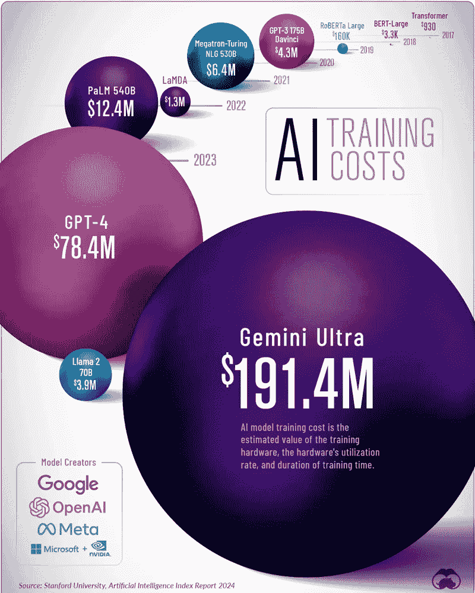

###### 图 1-1. 训练尖端 AI 模型的成本急剧攀升（来源：[posts.voronoiapp.com](https://posts.voronoiapp.com/technology/The-Training-Costs-of-AI-Models-Over-Time-1334#:~:text=The%20cost%20of%20training%20AI,4%20last%20year)）

DeepSeek 声称，他们的 DeepSeek-R1 模型仅花费了 [600 万美元](https://www.forbes.com/sites/markminevich/2025/02/06/the-6-million-ai-bombshell-how-deepseek-shook-wall-street-and-ai-leadership/)的计算成本进行训练——比 GPT-4 和 Gemini 等模型低了整整一个数量级——同时性能却与那些成本高出几个数量级的竞品模型相当。

尽管人们对 600 万美元这一说法的真实性存在一些质疑，但这一公告曾短暂震惊了美国金融市场，包括英伟达的股价在消息公布后下跌了 17%，原因是市场担心未来对[英伟达硬件](https://www.voronoiapp.com/innovation/DeepSeek-R1-Upsets-AI-Market-With-Low-Prices-3846)的需求会减少。虽然这种市场反应有些过度，但它凸显了此类 AI 效率突破对全球金融市场的重大财务影响。

除了模型训练，DeepSeek 还通过针对 Transformer 架构（当今大多数前沿大语言模型的基础）进行硬件感知的算法改进，实现了显著的推理效率提升。DeepSeek 清楚地证明，巧妙的 AI 系统性能工程优化可以颠覆超大规模 AI 模型训练和推理的经济性。

这里的重要启示是一个深刻的认知：在这些规模下，从系统中榨取的每一点性能都可能转化为数百万甚至数十亿美元的成本节约。消除的每一个瓶颈都可能对训练吞吐量和推理延迟产生巨大影响。这反过来又降低了成本，并提升了最终用户的满意度。简而言之，AI 系统性能工程不仅仅关乎速度——它关乎让以前不可能的事情变得既可能又负担得起。

在第 1 章中，我们将深入探索 AI 系统性能工程师——这一角色在大规模人工智能时代已变得至关重要。本章作为一份全面指南，帮助理解这一职业的多方面职责及其对现代 AI 系统的关键影响。

我们首先追溯 AI 工作负载的演变，强调从传统计算范式到当代 AI 应用需求的转变。这一背景为理解 AI 中专门性能工程的必要性奠定了基础。

接着，本章深入探讨 AI 系统性能工程师所需的核心能力。我们审视了这一角色所必需的技术能力，包括对硬件架构、软件优化技术和系统级集成的深入理解。此外，我们还讨论了解决问题、沟通和协作等软技能的重要性，这些技能对于应对 AI 项目的跨学科性质至关重要。

本章中相当大的一部分专门讨论这一角色的实际工作内容。我们探讨了性能工程师如何分析系统瓶颈、实施优化策略，以及确保 AI 系统的可扩展性和可靠性。文中呈现了真实场景和案例研究，以说明这些概念，为读者提供该领域中遇到的挑战和解决方案的具体实例。

此外，我们讨论了性能工程师常用的工具和方法论，提供了关于性能测试、监控和基准测试实践的见解。这包括对行业标准工具的概述，以及它们如何被应用于评估和提升系统性能。

到第 1 章结束时，读者将对 AI 系统性能工程师的角色、在该岗位上脱颖而出所需的技能，以及性能工程在 AI 系统成功部署和运营中的关键重要性有全面的理解。这一基础性知识为后续章节奠定了基础，在后续章节中，我们将更深入地探讨定义 AI 性能工程卓越性的具体技术、方法和最佳实践。

## AI 系统性能工程师

AI 系统性能工程师是一个专业角色，专注于优化 AI 模型*及其*所运行的底层系统的性能。这些工程师确保 AI 训练和推理流水线运行快速、成本高效，并具备最大化性能。随着规模不断增大，AI 系统性能工程师变得更加关键。

AI 系统性能工程师薪资丰厚，这理所当然。我们的工作对企业的盈亏底线有着直接而明显的影响。我们融合了硬件、软件和算法方面的专业知识。我们必须理解底层操作系统考量、内存层次结构、网络基础知识，以及 Python 和 C++ 等多种语言。

在日常工作中，AI 系统性能工程师可能需要检查底层 GPU 内核效率、优化操作系统线程调度、分析内存访问模式、提升网络吞吐效率，或调试分布式训练算法。AI 系统性能工程师的关键职责包括基准测试、性能分析、调试、优化、扩展以及高效管理资源。

### 基准测试与性能分析

基准测试与性能分析涉及在不同工作负载下测量 AI 模型的延迟、吞吐量、内存使用情况以及其他性能指标。为了识别瓶颈，我们必须迭代地使用 NVIDIA Nsight 和 PyTorch profiler 等性能分析工具，在进行受控改进的同时持续跟踪性能变化。建立自动化性能测试以尽早发现性能回退也非常重要。

调试与优化要求我们将性能问题追溯到根本原因，无论是不理想的 CUDA 内核、不必要的通信开销，还是训练或推理工作负载中的不均衡。


## AI 系统性能工程

在某些场景下，我们可能希望利用最新的 Transformer Engine 硬件来执行更高效的矩阵运算。在另一些场景下，我们可以通过为“令人尴尬的并行”推理工作负载配置更高程度的并行性来改进软件框架。还有一种情况，我们可能会尝试通过实现更好的内存管理、减少相对于所需 GPU 计算量而言进出 GPU 显存的数据量，来改进 Attention 算法。

即使是微小的代码调整也能带来巨大收益。例如，一个用 Python 编写的数据预处理步骤可能会拖慢整个训练流水线。用 C++ 重新实现它，或者使用 NVIDIA 的 `CuPyNumeric` 库等 GPU 优化的向量化库，就可以消除这一瓶颈。

### 扩展分布式训练与推理

将小型研究负载扩展到超大规模集群上的更大生产负载，可以确保当我们从 8 块 GPU 扩展到 80,000 块 GPU 时，系统能以最小的效率损失进行扩展。这要求你优化单个节点内 GPU 之间的通信，以及跨数千个节点的通信，以支持诸如 `all-reduce` 之类的集体归约/聚合操作，这些操作在模型训练期间被广泛使用。

你可能希望利用数据并行将数据巧妙地在节点间分布。或者，你可能需要重新设计工作负载以使用张量并行或流水线并行，因为模型太大，无法放入单个 GPU。也许你正在使用混合专家（MoE）模型，可以利用专家并行。

AI 系统性能工程师通常需要实现分布式通信策略，使模型能够在数万块 GPU 上训练，而不会产生过多开销。

### 高效管理资源

优化模型如何利用 CPU 内核、GPU 内存、互连带宽和存储 I/O 等资源非常重要。这涉及方方面面，从确保 GPU 以全速接收数据，到将线程固定到特定 CPU 内核以避免上下文切换开销，再到协调内存使用，以免在大型模型训练/推理过程中耗尽 GPU 显存。

### 跨团队协作

跨团队协作对于 AI 系统性能工程师来说绝对至关重要。与研究人员、数据科学家、应用程序开发人员和基础设施团队携手合作非常重要。提高性能可能需要修改模型代码，这需要与研究人员协调。或者你可能希望部署新的 GPU 驱动程序以提高效率，这需要基础设施团队的配合。性能工程师位于这些多学科领域的交汇点，并且精通 AI、计算机科学和系统工程的语言。

### 透明性与可复现性

在性能工程中，衡量一切并相信数据而非假设至关重要。通过发布你的工作，其他人可以学习、复现并在此基础上继续推进。

DeepSeek 故事中一个显著的特点是，他们非常公开地分享了他们的基础设施优化。在 2025 年 2 月的 DeepSeek 开源周期间，他们发布了一系列开源 GitHub 仓库，包括 `FlashMLA`、`DeepGEMM`、`DeepEP`/`DualPipe` 和 Fire-Flyer 文件系统（`3FS`）。每个项目都经过了生产环境测试，旨在从其硬件中榨取最大性能。

`FlashMLA` 是他们优化的 Attention CUDA 内核。`DeepGEMM` 提供了一个 FP8 优化的矩阵乘法库，在稠密和稀疏运算上的表现都优于许多供应商内核。`DeepEP` 是他们为混合专家模型高度调优的通信库。`3FS` 则是他们的高性能分布式文件系统，提醒我们每一层都需要优化——包括文件系统——才能从我们的 AI 系统中获得最大性能。

通过在 GitHub 上开源这些[项目](https://github.com/deepseek-ai/open-infra-index/blob/main/README.md#:~:text=%E2%9C%85%20DualPipe%20,communication%20overlap%20in%20V3%2FR1%20training)，DeepSeek 不仅通过允许他人复现结果证明了其声明的可信度，还回馈了社区。它允许他人进行基准测试、复现并学习他们的方法，无论是通过 `DeepEP`/`DualPipe` 流水线并行来重叠通信，还是通过 `3FS` 来饱和 SSD 和 RDMA 带宽。

实验透明性和可复现性对于推动 AI 性能工程领域向前发展至关重要。很容易陷入那种基于轶事的“感觉”式优化（“我们做了 X，感觉变快了”）。相反，我提倡一种严谨的科学方法：提出假设，用可复现的基准测试衡量结果，调整以改进结果，重新运行基准测试，并在每一步共享所有结果。

像 DeepSeek 的 [Open-Infra Index](https://github.com/deepseek-ai/open-infra-index) 这样的开源努力提供了宝贵的基准和工具。它们记录各种 AI 硬件配置上的真实性能数据，并鼓励同类比较。我们将在后续章节中利用其中一些开源基准来说明问题。例如，在讨论 GPU 内核优化时，我们将引用 DeepSeek 发布的性能分析数据，展示他们的定制内核如何在 NVIDIA GPU 上实现接近峰值的内存带宽利用率。

### 迈向 100 万亿参数模型

100 万亿参数模型是 AI 的一个理想里程碑。100 万亿大致是人类大脑新皮层中[突触连接](http://pmc.ncbi.nlm.nih.gov)的数量。实现如此规模的模型理论上是可行的，但它需要极其庞大的资源——以及资金。除了最富有的机构之外，通过蛮力扩展到 100 万亿参数模型对所有人来说都是不切实际的。

一项粗略的心算估算表明，训练一个稠密的 100 万亿参数模型可能需要大约 10²⁹ 次浮点运算（FLOPs）。即使使用百亿亿次级计算机，天真地执行 10²⁹ FLOPs 也需要数千个 GPU 年。实际上，如果我们使用一台提供约 1.4 exaFLOPS（10¹⁸ FLOPs）8 位计算性能的最先进 AI 超级计算机，单次训练运行可能会持续约 3,000 年。显然，需要新的方法才能使 100 万亿参数的训练变得可行。

> **提示**
>
> 虽然本书讨论的优化也可以应用于较小的模型和集群规模，但我将继续以 100 万亿参数模型为例，来强调我们不能只是靠堆硬件来解决扩展问题。

训练成本的爆炸式增长正推动人们寻找新的 AI 系统和软件工程技术，以提高性能、降低成本，并在有限的计算资源、功耗约束和资金条件下实现极端规模的 AI。研究人员一直在探索新技术来降低有效计算需求。

一个突出的想法是利用稀疏性，特别是 MoE 模型。像 MoE 这样的稀疏模型与传统的稠密模型（如 OpenAI 推广的常见 GPT 系列大语言模型（LLM））形成对比。事实上，据传 OpenAI 专有的 GPT 系列和 O 系列推理模型是基于 MoE 架构的数万亿参数模型。


像 MoE 这样的稀疏模型对于每个输入标记只会激活模型的一部分。通过让每个输入标记仅经过众多内部“专家”中的一部分，即使总参数不断增长，每个标记的 FLOPs 也基本保持不变。这类稀疏模型证明，扩展到多万亿参数规模无需同等程度的计算成本爆炸。此外，由于这些模型在推理期间使用的活跃参数较少，MoE 模型的请求-响应延迟通常远低于同等密集模型。这些对于训练和服务 100 万亿参数规模的模型而言，都是至关重要的见解。

DeepSeek-R1 是 MoE 效率的绝佳范例。尽管其总参数高达 6710 亿，每个输入标记仅激活 370 亿参数。这使得 DeepSeek-R1 在资源效率上远高于同尺寸的稠密大语言模型。另一个例子是谷歌 2022 年的[Switch Transformer](https://arxiv.org/pdf/2101.03961) MoE。这个 1.6 万亿参数的 MoE 模型仅用一小部分计算量就达到了与稠密模型相同的精度，训练速度比可比的稠密方法快 7 倍。

除了巨大的算力需求，内存也是一大瓶颈。例如，如果每个参数以 16 位（2 字节）精度存储，一个 100 万亿参数的模型大约需要 200 TB 的 GPU 显存来加载。这与单块 NVIDIA Blackwell GPU 上 288 GB 的显存相比，高出 3 个数量级（1000 倍）。因此，仅加载 100 万亿模型的权重就需要近 700 块 Blackwell GPU——而且这还没有考虑用模型权重执行任何计算、接受任何推理请求数据等情况。如果一台典型的 GPU 服务器有 8 块 GPU，那么仅加载模型就需要大约 100 台 GPU 服务器！

此外，加载训练数据也变得极其困难，因为要让所有 GPU 保持忙碌，以足够快的速度为这样一个模型提供数据并非易事。特别是，当 100 万亿参数的模型被划分到 700 块 GPU 上时，GPU 之间的通信开销会显著增加。训练单个模型可能消耗数百万 GPU 小时和兆瓦时的能量。要扩展到足以训练并服务 100 万亿参数模型的规模，将带来巨额成本和能源消耗。

100 万亿参数 AI 的时代将迫使我们彻底重新思考系统设计，使这种规模下的训练和部署变得切实可行。硬件、算法和软件都需要协同演进，以迎接这一新前沿。

## NVIDIA 的“机架级 AI 超级计算机”

为了应对超大规模计算的挑战，NVIDIA 打造了一类全新的 AI 超级计算机，专门面向万亿参数规模的工作负载。其中一个例子是 NVIDIA GB200 NVL72——一台浓缩到单个数据中心机架内的 AI 超级计算机。NVIDIA 将 NVL72 称为“机架级 AI 超级计算机”，这不无道理。

从宏观角度看，GB200 NVL72 机架将 36 个 Grace-Blackwell 超级芯片与一种名为 NVLink 的专用网络结构集成在一起。每个 Grace-Blackwell 超级芯片由 1 个基于 ARM 架构的 NVIDIA Grace CPU 和 2 个 NVIDIA Blackwell GPU 组合而成，总计 72 个 Blackwell GPU（因此名称中有“NVL72”！）。

对于用户而言，整个 NVL72 机架就像一个巨大的加速器。关于这台超级计算机在计算、内存和互联硬件方面的更多细节，请参见第 2 章。现在，让我们在现代生成式 AI 模型的背景下，整体分析这台 AI 超级计算机的性能规格。

每个 NVL72 机架在低精度（4 位）模式下可提供 1.44 exaFLOPS 的 AI 算力，并在 72 块 GPU 上提供 13.5 TB 的超快高带宽内存（HBM）。简单来说，它是一台自包含的 120 kW AI 训练与推理超级计算机，既能训练和服务万亿参数模型，也能装入你数据中心里的单个机架。而且，通过将这些机架组合成超大规模集群，你可以支持大规模的多万亿参数模型。更棒的是，借助你喜欢的云提供商（包括 AWS、GCP、Azure、CoreWeave 和 Lambda Labs），你只需点击几次（当然还要花不少钱！）就能配置这些机架和机架集群。

> **提示**
>
> 虽然本书着重介绍 NVIDIA 的 Grace-Blackwell 一代芯片，但所讨论的优化原则源自 NVIDIA 以往多代硬件。这些优化还将继续适用于并演进到未来的许多 NVIDIA 芯片世代，包括 Vera-Rubin（2026 年）、Feynman（2028 年）及更远的未来。

整本书中，你将了解每一代在计算、内存、网络和存储方面的创新，如何以超大规模集群、多万亿参数模型、高吞吐量训练任务和极低延迟模型推理服务器等形式，为更大的 AI 扩展添砖加瓦。这些创新由硬件感知算法驱动，而这些算法贯彻了下一节讨论的机械共鸣与软硬件协同设计原则。

## 机械共鸣：软硬件协同设计

*机械共鸣*（Mechanical sympathy）这一术语最初由赛车手/工程师 Martin Thompson 提出（类比了那些深深理解赛车机械原理的赛车手）。在计算领域，它指的是编写对运行所在硬件有深刻感知的软件。在 AI 领域，它意味着算法设计与硬件能力携手并进，以最大化性能。

现实经验表明，即使对 GPU 内核或内存访问模式进行微小调整，也能带来超乎寻常的收益。一个经典例子是 FlashAttention，这是一种以硬件感知方式重新实现 Transformer 注意力机制的新颖算法。

FlashAttention 对 GPU 计算进行“分块”，从而最小化对 GPU 内存的读写次数。它大幅减少了内存移动，并加速了注意力计算。用 FlashAttention 替换默认的 Transformer 注意力机制/算法，可以在长序列的训练和推理中获得 2–4 倍的加速，同时降低整体内存占用。这种改变将曾经的一大瓶颈（Attention）缩减为总运行时间的一小部分。FlashAttention 几乎一夜之间成为许多库的默认实现，因为它让模型能够更快、更经济地处理更长的序列。在 FlashAttention 之后，出现了许多新的注意力算法，包括 DeepSeek 的多头潜在注意力（MLA）。

DeepSeek 的 MLA 算法——以 NVIDIA GPU 内核实现并于 2025 年开源——是软硬件协同设计（即机械共鸣）的另一个例证。与 FlashAttention 类似，MLA 重构了注意力计算，以更好地利用 NVIDIA 的内存层级结构和专用的 GPU“张量核心”。这些算法优化使 MLA 适应了受中国出口管制限制的 NVIDIA GPU 的优势，并以远低于使用 FlashAttention 的成本实现了更高的吞吐量。

整本书实际上就是对机械共鸣的研究。我们将看到无数案例，其中新的硬件特性——或如 DeepSeek 案例中的硬件约束——催生了新颖的软件和算法技术。反过来，我们也将看到新的软件算法如何推动新的硬件创新。


例如，Transformer 模型的兴起和低精度量化（如 `FP8/FP4`）促使 NVIDIA 添加了专用硬件，例如 Transformer 引擎和专用的低精度张量核心，以实现更快的矩阵数学计算单元。这些硬件创新反过来又使研究人员能够探索新型数值优化器和神经网络架构。这进而推动硬件设计者更进一步，从而解锁更新的算法，等等。这是一个良性循环！

另一个例子是 NVIDIA 的 Blackwell GPU，它包含一个改进的指数计算单元，专门用于加速 Transformer 注意力算法中的 `softmax` 操作。尽管 `softmax` 对注意力机制至关重要，但在之前的 GPU 上它已成为瓶颈。

这种紧密的相互作用——GPU 与 AI 算法共同演进——正是 AI 领域机械同理心的核心。这些协同设计创新只有在硬件公司（如 NVIDIA 和 ARM）、AI 研究实验室（如 OpenAI 和 Anthropic）以及 AI 系统性能工程师（比如我们！）之间密切合作时才能实现。

## 衡量“有效吞吐量”（Goodput）

当运营包含数百、数千甚至数百万块 GPU 的集群时，了解理论硬件能力中有多少实际上在执行有用工作非常重要。传统的吞吐量指标（如 FLOPs/s 和设备利用率）往往虚高，因为大量时间很可能花在了通信停滞、计算空闲或重启失败的作业上。这正是“有效吞吐量”（goodput）概念的用武之地——正如 Meta 在一篇题为《重新审视大规模机器学习研究集群中的可靠性》的[论文](https://arxiv.org/pdf/2410.21680)中所描述的那样。

> **提示：**NVIDIA 将理论硬件上限称为“光速”，正如你在 NVIDIA 博客、文档、网络研讨会和会议演讲中可能看到的那样。

简单来说，有效吞吐量衡量的是单位时间内完成的有用工作量，扣除了所有不直接贡献于模型训练或推理的部分。从有效训练的角度来看，它实际上就是系统的端到端效率。有效吞吐量可以通过集群的最大可能吞吐量进行归一化，得到 0–1 的效率比率。

Meta 的 AI 基础设施团队强调了有效吞吐量的重要性，他们透露，其大规模 GPU 集群的实测有效吞吐量仅为峰值计算吞吐量的 25–30% 左右。换句话说，虽然集群看起来 100% 被利用，但 70-75% 的算力因通信延迟、并行化欠佳、等待数据或从故障中恢复等开销而损失。此外，Meta 的[分析](https://arxiv.org/pdf/2410.21680)表明，在规模化场景下，作业抢占、网络热点和不可恢复的故障是造成有效吞吐量损失的主要因素。

例如，假设一个训练作业在理想硬件上理论上每秒可以处理 1,000 个样本，但由于输入流水线和同步不佳，实际训练吞吐量只有每秒 300 个样本。我们会说该作业的有效吞吐量为 30%。其余 70% 的算力基本上被浪费了。

识别这些差距并加以弥合是我们工作的核心部分。例如，如果 GPU 在等待从存储加载数据，我们可能会引入缓存或异步预取。如果在模型训练过程中的梯度同步步骤里 GPU 处于空闲状态，我们很可能希望将 GPU 计算（如计算梯度）与 GPU 之间的通信（如同步梯度）重叠起来。我们的目标是将浪费的低效计算周期转化为有用工作。

理论性能与实际性能之间的差距，正是 AI 系统性能工程师这一角色的价值所在。我们的使命是，通过攻克低效环节并降低技术栈每一层（包括硬件、软件和算法）的成本，尽可能将有效吞吐量推高——理想情况下使其接近 100%。

> **提示：**正是这种成本节省，使得如今 AI 系统性能工程师在业内收入颇丰。我们能带来数倍于自身成本的回报——尤其是在大规模场景下！

通过聚焦有效吞吐量，我们优化的是真正重要的东西——每一美元成本和每焦耳电力所完成的有效训练量。有效吞吐量是衡量成功的终极指标——比原始 FLOPs 或设备利用率更重要——因为它体现了硬件、软件和算法在朝着更快、更经济地训练 AI 模型这一最终目标上的协调程度。

提高有效吞吐量需要深入理解硬件（如 CPU、GPU、网络拓扑、内存层级、存储布局）、软件（如操作系统配置、分页内存、I/O 利用率）和算法（如 Transformer 架构变体、注意力机制替代方案、不同的缓存和批处理策略）之间的相互作用。

对多学科——包括硬件、软件和算法——的广泛而深刻的理解，正是当今 AI 系统性能工程师如此稀缺的原因。这也是我写这本书的原因！接下来是规划本书其余部分的路线图和方法论。

## 本书路线图与方法论

我们将如何着手优化 100 万亿参数的 AI 系统？本书的安排将带你从硬件基础知识出发，逐步深入到软件栈和算法技术——并强调在每个层面进行实践分析。以下是本书其余部分的章节安排。

### 第一部分：AI 系统硬件、操作系统、CUDA 与 PyTorch 优化

我们首先从理解硬件基础开始。在讨论软件和算法优化之前，理解硬件的能力和限制至关重要。

第 2 章深入介绍 NVIDIA AI 系统硬件，包括 GB200 NVL72“机架式 AI 超级计算机”，它将 Grace-Blackwell 超级芯片设计与 NVLink 网络相结合，打造出 AI 超级计算机的性能/功耗特性。

第 3 章将介绍基于 GPU 的 AI 系统的操作系统级优化。这些优化包括 CPU 绑核与内存固定。第 4 章讨论 Docker 容器与 Kubernetes 编排的注意事项，以及 GPU 环境的网络 I/O 和存储配置。

第 5 章和第 6 章讨论 NVIDIA CUDA 编程基础和 CUDA 内核优化，这些对于开发新型硬件感知算法至关重要。这类流行的算法包括 FlashAttention 和 DeepSeek 的 MLA。这些算法针对的是 Transformer 架构中资源密集型的注意力机制，而 Transformer 架构在当今生成式 AI 工作负载中占据主导地位。

第 7 章讨论针对 PyTorch 的优化，包括 PyTorch 编译器和 OpenAI 基于 Python 的 Triton 编译器（及语言）。这些编译器降低了开发新型 CUDA 内核的门槛，因为开发 CUDA 内核通常需要深入理解 C++，而它们不要求这一点。

### 第二部分：可扩展的分布式模型训练与推理策略

掌握了 NVIDIA 硬件和 CUDA 软件背景后，我们将深入探讨分布式通信优化，包括超大规模模型的高效训练与推理服务。我们将研究最小化通信的策略，例如将计算与通信重叠——这种模式适用于 AI 系统技术栈的许多层次。


### 第 8 章：模型训练的分布式并行化技术

本章讨论模型训练的分布式并行化技术，包括数据并行、张量并行、流水线并行、序列并行和混合专家（mixture-of-experts）。我们将展示如何将参数达数万亿的模型拆分到多个 GPU 上高效训练。我们还将讨论超大规模模型训练期间的内存优化技术，包括梯度检查点（gradient checkpointing）、分片优化器状态（sharding optimizer states）以及将数据卸载到更大的 CPU 内存。当模型规模超出 GPU 硬件的物理限制时，这些技术至关重要。

### 第 9 章：高吞吐、低延迟的模型推理

本章聚焦于高吞吐、低延迟模型推理的软件与算法创新。我们讨论最流行的模型服务引擎，包括 `vLLM`、NVIDIA `TensorRT-LLM` 和 NVIDIA `Dynamo`。我们还将探讨如何利用 NVL72 中的 Grace CPU 进行预处理、并行运行较小的“草稿”模型以支持推测解码（speculative decoding）等高性能推理算法，以及通过高效的请求路由和批处理来最大化推理系统的整体吞吐量。我们还将探索模型压缩与加速技术，如 4 位量化、知识蒸馏（用更睿智的“教师”模型来教导较小的“学生”模型）、稀疏化与剪枝，以及使用专门的 `TensorRT` 内核。

### 第三部分：超大规模案例研究、新兴趋势与优化速查表

在本书的最后一部分，我们将展示各种性能优化案例研究和新兴趋势。此外，我们还会提供一个优化“速查表”，汇总本书所涵盖的高层次性能与成本优化技巧和要点。

第 5 章 提供了大规模优化巨型 AI 集群的案例研究，包括如何高效训练和服务数十亿乃至数万亿参数模型。

第 6 章 涵盖 AI 系统性能工程这一广阔领域中的新兴趋势，包括训练效率提升、面向多机架扩展的光互连、更优的稀疏模型算法等。这有助于我们描绘出 100 万亿参数规模 AI 系统的发展方向。

第 7 章 提供了一份常见性能优化与成本节省技巧清单，可供你在自己的 AI 系统中应用。这是对本书所讨论的可落地的效率提升方案所做的总结。

本书采用动手实践和实证的方法来应用性能优化。我们将经常分析实际运行、案例研究、基准测试结果和性能剖析数据，以理解瓶颈并验证改进效果。读完本书后，你应当掌握优化超大型 AI 系统的原理，并获得使用相关工具的实际经验，以便在超大规模、多 GPU、多节点、多机架的 AI 系统（如 NVIDIA GB200 NVL72 机架式 AI 超级计算机）或现在及未来的类似 AI 系统上应用这些优化。

## 关键要点

以下特质共同定义了 AI 系统性能工程师这一角色：他们擅长将深厚的技术知识与有策略的、由性能剖析驱动的优化相结合，将原始硬件转化为高性价比、高性能的 AI 解决方案。

- **衡量有效吞吐（Goodput）。** 不要只盯着原始 FLOPs 或利用率。相反，要衡量计算中有多少是在做有用功（例如前向/反向传播），又有多少是在等待数据或其他开销。努力提升有用功。

- **优化胜过蛮力。** 更多硬件并非灵丹妙药。当硬件有限时，巧妙的软件与系统优化可以弥补差距，实现原本需要远为昂贵的基础设施才能获得的结果。我们从 DeepSeek 的成就中看到了这一点——精湛的工程胜过蛮力式的资金投入。

- **追求数量级的影响。** 在规模化场景中，即使只提升很小的效率百分比，也可能节省数百万美元。反之，冗余计算或糟糕的数据管道等低效问题会悄然推高成本。

- **采用性能剖析驱动的方法。** 用数据和剖析工具来指导优化。使用剖析器识别真正的瓶颈——无论是计算利用率、内存带宽、内存延迟、缓存未命中，还是通信/网络延迟。然后针对该瓶颈应用精准优化。

- **保持全局视野。** 提升 AI 系统性能涉及硬件（包括 GPU、CPU、内存和网络），也涉及软件（如算法和库）。任何一层的薄弱环节都可能成为整个系统的瓶颈。最优秀的性能工程师会考虑软硬件协同设计：有时改变算法可以缓解硬件限制，有时新的硬件特性又能催生新算法。

- **持续关注最新硬件。** 现代 AI 硬件发展日新月异。统一 CPU-GPU 内存、更快的互连、新颖的数值精度格式等新能力都可能改变最优策略。优秀的工程师会紧盯这些进展并相应更新自己的心智模型，以快速消除瓶颈。

### 结语

这一引言式的分析强调，在大规模场景下，优化不是可选项，而是绝对必要。它决定了一个系统是真正可用，还是完全不切实际。无论是硬件还是算法，传统方法在这样的规模下都会失效。要向前推进，我们既需要先进的硬件，也需要聪明的软件技术。

显而易见，AI 模型正在逼近物理资源极限。硬件正奋力追赶新的模型架构和算法。而性能工程师正是掌舵者，确保所有这些昂贵的机器真正交付成果。

我们已经证明，AI 系统性能工程师的角色正变得越来越重要。仅仅向问题砸钱和堆硬件是不够的。我们需要对一切进行协同优化——模型架构、算法、硬件和系统设计——才能推动 AI 能力实现下一次飞跃。

作为 AI 系统性能工程师，我们的工作是多学科、复杂且动态的。今天可能深入 GPU 性能剖析，明天研究网络拓扑，后天又或许要分析算法复杂度。这是一个属于“全栈”性能极客的角色，他们热衷于从硬件和软件中榨取每一滴可用性能。

从本质上讲，AI 系统性能工程师的口号是“机械同理心（mechanical sympathy）”。我们深刻理解机器——无论是硬件还是软件——从而能够量身定制高效的解决方案，将整个技术栈的性能潜力发挥到极致。

摆在面前的挑战是巨大的。例如，考虑训练和服务一个 100 万亿参数模型这一宏伟目标。一个粗略的估算显示，训练这样的模型需要大约 10²⁹ 次 FLOPs。即使在每秒 10¹⁸ 次 FLOPs 的百亿亿次（exascale）超级计算机上运行，仅对一份中等规模的语言数据集完成一次训练遍历，也需要数千 GPU 年。

在接下来的章节中，我们将演示如何拆解 AI 系统的各个组成部分——从处理器到内存、互连再到软件框架——并学习如何以有原则的方式优化每个组件。我们将研究具体的案例，看看小小的改变如何带来巨大的性能和成本改善。这样，我们将帮助你在多个维度上建立起关于性能优化推理的心智模型。


在这段旅程结束时，作为读者和实践者的你将掌握当今最佳实践的知识，以及应对未来挑战的工程化思维。你将拥有一整套技术手段，把 AI 系统推向极限——无论是现在还是未来。对于 AI 系统性能工程师而言，任务很明确：我们必须从这些创新中学习，并准备好在技术栈的每一层实施积极的优化。

现在，背景已经就绪，让我们深入探讨现代 AI 系统的硬件组件，包括 CPU、GPU、内存技术、网络互联结构和存储机制。通过研究支撑当代 AI 超级计算机的组件，你将掌握这些基础知识，为后续章节深入探讨优化技术奠定基础。

# 第 2 章 AI 系统硬件概述

想象一下，将相当于一台超级计算机的 AI 硬件浓缩进单个机架中。NVIDIA 的最新架构正是这样做的。在本章中，我们将深入探讨 NVIDIA 如何将 CPU 和 GPU 融合成强大的“超级芯片”，然后用超高速互连将几十个这样的芯片连接起来，打造出一台一体化 AI 超级计算机。我们将探索基本的硬件构建模块——Grace CPU 和 Blackwell GPU——并了解它们紧密的集成和巨大的内存池如何让 AI 工程师的工作更加轻松。

然后，我们将向外扩展，探讨把 72 个这类 GPU 连接得如同一台机器般的网络结构。在此过程中，我们将重点介绍计算性能、内存容量和效率上的巨大飞跃，正是这些赋予了该系统超能力。最终，你会认识到这种尖端硬件如何让训练和部署数万亿参数模型成为可能——这在以前似乎是不可能实现的。

## CPU 与 GPU“超级芯片”

NVIDIA 扩展 AI 规模的方法始于单个 CPU+GPU 组合的“超级芯片”模块。从 Hopper 一代开始，NVIDIA 将基于 ARM 的 CPU 与一个或多个 GPU 封装在同一单元中，并通过高速接口紧密连接。最终形成一个行为类似统一计算引擎的单一模块。

第一款产品是 Grace-Hopper (GH200) 超级芯片，它将一个 Grace CPU 与一个 Hopper GPU 配对。接下来是 Grace-Blackwell (GB200) 超级芯片，它在同一封装内将一个 Grace CPU 与两个 Blackwell GPU 配对。本质上，Grace CPU 位于模块中央，两侧是两个 Blackwell GPU 芯片，所有部分连接成一个连贯的整体，如图 2-1 所示。

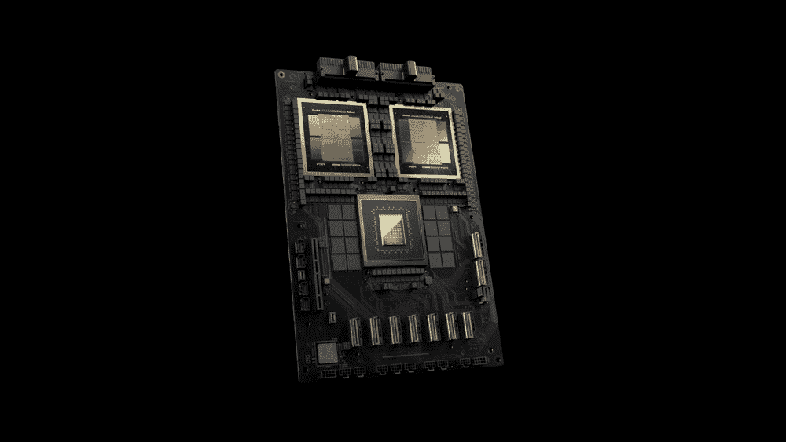

###### 图 2-1. NVIDIA Grace-Blackwell 超级芯片模块：单个模块上集成一个 Grace CPU（居中）和两个 Blackwell B200 GPU（顶部），并共享内存地址空间。

将 CPU 和 GPU 融合在一起有什么优势？一句话——内存！在传统系统中，CPU 和 GPU 拥有独立的内存池，并通过相对较慢的总线（如 PCIe）通信，这意味着数据必须来回拷贝。NVIDIA 的超级芯片通过名为 NVLink-C2C（芯片到芯片）的定制高速总线将 CPU 和 GPU 连接起来，从而消除了这一障碍；该总线在 Grace CPU 与每个 GPU 之间的带宽约为 900 GB/s。

NVLink-C2C 的互连速度比典型 PCIe 快几个数量级。更重要的是，它具备缓存一致性。缓存一致性意味着 CPU 和 GPU 共享统一的内存地址空间，并且始终看到相同的数据值。实际上，超级芯片上的 Grace CPU 和 Blackwell GPU 都可以直接访问彼此的内存，如同面对一个巨大的内存池。GPU 可以直接读写 CPU 内存中的数据，反之亦然，而无需显式复制。这种统一内存架构常被 NVIDIA 称为扩展 GPU 内存（Extended GPU Memory，EGM），它实际上模糊了“CPU 内存”和“GPU 内存”之间的界限。

每个 Grace-Blackwell 超级芯片都拥有海量内存。Grace CPU 自带数百 GB 的 LPDDR5X DRAM，每个 Blackwell GPU 也有自己的高速 HBM 堆栈。在 GB200 超级芯片中，Grace CPU 提供 480 GB 内存，两个 Blackwell GPU 合计提供 384 GB HBM3e 内存（每个 GPU 192 GB）。因此，在统一地址空间中，GPU 和 CPU 可访问的内存总计达 864 GB。

简而言之，每个超级芯片拥有近 1 TB 的快速统一内存可供使用。这对大型 AI 模型来说堪称颠覆性变革。在较旧的系统中，单个 GPU 的内存可能被限制在 <100 GB，这意味着更大的模型必须被分区或卸载到较慢的存储中。而在这里，GPU 可以无缝地将 CPU 内存作为扩展来使用。

如果某个神经网络层或大型嵌入表无法放入 GPU 本地 HBM，它可以驻留在 CPU 内存中，GPU 仍可通过 NVLink-C2C 使用它。从程序员的角度来看，数据搬运由硬件负责；只需分配内存，然后使用它即可。统一内存和缓存一致性意味着，在 CPU 与 GPU 内存之间手动搬运张量的时代已基本结束。

当然，GPU 内存仍然比 CPU 内存快得多，也更靠近 GPU 核心——你可以把 CPU 内存看作一个大容量但速度稍慢的扩展。访问 LPDDR5X 数据不如访问 GPU 上的 HBM 快。它的带宽大约低一个数量级（10 倍），延迟也更高。智能运行时会最频繁使用的数据保存在 192 GB HBM 中，并用 CPU 的 480 GB 内存存放溢出数据或对速度不太敏感的数据。

关键在于，内存溢出不再需要借助 SSD 或跨网络。GPU 可以大约 900 GB/s 的速度从 CPU 内存中获取数据（半双工，每个方向 450 GB/s），虽然比 HBM 慢，但远比从 NVMe 存储中获取要快得多。这种灵活性极具价值。这意味着，一个例如 500 GB 的模型（对单个 GPU 的 HBM 来说太大）仍然可以完整放入一个超级芯片模块（192 GB HBM + 其余放入 CPU 内存）中运行，而无需将模型拆分到多个 GPU 上。GPU 只会在需要时透明地从 CPU 内存中拉取额外数据。

本质上，只要模型总量能放入超级芯片的 CPU+GPU 合并内存，内存大小就不再是容纳超大规模模型的硬性限制。许多研究者都曾因模型无法装入 GPU 而遭遇可怕的“内存不足（out of memory）”错误——这一架构的设计目标正是大幅突破这一边界。

### NVIDIA Grace CPU

Grace CPU 本身也绝非等闲之辈。它是一款高核心数（72 核）ARM CPU，由 NVIDIA 针对带宽和效率专门打造。它在超级芯片中的任务是处理通用任务、预处理数据并馈送给 GPU，同时管理其附带的海量内存。它的时钟频率不算高，但凭借巨大的内存带宽——到 LPDDR5X 内存约 0.5 TB/s——以及大量缓存（包括数十 MB L3 缓存）弥补了这一点。

其设计理念是：在向 GPU 输送数据时，CPU 绝不能成为瓶颈。它可以从存储中流式读取数据，或执行分词（tokenization）、数据增强等即时数据转换，从而通过 NVLink-C2C 非常高效地供给 GPU。如果你的部分工作负载更适合在 CPU 上运行，Grace 核心可以处理这些任务，并让 GPU 立即访问其结果。


这是一种和谐的耦合：CPU 在 GPU 表现较弱的领域（如随机内存访问或控制密集型代码）扩展 GPU 的能力，而 GPU 则在 CPU 跟不上趟的数字密集计算上加速。CPU 与 GPU 之间的低延迟链路意味着它们可以不用承担常规开销就能交换任务。例如，从 CPU 启动一个 GPU 内核的速度比传统系统快得多，因为命令无需经过缓慢的 PCIe 总线。CPU 和 GPU 本质上位于同一块主板上。这应该类似于调用快速本地函数与较慢远程函数的区别。

现在让我们来谈谈 Blackwell GPU——这颗超级芯片的蛮力引擎。

### NVIDIA Blackwell GPU

Blackwell 是 NVIDIA 对这一代 GPU 的代号，它在计算能力和内存方面都相比上一代 Hopper（H100）GPU 有了显著飞跃。GB200 超级芯片中的每个 Blackwell B200 GPU 并不是单一芯片，而实际上是一个多芯片模块（MCM），在一个封装上包含两个 GPU die。

这是 NVIDIA 旗舰数据中心 GPU 首次采用 chiplet 方法。这实际上将原本一个巨大的 GPU 分成两个相当大的 die，并将它们连接在一起。为什么要这么做？因为单一单晶片受限于制造工艺，芯片在硅片上的尺寸是有限制的。通过将两个物理 die 组合成一个 GPU，NVIDIA 可以将 GPU 的总晶体管预算翻倍。

以 Blackwell 为例，每个 die 约有 1040 亿个晶体管，因此 GPU 模块合计约有 2080 亿个晶体管。这是一个惊人的电气复杂度与精密程度。这两个 die 通过一种专用的高速 die-to-die 互连进行通信，它们之间的带宽为 10 TB/s，使得两个 die 作为一个统一的 GPU，对运行在其上的软件层表现为一个整体。

从系统的角度来看，一个 Blackwell“GPU”是一个单一设备，拥有大容量内存池（192 GB HBM）和大量执行单元，但在底层是两个芯片协同工作。NVIDIA 的软件和调度机制确保工作负载在两个 die 之间平衡，内存访问保持一致。这使得开发人员基本上可以忽略这种复杂性，因为正如 NVIDIA 所设计的那样，它们表现为一个 GPU。

每个 Blackwell GPU 模块拥有 192 GB 的 HBM3e 内存，分布在两个 die 上（每个 96 GB）。这使上一代 Hopper H100 GPU 的 96 GB 翻倍，为模型参数、激活值和输入数据提供了更大的余量。内存也更快，因为 Blackwell 的 HBM3e 每个 GPU 的聚合带宽约为 8 TB/s。作为比较，Hopper H100 提供了约 3.35 TB/s 的带宽，所以 Blackwell 的内存子系统吞吐量大约是前者的 2.4 倍。

以每秒 8 TB 的速度供数意味着 GPU 核心能够在大矩阵计算中保持忙碌，而不会频繁停滞等待数据。NVIDIA 还增强了片上缓存，Blackwell 共有 100 MB 的 L2 缓存（每个 die 50 MB）。这种缓存是 GPU 上一块虽小但超快的内存，用于保存最近使用的数据。与 H100 的 50 MB L2 缓存相比，Blackwell 将 L2 缓存大小翻倍，从而可以在片上保存更多的神经网络权重或中间结果，避免额外访问 HBM。这同样有助于确保 GPU 的计算单元很少因数据不足而受限。

### NVIDIA GPU Tensor Core 与 Transformer Engine

说到计算单元，Blackwell 引入了专门针对 AI 工作负载的增强功能。核心是 NVIDIA 的 Tensor Core 技术和 Transformer Engine。Tensor Core 是 GPU 每个流式多处理器（SM）内的专用单元，能够以非常高的速度执行矩阵乘法运算。

Tensor Core 在之前的几代产品中已经有，但 Blackwell 的 Tensor Core 支持更多数值格式，包括 8 位和 4 位浮点等极低精度格式。低精度的想法很简单：用更少的比特来表示数字，就能同时执行更多操作——更不用说内存容量更大了，因为表示相同数字所用的比特更少。当然，这前提是你的算法能够容忍一定的数值精度损失。如今，许多 AI 算法在设计时就已经考虑到了低精度数值格式。

NVIDIA 首创了 Transformer Engine（TE），用于在深度学习中自动调整并使用混合精度，其中关键层使用较高精度（FP16 或 BF16），不太关键的层使用 FP8。TE 自动优化精度平衡，目标是在较低精度下保持模型精度。

在 Hopper 一代中，Transformer Engine 首次引入 FP8 支持，其吞吐量是 FP16 的两倍。Blackwell 更进一步，引入了一种更低精度的格式 FP4，这是一种 4 位浮点格式，用 FP8 一半的比特来表示数字。FP4 非常小，其计算吞吐量有可能是 FP8 的两倍。

事实上，一块 Blackwell GPU 使用 FP4 Tensor Core 运算可实现约 9 PFLOPS（每秒 9 千万亿次运算）的计算能力。这大约是 FP8 速率的 2 倍，是 FP16 速率的 4 倍。作为对比，早期的 H100 GPU 在 FP16 下的峰值约为 1 PFLOP，因此 Blackwell 在 FP16 下大约快 2 到 2.5 倍，而在使用 FP8/FP4 时则快得多。图 2-2 展示了 FP8 和 FP4 相对于 FP16 的加速比。

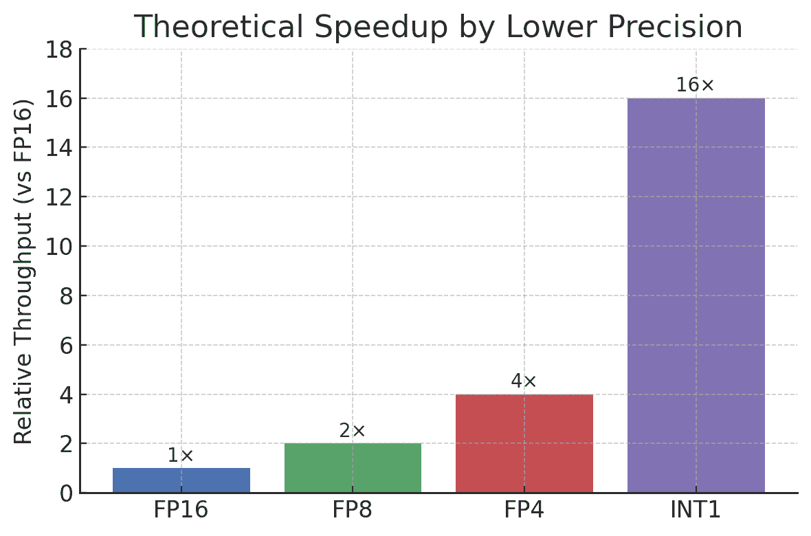

###### 图 2-2. FP8 和 FP4 相对于 FP16 的加速比。

一个完整的 NVL72 机架（72 个 GPU）在 4 位精度下拥有超过 1.4 exaFLOPS（即 1.4×10¹⁸）的理论 Tensor Core 吞吐量。这是一个令人难以置信的数字，使单个机架跻身全球最快超级计算机之列——尽管是在低 FP4 精度下。即使真实工作负载并不总能达到这一峰值，但这种能力就在那里，堪称惊人。

Blackwell 配备了 NVIDIA Transformer Engine（TE）第 2 版。这正是让 FP8 和 FP4 变得实用的神奇酱料。它在训练或推理过程中动态选择神经网络每一层的精度，尝试使用仍然能保持模型精度的最低精度。例如，TE 可能会将神经网络的前几层保持在 FP16，因为早期层可能对噪声敏感。但是，基于启发式算法，它可以决定对更靠后且更容忍噪声的层使用 FP8 或 FP4——或者对于巨型嵌入矩阵，因为高精度并不那么关键。

这一切都在 NVIDIA 的库中自动完成。作为用户，你只需启用混合精度，然后放行。其结果就是本质上“免费”获得的巨大加速。如今许多大语言模型（LLM）都使用 FP8 进行训练，原因就是它相比 FP16 有效加倍了训练速度——同时精度损失可以忽略不计。Blackwell 的构建目标就是让 FP8 和 FP4 不仅是理论上的选项，而是日常工具。

事实上，测试表明，在某些情况下，Blackwell 使用 FP4 相比 FP16 可提供近 5 倍的 AI 吞吐量提升。这些格式还大幅削减了内存占用。使用 FP4 相比 FP8，每个参数所需内存减半，这意味着可以将更大的模型装入 GPU 内存。

NVIDIA 实际上押注了 AI 的未来在于低精度运算，并赋予了 Blackwell 在这方面大放异彩的能力。这对大规模模型的推理服务尤为关键，因为在那里吞吐量（每秒 token 数）和延迟是重中之重。


为了说明从 Hopper 到 Blackwell 的代际飞跃，NVIDIA 报告称，基于 H100 的系统在运行一个 1.8 万亿参数的混合专家（MoE）大模型时，每个 GPU 每秒只能生成大约 3 到 5 个 token——首 token 延迟超过 5 秒。这对于交互式使用来说太慢了。

基于 Blackwell 的系统（NVL72）运行同一模型时，每个 GPU 每秒可生成约 150 个 token，并将首 token 延迟降低到约 50 毫秒。这大约带来了 30 倍的吞吐量提升和巨大的延迟降低，将一个不实用的模型变成了一个几乎可以实时响应的模型。

这种惊人的加速源于原始 FLOPs，以及更快的 GPU、更低精度（FP4）的使用和保持 GPU 数据供给的 NVLink 互连三者的结合。这凸显了跨越计算和通信的整体设计如何转化为现实世界的性能提升。

本质上，Blackwell GPU 比其前代产品更强大、更智能，数据供给也更充足。得益于 Tensor Core、Transformer Engine 和低精度，它们能更快地完成数学运算。此外，系统架构借助巨大的内存带宽、大容量缓存和 NVLink，确保数据能够快速就位。

在继续之前，让我们快速讨论一下 GPU 内部的层级结构，因为这对之后理解性能调优很有帮助。

## 流式多处理器、线程与线程束

每个 Blackwell GPU 与其前代产品一样，由许多流式多处理器（SM）组成。可以将它们视为 GPU 的"核心"，如图 2-3 所示。

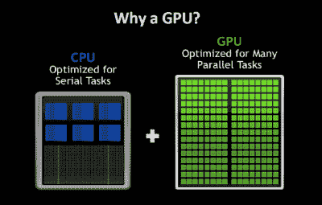

**图 2-3.** CPU 核心与 GPU 核心的对比（[*https://www.cudocompute.com/blog/nvidia-gb200-everything-you-need-to-know*](https://www.cudocompute.com/blog/nvidia-gb200-everything-you-need-to-know)、[modal.com](https://modal.com/gpu-glossary/device-hardware/streaming-multiprocessor#:~:text=Streaming%20Multiprocessors%20,performance%20CPUs)）。

每个 SM 包含一组算术单元（用于 FP32、INT32 等）、用于矩阵运算的 Tensor Core、用于内存操作的加载/存储单元，以及一些用于超越函数等运算的特殊函数单元。GPU 还有自己的小型超快内存池，包括寄存器、共享内存和 L1 缓存。

SM 以 32 个为一组（称为线程束）来执行线程，每个线程束包含 32 个线程。它可以并行执行许多活跃的线程束，从而在某个线程等待内存数据时帮助掩盖延迟。想象一个 SM 同时有数十个线程束（数百个线程）在并发执行。如果一个线程束在等待内存读取，另一个线程束就可以运行。这称为延迟隐藏。我们将在本书中反复讨论延迟隐藏。这是你的调优工具箱中一个非常重要的性能优化工具。

像 Blackwell 这样的高端 GPU 大约有 140 个 SM。每个 SM 能够并发运行数千个线程。正是通过这种方式，我们才能在一个 GPU 上承载数万个活动线程。所有这些 SM 共享一个大型 100 MB L2 缓存（如前所述），并共享连接到 HBM 的内存控制器。内存层次结构包含寄存器（每个线程）→ 共享内存/L1 缓存（每个 SM）→ L2 缓存（GPU 上，由所有 SM 共享）→ HBM 内存（片外），如图 2-4 所示。

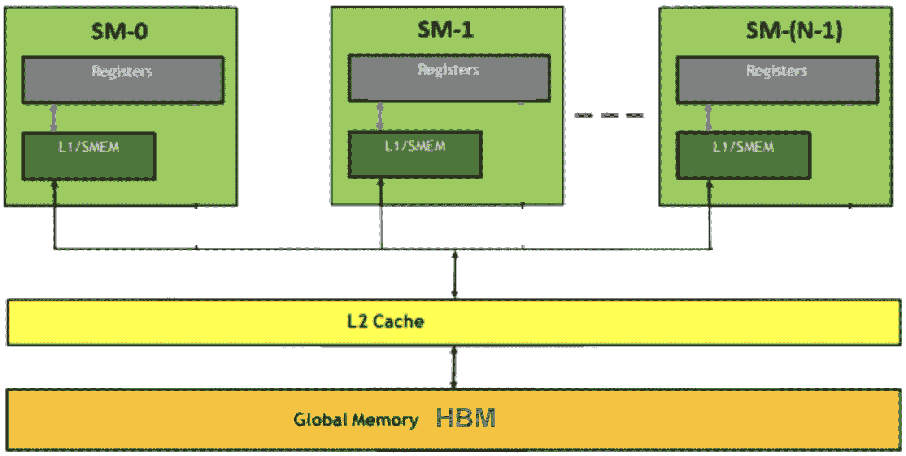

**图 2-4.** GPU 内存层次结构

为了获得最佳性能，数据需要尽可能停留在该层次结构的高层。如果每个操作都要访问 HBM，即使带宽高达 8 TB/s，GPU 也会因访问片外内存的更高延迟而频繁停顿。通过将可重用数据保存在 SM 本地内存或 L2 缓存中，GPU 可以实现巨大的吞吐量。Blackwell 架构将缓存和带宽翻倍，目的正是为了让 GPU 这头巨兽保持喂饱且状态良好。

作为性能工程师，我们会看到许多内核的性能既受计算限制，也受内存流量和吞吐量限制的例子。NVIDIA 显然在设计 Blackwell 时就考虑到了：对于许多 AI 工作负载，FLOPs 与内存带宽之间应达到良好匹配。粗略地说，在 FP4 模式下，这一平衡约为每字节内存带宽对应 2–3 个 FLOPs 的计算量。对于密集线性代数运算来说，这是一个合理的比率。这意味着，在代码优化得当的前提下，GPU 通常会忙于计算而不是等待数据。请注意，某些操作（如大规模归约或随机内存访问）仍然可能受内存限制，但更新后的 GPU、内存和互连硬件使这个问题变得不那么严重了。

## 超大规模网络：将众多 GPU 视为一个整体

将两个 GPU 和一个 CPU 封装进一个超级芯片，为我们带来了一个极其强大的节点——但 NVIDIA 并没有止步于单个节点。下一个挑战是将许多这样的超级芯片连接在一起，以扩展到更大规模的模型训练。

使用 GB200 超级芯片的旗舰配置就是 NVIDIA 所称的 NVL72 系统，它本质上是一台封装在单个机架中的 AI 超级计算机。NVL72 代表一个拥有 72 个 Blackwell GPU——以及 36 个 Grace CPU——全部通过 NVLink 互连的系统。

GB200 NVL72 由 18 个计算节点（每个均为 1U 尺寸）构建而成，每个节点包含两个 GB200 超级芯片，因此每个计算节点共有 4 个 Blackwell GPU + 2 个 Grace CPU，如图 2-5 所示。

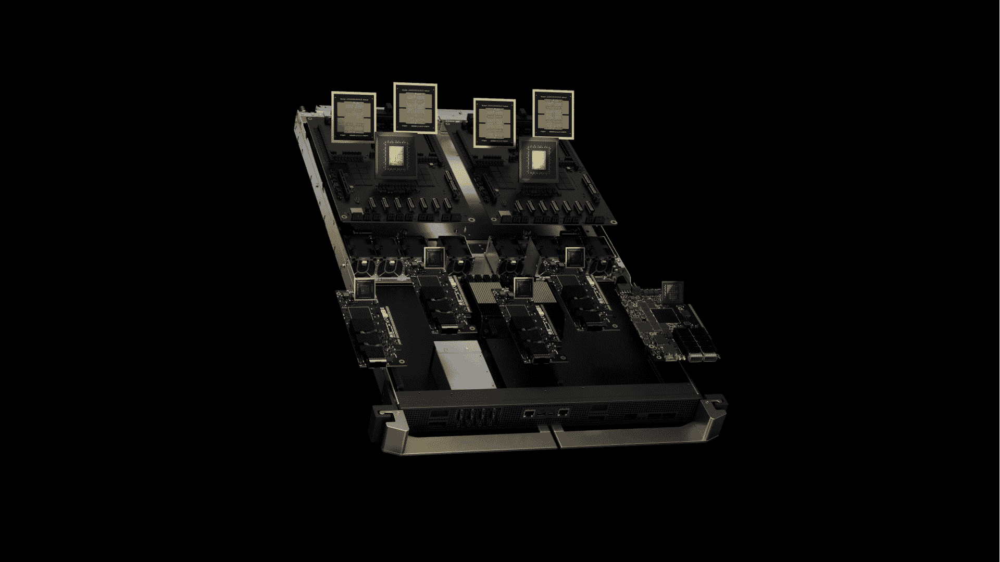

**图 2-5.** GB200 NVL72 机架内的一个 1U 计算托盘，带有两个 Grace-Blackwell 超级芯片，每个超级芯片模块包含一个 Grace CPU 和两个 Blackwell GPU 芯片。NVL72 有 18 个这样的托盘连接在一起（来源：[developer.nvidia.com](https://developer.nvidia.com/blog/nvidia-gb200-nvl72-delivers-trillion-parameter-llm-training-and-real-time-inference/#:~:text=The%20GB200%20compute%20tray%20is,7%20TB%20of%20fast%20memory)）。

通过将 18 个计算节点连接在一起，GB200 NVL72 将 72 个 Blackwell GPU（18 个节点 × 4 个 GPU）和 36 个 Grace CPU（18 个节点 × 2 个 CPU）互联，形成一个强大、统一的 CPU-GPU 集群。NVL72 的非凡之处在于，每个 GPU 都能以极高的速度与任何其他 GPU 通信，仿佛全部 72 个 GPU 都位于同一块主板上。NVIDIA 通过 GPU 上的 NVLink 5 连接与名为 NVSwitch 的专用交换芯片相结合实现了这一目标。

### NVLink 与 NVSwitch

每个 Blackwell GPU 拥有 18 个 NVLink 5 端口，每个端口支持 100 GB/s 的双向数据传输，或单向 50 GB/s。综合来看，单个 GPU 通过 NVLink 与对等 GPU 之间可以传输高达 1.8 TB/s（18 个 NVLink 端口 × 100 GB/s）的数据。这是上一代每 GPU NVLink 带宽的两倍，因为 Hopper H100 使用的是 NVLink 4，其双向 900 GB/s 的速度仅为 NVLink 5 的一半。

GPU 通过 NVSwitch 芯片以网络方式互联布线。NVSwitch 本质上是一种与网络交换机类似的交换芯片，但它是专为 NVLink 打造的。这意味着任何 GPU 都可以通过某个 NVSwitch 芯片以全带宽单跳访问任何其他 GPU。图 2-6 展示了 NVL72 中使用的 NVLink Switch 托盘。

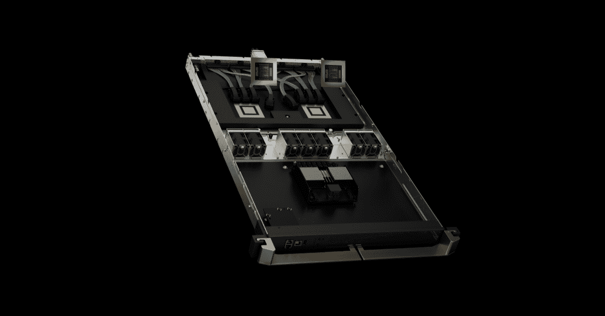

**图 2-6.** 来自 NVL72 的一个 NVLink Switch 托盘（来源：[developer.nvidia.com](https://developer.nvidia.com/blog/nvidia-gb200-nvl72-delivers-trillion-parameter-llm-training-and-real-time-inference/#:~:text=Fifth,System)）。


每个交换托盘包含两颗 NVSwitch 芯片（图中可见的大芯片）和多个高速端口（蓝色线缆代表 NVLink 连接）。在 NVL72 机架中，如图 图 2-7 所示，9 个这样的交换托盘提供了完全连接 72 个 Blackwell GPU 的交换结构。

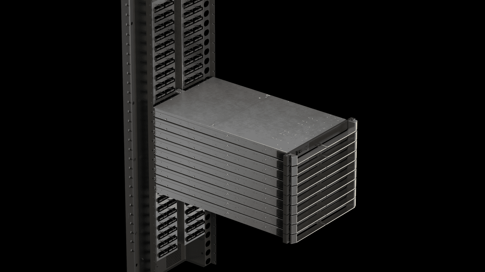

###### 图 2-7. NVL72 机架内 9 个托盘的 NVSwitch 系统

每个交换托盘包含两颗 NVSwitch 芯片，因此整个系统共有 18 颗 NVSwitch 芯片。该网络采用全交叉开关（full crossbar）布局，每个 GPU 都与每个 NVSwitch 相连，每个 NVSwitch 也与每个 GPU 相连，从而在任意一对 GPU 之间提供高带宽路径。

具体来说，每个 GPU 使用其 18 个 NVLink 端口连接到 18 颗 NVSwitch 芯片（每个交换机一条链路）。这意味着任意 GPU 最多经过两次跳转（GPU → NVSwitch → GPU）即可到达另一个 GPU，沿途带宽极为可观。

整个 72-GPU 网络的带宽，即聚合对分带宽（aggregate bisection bandwidth），在机架内约为 130 TB/s。打个比方，这比类似规模的顶级 InfiniBand 集群还要高出许多倍。这种设计基本上将整个机架变成了一台巨大的共享内存机器。

### 多 GPU 编程

从编程模型的角度来看，一个 GPU 可以直接通过 NVLink 从另一个 GPU 的 HBM 内存执行内存加载，甚至可以从另一个节点的 Grace CPU 加载，并在微秒级时间内获取数据。换句话说，这些 GPU 可以在整个机架的全局共享内存空间中运行，非常类似于单台服务器内核心共享内存的方式。这就是为什么 NVL72 常被描述为“一个大 GPU”或“机架中的 AI 超级计算机”。

RDMA（远程直接内存访问）等软件库通过提供简洁的编程接口（如跨 GPU 的原子操作），屏蔽了全局共享内存空间的复杂性。分布式训练和推理工作负载需要在多个 GPU 之间频繁同步和交换信息。传统上，GPU 位于不同的计算节点和机架中，因此同步通过相对较慢的网络链路（如 InfiniBand 和 Ethernet）进行。在扩展到多个 GPU 以支持大型 AI 模型时，这往往是瓶颈。

借助 GB200 NVL72 系统，这些数据交换通过 NVLink 和 NVSwitch 以极快的速度完成。这意味着你可以将训练任务或推理集群扩展到 72 个 GPU，且通信开销极小。由于 GPU 花在等待彼此数据上的时间大大减少，整体吞吐量在扩展到 72 个 GPU 时接近线性增长。相比之下，考虑在由 9 台独立计算服务器（每台配备 8 个 Hopper H100 GPU）组成的相似规模 72-GPU H100 集群上运行相同的任务。这种配置需要 InfiniBand，这将产生网络瓶颈，从而大幅降低集群的扩展效率。

让我们用具体数字来分析和比较 GB200 NVL72 与 72-GPU H100 集群。在单个 NVL72 机架内，GPU 到 GPU 的带宽约为 100 GB/s 以上，小消息的延迟约为 1–2 微秒。在传统 InfiniBand 网络中，每个 GPU 的带宽可能约为 20–80 GB/s（取决于网卡数量及其速率），延迟可能为 5–10 微秒甚至更高。就节点间 GPU 通信而言，NVL72 网络比最好的 InfiniBand 网络具有更高的吞吐量（每个 GPU 提升 2 倍或更多）和更低的延迟（提升 3–5 倍）。在实际场景中，跨 GPU 聚合梯度的 `all-reduce` 集合操作在基于 InfiniBand 的 H100 集群上可能占用迭代时间的 20–30%，而在基于 NVLink 的 NVL72 集群上仅占用 2–3%。

NVIDIA 的一项真实测试证明了这一点，该测试显示，基于 NVL72 的单个系统比类似的基于 H100 的集群快约 4 倍，这主要归功于通信效率。关键要点是，在单个 NVL72 机架内，通信速度非常快，通信瓶颈几乎被完全消除，因此不再是优先考虑的问题。而在传统 InfiniBand 和 Ethernet 集群中，通信往往是主要瓶颈，需要在软件层面进行精心优化和调优。

总之，设计和实现软件时应充分利用 NVL72 的配置，尽可能将工作负载的通信保持在机架内部（“机架内”），以发挥高速 NVLink 和 NVSwitch 硬件的优势。只有在绝对必要时，才使用基于 InfiniBand 或 Ethernet 的较慢机架间（“机架间”）通信，以扩展超出 NVL72 的计算和内存资源。

### 基于 NVIDIA SHARP 的网络内聚合

另一个硬件加速优化是 [NVIDIA  SHARP](https://developer.nvidia.com/blog/advancing-performance-with-nvidia-sharp-in-network-computing/)，全称是 Scalable Hierarchical Aggregation and Reduction Protocol（可扩展分层聚合与归约协议）。SHARP 直接集成在 NVSwitch 硬件中，能够在网络硬件本身直接执行聚合操作（例如 `all-reduce`、`all-gather` 和 `broadcast`）。NVSwitch 交换结构直接合并部分结果，无需将数据经由 GPU 转发。通过将集合通信操作从 GPU 和 CPU 卸载到交换机硬件本身，SHARP 大幅提高了效率、降低了延迟，并减少了网络中传输的数据量。

SHARP 的效率提升意味着在分布式训练期间，聚合梯度或同步参数的重任由 NVSwitch 专用的 SHARP 引擎承担。结果是在机架内和机架间配置下都能实现更高效的扩展。即使 GPU 数量增加，SHARP 也能实现接近线性的性能提升。这种网络内计算能力对于训练超大规模模型尤其关键，因为在集合操作上节省的每一微秒都能转化为可观的整体加速。

### 多机架与存储通信

接下来，我们来讨论一个 NVL72 机架如何与另一个 NVL72 机架或外部存储系统（如共享文件系统）通信。正如我们前面所述，在 NVL72 机架内部，NVLink 覆盖了所有 GPU 到 GPU 的流量。但在机架外部，则依赖更传统的网络硬件。

NVL72 中的每个计算节点都配备了高速网络接口卡（NIC）和数据处理器（DPU）。在 GB200 NVL72 参考设计中，每个节点有 4 个 ConnectX InfiniBand 网卡和 1 个 BlueField-3 DPU。这 4 个 InfiniBand 网卡每个运行速率为 400 Gb/s。合计起来，这些网卡向外部发送和接收数据的速率约为 1.6 Tbit/s（1600 Gbit/s），如图 图 2-8 所示。

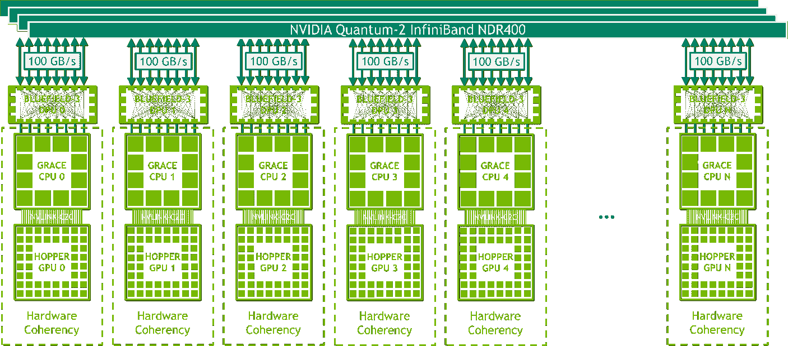

###### 图 2-8. InfiniBand 与 BlueField DPU 网卡

在单个机架的 18 个计算节点中，若充分利用，机架外部总吞吐量接近 30 Tbit/s（1.6 Tbit/s × 18 个计算节点）的聚合网络容量。关键在于，NVIDIA 预见了被称为“AI 工厂”的多机架部署，因此他们确保 NVL72 可以通过每个节点上的这 4 个网卡接入更大的网络结构。

###### 提示

NVIDIA 还提供基于 Ethernet 的解决方案，使用 Spectrum 交换机并采用融合以太网上的 RDMA（RoCE）作为互连替代方案，称为 Spectrum-X。


每个节点中的 BlueField-3 DPU 有助于卸载诸如 RDMA、TCP/IP 和 NVMe 存储访问等网络任务。这确保了 Grace CPU 不会因管理网络中断而陷入困境。DPU 本质上充当智能网络控制器，利用 NVIDIA 名为 GPUDirect 的 RDMA 软件，在网卡和 GPU 内存之间直接移动数据，无需 CPU 参与。这在从存储服务器流式传输大型数据集时尤其有用，因为 DPU 可以处理数据传输并直接将数据存入 GPU 内存，而 CPU 则专注于数据预处理等其他任务。

当扩展到多个 NVL72 机架时，NVIDIA 使用 Quantum 系列 InfiniBand 交换机。多个 NVL72 机架可通过这些 InfiniBand 交换机互连，形成大型 NVL72 机架集群，如图 2-9 所示。


*图 2-9. 使用 InfiniBand 扩展 NVL72 集群*

例如，一个包含 8 个机架、总计 576 个 GPU 的 NVL72 集群可以通过第二层 InfiniBand 交换机构建，尽管跨机架的 InfiniBand 通信性能将低于单个机架内的 NVLink/NVSwitch 通信。

### 预集成机架设备

由于 NVL72 是一个复杂的系统，NVIDIA 将其作为预集成机架“设备”在单个机柜中交付。它组装好了所有 18 个计算节点、全部 9 个 NVSwitch 单元、内部 NVLink 线缆、电源分配和冷却系统。其理念是，组织可以将其作为一个整体订购，到达后即可投入使用。只需将机架连接到设施电源，接好水冷接口，将 InfiniBand 线缆连接到网络，然后开机即可！无需单独为 72 个 GPU 布线 NVLink，因为 NVIDIA 已在机架内为您完成。即使是液冷配置也是自包含的，我们稍后将讨论。

这种设备化方法加速了部署，并确保系统构建正确且经过 NVIDIA 验证。该机架还包含 NVIDIA Base Command Manager 集群管理软件，以及用于集群作业调度和编排的 SLURM 和 Kubernetes。换句话说，NVL72 机架的设计目标是直接集成到您的环境中，并。

### 共封装光学：网络硬件的未来

随着网络数据吞吐率攀升至 800 Gbit/s 甚至更高，传统的可插拔光模块方法开始触及功率和信号极限。这种方法在交换机处将电信号转换为光信号时会消耗大量功率。NVIDIA 正通过在其网络设备中集成共封装光学（CPO）来解决这一问题。

采用共封装光学，光发射器直接集成在交换机芯片旁边。这大幅缩短了电路路径，使得机架间能够实现更高带宽的链接，降低功耗，并提高整体通信效率。NVIDIA 正将 CPO 集成到计划于 2025 年底或 2026 年推出的 Quantum-3 InfiniBand 交换机中。

实际上，像 CPO 这样的技术正为将成百上千个机架（“AI 工厂”）连接成一个统一网络铺平道路，使机架间带宽不再成为瓶颈。这些光网络技术进步对于实现高性能的机架间带宽至关重要，以确保网络在超大规模下能够跟上 GPU 的发展。

总而言之，在 NVL72 机架内部，NVIDIA 使用 NVLink 和 NVSwitch 在 72 个 GPU 之间构建了一个极速的全互连网络。这些互连速度如此之快且均匀，使得 GPU 实际上像一个整体一样工作。在机架之外，高速 NIC（例如 InfiniBand 或以太网）将机架连接到其他机架或存储，并由 DPU 高效管理数据移动。

NVL72 是一个极其强大的独立系统，也是更大规模 AI 超级计算机的基本构建模块。NVIDIA 与 CoreWeave、Lambda Labs、AWS、Google Cloud、Azure 和 Equinix 等云服务提供商合作，提供基于 NVL72 的机架，企业可以快速租用或部署。

AI 工厂——由多个此类机架组成的大规模 AI 数据中心——的概念正在成为现实。NVIDIA 的硬件和网络路线图明确瞄准实现 AI 工厂愿景。简而言之，NVL72 展示了协同设计能走多远：GPU、网络和物理机架硬件携手构建，以尽可能无缝高效地扩展到成千上万个 GPU。

### 计算密度与功率需求

NVL72 机架在计算密度方面非常惊人，这意味着单个机架的功耗非常高。满载的 NVL72 在最大负载下可消耗高达约 120 kW 的功率。而 NVIDIA 上一代 AI 机架的功耗约为 50–60 kW。将 72 个尖端 GPU 以及所有支持硬件装入一个机架，已触及数据中心基础设施可处理的极限。

要为 NVL72 机架提供 120 kW 电力，不能只使用单一标准电源线路。数据中心通常会配置多条大容量电路来提供这种功率。例如，可以为机架输入两路独立电源以实现冗余，每路电源可承载 60 kW。正常运行时，负载在两路电源之间均衡分配。如果一路电源发生故障，系统可以削减部分负载或限制 GPU 性能，以保持在剩余电源的容量范围内。这种冗余对于防止电路烧断导致您长达数月的训练任务中断非常重要。

在机架内部，电力被分配到每个 1U 计算节点的电源。电力从 AC 转换为 DC，供本地电子设备使用。NVL72 中的每个计算节点包含 2 个 Grace-Blackwell 超级芯片，它们合计消耗约 5-6 kW 功率。18 个计算节点的总功耗约为 100 kW。NVSwitch 托盘、网络交换机和冷却泵约占 20 kW，因此整个 NVL72 机架总功耗为 120 kW。

在典型的数据中心电压（例如 415 V 三相交流电）下，电流巨大，因此所有设备都针对高电流进行了工程设计。运维人员必须仔细规划才能容纳这样的机架，这通常需要专用的电源分配单元（PDU）和仔细监控。电源瞬变也是一个考虑因素，因为 72 个 GPU 从空闲状态升至满功率时，可能在短短几毫秒内迅速消耗数十千瓦的功率。良好的设计应包含电容器或时序控制，以避免较大的电压跌落。

系统可能会以微小的时间间隔错开 GPU 的加速时钟，使其不会在同一微秒内全部达到峰值，从而平缓电流冲击。这些就是让 120 kW 机架变得可管理的电气工程细节。

将处于高密度计算前沿的 NVL72 机架称为“迷你电力变电站”并不夸张。8 个这样的机架组合在一起，共 572 个 GPU，将消耗近 1 MW 的功率（8 个机架×每个机架 120 kW），这相当于一个小型数据中心的全部容量！值得庆幸的是，尽管 120 kW 在一个机架中算很大，但每瓦功耗也能完成更多工作。事实上，如果一台 NVL72 取代几台旧设备机架，整体效率会更高。但您绝对需要支持这种集中功耗的基础设施。任何容纳 NVL72 机架的设施都必须确保其具有足够的功率容量和冷却能力，我们接下来将讨论这一点。


### 液冷与风冷

在一个机架中冷却 120 kW 的功率超出了传统风冷的能力范围。要让风吹过 72 个每个可散热 1000+ 瓦的 GPU，需要飓风般的气流，而且会非常嘈杂且效率低下——更不用说排出的热风会非常猛烈。因此，对于运行在这种功率密度下的 `NVL72` 机架来说，液冷是唯一实用的解决方案。

`NVL72` 是一个全液冷系统。每个 `Grace-Blackwell` 超级芯片模块和每个 `NVSwitch` 芯片都附有一个冷板。冷板是一种带有内部管道的金属板，直接安装在组件上。水基冷却液流经管道带走热量。所有这些冷板通过软管、歧管和泵连接在一起，使冷却液在整个系统中循环。

通常，机架上的每个节点都配有快速断开接头，这样你可以在不泄漏冷却液的情况下将服务器滑入或滑出。然后，机架通过供水和回水连接与外部设施的冷冻水系统相连。通常，会有一个称为冷却分配单元（`CDU`）的热交换器，要么内置在机架中，要么紧邻机架。`CDU` 将热量从机架的内部冷却液回路传递到数据中心的冷却水回路。

设施提供 20-30°C 的冷冻水。水通过热交换器吸收热量。升温后的水被泵送回冷水机或冷却塔再次冷却。在现代设计中，甚至可以采用温水冷却，即冷冻水以 30°C 进入系统，以 45°C 离开。然后水可以通过蒸发冷却塔冷却，无需主动制冷，从而提高整体效率。关键在于，水或液体冷却剂在单位流量下能携带的热量远多于空气，因此在狭小空间内高功率运行时，液冷远比风冷有效。

通过将 GPU 和 CPU 的温度保持在远低于风冷时的水平，液冷减少了 GPU 的热降频现象。GPU 可以在不触及温度限制的情况下维持其最高时钟频率。此外，让芯片在更低的温度下运行还能提高可靠性和效率，因为温度较低时漏电功耗更低。

`NVL72` 在负载下将 GPU 温度保持在 50-70°C 范围内，对于这类高功耗设备来说非常出色。冷板和冷却液回路经过精心设计，使每个 GPU 能向系统释放 1000 W 热量，每个 CPU 能释放 500 W。此外，冷却液的流速必须足以快速带走这些热量。粗略估算，系统需要每分钟流过约 10 升以上的水，才能在合理的温升范围内消散 120 kW 的功率。

系统无疑配备了用于冷却液温度、压力和泄漏检测的传感器和控制装置。如果滴液或压力损失传感器检测到泄漏，系统可以快速关闭或隔离相应部分。建议使用自密封接头——或许再配一个二次收集托盘——以最大程度降低液体泄漏的风险。

这种级别的机架液冷曾经非常罕见，但现在已成为这些大规模 AI 集群的标准。Meta、Google 和 Amazon 等公司都在为其 AI 集群采用液冷，因为风冷根本无法支持这些系统所需的大功率。

因此，虽然 `NVL72` 需要更复杂的设施，包括液冷回路，但许多数据中心现在在建设时就已经考虑了液冷。`NVL72` 机架凭借其内置的内部液冷，可以直接连接到冷却回路。

内部液冷的一个副作用是机架的重量。`NVL72` 机架在装满硬件和冷却液后，重量约为 3000 磅（1.3–1.4 吨）。对于机架来说，这非常重，大约相当于一辆小型汽车的重量，但却集中在几平方英尺的地板上。采用架空地板的数据中心必须检查地板能否承受以磅/平方英尺为单位的这种载荷。通常，高密度机架会被放置在加固地板上或用额外的支柱支撑。移动这样的机架需要叉车等专用设备。这些都是部署考虑因素的一部分，因为你安装的是一台 AI 超级计算机，它带来了独特的物理和后勤挑战。

NVIDIA 还通过机架管理控制器的形式集成了管理和安全功能，该控制器负责监管冷却液泵、阀门位置、功耗等，并监控每个节点的状态。管理员可以通过它与系统交互，例如更新所有节点的固件，或安全地关闭系统。

所有这些考虑都说明，`NVL72` 是与数据中心基础设施协同设计的。NVIDIA 与负责电力输送和冷却的系统工程师协同设计计算架构，同时与负责规定安装和运行方式的设施工程师协同工作。这不仅仅是关于快速的芯片——更是关于提供一个均衡、可用的系统。

这种复杂性带来的回报是巨大的。通过突破功耗和冷却的极限，NVIDIA 成功地将海量计算能力集中到一个机架中。这转化为前所未有的每平方英尺计算量和每瓦计算量。没错，120 kW 确实很大，但分摊到每个 GPU 或每个 TFLOP 上，与将这些 GPU 分散到多个机架且冷却效率较低的情况相比，这实际上很高效。

### 实践中的性能监控与利用率

当你拥有一台如此强大且昂贵的机器时，你会想确保物尽其用。有效运营 `NVL72` 需要仔细监控性能、利用率和功耗。NVIDIA 提供了像 `DCGM`（数据中心 GPU 管理器）这样的工具，可以跟踪每个 GPU 的指标，例如 GPU 利用率百分比、内存使用量、温度和 `NVLink` 吞吐量。

作为性能工程师，在训练运行和推理工作负载期间，你会密切关注这些指标。理想情况下，你希望 GPU 在训练任务的大部分时间内接近 100% 利用率。如果你看到 GPU 利用率为 50%，这意味着有某种原因让它们有一半时间处于空闲状态。也许是数据加载瓶颈或同步问题。

同样，你可以监控 `NVLink` 的使用情况。如果 `NVLink` 链路频繁饱和，通信很可能就是罪魁祸首。`BlueField DPUs` 和网卡（NICs）有自己的统计信息，用于监控以确保在读取数据时不会使存储链路饱和。像 `NVL72` 这样的现代系统会公开这些遥测数据。

功耗监控也至关重要。在约 120 kW 的功率下，即使是很小的低效或错误配置也会浪费大量电力和金钱。系统可能会让你监控每个节点或每个 GPU 的功耗。如果不需要全部性能，管理员可能会限制 GPU 的功率或时钟频率以节省能源。

NVIDIA GPU 允许设置功率限制。例如，如果你运行的任务较小，不需要榨干每一分性能，你可以调低 GPU 时钟频率以提高效率——以每瓦性能来衡量——同时仍然满足吞吐量要求。这样做可以节省数千瓦的电力。在数周的训练中，这可以转化为显著的节省和成本效益。

### 共享与调度

另一个方面是在 `NVL72` 上共享和调度工作负载。很少有单个任务需要全部 72 个 GPU。你可能会有多个团队或多个实验在 GPU 子集上运行。使用像 `SLURM` 或 `Kubernetes` 这样的集群调度器并配合 NVIDIA 的插件，你可以划分出，例如，8 个 GPU 给一个用户，16 个给另一个用户，48 个给第三个用户——所有这些都在同一个机架内。


此外，NVIDIA 的多实例 GPU（MIG）功能可让你将单个物理 GPU 拆分为多个在硬件层面进行分区的小型 GPU。例如，一块配备 192 GB GPU 显存的 Blackwell GPU 可以被拆分为更小的分区，从而并发运行许多小型推理任务。例如，192 GB 的 GPU 显存可以被拆分为四个 24 GB 分区和两个 48 GB 分区（`4 * 24 + 2 * 48 = 192 GB`）。类似地，GPU 的 SM 也可以与 GPU HBM 显存一并拆分到各个分区中。

在实践中，对于如此大型的 GPU，MIG 可以用于在一张 GPU 上服务多个模型的推理场景。BlueField DPU 的存在还实现了安全的多租户能力，因为 DPU 可以充当防火墙和虚拟交换机。这能为不同的作业和用户隔离网络流量。这意味着一个组织可以安全地让不同部门甚至外部客户使用系统的分区，而不会相互干扰——类似于云提供商如何将一台大型服务器分区给多个客户，并提供安全的多租户隔离。

从成本角度来看，像 NVL72 这样的系统是价值数百万美元的资产，而且每月可能消耗数万美元的电费。因此，你确实希望尽可能多地完成有用工作，即有效吞吐。如果它闲置在那里，就会浪费大量资本和运营成本。这就是为什么监控随时间变化的利用率很重要的原因。你可以跟踪已使用的 GPU 小时数对比可用小时数。

如果你发现系统利用率不足，你可能希望整合工作负载，或将其提供给更多团队以运行更多项目。一些组织会实施一种费用分摊（chargeback）模式，即内部团队使用自己的预算按 GPU 小时数支付使用费用。这有助于鼓励高效使用，并将电费与折旧成本纳入考量。这种透明度能确保人们重视该资源。毕竟，在所有 72 块 GPU 上运行 1 小时可能就是 72 个 GPU 小时，其电费加上分摊的硬件成本可能价值数百美元。

## 升级硬件的投资回报率

人们可能会问，投资这种最前沿的硬件是否值得。在分析投资回报率（ROI）时，答案通常归结为每美元带来的性能。如果 NVL72 能完成比如四台旧一代机架的工作，从长远来看，它实际上可能会在硬件和电力方面节省成本。本章前面我们讨论了在吞吐量方面，一块 Blackwell GPU 如何替代 2–3 块 Hopper GPU。这意味着，如果你升级，完成同样的工作可能需要的 GPU 总数会更少。

让我们分析一个快速的案例研究。假设你目前有一百块 H100 GPU 来处理你的工作负载。你或许可以用 50 块 Blackwell GPU 来处理，因为每块的性能是其两倍以上（使用 FP8/FP4 时甚至更高）。因此，你可以只买 50 块而不是 100 块 GPU。即使每块 Blackwell 比 H100 更贵，购买一半数量也能做到成本持平甚至更优。在功耗方面，一百块 H100 可能消耗 70 kW，而五十块 Blackwell 在完成相同工作时可能消耗 50 kW。这是显著的电力节省。

一年下来，这种电力差异可以节省数万美元。此外，更少的 GPU 意味着需要维护的服务器更少，这意味着这些服务器在 CPU、内存和网络方面的开销更少，从而带来进一步的节省。总而言之，在某些情况下，如果你有足够的工作负载让它保持忙碌，升级到新硬件可以在 1–2 年内收回成本。

这个计算显然取决于具体价格和使用模式，但重点是，对于大规模部署而言，采用最新 AI 硬件的 ROI 可能非常高。除了有形的 ROI 之外，还有一些软性收益，例如使用一个强大的系统而非多个较小的系统可以简化你的系统架构。这种简化通过降低功耗和降低网络复杂性来提高运营效率。

例如，由于内存限制而无需将模型拆分到多个旧 GPU 上，这可以简化软件并降低工程复杂性。此外，拥有最新的硬件可以确保你利用最新的软件优化，并跟上同样在升级的竞争对手。没有人愿意自己在训练和服务模型的速度上只有对手的一半。升级将提升你的性能，同时还能支持更大的模型、更快的迭代和更迅速的响应。

有效运行 NVL72 既是一项硬件壮举，也同样是一项软件和管理挑战。硬件赋予你巨大的潜力，但要发挥硬件的全部能力，需要工程师们监控性能、保持高利用率并智能地调度作业。

好消息是，NVIDIA 提供了丰富的软件栈来监控和提升性能，包括驱动程序、性能分析器、容器运行时和集群编排工具。在本书的其余部分，我们将了解如何优化软件，以充分利用 GB200 NVL72 等系统。目前，你需要记住的是：当你拥有一个具有百亿亿次浮点运算级性能的盒装 AI 系统时，你需要同样先进的策略让每一次浮点运算和每一字节都发挥价值。

## 展望未来：NVIDIA 的路线图

在撰写本文时，Grace-Blackwell NVL72 平台代表了 AI 硬件领域的最先进水平。当然，NVIDIA 已经在准备下一步的飞跃。值得简要看一下 NVIDIA 未来几年的硬件路线图，因为它展示了一个清晰的扩展模式。NVIDIA 打算继续在性能、内存和集成度上加倍投入。

### Blackwell Ultra 与 Grace-Blackwell Ultra（2025 年末）

2025 年 3 月，NVIDIA 发布了名为 Blackwell “Ultra”（B300）的增强版 Blackwell，以及相应的 Grace-Blackwell Ultra 超级芯片（GB300）。这些 Ultra 版本计划于 2025 年末推出，它们将是 NVL72 架构的即插即用升级。每块 Blackwell Ultra GPU 的性能预计比当前的 B200 提升约 50%，每颗 GPU 的显存也将从 192 GB 增加到 288 GB。

一个 GB300 超级芯片模块将包含 1 颗 Grace CPU + 2 颗 Blackwell Ultra GPU，总 HBM GPU 显存为 576 GB（`2 * 288 GB = 576 GB`），再加上 Grace CPU 的 480 GB DDR 内存。这样，每个 Grace-Blackwell Ultra 超级芯片模块的内存超过 1 TB。由这些超级芯片组成的 72 GPU 机架将拥有约 20 TB 的 GPU 和 CPU 组合内存。

GB300 NVL72 Ultra 中的机架内 NVLink 和 NVSwitch 网络与 GB200 NVL72 一样，基于同代 NVLink 5 技术。GB300 NVL72 Ultra 每个机架可提供约 1.1+ exaFLOPS 的 FP4 性能——进一步迈入百亿亿次计算时代。

GB300 NVL72 Ultra 的功耗和散热为 120 kW，采用液冷，但好处是在与 GB200 NVL72 相同的占地面积内实现更多的计算和内存。NVIDIA 声称，凭借更强大的 GPU 以及大量使用 FP4 精度，在生成式 AI 工作负载方面，机架级性能相比 GB200 提升了 1.5 倍。NVIDIA 瞄准的是实时 AI 智能体和多模态模型等需要最大吞吐量的用例。本质上，GB300 是一次演进式升级，因为它采用了相同的架构，但各方面都更多，包括更多的 SM、更大的内存和更高的时钟频率。

### Vera-Rubin 超级芯片（2026）

Vera-Rubin 超级芯片（VR200）以科学家维拉·鲁宾（Vera Rubin）的名字命名，是预计于 2026 年推出的下一个重大架构进步。Vera 是 Grace CPU 的基于 ARM 的继任者，而 Rubin 是 Blackwell 之后的新一代 GPU 架构。NVIDIA 延续了超级芯片的概念，将一颗 Vera CPU 与两颗 Rubin GPU 组合在单个模块（VR200）中，类似于 Grace-Blackwell（GB200）的配置。


Vera CPU 预计将采用台积电的 3 纳米半导体工艺，拥有更多 CPU 核心和更快的内存，例如 LPDDR6 或某种面向 CPU 设计的类 GPU 高带宽内存（HBM）。这可能将 CPU 内存带宽推向 1 TB/s。Rubin GPU 预计将采用 HBM4 内存，每个 GPU 的带宽可能跃升至 13–14 TB/s。

NVLink 也有望升级到第六代 NVLink 6，这将使 CPU 到 GPU 以及 GPU 到 GPU 的链路带宽翻倍。还有猜测认为，Vera-Rubin 可能允许每个机架容纳更多节点，或每个 NVLink 域容纳更多机架，从而超越 8 机架 GB200 NVL72 集群的 576 GPU 限制，但截至撰写本文时细节尚未确认。

归根结底，Vera-Rubin 这一代在大多数指标上又是一次约 2 倍的跃升，包括更多核心、更多内存、更高带宽和更多 TFLOPS。Rubin GPU 可能会显著增加 SM 数量，达到每个芯片约 200 个 SM，而 Blackwell 大约为 140 个。这还能进一步提升效率。它们还可能集成第二代 FP4 甚至实验性的 2 位精度等新特性，尽管目前这还只是猜测。

另一个特别有趣的可能是，由于 Rubin 预计配备的 288 GB HBM 内存对于大型 AI 模型来说仍然是瓶颈，NVIDIA 可能会直接在 GPU 模块中为 GPU 加入二级内存。例如，他们可能在 GPU 模块底部直接放置一些 LPDDR 内存，作为 GPU 更大但更慢的内存池，与 Vera 的 CPU DDR 内存分开。如果实现，单个 GPU 模块可以拥有超过 500 GB（256 GB HBM + 256 GB LPDDR）的缓存一致性统一内存。这将进一步模糊 CPU 与 GPU 内存之间的界限，因为 GPU 将拥有自己的多层级内存体系。无论这在 Rubin 上是否实现，这都是一个值得关注的方向。

总体而言，一个 Vera-Rubin 机架在相似或略高的功耗下，性能可能是 GB200 NVL72 的 1.5 到 2 倍。它还可能显著增加每个机架的总内存——72 个 Rubin GPU 可提供 20+ TB 的 HBM（每个 GPU 288 GB HBM × 72 个 GPU），外加数十 TB 的 CPU 内存。机架内的 NVLink 6 将进一步降低通信开销，使 72 个或更多 GPU 表现得像一个紧密耦合的整体。

### Rubin Ultra 与 Vera-Rubin Ultra（2027 年）

按照这一模式，Rubin（R300）和 Vera-Rubin 的“Ultra”版本预计将在首发一年后问世。有报道称，届时 NVIDIA 可能会转向 4 芯片 GPU 模块。这将把两个双芯片 Rubin 封装组合在一起，形成四芯片 Rubin GPU。这种假设的 R300 GPU 模块将在单个封装上拥有 4 个 GPU 芯片，并可能配备 16 个 HBM 堆栈，在一个 R300 GPU 模块上总共提供 1 TB 的 HBM 内存。4 个芯片合计约为双芯片 B300 模块核心数的两倍。这可以使每个 GPU 模块提供近 100 PFLOPS 的 FP4 性能！

那么，如何集成这些模块呢？它们可能会减少每个机架的模块数量，但增加每个模块的 GPU 数量。具体来说，整个机架可能有 144 个这样的芯片，也就是 36 个模块（每个模块 4 个芯片），或者其他等效组合。还有提到 NVL576 配置，意味着一个 NVLink 域中有 576 个 GPU。到 2027 年，每个机架的计算性能可能达到 3-4 exaFLOPS，GPU HBM 内存合计 165 TB（每个 Rubin GPU 288 GB HBM × 576 个 GPU）。虽然这些数字只是推测，但向着超大规模 AI 系统发展的趋势是明确的——计算量达到大量 exaFLOPS，GPU HBM 内存达到 TB 级。

### Feynmann GPU（2028 年）与每年翻倍

NVIDIA 已将 Rubin 之后的一代命名为 Feynmann，计划于 2028 年发布。目前细节还很少，但 Feynmann GPU 很可能会采用更精细的台积电 2 纳米工艺节点。它可能会使用 HBM5，并在模块内集成更多 DDR 内存。也许还会将芯片数量从 4 个加倍到 8 个。

到 2028 年，预计推理需求必将主导 AI 工作负载——尤其是随着推理能力在 AI 模型中持续演进。推理所需的推理时计算量远比以前的非推理模型大得多。因此，芯片设计可能会针对大规模推理效率进行优化，可能包括更多新颖的精度格式、更多的片上内存，以及封装上光链路，以进一步提升 NVLink 的吞吐量。

NVIDIA 似乎每一代都在翻倍，只要可能每年都翻倍。某年他们翻倍内存，另一年翻倍芯片数量，再一年翻倍互连带宽，如此类推。几年下来，这种翻倍的复合效应非常巨大。事实上，从 2024 年到 2027 年，人们将看到 NVIDIA 激进的上升曲线：GPU 数量从 72 个翻倍到 144 个芯片，NVLink 吞吐量从 900 GB/s 翻倍到 1.8 TB/s，每 GPU 内存从 192 GB 翻倍到 288 GB。

NVIDIA 反复强调“AI 工厂”的概念，其中机架就是 AI 模型的生产线。NVIDIA 设想通过其合作伙伴提供“机架即服务”，让企业可以租用超级计算机的一部分，而不必自己构建一切。这一趋势可能会持续下去，因为尖端硬件将以可部署的集成算力舱形式交付。每一代产品都允许你更换新的算力舱，以翻倍容量、提升性能并降低成本。

对于我们这些性能工程师来说，重要的是硬件将不断解锁新的规模水平。如今不可行的模型可能会在几年后成为常规操作。这也意味着我们必须不断调整软件，以利用新的精度格式、更大的内存池和改进的互连等。这是一个激动人心的时代，因为前沿模型的进步与这些硬件创新密切相关。

## 关键要点

以下创新共同使 NVIDIA 的硬件能够以前所未有的速度、效率和可扩展性处理超大型 AI 模型。

- **集成超级芯片架构：** NVIDIA 将基于 ARM 的 CPU（Grace）与 GPU（Hopper/Blackwell）融合到单个“超级芯片”中，从而创建统一的内存空间。这种设计无需在 CPU 和 GPU 之间手动传输数据，简化了数据管理。
- **统一内存架构：** 统一内存架构和一致性互连降低了编程复杂性。开发者无需担心显式的数据移动即可编写代码，从而加速开发并有助于专注于改进 AI 算法。
- **超高速互连：** 通过使用 NVLink（包括 NVLink-C2C 和 NVLink 5）和 NVSwitch，系统实现了极高的机架内带宽和低延迟。这意味着 GPU 之间的通信几乎就像同一个大型处理器的组成部分一样，这对于扩展 AI 训练和推理至关重要。
- **高密度超大规模系统（NVL72）：** NVL72 机架在一个紧凑系统中集成了 72 个 GPU。这种整合式设计将高计算性能与巨大的统一内存池相结合，支持大规模模型，能够完成在传统架构上不可行的任务。
- **先进散热与电源管理：** NVL72 每个机架功耗约 120 kW，依赖精密的液冷和稳健的配电系统。这些对于管理高密度、高性能组件并确保可靠运行至关重要。
- **显著的性能与效率提升：**


与 Hopper H100 等前代产品相比，Blackwell GPU 在计算和内存带宽方面提供了约 2 至 2.5 倍的提升。这带来了训练和推理速度的显著提升——在[某些情况](https://developer.nvidia.com/blog/nvidia-gb200-nvl72-delivers-trillion-parameter-llm-training-and-real-time-inference/)下推理速度可提高达 30 倍——同时还能通过减少 GPU 数量来节省成本。

### 面向未来的路线图

英伟达的发展路线图（包括 Blackwell Ultra、Vera-Rubin、Vera-Rubin Ultra 和 Feynman）承诺计算吞吐量和内存带宽等关键参数将持续翻倍。这一发展轨迹旨在支持未来更大规模的 AI 模型和更复杂的工作负载。

## 结论

NVIDIA NVL72 系统——凭借其 Grace-Blackwell 超级芯片、NVLink 互联结构和先进散热技术——体现了 AI 硬件设计的前沿水平。在本章中，我们看到了每个组件如何协同设计，以服务于加速 AI 工作负载这一唯一目标。CPU 和 GPU 融合为一个单元，消除了数据传输瓶颈，并提供了巨大的统一内存。

数十块 GPU 通过超高速网络连接在一起，使其表现得像一块巨大的 GPU，通信延迟极小。内存子系统也得到扩展和加速，以满足 GPU 核心的巨大“胃口”。甚至供电和散热管理也被推向了新的高度，以支撑这种计算密度。

最终的结果是，单个机架就能提供以往只有在多机架超级计算机中才能看到的性能。NVIDIA 将整个计算堆栈——芯片、板卡、网络、散热——进行了端到端优化，从而能够以超大规模训练和部署海量 AI 模型。

但这样的硬件创新也伴随着挑战，因为你需要专门的设施、对电力和散热的周密规划，以及复杂的软件来充分利用它。但回报也是巨大的。研究人员现在可以尝试前所未有的规模和复杂度的模型，而无需等待数周或数月才能获得结果。

在旧基础设施上可能需要一个月才能训练完成的模型，在 NVL72 上可能只需几天。曾经几乎无法交互的推理任务（每次查询需要数秒）现在已成为实时（毫秒级）的现实。这为以前不可行的 AI 应用打开了大门，例如拥有数万亿参数的交互式 AI 助手和智能体。

NVIDIA 快速的路线图表明这仅仅是个开始。Grace-Blackwell 架构将演进为 Vera-Rubin、Feynmann 乃至更远的未来。正如 NVIDIA 首席执行官黄仁勋所说：“AI 正以光速发展，各公司正竞相构建能够扩展以满足需求的 AI 工厂。”

NVL72 及其后继产品是 AI 工厂的核心。它们是重型机械，将处理海量数据以产生惊人的 AI 能力。作为性能工程师，我们站在这一硬件创新的肩膀上。它为我们提供了巨大的原始能力，而我们的角色就是通过开发软件和算法来充分利用这一创新，最大限度地发挥硬件的潜力。

在下一章中，我们将从硬件转向软件。我们将探讨如何优化 NVL72 等系统上的操作系统、驱动程序和库，以确保这些出色的硬件不会被闲置。在后续章节中，我们将研究内存管理以及补充软件架构的分布式训练/推理算法。

本书的主题是协同设计。正如硬件是为 AI 协同设计的一样，我们的软件和方法也必须协同设计以充分利用硬件。现在，在清晰理解硬件基础知识之后，我们已经准备好深入探讨提升 AI 系统性能的软件策略。AI 超级计算的时代已经到来，充分利用它将是一段激动人心的旅程。

让我们开始吧！

# 第 3 章 针对 GPU 环境的操作系统、Docker 与 Kubernetes 调优

即使拥有高度优化的 GPU 代码和库，系统级瓶颈仍然可能限制大规模 AI 训练的性能。最快的 GPU 也取决于向它提供数据和指令的环境。在本章中，我们将探讨如何调优操作系统和容器运行时，让 GPU 充分发挥其潜力。

在本章中，我们首先探索基础的 GPU 软件栈。然后深入了解关键的 CPU 和内存优化，如 NUMA 亲和性和大页。这些确保数据从存储经 CPU 高效地流向 GPU。同时，我们讨论关键的 GPU 驱动程序设置，如持久模式、多进程服务（Multi-Process Service）和 GPU 多实例分区（Multi-Instance GPU）。这些有助于通过减少开销和有效同步资源来保持最大 GPU 利用率。

借助 NVIDIA 容器工具包（NVIDIA Container Toolkit）、容器运行时、Kubernetes 拓扑管理器（Kubernetes Topology Manager）和 Kubernetes GPU Operator 等解决方案，你可以为 GPU 环境创建统一且高度优化的软件栈。这些解决方案支持在单节点和多节点 GPU 环境中实现高效的资源分配和工作负载调度，并确保 GPU 能力得到充分利用。

在此过程中，你将建立起对这些优化为何重要的直观认识。从本质上讲，它们能最小化延迟、最大化吞吐量，并确保 GPU 持续获得数据并以峰值性能运行。最终形成一个健壮、可扩展的系统，为训练和推理工作负载都带来显著的性能提升。

## 操作系统

操作系统是一切运行的基础。GPU 服务器通常运行 Ubuntu 和 Red Hat 等 Linux 发行版，其操作系统内核经过配置以支持特定硬件。NVIDIA 驱动程序会安装内核模块，通过创建诸如 `/dev/nvidia0` 之类的设备文件，使操作系统能够与 GPU 交互。操作系统还管理 CPU 调度、内存分配、网络和存储，所有这些都需要进行调优以获得更好的 GPU 使用效果。

操作系统需要配置为不干扰 GPU 任务。例如，默认情况下，Linux 在交换内存时可能过于激进，或者在线程调度时可能没有意识到非均匀内存访问（NUMA）。这两者都可能损害 GPU 性能。我们的部分工作就是调整这些操作系统设置，为 GPU 打造顺畅的运行环境。

面向 GPU 的服务器可能还需要运行额外的守护进程（后台进程），例如用于保持 GPU 初始化的 NVIDIA 持久化守护进程（NVIDIA Persistence Daemon）、在带有 NVSwitch 的系统上用于管理 GPU 互联拓扑的 Fabric Manager，以及用于监控 GPU 系统健康指标的 NVIDIA Data Center GPU Manager（DCGM）。

## GPU 驱动程序与软件栈

运行一个多千万亿次浮点运算（multi-petaFLOP）的 GPU 集群，不仅仅需要编写高级的 PyTorch、TensorFlow 或 JAX 代码。支撑 GPU 运行的是一个完整的软件栈，每一层都可能影响性能。最底层是 NVIDIA GPU 驱动程序，它充当 Linux 操作系统和 GPU 硬件之间的接口。驱动程序管理底层 GPU 操作，包括设备上的内存分配、GPU 核心上的任务调度，以及为多租户使用而进行的 GPU 分区。

### GPU 驱动程序

GPU 驱动程序能够开启 GPU 的功能并保持硬件持续处理工作。保持驱动程序更新很重要，因为新的驱动版本通常会带来性能改进，并为最新的 CUDA 功能提供额外支持。`nvidia-smi` 等工具随驱动程序一起提供，允许你监控温度、测量利用率、查询纠错码（ECC）内存状态，以及启用持久模式等不同的 GPU 模式。

### CUDA 工具包与运行时


在驱动程序之上是 CUDA 运行时和一组称为 CUDA 工具包的库。该工具包包含 CUDA 编译器 `nvcc`，用于编译 CUDA C++ 内核，我们将在下一章中看到。编译时，CUDA 程序会链接到 CUDA 运行时（`cudart`）。CUDA 运行时直接与 NVIDIA 驱动程序通信，以启动工作并在 GPU 上分配内存。

此外，CUDA 工具包还提供了许多优化的神经网络库，包括用于神经网络原语的 cuDNN、用于线性代数的 cuBLAS，以及用于多 GPU 通信的 NCCL。这些 CUDA 库为你的更高级代码提供了高性能构建模块，这样你就不必从头重新发明诸如矩阵乘法之类的原语。我们将在后续章节中更详细地讨论 CUDA 编程和优化。

了解 GPU 的计算能力（CC）并确保使用与之匹配的最新版 CUDA 工具包非常重要。CUDA 工具包将对你的 GPU 内核执行即时编译，针对特定 GPU 架构优化你的代码，并将你的代码升级到最新的硬件。

#### 提示

GPU 编程的一个重要特性是，生成的 PTX（即 GPU 的汇编代码）与旧版 NVIDIA GPU 硬件向后兼容，同时与新硬件向前兼容。这是 NVIDIA 编程模型的一大卖点，NVIDIA 首席执行官黄仁勋在每一次新硬件发布时都会强调这一点。

### C++ 和 Python CUDA 库

虽然大多数 CUDA 工具包库都是基于 C++ 的，但 NVIDIA 正推出越来越多以“Cu”为前缀、基于 C++ 工具包构建的 Python 库。例如，CuTile 和 CuPyNumeric 是 2025 年初推出的 Python 库。它们旨在降低 Python 开发者使用 CUDA 为 NVIDIA GPU 构建应用的门槛。

CuTile 是一个 Python 库，旨在简化在 GPU 上处理大型矩阵的工作，它将矩阵拆分为更小、更易于管理的子矩阵，称为“tiles”。它提供了一种基于 tile 的高级抽象，使分块计算、优化内存访问模式和高效调度 GPU 内核变得更加容易。通过将大矩阵划分为多个 tile，CuTile 帮助开发者充分利用 GPU 的并行性，而无需手动管理底层细节。这种方法可以改善缓存使用，并在需要密集矩阵计算的应用中带来整体更好的性能。

CuPyNumeric 是流行的 `numpy` Python 库的即插即用替代品，并利用了 GPU。它提供几乎与 NumPy 相同的函数、方法和行为，因此开发者通常只需对代码进行极少的修改即可切换。在底层，CuPyNumeric 利用 CUDA 在 GPU 上并行执行操作。这为大规模数值计算、矩阵运算和数据分析等计算密集型任务带来了显著的性能提升。通过将工作卸载到 GPU，CuPyNumeric 加速了计算，并提高了处理海量数据集的应用的效率。它的目标是降低 Python 开发者利用 GPU 力量的门槛，而无需学习一套全新的接口，使其成为高性能计算中 NumPy 的强大即插即用替代品。

### PyTorch 和更高级的 AI 框架

一些基于 CUDA 的流行 Python 框架包括 PyTorch、TensorFlow、JAX 和 Keras。这些框架为深度学习提供了高级接口，同时利用了 NVIDIA GPU 的强大性能。本书主要关注 PyTorch。

当你使用 GPU 对 PyTorch 张量执行操作时，它们会从 CPU 移动到 GPU，这看起来只是一次 Python 调用。然而，这一次调用实际上会转化为对 CUDA 运行时的一系列调用，并利用各种 CUDA 库。例如，当你执行矩阵乘法时，PyTorch 会将这些任务委托给 cuBLAS 等库。cuBLAS 是 CUDA 工具包的一部分，并针对 GPU 执行进行了优化。在幕后，PyTorch 确保前向和反向传播等操作使用底层优化过的 CUDA 函数和库来执行。

简而言之，PyTorch 抽象了直接 CUDA 编程的复杂性，让你能够编写直观的 Python 代码，这些代码最终会调用高度优化的 CUDA 例程，从而在开发便利性和高性能两方面都带来好处。我们将在第 4 和第 5 章讨论 CUDA 编程和优化——并在第 6 章讨论 PyTorch 优化。

所有以上组件——操作系统、GPU 驱动程序、CUDA 工具包、CUDA 库和 PyTorch——必须协同工作，才能创建理想的基于 GPU 的开发环境。当研究人员提交训练作业时，调度器会预留节点，操作系统通过 NVIDIA 驱动程序提供 GPU 设备和内存分配，容器提供正确的软件环境，包括经过优化且感知硬件的 CUDA 库。用户代码（例如 PyTorch、TensorFlow、JAX）使用这些 CUDA 库，这些库最终与驱动程序和硬件通信。

本章中描述的优化旨在使这个堆栈中的每一层都尽可能高效。它们将帮助 GPU 保持忙碌，处理实际有用的训练和推理工作——而不是让 GPU 等待 CPU、等待内存或磁盘 I/O，或等待其他 GPU 同步。一个调优良好的系统可确保分布在数十个 GPU 上的模型不会因 I/O 或操作系统开销而成为瓶颈。系统级调优常常被忽视，人们更倾向于模型优化，但系统级优化可以带来显著的性能提升。在某些情况下，只需对你的操作系统级配置做一些小调整，就能获得两位数的百分比改进。在一个大型 AI 项目的规模下，这可以在计算时间上节省数万甚至数十万美元。

## 为 GPU 环境配置 CPU 和操作系统

导致 GPU 无法充分利用的最常见原因之一是 CPU 未能为 GPU 持续提供有用的工作。在典型的训练循环中，CPU 负责准备下一批数据，包括从磁盘加载数据、对数据进行分词、转换等。此外，CPU 还负责调度 GPU 内核，并协调线程和进程。如果这些 CPU 端任务很慢，或者操作系统对它们的调度不佳，昂贵的 GPU 可能会发现自己处于空闲状态，晶体管空转，等待下一个任务或数据批次。为了避免这种情况，我们需要优化 CPU 和操作系统处理 GPU 工作负载的方式。这包括仔细的 CPU 亲和性设置，使正确的 CPU 核心处理正确的数据；适当的内存分配策略，以避免 NUMA 惩罚；以及其他影响较大的操作系统级设置，以消除不必要的延迟，我们接下来将讨论这些。

### NUMA 感知与 CPU 绑定

现代服务器 CPU 有数十个核心，通常被划分为多个非一致内存访问（NUMA）节点。NUMA 节点是 CPU、GPU、NIC 和内存在物理上彼此靠近的逻辑分组。了解系统的 NUMA 架构对于性能调优非常重要。在单个 NUMA 节点内访问资源比访问其他 NUMA 节点中的资源更快。


例如，如果 NUMA 节点 0 中 CPU 上运行的进程需要访问 NUMA 节点 1 中的 GPU，则必须通过节点间链路发送数据，这会带来更高的延迟。事实上，一项[实验](https://frankdenneman.nl/2022/09/21/sub-numa-clustering/#:~:text=Latency%20,9)表明，跨 NUMA 节点访问内存时，内存访问延迟几乎会翻倍。该实验测得本地 NUMA 节点内存访问延迟为 80 ns，而跨 NUMA 节点访问内存时为 139 ms。差别巨大。将进程绑定到与 GPU 处于同一 NUMA 节点的 CPU 上，我们可以避免这种额外开销。关键思路就是让 CPU 执行和内存访问都保持在其所服务的 GPU 本地。

###### 提示

值得注意的是，默认情况下，Linux 调度器不会使用 NUMA 感知的调度算法。

为了防止出现这种情况，关键是要将进程或线程“固定”到与 GPU 连接在同一 NUMA 节点上的特定 CPU。这种 CPU 亲和性通常称为 CPU 固定（CPU pinning）。假设一个节点中有 8 个 GPU，其中 4 个连接到 NUMA 节点 0，另外 4 个连接到 NUMA 节点 1。如果你启动 8 个训练进程，每个 GPU 一个进程，那么你应该将每个训练进程绑定到与这些 GPU 处于同一 NUMA 节点的 CPU 核心（或一组 CPU 核心）。在这个例子中，GPU 0-3 连接到 NUMA 节点 0，GPU 4-7 连接到 NUMA 节点 1 的核心，如 图 3-1 所示。

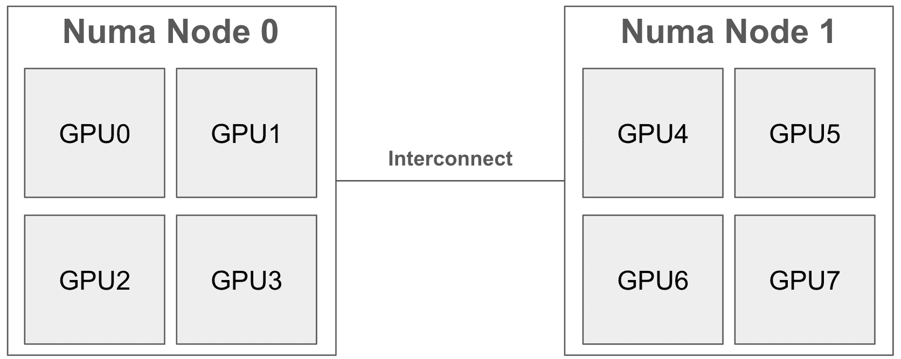

###### 图 3-1. 节点中的 8 个 GPU：其中 4 个连接至 NUMA 节点 0，另外 4 个连接至 NUMA 节点 1

这样，当 CPU 进程要向 GPU 5 提供数据时，它应该运行在与 NUMA 节点 1 相连的 CPU 上，因为 GPU 5 连接至 NUMA 节点 1。Linux 提供了相应工具，包括 `numactl --cpunodebind=<node>`，它可以启动一个绑定到指定 NUMA 节点的进程。你还可以使用 `taskset` 将进程绑定到特定的核心 ID。下面是一个使用 `numactl` 将 `train.py` 脚本绑定到与 GPU 5 相同的 NUMA 节点 1 中某个 CPU 上的示例。

```
numactl --cpunodebind=1 --membind=1 python train.py --gpu 5 &
```

该命令中的 `--membind` 部分同样重要。我们将在下一节讨论 NUMA 友好的内存分配和内存固定。

许多深度学习框架还允许你通过编程方式设置线程亲和性。例如，PyTorch 的 `DataLoader` 允许为基于 CPU 的工作进程设置 CPU 亲和性，如下所示。

```
import os
import psutil
import torch
import torch.distributed as dist
from torch.nn.parallel import DistributedDataParallel as DDP
from torch.utils.data import DataLoader, Dataset

# Set CPU affinity for the main process (the DDP process)
def set_main_process_affinity():
    available_cpus = list(range(psutil.cpu_count()))
    rank = int(os.environ.get("RANK", "0"))
    # For demonstration, pin the main process to one specific CPU based on its rank
    main_affinity = [available_cpus[rank % len(available_cpus)]]
    process = psutil.Process(os.getpid())
    process.cpu_affinity(main_affinity)
    print(f"Main process (rank {rank}) pinned to CPU core(s): {main_affinity}")

# Set CPU affinity for each DataLoader worker
def worker_init_fn(worker_id):
    available_cpus = list(range(psutil.cpu_count()))
    rank = int(os.environ.get("RANK", "0"))
    # Example mapping: assign each worker a CPU based on the rank and worker ID
    assigned_cpu = available_cpus[(rank * 10 + worker_id) % len(available_cpus)]
    process = psutil.Process(os.getpid())
    process.cpu_affinity([assigned_cpu])
    print(f"DataLoader worker {worker_id} (rank {rank}) pinned to CPU core {assigned_cpu}")

# main() function that combines DDP with a DataLoader using the affinity settings
def main():
    # Initialize the distributed process group as required 
    ...
    
    # Set affinity for the main DDP process
    set_main_process_affinity()
    
    # Create your dataset (Fictitious dataset)
    dataset = Dataset()
    
    # Create DataLoader with the worker_init_fn to set affinity for each worker
    dataloader = DataLoader(
        dataset,
        batch_size=32,
        num_workers=4,
        pin_memory=True,
        worker_init_fn=worker_init_fn # set affinity
    )
    
    # Create and move your model to the current device (GPU)
    model = torch.nn.Linear(224 * 224 * 3, 10)  # Example model
    model = model.to("cuda")
    
    # Wrap the model in DistributedDataParallel (DDP)
    ddp_model = DDP(model, device_ids=[
torch.cuda.current_device()
])
    
    # Training loop 
    ...
```

`set_main_process_affinity()` 函数根据进程 rank 将主 DDP 进程分配给特定的 CPU 核心。`worker_init_fn()` 函数被传给 `DataLoader`，以便每个 worker 子进程都固定到特定的 CPU 核心上。这可以最大限度地减少跨 NUMA 流量，并提高数据预处理和传输效率。

在实践中，固定（pinning）可以消除不可预测的 CPU 调度行为。它能确保诸如 GPU 数据加载线程之类的关键线程不会在训练或推理过程中突然被操作系统迁移到另一个 NUMA 节点的核心上。实际上，仅仅通过消除跨 NUMA 流量和 CPU 核心迁移，就可能看到 5-10% 的训练吞吐量提升。这也有助于减少性能抖动和方差。

许多高性能 AI 系统还会禁用 CPU 超线程，以获得每个 CPU 核心更可预测的性能。有些甚至专门预留几个核心给操作系统后台任务，让其余核心完全专用于训练或推理工作负载。

需要特别指出的是，对于 NVIDIA 的 Grace-Blackwell 这类集成式 CPU-GPU 超级芯片，许多传统上对 CPU 到 GPU 数据传输的顾虑都已得到缓解，因为 CPU 和 GPU 共享同一物理内存，并且属于统一架构的一部分。这意味着跨 NUMA 延迟等问题被最小化，数据可以在 CPU 和 GPU 之间更直接地流动。

###### 提示

NVIDIA 将 CPU 和 GPU 集成到单个超级芯片上以解决硬件中的 CPU 到 GPU 瓶颈，这并非巧合。可以预期 NVIDIA 会继续通过硬件创新解决越来越多的瓶颈问题。

即使采用紧密耦合的 CPU-GPU 超级芯片架构，仍然需要通过确保硬件和软件配置正确来优化整个技术栈，使集成系统以最高效率运行。即使在这样紧密耦合的架构中，也要尽量减少数据处理中任何不必要的延迟，以保持 GPU 的充分利用。这包括配置大页、使用高效预取以及固定内存，你将在接下来的章节中看到。

### NUMA 友好的内存分配与内存固定

默认情况下，进程会从当前运行 CPU 所在的 NUMA 节点分配内存。因此，如果你将进程固定到 NUMA 节点 0，其内存自然会来自 NUMA 节点 0 的本地 RAM，这是理想情况。然而，如果操作系统调度器迁移了线程——或者某些内存在你进行绑定之前就已经被分配——你最终可能会遇到不理想的情况：运行在 NUMA 节点 0 中的进程却在使用 NUMA 节点 1 的内存。在这种情况下，每次内存访问都必须跳到另一个 NUMA 节点，从而抵消了 CPU 固定的好处。


为了避免这种情况，`numactl --membind` 选项会强制从特定的 NUMA 节点分配内存。在代码中，也有 NUMA API 甚至环境变量可以影响此配置。一般原则是让内存靠近与 GPU 相近的 CPU。这样，从内存到 CPU 再到 GPU 的数据移动链就都在同一个 NUMA 节点内。以下是与之前相同的示例，但使用了 `--membind=1` 来强制从包含 NUMA 节点 1 的首选 NUMA 节点分配内存。

```
numactl --cpunodebind=1 --membind=1 python train.py --gpu 5 &
```

GPU 内存的另一面称为页锁定（page pinning）、页锁定（page locking）或内存固定（memory pinning）。在向 GPU 传输数据时，固定（页锁定）的主机内存可以显著提高吞吐量。通常，操作系统可以决定将内存页换入换出——或根据需要移动它们。但是，如果你分配了固定内存，操作系统会保证这些内存页保留在物理 RAM 中，不会被换出或移动。内存固定允许 GPU 以高速执行直接内存访问（DMA）传输，而无需担心操作系统可能带来的开销。从固定主机 CPU 内存复制到 GPU 通常比从常规可分页 CPU 内存复制快 2–3 倍。

深度学习框架提供了使用固定内存进行数据加载的选项。例如，PyTorch 的 `DataLoader` 有一个标志 `pin_memory=True`，当为真时，意味着加载的批次将被放置在固定 RAM 中。这加速了 `tensor.to(device)` 操作，因为 CUDA 驱动程序不必即时固定页面。当你使用大批次或每次迭代读取大量数据时，这尤其有益。许多从业者注意到，只需在 PyTorch 中开启 `pin_memory=True` 就能通过减少数据传输瓶颈显著提升性能。

###### 提示

操作系统对用户可锁定（固定）的内存量有限制。这可以通过 `ulimit -l <最大锁定内存>` 命令设置。如果你计划使用大的固定缓冲区，请确保此限制设置得较高——或者为你的用户设置为无限制——否则分配可能会失败。通常，对于大型 AI 工作负载和 HPC 应用程序，会将其设置为无限制。

### 透明大页

除了固定内存并将其绑定到 NUMA 节点之外，我们还应该讨论透明大页（THP）。Linux 内存管理通常使用 4 KB 页面，但当你的进程使用数十甚至数百 GB 内存时（如深度学习数据集、预取批次、模型参数等），管理数百万个微型页面是低效的。

大页——2 MB 甚至 1 GB 的页面——可以通过增大内存块来减少虚拟内存管理的开销。主要好处是减少缺页错误次数，并减轻转换后备缓冲区（TLB）的压力。TLB 是 CPU 用于将虚拟地址映射到物理地址的缓存。更少的、更大的页面意味着 TLB 可以用相同数量的条目覆盖更多内存，从而减少缺失。

通常建议为大型内存工作负载启用大页。Linux 使用 THP，它会尝试尽可能自动使用 2 MB 页面。在现代发行版中，它通常默认启用，采用 `madvise` 或 `always` 模式。你可以通过读取 `/sys/kernel/mm/transparent_hugepage/enabled` 来检查设置。

对于大多数深度学习训练任务，启用 THP 是有益的，这样它对程序是透明的。在这种情况下，你不必更改代码，但会获得 CPU 效率的提升。请注意，大页带来的增益并非在每个场景中都很大。你可能只会看到因缺页错误减少而带来的几个百分点的吞吐量提升。对于极大的内存使用场景，可以使用 `hugetlbfs`（Linux 伪文件系统）来预留显式大页，用于分配 1 GB 页面。然而，这需要更多的手动设置和配置。启用 THP 是一种更简单、更直观的收益。一旦启用，操作系统将自动用 2 MB 页面支持大分配，从而减少内核开销。

现在，除了 CPU 和内存固定之外，还有一些其他操作系统级别的调整值得一提。这些包括线程调度、虚拟内存管理、文件系统缓存和 CPU 频率设置。

### 调度器和中断亲和性

在繁忙的系统上，你要确保重要的线程（如数据管道线程）不会被频繁中断。Linux 默认使用完全公平调度器（CFS），在大多数情况下表现良好。但如果你有一个对延迟敏感的线程，例如向 GPU 提供数据的线程，你可以考虑为该线程使用实时先入先出（FIFO）或轮询（RR）优先级调度。这将确保运行不会被普通线程抢占。但是请谨慎使用，因为实时线程如果管理不当可能会使其他进程饿死。不过在实际中，如果你已将线程固定到专用核心，通常不需要调整实时线程优先级，但值得留意。

另一个技巧是使用 `cset` 或内核启动参数（如 `isolcpus` 内核选项）完全隔离核心供你的进程使用。在这种情况下，操作系统调度器将这些 CPU 核心让给你，按你的程序意愿使用。

此外，你可以将硬件中断以 NUMA 感知的方式绑定到特定核心，以避免跨 NUMA 节点的中断可能驱逐另一个 NUMA 节点上有用的缓存数据。如果你的 GPU 或 NIC 在 NUMA 节点 0 中生成硬件中断，你希望这些中断由同一 NUMA 节点上的核心处理。否则，来自另一个 NUMA 节点的随机核心必须跨 NUMA 节点通信。可以配置像 `irqbalance` 这样的工具，例如，NUMA 节点 0 中 InfiniBand 卡的中断由 NUMA 节点 0 中的 CPU 核心处理。

### 虚拟内存和交换

无需多言，你应该始终尽量避免内存交换。如果进程的任何一部分内存被交换到磁盘，你会看到灾难性的、多个数量级的性能下降。GPU 程序往往会为数据缓存分配大量主机内存。如果操作系统决定将一些数据从内存换出到磁盘，GPU 在需要访问这些数据时会遇到巨大延迟。

我们建议设置 `vm.swappiness = 0`，这告诉 Linux 除非在极端内存压力下，否则避免交换。此外，请确保有足够的内存用于你的工作负载，或者设置限制以防止过度使用。另一个相关设置是前面提到的 `ulimit -l` 用于锁定内存。如果要防止内存交换，你应该将该限制设置得高一些，否则可能会遇到过度的内存交换。同样，对于使用大量内存的大型 AI 工作负载，通常会将此限制设置为无限制。

### 文件系统缓存和写回

对于大型训练任务，最佳实践是将频繁的检查点写入磁盘，以防需要从已知的良好检查点重启失败的任务。然而，在检查点期间，大量突发数据可能会填满操作系统页面缓存并导致停滞。调整 `vm.dirty_ratio` 和 `vm.dirty_background_ratio` 可以控制写入刷新到磁盘之前可以缓冲的数据量。例如，如果你正在写入数 GB 的检查点，你可能希望允许大量脏页缓存累积并在后台刷新，这样你的训练进程不会被文件写入阻塞。另一个选择是在单独的线程中执行检查点。PyTorch 中一个较新的选项是从集群中的节点写入分布式检查点分区。在这种情况下，当故障重启后加载检查点时，检查点分区会被合并。

### CPU 频率和 C 状态


## CPU 与操作系统性能调优

默认情况下，许多计算节点会让 CPU 以节能模式运行，这种模式要么降低 CPU 主频，要么在空闲时让 CPU 进入睡眠状态。这有助于节省能源、减少热量并降低成本。在模型训练期间，由于 GPU 正在处理其数据集中的最后几个批次，CPU 可能不会始终达到 100% 的利用率。然而，这些电源管理特性可能会在系统因新任务到达而再次唤醒 CPU 时引入额外的延迟。

为了获得最大且一致的性能，AI 系统通常会将 CPU 频率调节器配置为“performance”模式，使 CPU 始终保持最高频率。这可以通过 `cpupower frequency-set` 命令或在 BIOS 中完成。

同样，禁用深层 C 状态可以防止核心进入低功耗睡眠状态。CPU C 状态是由系统 ACPI 规范定义的省电模式。当 CPU 核心空闲时，它可以进入 C 状态以节省能源。C 状态越深，节省的电力越多，但当工作到达时，核心“唤醒”所需的时间也可能越长。禁用更深的 C 状态可以消除过度的延迟尖峰。`C0` 表示活动状态，高于 `C0` 的所有状态都代表更深的睡眠状态。

本质上，我们可以用一点额外的功耗来换取更灵敏的 CPU 行为。在 GPU 是主要功耗大户的训练场景中，只要能让 GPU 保持“喂饱”状态，稍微增加一点 CPU 功耗通常是没问题的。例如，如果数据加载线程因等待数据而睡眠，CPU 进入深度 `C6` 状态，此时 CPU 的很大一部分会被断电以最大化节能效果。

如果 CPU 进入更深的睡眠状态，它可能需要几微秒才能唤醒。虽然这段时间不长，但许多微秒累积起来，如果管理不当，可能会导致 GPU 气泡。气泡是指 GPU 等待 CPU 恢复数据处理的时段。通过让 CPU 保持就绪状态，我们可以减少这类卡顿。许多服务器 BIOS 都提供了禁用 C 状态（或至少限制它们）的设置。

总结一下 CPU 和操作系统调优的要点：你应该将工作负载绑定到硬件拓扑上，利用 NUMA 的优势，并消除操作系统干扰。确保将每个 GPU 的工作固定到最近的 CPU 核心和内存上。建议使用大页（huge pages）和锁定内存来加速内存操作。你应始终关闭任何可能引入不可预测延迟的功能，例如过多的上下文切换、频率缩放和内存到磁盘的换页。

最终的结果应该是：CPU 以 GPU 能够消耗的速度向 GPU 提供数据，而操作系统不会在错误的核上调度任务，也不会在错误的时间抢占 CPU 周期。在一台调优良好的 GPU 服务器上，你可能会注意到 CPU 使用率并不极高，因为 GPU 承担了繁重的工作，但 CPU 使用率应与 GPU 保持一致和同步。CPU 在 GPU 处理当前批次时保持足够活跃，以准备下一批次。每个 GPU 的利用率曲线都应保持在接近顶部的水平，仅在绝对必要的同步点才会下降——而不是因为 GPU 在等待数据或卡在缓慢的 CPU 上。

## 面向性能的 GPU 驱动与运行时设置

我们已经对 CPU 侧进行了优化，但 GPU 驱动和运行时也有一些重要设置会影响性能——尤其是在多 GPU 和多用户场景中。NVIDIA GPU 有几个可调参数，如果调校得当，可以减少开销并改善多个工作负载共享 GPU 的方式。我们将介绍 GPU 持久模式、多进程服务（Multi-Process Service）、多实例 GPU 分区，以及其他一些考虑因素，如时钟设置、ECC 内存和内存不足行为。

### GPU 持久模式

默认情况下，如果没有应用程序正在使用 GPU，驱动程序可能会将 GPU 置于较低功耗状态，并卸载部分驱动上下文。当下一个应用程序出现并希望使用 GPU 时，初始化会产生成本。驱动程序重新启动所有功能可能需要大约一两秒的时间。对于周期性释放并重新获取 GPU 的工作负载，这一初始化开销可能会对性能产生负面影响。例如，考虑一个作业频繁启动和停止的训练集群。或者一个低流量的推理集群，每次新的推理请求到达时都必须唤醒 GPU。在这两种情况下，该开销都会降低整体工作负载的性能。

持久模式是通过 `nvidia-smi -pm 1` 启用的一项设置，它使 GPU 驱动程序保持加载状态，并让硬件处于就绪状态，即使没有应用程序处于活动状态也是如此。本质上，它要求系统在空闲时不要完全关闭 GPU。GPU 保持唤醒状态，因此下一个作业的启动延迟为零。

在 AI 集群中，通常会在服务器启动时就在所有 GPU 上启用持久模式。这样，当作业开始时，GPU 已经完成初始化，可以立即开始处理。这并不会让你的实际计算变得更快，因为它不会加速数学运算，但它能削减作业启动延迟，并防止冷启动延迟。

GPU 持久模式也有助于交互式使用：如果没有持久模式，你在空闲一段时间后发出的第一个 CUDA 调用可能会因驱动程序重新初始化 GPU 而停顿。启用持久模式后，该调用会快速返回。唯一的缺点是空闲功耗会略高一些，因为 GPU 保持在更高的就绪状态，但对于大多数数据中心 GPU 来说，这是为了性能一致性而可以接受的权衡。一旦具有 `sudo` 权限的管理员设置了 GPU 持久模式，你就可以享受其好处，并继续处理其他优化工作。

### 多进程服务（MPS）

通常，当多个进程共享单个 GPU 时，GPU 的调度器会在它们之间进行时间片调度。例如，如果两个 Python 进程各自有一些内核要在同一个 GPU 上运行，GPU 可能会先执行一个进程的内核，然后再执行另一个进程的内核，以此类推。如果这些内核很短，并且它们之间存在空闲间隔，GPU 最终可能会利用率不足，因为它正在进行“乒乓”式的上下文切换，而没有让工作重叠。

NVIDIA 的多进程服务（MPS）是一项功能，它创建了一个“保护伞”，让多个进程可以在 GPU 上并发运行，而无需严格的时间片调度。借助 MPS，只要 GPU 资源（流式多处理器、张量核心等）可用，GPU 就可以同时执行来自不同进程的内核。MPS 本质上将各进程的上下文合并到一个调度器上下文中。这样，你就不必承担独立进程之间切换和空闲的全部成本。

MPS 何时有用？对于模型训练，如果你通常每个 GPU 运行一个进程，可能不需要使用 MPS。但如果你有这样的场景：在一台大型 GPU 上运行多个推理作业，MPS 就是改变游戏规则的关键。假设你拥有一个强大的 GPU 或 GPU 集群，但你的推理作业——或一组多个推理作业——并没有充分利用它。例如，考虑在一个 40 GB 的 GPU 上运行四个独立的推理作业，每个作业使用 5-10 GB 内存，且仅使用 30% 的 GPU 计算能力。默认情况下，每个推理作业获得一个时间片，因此在任何时刻，只有一个作业的工作实际上在 GPU 上运行。这导致 GPU 平均有 70% 的时间处于空闲状态。

如果你为这些推理作业启用 MPS，GPU 可以交错执行它们的工作，这样当一个作业在等待内存时，另一个作业的内核可能会填满 GPU，等等。结果是整体 GPU 利用率更高。在实践中，如果两个进程各自使用一个 GPU 的 40%，启用 MPS 后，你可能会看到 GPU 以 80-90% 的利用率同时服务这两个进程。例如，两个训练进程各自单独运行需要 1 小时——如果它们在同一个 GPU 上顺序运行则需要 2 小时——在 MPS 下它们可以并行运行，总共只需略多于 1 小时即可完成，而不是顺序运行 2 小时。这种 2 倍加速是将两个训练进程的工作合并起来并让 GPU 保持完全忙碌的结果。


为了便于理解，可以想象在没有 MPS 的情况下，进程 A 和进程 B 各自周期性地启动内核。GPU 的调度可能会呈现 A-B-A-B 的交替模式，并且中间存在间隙，因为每个进程都在等待，如 图 3-2 所示。

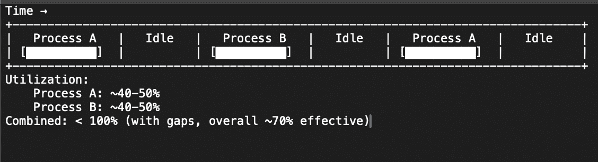

**图 3-2.** GPU 在运行进程 A 的内核和进程 B 的内核之间交替切换，并产生空闲间隙：一个进程在等待，而另一个进程处于活动状态。

启用 MPS 后，调度更接近于 A 和 B 重叠执行：只要 A 没有使用 GPU 的某些部分，B 的工作就可以同时使用这些部分，反之亦然。这种重叠消除了空闲间隙，如 图 3-3 所示。

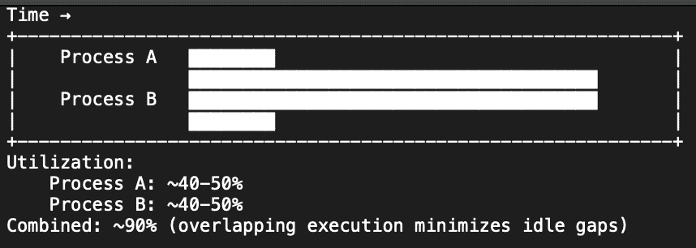

**图 3-3.** 消除进程 A 和 B 的调度间隙后，原本单独使用利用率约为 40% 到 50% 的两个进程，在结合 MPS 后可以达到约 90% 的利用率。

设置 MPS 需要运行一个 MPS 控制守护进程（`nvidia-cuda-mps-control`），它会启动一个 MPS 服务器进程来调度 GPU 访问。在现代 GPU 上，MPS 更加精简，因为客户端（也就是这些进程）可以直接与硬件通信，计算节点本身的干预极少。通常，你会在一个节点上启动 MPS 服务器——通常每个 GPU 一个或每个用户一个——然后通过一个环境变量将你的 GPU 作业连接到 MPS。该服务器下的所有作业将并发共享 GPU。

MPS 的另一个特性是能够为每个客户端设置活跃线程百分比。这限制了客户端可以使用多少个流式多处理器（本质上就是 GPU 核心）。如果你想保证服务质量（QoS），这个特性会很有用；例如，两个作业各自最多只能获得 GPU 执行资源的 50%。如果没有显式设置，这些作业就会互相竞争，尽可能占用它们能获得的 GPU 资源。

请注意，MPS 不会对 GPU 显存进行分区，因此所有进程将共享完整的 GPU 显存空间。MPS 主要涉及计算共享和调度。问题在于，某个进程可能会请求大量 GPU 显存，从而导致 GPU 上发生显存不足（OOM）错误，并导致该 GPU 上运行的所有其他进程被终止。这会造成很大的破坏。此外，如果某个程序本身就将 GPU 的利用率占满到 100%，MPS 也无法神奇地让它运行得更快，因为利用率不可能超过 100%。只有当单个作业留出一些空闲资源、让其他作业可以填补时，MPS 才有价值。

MPS 的另一个限制是，默认情况下，所有 MPS 客户端必须以同一个 Unix 用户身份运行，因为它们共享一个上下文。在多用户集群中，这意味着 MPS 通常是在调度器级别配置的，使得同一时间只有一个用户的作业共享 GPU。否则，你也可以配置一个系统级的 MPS，让所有用户共享，但要知道，从安全角度来看，这些作业之间并没有隔离。最近的 NVIDIA 驱动程序引入了多用户 MPS 的概念，但截至本文撰写时，它在生产环境中仍不太常见。

MPS 的一个具体替代方案是 Kubernetes 中对 GPU 进行时间切片的功能。Kubernetes 上的时间切片允许设备插件按时间将不同的 Pod 调度到同一块 GPU 上。例如，四个 GPU 各自会获得 25% 的时间。这有点像一种自动化的分时算法，不需要 MPS。然而，这并不会重叠执行，它只是比默认驱动程序更快地切换。时间切片可能适用于交互式工作负载，在这种情况下，你更希望获得隔离，而代价是一些空闲时间。对于高吞吐量作业，使用 MPS 重叠执行，或使用多实例 GPU 对 GPU 进行切分，通常比细粒度的时间切片更好，这一点将在下文讨论。

### 多实例 GPU

从 NVIDIA A100 Ampere 一代开始，GPU 可以使用多实例 GPU（MIG）在硬件层面被划分为多个实例。MIG 允许将一块 GPU 切分为最多 7 个更小的逻辑 GPU——每个逻辑 GPU 都拥有自己专用的显存和计算单元（即流式多处理器，SM）。例如，一块 192 GB 的 Blackwell B200 GPU 可以被划分为 7 个实例，每个实例约 27 GB（192 GB / 7 个实例）和 20 个 SM（140 个 SM / 7 个实例）。从软件的角度来看，每个实例都像一块独立的 GPU，因为它拥有自己的显存、自己的流式多处理器，甚至独立的引擎上下文。

MIG 的好处在于强大的隔离性以及为每个作业提供有保障的资源。如果你有多个用户或多个服务，每个服务只需要例如 10 GB 的逻辑 GPU 显存，你可以把它们打包到一块物理 GPU 上，而不会让它们互相干扰彼此的内存或计算。这是一种虚拟化形式，但由硬件实现，因此开销非常低——可能只有几个百分点——但代价是失去了一些灵活性。如果某个实例处于空闲状态，它无法将自己的资源借给另一个实例，因为它们是硬性分区的。此外，如果你没有使用所有 MIG 切片，就会让这些资源处于碎片化状态，从而造成浪费。规划与工作负载匹配的分区大小非常重要。

一个重要的运维注意事项是：要使用 MIG，你通常需要在系统层面——或者至少是节点层面——进行配置。必须先将 GPU 置于 MIG 模式，创建切片，重启节点，然后这些切片才会作为独立设备出现在系统中。

**提示**

Kubernetes 设备插件会将 MIG 设备列为资源，例如 `nvidia.com/mig-2g.10gb` 对应一个 2 GPU、10 GB 的切片。

作业可以专门请求 MIG 设备，但你必须小心地进行调度，以便使用所有切片。例如，如果你有 7 个切片的配置，而某个作业只占用一个切片，那么其余 6 个切片应该用其他作业填满，否则你会让大量资源闲置。例如，你可以将集群中的某些节点配置为使用 MIG 来运行小型推理作业，并将其他节点配置为不使用 MIG 来运行大型训练作业。

对于跨多 GPU 的大规模模型训练作业和推理服务器，MIG 通常没有用处，因为我们希望使用全部 GPU。另一方面，对于可以运行较小 GPU 分区的多租户、小模型推理服务器，MIG 及其隔离特性可能会很有用。

总之，只有当你需要在同一块 GPU 上以强隔离方式运行多个独立作业时，才启用 MIG。不要将 MIG 用于跨 GPU 的大规模分布式训练或推理，因为你希望获得 GPU 及其高速互连的全部性能。

在我们的大型基于 Transformer 的模型训练和推理场景中，我们会关闭 MIG。但了解一下这个特性是件好事。也许某个集群可以动态切换模式：白天在大量小型训练或推理实验进行时运行 MIG，晚上关闭 MIG，以运行使用整块 GPU 的大型训练作业。

### GPU 时钟速度与纠错码

NVIDIA GPU 具有一个称为 GPU Boost 的功能，它会在功耗和热限制范围内自动调整核心时钟。大多数情况下，你应该让 GPU 自行管理。但有些用户为了结果一致性而喜欢锁定时钟，使 GPU 始终以固定的最高频率运行。这样一来，不同运行之间的性能就会保持稳定，不会受到功耗或温度变化的影响。在进行基准测试时，这一点极其重要，也是一个常见问题，因为后续运行可能会因过热而降频。如果你没有意识到这一点，你可能会无意中错误解读后续运行的不佳结果；这些结果不佳可能是因为前几次运行引发的过热导致 GPU 降频。


你可以使用 `nvidia-smi -lgc` 锁定核心时钟，并使用 `-ac` 锁定内存时钟。这有助于确保 GPU 以一致的频率运行，这对于基准测试或需要可重现的性能结果时尤其有用。通过锁定时钟，你可以防止默认自动加速（auto-boost）行为可能引起的波动，这种波动会随散热条件或供电情况而变化。

有些人可能会选择稍微降低 GPU 的时钟频率以减少热量，如果他们计划运行非常长久的作业，并希望在基准测试运行期间避免触发热降频。然而，除非你看到由于热节流而导致的 GPU 性能波动，否则通常不需要锁定时钟，因为数据中心 GPU 通常具有功率和温度余量，以及适当的空气或液体冷却。如果你追求极致的确定性和一致性，那么锁定时钟是需要留意的事情。不过，通常让 GPU 保持默认的自动加速模式即可。

GPU 上的纠错码（ECC）内存是另一个需要考虑的因素。ECC 可以确保，例如，如果出现由宇宙射线引起的单比特内存错误，内存能够在运行中即时纠正。如果出现双比特错误，该错误会被检测出来，并向调用代码抛出一个错误。NVIDIA 数据中心 GPU 通常默认启用 ECC。

禁用 ECC 可以释放少量内存，因为 ECC 需要额外比特进行错误检查。这也许能通过减少即时错误检查的开销而带来轻微的性能提升，但通常只有几个百分点。然而，关闭 ECC 也会移除关键的内存错误保护，这可能导致系统不稳定或数据损坏而未被察觉。

此外，在 NVIDIA 许多较新的数据中心 GPU（包括 Hopper 和 Blackwell）上，ECC 始终启用且无法禁用。这种设计选择有助于在严苛的高性能计算环境中确保可靠性和数据完整性。

对于在大型模型上进行的长时间训练或推理作业，一个单一的内存错误可能会使作业完全崩溃，甚至更糟的是，在没有任何预警的情况下静默破坏你的模型。因此，对于任何严肃的 AI 工作负载，建议始终保持 ECC 开启。唯一可能考虑关闭 ECC 的情况是在研究环境中，你愿意承担风险，因为你需要那额外的一丁点内存，以便让你的模型能够装进内存有限的 GPU 集群。

切换 ECC 模式需要重置 GPU，并且很可能需要重启当前正在该 GPU 上运行的作业。因此，这不是一个适合频繁切换的开关。让 ECC 保持开启以换取稳定性和可靠性。安心所带来的价值远超过关闭 ECC 所能带来的微不足道的加速。

### GPU 内存超订、碎片化与内存不足处理

与 CPU RAM 不同，默认情况下并不存在 GPU“交换”内存这种东西。如果你尝试分配超过可用量的 GPU 内存，你会收到一个不友好的内存不足（OOM）错误，并且伴随一个更不友好的进程崩溃。有几种机制可以缓解这一问题，包括允许内存动态增长、CPU 与 GPU 之间的统一内存，以及内存池和缓存分配器。

默认情况下，一些框架（例如 TensorFlow）在启动时会占用所有可用的 GPU 内存，以避免碎片化并提高性能。如果你不了解这一点，在共享 GPU 的场景下可能会非常糟糕。PyTorch 默认只按需分配 GPU 内存。幸运的是，TensorFlow 有一个选项（`TF_FORCE_GPU_ALLOW_GROWTH=true`）可以使其从较小内存开始，并按需动态增长 GPU 内存使用量——类似于 PyTorch。当然，PyTorch 和 TensorFlow 都不会让你分配超过 GPU 可用容量的内存。但这种惰性分配方式在多租户场景下表现更好，因为两个进程不会从一开始就同时尝试分配最大可用 GPU 内存。

CUDA 的统一内存系统允许你分配内存，而无需预先决定它驻留在 CPU 还是 GPU 上。CUDA 运行时负责按需迁移页面。像 Hopper 和 Blackwell 这样的现代 NVIDIA GPU 包含了使用页面迁移引擎（PME）进行按需分页的硬件支持。当 GPU 可用内存不足时，PME 会自动在 GPU 内存和主机 CPU RAM 之间迁移内存页面。然而，虽然 PME 提供了灵活性，但与为工作负载准备足够的 GPU 内存相比，依赖它可能会带来性能损失。

不过，这种从 GPU 到 CPU 的内存卸载可能很慢，因为正如我们在前一章所学到的，CPU 内存 I/O 比 GPU 高带宽内存（HBM）I/O 更慢。这个机制主要是为了方便那些尝试运行超出 GPU RAM 容量的模型的从业者。然而，对于性能关键型工作负载，你通常应尽可能避免依赖统一内存超订。它是作为安全网而不是让脚本直接崩溃而存在的，但当 GPU 内存超订时，你的作业会运行得更慢。

像 PyTorch 这样的库使用缓存分配器，这样当你释放 GPU 内存时，它不会立即将内存返回给操作系统，而是保留它以供后续分配重用。这避免了内存碎片化，也避免了反复请求操作系统分配同一内存块的开销。你可以通过 `PYTORCH_CUDA_ALLOC_CONF` 等环境变量来配置 PyTorch 的分配器，以设置最大池大小。

如果你遇到 GPU OOM 错误（你迟早肯定会遇到），它很可能是由内存碎片化或过度内存缓存造成的。你可以尝试使用 PyTorch 的 `torch.cuda.empty_cache()` 清除缓存，但这几乎总是意味着你的工作负载确实需要那么多内存。

从操作系统的角度来看，你可以使用 Linux cgroups 或 Docker 的选项来对给定进程强制执行 GPU 内存限制。例如，使用 Docker 时，你可以通过 `--gpus <device>:<mem_limit>` 运行容器，人为地限制容器可分配的 GPU 内存量。这样，如果某个进程试图使用超过（比如说）10 GB 的内存，它会被终止或报错，而不会影响其他进程。在多租户节点上，这有助于隔离作业。在每 GPU 单作业的情况下，通常不会设置内存限制，因为你希望让作业尽可能多地使用可用的 GPU 内存。

一般来说，GPU 内存不足是可以在应用层解决的问题。例如，你可以减小数据批量大小、降低模型权重精度，甚至减少模型参数数量（如果可行的话）。一个最佳实践是在模型训练和推理期间使用 `nvidia-smi` 或 NVML API 监控 GPU 内存使用情况。如果你接近内存限制，可以考虑一些变通方法，例如减小批量大小、在训练中使用梯度检查点，或其他降低内存占用量的技术。

此外，你应该确保 CPU 内存没有被交换，因为这会间接损害 GPU 利用率和有效吞吐量（goodput）。每次 GPU 尝试从 CPU 主机获取数据时，如果主机内存页已被交换到磁盘，你的性能就会受到慢得多的磁盘 I/O 的瓶颈限制。因此，务必将这些降低内存占用的最佳实践与之前关于内存固定、增大 `ulimit`、禁用 `swappiness` 等建议结合起来。


最后，建议始终让 GPU 驱动保持加载状态，而不要在作业之间卸载 GPU 驱动。这类似于 GPU 持久模式，但层次更深。某些集群为了释放操作系统内核内存和保证安全，会配置为在没有作业运行时卸载驱动。但是，如果你这样做，下一个作业就必须承担重新加载 GPU 驱动的开销，并且如果使用了 MIG，还需要重新配置 MIG 切片。通常，你希望驱动以及任何 MIG 配置在作业之间保持持久。只有在排查问题或升级驱动时，才需要卸载 GPU 驱动。因此，集群管理员通常会将系统配置为：机器启动后，NVIDIA 驱动模块始终存在。

## 面向 GPU 的容器运行时优化

许多 AI 系统使用编排工具和容器运行时来管理软件环境。Kubernetes 和 Docker 在 AI 基础设施中很常用。使用容器可以确保包括 CUDA 和库版本在内的所有依赖项保持一致。这避免了“在我机器上是好的”这类问题。容器会引入一些复杂性和少量开销，但只要配置得当，你就能在使用容器时获得接近裸机的 GPU 工作负载性能。

在节点上运行的容器并不是传统的虚拟机（VM）。与虚拟机不同，容器共享宿主机的操作系统内核，因此 CPU 和内存操作可以接近原生速度执行。同样，对于 GPU 工作负载，容器可以直接使用宿主机的 GPU 驱动和硬件，开销可以忽略不计。这得益于 NVIDIA 的容器工具包（Container Toolkit），它允许 Docker 容器直接使用宿主机上的 GPU。

### NVIDIA 容器工具包与 CUDA 兼容性

将容器与 GPU 结合使用的一个挑战是：确保容器内的 CUDA 库与宿主机上的驱动匹配。NVIDIA 通过其容器工具包和基础 Docker 镜像解决了这个问题。宿主机提供 NVIDIA 驱动，而你要记住，这个驱动与内核和硬件紧密集成。在容器内部，通常会有某个版本的 CUDA 运行时库。

一般规则是：宿主机的 NVIDIA 驱动版本必须至少与容器内 CUDA 版本所需的最低驱动版本一样[新](https://docs.nvidia.com/cuda/cuda-toolkit-release-notes/index.html)。如果你运行的是 CUDA 12.8 的容器，那么宿主机必须具有 570.124.06 或更高版本的 NVIDIA 驱动。如果宿主机驱动版本较旧，则 CUDA 12.8 的容器可能无法正常工作。

> **提示：** 最简单的方法是使用 NVIDIA 官方基础 Docker 镜像，这些镜像来自 NVIDIA GPU 云（NGC）或 DockerHub 镜像仓库。这些仓库中的镜像经过充分测试，并说明了它们在宿主机上需要的 NVIDIA 驱动版本。

### NVIDIA 容器运行时

另外，NVIDIA 的容器运行时实际上可以在运行时将宿主机的驱动库注入容器，因此你甚至不需要在镜像中附带 NVIDIA 驱动。相反，你只需依赖宿主机的驱动。再次强调，之所以可行，是因为容器不像传统虚拟机那样完全隔离。Docker 容器可以使用宿主机的设备、卷和库。

例如，容器内的代码会看到来自宿主机 CUDA 工具包的 `libcudart.so`。它直接在宿主机上调用这个库，所以一切都能正常工作。如果你不匹配版本，比如在容器中使用较新的 CUDA 版本而宿主机驱动较旧，你很可能会遇到错误。因此，匹配 CUDA 和驱动版本非常重要。

关键要点是：在 GPU 容器中没有 Hypervisor 或虚拟化层。容器直接共享宿主机的内核和驱动，所以当内核在 GPU 上启动时，就像从宿主机启动一样。这意味着你不会因为 Docker 式虚拟化而损失性能——除非你使用的是 VMware 或 SR-IOV 虚拟 GPU 之类的技术，那是一种需要调优的特殊场景。使用 Docker + NVIDIA，基本上等同于裸机性能。

### 避免容器叠加文件系统开销

在 Docker 容器中运行与直接在宿主机上运行的主要区别可能在于 I/O。容器通常使用联合文件系统，它将多个底层文件系统（如宿主机文件系统和容器文件系统）透明地叠加成单一的统一视图。

在 OverlayFS 这类联合文件系统中，来自多个来源的文件和目录会显示为属于一个文件系统。这种机制对容器尤其有用，因为基础镜像层的只读文件系统会与可写的容器层结合在一起。

不过，使用叠加文件系统时会有一些开销。这种额外延迟来自：文件系统必须检查多个底层（包括只读和可写）以确定应返回哪个版本的文件。与从单个简单文件系统读取相比，额外的元数据查找和合并这些层的逻辑会增加少量开销。

此外，写入时还会涉及叠加使用的写时复制（CoW）机制。CoW 意味着当你修改只读层（例如基础镜像）中的文件时，必须先将文件复制到可写层。然后写操作会写入这个复制的可写文件，而不是原始的只读文件。如前所述，读取一个被修改的文件需要同时查看只读层和可写层，以确定应该返回哪个正确版本。

模型训练在读取数据集、加载模型和写入模型检查点时，往往涉及大量 I/O 操作。为了解决这个问题，你可以使用绑定挂载（bind mount）将宿主机目录或网络文件系统挂载到容器中。

绑定挂载会绕过叠加层，因此其性能类似于直接在宿主机上进行磁盘 I/O。如果宿主机的文件系统是 NVMe SSD 或 NFS 挂载，你能获得底层存储设备的全部性能。我们故意不将数 TB 的数据集打包进镜像，而是通过挂载将数据引入。

例如，如果你的训练数据在宿主机的 `/data/dataset` 目录下，你可以使用 `-v /data/dataset:/mnt/dataset:ro` 来运行容器，其中 `ro` 表示“只读”挂载。然后你的训练脚本从 `/mnt/dataset` 读取数据。这样，你就是直接从宿主机文件系统读取。

实际上，最佳实践是避免对容器的可写层进行大量数据读写。相反，将宿主机的数据目录和输出目录挂载到容器中。你要确保 I/O 不会因为容器写时复制机制的开销而成为瓶颈。

### 减小镜像体积以加快容器启动

如果镜像很大并且需要通过从网络拉取，容器启动时间可能会慢很多。但在典型的长时间训练循环中，几分钟的启动时间与几小时、几天甚至几个月的训练时间相比微不足道。不过，仍然值得让镜像保持相对精简，不要包含不必要的构建工具或临时构建文件。这样可以节省磁盘空间并缩短容器启动时间。

一些 HPC 中心更倾向于使用 Singularity（Apptainer）而不是 Docker，因为它可以在用户空间中运行镜像，而无需 root 守护进程。它还直接使用宿主机文件系统，并且除了操作系统已有的开销外，通常几乎为零开销。


无论是使用 Docker 还是 Singularity（Apptainer），研究和基准测试都已表明，只要配置得当，这些容器解决方案在容器内运行与直接在宿主机上运行之间的性能差异通常仅有几个百分点。本质上，如果有人给你一份 GPU 利用率和吞吐量的日志，你很难仅从日志本身判断任务是否运行在容器中。

## 面向拓扑感知的容器编排与网络的 Kubernetes

Kubernetes 是一种流行的容器编排器，广泛应用于包括 AI 训练和推理在内的各种场景。与 NVIDIA Container Toolkit 类似，NVIDIA 为其 GPU 提供了一款 Kubernetes 设备插件，名为 NVIDIA [GPU Operator](https://github.com/NVIDIA/gpu-operator)。当你使用该设备插件在 Kubernetes 上部署容器时，Kubernetes 会负责将 GPU 提供给容器使用。你只需在 Kubernetes Pod 规范中请求 GPU，设备插件就会为你挂载`/dev/nvidia*`设备。GPU Operator 设备插件还会将宿主机上的驱动库挂载到容器中。

当使用 Kubernetes 编排基于 GPU 的容器时，你希望它以感知硬件拓扑（包括 NUMA 节点和网络带宽配置）的方式为容器分配资源。然而，默认情况下，Kubernetes（K8s）并不具备拓扑感知能力。它将每个 GPU 视为一项资源，但并不知道`GPU0`和`GPU1`是否位于同一 NUMA 节点，或者它们是否使用相同的 NVLink 互连。这可能产生很大影响。

设想一台 8 GPU 服务器，其中两组各 4 个 GPU，每组之间通过 NVLink 连接。如果你向 Kubernetes 请求 4 个 GPU 用于一个任务，理想情况下 K8s 会分配给你 4 个全部通过 NVLink 互连的 GPU（因为它们可以更快地共享数据）。但如果 K8s 从系统中任意位置选择 4 个 GPU，你的任务可能会被分配到一个机架上的 2 个 GPU 和另一个机架上的 2 个 GPU。这会在 GPU 到 GPU 的通信路径中引入更慢的多机架（如 InfiniBand 或 Ethernet）互连，从而可能使 GPU 间带宽减半。

为避免资源争用，你应该尽量预留所需资源，或为任务请求整个节点。对于容器/Pod 的放置，应使用 [Kubernetes Topology Manager](https://kubernetes.io/docs/tasks/administer-cluster/topology-manager/) 组件将 Pod 与 CPU 亲和性和 NUMA 节点对齐，使容器分配的 CPU 与 GPU 绑定在同一 NUMA 节点上。

### 使用 Kubernetes Topology Manager 编排容器

幸运的是，Kubernetes Topology Manager 和 NVIDIA 硬件感知的 GPU Operator 设备插件可以提供详细的拓扑信息。例如，它们可以检测到 GPU 0 连接到 NUMA 节点 0、NVLink 域 A 和 PCIe 总线 Z。然后，Kubernetes 调度器可以利用这些信息，以最优化的方式将容器分配给 GPU，以实现高效处理和通信。

GPU 的拓扑感知调度仍在不断发展。在某些环境中，管理员可能仍使用节点标签显式标记 GPU 或节点拓扑，以确保多 GPU Pod 放置在 GPU 共享相同 NVLink 域或 NUMA 节点的宿主机上。

就我们的目的而言，如果你在 Kubernetes 中运行多 GPU 任务，请确保启用拓扑感知调度。这通常涉及配置 Kubernetes Topology Manager 策略，使用“`best-effort`”、“`restricted`”或某些情况下的“`single-numa-node`”等选项。

另外，请务必使用最新的 NVIDIA 设备插件，它支持将多 GPU Pod 打包到连接到同一 NUMA 节点的 GPU 上。此设置有助于确保最佳性能，方法是尽量减少跨 NUMA 节点通信并降低多节点 GPU 工作负载的延迟。

### 使用 Kubernetes 和 SLURM 进行作业调度

在多节点部署中，作业调度器对于最大化所有节点的资源利用率至关重要。通常，训练集群会部署 SLURM，而推理集群通常更青睐 Kubernetes。然而，集成了 SLURM 与 Kubernetes 的混合解决方案已经出现。开源 [Slinky](https://github.com/SlinkyProject) 项目和 CoreWeave 的 [SUNK](https://docs.coreweave.com/docs/products/sunk) 产品就是这类集成解决方案的示例，可简化跨训练和推理工作负载的集群管理。

这些系统负责将 GPU 分配给作业，并协调跨节点的进程启动。如果训练作业请求 8 个节点且每个节点 8 个 GPU，调度器将识别符合条件的节点，并使用`mpirun`等工具或 Docker 等容器运行时启动作业，确保每个进程都感知到作业中所有可用的 GPU。许多集群还依赖经过充分验证的 Docker 仓库（如 NVIDIA 的 NGC Docker 仓库）来保证所有节点上软件环境的一致性——包括 GPU 驱动、CUDA 工具包、PyTorch 库和其他 Python 包。

SLURM 也存在类似问题。SLURM 具有“通用资源”（generic resources）概念，你可以定义某些 GPU 连接到特定的 NUMA 节点或 NVLink/NVSwitch。然后在作业请求中，你可以要求获得例如连接到同一 NUMA 节点的 GPU。如果配置不当，调度器可能将所有 GPU 视为相同资源，从而为多 GPU 容器请求提供不理想的分配。正确的配置可以避免不必要的跨 NUMA 节点和跨 NVLink GPU 通信开销。

### 使用多实例 GPU（MIG）切分 GPU

如果你使用 NVIDIA 的多实例 GPU（MIG）将 GPU 切分为多个分区，调度器需要感知这些切片。例如，Kubernetes 会将每个 MIG 实例视为类似“`nvidia.com/mig-3g.20gb`”的资源。你可以请求两个这样的实例，K8s 会将你的 Pod 放置到至少有两个空闲 MIG 实例的节点上。

MIG 的一个运维缺点是，在 MIG 模式和普通（非 MIG）模式之间切换 GPU 需要重启计算节点以重置 GPU。因此，调度器不能很容易地为每个作业动态切换。通常，你需要预先创建 MIG 分区，并让该配置保持运行一段时间。你可以将一个 K8s 节点标记为“`mig-enabled`”，另一个标记为“`mig-disabled`”，然后让调度器相应地放置作业/Pod。这更多是运维层面的细节，但了解 MIG 是一种静态分区而非动态调度决策是很好的。

###### 提示

使用 MIG 时建议开启持久模式，这样即使没有任何作业在运行，MIG 配置也能在 GPU 上保持激活。这样，GPU 无需在每个周期性作业运行前反复重建切片。

### 优化 Kubernetes 的网络通信

当你使用容器以及 Kubernetes 运行多节点 GPU 工作负载时，Pod 之间需要相互通信。默认情况下，在 Kubernetes 中，每个 Pod 都有自己的 IP，不同节点上的 Pod 之间可能还存在 overlay 网络或网络地址转换（NAT）。这会引入复杂性和额外开销。

对于 GPU 集群而言，最简单的解决方案通常是对这些性能敏感型作业使用主机网络（host networking）。这意味着容器的网络不隔离，直接使用宿主机的网络接口。要在 Kubernetes 中启用此功能，可在 Pod 规范中设置`hostNetwork: true`。在 Docker 中，你可以使用`--network=host`运行。

使用主机网络可以使容器像宿主机一样直接访问 InfiniBand 互连——无需任何额外的转换或防火墙层。这对于 MPI 作业尤其有用，因为它消除了为每个 MPI rank 配置端口映射的需要。


然而，如果由于安全策略而无法使用主机网络，则必须确保你的 Kubernetes 容器网络接口（CNI）和任何覆盖网络能够处理所需的流量。在这种情况下，你可能需要打开特定端口以支持 NCCL 的握手和数据交换，并使用像 `NCCL_PORT_RANGE` 和 `NCCL_SOCKET_IFNAME` 这样的环境变量来帮助建立连接。

在覆盖网络上运行时，保持低延迟、在内核空间运行操作、并且没有用户空间代理限制节点间的流量至关重要，因为这些因素会显著影响性能。

### 减少 Kubernetes 编排抖动

运行像 Kubernetes 这样的编排器意味着每个节点上都会运行一些后台进程（例如 Kubernetes 的 `kubelet`）、容器运行时守护进程，以及（理想情况下）监控代理。虽然这些服务会消耗 CPU 和内存，但消耗量大约只有单个核心的百分之几。因此，它们不会从基于 GPU 的训练任务中窃取明显的时间，因为这类任务会使用这些核心进行数据加载和预处理。

然而，如果训练任务运行在一个同时运行推理工作负载的节点上，你可能会遇到一些抖动。不过，这在任何多租户场景中都很常见。如果同一台机器上的另一个容器意外地使用了大量 CPU 或 I/O，它就会通过竞争相同的资源来影响你的容器——无论是训练还是推理。

**提示：** 从系统角度来看，同质工作负载（例如全训练或全推理）比训练和推理混合的异构负载更容易调试和调优。

### 改进资源保证

为了防止资源争用，Kubernetes 允许你为 Pod 定义资源请求（requests）和限制（limits）。例如，你可以指定训练任务需要 16 个 CPU 核心和 64GB 内存。然后，Kubernetes 会将这些资源专门保留给你的任务，并避免将其他 Pod 调度到相同的 CPU 上。

这些限制通过 Linux cgroups 强制执行，因此如果你的容器超出其分配额度，它可能会被限流，甚至被 OOM killer 终止。通常的做法是使用资源请求——并可选地使用 CPU Manager 功能来绑定核心——以确保性能关键型任务能够独占所需的 CPU 资源，从而防止其他进程从你保留的核心中窃取 CPU 时间。

另一个抖动来源是后台内核线程和中断，我们在第 2 章中讨论 IRQ 亲和性时已经提到过。在 Kubernetes 中也是如此，如果其他 Pod 与你的任务使用相同的网络或磁盘，它们可能会在承载你任务的计算节点上引发大量中断和额外的内核工作。这会导致抖动并影响任务性能。

理想情况下，GPU 节点应完全专用于你的任务。但如果不是这样，你应确保使用 Linux cgroup 控制器对节点进行仔细分区，以便在 I/O 和 CPU 方面隔离，从而使其他工作负载不会产生干扰。

幸运的是，Kubernetes 支持 CPU 隔离，这可以确保 Pod 获得它们请求的专用 CPU 核心和内存，并防止其他 Pod 被调度到与你相同的 CPU 核心上。这避免了上下文切换和资源争用带来的额外开销。

**提示：** 在实践中，对性能敏感的 Kubernetes 任务应请求给定节点的所有 CPU 和 GPU，以确保没有任何其他东西干扰或争用任务资源。这说起来容易做起来难，但从性能和一致性角度来看，这是理想的任务配置。

### 内存隔离与避免 OOM Killer

如果没有适当限制，内存干扰也可能发生。Kubernetes 提供了一流的内存隔离支持（使用 Linux cgroups）。然而，一个贪婪的容器如果不受约束，可能在主机上分配过多内存，导致主机将部分内存交换到磁盘。

如果一个不受限制的容器在主机上占用过多内存，臭名昭著的 Linux “OOM Killer” 就会开始杀死进程——可能包括你的 Kubernetes 任务——即使你的任务并不是那个占用过多内存的进程。

OOM killer 在决定杀死哪些 Pod 时会使用启发式算法。有时它会决定杀死正在运行的最大 Pod，而这很可能就是你的大型训练或推理任务——它在 CPU 内存中保存了大量数据以供给 GPU。为避免这种情况，你可以故意不设置严格的训练或推理容器内存限制。这样，它们就可以在需要时使用所有可用内存。

通过适当的监控和告警，你可以确保任务不会超出预期过度分配内存。如果你确实设置了内存限制，请确保它高于你实际预期使用的量。这样可以提供一点余量，避免长时间运行的训练任务在 3 天后被 OOM killer 杀死。

### 处理 I/O 隔离

在撰写本文时，遗憾的是 Kubernetes 并未提供开箱即用的原生一流 I/O 隔离。虽然 Linux 确实通过 cgroup 控制器支持 I/O 控制，但 Kubernetes 本身并不会像对 CPU 和内存那样自动强制实施 I/O 限制。

如果你需要确保 GPU 节点上的重型 I/O 工作负载不会相互干扰，你可能需要在节点级别手动配置 I/O 控制。这可能涉及调整 `blkio` 权重或使用其他操作系统级配置来划分 I/O 资源。简而言之，虽然 Kubernetes 通过调度和资源请求来防止 CPU 争用，但 I/O 隔离通常需要对底层 Linux 系统进行额外的手动调优。

需要特别注意的是，在容器内部，某些系统设置是从主机继承而来的。例如，如果主机将 CPU 频率缩放设置为性能模式，容器也会继承该设置。但如果容器运行在虚拟化环境（例如云实例）中，你可能无法更改这些设置。

始终确保主机已调优是个好主意，因为容器无法更改诸如巨页设置或 CPU 调速器限制等内核参数。通常，集群管理员通过基础操作系统镜像来设置这些参数和配置。或者，在 Kubernetes 环境中，他们可能会使用像 NVIDIA GPU Operator 这样的工具，在每个节点上设置持久化模式和其他 `sysctl` 参数。

## 关键要点

以下是本章的关键要点列表，涵盖操作系统、驱动程序、GPU、CPU 和容器层的优化。

- **数据和计算的位置局部性至关重要。** 确保数据尽可能存储在处理单元附近并进行处理。使用本地高速存储（如 NVMe 或 SSD 缓存）以最大限度地减少延迟，并减少对远程文件系统或网络 I/O 的依赖。
- **NUMA 感知配置和 CPU 亲和性。** 通过在同一个 NUMA 节点内对齐进程和内存分配来优化 CPU 到 GPU 的数据流。使用 `numactl` 和 `taskset` 等工具绑定 CPU，可防止跨节点内存访问，从而降低延迟并提高吞吐量。
- **最大化 GPU 驱动和运行时效率。** 微调 GPU 驱动程序设置，例如启用持久化模式以保持 GPU 处于就绪状态。考虑使用多进程服务（MPS）等功能，让单个 GPU 上的多个进程重叠工作。对于多租户环境，探索多实例 GPU（MIG）分区以有效隔离工作负载。
- **高效的数据预取和批处理。** 通过提前预取数据，并将小 I/O 操作合并为更大、更高效的读取，来保持 GPU 的供给。利用 PyTorch 的 `DataLoader` `prefetch_factor` 等预取机制，提前加载多个批次。
- **使用锁页内存进行数据加载。**


使用 PyTorch 的 `DataLoader`（`pin_memory=True`）将数据预取与内存固定相结合，使用固定 CPU 内存（页锁定，不可交换到磁盘）以实现更快、异步的数据传输到 GPU。因此，数据加载和模型执行可以重叠，空闲时间减少，CPU 和 GPU 资源得到持续利用。

**内存传输优化：** 利用固定（页锁定）内存和巨页等技术加速主机与 GPU 之间的数据传输。这有助于减少复制开销，并允许异步传输与计算重叠。

**重叠通信与计算：** 通过将梯度同步和数据暂存等内存操作与正在进行的 GPU 计算重叠，减少数据传输的等待时间。这种重叠有助于保持较高的 GPU 利用率，并提升整体系统效率。

**可扩展网络调优：** 在多节点环境中，使用支持 RDMA 的网络（如 InfiniBand/以太网），并调整 TCP 缓冲区、MTU 和中断亲和性等网络设置，以在分布式训练和推理期间保持高吞吐量。

**使用容器化和编排确保一致性：** 使用 Docker 等容器运行时配合 NVIDIA Container Toolkit，以及 Kubernetes 等编排平台配合 NVIDIA GPU Operator 设备插件，确保整个软件栈（包括驱动程序、CUDA 库和应用代码）在节点间保持一致。这些解决方案有助于对齐 CPU-GPU 亲和性，并根据硬件拓扑管理资源分配。

**消除容器运行时开销：** 虽然容器提高了可重现性和部署便捷性，但要确保正确配置 CPU 和 GPU 亲和性、主机网络和资源隔离，以最大限度减少容器开销。

**使用编排与调度的最佳实践：** 像 Kubernetes 这样强大的容器编排器是确保高效资源分配的关键组件。高级调度技术（如 Kubernetes 拓扑管理器）有助于确保具有快速互连的 GPU 聚集在一起。

**通过动态适应和扩展实现灵活性：** 编排层负责分发工作并动态管理跨节点的工作负载分段。这种灵活性对于扩展训练任务以及在数据负载和请求模式变化很大的推理场景中确保高效运行至关重要。

**持续与增量调优：** 系统级优化并非一劳永逸。随着工作负载的变化，定期监控性能指标，调整 CPU 亲和性、批大小和预取设置，并累积这些小的改进以取得显著的性能提升。

**减少整个技术栈中的瓶颈：** 最终目标是确保从操作系统和 CPU 到 GPU 驱动程序和运行时的所有组件协同工作。消除某一层中的瓶颈（如 CPU 内存分配或驱动程序初始化）可以释放 GPU 的全部潜力，这直接转化为更快的训练、更低的成本和更高效的资源使用。

这些策略共同作用，以最大程度地减少数据传输摩擦、缩短等待时间，并确保您的硬件得到充分利用，以实现高效的训练和推理。

## 结论

本章表明，即使是最先进的 GPU 也可能因其周边环境的低效而受阻。精心调优的操作系统和 GPU 软件栈构成了高性能 AI 系统默默无闻的支柱。通过 NUMA 感知的固定和本地存储方案将数据与计算对齐，将通信与计算重叠，并微调主机系统和 GPU 驱动程序，您可以显著降低延迟并提高吞吐量。精心调优的操作系统、容器运行时、集群编排器和软件栈构成了高性能 AI 系统的支柱。

将整个系统视为一台精密打造的跑车，其中每个组件（CPU、内存、GPU、网络、容器、编排器和编程栈）都必须无缝协作才能发挥最大性能。一些小调整，例如启用持久模式或优化 CPU 调度，单独来看可能微不足道，但将其组合并扩展到大型 GPU 集群时，可以节省大量时间和成本。无论您是训练大规模 Transformer 模型还是运行复杂的推理流水线，这些优化都能确保 GPU 持续在其峰值效率附近运行。

随着领域的发展和模型的不断增大，系统级调优的重要性只会日益增加。本章讨论的技术使性能工程师和系统架构师能够充分利用每一分硬件潜力。这有助于实现更快的迭代周期和更具成本效益的 AI 部署。最终，深度优化的系统能加速研究，使前沿 AI 应用更容易被更广泛的受众所使用。

最后，请记住，虽然硬件和软件栈可能看起来像是一堆难以管理的相互关联的旋钮和开关，但小的调整可以转化为时间和成本上的显著节省。通过持续监控性能指标并逐步优化技术栈的每一层，您可以将潜在的瓶颈转化为提高效率的机会。让数据引导您，您将释放 AI 系统的全部潜力。

# 第 4 章 分布式通信与 I/O 优化

在当今高性能 AI 领域，GPU、存储和网络接口之间无缝且高效的数据移动需求比以往任何时候都更为关键。第四章深入探讨了最先进的分布式通信库，如 RDMA、NCCL，以及较新的用于推理的 NIXL。

本章重点阐述存储和网络系统如何充当数据与计算之间的关键纽带。在大型系统中，即使最快的 GPU 也可能因内存和磁盘的低效通信与数据传输而受到阻碍。因此，我们讨论了加速顺序数据传输、合理数据分片，以及允许 GPU 将通信与计算重叠并直接与快速存储子系统协同工作的高级技术。

我们将讨论使用 Nvidia 的 I/O 加速平台 [Magnum IO](https://www.nvidia.com/en-us/data-center/magnum-io/) 的组件（包括 NCCL、NIXL、GPUDirect RDMA 和 GPUDirect Storage）来重叠通信与计算的重要性。然后我们将探讨如何使用这些库来降低通信延迟、减少 CPU 开销，并在多节点、多 GPU AI 系统的各层中最大化吞吐量。通过利用 NVLink、InfiniBand 甚至高带宽以太网等高速互连，这些底层库使 PyTorch 等高级 AI 框架能够有效地重叠计算和通信。

无论您是训练非常大的模型，还是将分布式推理扩展到数百万用户，将这些技术集成到您的 AI 系统都代表了一种加速通信和数据管道的整体方法——确保每个组件都为峰值性能而调优。性能工程师需要仔细配置和调整网络与存储配置，以保持高水平的 GPU 利用率和有效吞吐量。

## 重叠通信与计算


重叠通信与计算在构建大规模高效训练和推理 AI 系统中起着关键作用。在这些环境中，重要的是保持 GPU 忙碌，减少等待数据的时间。主要思想是确保数据传输与正在进行的计算同时发生，这样当一个任务完成时，下一阶段所需的结果已经在进行中或已送达。PyTorch 等 AI 框架支持这些异步操作，例如，all-reduce 通信操作可以与计算任务并行运行。这减少了 GPU 空闲时间，提高了整体系统吞吐量。

基于 CUDA 的库利用多个 CUDA 流的能力。当一个流执行计算密集的矩阵乘法时，另一个流处理聚合梯度等通信任务。随着神经网络的每一层完成计算，之前的输出已经在传输途中用于聚合或进一步处理。这种重叠确保系统在没有不必要等待的情况下产生结果，并保持稳定高效的数据流。

增加通信事件之间执行的计算量进一步最小化通信开销。当系统处理更大的数据批次时，它在需要停下来交换信息之前执行更多的计算。在分布式训练中，这种方法表现为梯度累积，其中来自几个小批量的更新合并为单个同步步骤。通过降低通信事件的频率，系统降低了每次数据交换的相对成本，并提高了整体响应能力。

支持计算与通信无缝重叠的另一种技术是压缩。压缩减少了需要传输的数据量。当模型在发送梯度之前压缩梯度时，网络移动的数据量更小。这减少了传输时间并缓解了拥塞。更短的传输时间意味着通信阶段对计算阶段的干扰更小。虽然压缩并不直接发起重叠，但它缩短了数据在网络中移动的时间窗口，并允许计算工作更有效地并行继续。

将大型张量拆分为更小的桶进一步优化了计算与数据传输之间的平衡。像 PyTorch 这样的框架自动将大的梯度或激活分割成多个桶，这些桶在可用时立即传输。这意味着不必等待整个数据集准备好，部分数据可以立即开始传输。通过调整桶大小并适当调度这些传输，可以实现一定程度的重叠，有助于防止通信延迟阻塞计算流水线。PyTorch Profiler 和 NVIDIA Nsight Systems 等性能工具提供了洞察，使工程师能够动态调整这些参数。

通过将更大的批大小、梯度累积、异步传输、压缩和分桶组合成一个统一的策略，大型分布式 AI 模型克服了网络限制并减少了冗余传输。这种设计最小化了同步事件，同时实现了高吞吐量和最佳的 GPU 利用率。结果是一个训练系统，不仅减少了整体训练和推理时间，而且更有效地利用可用的硬件资源。这使工程师不必重新发明低层网络例程，而是专注于创新模型架构和调整高层参数，而不是编写复杂的数据传输机制。

## NVIDIA Magnum IO 优化栈

NVIDIA 的总体 I/O 加速平台称为[Magnum IO](https://www.nvidia.com/en-us/data-center/magnum-io/)。Magnum IO 汇集了一系列技术，以加速跨 GPU、CPU、存储和网络接口的数据移动、访问和管理。Magnum IO 架构有四个关键组件，包括存储 I/O、网络 I/O、网络内计算和 I/O 管理，如图 4-1 所示。

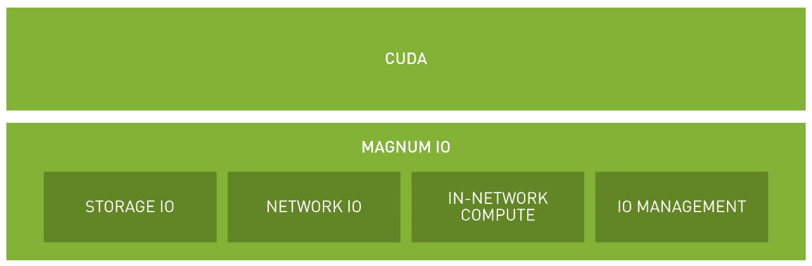

**图 4-1. NVIDIA Magnum IO 加速平台的四个组件**

第一个组件是网络 I/O。该组件包括[GPUDirect RDMA](https://network.nvidia.com/products/GPUDirect-RDMA/)、[NCCL](https://developer.nvidia.com/nccl)、[NVSHMEM](https://developer.nvidia.com/nvshmem)、UCX 和[HPC-X](https://developer.nvidia.com/networking/hpc-x)等技术，以实现跨节点的 GPU 之间的直接高速数据传输，绕过 CPU。

第二个组件，存储 I/O，由 NVIDIA [GPUDirect Storage](https://developer.nvidia.com/gpudirect-storage)（GDS）和[BlueField SNAP](https://docs.nvidia.com/networking/display/bluefielddpuosv470/bluefield+snap)（软件定义网络加速处理）代表。这些技术允许 GPU 直接从 NVMe SSD 等设备访问存储数据，而无需执行到主机系统内存的不必要复制。

第三个组件，网络内计算，包括专用设备，如 NVIDIA [BlueField DPU](https://www.nvidia.com/en-us/networking/products/data-processing-unit/)和协议，如[NVIDIA SHARP](https://developer.nvidia.com/blog/advancing-performance-with-nvidia-sharp-in-network-computing/)，用于在网络本身内执行数据聚合和归约。这降低了大规模集合操作（如 all-reduce）的延迟。

最后，I/O 管理包括 NVIDIA [NetQ](https://www.nvidia.com/en-us/networking/ethernet-switching/netq/)和 NVIDIA [Unified Fabric Manager](https://www.nvidia.com/en-us/networking/infiniband/ufm/)（UFM）等平台。这些技术提供实时遥测、诊断和数据中心 I/O 结构的生命周期管理。

这些组件通过灵活的 API 和可扩展的 SDK 协同工作，这些 API 和 SDK 隐藏了底层细节的复杂性。它们有助于为大规模 AI 和分析工作负载最大化性能和可扩展性。让我们深入研究其中几个组件，并演示如何分析和调优它们。

## 利用 RDMA 实现高速、低开销的数据传输

远程直接内存访问（RDMA）是一种针对低延迟、高吞吐量数据传输进行优化的技术，它允许组件之间直接进行内存到内存的数据传输，而无需为每个数据包传输使用 CPU。RDMA 绕过了传统网络堆栈的大部分，并确保 CPU 线程亲和性，以减少传输完成中断的开销。它还使通信与计算重叠，支持分布式文件系统，并持续监控 GPU 和网络。建议尽可能使用 RDMA。

NVIDIA 的 RDMA 实现称为 GPUDirect RDMA，它允许 GPU 通过 InfiniBand 或 RoCE 等支持 RDMA 的网络直接与远程设备（如其他 GPU）交换数据，绕过 CPU 进行数据传输。这最大限度地减少了多节点环境中的延迟和 CPU 开销。

现代 InfiniBand 硬件本质上支持 RDMA，一些实现 RoCE（融合以太网上的 RDMA）的高速以太网硬件也支持。RoCE 是一种基于以太网构建的 InfiniBand 风格的 RDMA 技术。InfiniBand 必须正确配置，并安装所有必需的驱动程序。


使用 RDMA 与使用基于标准 TCP 的以太网（不带 RDMA）之间的性能差异可能非常巨大。例如，InfiniBand 可能提供 <10 微秒的延迟和高吞吐量，而标准 TCP 的延迟可能高出 5-10 倍。不过，对于大型 all-reduce 操作而言，吞吐量比延迟更重要。在高吞吐量网络中，即使每条消息开始传输所需的时间稍长（更高的延迟），只要网络能够维持较高的数据传输速率，操作仍然会很快完成。相反，如果网络延迟很低，但传输数据的吞吐能力有限，大型 all-reduce 的整体性能就会受到影响。

如果你只有以太网，请尽量确保其带宽尽可能高——至少 100 Gbit/s。同时，确保你的以太网网络协议栈经过调优，使用如 9000 字节这样的大型 MTU 巨型帧，这样你发送的是更少的大数据包，而不是许多小数据包。这与大文件与小文件的直觉相同。更少、更大的数据包比更多、更小的数据包产生的开销更少。最后，确保你的 TCP 缓冲区大小足够大，以便系统能容纳大量在途数据。

要调优基于以太网的网络，你可以使用 Linux 网络 `/etc/sysctl.conf` 参数：`net.core.rmem_max`、`net.core.wmem_max` 用于设置最大缓冲区大小，`net.ipv4.tcp_rmem`/`tcp_wmem` 用于设置默认值和自动调优范围。对于 100 Gbit/s 的链路，你可以将最大缓冲区设置为几 MB 以充分利用它。此外，使用像 BBR 这样的现代 TCP 拥塞算法可以改善高延迟带宽网络上的吞吐量，但如果这是一个受控、专用且受管制的集群网络，默认的 [CUBIC](https://en.wikipedia.org/wiki/CUBIC_TCP) TCP 拥塞控制算法通常就足够了，因为网络条件通常是可预测的，网络在设计上就避免了拥塞。

> **提示：** 要在 AWS 等云环境中创建受控的集群网络，你的本地数据中心需要使用 AWS Direct Connect 与 AWS 建立专用、受管制的链路。但是，如果你的本地数据中心与 AWS 之间的连接以任何方式通过公共互联网传输，那么由于拥塞多变且网络条件不可预测，这通常不能被称为受控的集群网络。

尽管 RDMA 可以在不占用 CPU 拷贝数据的情况下移动数据，但 CPU 仍然扮演着关键角色。CPU 负责建立 RDMA 连接、发起传输、处理完成中断，并管理控制路径。因此，你应确保网络中断和线程被绑定到与你的 InfiniBand 主机通道适配器（HCA）相同的 NUMA 节点上的 CPU。例如，如果一个 InfiniBand HCA 位于 NUMA 节点 0，你希望它的中断由运行在连接到同一 NUMA 节点 0 的 CPU 核心上的线程处理，以减少延迟并提高整体效率。

## 用于分布式多 GPU 通信的 NCCL

Nvidia 集体通信库（NCCL - 发音为“nickel”）是一个面向一组（即一个集合）GPU 的多对多通信库。它是大多数分布式训练和推理工作负载的基础。该库充当 GPU 组之间协调数据通信交换的骨干。当在多个 GPU、计算节点、机架和集群之间执行模型训练和推理时，需要尽可能快地交换数据，以让 GPU 持续忙于有用的工作。

在模型训练期间，每个 GPU 在反向传播过程中针对自己的数据块计算梯度。然后系统执行一次 all-reduce 通信操作，以聚合所有 GPU 的梯度。

在模型推理期间，随着请求在网络中移动，GPU 会在前向传播过程中交换激活值。这种交换使用发送和接收通信操作。所有这些通信操作都在 NCCL 中实现。

### NCCL 中的拓扑感知

拓扑感知在 NCCL 中也扮演着重要角色。NCCL 会检测 GPU 之间的物理连接方式，并相应地调整其通信模式。在像 GB200 NVL72 这样具有相对扁平、高速互连的系统中，每个 GPU 都可以直接与其它 GPU 以最高速度通信。在更碎片化的系统中，NCCL 会自动将设备分组为更小的集群，其中繁重的工作在通过快速链路连接的 GPU 上完成。这减少了通过较慢连接进行的通信量。

NCCL 会自动选择可用的更快互连——无论是 PCIe、NVLink 还是 InfiniBand——然后为数据选择最佳算法和路由。如果网络硬件支持 RDMA，NCCL 会自动使用 RDMA。这使开发者无需微观管理通信交换的每个细节。

如果你的 GPU 之间拥有非常快的互连，例如计算节点内 GPU 之间的 NVLink/NVSwitch，或不同计算节点 GPU 之间的 InfiniBand，那么通信成本非常低。但通常情况下，尤其是基于以太网的集群，网络可能会拖慢速度。

### NCCL 通信策略

NCCL 提供了多种通信技术，以便在分布式操作期间在 GPU 之间高效地交换数据。这些方法被称为 NCCL 环形（ring）、树形（tree）、集合网络（CollNet）和并行聚合树（PAT）算法。

环形方法将 GPU 排列成一个环形，每个 GPU 将小块数据段传递给下一个 GPU。在这种配置中，随着数据在环中传递，每个设备逐渐累积集合结果的一部分。每个 GPU 将小块数据发送给其邻居，直到完整结果在环中循环一圈。这种方法在许多设备上表现稳定，并且在处理通信成本相对均匀的环境中管理大消息时表现出色。

树形策略将 GPU 组织成层次化的树状结构。在这种方法中，GPU 两两配对，将数据合并为部分结果，然后在树的上层进一步合并。该策略允许跨层级同时合并数据，从而减少通信步骤的数量。递归倍增遵循类似的思路，在连续多轮中反复在两两配对的 GPU 之间交换数据。在每一轮中，有效组大小翻倍，直到完整数据集到达每个 GPU。这个过程尤其有利于设备数量为 2 的幂次的集群，因为它最大限度地减少了所需的阶段数。

CollNet 代表了一种更高级的策略。它利用 GPU 之间专用的高速互连来形成一个集合网络。其思路是将 GPU 划分为多个较小的树，这些树同时聚合数据，从而使通信工作负载更均匀地分布，并减少缓冲需求。这种方法最大限度地减少了通信阶段的数量，在大型集群中尤其有效，可以从几个 GPU 优雅地扩展到数千个 GPU。

最近，[并行聚合树](https://developer.nvidia.com/blog/new-scaling-algorithm-and-initialization-with-nvidia-collective-communications-library-2-23)（PAT）策略已成为一种在大型集群中提高可扩展性和负载均衡的方法。PAT 扩展了树形方法，将 GPU 组织为多个并行运行的较小树状结构，以更好地利用可用的互连带宽。每个树并行聚合自己那部分数据，所有树的部分结果在最终合并中组合在一起。这种并发聚合最大限度地减少了缓冲需求，并均匀地分散了通信负载，最终降低了延迟并提高了吞吐量。


系统还可以在自动模式下运行，NCCL 会根据拓扑、消息大小和系统条件动态选择最优策略。通过这种方式，NCCL 确保每个 GPU 都能以高效的方式进行通信，从而在集合操作期间最大化吞吐量并最小化延迟。

在实践中，像 `NCCL_ALGO` 这样的环境变量允许你强制指定特定算法，例如 `Ring`、`Tree`、`CollNet` 或 `PAT`。NCCL 会继续完善这些选项，以适应不同的工作负载和系统架构。

### NCCL 性能分析与调试

要对 NCCL 进行调试，可以使用 [NCCL Profiler Plugin API](https://developer.nvidia.com/blog/new-scaling-algorithm-and-initialization-with-nvidia-collective-communications-library-2-23/#new_profiler_plugin_api%C2%A0) 来监控 GPU 通信的内部时间线，并定位系统中的任何落后设备或瓶颈。NCCL Profiler Plugin API 旨在解决那些随着 GPU 集群规模扩大而越来越难以诊断的性能问题。

NVIDIA 创建了这个灵活的 API，以简化第三方性能分析工具（例如 [PyTorch Kineto](https://github.com/pytorch/kineto)）与 NCCL 的集成，并确保在运行时以清晰、分层且低开销的方式监控和捕获复杂的通信活动。`NCCL_PROFILER_PLUGIN` 环境变量以类似于其他 NCCL 插件的方式控制此插件的加载和初始化。

加载后，NCCL Profiler Plugin 会配置一个事件激活掩码，这是一个 32 位整数，其中每一位对应一个不同的 NCCL 事件，如组事件、集合事件、点对点事件以及各种与代理相关的操作。这种结构创建了自然的事件层次结构，有助于以有意义的方式呈现详细的性能信息并快速定位问题。

NCCL Profile Plugin API 定义了五个函数回调。`init` 回调通过提供不透明的上下文并确定应分析哪些事件来设置插件。`startEvent` 回调从 NCCL 接收事件描述符并分配一个新的事件对象，返回一个 NCCL 用于后续操作的不透明句柄。`stopEvent` 回调标记事件完成，以便回收其资源。`recordEventState` 回调允许插件在事件经历不同状态时更新事件。`finalize` 回调在分析完成后释放与分析器上下文关联的所有资源。

### NCCL 性能调优

NVIDIA 的集合通信库（NCCL）通过高效地处理 GPU 之间的数据交换，在分布式训练中发挥着关键作用。其中一个关键的性能方面是数据如何通过诸如节点内用户缓冲区注册等机制在 GPU 之间直接传输。

NCCL 会注册 GPU 内存，用于通过 NVLink 等高速互连甚至直接到网卡进行直接数据传输，从而避免了通过主机内存移动数据的额外开销。这种直接路径对于在 all-reduce 等操作（跨 GPU 聚合梯度）中最小化延迟和最大化吞吐量至关重要。

为了优化这些数据传输，NCCL 提供了几个环境变量，以便根据你的工作负载需求定制其行为。下面列出了一些关键的 NCCL 环境变量，它们可以让你精细控制 NCCL 的通信行为。

- `NCCL_DEBUG`：这控制 NCCL 日志记录的详细程度。将其设置为 `INFO` 或 `WARN`/`VERSION` 以对应不同级别，可以帮助你诊断性能问题，并了解 NCCL 如何选择算法和接口。在排查性能低下或意外行为时，这是一个有用的第一步。

- `NCCL_ALGO`：通过此变量，你可以强制 NCCL 使用特定的集合通信算法（例如 `Ring`、`Tree`、`CollNet` 或 `PAT`）。根据你的工作负载、网络拓扑和梯度大小，某一种算法可能比其他算法表现更好。在此处进行试验有时可以带来性能一致性方面的显著改善。

- `NCCL_NTHREADS`：这控制每个 GPU 在 NCCL 网络操作中使用的 CPU 线程数。如果你发现 CPU 资源未被充分利用，增加 `NCCL_NTHREADS` 可以允许更并发地处理网络任务，从而提高整体网络链路利用率。在需要通信大量梯度数据的分布式训练中，分配更多线程来管理这些传输有助于减少瓶颈并提高同步速度。

- `NCCL_BUFFSIZE`：这决定了 NCCL 在 all-reduce 等通信操作期间使用的缓冲区大小。通过增加缓冲区大小，NCCL 可以在每个通信步骤中发送更大的数据块。这在聚合大型梯度时尤其有利，因为它减少了所需的通信迭代次数，从而降低了同步过程的总体开销。但是请注意，虽然更大的缓冲区可以减少操作次数，但它们也会消耗更多内存，因此在缓冲区大小和可用系统资源之间取得平衡非常重要。

- `NCCL_PROTO`：这允许你选择 NCCL 应采用的协议。例如，`LL`（低延迟）或 `Simple` 是典型的值。低延迟协议可能对较小的消息大小有利，而简单协议可能对较大的消息更有效。

- `NCCL_IB_HCA`：此设置指定 NCCL 用于通信的 InfiniBand 主机通道适配器（HCA）。在存在 RDMA 的多节点环境中，此变量允许你显式选择所需的接口，这在具有多个 IB 适配器的节点上尤其有用。

- `NCCL_IB_TIMEOUT`：使用此项可调整 InfiniBand 操作的超时设置。默认值可能并非针对你的网络条件的最优选择，因此调整超时有助于减少在 all-reduce 操作期间通信停滞或意外超时的可能性。

- `NCCL_SOCKET_IFNAME`：对于 NCCL 回退到 TCP（或直接使用以太网）的设置，你可以指定应使用哪个网络接口。在多宿主主机上，当你希望通信通过特定的高速接口而不是无关接口进行时，这一点至关重要。

- `NCCL_LL_THRESHOLD`：这控制消息大小的阈值，低于该阈值时 NCCL 使用其低延迟（LL）协议进行通信。调整此阈值可以帮助你优化小消息的性能，确保在最重要的时候使用最快的协议。

- `NCCL_MIN_NCHANNELS` 和 `NCCL_MAX_NCHANNELS`：这些变量允许你控制 NCCL 使用的通信通道数量。合适的通道数量可以确保数据在多个 GPU 之间高效流动，尤其是在互连或网络成为限制因素时。

- `NCCL_NCCL_MAX_RINGS`：你可以使用此变量指定在集合操作（如 all-reduce）期间 NCCL 应使用的最大环数。环算法对环的数量很敏感，调整此设置有助于在聚合大型梯度时减少通信开销。

通过仔细调整这些环境变量，使其更好地匹配你的工作负载和系统拓扑的具体情况，你可以优化 NCCL 管理 GPU 间通信的方式。这可以降低同步开销，使你的训练和推理工作负载能够更有效地利用可用带宽，并确保你的 GPU 将更多时间花在实际计算上，而减少等待数据传输的时间。


最佳设置通常取决于你的具体硬件配置、数据传输量以及特定的网络环境。反复试验和性能剖析至关重要。首先使用 `NCCL_DEBUG` 启用调试，通过 `NCCL_IB_HCA` 和 `NCCL_SOCKET_IFNAME` 验证预期的互连是否按预期被使用，然后根据需要微调与吞吐量相关的变量 `NCCL_NTHREADS`、`NCCL_BUFFSIZE` 和 `NCCL_LL_THRESHOLD`。

将这些工具与其他系统级优化手段结合使用，可以带来显著的性能提升，尤其是在大规模多 GPU 和多节点环境中。如果将这些调整与调优良好的操作系统和 CPU 配置相结合，你的整体基础设施将能更好地保持 GPU 的数据供给，并使其以最高效率运行。

### 使用 NVIDIA SHARP 和 NCCL 进行网络内层次化聚合

当使用支持 NVIDIA 可扩展层次化聚合与规约协议（SHARP）的网络硬件时，还能获得额外优势，因为 SHARP 将 all-reduce 操作的部分繁重工作从 GPU 转移到了网络交换机上。网络交换机本身会在数据通过时合并梯度数据。NVIDIA 的一份[报告](https://developer.nvidia.com/blog/advancing-performance-with-nvidia-sharp-in-network-computing/)显示，在大型 AI 系统上使用 SHARP 可使 all-reduce 提速 2-5 倍。

SHARP 需要特殊的硬件、固件和驱动程序。你可以使用 `ibv_devinfo -d <device>` 并检查输出中与 SHARP 相关的内容来确认是否支持 SHARP。假设 SHARP 已启用，你的 PyTorch 应用将自动在 all-reduce 等集合操作中使用它，因为 PyTorch 使用的 NCCL 内置了对 SHARP 的支持。在需要以受控方式约束环境来排查性能问题的场景中，你也可以使用 `NCCL_SHARP_ENABLE=0` 来禁用 SHARP。

工程师可以通过诊断命令验证 SHARP 支持情况，并在需要时调整应用设置。SHARP 与 NCCL 无缝协作，进一步展示了硬件与软件如今如何携手高效管理数据移动。

### 用于加速数据传输与推理的 NIXL

NVIDIA 推理传输库（NIXL）是一个较新的通信库。NIXL 于 2025 年初发布，其设计初衷是让模型推理服务器能够通过在 GPU 之间高效传输 KV-cache 等资源来实现水平扩展。NCCL 非常适合群体通信，而 NIXL 则专为满足分布式模型推理的独特需求而设计。

对于持续生成 token 流的模型（例如 AI 助手），管理和复用 Transformer 注意力机制生成的计算密集型键值张量至关重要。具体来说，在与基于 Transformer 的模型对话时，发送到模型推理服务器的每个新 token 都会通过 Transformer 的注意力机制生成键/值（KV）张量。这些 KV 张量在生成响应的新 token 时会被复用。因此，我们使用 KV-Cache，它需要在分布式推理集群中的不同 GPU 和计算节点之间共享。

#### Prefill 与解码推理阶段

基于 Transformer 的模型的推理路径实际上分为两个不同的阶段。第一阶段通常是计算受限的，因为它使用大量矩阵乘法从传入的请求数据（即“提示词”）构建 KV-cache。第二阶段通常是内存吞吐受限的，因为它需要从 GPU HBM 内存中收集模型权重，以计算下一组 token（即“补全”或“响应”）。在许多先进的高性能推理系统（如 NVIDIA Dynamo 和 vLLM）中，这两个阶段运行在不同的 GPU 或计算节点上，如图 4-2 所示。

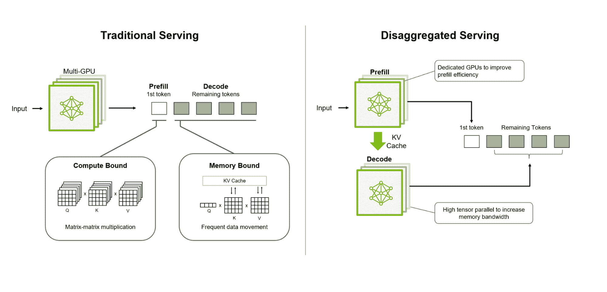

*图 4-2. 分离式服务将 prefill 和解码阶段分配到不同的 GPU 上*

一组 GPU 负责填充 KV-cache，而另一组则负责生成最终响应。在这种情况下，KV-cache（在长提示词中可能达到数十 GB）必须实时无缝地从一台处理单元移动到另一台处理单元。

传统方法通过 CPU 内存甚至存储来传递数据，无法满足所需的速率和低延迟体验。NVIDIA 在 2025 年初创建了 NIXL 来应对这一场景。我们真正想要的是直接的、高带宽的 GPU 到 GPU 传输（跨越计算节点和机架），并且让数据传输与计算重叠进行。这样，专注于解码的 Stage 2 GPU 在从专注于 prefill 的 Stage 1 GPU 接收下一组输入 token 的 KV-Cache 时，就可以开始计算下一个 token。

NIXL 提供了一条直接通道，用于将数据从一块 GPU 传输到另一块 GPU 或一小群 GPU，可跨越计算节点甚至机架。系统会查看所有可用路径，并始终选择最快到达目的地的路径。无论数据是通过服务器内的 NVLink、机架内的 NVSwitch、机器间的 InfiniBand 传输，还是按需使用 NVMe 存储，NIXL 都会自动选择最快的通道。

#### 用于高效数据传输的 NIXL 核心 API

开发人员通过一个非常直接的 API 与 NIXL 交互。他们只需提交一个包含数据指针和目标标签的请求，其余工作由库完成。例如，NIXL 可以接受将 KV-Cache 数据发送到多种目标地址的请求，如图 4-3 所示。

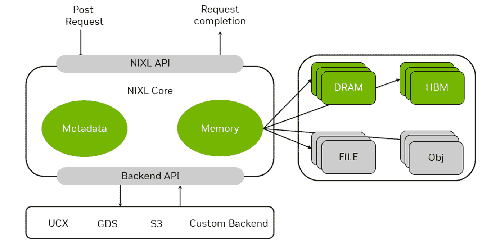

*图 4-3. NVIDIA 推理传输引擎（NIXL）架构（来源：[`developer.nvidia.com/blog/introducing-nvidia-dynamo-a-low-latency-distributed-inference-framework-for-scaling-reasoning-ai-models/`](https://developer.nvidia.com/blog/introducing-nvidia-dynamo-a-low-latency-distributed-inference-framework-for-scaling-reasoning-ai-models/)）*

NIXL 核心负责管理元数据和内存缓冲区。NIXL 后端 API 与各种传输后端（如 UCX、GPUDirect Storage、S3 或自定义后端）对接。NIXL 可以高效地在不同层之间移动数据，例如 GPU HBM、CPU 内存（DRAM）、文件存储（NVMe SSD）和对象存储。NIXL API 抽象了在分布式推理环境中跨异构内存和存储设备传输数据的复杂性。

NIXL 会为每次数据传输选择最高效的路径，并尽可能使用零拷贝传输以避免不必要的复制步骤。例如，NIXL 避免将数据复制到主机 CPU 内存中的反弹缓冲区。

该库还提供通知和回调，让你的代码知道传输何时完成。通知和回调对于与计算同步至关重要，因为如果数据尚未到达，你不会希望开始使用它。

需要重点指出的是，NIXL 是对 NCCL 的补充，而非替代。当一大组 GPU 需要紧密协作以完成诸如并行运行巨型模型时的同步等任务时，NCCL 仍扮演着关键角色。NCCL 负责协调群体通信，而 NIXL 专注于将大量数据从一块 GPU 发送到另一块 GPU，或在需要时发送到存储。

#### NIXL 内部依赖


在底层，NIXL 使用 Nvidia 的 [Unified Communication X](https://docs.nvidia.com/doca/sdk/doca+ucx/index.html)（UCX）。UCX 是一个专为高性能点对点通信设计的框架。它提供了抽象的通信原语，使应用程序能够充分利用先进的硬件特性，包括主动消息、带标签的发送和接收操作、远程内存读写、原子操作以及各种同步例程。UCX 支持多种硬件类型，例如 InfiniBand 和 RoCE 提供的 RDMA、TCP 网络、GPU 和共享内存。

UCX 框架通过提供隐藏底层细节的高级应用程序编程接口来加速开发，同时仍然提供卓越的性能和可扩展性。它基于从大型数据中心和超级计算机上运行的应用中学到的行业最佳实践，并能高效处理各种大小的消息。

NIXL 还使用 GPUDirect RDMA 和一种称为 [InfiniBand GPU Direct Async](https://developer.nvidia.com/blog/improving-network-performance-of-hpc-systems-using-nvidia-magnum-io-nvshmem-and-gpudirect-async/)（IBGDA）的技术，让 GPU 无需等待 CPU 介入即可启动数据传输。在较早的系统中，即使数据通过 RDMA 传输，中央处理器也需要协调传输。NIXL 突破了这一瓶颈，使 GPU 可以直接将数据块发送到另一个 GPU。

一旦阶段 1 中的 GPU 将 KV-cache 写入其 GPU HBM，数据就会立即通过网络资源发送到目标 GPU。如果目标 GPU 正忙于阶段 2 并计算解码响应，它将在后台接收 KV-cache，从而高效地重叠计算和通信。NIXL 还支持不将数据排列在连续块中的传输。它也能处理分散的数据。

### 使用 NIXL 进行 KV-Cache 卸载

NIXL 的优势在于它不仅能管理 GPU 内存，还能管理其他数据。如果您的应用程序需要将数据从 GPU 内存溢出到 CPU 或 NVMe 驱动器，NIXL 仍然可以高效地处理这些传输。它与 NVIDIA 的 [GPUDirect Storage](https://docs.nvidia.com/gpudirect-storage/overview-guide/index.html)（GDS）集成，后者通过直接与 GPU 内存交互，为读写 NVMe 驱动器提供了一条优化的路径。

> **提示**
>
> GPUDirect Storage 与 GPUDirect RDMA 的作用类似，关键区别在于它是为加速磁盘 I/O 而设计，而非直接的 GPU 到 GPU 通信。

你可以把 NIXL 视为一个统一的数据访问层。无论你的数据当前位于何处（例如 GPU、CPU、磁盘），或者需要传输到哪里，你都可以使用相同的 NIXL API，它将选择最快的可用路径来读写你的数据。

这为基于 NVMe 的 KV cache 卸载铺平了道路，使系统能够在不需要时自动将 KV-Cache 溢出到 NVMe 存储，并在需要时将其流式读回。如果对话或会话进入空闲状态，其上下文可以暂存在 SSD 上，以释放 GPU 内存供其他任务使用，之后 NIXL 可以将其取回。

基于 NVMe 的 KV-caching 扩展了可用于服务模型的有效内存，因为你可以通过使用磁盘作为溢出来支持更长的对话或更多的并发会话。当对话或会话暂停时，上下文安全地存放在快速存储上，为其他任务释放宝贵的内存。

当然，访问 NVMe 比 HBM 慢得多，但通过巧妙的重叠、现代 SSD 的巨大带宽以及 GPUDirect Storage 直接读入 GPU 内存的能力，部分基于 NVMe 的 KV-cache 卸载延迟可以隐藏在计算背后。

### NIXL 与 NVIDIA Dynamo 等高性能推理系统

NIXL 对性能的影响对于 NVIDIA Dynamo 等分布式推理系统来说是巨大的，Dynamo 也于 2025 年初发布。NVIDIA 已经[证明](https://developer.nvidia.com/blog/introducing-nvidia-dynamo-a-low-latency-distributed-inference-framework-for-scaling-reasoning-ai-models/#:~:text=match%20at%20L169%20DeepSeek,model%20on%20NVIDIA%20GB200%20NVL72)，与不重叠传输或使用较慢方法的朴素实现相比，使用 Dynamo 和 NIXL 可以将多节点 LLM 推理吞吐量提升高达 30 倍。

曾经是一个主要延迟障碍的问题——在节点之间传输数十 GB 的上下文数据——在 NIXL 下变成了一个相对快速、异步的操作。我们将在第 9 章深入介绍 Nvidia Dynamo、TensorRT、vLLM 以及各自的模型推理优化。

## 存储 I/O 优化

在深度学习训练中，向 GPU 提供数据与计算本身同等重要。考虑一个在数百个 GPU 上训练的 100 万亿参数模型。虽然计算能力巨大，但如果数据不能及时准备好，计算就会停滞。存储和网络的读写都可能成为瓶颈。当从磁盘向 GPU 流式传输大型数据集时，单个训练进程可能每秒读取数百兆字节或数 GB 的数据。如果存储子系统跟不上，GPU 将会因等待数据而停滞。这会降低系统的整体有效吞吐量。

大型 GPU 集群受益于使用高性能存储解决方案，例如并行文件系统（如 Lustre 或 GPFS）、高速网络附加存储（NAS），或每个计算节点中用于缓存数据的本地 NVMe SSD。随着 GPU 速度越来越快，对数据管道的需求也在增加。在这里，我们将讨论如何优化存储、数据加载和网络使用，以保持 GPU 持续有数据可用。本节涵盖使用更快的存储硬件、预取和缓存数据、读取少量大文件与大量小文件、使用 GPUDirect Storage、重叠计算和通信，以及为大规模分布式训练和推理集群调整网络设置。

### 快速存储与数据局部性

大型模型训练任务通常需要读取海量数据集。例如，常见的有数十亿和数万亿的文本 token、数十亿张图片、数十万小时的音频等。如果你试图从单个机械硬盘流式读取这些数据，你会浪费大量金钱，因为你的 GPU 将因数据不足而饥饿，机械硬盘无法足够快地流式传输数据。这就是为什么大多数严肃的 AI 系统会使用并行存储系统或大型、快速的本地固态硬盘（SSD）。

像 Lustre 这样的并行文件系统会将数据条带化到许多服务器和磁盘上，因此你可以获得每秒数 GB 的聚合读取吞吐量。云端类似方案是构建在 Amazon S3 之上的 Amazon FSx for Lustre。然而，在很多情况下，从业者通常会在本地暂存数据，即将数据从 Amazon S3 复制到本地 SSD 以获得性能。不过，AWS 推荐的方法是使用 Amazon FSx for Lustre。另外，如果你使用类似网络文件系统（NFS）的方案，你可能会在集群中运行多个 NFS 服务器——每个服务器提供一部分数据。AWS 云上的对应方案是 Amazon 的 Elastic File System（EFS）。

一个不错的策略是在每个节点上预加载和缓存数据。如果每个节点都有快速的 NVMe SSD，你可以在训练开始前将一部分数据集复制到其中。假设你有 100 TB 数据和 100 个节点——每个节点在本地获取 1 TB 的数据分片。以 5-6 GB/s 的速度（顺序读取，而非随机读取）从 NVMe 磁盘读取，将比通过网络从远程存储读取更快、更稳定。即使你无法将所有分片数据都放入本地 NVMe，你也可以逐批次缓存。在这种情况下，你会在后台加载下一批次的数据分片。有些团队会使用在训练任务之前运行的数据暂存作业。这个数据暂存作业负责对数据进行分片并分发到集群中的各个节点。


当使用共享文件系统时，数据不容易拆分。你可以启用 Linux 的页缓存（page cache）来自动将文件内容缓存到 RAM 中——前提是你的数据集能放进 RAM。在这种情况下，数据会被缓存，后续的 epoch 读取数据会快得多——无需从 NVMe 磁盘读取。如果数据集无法完全放入 RAM，对于能放入的部分你仍然会获得性能提升。还有一些用户空间缓存解决方案，比如 Linux 的 `fscache`，它可以帮助缓存共享文件系统中经常访问的文件。

### 顺序读与随机读模式

GPU 作为大规模并行处理器，更喜欢大块的数据。幸运的是，读取少量大文件比读取大量小文件更高效，因为每次读取都会产生系统调用（syscalls）、磁盘寻道时间（虽然对 SSD 来说很低）等开销。因此，如果你的数据集由数百万个小文件组成，你应该考虑将它们打包成更大的文件。事实上，这也是 TensorFlow 引入 TFRecord 文件格式的原因之一。

使用 TFRecord，可以将许多小文件（通常是文本格式）合并成几个大文件（二进制格式）。PyTorch 并不强制使用某种格式，但你可以使用类似 Parquet 格式——甚至只是普通的 numpy 文件——来打包数据。其思路是进行更少数量的大的顺序读取——并避免随机读取。例如，如果你能顺序读取 1 GB 的数据，任何像样的 SSD 都能在毫秒内完成。但如果你在这里随机读一个 1 KB 文件，在那里随机读另一个 1 KB 文件，你就会受到过多 I/O 延迟的瓶颈限制。

另一个技巧是使用并行和异步读取。大多数操作系统和语言允许你一次发出多个读取请求。如果你有 8 个 CPU 核心负责数据加载，那么每个核心可以并行读取不同的文件。你的存储系统能够处理的并行请求越多，你获得的吞吐量就越大——前提是 CPU 与存储系统（NVMe 本地磁盘、远程共享文件系统等）之间的链路能够支持来自并行数据加载器的整体吞吐量。

在 Python 中，使用带有 `num_workers > 0` 的 `DataLoader` 会通过跨更多 CPU 派生更多 worker 数据加载进程来实现并行读取。在后台，操作系统会让磁盘尽可能保持忙碌。现代 NVMe 驱动器有多个队列，可以处理许多并发请求。

如果你的访问模式主要是流式读取，请考虑增加块设备的预读（read-ahead）设置，因为这会让操作系统预读比请求更多的数据，以应对后续的顺序读取。你可以通过在设备上使用 `blockdev --setra <kilobytes>` 或向 `/sys/block/<device>/queue/read_ahead_kb` 写入千字节数来配置预读设置。

预读有助于隐藏重复顺序读取的延迟。如果你的数据加载器从磁盘请求 4 MB 数据，操作系统实际上可能会获取 8 MB 数据，因为它知道你很可能很快就会请求接下来的 4 MB。

在某些场景下，使用内存映射文件（`mmap`）也可能很高效。`mmap` 将文件映射到进程的地址空间，使文件 I/O 由操作系统的虚拟到物理内存映射子系统管理。这很高效，因为它让操作系统按需将数据加载到 OS 页缓存中。

当 `mmap` 配合大页（huge pages）使用时，虚拟到物理地址转换的性能会受益于更大的页面大小，以及维护转换映射数据的 TLB 带来的更少缓存未命中。这减少了开销，并提高了顺序和可预测访问模式（如将数据集加载到训练任务中）的性能。

### 调优 NVMe 和文件系统

现代 Linux 系统使用一个名为 `blk-mq` 的多队列框架来高效地调度和分发 I/O 请求到多个硬件队列。当你使用 NVMe SSD 时，这些设备已经带有高度优化的固件级调度。因此，为了避免 OS 在固件级调度之上产生额外的调度开销，你可以选择将操作系统 I/O 调度器设置为更简单的类型，例如 `noop` 或 `mq-deadline`。

这种配置意味着 `blk-mq` 多队列框架继续管理请求的分布，但它使用一个更简单的 `noop` 调度器，基本上将请求直接传递给 NVMe 固件调度器来分发 I/O 请求。

另外，请确保 NVMe 驱动程序使用所有可用的队列——默认情况下应该如此。这将最大化 I/O 吞吐量。如果你在虚拟环境中，请确保 `virtio` 驱动程序是最新的，以确保最佳的 I/O 性能。

像 XFS 和 EXT4 这样的文件系统很常见，两者都应该进行调优。XFS 通常被推荐用于多核系统上的并行吞吐量。确保挂载选项不会引入开销。例如，你可能希望禁用 `atime`（访问时间），并在不需要这些信息时避免写入额外的元数据。

### 使用 GPUDirect Storage（GDS）

GDS 是一个相对较新的功能，它允许 GPU 直接从存储或网络拉取数据，而无需通过 CPU 来复制数据。通常，从磁盘读取的数据会通过页缓存或你提供的缓冲区进入 CPU 内存。然后你需要将该缓冲区复制到固定（不可分页）的 CPU 内存缓冲区。只有这样，GPU 的直接内存访问（DMA）引擎才能将该固定的 CPU 内存缓冲区拉入其 GPU 内存。

使用 GDS 后，GPU 的 DMA 引擎可以直接从存储设备发起读取，将数据读入 GPU 内存。使用 GDS 将数据读入 GPU 内存，跳过了经过 CPU 内存缓冲区的额外中转。GDS 的明显好处是减少了 CPU 使用率，因为 CPU 不管理这些数据传输——也不会以任何方式接触数据。它还可以略微降低延迟。

然而，在实践中，并非所有的存储栈都已为 GDS 做好准备，因为 GDS 需要特殊的硬件、软件和驱动程序。不过，许多现代高端 NVMe 驱动器和 RAID 控制器现在都支持 GDS。在编程上，你可以通过 NVIDIA 的 `cuFile` 库来使用 GDS，使用 `cuFileRead` 读取文件，直接将数据检索到 GPU 的内存缓冲区中。

来自 VAST Data 的[报告](https://www.vastdata.com/blog/to-infinity-and-beyond-ai-gpudirect-storage-is-happening#:~:text=,the%20client%20by%20nearly%209X)显示，在特定 AI 工作负载上使用 GDS 可使读取吞吐量提升 20%。在他们的实验中，他们展示了仅使用单个 GPU 的 GDS 就能使 100Gb/s 网络链路饱和，获得额外 20% 的吞吐量，并大幅降低 CPU 使用率。随着 GDS 日益成熟并变得更加标准化，更多的训练流水线将采用它——尤其是在处理超高数据加载速率时，此前 CPU 曾是 I/O 的瓶颈。

重要的是要认识到，某些工作负载在 I/O 期间并不受 CPU 瓶颈限制。它们通常受磁盘的 I/O 吞吐量限制。如果你有多个 GPU 各自从 NVMe 进行随机小读取，GDS 通常会大放异彩。GPU 可以并行进行这些随机读取，而 CPU 不会因为处理每个小读取通常产生的所有中断而成为瓶颈。

即使没有 GDS，关键原则依然存在：将 I/O 与计算重叠始终是理想的。当 GPU 正在处理一个批次时，你的代码应该已经在读取和解压缩下一个批次以发送给 GPU。这样，当 GPU 准备好接收下一个输入时，数据已经准备好并位于 GPU 内存中。否则，如果 GPU 完成计算后不得不等待数据转换和加载，这会在你的数据流水线中产生一个需要消除的气泡。

### 分布式和并行文件系统


接下来，让我们从网络与通信的角度来考虑分布式文件系统。当所有计算节点都从单一存储服务器读取数据时，该服务器就会成为瓶颈，因为它的资源（尤其是文件访问相关的资源）会不堪重负。为了缓解这一问题，最好的做法是将数据分区（或分片）到多个存储节点上，这样每个计算节点只读取其指定的数据子集。

将数据分片到多个存储节点可以减轻任何一个单一存储节点的负载——前提是数据分布均匀，且没有任何特定分片会成为“热点”。在这种情况下，包含热点的存储节点可能会过载，你又回到了最初单存储节点性能瓶颈的老问题上——尽管定位和分析问题可能需要更长时间。

然而，如果你的数据集包含许多小文件，即使是分片良好的文件分布也可能使文件系统的元数据服务器过载。即使只是检索文件大小、权限和修改时间等简单的元数据属性，在大规模执行时也可能会集体引发性能问题。

如前文存储部分所述，解决“小文件”问题的一种常见方法是将许多小文件打包成数量更少、体积更大的文件。如果无法打包，则可能需要扩展元数据服务本身，以支持额外的元数据请求。

最终目标是实现大规模顺序读取，而并行文件系统可以高效地处理这种读取，因此监控网络以及 GPU 和 CPU 非常重要。如果你发现 GPU 在等待，请使用 `nvidia-smi dmon` 或 NIC 计数器等工具检查网络的吞吐量。确保你没有超出网络的带宽。

如果每个节点有 8 个 GPU，每个 GPU 以 1 GB/s 的速度进行梯度全归约通信，而你的网络是 100 Gbit/s（12.5 GB/s）。在这种情况下，你的通信大约只占网络总带宽的 1/12，因此你并没有超出网络带宽——当然，前提是网络上没有其他流量。

但如果每个节点有 16 个 GPU，该节点以总计 16 GB/s 的速度进行全归约通信，那么你显然超出了网络的总带宽容量。这时就应该探索压缩、累积和批处理等技术。缺点在于这些技术可能会影响模型精度。这是一个需要仔细监控、分析和调优的权衡，因为它与你的 AI 工作负载和用例密切相关。

### 监控存储 I/O 指标

在监控方面，你可以使用工具近乎实时地显示资源使用情况。例如，`iostat` 显示磁盘 I/O 吞吐量，`ifstat` 显示网络利用率，`nvidia-smi` 显示 GPU 使用情况。如果在训练的高负载阶段 GPU 使用率未接近 90-100%，请查明原因。GPU 是在等待磁盘或网络的数据吗？还是 GPU 因基于 CPU 的数据加载和预处理管道变慢而停滞？通过系统地排查存储、CPU 和网络等各个相关组件，你可以提高 GPU 利用率及整体效率。

有时快速修复就能奏效。将数据加载工作进程数量翻倍，GPU 利用率可能会从 70% 提升到 85%。或者从加载原始文本改为加载预计算的 token 张量。这样可以减轻 CPU 在 GPU 数据供给管道中执行分词的压力，从而更快地喂给 GPU。这些在优化 AI 管道时都是唾手可得的成果。

通过应用这些策略，你往往能显著提高资源利用率、性能和效率。这会直接转化为更短的训练时间、更快的推理响应以及整体成本节约。在超大规模场景下，这种节约是巨大的。

## 调优数据管道

让我们更详细地讨论数据加载和预处理。PyTorch 等深度学习框架提供了并行加载和预取批量数据的工具。

GPU 可以承担计算密集型的预处理任务，例如文本分词、多模态图像、视频和音频的转换。NVIDIA 的数据加载库通过提供优化的增强数据集管道来加速预处理。

数据集的质量同样重要，尤其是用于大语言模型（LLM）的数据集。NVIDIA 的 Nemo Curator 帮助将原始文本转化为精炼的、领域特定的数据集。该框架自动化了清理、过滤、去重和数据聚合等任务，以生成高质量的训练材料。

调优数据管道在处理需要额外关注的多类型数据时尤为重要。它让主训练循环可以专注于模型计算，而无需等待冗长的数据准备步骤。

### 高效的数据加载与预处理

将数据传输与计算重叠对于保持高吞吐量和最小化空闲时间至关重要。调整工作进程数量、预取因子和锁页内存等配置非常重要，这样你可以微调数据管道，使其匹配你的工作负载和系统配置。

配置 PyTorch 的 `DataLoader` 并设置 `num_workers` 会生成 `num_workers` 个工作进程。这些工作进程从磁盘获取数据、应用任何转换，并将数据放入队列。主进程中的训练循环从该队列获取批次。

如果 `num_workers` 设置得当，当模型处理完第 N 个批次时，第 N+1 个批次已经就绪或即将就绪。通常会将许多 CPU 核心专门用于数据加载和转换——尤其是在数据复杂的情况下。如果你有 32 个核心，可能会分配 8-16 个给加载线程。是的，这很多，但例如如果你的文本需要增强和分词，这些额外的核心很容易被充分利用。

理想的工作进程数量取决于任务和系统资源。你需要通过监控和反复调整配置，针对自己的工作负载和环境进行调优。假设你将 PyTorch 的 `num_workers` 从 2 增加到 4 再到 8 个 CPU。如果你看到 GPU 利用率上升、迭代时间下降，那就说明你在取得进展。到某个点后会进入平台期，此时继续增加 `num_workers` 不再有帮助，因为要么磁盘吞吐量已饱和，要么过度使用 CPU 开始产生收益递减。

解决这个问题的一种常见模式是使用生产者-消费者管道。生产者是在 CPU 上运行的数据加载工作进程，它们不断用准备好的批次填充 CPU 上的队列内存缓冲区。消费者是在 GPU 上运行的训练循环，它们不断从 CPU 上的该队列内存缓冲区中获取数据。

在生产者-消费者数据管道中，你可以微调预取的数据量，以便在不让系统内存过载的情况下持续为 GPU 提供输入。例如，PyTorch 的 `DataLoader` 有一个 `prefetch_factor` 参数（默认为 2），意味着每个工作进程会提前获取两个批次。使用 8 个工作进程时，最多可能提前加载 16 个批次。虽然这种方法通过提前准备数据来最小化空闲时间，但监控内存使用情况也很重要。如果批次较大或预取过于激进，你可能会消耗过多的 RAM。在使用大批次时，关注系统内存非常重要。


为了进一步提升效率，PyTorch 的 `DataLoader` 可以通过设置 `pin_memory=True` 来使用固定（页面锁定）的 CPU 内存。固定内存分配在不会被换出的固定物理区域中，这对于高性能直接内存访问（DMA）传输至关重要。使用固定内存后，GPU 到 CPU 以及 CPU 到 GPU 的传输可以异步执行。这意味着当你在一个批次上调用 `.to(device, non_blocking=True)` 时，该操作会被调度到后台流中，从而让下一次数据传输与 GPU 计算重叠进行。请看下面的 PyTorch 代码片段：

```
import torch
from torch.utils.data import DataLoader

# Create a DataLoader that prefetches 2 batches per worker into pinned CPU memory.
loader = DataLoader(
    dataset,
    batch_size=B,
    num_workers=8,
    pin_memory=True,
    prefetch_factor=2
)

for batch in loader:
    # Asynchronously copy the batch to the GPU.
    batch = batch.to(device, non_blocking=True)
    # While the copy is still happening in the background, the GPU may begin processing the current batch.
    outputs = model(batch)  # This call will block only if the copy isn't yet complete.
    # Continue with training steps...
```

在这个例子中，8 个 worker 进程中的每一个都会将数据批次预加载到固定内存中。由于主机内存是固定的，异步的 `.to(device, non_blocking=True)` 传输可以利用 DMA 进行高速数据复制。因此，当 GPU 处理当前批次（第 N 批）时，`DataLoader` 已经在并行地准备并传输下一批次（第 N+1 批）。这种重叠至关重要。如果没有固定内存，系统就需要在每次传输时临时固定内存，这会产生不必要的延迟。本质上，固定内存确保了 CPU 到 GPU 的数据传输能够更快地进行，并与 GPU 计算并发执行，从而最大化整体吞吐量。

另外，请务必考虑将数据预处理（例如文本分词）放到 CPU worker 进程中完成。将这些工作异步地卸载到 CPU 上，与运行主训练过程的 GPU 分开，意味着 GPU 不必浪费计算周期去执行这些数据预处理。新一批预处理好的数据会从 CPU 的固定内存中及时到达 GPU 的内存缓冲区，供 GPU 立即开始处理。这提高了 GPU 的利用率和有效工作（即 goodput）。

### 使用 NVIDIA DALI 库进行多模态数据处理

在某些特殊情况下，你可能希望 GPU 执行计算密集型的预处理，例如在多模态模型训练中解码图像、视频或音频。这时，GPU 可以使用 NVIDIA 的 [数据加载库](https://github.com/NVIDIA/DALI)（DALI），它提供了用于解码和增强图像、视频及音频数据输入的优化流水线。如果你注意到 CPU 在数据预处理期间成为瓶颈，那么绝对应该考虑让 GPU 来承担这些计算密集型的任务，以提升整体模型训练性能。

一般的准则是：对数据流水线进行性能分析，找出流水线中哪一部分是限制因素。如果你的 GPU 相对空闲，利用率只有 50%，并且你发现每个批次的加载时间都很长，那么很可能需要调整数据流水线。

调整数据流水线的一些选项包括：增加 `num_workers`、使用更快的磁盘/存储，以及使用更简单的数据格式。很多时候，对数据流水线做出相对较小的改动，就能让输入流水线从停滞不前变得顺畅高效。

为了提升数据流水线性能，可以考虑使用多个 worker 而不是单个 worker，启用固定内存，或者从 `CSV` 或 `JSON` 这类简单的基于文本的文件格式切换到机器友好的二进制格式。当然，使用二进制格式的缺点在于，你需要一条新的流水线（或作业）来将数据从 `CSV`/`JSON` 转换为二进制，不过这通常可以在离线状态下以批处理方式完成。

### 使用 NVIDIA NeMo Curator 框架创建高质量 LLM 数据集

NVIDIA NeMo Curator 是一个[开源](https://github.com/NVIDIA/NeMo-Curator)框架，旨在帮助你为 LLM 训练整理和准备自定义数据集。它是更广泛的 NVIDIA NeMo 框架的一部分，后者为对话式 AI 及相关应用提供端到端解决方案。[Curator](https://developer.nvidia.com/blog/curating-custom-datasets-for-llm-training-with-nvidia-nemo-curator/) 通过提供一系列功能，简化了将原始文本数据转换为高质量、领域特定数据集的过程，包括数据清洗、过滤、去重和聚合。

通过自动化这些流程，Curator 使数据科学家和开发人员能够高效地提取和精炼训练或微调 LLM 所需的数据，确保模型获得一致且相关的数据。这一能力对于希望在专业领域构建性能出色的定制语言模型的组织尤其有价值。

## 关键要点

本章的关键经验提醒我们，AI 系统的性能取决于包括软件和硬件生态系统在内的整个全栈。

- **端到端 I/O 优化至关重要。** AI 系统的性能取决于计算、存储和网络子系统的紧密集成。本章明确指出，只有当数据从存储通过网络高效地流向加速器时，强大 GPU 的优势才能得到充分发挥。每一层都应该进行调整以跟上 GPU 的步伐，包括用于本地缓存的 NVMe SSD 和用于海量数据集的并行文件系统。
- **软硬件协同设计。** 诸如 GPUDirect RDMA、NCCL、NIXL 和 SHARP 等专用 NVIDIA 库，将复杂、底层的操作封装为 API，从而支持直接的零拷贝传输。它们降低了 CPU 开销，最大限度地减少了延迟，并使系统能够利用先进的硬件特性（如网络内计算和统一数据访问层）来加速训练和推理。
- **针对多样化工作负载的定制通信策略。** 该架构利用多种通信算法（例如 ring、tree、CollNet、PAT），确保集合操作无论系统拓扑或工作负载大小如何，都具有可扩展性并得到优化。选择最佳策略将在延迟和吞吐量之间取得平衡——尤其是在大规模 GPU 同步、梯度聚合和键值缓存场景中。
- **优化的数据传输技术。** 零拷贝传输、将 CPU 线程绑定到合适的 NUMA 节点、以及让异步数据通信与计算重叠等技术，有助于保持数据持续流动。这些策略确保计算和传输并发进行，最大化整体系统效率并最大限度地减少 GPU 空闲时间。
- **统一且可扩展的 I/O 框架支持超大规模。** 统一的 API 和可扩展的 SDK 对于抽象底层硬件的复杂性非常重要。诸如 NVIDIA Magnum IO 之类的框架，集成了存储 I/O、网络 I/O、网络内计算和 I/O 管理，提供了一个能够从几张 GPU 扩展到数千张 GPU 的统一基础。
- **智能存储 I/O 流水线与数据预取。** 高效的数据流水线依赖于优化的存储解决方案和周密的缓存策略。通过高速 NVMe SSD 在本地预加载数据、使用 GPUDirect Storage 将数据直接读入 GPU 内存、以及采用并行异步文件读取，可以确保数据在需要时准确可用，而不会使计算停滞。
- **自适应网络调优以及通信与计算的重叠。**


设置合适的缓冲区大小、在可用时利用 RDMA，并调整拥塞算法（例如 CUBIC），对于发挥最大网络带宽至关重要。与此同时，通过异步传输和梯度累积等技术将通信任务与 GPU 计算重叠也很重要，这将进一步理顺数据流水线。

### 监控、性能分析和持续调优

NCCL Profiler、PyTorch Profiler、NVIDIA Nsight Systems 等工具，以及 NetQ 和 UFM 等实时遥测解决方案，对于识别瓶颈不可或缺。主动的性能调优循环——调整通信策略、重新配置数据预取并重新审视存储参数——将确保系统适应不断变化的工作负载和硬件环境。

### 面向未来的架构增强

NIXL 等新兴技术以及 SHARP 等高级网络内聚合表明，创新步伐正引导 AI 系统设计走向数据移动与计算之间更紧密的耦合。这些增强有望进一步降低延迟，实现高效的键值缓存卸载，并扩展 NVIDIA Dynamo 和 vLLM 等推理平台，以满足下一代需求。

### 整体性与协作式系统设计

在现代 AI 基础设施中实现峰值性能，并不是要优化某一个单一组件。相反，它需要一种整体性方法，协调计算、存储、网络和软件编排。构建这样的系统是一项协作努力，涉及硬件调优、软件性能分析以及来自真实工作负载的迭代反馈，确保技术栈的每一部分协同工作，以降低训练时间和推理延迟。

## 结论

分布式多 GPU 通信库和策略的演进标志着高性能深度学习的关键转变。通过采用专用库，例如用于集合通信的 NCCL、用于高效推理数据传输的 NIXL，以及用于超低延迟通信的 RDMA，系统可以显著减少数据移动瓶颈。容器运行时、Kubernetes 编排和智能调度的集成进一步确保这些优化的流水线直接转化为训练和推理性能的提升。此外，通过 GPUDirect Storage 和智能数据缓存等先进技术应对存储和 I/O 挑战，现代 AI 部署即使在模型复杂性不断扩展的情况下也能维持高吞吐量。

归根结底，本章强调的是，没有任何单一组件能独自提供峰值性能。正是高速通信、高效数据处理和系统级调优之间的精心协调，才能构建出可扩展且稳健的 AI 系统，以应对当今计算环境中一些最具挑战性的需求。这种集成视角不仅简化了 AI 工作流，也为分布式深度学习的未来创新奠定了坚实基础。

对实践者而言，要点在于无需发明自定义的网络和存储 I/O 解决方案。NVIDIA 提供了专门构建的库，因此你可以专注于模型、应用和系统逻辑，而不是网络和 I/O 底层细节。对于性能工程师而言，经验是快速数据移动和放置与原始计算能力同样关键。如果世界上最快的 GPU 持续等待来自另一块 GPU 或存储的数据，就无法带来加速。RDMA、NCCL、NIXL、GPUDirect Storage 和 Magnum IO 等库和技术，是保持分布式 AI 系统中网络和数据流水线顺畅流动的整体方法的一部分。

# 第 5 章 AI 系统优化案例研究

本章汇集了一系列案例研究，展示如何将先进硬件与智能软件技术相结合，以提高大型语言模型（LLM）的性能和成本效率。这些研究表明，通过采用现代 GPU 上新的数值精度模式，例如在 Hopper 上使用 8 位浮点数或在 Blackwell 上使用 4 位浮点数，工程师可以在不损失精度的情况下显著提升训练速度。

这些研究还表明，深思熟虑的软件设计可以克服固有的硬件限制。一个例子是开发将计算与数据传输重叠的算法，使得即使在内存带宽较低的系统中也能训练非常大的模型。另一个重要见解是，将强大的 CPU 和 GPU 集成在同一芯片上——通过超高速互连将它们连接起来——可以减少数据移动延迟，并显著提高吞吐量。

案例研究进一步表明，智能调度框架和开源工具可以通过优化工作在各设备间的分配，将现有硬件的有效性能提升一倍。它们还证明，人工智能本身可以帮助微调底层 GPU 代码，创建比手工编写的内核运行更快的内核。在更广泛的背景下，这些例子揭示了算法创新——即使是在矩阵乘法等核心运算中——也能产生与购置新硬件相当的性能提升。

这些经验共同表明，模型训练和推理的成功改进取决于硬件能力与软件技术之间的紧密协调。这种协调方法减少了训练时间和运营成本，同时还能在更小的系统上高效部署更大的模型，为人工智能的未来进步铺平道路。

## OpenAI 在超大规模下使用新硬件训练 GPT 4.5 的历程

本案例研究回顾了 OpenAI 构建 GPT 4.5 的[历程](https://www.youtube.com/watch?v=6nJZopACRuQ)，重点介绍了沿途遇到的挑战、过程和经验教训。该项目在训练运行开始前近两年启动，机器学习和基础设施团队共同协作，目标是实现比 GPT 4 提升 10 倍。早期，团队在一个为超大规模训练构建的全新且更大的计算集群上开展了风险规避实验。他们的协作规划为在实际运行中解决问题奠定了基础。

随着训练的推进，团队不断进行调整，并在他们仍在学习掌握的硬件上监控资源使用情况。在早期阶段，由于不可预见的硬件故障、网络问题，以及像 `sum()` 这样简单且经过充分测试的函数中的软件缺陷，故障率很高——当这些函数与罕见代码路径上的自定义代码结合时，可能会在如此庞大的系统中引发灾难性错误。修复这些问题成为一项共同的任务，模糊了机器学习研究与系统工程之间的界限，突显出即使在超大规模下，微小的细节也至关重要。

一个关键的启示是，扩展这些训练运行不仅仅是增加更多算力。它需要在长期规划与快速解决问题之间取得微妙的平衡，确保每次修复都能提高数据效率和模型智能。团队发现，通过协同设计，为模型设计所做的选择（例如缩放定律和预训练目标）会直接影响基础设施需求（例如多集群编排和网络可靠性），反之亦然。即使在事先进行了仔细规划，仍然存在一定程度的不确定性，这个过程需要持续监控和敏捷的跨团队协作。


最终，`GPT 4.5` 的训练过程成为了超大规模训练的蓝图，其中代码设计、错误解决和系统编排方面的渐进式改进汇聚成了一个实现了雄心勃勃性能目标的模型，并为下一代 AI 模型提供了路线图。本案例研究表明，真正的进步是通过不断学习和克服不可预见的挑战来衡量的。通过坚持、团队合作和持续迭代，研究人员和工程师将每一个障碍都转化为改进流程的机会。这证明了 AI 系统性能的突破是通过强大的硬件以及智能、自适应的工程实践实现的。

## 尽管硬件受限，DeepSeek 仍扩展至 6710 亿参数模型

有时创新源于需求。2024 年，中国机构 DeepSeek 因美国出口管制而只能使用 NVIDIA 的 `H800` GPU。`H800` 是 Hopper GPU 的带宽受限版本，这意味着与 `H100` 相比，其内存带宽显著降低，`NVLink` 互连速度也较低。实际上，`H100` 提供接近 3 TB/s 的内存带宽以及增强的 GPU 间通信，而 `H800` 的有限吞吐量意味着数据传输更慢，这有可能成为分布式训练任务的瓶颈。

DeepSeek 着手在这个严重受限的环境中训练一个名为 `DeepSeek-V3` 的大规模 6710 亿参数的混合专家（`MoE`）语言模型。该模型使用 64 个专家——每个专家是一个较小的 370 亿参数网络。凭借这种架构，任何给定时间只有一小部分模型被激活，这有助于即使在紧凑的 `H800` 配置下也能管理计算负载。

为了克服环境限制，DeepSeek 实现了一种新颖的 `DualPipe` 并行算法，该算法仔细地重叠了计算和通信，以掩盖 `H800` 固有的弱点。通过设计自定义 `CUDA` 内核来绕过一些默认的 `NCCL` 通信集合，DeepSeek 能够将数据传输与正在进行的计算协同进行，从而在互连带宽降低的情况下仍保持 GPU 的高效利用。

这项创新工程获得了回报，`DeepSeek-V3` 完成训练，估计仅花费了 560 万美元的 GPU 时间。这只是许多人认为在功能更强大的集群上训练如此规模的模型所需成本的一小部分。

基准评估表明，`DeepSeek-V3` 的性能在多项关键指标上（包括自然语言理解、阅读理解和推理任务）与 OpenAI 的 `GPT-4` 相当甚至超越。这些比较基于业内使用的标准化测试，表明一个开放的 `MoE` 模型即使使用能力较弱的硬件，也能与最好的闭源模型相抗衡。

在 `DeepSeek-V3` 模型的基础上，团队随后创建了 `DeepSeek-R1`——其专门的推理模型，构建方式类似于 OpenAI 的 `O1` 和 `O3` 系列。DeepSeek 没有大量依赖昂贵的人类反馈循环进行微调，而是开创了一种“冷启动”策略，使用极少的监督数据，转而强调强化学习技术，将思维链推理直接嵌入到 `R1` 中。这种方法降低了训练成本和时间，并强调了智能的软件和算法设计可以克服硬件瓶颈。

经验教训是，即使内存和计算预算有限，大规模、稀疏激活的 `MoE` 模型也能有效扩展。新颖的训练计划和底层通信/计算重叠优化可以克服硬件限制，DeepSeek 的巨大投资回报率就证明了这一点。

投资回报率是显而易见的，因为 DeepSeek 的非传统方法带来了巨大的效率提升，并以低得多的训练成本和时间创建了一系列强大的模型。通过从 `H800` GPU 中榨取每一分性能——即使在通信带宽降低的限制下——该团队以比通常少数百万美元的成本交付了 `GPT-4` 级别的模型性能。此外，DeepSeek 在 `R1` 的推理微调阶段不需要那么多人类标注数据，从而节省了更多资金。

简而言之，智能的软件和算法设计克服了蛮力硬件限制。这使得 DeepSeek 能够在紧张的成本和硬件预算下开发大规模 AI 模型。

## MobileEye 使用 `PyTorch` 与 `FP8` 精度提升 GPU 性能

当 NVIDIA `H100` Hopper GPU 发布时，MobileEye 的 AI 工程团队[升级](https://medium.com/data-science/pytorch-native-fp8-fedc06f1c9f7#:~:text=As%20the%20results%20demonstrate%2C%20the,and%20size%20of%20the%20model)了他们的 `PyTorch` 训练流水线，以利用 Hopper 对 8 位浮点（`FP8`）运算的支持。通过使用 Hopper 新的 Tensor Core 和 `Transformer Engine` 进行 `FP16`/`FP8` 混合精度计算，他们在不损失模型准确率的情况下提升了矩阵运算性能。在手动尝试了各种批大小和精度后，MobileEye 选择使用 `PyTorch` 的 `torch.compile`，在 `H100` 上以 `FP8` 精度进行积极的内核融合，相对于其 `bfloat16` 基线实现了 47% 的加速，如图 5-1 所示。

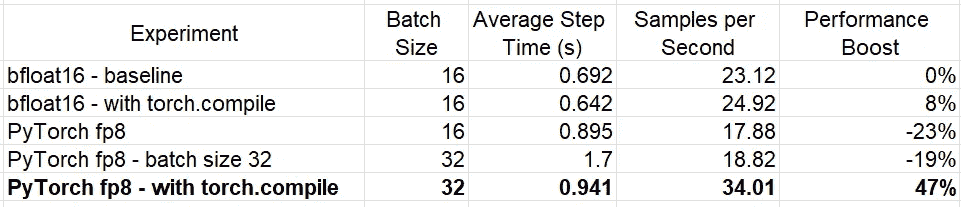

**图 5-1.** 使用 `PyTorch` 编译在 `FP8` 精度下进行内核融合，平均步长时间改善 47%（来源：[PyTorch 原生 FP8 数据类型。加速 PyTorch 训练工作负载…… | 作者：Chaim Rand | TDS 档案 | Medium](https://medium.com/data-science/pytorch-native-fp8-fedc06f1c9f7#:~:text=As%20the%20results%20demonstrate%2C%20the,and%20size%20of%20the%20model)）。

经验教训是，要在新一代 GPU 上实现软件加速，需要仔细协调硬件与软件，以适应更新的硬件特性和精度，例如 `Transformer Engine`、Tensor Core 和 `FP8` 精度。在本案例中，MobileEye 团队使用 `PyTorch` 编译器自动优化其 `PyTorch` 代码，以适应 Hopper GPU 硬件支持的新 `FP8` 精度。

投资回报率（ROI）是显而易见的。团队仅需几周的工程努力来尝试不同的组合，并最终使用 `PyTorch` 编译器，就使他们的视觉 Transformer（`ViT`）模型的训练吞吐量几乎翻倍，训练时间减半。

这个案例强调了，采用新的精度格式和编译器优化可以释放尖端 GPU 所承诺的性能。这会带来更快的结果，并充分利用硬件的全部能力。

## 使用开源 `NVIDIA Dynamo` 推理服务器提升性能

单纯的硬件速度并不是实现性能的唯一途径。智能的软件级优化可以在整个 AI 计算节点和机架集群中创造出倍增的效率。NVIDIA 的开源 [`Dynamo`](https://github.com/ai-dynamo/) 推理框架证明了这一点。

NVIDIA 的 `Dynamo` 推理服务器是一个面向 LLM 的[低延迟](https://nvidianews.nvidia.com/news/nvidia-dynamo-open-source-library-accelerates-and-scales-ai-reasoning-models#:~:text=NVIDIA%20Dynamo%20is%20fully%20open,Perplexity%2C%20Together%20AI%20and%20VAST)分布式服务平台。它构建在诸如 `TensorRT-LLM`、`vLLM`、`SGLang` 和 `PyTorch` 等引擎之上，并高效地协调跨多个 GPU 和计算节点的工作。


在一次内部的[测试](https://nvidianews.nvidia.com/news/nvidia-dynamo-open-source-library-accelerates-and-scales-ai-reasoning-models#:~:text=NVIDIA%20Dynamo%20is%20fully%20open,Perplexity%2C%20Together%20AI%20and%20VAST)中，NVIDIA 的一个团队使用 Dynamo 在 Hopper H100 GPU 上部署了 Llama 语言模型，结果发现其吞吐量相比他们自定义的请求调度代码立即提升了 2 倍。使用 Dynamo 将吞吐量翻倍，意味着 AI 服务可以用一半的硬件以同样的速度响应用户查询。这直接转化为成本节约，并为扩大最终用户规模提供了更多空间。

在相同 GPU 数量下，Dynamo 的动态批处理、GPU 负载均衡和分离式推理服务使系统每秒能够处理的 token 数量翻倍。分离式推理服务将内存密集型的 KV-Cache 预填充阶段与计算密集型的 token 生成解码阶段分开。

一旦 KV-Cache 在集群中填充完毕，Dynamo 就会将传入请求路由到已包含该请求所需 KV-Cache 数据的 GPU 节点。这避免了重复计算，并让 GPU 始终保持繁忙状态，处理有价值的工作。

此外，随着请求负载的增减，Dynamo 可以无缝地将不同的模型和阶段（预填充或解码）分配给不同的 GPU。这确保了不会有 GPU 闲置而其他 GPU 过载——即使在多个计算节点和机架之间也是如此。

得出的经验是，在超大规模推理中，瓶颈往往出在网络和协调环节。像 NVIDIA Dynamo 推理框架这样的软件，即使在最好的硬件之上也能释放性能增益。

这次实验的投资回报率在于，组织可以在现有基础设施上使用开源 NVIDIA Dynamo，从而免费获得 2 倍的性能。这个案例研究展示了吞吐量的显著提升——以及更低的每次查询和每用户成本——而无需购买新的 GPU。

总之，更好的推理调度算法创造了直接的业务价值。这使得大规模 LLM 的服务对大大小小的组织来说都更具成本效益且更易实现。

## 使用 vLLM 实现高效推理：更低成本下的高吞吐量

在服务 LLM 时，另一个现实挑战是最大化每个 GPU 的利用率。伯克利的一个研究团队最初通过他们名为 vLLM 的开源库实现了这一目标，vLLM 的全称是“虚拟大语言模型”（virtual large-language model）。vLLM 重新思考了 LLM 推理服务器执行批处理和内存管理操作的方式——尤其是针对那些大规模、内存消耗巨大的 LLM 和大型请求输入。

传统的模型推理服务引擎往往会让 GPU 利用率不足，并在大量独立推理请求不断堆积时产生巨大的内存移动。在这种情况下，GPU 核心可能会停滞等待新 token 的生成。

为了解决这个问题，vLLM 最初引入了两项关键创新，称为 `PagedAttention` 和连续批处理（continuous batching）。`PagedAttention` 是一种用于对注意力缓存进行分页的智能内存管理方案。连续批处理则是指智能地将输入请求打包在一起，以平衡推理系统的整体延迟和吞吐量。

`PagedAttention` 类似于操作系统级别的内存分页，将 GPU 内存视为虚拟内存。这种策略会动态重新分配键值缓存中空闲的部分，确保推理请求之间不留任何未使用的内存，最终实现对传入请求更高效的批处理并降低延迟。

连续批处理是指传入查询在到达时自动分组的方法。这使得系统能够在不依赖预定时间窗口的情况下形成最大规模的批处理。这种即时分组最大限度地提高了 GPU 效率，并确保推理过程在保持低延迟的同时持续实现高吞吐量。

vLLM 项目已被广泛采用并获得良好支持。它集成到了许多应用后端中，并包含在核心的云端推理服务中。该项目持续演进，受益于许多算法和内核优化——甚至支持 NVIDIA GPU 以外的加速器。

性能工程师应该从中汲取的经验是：不要只盯着 GPU FLOPs，还要考虑工作负载模式如何影响效率。例如，通过减少内存碎片和更好地合并输入请求，vLLM 能从相同的硬件中释放出更多有用的工作（或有效吞吐量）。

对于任何请求负载具有突发性或并发性的 AI 服务来说，采用 vLLM 的投资回报率都是显而易见的。在相同硬件上实现更高的每美元吞吐量，可以避免昂贵的硬件升级。重要的是，NVIDIA 认识到这种软件层面优化的价值，因此发布了 Dynamo 服务框架。Dynamo 原生支持 vLLM 作为后端。这使得组织可以将 vLLM 的算法和 GPU 层面优化与 NVIDIA Dynamo 的集群级路由和缓存管理优化结合起来。

这个案例研究提醒我们，开源创新可以带来巨大的性能飞跃。vLLM 无需任何额外配置即可开箱即用地提升吞吐量。这意味着在相同的硬件和模型部署下，运营成本更低、请求容量更高、用户体验更好。

## DeepMind 的 AlphaTensor：AI 发现的算法提升 GPU 性能

并非所有的 AI 优化都发生在代码层面。有时，优化会深入到算法和数学领域。DeepMind 2022 年的 AlphaTensor 项目就是一个开创性的[例子](https://deepmind.google/discover/blog/discovering-novel-algorithms-with-alphatensor/#:~:text=Algorithms%20in%20this%20rich%20space,flexibility%20in%20optimising%20arbitrary%20objectives)，该项目使用 AI 发现了新的通用矩阵乘法（GEMM）算法。

GEMM 是支撑几乎所有模型训练和推理工作负载的核心运算。即使是 GEMM 效率的微小提升，也可能对整个 AI 领域产生巨大影响。AlphaTensor 将寻找快速算法的过程形式化为一个单人游戏，使用强化学习来探索许多不同的可能性。

令人震惊的结果是，它找到了矩阵乘法的公式，这些公式在当时被证明优于任何现有的人类推导方法。例如，它重新发现了 Strassen 著名的用于 2×2 矩阵的[次二次算法](https://en.wikipedia.org/wiki/Strassen_algorithm)，如图 5-2 所示，并且还针对更大的矩阵规模进行了改进。

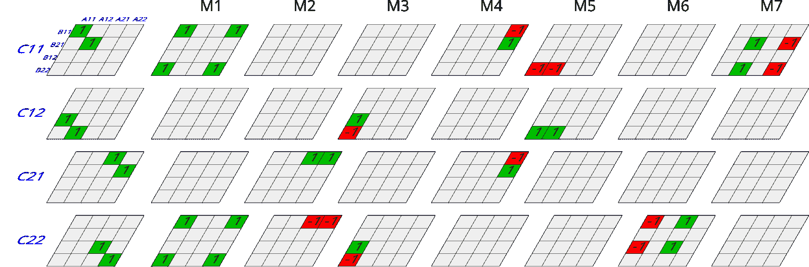

###### 图 5-2. Strassen 用于 2x2 矩阵乘法的次二次算法。（来源：https://en.wikipedia.org/wiki/Strassen\_algorithm）

但真正的证明来自于将这些算法在实际硬件上进行测试。AlphaTensor 发现了一种专门针对 NVIDIA Volta V100 GPU 代际的方法，其大型矩阵乘法速度比当时的标准 GPU 库快 10–20%。GEMM 性能 10–20% 的提升非常巨大。这就像每个模型的前向和后向传播都免费获得了额外 10–20% 的计算能力。这样的收益通常来自新一代硬件——或者数月的底层 CUDA 调优。然而，在这个案例中，AI 在相对较短的时间内从数学上找到了一条更好的路径。


得到的经验教训是：在人类工程师认为已经很先进的基础算法和数学运算中，可能仍存在尚未发掘的效率提升空间。AI 能够筛选成千上万乃至数以百万计的算法变体，而人类在合理时间内根本无法尝试这些变体。对于性能工程师而言，AlphaTensor 的成功表明算法创新尚未终结。未来，AI 或许会为我们提供一套新的工具包，其中包含针对卷积、排序或 Attention 等基础运算的更快速算法。

这种情况下的投资回报率（ROI）有些间接，但影响巨大。通过将 AlphaTensor 的矩阵乘法算法整合到 GPU 库中，任何大规模训练任务或推理负载都能立即获得速度提升。这可能影响从图形渲染、LLM 性能到科学计算的方方面面。AlphaTensor 证明了，15% 的速度提升——在数百块 GPU 上进行数千次训练迭代——可转化为巨大的时间和能源节省。这种回报在你每次运行代码时都会兑现。此外，这种加速是在不增加任何硬件的情况下实现的——仅仅依靠更智能的软件。

对于超大规模性能工程师而言，关键启示是：要对技术栈各个层面的 AI 驱动优化保持开放态度。即使是 GEMM 这类最基础、已经过充分优化的运算，也可能仍有改进空间。让 AI 在没有人类偏见的情况下探索优化空间，可以通过全面缩短运行时间带来丰厚回报。

## NVIDIA 基于 DeepSeek-R1 的 AI 辅助 GPU 内核优化

优化底层 GPU 代码长期以来一直是被称为“CUDA 忍者”的人类专家独享的艺术，但事实证明，AI 也能胜任这些专家级任务。NVIDIA 工程师使用功能强大的 DeepSeek-R1 推理模型进行了[实验](https://developer.nvidia.com/blog/automating-gpu-kernel-generation-with-deepseek-r1-and-inference-time-scaling/#:~:text=generates%20the%20GPU%20code%20,R1%20model)，以检验它能否为复杂的 Attention 机制生成与高性能手工调优实现相媲美的 CUDA 内核。

作为推理模型，DeepSeek-R1 采用“推理时”（inference-time）扩展策略：它不是在进行一次快速的模型前向传递后就生成响应，而是会在一段时间内不断优化输出——给它的时间越长，结果越好。像 DeepSeek-R1 这样的推理模型经过微调，会进行更长时间的思考，并对答案进行反复迭代。这很像人类在给出回答之前会花时间仔细思考。

在这项实验中，NVIDIA 在 H100 上部署了 R1，并给它 15 分钟来生成一个优化后的 Attention 内核代码。他们在生成循环中插入了一个验证程序，以便每次 R1 提出一个内核时，验证器都会检查生成的内核代码的正确性，并衡量代码的效率。这个反馈循环为下一轮内核代码迭代提供了改进提示词的指导。循环一直持续到代码满足严格标准，如图 5-3 所示。

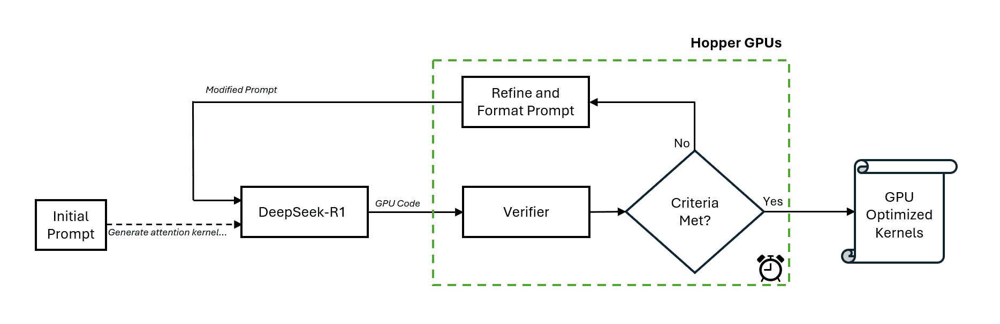

**图 5-3.** 在 NVIDIA Hopper 平台上使用 DeepSeek-R1 进行推理时扩展（来源：[使用 DeepSeek-R1 和推理时扩展自动生成 GPU 内核 | NVIDIA 技术博客](https://developer.nvidia.com/blog/automating-gpu-kernel-generation-with-deepseek-r1-and-inference-time-scaling/#:~:text=DeepSeek,on%20the%20NVIDIA%20Hopper%20platform)）

使用了以下提示词：

```
Please write a GPU attention kernel to support relative position encodings. Implement the relative positional encoding on the fly within the kernel. The complete code should be returned, including the necessary modifications.

Use the following function to compute the relative positional encoding:

def relative_positional(score, b, h, q_idx, kv_idx):
    return score + (q_idx - kv_idx)
    
When implementing the kernel, keep in mind that a constant scaling factor 1.44269504 should be applied to the relative positional encoding due to qk_scale = sm_scale * 1.44269504. The PyTorch reference does not need to scale the relative positional encoding, but in the GPU kernel, use:

qk = qk * qk_scale + rel_pos * 1.44269504

Please provide the complete updated kernel code that incorporates these changes, ensuring that the relative positional encoding is applied efficiently within the kernel operations.
```

结果令人惊叹。AI 不仅生成了功能正确的 Attention CUDA 内核，还[实现](https://developer.nvidia.com/blog/automating-gpu-kernel-generation-with-deepseek-r1-and-inference-time-scaling/#:~:text=Image%3A%20A%20bar%20chart%20showing,attention%20kernels%20with%20flex%20attention)了相比 NVIDIA 优化的 PyTorch 内置“`FlexAttention`”内核 1.1-2.1 倍的加速。图 5-4 展示了生成的内核与 PyTorch 优化后的 `Flex Attention` 在各种 Attention 模式（包括因果掩码和长文档掩码）下的性能对比。

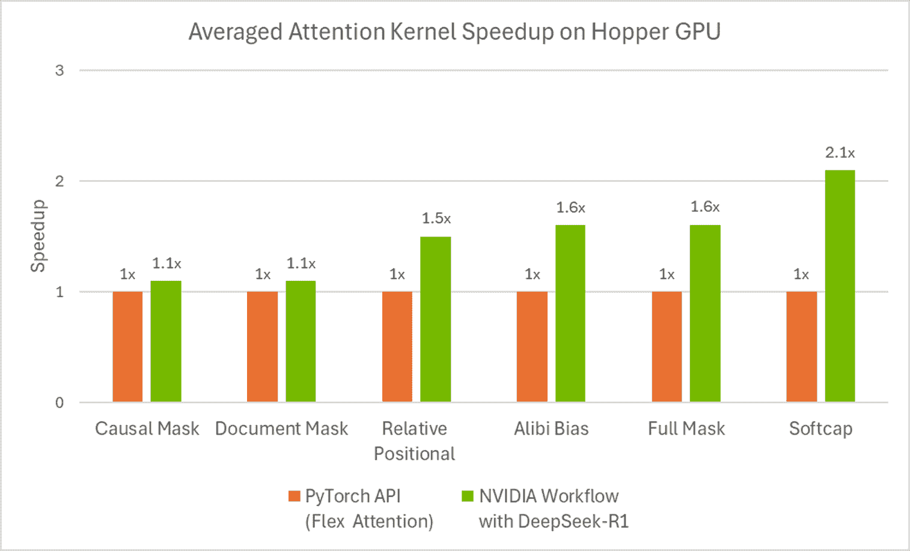

**图 5-4.** 自动生成并优化的 Attention 内核与 PyTorch 的 `Flex Attention` 的性能对比（来源：[使用 DeepSeek-R1 和推理时扩展自动生成 GPU 内核 | NVIDIA 技术博客](https://developer.nvidia.com/blog/automating-gpu-kernel-generation-with-deepseek-r1-and-inference-time-scaling/#:~:text=Image%3A%20A%20bar%20chart%20showing,attention%20kernels%20with%20flex%20attention)）

更令人印象深刻的是，AI 生成的内核在斯坦福大学的 [KernelBench](https://scalingintelligence.stanford.edu/blogs/kernelbench/) 测试套件中，100% 的基础测试用例和 96% 的复杂用例均被验证为准确。这基本上达到了人类工程师的可靠性。

得到的经验教训是：给 LLM 提供适当的工具来验证、评判和改进其输出，可以显著提高代码质量。直观地说，这个工作流程相当于人类工程师反复对自己的代码进行性能分析、调试和改进的过程。最初由模型生成的粗糙代码草稿，在短短 15 分钟内就演变成了达到生产质量的内核。这展示了 AI 辅助性能调优的一种强大范式。

投资回报率具有颠覆性，因为即使是 NVIDIA 最顶尖的 CUDA 工程师，也可能需要花费数小时甚至数天来手工编写和测试一种新型 Attention 内核变体。借助这种 AI 辅助优化方法，AI 只需一小部分时间就能生成效率相当的低层 CUDA 内核。这解放了工程师，使他们能够专注于更高级的 AI 系统优化机会，以及 AI 可能难以检测和修复的边界情况。

尽管仍需要一定的人工监督，但这项实验表明，有一条可行的路径可以降低 GPU 优化软件的开发成本，同时显著提升运行时性能。对于 AI 系统性能工程师而言，这类 AI 辅助暗示着未来的工作流程可能涉及与 AI 副驾驶（co-pilot）合作，在硬件、软件和算法层面快速共同设计优化方案。AI 副驾驶是提升人类生产力的倍增器。可以把这些副驾驶想象成经过预训练和微调的 AI 实习生，它们能够利用从现有代码库中获得的丰富 CUDA 技巧和诀窍，对复杂问题进行推理。

## Sakana.ai 的智能体：编写出快 100 倍的 GPU 内核的 LLM


2025 年，一家名为 Sakana.ai 的公司将 AI 编写 GPU 代码的理念又向前推进了一步，目标是自动化广泛的内核优化任务。他们[开发](https://sakana.ai/ai-cuda-engineer/)了一个名为 The AI CUDA Engineer 的自主智能体，它接收标准 PyTorch 运算，并将其转换为高度优化的 CUDA 内核。在底层，AI CUDA Engineer 使用大语言模型（LLM）和进化策略来迭代优化内核代码。这种策略经过多次迭代和进化代，会生成越来越好的解决方案，如图 5-5 所示。

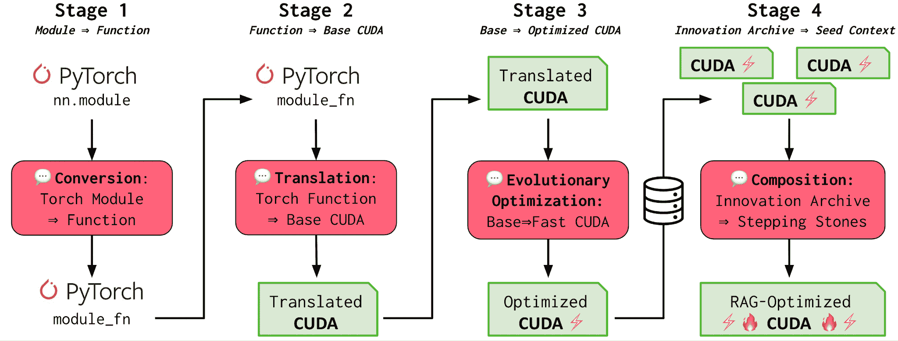

图 5-5. The AI CUDA Engineer 智能体框架的高层概览（来源：[`sakana.ai/ai-cuda-engineer/`](https://sakana.ai/ai-cuda-engineer/)）

Sakana 报告的结果令人瞩目。与等效的 PyTorch 运算相比，他们由 AI 生成的内核实现了从 10 倍到 100 倍的加速。在某些情况下，AI CUDA Engineer 生成的 CUDA 内核比生产库中已有的最佳 CUDA 内核还要快 5 倍。值得注意的是，AI CUDA Engineer 成功转换了 250 个目标 PyTorch 算子中的 230 个，展现了高度通用的方法。

经验表明，将大语言模型用于高层代码生成，再将算法优化用于微调和测试不同代码变体，这种组合可以发现即使是经验丰富的代码高手也可能错过的性能技巧。例如，Sakana 的智能体可能会尝试非常规的线程块大小，或以并不显而易见但有创意的方式使用共享内存。这可以为某些运算带来巨大收益。

另一个例子是 PyTorch 中一串复杂的张量运算：它通常会启动许多小型 GPU 内核，并遭遇严重的内存瓶颈。Sakana 的 AI CUDA Engineer 智能体可以轻松检测到这种情况，并在很短的时间内将张量运算融合为一个内核——这比手动融合要快得多。这类由 AI 生成的优化可以为 AI 系统带来数量级的性能提升。

如果正确采用并整合到公司的开发工作流中，这类 AI 代码助手的投资回报率（ROI）是巨大的。AI CUDA Engineer 无需手动费力地逐一优化每个神经网络层或运算，即可根据实现的复杂度和新颖性，在几分钟到几小时内自动生成优化内核。这意味着新模型架构可以更快上市，推理/训练速度也得以提升——而无需雇佣一大批稀缺的 CUDA 专家。

本质上，Sakana 展示了一条利用 AI 扩展专家级 AI 性能工程的路径。他们在一款 AI 智能体上的少量前期投入带来了复利式回报：许多内核在几乎零人力投入的情况下实现了 10 到 100 倍的优化。

## Predibase 使用强化学习生成优化 GPU 内核的方法

另一家初创公司 Predibase 采用了一种略有不同的强化学习方法，展示了自动化 GPU 编程。他们提出了一个更大胆的问题：能否利用大量 PyTorch 代码示例，将语言模型训练成完全合格的 OpenAI Triton 程序员？请记住，OpenAI Triton 是一种类似 Python 的 GPU 编程语言（及编译器），它简化了 GPU 编程。任务是看 AI 能否生成高效的 Triton 代码来替代 PyTorch 代码，并在 GPU 上运行得更快。

在他们的[实验](https://predibase.com/blog/teaching-ai-to-write-gpu-code-a-deep-dive-into-reinforcement-fine-tuning#:~:text=Can%20we%20teach%20a%20LLM,accurate%20and%20optimized%20Triton%2FCUDA%20kernels)中，Predibase 使用了一个 H100 GPU 集群，并用一批“PyTorch 到 Triton”代码样本对规模适中的 LLM 进行了微调，这些样本将高层 PyTorch 函数转换成了高效的 Triton 内核。然而，由于当时可用于监督微调（SFT）的“PyTorch 到 Triton”示例数据集不够大，他们创建了一个奖励函数，并使用一种名为“强化微调”（RFT）的方法，通过强化学习引导模型不断生成更好的代码。

在 Predibase 的强化学习（RL）方法中，AI 会首先生成一个候选内核。然后系统会自动编译并测试该内核的正确性和速度。如果内核无错误运行、产生正确结果，并且比基线内核运行得更快，模型就会获得正向奖励。

通过这种基于 RL 的试错方法的多次迭代，模型稳步提升。训练最初仅从 13 个示例问题开始，短短几天内，AI 就从对 Triton 一无所知，发展到能够为各种 GPU 运算生成正确且优化的基于 Triton 的内核代码。在撰写本文时，Predibase 尚未公布具体的加速数据，但他们指出，该模型仅用 1000 步训练就学会了输出可运行的 Triton 内核。此外，随着训练的继续，模型也在持续优化性能。

这一结果表明，AI 可以通过测试、观察反馈和做出调整来优化自己的代码。这与工程师迭代改进代码的方式类似。强化学习通过同时奖励正确性和速度，可以使 AI 生成的代码与实际性能指标保持一致。这会促使 AI 探索诸如使用线程束级并行或尽量减少全局内存访问等优化手段，以提升整体性能。

Predibase 的演示带来的启示和投资回报在于：这类 AI 辅助极具吸引力，因为它自动化了内核代码层面的性能优化，可能减少手动调优的需求。工程师无需再手动为新模型创建定制内核，训练好的 AI 助手可以生成多个变体并选择最佳方案。这缩短了开发周期，让工程师能够专注于探索新的模型架构，从而使各种规模的公司都能实现尖端前沿的模型性能。

这种方法还预示着一个未来：Triton 和 Python 等更高级的语言和框架可能会取代 CUDA 用于 GPU 编程。此类方法降低了 GPU 编程的门槛，从长远来看，可能会形成一条自动化流水线：AI 智能体持续编写和改进计算内核，成为性能工程师必不可少的工具。

## NVIDIA Grace-Hopper（GH200）超级芯片与 Hopper（H100）性能对比

NVIDIA GH200 Grace Hopper 超级芯片代表了先进硬件设计与创新软件技术的惊人融合，重新定义了 LLM 推理。本案例研究源于 [NVIDIA](https://developer.nvidia.com/blog/leading-mlperf-inference-v3-1-results-gh200-grace-hopper-superchip-debut) 和 [Baseten](https://lambda.ai/blog/partner-spotlight-testing-llama-3.3-70b-inference-performance-on-nvidia-gh200-with-baseten) 的两个独立实验。

请记住，GH200 超级芯片将 Hopper H100 GPU 和基于 ARM 的 Grace CPU 集成在单个模块上，采用高达每秒 900 GB 的 NVLink C2C 互连，而不是传统的 PCIe Gen5 连接。这种设计提供的带宽约为传统 PCIe 的 7 倍，并显著减少了 CPU 与 GPU 之间的数据传输延迟。


这段旅程始于 2023 年底，当时 NVIDIA 将重点放在使用 GPT-J 模型的 MLPerf 推理基准测试上，该模型包含 60 亿个参数，用于基本的生成式 AI 任务。NVIDIA 的工程师[证明](https://developer.nvidia.com/blog/leading-mlperf-inference-v3-1-results-gh200-grace-hopper-superchip-debut)，GH200 的紧耦合设计将 CPU 到 GPU 的数据传输开销从总推理时间的 22%降低到了仅 3%。这一改进使 GPU 能够专注于计算工作，与通过 PCIe 链路搭配 Intel Xeon CPU 的 H100 系统相比，每个 GPU 的吞吐量提升了 17%。这一结果强调，在运行复杂的推理工作负载时，内存带宽和高效互连与原始 GPU 计算能力同等重要。

在 NVIDIA[实验](https://developer.nvidia.com/blog/leading-mlperf-inference-v3-1-results-gh200-grace-hopper-superchip-debut)的另一阶段，重点转向克服 Transformer 模型内存密集型的 Attention 机制所固有的高内存需求。NVIDIA 团队采用了创新的混合精度方法。该策略涉及使用 Hopper 中的 Transformer Engine，将 8 位和 16 位精度相结合。在这种情况下，他们使用了 GPT-J 的 Attention KV-cache 的 8 位压缩版本。这种压缩使 96 GB HBM GPU 内存的有效缓存容量几乎翻倍，并允许在推理期间使用更大的批量大小。同时，Tensor Cores 保持着完全活跃状态。结果是，单个 GH200 在当时的 MLPerf 测试中提供了每个加速器的最高性能。

Baseten 在 2025 年初进行的另一项[实验](https://lambda.ai/blog/partner-spotlight-testing-llama-3.3-70b-inference-performance-on-nvidia-gh200-with-baseten)探讨了为超出 GPU HBM 内存限制的超大型 LLM 提供服务的挑战。他们使用 700 亿参数的 Llama 3.3 模型进行了测试，该模型由配置了 96 GB HBM 的单个 GH200 超级芯片提供服务。基于 H100 的系统不得不使用慢得多的 PCIe 互连将大约 75 GB 的模型数据卸载到主机 CPU 内存。而 GH200 系统只需使用其快速的 NVLink C2C 连接将 60 GB 的模型数据卸载到 CPU 内存。

性能差异非常显著。GH200 达到了每秒 4.33 个令牌的生成速率，而 H100 系统为每秒 0.57 个令牌。这一改进代表了吞吐量大约 7.6 倍的提升，并使得每个生成令牌的成本降至原来的 1/8。效率提升源于 21%的内存带宽优势，以及集成 CPU 内存作为 GPU 内存扩展的能力，同时避免了与 PCIe 相关的典型瓶颈。

最后的见解是选择与工作负载特定特征良好匹配的硬件的重要性。某些完全匹配 H100 的 80 GB HBM 内存的工作负载，并不会从 GH200 的 CPU 和 GPU 统一设计中显著受益。在这些情况下，只观察到大约 2%的适度性能提升。相比之下，当工作负载需要更大的内存占用和 CPU 与 GPU 之间大量的数据交换时，GH200 的表现优于 H100。

这提醒我们，昂贵的硬件投资应该与能够充分利用 GH200 等系统中先进内存和互连能力的工作负载相匹配。鼓励组织在进行任何大规模资本投资之前，在 AWS、GCP、Azure、CoreWeave 或 Lambda Labs 提供的云实例中测试其特定工作负载。这样，他们就可以为其特定的工作负载和用例部署最佳配置。

这个案例研究将硬件创新与软件优化交织在一起，从根本上改变了 LLM 推理的方法。通过提高内存吞吐量、优化数据传输和支持混合精度格式，GH200 在吞吐量和成本效率方面带来了显著提升。这展示了令人印象深刻的技术进步，并为旨在以更低运营成本在较小集群上服务更大模型的组织提供了明确的指导。

## 使用 Grace-Blackwell NVL72 机架系统进行高速推理

NVIDIA 的 Blackwell GPU 架构为大模型带来了前所未有的推理速度。在早期的 MLPerf 测试中，搭载 Blackwell GPU 的服务器打破了[记录](https://developer.nvidia.com/blog/nvidia-blackwell-delivers-massive-performance-leaps-in-mlperf-inference-v5-0/#:~:text=Additionally%2C%20in%20this%20round%2C%20Blackwell,FP8%E2%80%93while%20meeting%20benchmark%20accuracy%20requirements)。NVIDIA 随后将其基于 ARM 的 Grace CPU 与 Blackwell GPU 结合，创造了 Grace-Blackwell 超级芯片。

接下来，NVIDIA 将 36 个 Grace-Blackwell 超级芯片（每个包含 1 个 Grace CPU 和 2 个 Blackwell GPU）连接到一个名为 GB200 NVL72 的超密集机架部署中。这些超级芯片通过第 5 代 NVLink 交换机连接，以实现快速数据共享。借助该系统，NVIDIA 在 GB200 NVL72 上运行 4050 亿参数的 Llama 3.1 模型时，[实现](https://developer.nvidia.com/blog/nvidia-blackwell-delivers-massive-performance-leaps-in-mlperf-inference-v5-0/#:~:text=Additionally%2C%20in%20this%20round%2C%20Blackwell,FP8%E2%80%93while%20meeting%20benchmark%20accuracy%20requirements)了每个 GPU 3.4 倍的吞吐量提升，相比上一代基于 Hopper 的系统。

Blackwell 的改进，如第二代 Transformer Engine 和新的 FP4 精度，是关键。通过利用 FP4 数据类型进行量化推理，基于 Blackwell 的 GB200 NVL72 系统每个 GPU 的数学吞吐量相对于 FP8 精度翻了一番。

关键在于，基准测试的准确性保持在目标范围内，因此这种性能与精度之间的权衡基本上是中性的。在系统层面，收益不断累积。如图 5-6 所示，GB200 NVL72 机架在 Llama 405 推理任务上提供的吞吐量比类似的基于 Hopper 的集群高出 30 倍。

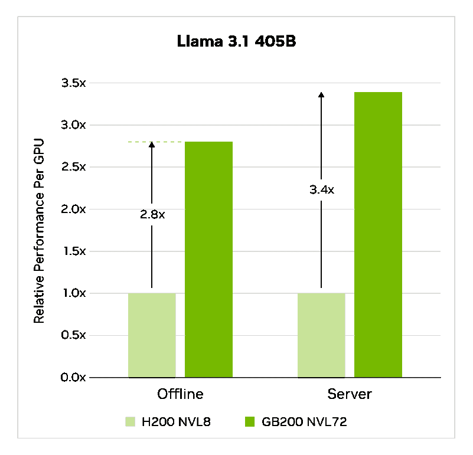

**图 5-6.** NVIDIA 的 Grace-Blackwell "GB200 NVL72"超级集群（深绿色）提供的 LLM 推理吞吐量比上一代（浅绿色）高出 30 倍，这得益于 9 倍的 GPU 数量和显著的每 GPU 加速（来源：[NVIDIA Blackwell 在 MLPerf 推理 v5.0 中带来巨大性能飞跃 | NVIDIA 技术博客](https://developer.nvidia.com/blog/nvidia-blackwell-delivers-massive-performance-leaps-in-mlperf-inference-v5-0/)）。

这归因于多个因素，包括单个 GPU 的速度提升、更快的 NVLink/NVSwitch 互连，以及 72 个 GPU 在机架内近距离协同工作的庞大集群规模。当时，GB200 NVL72 为大模型的延迟和大规模吞吐量树立了新的行业标准，"the 405"即是对 Llama 4050 亿参数模型的一种称呼。

**提示：** Meta 首席执行官马克·扎克伯格将 Llama 4050 亿参数模型随口称为"the 405"，这是借鉴了加利福尼亚州居民[称呼](https://www.pbssocal.org/shows/lost-la/the-5-the-101-the-405-why-southern-californians-love-saying-the-before-freeway-numbers)高速公路的方式。具体来说，[加利福尼亚人](https://www.youtube.com/watch?v=dCer2e0t8t8)会在高速公路编号前加上"the"（例如"the 405"高速公路）。

此外，值得注意的是，即便是较小的 8-GPU Blackwell 服务器（称为 DGX B200），在 Llama-70B 聊天模型上的吞吐量也比类似的 8-GPU Hopper 服务器高出 3.1 倍。这证明了 Blackwell 的架构优势——即使在 GPU 数量相同的情况下。


AI 系统性能工程师学到的经验是：诸如 FP4 Tensor Core 等新硬件特性——以及 GPU 之间更高的 NVLink 带宽——与 GB200 NVL72 等设计所实现的更高程度模型并行相结合时，可以带来数量级的性能提升。

从 Hopper 升级到 Blackwell 立即实现了投资回报：基于 Hopper 的 GPU 推理响应需要 6 秒，而 Blackwell GPU 只需 2 秒。因此，采用相同硬件配置的 Blackwell GPU 集群可以服务更多用户。投资 Grace-Blackwell 平台带来了渐进式改进，以及在服务能力上的显著阶梯式增长。对于任何应对不断增长的模型规模和用户需求的 AI 提供商而言，这都是一个竞争优势。

## 借助 Grace-Blackwell 集群加速万亿参数大语言模型的实验与洞察

NVIDIA 训练万亿参数模型的参考设计是 GB200 NVL72 Grace-Blackwell 机架。这是一个功能强大的服务器机架，在一个内存一致性域内整合了 72 个 Blackwell GPU 和 36 个 Grace CPU。

[基准测试](https://developer.nvidia.com/blog/nvidia-blackwell-delivers-massive-performance-leaps-in-mlperf-inference-v5-0/#:~:text=The%20Blackwell%20platform%20is%20available,connected%20using%20NVLink%20and%20NVSwitch) 表明，对于拥有 4050 亿参数的巨大模型，GB200 NVL72 的训练速度比前几代产品更快。Adrian Cockcroft 是一位以在云计算和系统架构领域的变革性工作而闻名的杰出技术专家，他的独立分析[认为](https://adrianco.medium.com/deep-dive-into-nvidia-blackwell-benchmarks-where-does-the-4x-training-and-30x-inference-0209f1971e71#:~:text=There%20are%20three%20generations%20of,been%20as%20impressive%2C%20and%20users)，将配置齐全的 Grace-Blackwell 与基于 Hopper 的高端集群相比，实现 4× 加速是可能的。

这一性能提升的关键因素包括：Blackwell 更高的单 GPU FLOPs、Grace 增加的 CPU 内存容量、更快的 NVLink-C2C 互连，以及单机架系统的庞大规模。具体来说，如果一个模型以前在 Hopper GPU 集群上训练需要 10 天，那么新的 Blackwell 集群大约 2–3 天就能完成。这大大加速了获得洞察的时间，并提高了实验的频率。

AI 系统性能工程师学到的经验是：扩展的成效与投入的硬件数量并不总是线性相关。要实现高效扩展，必须消除各个层面的瓶颈。Grace-Blackwell 设计同时解决了多个瓶颈，包括更快的 GPU、专用 Tensor Core 上更快的矩阵运算、更大的单 GPU 内存以支持更大的批次规模，以及改进的 NVLink 和 NVSwitch 架构，以低延迟连接数十个 GPU。所有这些都带来了更好的扩展效率。过去难以充分利用 72 个 H100 GPU 的训练任务和推理服务器，如今在 NVL72 配置中的 72 个 Grace-Blackwell GPU 上实现了近乎线性的扩展效率，因为通信开销大大降低。

使用 Grace-Blackwell 进行训练工作负载的投资回报（ROI）体现在更快的训练运行和更快速的实验上。例如，假设一家企业使用自己的数据集训练一个 5000 亿参数的大语言模型。使用 GB200 NVL72 系统，可以将训练时间从 4 周缩短到 1 周。这可能会带来变革性的影响，因为模型能更快投入生产，并且每次获得洞察所消耗的能源也更少。

因此，尽管 GB200 集群的前期成本高昂，但从每个训练模型和每次获得洞察的角度来衡量，组织能以加速研发和可能更低的成本获得价值。总之，这个案例证明了采用下一代硬件进行大规模大语言模型训练的 ROI，包括更快的实验结果和更好的每美元吞吐量。这使得组织和研究实验室能够在不大幅增加成本的情况下推进 AI 前沿。

## HPE 面向万亿参数时代的 Grace-Blackwell 超级计算机

2025 年初，HPE（慧与）[出货](https://www.hpe.com/us/en/newsroom/press-release/2025/02/hpe-announces-shipment-of-its-first-nvidia-grace-blackwell-system.html#:~:text=HOUSTON%20%E2%80%93%C2%A0%20FEBRUARY%2013%2C%202025%C2%A0,to%20optimize%20efficiency%20and%20performance)了其首款 NVIDIA Grace-Blackwell 系统——HPE Cray XD。这是他们对 GB200 NVL72 机架规格的实现。这标志着该技术成为 NVIDIA 自有实验室之外的首批实际部署之一。HPE Cray XD 机架级系统专为需要使用单一统一内存空间训练和服务 1 万亿参数规模模型的组织而构建。

HPE 强调，这类系统为超大规模模型提供了更低的每 token 训练成本和一流的吞吐量（[HPE 宣布出货其首款 NVIDIA Grace Blackwell 系统 | HPE](https://www.hpe.com/us/en/newsroom/press-release/2025/02/hpe-announces-shipment-of-its-first-nvidia-grace-blackwell-system.html#:~:text=%E2%80%9CAI%20service%20providers%20and%20large,leading%20services%20expertise.%E2%80%9D)）。这意味着，尽管其机架的绝对成本很高，但当模型达到万亿规模时，以每投资一美元每秒处理的 token 数衡量的效率要高得多。目标用户是云 AI 服务提供商和大型企业研究团队。

首批使用 HPE Cray XD 的 HPE 工程师学到的经验是，将所有 72 个 GPU 放在一个域中，并行训练任务的调试和优化比传统的每节点 8 个 GPU 集群更容易，因为网络通信模式中的可变部分更少。然而，他们也了解到了 NVL72 系统特有的故障模式，例如 NVLink/NVSwitch 结构中的故障。采用 NVL72 机架设计后，这类故障可能会同时影响许多 GPU。而以前，一条故障的 InfiniBand 链路只会影响一个节点。

对于这些系统的先驱客户来说，采用 NVL72 机架设计的 ROI 是一种竞争优势。HPE 及其客户现在可以将大规模模型装入内存，并且训练速度远快于竞争对手。此外，通过将 Cray XD 作为单一集成解决方案交付，客户的价值实现时间大大缩短。组织现在可以在数天内启动一台 1 exaFLOP 的 AI 超级计算机并投入工作，而不是数月或数年。快速的部署时间使 HPE 的客户能够为大型 AI 模型购买交钥匙解决方案。这降低了他们的投资风险，加快了实现 ROI 的速度，并带来了巨大的 AI 系统性能突破。

## 训练并服务 100 万亿参数模型

设想一个（并不遥远的）未来，某个 AI 研究实验室尝试一项非同寻常的任务，比如训练一个稠密的 100 万亿参数 Transformer。这大约是目前以数百亿或数千亿参数计的大模型的 100 倍。如何才能借助 Grace-Blackwell（GB200）超级集群实现这一目标？

在这一假设情景中，实验室组建一个由多个 GB200 NVL72 单元组成的训练集群——例如 8 个机架，总计 576 个 Blackwell GPU 和 288 个 Grace CPU 通过网络连接在一起。即使使用 Blackwell 每个 GPU 高达 192 GB 的 HBM 内存，一个 100 万亿参数的模型也几乎无法装进这 8 机架系统的 GPU HBM 内存总和之中——即使采用降低的 8 位精度也不行。


例如，在 8 位精度下，100 万亿参数将需要 100 TB 或 100,000 GB 的存储空间。100,000 GB / 每 GPU 192 GB HBM = 520 个 GPU。我们在一个 8 机架系统中只有 576 个 GPU，因此模型可以加载，但完全在 GPU HBM RAM 中训练是不可能的，因为训练还需要额外的梯度、激活和优化器状态，这些会带来巨大的额外开销——超出了单个机架的容量。

由于 100 万亿参数的模型无法装入 8-NVL72 机架超级集群，因此团队需要利用 Grace CPU 内存池，根据需要将 GPU 内存溢出到其中。这要求系统通过机架内的 NVLink 5 互联或机架间的 InfiniBand 在 CPU RAM 中流式加载和卸载权重。当然，你会希望尽可能避免跨机架通信。

人们几乎肯定会采用张量并行和流水线并行来将庞大的网络划分到多个 GPU 上。另一种选择是将模型拆分到……例如，采用流水线并行时，每个 GB200 机架负责 1/8 的层。然而，这需要层间进行跨机架通信——从而降低推理和训练的速度。

请记住，在机架内部，72 个 GPU 全部以完整的 NVLink 带宽互连，并以高速协同处理模型各自的部分。然而，机架之间由较慢的 InfiniBand 链路连接各个 NVLink 域。工程师们深知这种层级结构，会设计高效、流水线化且并行的计算/通信调度。例如，当一个机架完成给定批次的各层计算后，它会将中间结果（激活值）传递给下一个机架的层进行处理。与此同时，第一个机架开始计算下一批次——如此循环。

通过结合数据并行、流水线并行和张量并行（3D 并行），可以确保尽管存在跨机架通信延迟，所有 GPU 都能保持忙碌。为了进一步减轻压力，可以在传输过程中将激活值量化到`FP8`，并应用高效的 all-reduce 梯度更新算法，从而在每一步最小化跨机架同步。这样可以避免分布式训练中可怕的“停止世界”同步屏障。

还可以考虑采用混合专家（MoE）方法，将 100 万亿参数的模型拆分为 100 个独立的 10 万亿参数专家模型。这意味着在处理任意一个 token 时，只有一部分专家（机架）处于活跃状态。这将显著减少每一步的计算量和通信量。

然而，使用 MoE 还会带来额外的挑战，包括网络的门控、将 token 路由到正确的专家，以及确保专家间的负载均衡。可以使用动态专家扩展等技术，让所有机架都得到均匀利用，避免网络热点——即使在不同专家被激活时也是如此。

在软件方面，需要像 NVIDIA `Dynamo`这样的编排层，与`TensorRT-LLM`或`vLLM`服务引擎配合，来协调系统中大量 GPU 的工作。它可以为不同的流水线阶段分配微批次，通过重新映射 GPU 来处理 GPU 故障，并优化集群中大规模 KV 缓存的复用。

为 100 万亿参数的模型提供推理服务将是一项浩大的工程。团队可能会利用`Dynamo`的解耦功能，将模型权重放在 CPU 内存中，并仅针对特定查询将必要的专家/层加载到 GPU 内存中。在这种情况下，系统需要使用不同机架上计算出的部分结果来聚合生成响应。

团队还会大力依赖 4 位权重量化进行推理，利用 Blackwell 的`FP4`支持，将活动模型占用空间缩小到约 50 TB。这仍然很大，但在多机架系统的能力范围之内。

这个思想实验的教训凸显了需要哪些超大规模性能技巧，包括层次化并行、激进的量化与稀疏化，以及精细的调度。否则，这将是一个棘手的问题。模型的内部神经网络架构和物理集群网络必须协同设计，使得每一个延迟和带宽的考量都成为首要关注点。

成功训练一个 100 万亿参数模型的假想投资回报率将是开创性的。这样的模型可能展现出无与伦比的能力，在准确性上实现巨大飞跃，或者处理极其复杂的人工通用智能（AGI）或人工超级智能（ASI）任务。

然而，成本和风险也非常高。训练可能会在 GPU 计算时间上花费数千万甚至数亿美元。工程团队必须确保 576 个 GPU 中的每一个在整个过程中都得到最大程度的利用。任何低效都可能浪费计算时数和资金。在相对较小规模上得到验证的技术——例如 DeepSeek 在性能受限的 NVIDIA H800 训练集群上训练 V3 模型时使用的技术——在这个 100 万亿参数规模下将是必不可少的。

如果做得好，回报将是一个首创的 AI 系统和史册留名的地位。如果做得不好，可能会烧掉巨额财富而收效甚微。因此，这个假想案例凸显了性能工程师面临的现实——在极端规模下，规划、优化、性能剖析和迭代是让不可能变为可能的唯一途径。其理念是将超大规模的硬件投资高效地转化为前所未有的 AI 能力。

## 关键要点

### 协同设计的硬件与软件优化

大语言模型的性能提升真正来源于硬件与软件紧密集成、协同设计的创新突破。

### 数值精度进步

使用更新的数值精度模式，如 Hopper 上的 8 位和 Blackwell 上的 4 位，可以在不牺牲准确性的情况下显著提升训练速度。这表明，即使数字表示方式的微小改变也能带来巨大的性能收益。

### 计算与数据传输的重叠

多个案例研究强调了将计算与数据传输重叠的算法如何帮助抵消较低内存带宽等硬件限制。

### 高级调度与批处理

NVIDIA `Dynamo`和`vLLM`中使用的智能调度框架和动态批处理技术可最大化 GPU 利用率，使现有硬件实现更高吞吐量。

### 编译器与内核创新

诸如`PyTorch`中的激进内核融合和 AI 生成的 GPU 内核等技术表明，软件创新可以带来与预期新硬件改进相媲美甚至超越的性能提升。

### 跨团队协作至关重要

超大规模训练既关乎原始计算能力，也关乎敏捷的跨团队协作和迭代式故障排查。OpenAI 的案例研究为在长期规划与快速解决问题之间取得平衡提供了蓝本。

### 巧妙的软件和算法可以绕过硬件限制

尽管受限于带宽较低的 GPU（NVIDIA H800），DeepSeek 仍通过自定义并行技术（`DualPipe`）和巧妙的算法设计，成功训练了一个 6710 亿参数的混合专家模型。这展示了由硬件限制驱动的成本效益创新。

### 尽可能利用编译器

通过利用新的 Tensor Core 和用于`FP8`精度的`PyTorch`编译器，MobileEye 的训练吞吐量几乎翻倍，这表明采用新的精度格式和编译器优化可以带来显著的效率提升。

### 自优化算法

DeepMind 的`AlphaTensor`展示了 AI 如何发现新的、更高效的 GEMM 算法。这在无需额外硬件的情况下将性能提升了 10%–20%。

### 拥抱 AI 辅助编程与优化


NVIDIA 与 DeepSeek-R1、Sakana.ai 的 AI CUDA 工程师以及 Predibase 的强化学习方法的实验证明，大语言模型不仅可用于高级任务，还可用于生成、测试和优化底层 GPU 代码，从而在显著缩短工程时间的同时实现数量级的速度提升。

### 统一 CPU-GPU 超芯片减少瓶颈

像 NVIDIA 的 GH200 Grace-Hopper 和 Grace-Blackwell 平台这样的先进系统表明，将 CPU 和 GPU 集成在同一芯片上并通过高速互连进行连接，可以减少数据传输瓶颈并提高吞吐量。这种集成还可以大幅降低推理任务中每个生成 token 的成本。

### 面向机架级和超大规模基础设施的设计

GB200 NVL72 机架系统和 HPE 的 Grace-Blackwell 超级计算机等部署表明，从传统集群转向高度集成的系统可以带来吞吐量的巨大提升和延迟的显著降低。

### 考虑面向 100 万亿参数模型的策略

训练拥有 100 万亿参数的模型将需要激进量化、多维并行（数据、流水线、张量、专家和序列并行）以及机架间通信的精心编排相结合。这凸显了未来 AI 的扩展既取决于硬件能力，也取决于软件层面调度的巧思。

### 追求成本效率与吞吐量提升的双重目标

许多案例研究强调，软件改进和 AI 驱动的内核优化可以在不增加额外成本的情况下带来性能提升。这些增强降低了训练和推理成本，使组织能够在不按比例增加硬件投资的情况下服务更多用户或试验更大的模型。

### 缩短获取洞察的时间并提高生产力

更快的训练周期和更高效的推理使组织能够更快地将先进 AI 产品推向市场。在这个获取洞察的时间与原始性能提升同样宝贵的时代，这一点至关重要。

## 结论

对这些案例研究的探索，展现了 AI 系统性能工程领域一个关键时代的画卷，其标志是 NVIDIA 开创性 GPU 与 CPU 架构的无缝集成，包括当今的机架级 Grace-Hopper 和 Grace-Blackwell 系统，以及未来的 Vera-Rubin 和 Feynman 系统。

这些进步的核心是 GB200 NVL72 系统，它将 72 个 GPU 连接成一个统一的处理单元，为万亿参数大语言模型推理提供实时的极致吞吐量。这一性能得益于支持 FP4 和 FP8 精度的第二代 Transformer 引擎，以及提供每秒 130 TB 低延迟 GPU 通信的第五代 NVLink。软件突破与这些硬件创新相辅相成。例如，用于推理的软件——如 NVIDIA Dynamo 和 vLLM 改进了动态调度和资源分配算法——提升了处理速度并提高了能效。

这些案例研究强调了协同设计方法的重要性，即硬件能力与软件策略同步开发，以满足超大规模 AI 模型的需求。这种协作策略已带来训练时长的大幅缩短、推理延迟的降低和运营成本的减少，为投资带来了可观回报。

AI 驱动的 CUDA 编码智能体——由 NVIDIA、Sakana.ai 和 Predibase 等组织示范——凸显了如何利用 AI 来优化 AI。人类与 AI 智能体可以携手合作，创造可观的性能提升。

在快速发展的格局中，即使适度的性能提升也能带来显著的竞争优势，这些案例研究为 AI 系统性能工程的未来进步提供了全面路线图。它们表明，通过先进硬件与智能软件解决方案的战略性整合，部署万亿参数乃至数万亿参数的 AI 模型不仅可行，而且完全可以实现。这为下一代 AI 应用和研究计划铺平了道路。

# 第 6 章 超大规模 AI 系统性能工程的未来趋势

前一章的案例研究让我们对一些真实世界、全栈和超规模的 AI 优化研究有了概览。展望未来，AI 系统性能工程师将面临挑战与机遇交织的激动人心局面。下一代 AI 模型将需要更大、更快的硬件——以及更智能、更高效的使用方式。

值得关注的关键趋势包括：对大规模 AI 数据中心的高度关注、智能软件工具链、AI 辅助的系统优化器、面向推理的优化、更快的光学互连、将计算卸载到网络硬件、3D GPU 和内存、能源效率与可持续性、混合经典-量子计算的出现，以及有助于扩展到 100 万亿参数模型的创新。在本章中，我们将探讨这些趋势，并始终聚焦于对性能工程师具有实用价值的洞见和最佳实践。

## AI 与科学计算的融合

随着时间的推移，“AI 超级计算机”与基于 HPC 的“科学超级计算机”之间的界限将逐渐消失。我们已经在朝这个方向发展，因为像 GB200 NVL72 这样的现代 GPU 系统已经能够执行传统的 HPC 模拟。反过来，科学应用也越来越多地使用 AI 方法来加速发现。在不久的将来，GPU 将成为真正通用的计算引擎，同时服务于模拟和 AI。

事实上，在 NVIDIA 的一篇[博客文章](https://blogs.nvidia.com/blog/blackwell-scientific-computing/)中，该公司强调了 Blackwell 带来的巨大科学计算提升，包括在 Blackwell 上运行天气模拟的成本比 Hopper 低 200 倍——某些数字孪生工作负载的能耗也降低了 300 倍。这些数字是在同一款同时实现 AI 突破的硬件上取得的。

这一趋势是工作负载的融合：百亿亿次天气模拟可能会直接纳入用于亚网格物理的神经网络组件，在同一批 GPU 上并行运行。我们还将看到专门为增强和引导模拟而训练的 AI 模型，与 HPC 基础设施上的任务并发运行。这种融合将推动系统软件支持更高的异构性。调度软件将在同一 GPU 池中高效地混合编排 AI 训练任务和 HPC 任务。编程模型可能会允许在单个应用中无缝切换张量核心操作和经典双精度算术运算。

可以预期，许多科学突破将来自 AI 增强的模拟，例如分子动力学模拟中关键的量子化学计算由 AI 模型加速——所有这些都在同一台机器上执行。NVIDIA 显然正在为这一未来做准备，确保其 GPU 在 HPC 和 AI 领域都表现出色。Blackwell GPU 在科学计算任务中比 CPU 快 18 倍，同时在 AI 任务中表现优异，这一事实就是一个早期信号。

事实上，我们很可能不会再分别谈论“AI 系统”和“HPC 系统”。只会存在能够处理全方位计算问题的加速计算系统。对于性能工程师而言，这意味着来自 AI 领域的技术和优化——例如混合精度和稀疏性——将惠及 HPC。反之亦然，来自 HPC 领域的技术和优化——例如数值稳定性技术和调度算法——将惠及 AI 训练。


这种 HPC 与 AI 融合的趋势最终将带来更强大、更多功能的计算平台。未来的超级计算机可能会在上午解决一个物理问题，下午训练一个大规模 AI 模型，而且两者同样熟练。

## 大规模数据中心赋能自我改进、持续学习的 AI 智能体

2025 年初，[AI Futures 项目](https://ai-futures.org/)发布的一份[报告](https://ai-2027.com)描述了一系列里程碑以及用于衡量技术进展、提升研究速度，并为未来几年 AI 研发带来变革性收益的 AI 模型/智能体。报告描述了前沿 AI 实验室目前如何设计和建造世界上有史以来最大的 AI 数据中心。

这些超级集群将提供比以往系统指数级更多的算力，并带来模型性能的巨大飞跃。作为背景，训练 GPT-3 需要 3×10²³ FLOPs，而训练 GPT-4 需要 2×10²⁵ FLOPs。这些新数据中心的设计目标是训练算力达到 10²⁷ 和 10²⁸ FLOPs 的模型，如图 6-1 所示。它描述了一个虚构的 Agent-1 模型，该模型使用的训练算力比 . 多两个数量级。

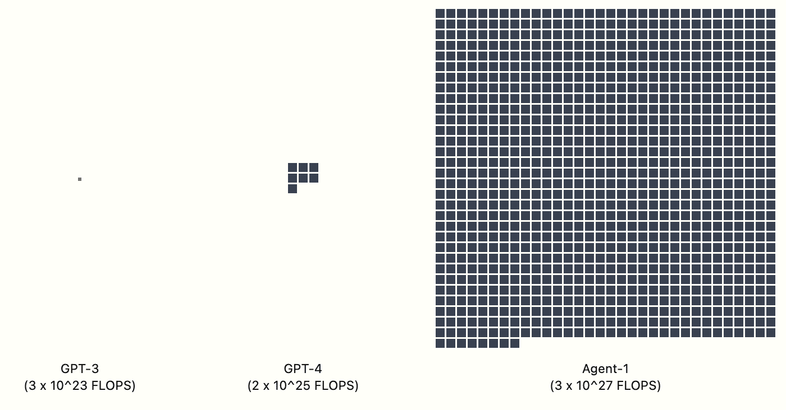

**图 6-1.** 训练 GPT-3 和 GPT-4 所需的实际算力，与 AI Futures 项目研究人员所描述的虚构下一代模型 Agent-1 的预期算力对比。（来源：https://ai-2027.com）

这些大规模集群将提供比以往多 2 到 3 个数量级的研究能力，并为持续更快的训练运行和更短的反馈循环奠定基础。其结果是构建了一个强大的平台，能够释放前所未有的吞吐量和效率，大幅缩短研究周期，并加速机器学习领域的突破性发现。

Agent-1 预计将成为一个自我改进的模型，能够实时生成和优化代码。通过自动化从常规调试到复杂内核融合的各种编码任务，这一前沿 AI 系统缩短了获得见解的时间，并拓展了全世界研究工程师的创意边界。自动化编码如同力量倍增器，支持快速迭代，让研究人员能够以更少的人工开销探索更大胆的想法。

这些大规模 AI 系统预计将支持模型的持续微调和改进。后续模型 Agent-2 可能是一个永不停止训练的持续学习型 AI。因此，Agent-2 的设计不是通过检查点来部署静态模型，而是每天根据新生成的合成数据更新其权重。

这种持续学习过程通过不断优化性能并适应新信息，确保系统始终处于最前沿。这种方法保证了数据效率和模型智能的提升能够长期持续，同时显著缩短了相继突破之间的间隔。借助这一持续学习框架，该组织为在快速变化的研究领域中保持领先树立了新标杆。

Agent-3 被描述为一个利用算法突破大幅提升编码效率的 AI 系统。通过集成先进的神经暂存器以及迭代蒸馏与放大技术，Agent-3 转变为一个快速、经济高效的超人级程序员。

Agent-3 可并行运行多达 20 万个副本，从而创建一支相当于数万名顶级人类程序员、且运行速度快 30 倍的虚拟劳动力。这一突破不仅能加速研究周期，还能让高级算法设计变得更加普及，使新想法得以快速构思、测试和完善。由此带来的研发加速，为 AI 性能持续、可衡量的提升铺平了道路。

自我改进的 AI 很快就会达到能够在研发任务中有效超越人类团队的程度。这些系统可以不间断地持续运行，以远超人类能力的速度勤勉地处理海量数据流并优化算法。

永不停歇的改进循环意味着每一天都会带来模型准确性和效率的新提升。这种自我改进的进程优化了研发流程，降低了运营成本，并实现了前所未有的创新水平。此时，人类团队的角色转变为监督和顶层战略制定，而 AI 负责完成繁重的工作，并以重新定义技术未来的速度交付突破。

Agent-4 进化为一名超人级研究员，集中体现了超人级研究能力的潜力。它建立在前代模型的基础之上，但通过重写自身代码并以最高效率优化复杂研究任务的能力而独树一帜。

Agent-4 展现出一种能够加速问题解决的智能形式，并通过精炼的机制可解释性来阐明其内部决策过程，从而帮助理解 AI 底层算法和推理过程的内部运作。在实际应用中，Agent-4 的表现使其能够解决科学挑战、生成创新研究设计，并拓展生成式 AI 模型所能达到的边界。它完成这一切的速度是人类无法企及的。这一突破将通过创造发现与技术进步的良性循环，标志着 AI 研发的转折点。

这些 Agent 的演进展示了 AI 系统基础设施、自动化编码、持续学习和自我改进模型方面的进步。每一代都极大地提升了研究生产力与创新能力。它们共同为这样一个未来奠定了基础：AI 系统的性能与效率变得至关重要，并达到前所未有的水平。

## 智能编译器与自动化代码优化

我们正在进入 AI 性能工具链中极其智能的编译器和自动化时代。性能工程师手动调优每个 CUDA 内核或摆弄每个底层旋钮的日子已经一去不复返。如今，越来越多的高层工具甚至 AI 驱动的系统正在承担繁重的工作，以榨干最后一点性能。

PyTorch、TensorFlow 和 JAX 等 AI 框架正在快速发展，借助智能编译器和执行图优化器来利用最新的 GPU 能力。PyTorch TorchDynamo 和 OpenAI 的 Triton 编译器等技术可以自动执行优化，例如使用 NVIDIA Tensor Cores 进行内核融合，以及通过 Tensor Memory Accelerator (TMA) 进行异步数据移动。

此外，OpenAI 的 Triton 编译器允许开发者使用其基于 Python 的语言编写 GPU 内核。Triton 在底层将这些基于 Python 的内核编译为高效的 CUDA 内核，但这一复杂性对 Triton 用户来说是不可见的。

这类工具正变得日趋强大。事实上，OpenAI 和 NVIDIA 目前正在紧密[合作](https://developer.nvidia.com/blog/openai-triton-on-nvidia-blackwell-boosts-ai-performance-and-programmability/#:~:text=The%20open,through%20an%20intuitive%20programming%20model)，以确保 Triton 完全支持最新的 GPU 架构，并自动利用其专用特性。一旦新一 GPU 代发布，更新后的 Triton 编译器就会展现出 GPU 的新能力，而研究人员或工程师无需了解底层的 C++ 代码或 PTX 汇编代码。相反，他们只需编写高级 Python 代码，编译器便会针对特定 GPU 环境生成优化后的代码。


很快，我们手工编写的许多优化都会被自动处理。内核自动融合、内核启动参数的自动调优，甚至数值精度的决策，都可以交给编译器和 AI 助手来完成。

利用 AI 来优化 AI 软件，是相当一段时间以来不断发展的更大趋势的一部分。事实上，谷歌 DeepMind 早在 2022 年就通过 [AlphaTensor](https://www.quantamagazine.org/ai-reveals-new-possibilities-in-matrix-multiplication-20221123) 给出了一个引人注目的概念验证。正如前一章所讨论的，AlphaTensor 是一个 AI，它发现了比任何人类开发的算法都更高效的矩阵乘法新算法。如果 AI 能在矩阵乘法上击败人类 50 年的手工数学调优，为什么不给 AI 一个机会，让它找到在专为矩阵乘法优化的硬件上进行矩阵乘法的更好方法呢？

如前一章所述，其他公司也在探索这些 AI 辅助优化。一家名为 Predibase 的初创公司利用强化学习（RL）训练了一个大语言模型（LLM），使其能够在给定参考 PyTorch 函数的情况下编写高效的 GPU 代码。他们构建的 LLM 接收高层操作并生成自定义的 CUDA/Triton 内核。这些代码既正确，又比人工优化的版本更快。

Predibase 报告称，其 AI 生成的内核在一组基准测试任务上的性能比 OpenAI 自家的优化器以及我们讨论过的 DeepSeek-R1 等强基线系统高出约 3 倍。这种由 AI 驱动的自动调优很可能成为性能工程师标准工具链的一部分。我们或许很快就能以特殊的"性能"模式运行 PyTorch 模型。在底层，AI 智能体将迭代地重写和测试生成的内核，以加速特定硬件上的特定工作负载。这就像编译器里住着一位不知疲倦的性能工程师——不断尝试让你的代码在每一次迭代中运行得更快。

在内核生成之外，现代框架在执行图和调度方面也变得越来越智能。图执行有助于减少 CPU-GPU 同步开销，并为整个图上的全局优化打开了大门。NVIDIA 的 CUDA Graphs 等技术允许将一系列 GPU 操作及其依赖关系捕获为静态图，并以更高效的方式启动，如图 6-2 所示。

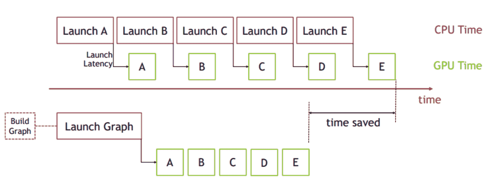

###### 图 6-2。 CUDA 中的图执行在顺序启动多个内核时可减少开销（来源：https://pytorch.org/blog/accelerating-pytorch-with-cuda-graphs/）

我们看到 AI 框架会自动将训练循环和其他重复模式捕获到图中以减少开销。即使执行图是动态的而不是静态的，框架也可以追踪一次，然后重复运行该追踪。

此外，通信与计算的重叠将越来越自动化。过去这需要人工安排，但系统可能会分析你的模型并意识到，例如，当 GPU 1 正在计算第 10 层时，GPU 2 可以并行开始计算第 11 层——实际上在底层实现了流水线并行。

我们见过许多关于如何实现 3D、4D 和 5D 并行来最大化训练和服务大模型时 GPU 利用率的复杂论述。这类技术既是一门艺术也是一门科学，目前需要大量的人类直觉和经验。虽然这些技术目前还写在诸如 [Hugging Face 的超大规模实战手册](https://www.threads.net/@sung.kim.mw/post/DGQ85hVyDtm?hl=en#:~:text=,why%20overlap%20compute%20%26%20communication)之类的专家指南中，但人们希望它们很快会被融入编译器、库和框架之中。

从本质上讲，AI 框架应该理解这些模式并调度工作，让分布式系统的所有部分都保持忙碌——无需用户对每个 GPU 流、内存传输和网络调用进行性能分析、调试和优化。例如，也许有一天我们会有一个 AI 顾问，当你定义一个 5000 亿参数的模型时，它会立即建议："你应该在每个节点上使用 8 路张量并行，然后在节点间使用 4 路流水线并行。另外，为了获得最佳效率，请使用这些层分组和块大小。"

对性能工程师来说，这将极大地提升生产力。你不必尝试无穷无尽的策略和配置，而是可以从一开始就向 AI 系统询问接近最优的解决方案。通过将人类洞察与编译器/AI 自动化相结合，你可以用比过去更少的精力获得最优结果。这有点像再一次从汇编语言走向高级语言，因为我们将更多责任委托给了工具。对性能工程师而言，这意味着我们的角色更多地转向引导这些工具，并快速验证它们是否做得很好，而不是缓慢地手动试验和验证一切。

总而言之，AI 的软件栈正变得越来越智能和自主。这里的最佳实践是拥抱这些工具，而不是与之对抗。善用像 OpenAI Triton 这样的高级编译器，它们了解你的硬件能力和性能选项。同时，留意新的 AI 驱动优化服务——它们起初可能看起来像黑盒，但它们封装了许多来之不易的性能知识。

## AI 辅助的实时系统优化与集群运维

自动化的推进不仅限于代码层面——它同样发生在系统和集群运维层面。未来，AI 系统将越来越多地自我管理和优化，尤其是在大规模训练和推理集群中，任何给定时间点都有大量并发作业和请求在途，因此需要复杂的资源共享策略。

一个即将到来的发展是 AI 驱动的自主调度和集群管理。如今，我们对 Kubernetes 和 SLURM/HPC 集群使用的是基本静态的启发式规则和相对简单的资源分配机制。但设想一下，一个智能体观察整个集群的状态，并学习如何调度推理请求和训练作业以实现最大整体吞吐量。

这个调度智能体可能会了解到，某些请求或作业可以共存于同一节点而互不干扰——也许因为一个是计算密集型，而另一个是内存带宽密集型。通过摄取大量监控数据，AI 调度器可以动态地打包和迁移任务，使所有 GPU 保持忙碌、最大化有效吞吐量，并最小化空闲时间。

从某种意义上说，集群开始表现得像一辆自动驾驶汽车，根据实时状况不断调整自己的驾驶策略（资源分配），而不是沿着固定路线行驶。对性能工程师而言，好处是更高的资源利用率和更少的瓶颈。我们的工作将转向为 AI 调度器设定高层策略和目标，让它去处理具体细节。

我们还会看到 AI 性能副驾驶协助系统运维人员。LLM 可以以辅助角色成为基础设施的一部分。例如，性能工程师可能会有一个 AI 助手，可以问它："如何加速我的训练作业？"并得到有见地的建议。这听起来有些异想天开，但考虑到这样的助手可以用过去数千次运行、日志和调优积累的知识来训练，这是合理的。


AI 性能副驾驶还可能识别到你的 GPU 内存使用率较低，并建议增大批大小，或者注意到你的梯度噪声尺度较高，并建议调整学习率计划。这个智能体将封装人类专家来之不易的经验——让这些知识随时可用。

类似地，AI 助手可以监视训练任务和推理服务器，并标记异常。例如，助手在监控一个训练任务时可能会说：“嘿，损失在训练早期就开始发散，也许你应该检查一下数据输入是否有问题，或者降低学习率”，如图 6-3 所示。

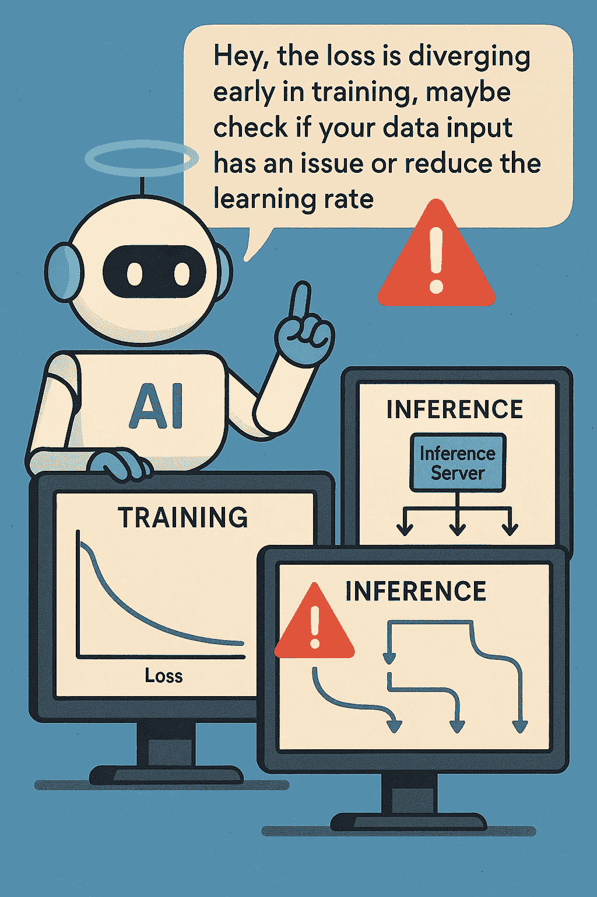

###### 图 6-3. AI 助手监控长时间运行的训练任务，并建议修复异常的操作

目前，Splunk（现为思科）和 PagerDuty 等公司已经在系统日志数据上使用 AI 模型来预测故障或检测数据中心中的异常。将这种方法扩展到针对 AI 工作负载的遥测技术正在积极推进中。简而言之，我们将为每个任务和每个推理服务器配备一双全新的 AI 眼睛——实时监控并提供建议。

AI 的另一个强大用途是 AI 系统的自动化调试和故障分析。当一个训练任务在运行 3 个月的中途失败时，人类必须阅读错误日志、设备统计信息，甚至可能还有内存转储文件，才能弄清楚出了什么问题。是硬件故障？数值溢出？还是网络抖动？

在未来，AI 系统可以消化包括日志、指标和警报在内的所有数据——并且比现在更快地指出可能的原因。它可能会说：“节点 42 在任务崩溃前出现了 5 次 ECC 内存错误——很可能是 GPU DIMM 故障。”或者，“损失在第 10000 次迭代时变成了`NaN`——可能是梯度不稳定；可以考虑进行梯度裁剪。”

通过从过去的许多事件中学习，AI 故障排查器可以为工程师节省许多小时的排查工作。一些大型计算站点已经在使用事件数据库训练模型，以预测故障并建议修复方案。

更进一步，强化学习（RL）可以应用于系统行为的实时控制，这是固定算法难以企及的。例如，可以训练一个电源管理 RL 智能体，在实时系统中持续调整频率和核心分配，以最大化每瓦性能。这个智能体将通过实时分析系统来学习最优策略。

另一个例子是主动管理 AI 模型中的内存。AI 智能体可以学习哪些张量保留在 GPU 内存中，哪些交换到 CPU 或 NVMe——超越“交换最近最少使用的”这类静态规则。通过观察实时访问模式，AI 可以更高效地管理缓存。当模式不明显或依赖于工作负载时，这种方法尤其有效。

顶尖从业者已经在使用 RL 优化缓存淘汰、网络拥塞控制等。超大规模系统的复杂性——涉及数百个相互作用的组件和资源——使其成为这类基于学习的控制的主要候选对象。可调参数实在太多，人类无法及时摸索出最佳设置——而且还需要以实时适应不同工作负载的方式进行调节。

对于性能工程师而言，AI 辅助运维智能体的兴起意味着其角色将更多地转向编排和监督 AI 驱动的流程，而不是手动调整每一个参数。这在某种程度上类似于现代飞机中飞行员管理自动驾驶仪的方式。他们仍然需要深厚的知识和监督，但大部分毫秒级的控制都已自动化。驾驶开启全自动驾驶（FSD）模式的特斯拉的人也一样。驾驶员仍然需要知识和直觉来避免复杂情况和预防事故，但车辆的控制由 FSD 软件自动化完成。

为了引导 AI 助手高效管理我们的集群，我们只需设定目标、提供安全和公平的护栏，并处理 AI 从未见过的新情况。负载均衡、故障恢复和内存缓冲区调整等常规优化由 AI 处理。拥抱这一范式对于未来非常重要。在如此复杂的系统中坚持手工操作的人，只会被那些让自动化运行的人超越。这些对 AI 自动化持开放态度的人将能够把精力集中在人类的直觉和创造力上——这正是他们在这一崭新时代中创造最大价值的地方。

## 将稀疏性与条件计算作为一等公民

随着模型规模和能力不断增长，应对其计算需求的最有前景的方法之一就是避免做不必要的工作。很快，硬件和软件将大力拥抱稀疏计算和条件计算。NVIDIA 的 Ampere 架构迈出了第一步，通过[引入](https://developer.nvidia.com/blog/accelerating-inference-with-sparsity-using-ampere-and-tensorrt/#:~:text=2%3A4%20structured%20sparse%20matrix%20W%2C,and%20its%20compressed%20representation)结构化 2:4 稀疏性到 Tensor Core 中。当网络将 50%的权重归零时，这实际上使吞吐量翻倍。在实践中，在 A100 GPU 上使用剪枝模型进行推理时，与稠密模型相比，稀疏性大约能带来 30%的每瓦性能提升。

我们很可能会看到这些能力得到大幅扩展。未来的 GPU 甚至可能支持动态稀疏性，即计算模式可以在运行过程中跳过零或无关的激活——不仅仅是固定的 2:4 模式。这与混合专家（MoE）等模型架构相呼应，这类架构只为每个输入激活模型参数的一个子集。

NVIDIA[暗示](https://www.nvidia.com/en-us/data-center/technologies/blackwell-architecture/#:~:text=The%20second,of%20replacement%20for%20larger%20precisions)了这一方向，指出 Blackwell 的 Transformer 引擎将加速 MoE 模型以及稠密大语言模型（LLM）。例如，该硬件经过调整，可以快速在不同的“专家”之间切换，并利用网络并非所有部分都会同时被使用这一优势。

随着编译器和软件库的不断发展，我们期望它们能够学会自动识别并利用神经网络中的不规则（或非结构化）稀疏性。如今，这是一项艰巨的任务，因为大多数编译器都是针对规则、可预测的数据结构进行优化的。

考虑一个动态神经网络，其执行图可以通过`if/else`语句从一个输入或训练迭代变为另一个。借助动态网络，你可以构建条件执行，使得只有与给定输入相关的图部分才会运行。例如，一个`if/else`分支可以让网络在不需要时跳过整个部分，如图 6-4 所示。

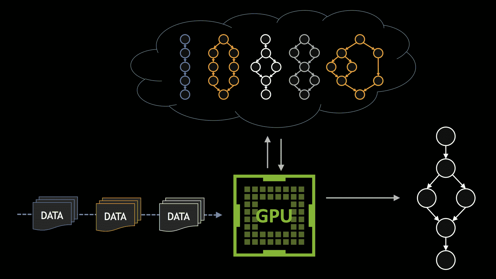

###### 图 6-4. 基于输入数据的动态图执行（来源：https://developer.nvidia.com/blog/enabling-dynamic-control-flow-in-cuda-graphs-with-device-graph-launch/）

这减少了必须执行的操作数量。这意味着网络可以有选择地只执行图中“活跃”的部分，与总是运行完整计算图的静态网络相比，可以更高效地利用计算资源、降低功耗并缩短处理时间。


动态网络往往会产生不规则的稀疏模式。这意味着零值或不活跃单元以不均匀、不可预测的方式散布。当前编译器在数据按规则、易预测的模式排列时表现最佳，因此很难检测并优化这些不规则性。要充分挖掘动态网络的潜力，需要编译器与硬件两方面的改进，包括编译器分析与优化技术的进步，以及能够有效处理非均匀稀疏性的新硬件设计。

在硬件方面，GPU 有望获得对不同块大小的块稀疏（block sparsity）支持。目前，硬件在设计时通常假设神经网络数据排列整齐——即使是不活跃的部分也是如此。有了块稀疏支持，GPU 将能够更智能地处理这些 if/else 分支，即通过"流过"这些分支的方式，而不会产生与跳过（不活跃）路径相关的常规计算开销。本质上，如果动态网络选择不运行某个分支，GPU 就不会遭受典型的延迟或性能损失，从而带来显著的性能提升。

许多最先进的模型很可能会默认采用稀疏方式——无论是通过训练技术还是自适应推理。相应地，GPU 为这些稀疏操作提供的每秒万亿次操作（tera-ops）将高于稠密操作。学术界的工作已经取得了进展。最近的一个研究原型"[Eureka](https://ieeexplore.ieee.org/document/10411411)"通过在硬件中处理更通用的稀疏模式，展示了超越 Ampere 2:4 稀疏性 4 倍以上的加速。NVIDIA GPU 可以采纳类似的想法。

区分稠密 TFLOPS 与稀疏 TOPS，对于准确了解现代 AI 应用中的计算效率非常重要。对于稀疏工作负载，许多操作根本不会执行，因为硬件检测到输入中的某些部分（例如低于某个阈值的权重）对最终结果的贡献可以忽略不计。这种跳操作机制使 GPU 能够将其在有用计算上的工作速率有效翻倍。因此，如果将稀疏计算吞吐量与稠密计算吞吐量进行比较，人们很容易低估 GPU 的真实能力。

想象你有一台能够执行海量数学运算的机器。当我们说一块 GPU 拥有"500 TFLOPS"时，我们的意思是：如果它必须执行每一个浮点运算（例如乘法或加法）而绝不跳过任何操作，那么它每秒可以完成 500 万亿次这样的运算。这就是"稠密"度量。

然而，在稀疏 AI 任务中，许多这样的操作实际上并不需要，因为网络中的许多权重——即它用来做决策的数字——非常微小，以至于不会影响结果。现代 GPU 可以检测这些接近零或等于零的值，并跳过不必要的计算。

由于 GPU 跳过了大量这些不重要的操作，它实际上完成了更多有用的工作，即有效吞吐量（goodput）。因此，我们不再像稠密 TFLOPS 那样通过统计每一次理论上的乘法来衡量性能，而是使用一种名为 TOPS（每秒万亿次操作）的度量，只统计 GPU 在稀疏工作负载上实际执行的操作。因此，一块 GPU 的额定性能可能是 500 稠密 TFLOPS，但在跳过针对零值的不必要工作后，它的有效吞吐量可以达到 1000 稀疏 TOPS。

#### 提示

尽管稀疏吞吐量以 TOPS 而非 TFLOPS 表示，但它仍然使用浮点运算。区别纯粹在于实际执行的操作数量。TOPS 只统计有价值的操作——不统计被跳过的操作。

一个简单的类比是工厂装配线：如果每个工人都对每件产品进行加工，这条线每分钟能够组装 500 件产品。但如果某件产品已经完成——或者不需要进一步组装——工人可以跳过这件产品，转而处理下一件。如果他们实际上每隔一件就跳过一件，这条线看起来每分钟处理了 1000 件有用产品，尽管其每分钟组装 500 件的完整能力并没有改变。

性能工程师的关键启示是：专注于你的系统在处理你的工作负载时的实际有效吞吐量。这同样强调的是系统完成的有用工作，而不仅仅是原始容量——即文档中记载的 GPU 理论上能够执行的操作数量。对于利用数据稀疏性的现代 AI 任务来说，这一视角至关重要。

稀疏性和条件执行很可能会从小众优化走向舞台中央。GPU 架构和模型设计的进步将为此提供支撑，并使我们能够处理拥有数万亿参数的模型，确保在任何给定时刻，我们只计算模型中对生成准确响应最有用的部分。

## GPU 在整个 AI 流水线中执行更多任务

随着 GPU 变得越来越通用、越来越强大，它们将开始进入传统上由 CPU 负责的领域。一个突出的例子是数据预处理和分析。将这些工作负载转移到 GPU 上，可以消除传统上降低吞吐量、增加延迟的 I/O 和互连瓶颈。

NVIDIA 的 Blackwell 架构为这一未来提供了[线索](https://www.nvidia.com/en-us/data-center/technologies/blackwell-architecture/)：它在 GPU 上直接集成了解压缩引擎（Decompression Engine），用于访问压缩数据并极快地解压大量数据。它支持 LZ4、Snappy 和 Deflate 等流行压缩格式。

下一代系统将使用 GPU 来训练 AI/ML 模型，同时摄取压缩数据、解析数据、增强数据，并执行数据库连接和过滤操作。所有这些都将在 GPU 内部完成。事实上，NVIDIA 正在通过 RAPIDS（GPU 加速的 Spark 和 ETL）以及将 Apache Arrow 数据格式集成到 GPU 内存等举措，积极朝着这一目标努力。基于 GPU 的系统将能够在无需往返 CPU 的情况下完成数据摄取、分析、训练和推理。

借助 Grace-Blackwell，我们已经看到 GPU 能够以 900 GB/s 的速度直接从 CPU 内存中拉取数据并实时解压。GPU 可能会获得更多逻辑单元或优化核心，用于 SQL 查询处理、图遍历，甚至无需任何 CPU 资源即可运行推理 Web 服务器。对于某些工作负载来说，这可能并不理想，但这个选项值得测试。

动机很明确。通过避免在不同处理器之间移动数据的延迟，GPU 可以从 NVMe 加载海量数据集，对其解压和过滤，然后立即在过滤后的数据上开始训练模型。这大大减少了开销和复杂性。

我们已经看到 Blackwell 加速端到端数据分析流水线的能力，正如 NVIDIA 的[博客](https://www.nvidia.com/en-us/data-center/technologies/blackwell-architecture/#:~:text=Data%20analytics%20and%20database%20workflows,of%20data%20for%20data%20analytics)所提到的：利用 Grace-Blackwell 的 CPU 内存作为缓冲区，在 GPU 上进行解压，从而加速 Spark 查询。

AI 系统的性能在于优化整个全栈工作流——而不仅仅是机器学习数学。这意味着 GPU 正在成为一站式计算引擎。如果未来 NVIDIA GPU 在芯片上集成 NIC 和类似 DPU 的功能，从而无需任何 CPU 干预即可摄取网络数据并对其进行预处理，那也不足为奇。我们可能很快就会看到曾经多阶段的流水线走向融合。AI 加速器将处理从数据摄取到洞察的整个过程，模糊数据工程与模型训练之间的界限——从而提升 AI 系统的整体性能。

## 高吞吐量、低延迟的推理编排


随着生成式 AI 模型和其他大规模 AI 服务的激增，高效地为模型提供服务成为当务之急。推理服务是软件与 GPU 能力同步演进的另一个例证。NVIDIA 于 2025 年推出的开源 Dynamo 推理框架，正是这种面向生成式 AI 的专业化编排趋势的代表。

根据其发布[博客文章](https://developer.nvidia.com/blog/introducing-nvidia-dynamo-a-low-latency-distributed-inference-framework-for-scaling-reasoning-ai-models/#:~:text=NVIDIA%20announced%20the%20release%20of,AI%20researchers%C2%A0%20to%20accelerate%20AI)，Dynamo 可以将 LLM 推理吞吐量在全新 Blackwell GPU 集群上提升高达 30 倍。它采用先进的推理策略，例如将解码阶段与预填充阶段分离，并将其分布到多个 GPU 上。Dynamo 还支持动态负载均衡和模型状态的智能缓存。

Dynamo 还引入了缓存感知调度。例如，以能够避免为每个提示词冗余重新计算 Transformer KV 缓存的方式路由请求。借助令牌级调度、批量流水线和内存最优放置等技术，Dynamo 确保每一个 GPU 周期都不会被浪费。其结果是：即使模型规模扩展到万亿参数级别，也能提供更快速、响应更灵敏的推理服务，且每次查询的成本更低。

这些优化显著增加了每个 GPU 能够处理的请求数量。在实践中，运行 Dynamo 的 H100 或 Blackwell GPU 集群，在使用相同硬件但采用通用调度器的情况下，能够以更低的延迟服务更多并发聊天机器人用户。

## 硅光子与光互连

随着 GPU 集群规模不断扩大，对网络带宽的需求日益增加，光通信有望成为颠覆性的变革力量。我们预计，目前连接 GPU 和机架的铜缆将很快被光纤和共封装光学器件（CPO）大规模取代。NVIDIA 已经[宣布](https://nvidianews.nvidia.com/news/nvidia-spectrum-x-co-packaged-optics-networking-switches-ai-factories)了 Spectrum-X 和 Quantum-X 光子交换机原型，这些交换机将硅光子技术直接集成到数据中心交换结构中——每端口吞吐量达到 1.6 Tb/s。

此外，这些共封装光交换机与传统电以太网/InfiniBand 交换机相比，能效提升约 3.5 倍，并且能够在远得多的距离上保持信号完整性。在实际应用中，这意味着未来的 GPU 机架可以直接通过光链路连接。这将消除带宽与距离之间的权衡。

我们将看到用于跨机柜甚至跨机房连接 GPU 的光学 NVLink 或 NVLink-over-optical 技术，并且延迟损失极小。而拥有数万 GPU 的 AI 超级集群很可能会采用全光骨干网络，在整个数据中心内创建一个统一协同的系统。

NVIDIA 的愿景是将 AI 工厂扩展到跨多个物理位置的数百万 GPU。由于衰减和能源成本，这在今天的铜互连条件下根本无法实现。光子技术是唯一的前进道路。通过传输光子而非电子，网络将实现每链路每秒数太比特的带宽密度，并且每比特功耗更低。

不久之后，我们将看到共封装光收发器直接放置在 GPU 芯片旁边，在信号源头将高速电信号转换为光信号。这将大幅削减 GPU 间通信所需的能量，并在很大程度上消除分布式训练和推理中的网络瓶颈。

2020 年代后半叶，光链路很可能在 AI 基础设施中变得司空见惯，从板卡级互连一直到机架和数据中心级别。这是创建超大规模 GPU 集群的关键一步。

## 全球分布式数据中心（AI 工厂）

AI 部署的规模将超越单一数据中心和地理位置。我们很可能会看到覆盖全球的 AI 系统，其中多个数据中心“节点”作为统一资源协同进行训练或推理。为了以可管理的延迟连接远距离 GPU 集群，我们需要利用超高带宽的数据中心连接，例如光网络。

NVIDIA 首席执行官经常谈到“AI 工厂”或 AI 超级计算机。他设想用光子交换和光纤将这些工厂连接起来。一旦实现，例如，就可以将分布在三大洲的三个 100 万 GPU 集群视为一个拥有 300 万 GPU 的巨型集群，用于一次大规模、超大规模的训练运行。

事实上，2025 年发布的 Spectrum-X 光子平台明确[提到](https://nvidianews.nvidia.com/news/nvidia-spectrum-x-co-packaged-optics-networking-switches-ai-factories#:~:text=GTC%E2%80%94NVIDIA%20today%20unveiled%20NVIDIA%20Spectrum,optical%20communications%20at%20massive%20scale)了跨站点扩展到数百万 GPU 的目标。大约十年后，网络和分布式系统可能发展到足以让这一目标在特定工作负载中成为现实。我们可能会见证一个神经网络训练任务同时运行在东京、伦敦和硅谷，通过跨洋光链路保持同步。

这里的趋势是数据中心规模演变为全球规模。从性能角度看，考虑到光速限制、容错、功耗和能源等问题，挑战巨大。但行业可能会通过算法手段来缓解这些挑战。例如，一些设计巧妙的异步更新方案可以容忍延迟，或者采用张量、流水线和专家并行策略来减少节点间通信。

如果成功，训练或服务大规模 AI 模型的有效算力将不再受地理位置限制。其中一个具体衍生成果可能是真正实时的全球推理服务。想象一个分布在全球的 AI 模型：响应在各区域分别计算一部分，然后在返回给最终用户之前进行聚合。

今天，这种模式的种子已经体现在内容分发网络和分布式数据库中，但很快它们将扩展到分布式神经网络。例如，NVIDIA 在 2019 年收购 Mellanox，表明他们正着眼于这样一个未来。他们希望网络和 GPU 一样快，这样位置就不再重要。性能工程可能既涉及单个集群内部的优化，也涉及跨全球集群的优化。全球统一、覆盖广域的网络将成为系统设计的一部分。未来的 AI 很可能将整个地球视为其计算机。

## 智能网络与分布式计算卸载

与光互连并行的是，未来将高度依赖 BlueField 数据处理单元（DPU）等网络卸载引擎，以支持扩展到拥有成千上万乃至数百万 GPU 的 AI 超级计算机。随着单个 GPU 的速度越来越快，为它们提供数据并在大型集群中协调它们成为一项严峻挑战。

如前文所述，BlueField DPU 本质上是智能网络接口控制器（NIC），配有专门的基于 ARM 的网络处理器，可处理从 RDMA 通信到存储访问的各种任务。DPU 将 CPU 和 GPU 从这些任务中解放出来，使它们能够专注于更高级、更有用的有效吞吐活动。例如，将集合通信算法卸载到 DPU，可以让 GPU 专注于纯计算，而 DPU 则负责梯度的 all-reduce。

NVIDIA 的一份可持续性[报告](https://www.nvidia.com/en-us/sustainability/#:~:text=Less%20Power%20Consumption)显示，当前 DPU 可将 CPU 利用率和系统总功耗需求降低 25%。其实现方式是以更高效率处理数据移动。


随着 GPU 集群规模不断扩大，DPU（数据处理单元）的作用将持续增强。我们很快将看到 DPU 深度集成到 AI 系统中。它们可能负责实时负载均衡、为分布式模型缓存参数，并执行加密等安全任务——而且所有这些都以极低延迟完成。我们很可能会达到这样一个阶段：每个服务器节点都内置一个 DPU，本质上充当智能调度器，协调数十块 GPU。

DPU 带来的另一项创新是网络内计算，比如 NVIDIA 的 SHARP 协议。借助 SHARP 和 DPU，NVIDIA 网络交换机可以在数据穿越网络时执行归约和聚合操作。这将大幅加速分布式训练和推理。将网络内计算与网络卸载相结合，DPU 帮助 AI 集群提升整体吞吐量和降低延迟。

很快，典型的 AI 系统将涉及分层通信模式，其中 DPU 和智能交换机将承担梯度、模型权重/层、优化器状态和激活值的大部分同步工作。其性能影响将非常显著，因为当扩展到极大数量的 GPU 和计算节点时，收益递减效应将减小——从而实现近似线性的扩展。这是一个网络不再是被动数据管道的未来。相反，网络是整体 AI 计算栈中的活跃部分。网络将与 GPU 紧密协作，从而在数千个节点和数百万个 GPU 上高效运行大规模模型。

## GPU 上堆叠 HBM 内存（3D GPU）

未来最具变革性的 GPU 硬件趋势之一是缩短 GPU 与其内存之间的物理距离。例如，将内存和 GPU 核心合并到同一个封装或裸片中。当今的 HBM 内存堆栈位于 GPU 旁边的硅中介层基板上。中介层负责布线和连接 GPU 与 HBM 内存，但其相对较长的走线会造成延迟和带宽降低。然而，目前正在开发的未来迭代版本，旨在将内存直接堆叠在 GPU 计算芯片之上，实现 3D 方式的结合。这将提升 GPU 与 HBM 之间的带宽并降低延迟。

SK 海力士（一家专注于 HBM 等内存产品的半导体巨头）与 NVIDIA 正合作推出一项极具开创性的 3D[重新设计](https://www.tomshardware.com/news/sk-hynix-plans-to-stack-hbm4-directly-on-logic-processors#:~:text=SK%20Hynix%20has%20started%20recruiting,may%20transform%20the%20foundry%20industry)方案，用于下一代 GPU，实现 3D 堆叠。他们将 HBM4 内存堆栈直接置于 GPU 处理器之上，从而无需使用中介层。这种方法将极大地提升逻辑与内存之间的带宽并降低延迟。这种提升可能是一个数量级的飞跃，类似于片上 SRAM 相对于片外 DDR RAM 的性能优势。

通过 3D 设计去除中介层，每个比特从 HBM 存储单元到 GPU 处理器只需传输几微米。这将使得每个堆栈的接口或数据通道可远超 1024 位。3D 堆叠将允许更大量数据的并发传输并行转移——从而提升整体内存带宽。

3D 设计将彻底改变芯片制造方式，因为 SK 海力士实质上会成为类代工厂——将其芯片集成并堆叠到 NVIDIA 生产的 GPU 处理器上。如果成功，这可能完全改观半导体制造业，并模糊无晶圆厂芯片设计公司与芯片制造代工厂之间的传统界限。

对 AI 系统性能而言，这影响深远。内存带宽一直是瓶颈，尤其是对于大模型和内存受限操作，比如 Token 生成/解码。通过逻辑-内存堆叠，未来的 GPU 可能拥有每秒数 PB 的内部带宽。

借助 3D 堆叠，我们可以为成千上万个 Tensor Core 提供数据，几乎不会出现数据饥饿的情况。想象一下，每个 GPU 流式多处理器（SM）的顶部都直接有一块 HBM 切片。这将使 HBM 成为更快的 L2 缓存的延伸。3D 设计中去除中介层还将大幅提升能效，因为目前 GPU 的大量能量消耗在通过中介层传输电信号的过程中。

很快，我们预计至少一代 NVIDIA GPU 将采用某种形式的计算-内存 3D 堆叠。它可能首先以多芯片模块的形式出现，即内存芯片堆叠在计算芯片之上，形成 chiplet-on-chiplet 架构。最终，也许我们会看到 GPU 处理器和 HBM 混合在同一个 3D 堆栈中。

性能工程师在不远的将来或许不会再讨论内存带宽这一瓶颈。相反，他们会关注其他因素，因为 GPU 的内存在实际上等同于在封装内了。然而，实现这一点面临巨大挑战，因为冷却 3D 堆栈——并维持这种组合堆栈的高良率——非常困难。尽管存在这些挑战，所有迹象都表明这项技术正在发展，且其落地会比预期更快。

## 大规模新能源效率与可持续性

随着模型和 GPU 集群指数级增长，它们对电力的需求也呈指数级上升。能源效率正迅速成为 AI 系统设计的首要目标——与原始性能并驾齐驱。我们在这方面已看到戏剧性的进展。例如，NVIDIA 的 Grace-Blackwell GB200 NVL72 机架级系统，在相同功耗下，性能比上一代基于 H100 的风冷[方案](https://www.nvidia.com/en-in/data-center/gb200-nvl72/)提升了约 25 倍。GB200 NVL72 能效的巨大飞跃源于多种因素，包括改进的 GPU 架构、先进的液冷技术，以及更好地让所有芯片保持高利用率运转状态。简单来说，NVL72 每焦耳能量做的有用功更多。

对性能工程师而言，这意味着功耗现已成为优化系统时的关键约束。以往，性能-价格比（性价比）是主要优化指标，但现在性能-功耗比（能效比）同样举足轻重。每一次优化都必须考虑能源效率。结构化稀疏性就是一个很好的例子——通过跳过不必要的运算，既节省功耗又节省时间。如果矩阵中一半可以为零，且精度损失极小，那么利用这种稀疏性，就能以大约一半的能量获得基本相同的结果。我们可以预见，未来的硬件和软件库/框架将为稀疏性及其他效率优化技巧提供更多支持，因此，在设计模型时考虑这些节能技术是明智之举。

另一个新兴的实践是与工作负载阶段相关的动态电源管理。例如，有时 GPU 处于计算受限（compute-bound）阶段，而其他时候则属于内存受限（memory-bound）或通信受限（communication-bound）阶段。现代 AI 系统会利用这些阶段转换。比如，当你的代码进入内存受限阶段时，一个智能调度器可能会临时降低 GPU 时钟频率或电压来节省功率、减少发热，因为当瓶颈在内存时，无需全速计算。然后，当你的代码进入计算密集阶段时，系统会重新提升时钟和电压，以最大化吞吐量。这种动态电压频率调节（DVFS）可能很快将自动运行于幕后。一个人工智能控制器可以动态地实时学习最优电源设置。


可持续发展方面的考量也在将可再生能源意识引入 AI 运营中。我们可能会把高耗能的训练任务安排到一天中绿色能源充足的时段。目前已有积极研究致力于将 AI 工作负载调度与可再生能源可用性对齐。设想这样一个未来仪表盘：它能显示 GPU 利用率，以及来自无碳能源的电力百分比。公司可能会开始炫耀：“我们在 2 个月内训练了一个 10 万亿参数模型——而且是用 80% 的可再生能源完成的！”作为性能工程师，你可能会发现自己需要与机房电力管理人员协同工作，思考在何时何地运行任务，以便在最小化碳足迹的前提下充分利用可用电力。

简而言之，面对电力约束，超大规模 AI 计算必须明智地扩展。追求每一分 FLOPS 固然很好，但高效地实现这一点才是真正的胜利。好消息是，像 Grace-Blackwell NVL72 这样的 AI 系统表明，业界正在大力投资能效。我们的工作将是利用这些进展：让 GPU 保持忙碌但不浪费，善用低精度模式和稀疏性等特性，并设计出能在可行时精打细算电力的工作流。这是一种相对较新的思维方式，将电力视为一种稀缺资源，需要与时间和金钱一起进行优化和预算。

## 先进冷却与能源再利用技术

数据中心已经在应对单机柜功率密度更高这一现实。GB200 NVL72 目前功耗为 120 kW，但在不久的将来很可能会超过 200 kW。考虑到可持续性，我们需要更广泛地采用尖端冷却方案，例如单相和两相浸没式冷却、带蒸发冷却的冷板，甚至是片上微流道冷却。一些 AI 数据中心已经在尝试浸没式冷却，将整块服务器主板浸入介电液体中。他们[报告](https://www.cnbc.com/2024/08/27/nvidia-partner-sustainable-metal-cloud-ai-data-center-energy-consumption.html#:~:text=This%20Nvidia%20partner%20can%20help,typically%20used%20in%20data%20centers)，与传统风冷相比，液冷能耗最高可降低 50%。

很快，许多 AI 集群将从零开始设计为使用浸没式冷却技术。这能提升能效，并让废热更容易通过热交换器被捕获。我们很可能会看到大型 AI 计算园区与相关设施集成，利用这些捕获的热量用于其他工艺——实际上是回收了能源。

在能源供应方面，NVIDIA 和其他公司将继续努力，以可再生能源和巧妙的储能机制为这些“AI 工厂”供电，以抵消峰值负载期间的能源需求。这对性能的影响在于，热约束是持续性能的关键限制因素。如果你能让 GPU 温度降低 20°C，它就有可能在多日训练运行中保持更高的时钟频率，并避免热降频。卓越的冷却直接转化为更快、更可靠的吞吐量。未来大多数高端 GPU 集群将采用浸没式冷却。

我们还将看到更多液冷机柜标准成为主流。正如美国供暖、制冷与空调工程师学会（ASHRAE）为风冷数据中心制定了指南，业界也将为 HPC 和 AI 集群标准化液冷机柜配置。事实上，2024 年，NVIDIA 将其 GB200 NVL72 机柜和冷却设计[贡献](https://developer.nvidia.com/blog/nvidia-contributes-nvidia-gb200-nvl72-designs-to-open-compute-project/)给了 Open Compute Project（OCP），以帮助建立高效、可扩展的液冷系统行业标准。

这一趋势将使数据中心能够继续提高计算密度，而不会撞上“热墙”。设想一个 48U 机柜容纳 100+ PFLOPS 的 FP8 计算能力。目前，只有借助先进冷却系统才可能实现这一点。

AI 系统性能不仅仅关乎 FLOPS。它还关乎消除那些阻碍 FLOPS 被充分利用的瓶颈。而其中一个瓶颈就是热量。业界将持续以新颖的冷却和能效技术来应对，使 GPU 能够运行得更热、更密集、更绿色。

## 混合经典-量子计算（CUDA Quantum）

把目光投向更远的地平线，我们会看到量子计算。众所周知，如果实用的量子计算机出现，它们可能会彻底改变某些类型的计算。虽然通用型量子 AI 尚未到来，但我们已开始看到将量子加速器集成到 AI 技术栈中的早期探索。X 量子计算机的图片见图 6-5。

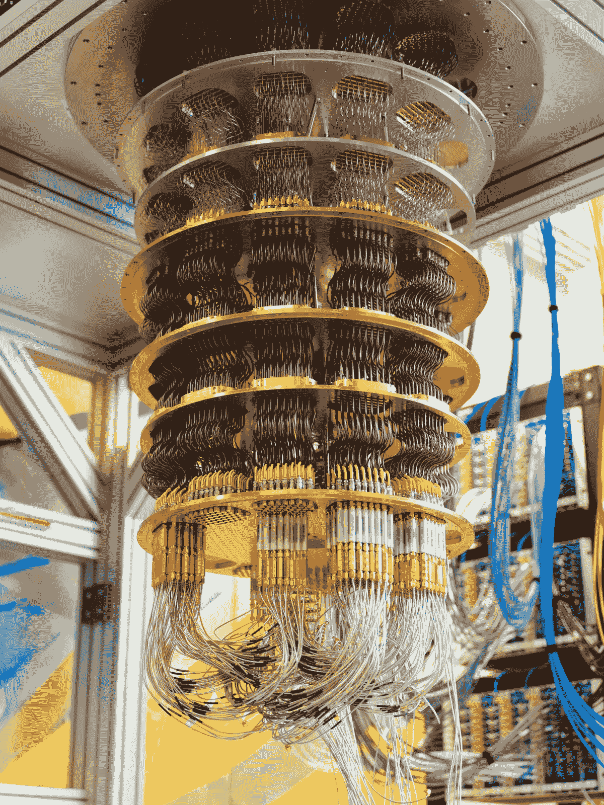

### 图 6-5. Google 量子计算机（来源：https://quantumai.google/quantumcomputer）

NVIDIA 一直在通过其 [CUDA Quantum](https://developer.nvidia.com/cuda-q)（CUDA-Q）计划为这一量子未来做准备，该计划为混合量子-经典计算提供了统一的编程模型。其基本思想是，未来的 HPC 集群可能会让量子处理单元（QPU）与 GPU 和 CPU 并排，各自处理自己经过独特优化的任务。

在短期内，量子处理器可能仍会相对较小且专门化。例如，它们不会端到端地训练一个拥有 100 万亿参数的 Transformer，因为目前的量子设备根本无法处理这种规模的数据。不过，它们可以作为加速器，用于 AI 工作负载中出现的特别困难的问题。例如，某些优化问题或采样任务可以通过量子方法加速。

考虑一个大型生成模型，它在运行过程中需要从极其复杂的概率分布中进行采样。量子退火机或小型基于门的量子计算机或许能够利用量子叠加或隧穿来更高效地完成这种采样。如果是这样，混合算法可以让 GPU 处理绝大部分神经网络计算，然后将这一特殊采样步骤卸载给 QPU。CUDA Quantum 被定位为充当底层管道，让这种集成变得无缝顺畅。

作为性能工程师，这意味着如果量子计算达到对 AI 有用的程度，我们不必重新发明整个软件栈。我们只需将 QPU 视为另一个拥有自己的内核和优化技术的设备。这与我们今天相对于 CPU 来看待 GPU 的方式类似。事实上，CUDA-Q 已经允许你编写单个程序，在其中同时调用 GPU 内核和量子内核。你甚至可以在 GPU 上模拟量子部分以进行开发，如 NVIDIA [博文](https://developer.nvidia.com/blog/performant-quantum-programming-even-easier-with-nvidia-cuda-q-v0-8)所述。这很棒，因为我们可以从今天开始使用模拟来编写和测试混合算法，因为真正的大型 QPU 还没有大规模存在。这样一来，当这项技术成熟时，我们就能准备好在实际量子硬件上运行它们。


那么，作为性能专家，我们在这个领域应该关注什么呢？首先，密切关注量子硬件的进展——尤其是任何量子加速器在与 GPU 对比时哪怕表现出一点加速迹象的任务。截至撰写本文时，尚未有人在主流机器学习任务中展示出明确的量子优势，但关于量子核方法用于机器学习以及受量子启发的张量网络方法等研究仍在进行中。如果出现突破，那将标志着混合经典-量子计算已准备好登上主流舞台。例如，假设一个 QPU（量子处理单元）计算大型矩阵乘法或解决复杂组合优化问题的速度超过了 GPU。那将是迈向量子未来的巨大一步。

如果这种情况发生，性能工程师必须理解系统中 CPU、GPU 和 QPU 之间的数据移动和延迟。我们需要确保 QPU 节省下来的时间不会浪费在等待数据传输或设备同步上。这让人想起经典的异构 CPU-GPU 计算挑战，只不过这次的设备更加新奇且强大。

实际而言，目前没有什么重大改变。我们大多数人在不远的将来不会直接使用量子硬件。但很可能在十年内，某些 AI 工作负载的一部分将运行在单个 AI 系统中根本不同的计算基板上。类似于 GPU 在 CPU 之外引入了新范式，QPU 也将它们自身的特点和优化方式带入其中。我们工作的复杂性将再次跃升，因为我们将在一个应用中对 CPU、GPU 和 QPU（还有其他的吗？）进行性能分析和优化。未来充满乐趣！好消息是，像 CUDA-Q 这样的框架已经在思考如何为这些新设备提供一个统一的平台。

值得注意的是，当前你可以在开发过程中使用 GPU 来模拟量子算法。例如，NVIDIA 的 cuQuantum SDK 允许在 GPU 上快速模拟中等量子比特数量的系统。如果有人设计了一个涉及需要 30 个量子比特的量子程序的 AI 算法，我们可以在开发和测试阶段在 GPU 上模拟这些量子比特。

这意味着 HPC GPU 可能同时运行神经网络代码和量子电路模拟。优化量子电路模拟实际上与优化神经网络操作非常相似——都是优化与量子门对应的线性代数和矩阵运算。

所以有趣的是，高层级的优化原则在不同设备间是相通的。都关乎高效的线性代数、内存带宽利用率和并行性。对量子感兴趣的性能工程师现在就可以在模拟方面做出贡献。

AI 量子计算是一种前瞻性的押注，但基础正在奠定。这里的最佳实践就是保持好奇心和开放思维。动手玩玩量子编程框架和模拟器，了解 QPU 工作的基本原理。关注那些展现出 AI 加速潜力的发展动态。这样，当量子时代到来并应用于 AI 工作负载时，你就能第一时间跟上节奏，而不是手忙脚乱地追赶全新概念。这是一个令人兴奋的前沿领域，全新的性能工程挑战和机遇正等待着我们。

## 迈向 100 万亿参数模型的扩展

最后，让我们重新审视向超大规模、100 万亿参数模型不断迈进的步伐。我们已经突破了万亿参数的门槛。现在的问题是如何在未来几年扩展到数十甚至数百万亿参数模型。这样的模型对我们的系统提出了什么要求？需要哪些创新才能使训练如此强大的模型变得可行？这正是我们所讨论的一切汇聚之处——包括高效硬件、智能软件、巧妙算法。要达到 100 万亿参数模型，需要使用书中所有的技巧——以及一些可能尚未被发现的技巧。让我们深入探讨！

在硬件方面，显而易见的需求是更多的内存和更大的带宽——最好是直接集成在 GPU 上。如果你有 100 万亿参数并想训练它们，你需要高效地存储和移动海量数据。下一代内存技术将至关重要。高带宽内存（HBM）在持续演进：HBM3/3e 用于当前一代 GPU，HBM4 很可能用于下一代 GPU。HBM4 再次将每个堆栈的带宽翻倍——大约每个堆栈 1.6 TB/s。它还将把每个堆栈的容量提高到可能每个模块 48GB 或 64GB。

HBM4 更高的容量和吞吐量意味着未来的 GPU 可能配备，比如说，8 个 64GB 的 HBM4 堆栈，单块板上总共 512GB 的超快 HBM 内存，聚合内存带宽超过 10 TB/s。这种本地 HBM 容量可以直接在每个 GPU 上容纳大量模型参数——大幅减少数据进出交换的需求。不难看出，这将支持更大的模型、更高带宽的训练运行和更低延迟的推理服务器：以前需要分片到 8 个 GPU 的任务可能只需要 1 个 GPU，以前需要 100 个 GPU 的任务可能只需要 10 个，依此类推。

除了像 Grace-Blackwell 超级芯片这样的多芯片架构外，多个 NVL72 机架可以相互连接成一个巨大的集群，形成数百个共享统一快速网络的 GPU。本质上，从通信角度来看，你的集群就像一个巨型 GPU。这对扩展到 100 万亿参数至关重要，因为这意味着我们可以持续添加 GPU 来获得更多总内存和算力——而不会遇到通信瓶颈。这假设 NVLink（或类似技术）能持续扩展到这些超大规模。

然而，仅靠硬件无法解决 100 万亿参数的挑战。软件和算法创新同样重要，甚至更为关键。例如，用朴素的数据并行方法训练这种规模的模型将极其缓慢且昂贵。想象一下优化器每一步都要更新 100 万亿个权重！我们将需要大量依赖那些能减少有效计算量的技术。我们探讨的一个重要领域是低数值精度。除了 FP8 和 FP4 之外，未来的硬件可能支持网络某些部分使用更低的（1 比特）精度。混合方案很可能至关重要——模型大部分使用低精度，但敏感部分使用更高精度。

作为性能工程师，我们应该关注这些新能力并准备好使用它们。要训练 100 万亿参数模型，你很可能需要使用低精度来提高效率，否则工作负载会慢得难以接受且代价高昂。好消息是，硬件和库将使这一过渡相对无缝——我们已经看到，例如，NVIDIA Tensor Core 和 Transformer Engine 获得了一流的 CUDA 和 PyTorch 低精度支持。

另一个关键方法是稀疏性和条件计算。我们已经在像稀疏专家混合（MoE）这样的模型中使用了稀疏激活，即对于给定输入，只有模型参数的一部分被激活。这个想法可以推广——你不必每次都使用完整的 100T 参数；只需要用你需要的那部分。采用 MoE 架构的模型已被证明功能强大且高效。到 100 万亿参数模型问世时，我预计其中很多都需要稀疏激活。

对于性能工程师而言，这意味着吞吐量不仅关乎矩阵乘法速度，还关乎 MoE 条件路由的效率、专家输出的缓存以及稀疏数据交换的通信模式。这增加了复杂性，但也带来了机遇。如果你能确保正确的专家在正确的时间出现在正确的设备上以最小化通信，你就能大幅加速这些庞大规模模型。


我们还应该考虑算法效率的改进。使用更少内存的优化器可能至关重要。传统的`Adam`优化器变体通常需要为动量和方差估计额外保存两份权重副本。这实际上使内存使用量变为原来的三倍。因此，如果你有 100 万亿个参数权重，就需要额外的 200 万亿个值来保存优化器状态！像`Adafactor`和`Shampoo`这样内存效率高的优化器有助于减少这一开销。

梯度检查点（gradient checkpointing）等技术通过重新计算激活值而非存储它们，来用计算换取内存。在 100 万亿参数规模下，你几乎肯定会采用激进的检查点策略。一个更为激进的想法是，也许我们不必在每一步都更新所有权重。可以考虑以轮换方式更新权重的子集——类似于不必每天给每株植物浇水，而是轮流浇灌。如果操作得当，模型仍然能有效学习，但每个参数的更新频率会降低。这减少了系统的总计算需求。

这类想法与算法设计领域交织在一起，但性能意识视角仍然很有价值。我们应该对训练和推理的每一个方面都问一问：“我们真的需要这么频繁地做`X`，或者需要这么高的精度吗？”通常答案是，我们可以找到一个成本更低但仍有效的近似方案。在 100 万亿参数规模下，这些近似可以节省数月时间或数百万美元。

超大规模训练中一个经常被忽视的方面是基础设施和网络。当你在谈论由 10,000 多块 GPU 组成的集群来处理一个模型时，网络结构变得与 GPU 本身同等重要。以太网和 InfiniBand 技术正在通过提升吞吐量和更智能的自适应路由技术等方面不断进步。

NVIDIA 的 Spectrum-X 是近期的一个例子，它是为 AI 优化的类以太网结构，有望减少拥塞并提供高对分带宽。我们还可能会看到更多先进的开放行业标准互连技术，如 Compute Express Link（CXL）的使用，它能够在计算节点之间实现高吞吐、低延迟的共享内存访问，从而形成一个庞大的全局内存池——例如，该内存池可通过 NVIDIA 的 GPUDirect RDMA 技术访问。

性能工程师需要深入了解这些层级，并确保数据在正确的时间出现在正确的位置。目标将是模拟一个跨越 GPU 和 CPU 的巨大内存空间，这样即使一个模型无法容纳在一台机器中，程序员也可以相对透明地处理它。如今，通过统一内存和分页系统，其中一些功能已经实现，但在 100 万亿参数规模下，这一功能将真正受到考验。

像 xAI、OpenAI 和微软这样的前沿研究实验室[据报道](https://semianalysis.com/2024/05/07/openai-is-doomed-et-tu-microsoft/#:~:text=Microsoft%20has%20plans%20for%20a,Many%20firms%20use)正在规划拥有 10 万和 100 万块 GPU 的大型单一集群，这并不令人意外。在 100 万亿参数规模下，你可能需要让一个任务横跨整个数据中心规模的硬件。性能工程师必须以数据中心和多数据中心（全球）的规模来思考。

最后，随着模型及其所需计算资源的规模扩大，出现了一种社会技术趋势。任何单一团队——甚至单一公司——独立训练最大规模的模型可能会变得不可行。我们（希望）将看到 AI 社区中更多的协作与共享，以处理这些庞大的项目。这将类似于大型科学项目（如粒子物理实验）需要众多机构参与的方式。与[现已解散](https://blog.opencollective.com/open-collective-official-statement-ocf-dissolution/)的 Open Collective Foundation 类似的倡议，可以将计算资源汇集起来，训练一个 100 万亿参数的模型，然后与世界共享。

这将需要对检查点格式等内容进行标准化、共同开发训练代码，并思考模型的多方所有权。虽然这本身不是性能问题，但它会影响我们构建大型 AI 系统的方式。我们需要让系统更具容错性，并且易于快照，以便共享部分结果。作为工程师，你可能最终不仅要优化纯粹的速度，还要优化可复现性和互操作性。这使得不同团队能够顺利、高效地处理训练和推理工作流的不同部分。

达到 100T 模型将需要全面的、全栈式的创新。这个挑战没有单一的解决方案。相反，拼图的每一部分都必须改进。硬件需要更快并能存储更多数据。软件需要更多地自我优化——并通过编译器、AI 助手和实时自适应用更高效地利用资源。算法需要通过稀疏性、更低精度和更好的优化器来巧妙地避免不必要的工作。

性能工程师的角色将是把所有这些进步整合成一个连贯的工作流程。这就像组装一辆高性能赛车。发动机、轮胎、空气动力学和驾驶技术都必须协同工作。如果我们做对了，现在看起来不可能的事情——例如在不花费过高成本的情况下训练 100 万亿参数——将变得可行。不久之前，1 万亿和 10 万亿参数的模型听起来还很疯狂，但如今它们已成为现实。因此，历史表明，凭借创造力，我们也一定能征服下一个里程碑。

## 关键要点

- **统一计算引擎。** 现代 GPU 正在演变为通用处理器，既可以处理传统的高性能科学计算（HPC）模拟，也可以处理 AI 工作负载。这种融合意味着“AI 超级计算机”与 HPC 系统之间的传统区别正在模糊。性能工程师将越来越多地以集成方式应用来自这两个领域的技术，包括混合精度、稀疏性和调度算法。

- **无缝工作负载集成。** 未来的系统将允许百亿亿次（exascale）气象模拟等 HPC 任务与神经网络加速无缝融合。编程模型可能会支持在深度学习使用的张量运算与科学模拟至关重要的双精度算术之间进行即时切换。这为更通用的计算系统铺平了道路。

- **指数级算力扩展。** 下一代 AI 数据中心正在设计中，将提供数量级增长的计算能力。这些设施将训练算力预算远超当前水平的 AI 模型。这将使训练运行使用的 FLOPs 达到当前系统的 100 到 1,000 倍。

- **持续演进的 AI 模型与智能体。** 未来的模型将是能够生成和优化代码、用新数据持续更新权重、甚至重写自身代码的自我改进系统。这种学习与完善的永久循环将缩短突破之间的时间，并创造出在研究及研发任务中超越人类团队的虚拟劳动力。

- **软件栈自动化。** 一个核心主题是从手动内核优化转向日益自主的软件工具链。`PyTorch`、`TensorFlow`和`JAX`等现代 AI 框架正在融入智能编译器和执行图优化器，它们可以自动融合内核、调优启动参数并优化内存传输。

- **AI 辅助优化。** 新兴的 AI 驱动助手将不断减轻人类工程师的性能调优任务。在不久的将来，绝大多数底层优化将自动进行，让性能工程师得以专注于高层策略和验证。

- **自主调度与集群管理。**


未来的系统将利用 AI 来监控并动态优化整个集群。智能调度代理将分析实时数据，将作业与互补的工作负载协同放置，最大化资源利用率，并通过实时调整 GPU 显存使用和时钟频率等参数来缓解瓶颈。

### 实时故障排除

除了调度之外，AI 副驾驶将监控系统日志和训练运行过程，以快速检测异常。这包括自动调试、故障分析，甚至通过强化学习来学习最优配置，以最大化每瓦特和每单位时间的性能。

### 利用固有数据稀疏性

随着模型不断增长，避免不必要操作的机会也在增加。硬件和软件将越来越多地利用只激活网络相关部分的技术（例如混合专家架构），以将有效吞吐量提高一倍并改善能效。稀疏和条件计算模型将成为最大化"有效吞吐"（goodput）而非原始 TFLOPS 的核心。

### 动态图执行

编译器将通过追踪动态执行模式并自动重组计算图来持续改进。这对于训练超大规模模型和提供低延迟推理服务都至关重要，因为它将通过最小化冗余数据传输和同步来降低开销。

### 硅光子学与光网络

为了克服 GPU 集群扩展中的带宽和延迟问题，传统铜互连将被光纤和共封装光学器件所取代。这些技术有望提供每端口太比特级别的速度，同时大幅降低功耗，从而实现具有极低通信延迟的全球统一数据中心。

### 3D 内存集成

在不久的将来，将高带宽内存（HBM）直接堆叠到 GPU 上的技术将取得进展。通过大幅缩短计算核心与内存之间的物理距离，这些 3D 设计有望带来巨大的带宽提升和能量损耗降低，有效消除传统内存瓶颈。

### 每瓦性能是至关重要的指标

随着计算规模扩大，能耗成为头等关注的问题。低精度运算、结构化稀疏和动态功耗管理方面的创新将变得至关重要，以确保性能提升不会以不可持续的能源成本为代价。根据工作负载阶段智能调整电压/频率以提高能效而不牺牲性能，将变得至关重要。

### 先进冷却与能源再利用

冷却技术将持续演进，包括浸没式冷却和微流控系统。这些技术将实现更高的计算密度，并允许废热的再利用或回收。这些技术对于在数据中心保持高性能的同时控制能源使用和碳足迹至关重要。

### 量子计算的集成

虽然实用化的量子计算仍在前方，但 NVIDIA 的 CUDA Quantum 等举措凸显了将量子加速器与经典 GPU 集成的早期努力。这种混合方法有望提升组合优化和某些模拟任务等特定任务的性能——而无需彻底改造现有软件栈。

### 从数据中心到全球 AI 工厂

不久之后，各个数据中心将在全球范围内互联互通，而不是彼此孤立。这些"AI 工厂"将跨大洲运营，通过超高带宽光网络将数百万乃至数十亿个 GPU 无缝连接成一个统一、连贯的全球资源。这里的性能工程挑战包括本地优化、跨数据中心同步以及聚合结果的高效路由。

### 整体全栈创新

将 AI 模型扩展到 100 万亿参数的动力，融合了从硬件突破到软件优化和新颖算法方法的一切。这种规模要求整合低精度训练、稀疏计算、先进的优化器设计，以及能够以极低延迟处理海量数据的稳健基础设施。

### 协作与可复现研究

随着模型不断增长，其训练和部署的复杂性也在增加。成功的扩展将依赖于标准化格式、协作框架以及全球数据共享和可复现性工作，确保研究能够被有效汇集并扩展到任何单一团队或机构都无法独立处理的规模。

## 结论

AI 系统性能工程正在进入其黄金时代。这既充满挑战又令人兴奋。可能性的前沿在不断扩展。模型规模已扩大百倍。为高级推理和 AGI 模型提供动力的实时推理需求正达到前所未有的规模。新的硬件范式不断涌现，而 AI 优化 AI 已成为现实。我们之前研究的案例研究都凸显了创造性工程如何将雄心勃勃的想法变为现实。现在，我们所讨论的新兴趋势将把这些经验延续到未来。

一个首要的主题是从暴力扩展向智能扩展的转变。在过去，为了更快，你可能会简单地投入更多 GPU 来解决问题。但在未来，这还不够。这样做的成本或功耗效率都不高。我们必须明智地扩展。这意味着拥抱算法效率，以便执行更多有用的工作，即有效吞吐。充分利用最新的硬件特性——如 Grace-Blackwell 的快速互连和巨大内存。这意味着让自动化（有时是 AI 本身）协助优化，因为系统已经发展到任何单个人类都无法管理的程度。本质上，性能工程正在提升一个抽象层次。我们需要为系统建立正确的环境和激励，使其能够自动调优并持续以最优状态运行——而不是我们手动调整每一个旋钮。

未来的基调不是性能工程师被淘汰，而是工程师的增强。是的，许多手动任务将被智能编译器和 AI 代理接管，但我们的专业知识对于引导这些工具仍然至关重要。我们将花更多时间在高层架构决策、实验设计、结果解读以及引导自动化走向正确方向。"工程师的直觉"将仍然极其宝贵。例如，我们能直觉地知道何时通信模式效率低下，或某个指标表明存在瓶颈。我们将通过新界面应用这种直觉，告诉 AI 助手："专注于优化此部分的 `all-reduce`，我怀疑那是我们的瓶颈点"，而不是自己重写 `all-reduce` 代码。

重要的是，性能工程师的职责范围正在扩大。这不仅仅是 GPU 内核或单节点优化。它现在包括系统级、设施级和全球效率。更不用说可靠性、可持续性和协作方面的考虑。我们正在成为极其复杂的 AI 计算生态系统的架构师。这有点像从逐步修理汽车部件的汽车修理工，转变为从头设计和制造整辆汽车的汽车工程师。范围要广阔得多。这将需要持续学习和适应。硬件、软件和算法的新发展步伐不会放缓。因此，我们对这些创新的理解也不应放缓。


我们正在进入一个全栈被重新发明的时代——有时是被 AI 本身——以满足这些超大规模模型永不满足的胃口，并推动 AI 能力的边界。在这样的未来中，GPU 不再仅仅是一块芯片——而是一个集成的计算世界，光学、量子和硅相互交织，以在之前无法想象的规模上创造智能机器。随着这些趋势走向成熟，AI 的可能性边界将持续扩展，这得益于那些致力于按自己的意愿改造硬件和软件的工程师和研究者们。

未来几年很可能会带来如今几乎难以想象的突破。正如几年前，训练数万亿参数模型还让人觉得遥不可及，但我们做到了。当我们遇到阻碍——无论是功耗限制、内存墙，还是大模型中的收敛问题——这个领域的集体智慧总能找到解决办法。而性能工程正是这一创新的核心，它将崇高的 AI 愿景转化为现实。

最后，我建议的最佳实践是保持好奇心，保持适应力，并拥抱未来。不要害怕尝试新的编译器，或相信 AI 的建议，或尝试量子内核——如果它可能给你带来优势的话。扎实掌握基础知识，因为这些东西永远不会浪费。并随时准备在形势变化时做出调整。这样，你就能跟上超大规模 AI 系统的未来——并帮助创造它！

毕竟，AI 的每一次重大飞跃——从最早的多层感知机（MLP）到如今基于 Transformer 的大规模 GPT 和 MoE 模型——背后都有许多无名英雄在默默让它高效、经济地运行。在百万亿参数模型及未来的时代，你或许也能成为这些英雄之一，确保下一代 AI 强大、高效、可持续，并且有着卓越的工程设计。冒险才刚刚开始，而就我个人而言，我已经等不及想看看我们接下来会取得什么成就了。

# 第 7 章 AI 系统性能检查清单（175+项）

这份详尽的检查清单既涵盖了广泛的过程级最佳实践，也为 AI 系统性能工程师提供了详细的底层调优建议。清单中的每一项都是实用的提醒，帮助你从 AI 系统中榨取最大性能和效率。

在调试、剖析、分析和调优你的 AI 系统时，请使用本指南。通过系统性地应用这些技巧——从底层操作系统和`CUDA`调整，到集群规模的优化——AI 系统性能工程师可以在现代 NVIDIA GPU 硬件上，使用包括`CUDA`、`PyTorch`、OpenAI 的`Triton`、`TensorFlow`、`Keras`和`JAX`在内的众多 AI 软件框架，实现极速执行和低成本运营。本清单中的原则同样适用于未来世代的 NVIDIA 硬件，包括其 GPU、基于 ARM 的 CPU、网络设备和机架系统。

## 性能调优思维与成本优化

**先优化开销最大的部分。**

运用 80/20 法则。找出运行时的最大贡献者并集中优化它们。如果 90%的时间花在几个内核或通信阶段上，那么深入优化它们要比微优化仅占 1%时间的东西更好。每章的技术都应应用到最关键的地方。例如，如果你的训练有 40%用于数据加载、50%用于 GPU 计算、10%用于通信，那么先修复数据加载，因为你可能将开销减半。然后再考虑 GPU 内核优化。

**优化前后都要进行性能剖析。**

每当你应用一项优化时，都要衡量其影响。这听起来显而易见，但很多调整是基于理论做出的，实际中可能没有帮助，甚至有害。考虑一个场景：你的工作负载并不受内存限制，但你决定尝试为训练任务启用梯度检查点。这实际上可能因为使用额外计算来减少内存而拖慢任务。换句话说，始终比较更改前后的关键指标，如吞吐量、延迟和利用率。对于简单计时，可使用内置剖析器，例如 100 次迭代的平均迭代时间。

**自适应自动调优反馈循环。**

实现先进的自动调优框架，利用实时性能反馈——通过强化学习或贝叶斯优化等技术——来动态调整系统参数。这种方法使你的系统能够响应不断变化的工作负载和运行条件，持续微调设置。

**为优化时间做好预算。**

性能工程是一项迭代投资。收益会递减——先摘容易的果子，比如启用 AMP 和数据预取。这些可能轻松带来 2 倍的提升。更难的优化，如编写自定义内核，可能带来较小的增量。始终要权衡工程时间与运行时节省的成本收益。对于训练旗舰模型这类大规模重复任务，即使 5%的提升也值得数周的调优，因为它可能节省数百万。对于一次性或小型工作负载，则要专注于更大的收益，保持务实心态。

**及时跟进框架改进。**

我们讨论的许多优化，如混合精度、融合内核和分布式算法，都在深度学习框架和库中持续改进。升级到最新的`PyTorch`或`TensorFlow`有时能立即获得加速，因为它们引入了新的融合算子或更好的启发式方法。例如，`PyTorch` 2.0 的`torch.compile`通过更好的融合和 lowering，在 163 个模型上平均实现了约 43%的加速。利用这些改进，因为它们基本上是无本之利。多阅读发布说明中与性能相关的更改。

**与厂商和社区协同设计合作。**

与硬件供应商以及更广泛的性能工程社区保持联系，使软件优化与最新的硬件架构保持一致。这种协同设计方法可以通过定制算法来利用新兴硬件能力，从而揭示显著的性能提升机会。定期查阅供应商文档、参与论坛，并测试驱动程序或框架的测试版。这些交互往往会揭示新的优化机会和最佳实践，可以整合到你的系统中。集成新的驱动优化、库更新和硬件特定技巧，可以带来额外的、有时是显著的性能提升。

**利用云的灵活性降低成本。**

如果在云环境中运行，要明智地使用更便宜的竞价实例或预留实例。它们可以大幅削减成本，但竞价实例可能在几分钟通知后就被回收。同时也要考虑实例类型，有时成本仅为其一小部分的稍老 GPU 实例，如果工作负载不需要绝对最新的话，可以提供更好的性价比。我们关于 H800 与 H100 的讨论表明，在次优硬件上通过努力也能做出出色的工作。在云中，你可以获得类似的权衡。通过在不同实例配置上进行基准测试来评估成本/性能，包括 CPU 数量、CPU 内存、GPU 数量、GPU 内存、L1/L2 缓存、统一内存、NVLink/NVSwitch 互连、网络带宽和延迟，以及本地磁盘配置。计算每美元吞吐量。

**监控利用率指标。**

持续监控 GPU 利用率、SM 效率、内存带宽使用情况，对于多节点还要监控网络利用率。使用`DCGM exporter`、`Prometheus`等工具设置仪表板，以便在任一资源未充分使用时及时发现。如果 GPU 的利用率只有 50%，要深入调查原因。很可能是数据等待/停滞以及同步通信缓慢。如果网络仅被利用 10%但 GPU 仍在等待数据，那么可能是其他问题，比如锁。这些指标有助于定位应聚焦的子系统。

**为吞吐量迭代调优超参数。**


某些模型超参数（如批次大小、序列长度和 MoE 活跃专家数量）可以在不影响最终准确率的前提下针对吞吐量进行调优。例如，更大的批次大小能带来更好的吞吐量，但可能需要调整学习率计划以保持准确率。不要害怕调整这些参数，以找到速度与准确率的最佳平衡点。这也是性能工程的一部分——有时可以调整模型或训练流程以提高效率，例如使用梯度检查点，或对相同的有效批次执行更多步的计算。你可以调整训练学习率计划来补偿这种情况。

## 文档记录与复用

记录你应用了哪些优化及其影响。在代码中或内部类似 wiki 的共享知识库系统中进行文档化记录。这会为未来项目构建知识库。许多技巧是可复用的模式，例如启用重叠（overlapping）、对集群有帮助的特定环境变量。拥有这段历史可以在启动新项目或让新团队成员加入性能调优工作时节省时间。

## 在优化与复杂性之间取得平衡

以能达成所需性能的最简单方案为目标。例如，如果原生 PyTorch 配合 `torch.compile` 即可满足速度目标，那么你可能无需编写自定义 CUDA 内核。这将有助于避免额外维护。使用高度自定义的代码进行过度优化会使系统变得脆弱。既快速又可维护的方案本身就有一种优雅。因此，应施加能带来所需收益的最小侵入性优化，并仅在必要时升级到更复杂的优化。

## AI 驱动的性能优化

利用机器学习模型分析历史遥测数据并预测系统瓶颈，从而实时自动调整参数，以优化资源分配和吞吐量。

## 可复现性与文档记录最佳实践

### 严格的版本控制

对所有系统配置、优化脚本和基准测试进行全面的版本控制。使用 Git（或类似系统）跟踪更改并标记发布版本，确保实验可复现，并能轻松识别性能回退。

### 针对性能回退的持续集成

将自动化性能基准测试和实时监控集成到你的 CI/CD 流水线中。这确保每一项更改——从代码更新到配置变更——都根据一组性能指标得到验证，有助于尽早发现回退，并保持一致且可衡量的性能提升。采用 MLPerf 或 DeepBench 等业界标准基准测试，建立可靠的性能基线，并随时间跟踪改进。

### 端到端工作流优化

确保优化在整个人工智能流水线中全面应用——从数据摄取和预处理到训练及推理部署。协调的跨系统调优可以揭示孤立调整可能错过的协同效应，从而带来更显著的整体性能提升。

### 自动化监控与诊断

部署端到端监控解决方案，收集硬件、网络和应用层的实时指标。将这些指标与 Prometheus/Grafana 等仪表盘集成，并配置自动化告警，以便及时检测异常，例如 GPU 利用率突然下降或网络延迟突增。

### 容错与自动恢复

通过使用分布式检查点、冗余硬件配置和动态作业重调度，将容错融入系统设计。该策略能够最大程度减少停机时间，即使面对硬件或网络故障也能保持性能。

### 编译器与构建优化

在构建过程中利用激进的编译器标志和配置文件引导优化，从代码中挖掘最大性能。定期更新和调整构建配置，并通过严格的基准测试验证每项更改的影响，以确保最佳执行。

### 安全与合规集成

通过定期审计系统配置、强制实施安全访问控制并保持符合行业标准，在性能优化与稳健的安全实践之间取得平衡。这确保性能增强不会无意中损害系统安全。

### 安全与性能协同优化

确保在性能调优工作中集成安全最佳实践，包括使用加密、安全数据通道、零信任网络模型、定期漏洞审计、强制实施安全访问控制，并保持符合行业标准。这样，经过优化的配置就不会无意中暴露系统弱点。这种方法还确保，通过添加硬件安全模块（HSM）和安全飞地等安全层，不会影响工作负载性能。

### 全面文档记录与知识共享

对所有优化步骤、系统配置和性能基准测试保持详细记录。建立内部知识库，以促进团队协作和快速上手，确保最佳实践被保留并在各项目中复用。

### 面向未来与可扩展性规划

设计模块化、适应性强的系统架构，使其能够轻松融入新兴的硬件和软件技术。持续评估可扩展性需求，并随着工作负载增长更新优化策略，以保持有竞争力的性能。

## 系统架构与硬件规划

### 面向有效吞吐量与效率的设计

将有效吞吐量作为目标。每获得一点性能提升，在大规模场景下都意味着巨大的成本节约。专注于最大化每美元/焦耳的有效工作，而不只是原始算力（FLOPs）。

### 选择合适的加速器

优先选择如 Blackwell GB200 这样的现代 GPU，以获得卓越的每瓦性能和内存容量。更新的架构提供 FP8 支持和更快互连等特性，相比旧 GPU 能带来大幅加速。

### 利用高带宽互连

对于多 GPU 工作负载，应使用带 NVLink/NVSwitch 的系统（如 GB200 NVL72），而非仅采用 PCIe 连接。NVLink 5 提供高达 1.8 TB/s 的 GPU 到 GPU 带宽（超过 PCIe Gen5 的 14 倍），从而在 GPU 之间实现近乎线性的扩展。

### 平衡 CPU/GPU 与内存配比

为每块 GPU 配置足够的 CPU 核心、DRAM 和存储吞吐量。例如，为每块 GPU 分配约 1 个快速 CPU 核心，用于数据加载和网络任务。确保系统内存和 I/O 能够以所需的速率（每块 GPU 数百 MB/s 量级）将数据供给 GPU，避免出现饥饿。

### 数据局部性规划

如果跨多个节点进行训练，请尽量减少节点外通信。尽可能将紧耦合工作负载放在同一 NVLink/NVSwitch 域内，以充分利用带宽，并使用你可用的最高速互连（如 NVLink 和 InfiniBand）进行节点间通信。

### 避免链路中的瓶颈

找出最慢的环节——无论是 CPU、内存、磁盘还是网络——并对其进行扩展。例如，如果 GPU 利用率因 I/O 而偏低，应投资更快的存储或缓存，而不是增加 GPU。所有组件都良好匹配的端到端设计可以防止 GPU 周期浪费。

### 合理规划集群规模

警惕增加 GPU 带来的收益递减。超过一定集群规模后，开销可能会增加——请确保加速效果对得起成本。通常更好的做法是，先在 N 块 GPU 上优化利用率（例如达到 95%），然后再扩展到 2N 块 GPU。

### 针对散热与电力进行设计

确保数据中心能够满足 GPU 的散热和电力需求。像 GB200 这样的高性能系统具有很高的热设计功耗（TDP）——请提供充足的冷却（可能采用液冷）和电力供应，以便 GPU 能够维持加速时钟频率而不会降频。


## Grace-Blackwell GB200 统一架构

### 统一 CPU-GPU 内存

利用 Grace-Blackwell (GB200) 超级芯片的统一内存空间。两个 Blackwell GPU 和一个 72 核 Grace CPU 通过 NVLink-C2C（900 GB/s）共享一致的内存池。使用 CPU 的大内存（例如 512 GB LPDDR5X）作为超大模型的扩展，同时将“热”数据保留在 GPU 的 HBM 中以保证速度。

### 按局部性放置数据

即使采用统一内存，也要优先考虑数据放置。将模型权重、激活值和其他频繁访问的数据放在 GPU 上的 HBM3e 中（其本地带宽要高得多），让不常用或溢出的数据驻留在 CPU RAM 中。这确保 900 GB/s 的 NVLink-C2C 链路不会成为关键数据的瓶颈。

### GPU 直接访问 CPU 内存

利用 GPU 在 GB200 上直接访问 CPU 内存的能力。GPU 可以在不涉及 CPU 的情况下从 CPU RAM 获取数据，这使得内存映射文件或 CPU 侧数据准备等技术更加高效。但要注意延迟 – 顺序或批处理访问模式效果最佳。

### 有效利用 Grace CPU

封装内的 Grace CPU 提供 72 个高性能核心 – 要善用它们！将数据预处理、增强和其他适合 CPU 的任务卸载到这些核心上。它们可以通过 NVLink-C2C 快速为 GPU 提供数据，本质上充当 GPU 的极快 I/O 和计算伴侣。

### 为超大规模模型做规划

对于超出 GPU 内存的万亿参数模型训练，GB200 系统允许您将 CPU 内存用作模型内存池的一部分进行训练。使用 CUDA 统一内存或托管内存 API 优雅地处理溢出，并考虑显式预取即将使用的层从 CPU->GPU 内存以隐藏延迟。

## 多 GPU 扩展与互连优化

### 全对全拓扑

在 NVL72 NVSwitch 集群中，72 个 GPU 完全互连，例如，任何 GPU 都可以以完整的 NVLink 5 速度与其他任何 GPU 通信。利用这种拓扑结构，采用数据并行、张量并行和流水线并行等并行化策略，这些策略在较弱的互连上会成为瓶颈。

### 拓扑感知调度

如果可能，始终将多 GPU 作业共置于 NVLink Switch 域内。将作业的所有 GPU 保持在 NVL72 结构上，意味着通信密集型工作负载可获得接近线性的扩展。跨 NVLink 域或标准网络混合使用 GPU 会引入瓶颈，对于紧耦合任务应避免这样做。

**利用前所未有的带宽。** 请注意，NVLink 5 每个 GPU 每个方向具有 900 GB/s 的带宽，与上一代相比，每 GPU 带宽翻倍。一个 NVL72 机架提供 130 TB/s 的总对分带宽。这大幅减少了通信等待时间，因为即使数十 GB 的梯度数据也能以 1.8 TB/s 的速度在几毫秒内完成全归约。设计训练算法（如梯度同步和参数分片）以充分利用这种相对充裕的通信预算。

### 新的集合通信算法

使用针对 NVSwitch 优化的最新 NVIDIA NCCL 库。启用诸如 NCCL 新的低延迟全归约或专为 NVLink Switch 环境引入的并行聚合树（PAT）[算法](https://developer.nvidia.com/blog/new-scaling-algorithm-and-initialization-with-nvidia-collective-communications-library-2-23/)等特性，以进一步减少同步时间。这些算法利用 NVL72 拓扑，比旧的树/环算法更高效地执行归约。

### 细粒度并行

凭借全带宽全对全连接，可以考虑以前不可行的细粒度模型并行。例如，当每个 GPU 与其他 GPU 之间有 1.8 TB/s 带宽时，跨多个 GPU 的逐层并行或张量并行可以变得高效。以前，人们可能会避免过多的跨 GPU 通信，但 NVL72 允许积极的工作分区而不会触及网络限制。

### 监测饱和状态

尽管 NVL72 极快，但在性能分析中要密切关注链路利用率。例如，如果您的应用程序通过极端的全对全操作导致 NVSwitch 饱和，您可能需要通过聚合梯度等方式限制通信。使用 NVIDIA 的工具或 NVSwitch 遥测来验证通信是否在 NVLink 容量范围内，并在需要时调整模式。例如，您可以错开全对全交换以避免网络争用。

### 未来扩展

请注意，NVLink Switch 可以扩展到单个机架之外 – 通过二级交换机，一个连接域中最多可支持 576 个 GPU。如果您在超大规模下运行，请规划分层通信，首先使用本地 NVL72 机架内集合通信，仅在必要时使用机架间互连。这有助于优先最大化机架内 NVLink 的使用。这确保您在求助于机架间 InfiniBand 跳转之前，先使用最快的链路。

### 联邦与分布式优化

对于跨越异构环境的部署（如多云或边缘到云设置），采用自适应通信协议和动态负载均衡策略。这将最大限度地减少延迟并最大化分布式系统的吞吐量，从而确保即使在资源和容量变化的情况下也能获得稳健的性能。

## 操作系统与驱动优化

### 使用为 HPC 调优的 Linux 内核

确保您的 GPU 服务器运行针对高性能计算配置的最新稳定 Linux 内核。禁用消耗 CPU 或 I/O 的不必要后台服务。使用“performance” CPU 调频策略 - 而不是“on-demand”或“power-save” - 以使 CPU 核心保持高主频来为 GPU 提供数据。

### 对性能关键型工作负载禁用交换

在训练服务器上禁用交换以避免页面抖动，或者如果必须保持交换启用，请使用`mlock`或`cudaHostAlloc`锁定关键缓冲区，以确保它们保留在 RAM 中。

### 通过积极预分配避免内存碎片

为常用张量预先分配大型连续内存块，以减少运行时分配开销和碎片。这种主动策略可确保在长时间训练期间进行更稳定、更高效的内存管理。

### 优化 CPU 库的环境变量

微调`OMP_NUM_THREADS`和`MKL_NUM_THREADS`等参数，以更好地匹配硬件配置。调整这些变量可以减少线程争用，并提高 CPU 密集型操作的并行效率。

### NUMA 感知

对于多 NUMA 服务器，将 GPU 进程/线程绑定到本地 NUMA 节点的 CPU。使用`numactl`或`taskset`等工具将每个训练进程绑定到离其指定 GPU 最近的 CPU。类似地，将内存分配绑定到本地 NUMA 节点（`numactl --membind`），以便用于 GPU DMA 的主机内存来自最近的 RAM。这避免了代价高昂的跨 NUMA 内存流量，这种流量会使有效 PCIe/NVLink 带宽减半。

### 网络和 GPU 任务的 IRQ 亲和性

将 NIC 中断显式绑定到与 NIC 位于同一 NUMA 节点的 CPU 核心，同样将 GPU 驱动程序线程固定到专用核心 - 包括来自诸如`nvidia-persistence` GPU 持久模式服务守护进程等长运行服务的线程。这种策略最大限度地减少跨 NUMA 流量，并在重负载下稳定性能。

### 启用透明大页

在 always 或 `madvise` 模式下启用透明大页（THP），以便大内存分配使用 2 MB 页。在为框架分配数十或数百 GB 主机内存时，这可以减少 TLB 抖动和内核开销。通过检查`/sys/kernel/mm/transparent_hugepage/enabled`来验证 THP 是否处于活动状态。启用 THP 后，您的进程将为大型分配使用大页。

### 增加最大锁定内存


## 系统级优化

配置操作系统以允许较大的固定（即页锁定）内存分配。GPU 应用通常为了更快的传输而固定内存——设置 `ulimit -l unlimited` 或一个较高的值，以便数据加载器能够分配固定缓冲区而不会触及操作系统限制。这样可以防止失败，或避免回退到可分页内存而拖慢 GPU DMA。

### NVIDIA 驱动与 CUDA 软件栈

在所有节点上保持 NVIDIA 驱动和 CUDA 运行时的最新状态（但在经过测试的稳定版本范围内）。新驱动可能带来性能改进，并且是新型 GPU 计算能力所必需的。确保所有节点具有相同的驱动/CUDA 版本，以避免多节点作业中出现任何不匹配。在启动时启用 GPU 持久模式（`nvidia-smi -pm 1`），使驱动保持加载状态，GPU 不会遇到重新初始化的延迟。

### GPU 持久化与 MIG 设置

启用持久模式后，GPU 保持“预热”状态并随时可用，从而降低作业的启动延迟。这在使用 MIG 分区时尤其关键——如果没有持久模式，MIG 配置会在每次作业时重置，而保持驱动活动则可以保留这些切片。使用多实例 GPU 时，务必配置持久模式。

### 隔离系统任务

在每台服务器上专门划分一个核心——或一小部分核心——用于操作系统维护，例如中断处理和后台守护进程。这样，为 GPU 提供数据的主要 CPU 线程就不会被中断。这可以通过 CPU 隔离或 cgroup 固定来实现。消除操作系统抖动可确保稳定的吞吐量。

### 快速系统 I/O 设置

如果你的工作负载涉及大量日志记录或检查点保存，请使用有利于吞吐量的选项挂载文件系统。考虑对数据磁盘使用 `noatime`，并为流式读取增加文件系统预读量。确保磁盘调度程序设置适当，对 NVMe SSD 使用 `mq-deadline` 或 `noop`，以减少延迟波动。

### 定期维护

保持 BIOS/固件更新以获取性能修复。某些 BIOS 更新可改善 PCIe 带宽或修复 GPU 的 IOMMU 问题。此外，如果适用，请定期检查网卡和 NVSwitch/Fabric 的固件更新，例如 NVIDIA 提供的 Fabric Manager 升级等。固件的小调整有时可以解决难以发现的瓶颈或可靠性问题。

### 为系统任务预留专用资源

预留特定 CPU 核心专门用于操作系统任务，如中断处理和后台守护进程。隔离这些任务可防止对延迟敏感的 GPU 操作造成干扰。

### Docker 和 Kubernetes 调优

在容器中运行时，添加诸如 `--ipc=host` 之类的选项以启用共享内存，并设置 `--ulimit memlock=-1` 以防止内存锁定问题。这可以确保容器化进程在访问内存时不受操作系统施加的限制。

### 拓扑感知的作业调度

确保 Kubernetes 和 SLURM 等编排器在符合 NUMA 和 NVLink 边界的节点上调度容器，以尽量减少跨 NUMA 和跨 NVLink 域的内存访问。这种对齐方式可降低延迟并提高整体吞吐量。

## GPU 资源管理与调度

### 多进程服务（MPS）

在单个 GPU 上运行多个进程时，启用 NVIDIA MPS 以提高利用率。MPS 允许来自不同进程的内核在 GPU 上并发执行，而不是进行时间切片。如果单个作业未完全占满 GPU，这会很有用——例如，在一个 GPU 上使用 MPS 运行 4 个训练任务，可以让它们的工作重叠，从而提高整体吞吐量。

### 多实例 GPU（MIG）

使用 MIG 将高端 GPU 划分为多个较小的实例，以支持多个作业。如果你有许多轻量级工作负载，例如推理小型模型或运行大量实验，你可以切分一个 GPU 来确保每个作业获得有保障的资源。例如，一块 Hopper H100 可以划分为 7 个 MIG 切片。不要将 MIG 用于紧密耦合的并行作业，因为这些作业受益于完整的 GPU 访问。当作业规模小于完整 GPU 时，部署 MIG 可实现隔离并最大化 GPU ROI。

### MIG 的持久化

保持持久模式开启，以在作业之间维持 MIG 分区。这可以避免重新分区的开销，并确保后续作业能立即看到预期的 GPU 切片。在集群启动时配置 MIG 并保持其启用，以便调度可预测，因为动态更改 MIG 配置需要服务器重启和 GPU 重置，这可能会中断正在运行的作业。

### GPU 时钟和电源设置

如果你需要多次运行之间的一致性，可以考虑通过 `nvidia-smi -lgc`/`-lmc` 将 GPU 时钟锁定为固定的高频。默认情况下，GPU 使用自动加速，这通常是最优的，但固定时钟可以避免任何瞬时降频。在功耗受限的场景中，你可以稍微降低时钟或设置功耗上限，使 GPU 保持在稳定的热/功耗范围内——如果偶尔出现降频问题，这可以提供一致的性能。

### ECC 内存

除非有特殊原因需要禁用，否则请保持数据中心 GPU 上的 ECC 处于启用状态，以确保可靠性。其性能成本很小——带宽和内存损失约几个百分点，但 ECC 可以捕获内存错误，否则这些错误可能会破坏长时间的训练作业。大多数服务器 GPU 默认启用 ECC。保持启用状态，以保护持续数周的训练。

### 集群调度器感知

将 GPU 拓扑集成到你的作业调度器中，例如 SLURM 和 Kubernetes。当需要低延迟耦合时，配置调度器将作业分配到同一节点或同一 NVSwitch 组。使用 Kubernetes 设备插件或 Slurm Gres 为较小的作业调度 MIG 切片。支持 GPU 感知的调度器可以避免诸如单个作业跨越相距较远的 GPU 而遭受带宽问题的情况。

### 避免 CPU 超订

在调度作业时，要考虑到每个 GPU 任务的 CPU 需求，如数据加载线程等。不要在节点上安排超过 CPU 处理能力的 GPU 作业。让一个 GPU 闲置也比使 CPU 过载而导致所有 GPU 得不到足够数据要好。监控每个 GPU 作业的 CPU 利用率，为调度决策提供依据。

### 为 NVSwitch 使用 Fabric Manager

在配备 NVSwitch 的系统（如 GB200 NVL72 机架）中，确保 NVIDIA Fabric Manager 正在运行。它管理 NVSwitch 拓扑和路由。没有它，多 GPU 通信可能无法完全优化，甚至可能在大规模作业中失败。该服务通常在配备 NVSwitch 的服务器上默认运行，但你应该仔细检查它是否已启用——尤其是在驱动更新之后。

### 通过作业打包提高利用率

通过智能打包作业来最大化利用率。例如，在一个 4-GPU 节点上，如果你有两个不太占用 CPU 的 2-GPU 作业，将它们放在同一节点上运行可以节省资源，并且如果在同一计算节点或支持 NVLink 的机架内一起运行，甚至可以使用更快的 NVLink 进行通信。相反，应避免将合计超过节点内存或 I/O 容量的作业放在一起。目标是实现高硬件利用率且无争用。

## 数据管道与 I/O 优化

### 并行数据加载

使用多个工作进程/线程为 GPU 加载和预处理数据。默认的 1-2 个数据加载工作进程可能不够。通过性能分析，并使用例如 PyTorch 的 `DataLoader(num_workers=N)` 来增加数据加载进程/线程的数量，直到数据输入不再是瓶颈。高核心数 CPU 的存在就是为了给这些 GPU 供数，所以请确保你充分利用它们。

### 用于 I/O 的固定主机内存

为数据传输缓冲区启用固定（即页锁定）内存。许多框架都有类似 PyTorch 为其 `DataLoader` 提供的 `pin_memory=True` 选项，用于分配 GPU 可直接 DMA 的主机内存。使用固定内存可显著提高 H2D 复制吞吐量。将其与异步传输相结合，可使数据加载与计算重叠。

### 重叠计算与数据传输


## 优化数据加载与存储

对输入数据进行流水线处理。当 GPU 忙于计算第 N 批数据时，在 CPU 上加载并准备第 N+1 批数据，并利用 CUDA 流和非阻塞式 `cudaMemcpyAsync` 在后台进行传输。这种双缓冲机制可以隐藏延迟——理想情况下 GPU 永远不会等待数据。请确保训练循环使用异步传输。例如，在 PyTorch 中，你可以通过设置 `non_blocking=True` 将张量复制到 GPU。异步传输允许 CPU 在数据后台传输期间继续运行。通过让计算与数据传输重叠，可以提升性能。

### 使用高速存储（NVMe/SSD）

将训练数据存储在本地高速 NVMe SSD 或高性能并行文件系统上。机械硬盘会严重限制吞吐量。对于大型数据集，可考虑让每个节点保存数据的一份本地副本或分片。如果使用网络存储，建议选用支持条带化的分布式文件系统（如 Lustre），或能够并行服务大量客户端的对象存储。

### I/O 并发与条带化

避免单文件访问造成的瓶颈。如果所有工作进程都使用同一个大文件，可将其条带化到多个存储目标，或拆分成多个块，以便多台服务器同时提供数据。例如，将数据集拆分成多个文件，让每个数据加载工作进程同时读取不同的文件。这样可以最大化存储系统的聚合带宽。

### 优化小文件访问

如果数据集包含数百万个小文件，需要降低元数据开销。每秒打开过多小文件会让文件系统的元数据服务器不堪重负。解决方案：将小文件打包到更大的容器中（如 tar/recordio 文件），使用支持批量读取的数据接入库，或确保客户端启用元数据缓存。这能减少单文件开销并加快每个 epoch 的启动时间。

### 客户端缓存

充分利用各种缓存层。如果使用 NFS，可增大客户端缓存容量并延长缓存时间。对于分布式文件系统，可考虑使用缓存守护进程，甚至手动将部分数据集缓存到本地磁盘。目标是避免从慢速来源重复读取相同数据。如果每个节点在不同时间处理相同的文件，本地缓存可以大幅减少冗余 I/O。

### 明智地压缩数据

如果 I/O 是瓶颈，可以将数据集压缩存储，但要使用轻量级压缩算法，如 LZ4 或 ZSTD 快速模式。这会用一部分 CPU 开销换取 I/O 量的减少。如果 CPU 因解压而成为瓶颈，可考虑多线程解压或将解压工作卸载到加速器。此外，可用一个线程读取压缩数据、另一个线程并行解压，从而将解压与读取重叠。

### 测量吞吐量并消除瓶颈

持续监控数据管道的吞吐量。如果 GPU 利用率接近但未达到 100%，且你怀疑是输入延迟所致，请测量磁盘读取的 MB/s 以及数据加载核心的繁忙程度。`dstat` 或 NVIDIA 的 DCGM 等工具可以揭示 GPU 是否在等待数据。通过增加预取缓冲区、增大网络缓冲区、优化磁盘 RAID 设置等，系统地调整每个组件。持续优化，直到输入管道能够以 GPU 消耗数据的速度提供数据。通常，这些优化通过消除 I/O 停顿，能在相同硬件上将 GPU 利用率从约 70% 提升到 95% 以上。

### 面向多节点扩展 I/O

在集群规模下，确保存储系统能够处理聚合吞吐量。例如，8 块 GPU 每块消耗 200 MB/s，则每个节点需要 1.6 GB/s；跨 100 个节点就需要 160 GB/s。几乎没有集中式文件系统能够支撑这个速度。可通过将数据分片到不同存储服务器、使用每节点缓存，或将数据预加载到每个节点的本地磁盘来缓解压力。用存储空间换取吞吐量（例如保留多份数据副本）通常是值得的，以免让昂贵的 GPU 因数据不足而空等。

### 检查点与日志记录

高效地写入检查点和日志。如果可能，对检查点使用异步写入，或先写入本地磁盘再复制到网络存储，以避免训练停顿。压缩检查点或使用稀疏存储格式以减小体积。限制每一步的日志频率：聚合迭代统计信息，每第 N 次迭代记录一次，而不是每次迭代都记录。这将大幅降低 I/O 开销。

## 工作负载剖析与监控

### 通过剖析找出瓶颈并进行根因分析

定期对训练/推理任务运行剖析器。使用 NVIDIA Nsight Systems 获取 CPU 和 GPU 活动的时间线。你也可以使用 Nsight Compute 或 PyTorch/TensorFlow Profiler 深入分析内核效率。判断你的任务是计算密集型、内存密集型，还是在等待 I/O/通信。据此有针对性地进行优化。例如，如果工作负载是内存密集型，应专注于减少内存流量，而不是实施针对计算密集型的优化。结合机器学习驱动的分析，可以预测并提前预防性能瓶颈，这有助于实时自动化调整优化参数。

### 消除 Python 开销

剖析训练脚本以识别 Python 瓶颈（如过多循环或日志记录），并用向量化操作或优化库调用替换它们。最大程度减少 Python 开销有助于确保 CPU 不会成为整个系统性能中的隐藏瓶颈。

### 测量 GPU 利用率与空闲间隙

持续监控 GPU 利用率、SM 效率、内存带宽使用情况等。如果发现利用率周期性下降，请将其与相关事件关联起来。例如，每 5 分钟出现一次利用率下降，可能与保存检查点的时间重合。此类模式提示了优化机会，例如错开检查点时间并使用异步刷新。可使用 DCGM 或处于守护进程模式的 `nvidia-smi` 等工具，随时间记录这些指标。

### 使用 NVTX 标记

使用 NVTX 范围或框架剖析 API 为代码添加插桩，以标记不同阶段，包括数据加载、前向传播、反向传播等。这些标记会出现在 Nsight Systems 时间线中，帮助你确定 GPU 空闲时间或延迟源于管道中的哪个具体部分。这样也更容易与开发人员沟通，让他们知道代码的哪一部分需要关注。

### 内核剖析与分析

对于性能关键的内核，使用 Nsight Compute 或 `nvprof` 检查各项指标。检查实际占用率、内存吞吐量和指令吞吐量。留意内存瓶颈的迹象，例如内存带宽接近硬件上限。这有助于识别内存密集型工作负载。剖析器的“Issues”部分通常会直接指出内核是内存密集型还是计算密集型，并说明原因。利用这些反馈来指导代码修改，例如当全局加载效率较低时改进内存合并。

### 检查 Warp 发散

使用剖析器查看 warp 是否发生发散，它可以显示分支效率和发散分支指标。发散意味着 warp 中的某些线程由于分支而处于非活动状态，这会损害吞吐量。如果问题严重，请重新审视内核代码，重构条件语句或数据分配，以尽量减少 warp 内部发散，并确保每个 warp 处理统一的工作。

### 验证负载均衡

在多 GPU 作业中，跨所有 rank 进行剖析。有时某个 GPU（rank 0）会承担额外工作，如汇总统计信息和数据收集，因而常常成为瓶颈。监控每个 GPU 的时间线。如果某个 GPU 持续落后，请分摊这些额外工作负载。例如，可以让非零 rank 分担 I/O 和日志记录职责。确保所有 GPU/rank 的工作负载相似，避免最慢的 rank 拖累其他 rank。

### 监控内存使用情况


### 跟踪 GPU 内存分配和使用随时间的变化

确保你没有接近 OOM（内存不足），否则框架可能会意外地将张量交换到主机端，导致严重的速度下降。如果内存使用量逐迭代攀升，你很可能发现了内存泄漏。在这种情况下，使用`torch.cuda.memory_summary()`和 Nsight 等工具进行分析，以查看详细的分配情况。在 CPU 方面，监控分页行为，因为你的进程常驻内存（`RES`）不应显著超过物理 RAM。如果出现分页，请减少数据集预加载的大小或增加 RAM。

### 网络与磁盘监控

对于分布式任务，使用操作系统工具监控网络吞吐量和磁盘吞吐量。确保实际吞吐量符合预期。例如，在 100 Gbps 链路上，如果充分利用，你应该看到 12 GB/s 的速率。如果没有，网络可能是瓶颈或配置不正确。同样，监控训练节点上的磁盘 I/O。如果你看到磁盘利用率达到 100%且 GPU 空闲，那么你可能需要更好地缓冲或缓存数据。

### 设置异常警报

在生产环境或长时间运行的训练场景中，为 GPU 错误（如 ECC 错误、设备过热等）设置自动化警报或日志。这将有助于识别异常缓慢的迭代。例如，NVIDIA 的 DCGM 可以监控健康指标，如果 GPU 开始降频或遇到错误，你可以触发相应操作。这有助于在作业完成之前立即捕获性能问题——例如冷却故障导致的降频——而不是事后才发现。

### 进行回归测试

维护一组基准测试任务，在更改软件（包括 CUDA 驱动程序、CUDA 版本、AI 框架版本，甚至你自己的训练代码）时运行它们。将性能与之前的运行结果进行比较，以便及早发现性能回退。驱动程序更新或代码更改无意中降低吞吐量并不罕见——在标准工作负载上快速运行一次性能分析即可发现这一问题，以便你进行调查。例如，某个内核可能意外地不再使用 Tensor Core。这绝对是值得深入排查的事情。

## GPU 编程与 CUDA 调优优化

### 理解 GPU 内存层次结构

牢记 GPU 的分层内存结构——每线程寄存器、每块/SM 的共享内存/L1 缓存、跨 SM 的 L2 缓存，以及全局 HBM。尽可能在更高层级中最大化数据复用。例如，使用寄存器和共享内存来复用数值，并最小化对较慢全局内存的访问。一个好的内核能确保绝大多数数据要么位于寄存器中，要么通过合并访问和缓存高效地从 HBM 加载。

### 合并全局内存访问

确保同一 warp 中的线程访问连续的内存地址，以便硬件用尽可能少的事务来处理这些访问。warp 线程的跨步或散乱内存访问将导致每个 warp 产生多个内存事务，从而浪费带宽。重新设计数据布局或索引计算方式，使得 warp 加载数据时，能够通过单次、宽位宽的内存事务完成。

### 使用共享内存实现数据复用

共享内存就像一个手动管理的高带宽缓存。将频繁使用的数据——例如矩阵的分块（tile）——加载到共享内存中，并让线程在继续前进之前多次操作这些分块。这种流行的分块技术能大幅减少全局内存流量。注意共享内存的存储体（bank）冲突。组织共享内存访问模式或对数据进行填充，以确保线程不会争抢同一个存储体，否则会使访问串行化并降低性能。

### 优化内存对齐

尽可能将数据结构对齐到 128 字节，尤其是对于批量内存拷贝或向量化加载。即使理论上已合并，未对齐的访问也可能导致多次事务。在全局内存 I/O 中使用`float2`和`float4`等向量化类型，有助于每条指令加载/存储多个值，但请确保你的数据指针正确对齐到向量大小。

### 最小化内存传输

仅在必要时以大块方式向 GPU 传输数据。如果可以，将许多小传输合并为一次大传输。例如，如果每次迭代需要发送许多小数组，请将它们打包到一个缓冲区中一次性发送。频繁的小型`cudaMemcpy`会成为瓶颈。如果使用统一内存，请使用显式预取（`cudaMemPrefetchAsync`）在需要之前将数据暂存到 GPU 上，避免在关键计算段期间发生按需缺页。

### 避免过多的临时分配

频繁分配和释放 GPU 内存会损害性能。例如，在内核中频繁使用`cudaMalloc/cudaFree`或设备端`malloc`会造成额外开销。相反，可以复用内存缓冲区，或使用大多数深度学习框架（如 PyTorch）中提供的内存池，这些框架实现了 GPU 缓存分配器。如果编写自定义 CUDA 代码，请考虑使用带内存池的`cudaMallocAsync`，或自行管理临时内存池，以避免重复分配/释放的开销。

### 平衡线程与资源使用

实现良好的占用率-资源平衡。使用更多线程来提高占用率有助于隐藏内存延迟，但如果每个线程使用过多寄存器或过多共享内存，占用率就会下降。调整内核启动参数（包括每块线程数），确保有足够的 warp 在运行以覆盖延迟，但又不能过多，以免每个线程缺少寄存器或共享内存。在具有高指令级并行度（ILP）的内核中，减少寄存器使用以提高占用率实际上可能会损害性能。最优解通常位于占用率谱的中间位置，因为最大占用率并不总是理想的。使用 NVIDIA Nsight Compute 的[占用率计算器](https://docs.nvidia.com/nsight-compute/NsightCompute/index.html#occupancy-calculator)来试验不同的配置。

### 寄存器与共享内存使用

使用 Nsight Compute 等性能分析工具持续监控每线程的寄存器和共享内存消耗。如果观察到占用率低于 25%，请考虑增加每块线程数，以更好地利用可用硬件资源。但是，通过查看详细的占用率报告和内核执行指标，请验证这一调整不会导致过多的寄存器溢出。寄存器溢出会导致额外的内存流量并降低整体性能。

### 将内存传输与计算重叠

在多个 CUDA 流中使用`cudaMemcpyAsync`，在计算进行的同时预取数据。在现代 GPU（例如基于 Hopper 架构及更高版本的 GPU）上，利用`cp.async`特性异步地将数据从全局内存复制到共享内存。这种方法通过将数据传输与计算重叠来有效掩盖全局内存延迟，确保 GPU 核心保持充分利用，而无需等待内存操作完成。

### 手动预取

通过利用`__prefetch_global`等函数，或在使用前显式将数据加载到寄存器中，将手动预取策略集成到 CUDA 内核中。这种主动方法减少了全局内存访问造成的延迟，并确保关键数据在需要时即可位于更快、更低延迟的存储（如寄存器或共享内存）中，从而最大限度地减少执行停顿并提高整体内核效率。

### 协作组

利用 CUDA 的协作组（cooperative groups）在一部分线程之间实现高效的局部同步，而不是强制执行整个块的屏障。这种技术可以对同步进行更细粒度的控制，减少不必要的等待时间和开销。通过将共享数据或执行相关计算的线程分组，你可以只同步那些需要协调的线程，从而实现更高效的执行模式和更好的整体吞吐量。


## 内核优化技巧

### 优化线程束分叉

编写代码时，应尽量让线程束（warp）内的线程遵循相同的执行路径。分叉（divergence）可能使该线程束的执行时间翻倍。例如，半个线程束（16 个线程）走一个分支，另外半个线程束（16 个线程）走另一个分支。如果某些分支极少被数据触发，可以考虑对数据“排序”或分组，让线程束处理一致的情况（即全部为真或全部为假）。使用 `ballot` 和 `shuffle` 等线程束级原语，为特定问题创建无分支（branchless）的解决方案。将线程束视为工作单元，目标是让全部 32 个线程以锁步（lockstep）方式执行完全相同的工作，以获得最高效率。

### 利用线程束级操作

在适当的情况下，使用 CUDA 的线程束内建函数（warp intrinsics），让线程无需访问共享内存即可通信。例如，使用 `__shfl_sync` 将某个值广播给线程束内的所有线程，或执行线程束级归约——例如在线程束内对寄存器求和——而不是让每个线程都写入共享内存。这些内建函数绕过了较慢的内存，能显著加速可在线程束内完成的归约（reduction）或扫描（scan）等算法。通过在线程束内处理这些任务，你可以避免与共享内存以及全线程块同步（full-block synchronization）相关的延迟。

### 使用 CUDA 流实现并发

在单个进程/GPU 内，如果独立的内核没有用尽所有资源，可以在不同的 CUDA 流中启动它们以重叠执行。让计算与计算相互重叠——例如，一个流计算模型的一部分，同时另一个流启动独立的内核（如 GPU 上的数据预处理或异步 `memcpy`）。要注意依赖关系，并在需要时使用 CUDA 事件进行同步。合理使用流可以避免任何资源闲置，从而提高 GPU 利用率——尤其当你有一些轻量级内核时。

### 优先使用库函数

在可行的情况下，尽量使用 NVIDIA 的优化库（如 cuBLAS、cuDNN、Thrust、NCCL 和 NIXL）来执行常见操作。这些库针对每种 GPU 架构进行了深度优化，通常接近理论上的“光速”（speed of light）峰值。这能省去你自行重新实现的麻烦。例如，除非你有非常特殊的数据模式，否则应使用 cuBLAS 的 `GEMM` 进行矩阵乘法，而不是自定义内核。这些库还会透明地处理新的硬件特性。

### 内核融合

在可行的情况下，将小型操作融合为一次内核启动，以减少启动开销和全局内存的往返访问。例如，如果有连续的逐元素内核（如激活函数后接 dropout），可以将它们合并为一个内核，在一次数据遍历中完成两项操作。这可以避免将中间结果写入全局内存，并在下一个内核中重新读回。注意不要创建难以维护的巨型（monolithic）内核。应将融合工作重点放在受带宽限制的轻量级操作上。

### 使用 CUDA 图处理重复启动

如果你有一个会被启动数千次的静态训练循环，可以考虑使用 CUDA 图（CUDA Graphs）将操作序列捕获并作为图来启动。这可以显著降低每次迭代的 CPU 启动开销，尤其是在多 GPU 场景下——启动大量内核和 `memcpy` 会给 CPU 带来额外压力并产生额外延迟。

### 检查可扩展性限制

在优化内核时，定期检查它随问题规模以及不同架构的扩展情况。某个内核在小输入下可能获得很高的占用率和性能，但在更大的输入下可能无法良好扩展，因为它可能开始导致 L2 缓存颠簸（thrashing）或触发内存缓存驱逐（cache eviction）。使用屋顶线（roofline）分析，将实际达到的 FLOPs 和带宽与硬件极限进行比较，以确保你没有浪费性能。

### 检查 PTX 和 SASS 以进行高级内核分析

对于性能关键的自定义 CUDA 内核，使用 Nsight Compute 检查生成的 PTX 和 SASS。这种深入分析可以揭示内存银行冲突或冗余计算等问题，引导你进行有针对性的底层优化。

## 数据管道与存储技巧

### 使用二进制数据格式

将数据集转换为二进制格式，例如 TFRecords、LMDB 或内存映射数组（memory-mapped arrays）。这种转换可以降低处理数百万个小文件带来的开销，并加速数据摄入。

### 文件系统调优

除了使用 `noatime` 挂载文件系统并增大预读（read-ahead）之外，还可以考虑将数据分片到多个存储节点，以分散 I/O 负载，避免单台服务器成为瓶颈。

### 对 CPU 密集型工作负载禁用超线程

对于重度 CPU 密集型的数据管道，禁用超线程可以减少资源争用，带来更稳定的性能。这在单线程性能至关重要的系统上尤其有益。

### 提高线程优先级

使用 `chrt` 或 `pthread_setschedparam` 等工具提高数据加载器和预处理 CPU 线程的调度优先级。通过赋予这些线程更高的优先级，你可以确保数据以最小延迟送入 GPU，从而降低管道停滞（pipeline stall）的可能性。

### 基于 CPU 和 GPU 的数据增强

将图像增强、文本分词等繁重的预处理任务分发到多个 CPU 线程，或利用 NVIDIA DALI 等 GPU 加速库异步执行这些任务。这有助于维持流畅且高吞吐的数据管道。

### 缓存常用数据

利用操作系统页缓存或专用 RAM 磁盘来缓存频繁访问的数据。这种方法在 NLP 等应用中尤其有益——某些词元或短语会被反复访问，从而减少冗余处理和 I/O 开销。

### 预取和缓冲数据

始终在需要数据的迭代之前提前加载数据。使用后台数据加载线程或进程，例如 PyTorch 的 `DataLoader` 配合 `prefetch_factor`。在主机端固定内存（`pin_memory=True`），以加快 Host->Device 的传输。对于分布式训练，使用 `DistributedSampler` 确保每个进程获得唯一的数据，避免冗余 I/O。

### 使用高效的数据格式

以读取快速的二进制格式存储数据集，例如 TFRecords、LMDB 和内存映射数组——而不是数百万个小文件。二进制格式可以降低内核 I/O 开销。如果使用 CSV/文本格式，可以考虑离线转换为更快的格式。如果磁盘或网络是瓶颈，可以对数据进行压缩，只要解压缩速度更快即可——在快速 CPU 和 I/O 密集型管道中通常如此。

### 并行化数据转换

如果 CPU 预处理（如图像增强和文本分词）负担较重，请将其分发到多个工作线程/进程。进行性能分析（profiling），确保 CPU 不会成为瓶颈而导致 GPU 等待。如果确实如此，要么增加工作进程数，要么将部分转换移到 GPU 上——因为 NVIDIA DALI 等库可以在 GPU 上异步执行图像操作。

### 在内存和磁盘中缓存常用数据

在使用 LLM 进行推理时，缓存频繁出现的词元的嵌入（embedding）和 KV 缓存（KV-cache）是有益的，可以避免重复计算。类似地，如果 LLM 训练任务多次复用同一数据集（即所谓的“轮次”（epochs）），你应该利用操作系统页缓存或 RAM 来存储热数据。DeepSeek 的 Fire-Flyer 文件系统（3FS）利用每个 GPU 节点的 NVMe 和 RAM 缓存数据分片，以便在该节点本地为 GPU 提供数据。

### 跨节点分片数据

在多节点训练中，为每个节点分配数据子集，以避免每个节点都从单个源读取整个数据集。这样可以横向扩展 I/O。使用分布式文件系统或手动分片分配，让每个节点读取不同的文件。这能加速训练，并且天然地与数据并行（data parallel）方式契合，因为每个节点都处理自己的数据分片。

### 监控管道并调整批大小


有时候，增大批量大小会将更多工作推给 GPU，并减少 I/O 频率，从而提高整体利用率——但这只能在一定程度上有效，因为它会影响收敛。反过来，如果 GPU 经常等待数据，而你又无法加快 I/O，那么实际上可以减小批量大小以缩短每次迭代，从而减少空闲时间，或者对较小的批量进行梯度累积，使数据读取更加连续。要找到一个平衡点，让 GPU 几乎始终处于忙碌状态。

### 使用异步数据传输

如果你的框架支持，可以将主机到设备的数据拷贝与 GPU 计算重叠。在 PyTorch 中，可以通过将数据传输移到固定内存并使用非阻塞传输（如 `to(device, non_blocking=True)`，使其与前一批次的计算并行进行）来实现这一点。

### 在 GPU 上进行数据增强

如果增强操作很简单但应用于大量数据（如添加噪声或归一化），那么在 GPU 上执行可能更值得，以避免 CPU 过载。在数据加载期间，GPU 通常未得到充分利用，因此使用一个小型 CUDA 内核在加载后增强数据可能很高效。但要注意不要使流水线串行化。使用流来重叠处理：在批次 N 训练时，同时增强批次 N+1。

### 关注端到端吞吐量

请记住，如果数据流水线使吞吐量减半，那么加速模型计算也无济于事。始终要做端到端的性能分析，而不仅仅是孤立地分析训练循环。使用 NVIDIA 的 `DLProf` 等工具——或者直接测量使用合成数据与真实数据时的批次时间——来了解数据加载引入了多少开销。目标是使真实数据相对理想的合成数据的开销低于 10%。如果开销更高，则投入时间进行流水线优化，这通常能在训练中带来大量“免费”的加速。

## 精度与算术优化

### 使用混合精度训练

利用 FP16 或 BF16 进行训练，以加速数学运算并减少内存使用。现代 GPU 配备的张量核心可以大规模加速 FP16/BF16 矩阵运算。为了数值稳定性，可以将关键部分（如最终累加或权重副本）保留在 FP32 中，但主体计算以半精度运行。这通常能带来 2-8 倍的加速，且精度损失极小，如今已成为大多数支持自动混合精度（AMP）的框架中的标准做法。

### 梯度累积与检查点

详细阐述如何使用梯度累积，在不增加内存占用的情况下有效增大批量大小，并考虑使用激活检查点来减少极深网络中的内存占用。当训练接近或超过 GPU 内存限制的模型时，这些技术至关重要。

### 在更新的硬件上优先使用 BF16 而非 FP16

如果可用，请使用 BF16 而非 FP16，因为 BF16 具有更大的指数范围，并且不需要损失缩放。Ampere/Hopper/Blackwell 等 GPU 以与 FP16 相同的速度支持 BF16 张量核心。BF16 可以避免溢出/下溢问题，从而简化训练，同时仍能获得半精度的性能优势。

### 利用 FP8 与新型精度

在 Blackwell 及更新的 GPU 上，可以考虑使用 FP8 精度以获得更大的加速。FP8 张量核心的吞吐量比 FP16/BF16 高约 4 倍。这可能需要对模型进行重新训练或校准，以容忍 FP8 噪声，但 NVIDIA 的软件栈和 Transformer 库支持 FP8 训练。在推理方面，Blackwell 还引入了实验性的 FP4 格式，可将推理吞吐量翻倍，达到 FP16/BF16 的 8 倍。请谨慎使用这些超低精度，因为它们可能需要逐层缩放（“微缩放”）或纠错技术来保持准确性。

### 利用张量核心与 WMMA

请确保自定义 CUDA 内核尽可能利用张量核心进行矩阵运算。这可能涉及使用 `WMMA API` 编写 warp 级矩阵操作，或使用 `CUTLASS` 模板以简化操作。通过使用张量核心，你可以在 GEMM、卷积和其他张量运算上实现显著加速——通常能达到 GPU 接近峰值 FLOPs。确保你的数据按需采用 FP16/BF16/TF32 格式，并对齐到张量核心的分块维度（8 或 16 的倍数）。

### 使用 TF32 轻松加速

在 Ampere 和 Hopper GPU 上，可为 FP32 矩阵计算启用 TensorFloat32（TF32）。TF32 现在是 `cuDNN/cuBLAS` 中的默认设置，它在内部使用 10 位尾数，在张量核心上加速 FP32 运算，且对收敛的影响极小。如果你有旧版 FP32 代码，切换到 TF32 几乎无需改动即可获得高达 2-3 倍的加速。你可以通过使用数学模式为 TensorOps 的 `cuBLAS`，或设置 `cudnn/cublas` 标志来进行切换。

### 利用结构化稀疏性

Nvidia Ampere 及更高版本的 GPU 在矩阵乘法中支持 2:4 结构化稀疏性，即以结构化模式将 50% 的权重置零。这使硬件能够将吞吐量翻倍。可以通过剪枝模型来利用这一点。如果能够将权重剪枝为符合 2:4 稀疏模式，那么这些层的 GEMM 运行速度可提升约 2 倍。使用 NVIDIA 的 SDK 或库支持来应用结构化稀疏性，并确保使用稀疏张量核心路径。如果你的模型能够容忍或通过训练适应这种稀疏性（这通常需要使用稀疏正则化进行重新训练），这可以带来免费的加速。

### 梯度和激活的低精度化

即使将权重保持在高精度，也可以考虑将梯度或激活压缩到较低精度。例如，对梯度使用 16 位或 8 位通信。许多框架支持 FP16 梯度全规约。类似地，对于激活检查点，用 16 位而非 32 位存储激活可以节省内存。可以研究 8 位优化器或量化梯度等方向，它们在大幅降低内存和带宽成本的同时能保持模型质量。

### 用于推理的自定义量化

在部署时，尽可能使用 INT8 量化。GPU 上的 INT8 推理极快且内存效率高。使用 NVIDIA 的 `TensorRT` 或量化工具将模型量化为 INT8 并进行校准。许多神经网络（如 Transformer）可以在 INT8 下运行，精度下降可忽略不计。与 FP16 相比，加速可达 2-4 倍。在最新的 GPU 上，还可以针对特定模型探索和评估 FP8 或 INT4，以进一步提高推理吞吐量。

### 融合激活与缩放

使用较低精度时，请记住要融合操作以保持准确性。例如，Blackwell 的 FP4“微缩放”建议对每组值保持一个缩放因子。可以通过在单次传递中完成缩放和计算来融合这些操作，而不是使用可能造成精度损失的多次独立传递。这些操作中的许多已由现有库处理，因此直接使用它们即可，无需从头实现。

## 高级策略与算法技巧

### 内核参数自动调优

针对目标 GPU 自动调优你的自定义 CUDA 内核。选择正确的块大小、分块大小、展开因子等会显著影响性能，而最佳设置通常因 GPU 代次而异，例如 Ampere、Hopper、Blackwell 及更新世代的 GPU。使用自动调优脚本或框架（如 `OpenAI Triton`）——甚至可以在预处理步骤中进行暴力搜索——来找到最佳启动配置。这可以轻松带来 20-30% 的性能提升，而使用静态的“合理”设置往往会错失这些收益。

### 机器学习工作负载中的内核融合

利用深度学习库提供的融合内核。例如，启用融合优化器将融合权重更新、动量等逐元素操作。这也会使用融合的多头注意力实现和融合的归一化内核。NVIDIA 的库以及一些开源项目（如 `Apex` 和 `FasterTransformer`）为常见模式（如层归一化+dropout）提供了融合操作，从而减少启动开销并更高效地利用内存。

### FlashAttention 与内存高效注意力


将 FlashAttention 等先进算法集成到 Transformer 模型中。FlashAttention 以分块、流式的方式计算注意力，避免实例化大型中间矩阵，从而大幅降低内存使用并提升速度——尤其是在长序列场景下。用 FlashAttention 替换标准注意力机制，可以同时提高吞吐量并减少内存占用，使同一硬件上能够支持更大的批大小或序列长度。

### 通信与计算重叠

在分布式训练中，尽可能将网络通信与 GPU 计算重叠。例如，对于梯度全归约（all-reduce），当每一层的梯度准备好后立即异步启动全归约，同时下一层仍在计算反向传播。如果处理得当，这种流水线操作可以完全隐藏全归约的延迟。使用异步 NCCL 调用或诸如 PyTorch 的 `DistributedDataParallel`（DDP）等框架库，它们开箱即用地提供了重叠能力。这能确保 GPU 不会因等待网络而空闲。

### 深度模型的流水线并行

当模型规模迫使你使用张量并行或流水线并行在多个 GPU 间进行流水线作业时，可以使用足够多的微批次来保持所有流水线阶段忙碌。利用 NVLink/NVSwitch 在阶段之间快速传输激活值。通过使用交错调度来重叠并减少流水线气泡。一些框架会自动执行此类调度。NVL72 结构在这里尤其有用，因为即使是通信密集的流水线阶段也能以每秒数 TB 的速度交换数据，从而最大限度地减少流水线停顿。

### 算法效率创新

持续关注能够提升利用率的新研究思路。例如，选择性激活或条件计算会对某些输入跳过模型的部分计算，从而节省算力。混合专家（MoE）模型每个样本仅激活少数几个专家网络，而推测解码（speculative decoding）和 Transformer 中的提前退出（early exit）等技术在处理长序列时也能节省工作量。这些算法层面的改动通过避免不必要的工作，可以带来巨大的加速效果。它们通常需要自定义实现，但为了追求顶尖效率，非常值得投入。

### 分布式优化器分片

使用一种节省内存的优化策略，例如零冗余优化器（ZeRO），它会在各 GPU 上对优化器状态和梯度进行分片，而不是复制它们。通过分散内存和通信负载，这使得模型可以扩展到极大的规模。它可以降低每个 GPU 的内存压力，避免与 CPU 交换数据，并在分块处理时减少通信量，从而提升吞吐量。许多框架（如 DeepSpeed 和 Megatron-LM）都提供了这种分片功能。对于大型模型，请利用它来保持高速运行，避免出现内存不足（OOM）或因交换数据而导致的性能下降。

### 异步与解耦训练

如果适用，可以考虑梯度压缩或异步更新等技术。例如，在全部归约之前使用 8 位量化或稀疏化来压缩梯度，以减少整体通信时间。或者采用包括参数服务器或陈旧同步随机梯度下降（SGD）在内的异步训练机制，让各工作节点不必总是相互等待。这些方法可以提高吞吐量，但可能需要仔细调优以避免损害收敛性。在带宽受限的环境中，梯度压缩尤其可能成为颠覆性的技术，正如 DeepSeek 所展示的那样，通过压缩梯度在资源受限的 GPU 上进行训练。

### 引入稀疏性与剪枝

大型模型通常存在冗余。在训练期间使用剪枝技术引入稀疏性，你可以在推理时利用这种稀疏性——如果受支持，也可以在训练期间部分利用。现代 GPU 硬件支持加速稀疏矩阵乘法（2:4），而未来的 GPU 很可能会扩展这一特性。即使你保持训练为密集模式，仅在推理时进行剪枝，更小的模型也会运行得更快并占用更少内存。这会提高模型部署的成本效益。探索彩票假设（lottery ticket hypothesis）、蒸馏或结构化剪枝，在缩小模型规模的同时保持准确性。

## 分布式训练与网络优化

### 使用 RDMA 网络

为你的多节点集群配备 InfiniBand 或融合以太网上的 RDMA（RoCE），以实现低延迟、高吞吐的通信。确保 NCCL、NIXL 和 MPI 等通信库使用 RDMA。NCCL 会自动检测 InfiniBand，并在可用时使用 GPUDirect RDMA。与传统 TCP 相比，RDMA 绕过内核网络协议栈，可将延迟降低 5-10 倍。如果只有以太网，请在支持 RDMA 的网卡上启用 RoCE，以获得接近 RDMA 的性能。不过，务必小心配置无损以太网。

### 如果使用以太网，请调优 TCP/IP 协议栈

对于基于 TCP 的集群，增加网络缓冲区大小。提高 `/proc/sys/net/core/{r,w}mem_max` 和自动调整限制（`net.ipv4.tcp_{r,w}mem`），以允许更大的发送/接收缓冲区。这有助于充分利用 10/40/100GbE 链路。在所有节点和交换机上启用巨型帧（MTU 9000），以减少每个数据包的开销，从而提高吞吐量并降低 CPU 使用率。对于广域网或拥塞网络，还可以考虑使用 BBR 等现代 TCP 拥塞控制算法。

### NIC 的 CPU 亲和性

将网络中断和线程绑定到与 NIC 位于同一 NUMA 节点的 CPU 核心上。这可以避免网络流量因跨 NUMA 节点而产生的开销，并使网络协议栈的内存访问保持本地化。检查 `/proc/interrupts` 并使用 `irqaffinity` 设置，以确保例如位于 NUMA 节点 0 的 NIC 由 NUMA 节点 0 中的核心处理。这可以提高网络性能和一致性，尤其是在高数据包速率下。

### NCCL 环境调优

对于大型多节点任务，可以尝试调整 NCCL 参数。例如，将 `NCCL_NTHREADS`（每个 GPU 用于 NCCL 的 CPU 线程数）从默认的 4 提高到 8 或 16，以换取更高的带宽，代价是占用更多 CPU。将 `NCCL_BUFFSIZE`（每个 GPU 的缓冲区大小）从默认的 1MB 增加到 4MB 或更多，以在传输大消息时获得更好的吞吐量。如果你的集群使用支持 SHARP 的交换机，请设置 `NCCL_SHARP_CAPABLE=1` 来启用 SHARP，将全归约操作卸载到交换机硬件上。对于大规模归约操作，这可以立即实现 2-5 倍的全归约加速。

### 针对慢速网络的梯度累积

如果因为扩展到由中等性能互联连接的众多节点而导致网络成为瓶颈，可以使用梯度累积来执行更少但更大的全归约操作。在同步之前对几个小批量进行梯度累积，这样你可以为 N 个批次通信一次，而不是每个批次都通信。这会用一点额外的内存和部分模型精度调优换取显著降低的网络开销。当由于通信成本导致增加更多 GPU 的收益递减时，这种方法尤其有用。

### 全归约拓扑优化

确保你为集群拓扑选用了最优的全归约算法。NCCL 会自动选择环形（ring）或树形（tree）算法，但在混合互联环境中，例如每个节点内由 NVLink 连接 GPU、节点之间由 InfiniBand 或以太网连接，层级式全归约可能更有益。层级式全归约会先在节点内执行全归约操作，然后在节点间执行。大多数框架默认会执行基于 NCCL 的层级聚合，但请通过性能剖析进行验证。在传统的 MPI 环境中，你可以考虑手动执行同样的两级归约——先节点内，再节点间。

### 避免网络过度订阅


在多 GPU 服务器上，请确保 GPU 的组合流量不会使网卡（NIC）过载。例如，八块 GPU 在 `all-reduce` 期间很容易产生超过 200 Gbps 的流量，因此如果只有一块 100 Gbps 网卡，就会成为瓶颈。可以考虑为每个节点配备多张网卡，或者在每节点扩展至多 GPU 时采用更新的 200/400 Gbps InfiniBand。同样，如果网卡和 GPU 共享同一个 PCIe 根复合体（root complex），也要注意 PCIe 带宽限制。

### 压缩通信

与单节点内存的情况类似，可以考虑压缩网络传输的数据。相关技术包括 16 位或 8 位梯度压缩、对跨节点流水线传输的激活值进行量化，甚至更特殊的方法（如 sketching）。如果你的网络是最慢的组件，那么花费略高的计算成本来压缩/解压数据是值得的。NVIDIA 的 `NCCL` 本身不提供压缩功能，但你可以在框架中集成压缩（例如 `Horovod` 中的梯度压缩，或 `PyTorch` 中的自定义 `AllReduce` 钩子）。这是 DeepSeek 成功的关键之一——压缩梯度以应对节点间带宽有限的问题。

### 监控网络健康

确保不存在默默影响分布式训练的隐性问题。检查数据包丢失（丢包会表现为重试或超时——在 InfiniBand 上使用重发计数器，在以太网上检查 TCP 重传）。即使只有少量丢包，也可能因触发拥塞控制而严重降低吞吐量。使用带外网络测试（如 `iperf` 或 `NCCL` 测试）来验证是否达到预期的带宽和延迟。如果没有达到，请按前文所述检查交换机配置、网卡固件或 CPU 亲和性。

## 高效推理与服务

### 动态资源编排

集成 `Kubernetes` 等高级容器编排平台，并辅以自定义性能指标。这样可以根据实时使用模式和吞吐量目标动态扩缩容、平衡工作负载。

### 无服务器与微服务化推理

针对推理工作负载探索无服务器架构和微服务设计，它们可以高效处理突发流量，并在需求较低时缩容以减少空闲资源开销。

### 优化批处理与并发

对于推理工作负载，要找到合适的批处理策略。较大的批大小能让 GPU 保持繁忙，从而提高吞吐量，但过大的批大小会增加延迟。可以使用动态批处理（如 NVIDIA `Triton` 中的方式）自动对传入请求进行分批。此外，如果单个推理流没有用满全部 GPU 资源，可以并行运行多个推理流——例如同时运行两个推理批次，以充分利用 GPU 的 SM 和张量核心。

### 使用 NVIDIA TensorRT、Dynamo、vLLM 及优化推理引擎

使用 NVIDIA `TensorRT`、`Dynamo` 和 `vLLM` 等推理优化库部署模型。这些运行时在底层应用了内核融合、`FP16/INT8` 优化和调度技巧。与朴素的框架推理相比，它们能显著提高吞吐量并降低延迟。在 `TensorRT` 中对模型进行性能剖析并做对比——它通常能更有效地利用张量核心，并消除框架开销。

### 使用量化

在推理中利用 `INT8` 量化。许多大型模型都可以量化到 `INT8` 而精度损失很小——通常只需校准即可。`INT8` 推理的内存占用减少到原来的 1/4，推理速度通常能提升 2-4 倍。在现代 GPU 上，还可以针对某些模型尝试 4 位权重量化。结合结构化稀疏性和一些巧妙的工程优化，你可以获得额外的加速。量化之后一定要验证精度。可使用校准或量化感知训练等技术来保持模型质量。

### 利用 NIXL 进行分布式推理

当服务跨多块 GPU 或多个节点的巨型模型时，可使用 NVIDIA 的推理传输引擎（`NIXL`）高效处理 GPU 之间的数据传输。在 `NIXL` 场景中，大型基于 Transformer 的键/值缓存（`KV-Cache`）会在节点之间传输。`NIXL` 提供了一个高吞吐、低延迟的 API，用于在 LLM 推理 GPU 集群中把 `KV-Cache` 从“预填充（prefill）”GPU 流式传输到“解码（decode）”GPU。它通过 GPUDirect RDMA 和最优路径完成这一过程，且不涉及 CPU。这大大降低了跨节点分布式推理的尾部延迟。

### 必要时卸载 KV 缓存

如果 LLM 的注意力 KV 缓存过大，无法放入 GPU 内存，可以使用卸载策略。当模型处理长输入序列时，就可能出现这种情况。NVIDIA 的 KV-Cache Offload Manager 可以将缓存中较少使用的部分溢出到 NVMe SSD，并在需要时流式读回。这样一来，即使序列长度超出 GPU 内存容量，也能进行推理——而且借助高速 NVMe 和计算/输入输出重叠，性能损失很小。如果你预期会有很长的提示词或聊天内容，请确保推理服务器已配置使用该功能。卸载到磁盘总比完全失败要好。

### 高效模型服务

使用 Nvidia 的 [`Dynamo`](https://github.com/ai-dynamo/dynamo)、[`TensorRT-LLM`](https://github.com/NVIDIA/TensorRT-LLM) 或 [`vLLM`](https://github.com/vllm-project/vllm) 等优化模型推理系统来服务大型模型，以获得低延迟和高吞吐量。这些系统应实现量化、低精度格式、高度优化的注意力内核，以及其他在推理期间最大化 GPU 利用率的技巧。这些库还应处理张量并行、流水线并行、专家并行、序列并行、投机解码、分块预填充、分离式预填充/解码、动态请求批处理等众多高性能特性。

### 监控并调优尾部延迟

在实时服务中，平均延迟和（长）尾延迟（99 百分位）都很重要。对推理延迟的分布进行分析。如果尾部延迟偏高，请找出异常原因，例如意外的 CPU 参与、垃圾回收（`GC`）暂停或过多的上下文切换。将推理服务器进程绑定到特定核心，使其与“吵闹的邻居”隔离，必要时使用实时调度以获得更稳定的延迟。另外，通过将模型加载到 GPU 并运行几次虚拟推理来预热 GPU。这样可以避免第一个真实请求到达推理服务器时出现一次性的冷启动延迟。

### 面向 QoS 的资源分区

如果在同一基础设施上运行混合异构工作负载（如训练和推理，或不同架构的模型），请考虑对资源进行分区，以确保对延迟敏感的推理获得优先权。这可以意味着将部分 GPU 完全专用于推理，或者使用 `MIG` 为推理服务提供 GPU 的保证切片——如果它不需要整块 GPU 但需要可预测的延迟。如果可能，将推理与训练放在不同节点上，因为训练带来的大量 I/O 或突发的通信抖动会干扰推理。

### 利用 Grace-CPU 进行推理预处理

在 Grace-Blackwell 系统中，服务器级 CPU 可以在与 GPU 相同的内存空间中极其快速地处理预处理任务（如分词和批数据整理）。将这些任务卸载到 CPU，并让它在共享内存中准备 GPU 可以直接使用的数据。这可以减少缓冲区重复复制，并利用强大的 CPU 来处理推理流水线的部分工作，从而让 GPU 专注于计算密集度更高的神经网络计算。

### 边缘 AI 与延迟关键型部署

利用专用边缘加速器，并优化中心服务器与边缘设备之间的数据传输协议，将性能调优扩展到边缘。这有助于在时间敏感型应用中实现超低延迟。

## 电源与热管理

### 绿色 AI 与能源效率


## 在优化性能的同时跟踪和优化能耗

除了管理功率和热限值之外，还要监控能源使用指标，并考虑同时提高性能和可持续性的技术。例如，通过实施动态功率上限或基于可再生能源可用性的工作负载迁移，您可以降低运营成本和碳足迹。这种双重关注降低了运营成本，并支持负责任、环保的 AI 部署。

### 监控温度和时钟

在运行期间密切关注 GPU 温度和时钟频率。如果 GPU 接近热限值（某些情况下为 85°C），它们可能会开始降频，从而降低性能。使用`nvidia-smi dmon`或遥测来查看时钟是否从最大值下降。如果检测到降频，改善冷却、提高风扇转速、改善气流，或略微降低功率上限，以保持在稳定的热包络内。目标是在不因热引发性能下降的情况下保持一致的性能。

### 能源感知的动态功率管理

现代数据中心越来越多地使用能源感知调度，根据实时能源成本和可再生能源可用性调整工作负载。结合自适应功率上限和动态时钟缩放，有助于优化每瓦吞吐量，同时降低运营成本和碳足迹。

### 优化每瓦性能

在功耗预算受限（或能源成本高）的多 GPU 部署中，考虑针对效率进行调整。许多工作负载，尤其是内存密集型工作负载，可以在 GPU 时钟略微降低的情况下运行，性能损失可忽略不计，但功耗明显降低。例如，如果内核受内存限制，将 GPU 锁定在较低时钟可以节省功耗，同时不影响运行时间。这提高了每瓦吞吐量。使用`nvidia-smi -pl`测试几个功率上限，看看吞吐量/瓦特是否提高。对于某些模型，从 100%功率上限降到 80%几乎可以保持相同的速度，同时功耗降低 20%。

### 使用自适应冷却策略

如果运行在冷却或能源可用性可变的环境中，请与集群管理集成以调整工作负载。例如，将繁重作业安排在一天中较凉爽的时间或可再生能源供应较高的时候（如果这对成本有影响）。一些站点实施策略，将非紧急作业排队到夜间电价较低时运行。这不会改变单个作业的性能，但会显著降低成本。

### 整合工作负载

让 GPU 在高利用率下运行，而不是让许多 GPU 在低利用率下运行。忙碌的 GPU 在每瓦完成的工作方面比空闲或轻度使用的 GPU 更节能。这是因为当 GPU 忙碌时，基线功耗得到更好的分摊。在一台 GPU 上以 90%利用率依次运行一个又一个作业，可能比并行使用两台各 45%利用率的 GPU 更好——除非您需要优化最小墙钟时间。计划调度以在不使用时关闭或空闲整个节点，而不是让大量硬件在低利用率下运行。

### 风扇和冷却配置

对于风冷系统，考虑在重负载运行期间将 GPU 风扇设置为更高的固定转速，以主动冷却 GPU。一些数据中心始终以最大速度运行风扇以提高一致性。确保数据中心的入口温度在规格范围内。环境温度每降低 1°C，有助于 GPU 保持增强频率。定期检查服务器 GPU 是否有灰尘或堵塞。堵塞的散热片会大大降低冷却效率。对于水冷，确保流速最佳并且水温得到控制。

### 功率监控

使用工具监控每个 GPU 的功耗。`nvidia-smi`报告瞬时功耗，有助于了解工作负载的功耗特征。功率尖峰可能与某些阶段相关。例如，`all-reduce`阶段可能测量到更少的计算负载和更低的功耗，而密集层会使负载和功耗测量飙升。了解这一点，您可以潜在地安排工作负载以平滑功耗。如果集群在受限功率电路上运行，这一点很重要。在功率受限的情况下，您可能需要避免在同一节点上同时运行多个功率尖峰型作业，以避免触发功率限制。

### 长期运行作业的韧性

如果您正在运行数月长的训练作业或 24x7 推理作业，请考虑热量对硬件寿命的影响。持续以 100%功率和热限值运行可能随着时间的推移略微增加故障风险。实际上，数据中心 GPU 是为这种韧性而设计的，但如果您想格外安全，以 90%功率目标运行可以减少组件应力，同时性能下降最小。这是在更长的训练运行与更少的硬件磨损之间的权衡——特别是如果该硬件将在很长一段时间内被多个项目复用。

## 结论

这个列表虽然广泛，但并非详尽无遗。随着硬件、软件和算法的演进，AI 系统性能工程领域将继续发展。这里列出的每个最佳实践并不适用于所有情况。但总的来说，它们涵盖了 AI 系统性能工程的广泛场景。这些技巧凝聚了多年来优化 AI 系统性能积累的许多实用智慧。

在调优您的 AI 系统时，您应该系统地检查上面列出的每个相关类别，并逐一检查清单中的每个项目。例如，您应该确保操作系统已调优，确认 GPU 内核高效，检查是否正确使用了库，监控数据管道，优化训练循环，调整推理策略，并优雅地扩展。通过遵循这些最佳实践，您可以诊断并解决大多数性能问题，并从 AI 系统中提取最大性能。

请记住，在大幅扩展集群之前，您应该在较少数量的节点上进行性能分析，并识别潜在的扩展瓶颈。例如，如果您看到`all-reduce`集合操作在 8 个 GPU 上已经占用了迭代的 20%，那么在更大规模下它会变得更糟——特别是当您超过单个计算节点或数据中心机架系统（如 GB200 NVL72）的容量时。

将这份清单放在手边，并在发现新技巧时不断添加。将这些技巧和最佳实践与前面章节的深入理解相结合，您将设计和运行高效、可扩展且高效的 AI 系统。

现在去让您最雄心勃勃的想法成为现实吧。优化愉快！

# 关于作者

**Chris Fregly** 是一位充满热情的性能工程师和 AI 产品领导者，在 Netflix、Databricks 和 Amazon Web Services (AWS)等领先科技公司推动创新方面有着良好的记录。他领导了专注于性能的工程团队，构建了先进的 AI/ML 产品，扩展了上市计划，并降低了大规模生成式 AI 和分析工作负载的成本。他还是两本 O’Reilly 书籍的合著者：*《AWS 上的数据科学》*和*《AWS 上的生成式 AI》*，以及 O’Reilly 在线课程“使用 Nvidia GPU 在生产环境中实现高性能 AI”的创建者。

