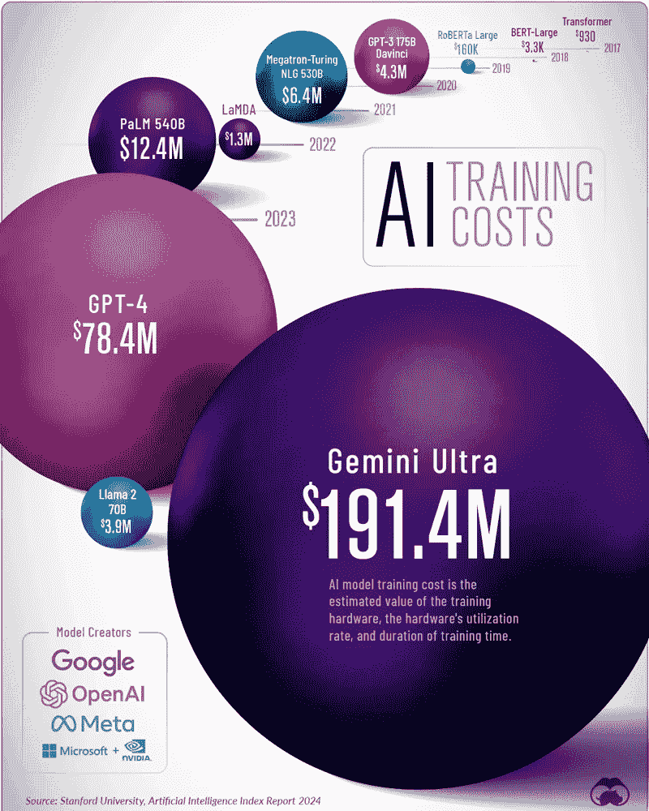

# 第 1 章：引言与 AI 系统概述

2024 年底，一家名为 DeepSeek.AI 的中国小型初创公司震惊了 AI 界。该公司在没有使用当时最新、最先进的 NVIDIA GPU 的情况下训练出了一个前沿大语言模型。由于出口限制，DeepSeek 的工程师无法获得顶级的 NVIDIA A100 或 H100 加速器，因此他们转而使用本地可用的、性能较弱的 NVIDIA 芯片。

尽管存在这些限制，DeepSeek.AI 仍然训练出了 DeepSeek-R1 模型，其推理能力接近当时在最强 NVIDIA 芯片上训练出的领先前沿模型的水平。这一案例表明，精通 AI 系统性能工程的从业者和研究人员，无论面临何种限制，都能从现有硬件中挖掘出最大价值。

例如，DeepSeek 的工程师将通信带宽视为*稀缺资源*，优化了网络上的每一个字节，从而在那套基础设施上实现了许多人认为不可能的目标。他们借助新颖的软件和算法优化，将规模扩展到数千个受限于带宽互联的 GPU，从而克服了这些限制。

将 DeepSeek 的做法与美国和欧洲最大的前沿 AI 实验室所采用的“蛮力”路线进行对比。这些实验室继续追求更大的计算集群和更大的模型。模型规模从百万参数爆炸式增长到数十亿，如今已达到数万亿参数。虽然每一次 10 倍的规模提升都解锁了质变级别的新能力，但它们也带来了巨大的成本和资源消耗。

例如，OpenAI 的 GPT-3（1750 亿参数，2020 年）训练成本约为 400 万美元，而 GPT-4（2023 年）的估计成本高达 7800 万美元。谷歌的 Gemini Ultra（2023 年）飙升至约 1.91 亿美元的惊人水平。图 1-1 展示了训练费用的大幅膨胀——从 2019 年前后的不到 1000 万美元，到 2023 年最先进模型已远超 1 亿美元。

###### 图 1-1. 训练尖端 AI 模型的成本急剧攀升（来源：[posts.voronoiapp.com](https://posts.voronoiapp.com/technology/The-Training-Costs-of-AI-Models-Over-Time-1334#:~:text=The%20cost%20of%20training%20AI,4%20last%20year)）

DeepSeek 声称，他们的 DeepSeek-R1 模型仅花费了 [600 万美元](https://www.forbes.com/sites/markminevich/2025/02/06/the-6-million-ai-bombshell-how-deepseek-shook-wall-street-and-ai-leadership/)的计算成本进行训练——比 GPT-4 和 Gemini 等模型低了整整一个数量级——同时性能却与那些成本高出几个数量级的竞品模型相当。

尽管人们对 600 万美元这一说法的真实性存在一些质疑，但这一公告曾短暂震惊了美国金融市场，包括英伟达的股价在消息公布后下跌了 17%，原因是市场担心未来对[英伟达硬件](https://www.voronoiapp.com/innovation/DeepSeek-R1-Upsets-AI-Market-With-Low-Prices-3846)的需求会减少。虽然这种市场反应有些过度，但它凸显了此类 AI 效率突破对全球金融市场的重大财务影响。

除了模型训练，DeepSeek 还通过针对 Transformer 架构（当今大多数前沿大语言模型的基础）进行硬件感知的算法改进，实现了显著的推理效率提升。DeepSeek 清楚地证明，巧妙的 AI 系统性能工程优化可以颠覆超大规模 AI 模型训练和推理的经济性。

这里的重要启示是一个深刻的认知：在这些规模下，从系统中榨取的每一点性能都可能转化为数百万甚至数十亿美元的成本节约。消除的每一个瓶颈都可能对训练吞吐量和推理延迟产生巨大影响。这反过来又降低了成本，并提升了最终用户的满意度。简而言之，AI 系统性能工程不仅仅关乎速度——它关乎让以前不可能的事情变得既可能又负担得起。

在第 1 章中，我们将深入探索 AI 系统性能工程师——这一角色在大规模人工智能时代已变得至关重要。本章作为一份全面指南，帮助理解这一职业的多方面职责及其对现代 AI 系统的关键影响。

我们首先追溯 AI 工作负载的演变，强调从传统计算范式到当代 AI 应用需求的转变。这一背景为理解 AI 中专门性能工程的必要性奠定了基础。

接着，本章深入探讨 AI 系统性能工程师所需的核心能力。我们审视了这一角色所必需的技术能力，包括对硬件架构、软件优化技术和系统级集成的深入理解。此外，我们还讨论了解决问题、沟通和协作等软技能的重要性，这些技能对于应对 AI 项目的跨学科性质至关重要。

本章中相当大的一部分专门讨论这一角色的实际工作内容。我们探讨了性能工程师如何分析系统瓶颈、实施优化策略，以及确保 AI 系统的可扩展性和可靠性。文中呈现了真实场景和案例研究，以说明这些概念，为读者提供该领域中遇到的挑战和解决方案的具体实例。

此外，我们讨论了性能工程师常用的工具和方法论，提供了关于性能测试、监控和基准测试实践的见解。这包括对行业标准工具的概述，以及它们如何被应用于评估和提升系统性能。

到第 1 章结束时，读者将对 AI 系统性能工程师的角色、在该岗位上脱颖而出所需的技能，以及性能工程在 AI 系统成功部署和运营中的关键重要性有全面的理解。这一基础性知识为后续章节奠定了基础，在后续章节中，我们将更深入地探讨定义 AI 性能工程卓越性的具体技术、方法和最佳实践。

## AI 系统性能工程师

AI 系统性能工程师是一个专业角色，专注于优化 AI 模型*及其*所运行的底层系统的性能。这些工程师确保 AI 训练和推理流水线运行快速、成本高效，并具备最大化性能。随着规模不断增大，AI 系统性能工程师变得更加关键。

AI 系统性能工程师薪资丰厚，这理所当然。我们的工作对企业的盈亏底线有着直接而明显的影响。我们融合了硬件、软件和算法方面的专业知识。我们必须理解底层操作系统考量、内存层次结构、网络基础知识，以及 Python 和 C++ 等多种语言。

在日常工作中，AI 系统性能工程师可能需要检查底层 GPU 内核效率、优化操作系统线程调度、分析内存访问模式、提升网络吞吐效率，或调试分布式训练算法。AI 系统性能工程师的关键职责包括基准测试、性能分析、调试、优化、扩展以及高效管理资源。

### 基准测试与性能分析

基准测试与性能分析涉及在不同工作负载下测量 AI 模型的延迟、吞吐量、内存使用情况以及其他性能指标。为了识别瓶颈，我们必须迭代地使用 NVIDIA Nsight 和 PyTorch profiler 等性能分析工具，在进行受控改进的同时持续跟踪性能变化。建立自动化性能测试以尽早发现性能回退也非常重要。

调试与优化要求我们将性能问题追溯到根本原因，无论是不理想的 CUDA 内核、不必要的通信开销，还是训练或推理工作负载中的不均衡。

## AI 系统性能工程

在某些场景下，我们可能希望利用最新的 Transformer Engine 硬件来执行更高效的矩阵运算。在另一些场景下，我们可以通过为“令人尴尬的并行”推理工作负载配置更高程度的并行性来改进软件框架。还有一种情况，我们可能会尝试通过实现更好的内存管理、减少相对于所需 GPU 计算量而言进出 GPU 显存的数据量，来改进 Attention 算法。

即使是微小的代码调整也能带来巨大收益。例如，一个用 Python 编写的数据预处理步骤可能会拖慢整个训练流水线。用 C++ 重新实现它，或者使用 NVIDIA 的 `CuPyNumeric` 库等 GPU 优化的向量化库，就可以消除这一瓶颈。

### 扩展分布式训练与推理

将小型研究负载扩展到超大规模集群上的更大生产负载，可以确保当我们从 8 块 GPU 扩展到 80,000 块 GPU 时，系统能以最小的效率损失进行扩展。这要求你优化单个节点内 GPU 之间的通信，以及跨数千个节点的通信，以支持诸如 `all-reduce` 之类的集体归约/聚合操作，这些操作在模型训练期间被广泛使用。

你可能希望利用数据并行将数据巧妙地在节点间分布。或者，你可能需要重新设计工作负载以使用张量并行或流水线并行，因为模型太大，无法放入单个 GPU。也许你正在使用混合专家（MoE）模型，可以利用专家并行。

AI 系统性能工程师通常需要实现分布式通信策略，使模型能够在数万块 GPU 上训练，而不会产生过多开销。

### 高效管理资源

优化模型如何利用 CPU 内核、GPU 内存、互连带宽和存储 I/O 等资源非常重要。这涉及方方面面，从确保 GPU 以全速接收数据，到将线程固定到特定 CPU 内核以避免上下文切换开销，再到协调内存使用，以免在大型模型训练/推理过程中耗尽 GPU 显存。

### 跨团队协作

跨团队协作对于 AI 系统性能工程师来说绝对至关重要。与研究人员、数据科学家、应用程序开发人员和基础设施团队携手合作非常重要。提高性能可能需要修改模型代码，这需要与研究人员协调。或者你可能希望部署新的 GPU 驱动程序以提高效率，这需要基础设施团队的配合。性能工程师位于这些多学科领域的交汇点，并且精通 AI、计算机科学和系统工程的语言。

### 透明性与可复现性

在性能工程中，衡量一切并相信数据而非假设至关重要。通过发布你的工作，其他人可以学习、复现并在此基础上继续推进。

DeepSeek 故事中一个显著的特点是，他们非常公开地分享了他们的基础设施优化。在 2025 年 2 月的 DeepSeek 开源周期间，他们发布了一系列开源 GitHub 仓库，包括 `FlashMLA`、`DeepGEMM`、`DeepEP`/`DualPipe` 和 Fire-Flyer 文件系统（`3FS`）。每个项目都经过了生产环境测试，旨在从其硬件中榨取最大性能。

`FlashMLA` 是他们优化的 Attention CUDA 内核。`DeepGEMM` 提供了一个 FP8 优化的矩阵乘法库，在稠密和稀疏运算上的表现都优于许多供应商内核。`DeepEP` 是他们为混合专家模型高度调优的通信库。`3FS` 则是他们的高性能分布式文件系统，提醒我们每一层都需要优化——包括文件系统——才能从我们的 AI 系统中获得最大性能。

通过在 GitHub 上开源这些[项目](https://github.com/deepseek-ai/open-infra-index/blob/main/README.md#:~:text=%E2%9C%85%20DualPipe%20,communication%20overlap%20in%20V3%2FR1%20training)，DeepSeek 不仅通过允许他人复现结果证明了其声明的可信度，还回馈了社区。它允许他人进行基准测试、复现并学习他们的方法，无论是通过 `DeepEP`/`DualPipe` 流水线并行来重叠通信，还是通过 `3FS` 来饱和 SSD 和 RDMA 带宽。

实验透明性和可复现性对于推动 AI 性能工程领域向前发展至关重要。很容易陷入那种基于轶事的“感觉”式优化（“我们做了 X，感觉变快了”）。相反，我提倡一种严谨的科学方法：提出假设，用可复现的基准测试衡量结果，调整以改进结果，重新运行基准测试，并在每一步共享所有结果。

像 DeepSeek 的 [Open-Infra Index](https://github.com/deepseek-ai/open-infra-index) 这样的开源努力提供了宝贵的基准和工具。它们记录各种 AI 硬件配置上的真实性能数据，并鼓励同类比较。我们将在后续章节中利用其中一些开源基准来说明问题。例如，在讨论 GPU 内核优化时，我们将引用 DeepSeek 发布的性能分析数据，展示他们的定制内核如何在 NVIDIA GPU 上实现接近峰值的内存带宽利用率。

### 迈向 100 万亿参数模型

100 万亿参数模型是 AI 的一个理想里程碑。100 万亿大致是人类大脑新皮层中[突触连接](http://pmc.ncbi.nlm.nih.gov)的数量。实现如此规模的模型理论上是可行的，但它需要极其庞大的资源——以及资金。除了最富有的机构之外，通过蛮力扩展到 100 万亿参数模型对所有人来说都是不切实际的。

一项粗略的心算估算表明，训练一个稠密的 100 万亿参数模型可能需要大约 10²⁹ 次浮点运算（FLOPs）。即使使用百亿亿次级计算机，天真地执行 10²⁹ FLOPs 也需要数千个 GPU 年。实际上，如果我们使用一台提供约 1.4 exaFLOPS（10¹⁸ FLOPs）8 位计算性能的最先进 AI 超级计算机，单次训练运行可能会持续约 3,000 年。显然，需要新的方法才能使 100 万亿参数的训练变得可行。

> **提示**
>
> 虽然本书讨论的优化也可以应用于较小的模型和集群规模，但我将继续以 100 万亿参数模型为例，来强调我们不能只是靠堆硬件来解决扩展问题。

训练成本的爆炸式增长正推动人们寻找新的 AI 系统和软件工程技术，以提高性能、降低成本，并在有限的计算资源、功耗约束和资金条件下实现极端规模的 AI。研究人员一直在探索新技术来降低有效计算需求。

一个突出的想法是利用稀疏性，特别是 MoE 模型。像 MoE 这样的稀疏模型与传统的稠密模型（如 OpenAI 推广的常见 GPT 系列大语言模型（LLM））形成对比。事实上，据传 OpenAI 专有的 GPT 系列和 O 系列推理模型是基于 MoE 架构的数万亿参数模型。

像 MoE 这样的稀疏模型对于每个输入标记只会激活模型的一部分。通过让每个输入标记仅经过众多内部“专家”中的一部分，即使总参数不断增长，每个标记的 FLOPs 也基本保持不变。这类稀疏模型证明，扩展到多万亿参数规模无需同等程度的计算成本爆炸。此外，由于这些模型在推理期间使用的活跃参数较少，MoE 模型的请求-响应延迟通常远低于同等密集模型。这些对于训练和服务 100 万亿参数规模的模型而言，都是至关重要的见解。

DeepSeek-R1 是 MoE 效率的绝佳范例。尽管其总参数高达 6710 亿，每个输入标记仅激活 370 亿参数。这使得 DeepSeek-R1 在资源效率上远高于同尺寸的稠密大语言模型。另一个例子是谷歌 2022 年的[Switch Transformer](https://arxiv.org/pdf/2101.03961) MoE。这个 1.6 万亿参数的 MoE 模型仅用一小部分计算量就达到了与稠密模型相同的精度，训练速度比可比的稠密方法快 7 倍。

除了巨大的算力需求，内存也是一大瓶颈。例如，如果每个参数以 16 位（2 字节）精度存储，一个 100 万亿参数的模型大约需要 200 TB 的 GPU 显存来加载。这与单块 NVIDIA Blackwell GPU 上 288 GB 的显存相比，高出 3 个数量级（1000 倍）。因此，仅加载 100 万亿模型的权重就需要近 700 块 Blackwell GPU——而且这还没有考虑用模型权重执行任何计算、接受任何推理请求数据等情况。如果一台典型的 GPU 服务器有 8 块 GPU，那么仅加载模型就需要大约 100 台 GPU 服务器！

此外，加载训练数据也变得极其困难，因为要让所有 GPU 保持忙碌，以足够快的速度为这样一个模型提供数据并非易事。特别是，当 100 万亿参数的模型被划分到 700 块 GPU 上时，GPU 之间的通信开销会显著增加。训练单个模型可能消耗数百万 GPU 小时和兆瓦时的能量。要扩展到足以训练并服务 100 万亿参数模型的规模，将带来巨额成本和能源消耗。

100 万亿参数 AI 的时代将迫使我们彻底重新思考系统设计，使这种规模下的训练和部署变得切实可行。硬件、算法和软件都需要协同演进，以迎接这一新前沿。

## NVIDIA 的“机架级 AI 超级计算机”

为了应对超大规模计算的挑战，NVIDIA 打造了一类全新的 AI 超级计算机，专门面向万亿参数规模的工作负载。其中一个例子是 NVIDIA GB200 NVL72——一台浓缩到单个数据中心机架内的 AI 超级计算机。NVIDIA 将 NVL72 称为“机架级 AI 超级计算机”，这不无道理。

从宏观角度看，GB200 NVL72 机架将 36 个 Grace-Blackwell 超级芯片与一种名为 NVLink 的专用网络结构集成在一起。每个 Grace-Blackwell 超级芯片由 1 个基于 ARM 架构的 NVIDIA Grace CPU 和 2 个 NVIDIA Blackwell GPU 组合而成，总计 72 个 Blackwell GPU（因此名称中有“NVL72”！）。

对于用户而言，整个 NVL72 机架就像一个巨大的加速器。关于这台超级计算机在计算、内存和互联硬件方面的更多细节，请参见第 2 章。现在，让我们在现代生成式 AI 模型的背景下，整体分析这台 AI 超级计算机的性能规格。

每个 NVL72 机架在低精度（4 位）模式下可提供 1.44 exaFLOPS 的 AI 算力，并在 72 块 GPU 上提供 13.5 TB 的超快高带宽内存（HBM）。简单来说，它是一台自包含的 120 kW AI 训练与推理超级计算机，既能训练和服务万亿参数模型，也能装入你数据中心里的单个机架。而且，通过将这些机架组合成超大规模集群，你可以支持大规模的多万亿参数模型。更棒的是，借助你喜欢的云提供商（包括 AWS、GCP、Azure、CoreWeave 和 Lambda Labs），你只需点击几次（当然还要花不少钱！）就能配置这些机架和机架集群。

> **提示**
>
> 虽然本书着重介绍 NVIDIA 的 Grace-Blackwell 一代芯片，但所讨论的优化原则源自 NVIDIA 以往多代硬件。这些优化还将继续适用于并演进到未来的许多 NVIDIA 芯片世代，包括 Vera-Rubin（2026 年）、Feynman（2028 年）及更远的未来。

整本书中，你将了解每一代在计算、内存、网络和存储方面的创新，如何以超大规模集群、多万亿参数模型、高吞吐量训练任务和极低延迟模型推理服务器等形式，为更大的 AI 扩展添砖加瓦。这些创新由硬件感知算法驱动，而这些算法贯彻了下一节讨论的机械共鸣与软硬件协同设计原则。

## 机械共鸣：软硬件协同设计

*机械共鸣*（Mechanical sympathy）这一术语最初由赛车手/工程师 Martin Thompson 提出（类比了那些深深理解赛车机械原理的赛车手）。在计算领域，它指的是编写对运行所在硬件有深刻感知的软件。在 AI 领域，它意味着算法设计与硬件能力携手并进，以最大化性能。

现实经验表明，即使对 GPU 内核或内存访问模式进行微小调整，也能带来超乎寻常的收益。一个经典例子是 FlashAttention，这是一种以硬件感知方式重新实现 Transformer 注意力机制的新颖算法。

FlashAttention 对 GPU 计算进行“分块”，从而最小化对 GPU 内存的读写次数。它大幅减少了内存移动，并加速了注意力计算。用 FlashAttention 替换默认的 Transformer 注意力机制/算法，可以在长序列的训练和推理中获得 2–4 倍的加速，同时降低整体内存占用。这种改变将曾经的一大瓶颈（Attention）缩减为总运行时间的一小部分。FlashAttention 几乎一夜之间成为许多库的默认实现，因为它让模型能够更快、更经济地处理更长的序列。在 FlashAttention 之后，出现了许多新的注意力算法，包括 DeepSeek 的多头潜在注意力（MLA）。

DeepSeek 的 MLA 算法——以 NVIDIA GPU 内核实现并于 2025 年开源——是软硬件协同设计（即机械共鸣）的另一个例证。与 FlashAttention 类似，MLA 重构了注意力计算，以更好地利用 NVIDIA 的内存层级结构和专用的 GPU“张量核心”。这些算法优化使 MLA 适应了受中国出口管制限制的 NVIDIA GPU 的优势，并以远低于使用 FlashAttention 的成本实现了更高的吞吐量。

整本书实际上就是对机械共鸣的研究。我们将看到无数案例，其中新的硬件特性——或如 DeepSeek 案例中的硬件约束——催生了新颖的软件和算法技术。反过来，我们也将看到新的软件算法如何推动新的硬件创新。

例如，Transformer 模型的兴起和低精度量化（如 `FP8/FP4`）促使 NVIDIA 添加了专用硬件，例如 Transformer 引擎和专用的低精度张量核心，以实现更快的矩阵数学计算单元。这些硬件创新反过来又使研究人员能够探索新型数值优化器和神经网络架构。这进而推动硬件设计者更进一步，从而解锁更新的算法，等等。这是一个良性循环！

另一个例子是 NVIDIA 的 Blackwell GPU，它包含一个改进的指数计算单元，专门用于加速 Transformer 注意力算法中的 `softmax` 操作。尽管 `softmax` 对注意力机制至关重要，但在之前的 GPU 上它已成为瓶颈。

这种紧密的相互作用——GPU 与 AI 算法共同演进——正是 AI 领域机械同理心的核心。这些协同设计创新只有在硬件公司（如 NVIDIA 和 ARM）、AI 研究实验室（如 OpenAI 和 Anthropic）以及 AI 系统性能工程师（比如我们！）之间密切合作时才能实现。

## 衡量“有效吞吐量”（Goodput）

当运营包含数百、数千甚至数百万块 GPU 的集群时，了解理论硬件能力中有多少实际上在执行有用工作非常重要。传统的吞吐量指标（如 FLOPs/s 和设备利用率）往往虚高，因为大量时间很可能花在了通信停滞、计算空闲或重启失败的作业上。这正是“有效吞吐量”（goodput）概念的用武之地——正如 Meta 在一篇题为《重新审视大规模机器学习研究集群中的可靠性》的[论文](https://arxiv.org/pdf/2410.21680)中所描述的那样。

> **提示：**NVIDIA 将理论硬件上限称为“光速”，正如你在 NVIDIA 博客、文档、网络研讨会和会议演讲中可能看到的那样。

简单来说，有效吞吐量衡量的是单位时间内完成的有用工作量，扣除了所有不直接贡献于模型训练或推理的部分。从有效训练的角度来看，它实际上就是系统的端到端效率。有效吞吐量可以通过集群的最大可能吞吐量进行归一化，得到 0–1 的效率比率。

Meta 的 AI 基础设施团队强调了有效吞吐量的重要性，他们透露，其大规模 GPU 集群的实测有效吞吐量仅为峰值计算吞吐量的 25–30% 左右。换句话说，虽然集群看起来 100% 被利用，但 70-75% 的算力因通信延迟、并行化欠佳、等待数据或从故障中恢复等开销而损失。此外，Meta 的[分析](https://arxiv.org/pdf/2410.21680)表明，在规模化场景下，作业抢占、网络热点和不可恢复的故障是造成有效吞吐量损失的主要因素。

例如，假设一个训练作业在理想硬件上理论上每秒可以处理 1,000 个样本，但由于输入流水线和同步不佳，实际训练吞吐量只有每秒 300 个样本。我们会说该作业的有效吞吐量为 30%。其余 70% 的算力基本上被浪费了。

识别这些差距并加以弥合是我们工作的核心部分。例如，如果 GPU 在等待从存储加载数据，我们可能会引入缓存或异步预取。如果在模型训练过程中的梯度同步步骤里 GPU 处于空闲状态，我们很可能希望将 GPU 计算（如计算梯度）与 GPU 之间的通信（如同步梯度）重叠起来。我们的目标是将浪费的低效计算周期转化为有用工作。

理论性能与实际性能之间的差距，正是 AI 系统性能工程师这一角色的价值所在。我们的使命是，通过攻克低效环节并降低技术栈每一层（包括硬件、软件和算法）的成本，尽可能将有效吞吐量推高——理想情况下使其接近 100%。

> **提示：**正是这种成本节省，使得如今 AI 系统性能工程师在业内收入颇丰。我们能带来数倍于自身成本的回报——尤其是在大规模场景下！

通过聚焦有效吞吐量，我们优化的是真正重要的东西——每一美元成本和每焦耳电力所完成的有效训练量。有效吞吐量是衡量成功的终极指标——比原始 FLOPs 或设备利用率更重要——因为它体现了硬件、软件和算法在朝着更快、更经济地训练 AI 模型这一最终目标上的协调程度。

提高有效吞吐量需要深入理解硬件（如 CPU、GPU、网络拓扑、内存层级、存储布局）、软件（如操作系统配置、分页内存、I/O 利用率）和算法（如 Transformer 架构变体、注意力机制替代方案、不同的缓存和批处理策略）之间的相互作用。

对多学科——包括硬件、软件和算法——的广泛而深刻的理解，正是当今 AI 系统性能工程师如此稀缺的原因。这也是我写这本书的原因！接下来是规划本书其余部分的路线图和方法论。

## 本书路线图与方法论

我们将如何着手优化 100 万亿参数的 AI 系统？本书的安排将带你从硬件基础知识出发，逐步深入到软件栈和算法技术——并强调在每个层面进行实践分析。以下是本书其余部分的章节安排。

### 第一部分：AI 系统硬件、操作系统、CUDA 与 PyTorch 优化

我们首先从理解硬件基础开始。在讨论软件和算法优化之前，理解硬件的能力和限制至关重要。

第 2 章深入介绍 NVIDIA AI 系统硬件，包括 GB200 NVL72“机架式 AI 超级计算机”，它将 Grace-Blackwell 超级芯片设计与 NVLink 网络相结合，打造出 AI 超级计算机的性能/功耗特性。

第 3 章将介绍基于 GPU 的 AI 系统的操作系统级优化。这些优化包括 CPU 绑核与内存固定。第 4 章讨论 Docker 容器与 Kubernetes 编排的注意事项，以及 GPU 环境的网络 I/O 和存储配置。

第 5 章和第 6 章讨论 NVIDIA CUDA 编程基础和 CUDA 内核优化，这些对于开发新型硬件感知算法至关重要。这类流行的算法包括 FlashAttention 和 DeepSeek 的 MLA。这些算法针对的是 Transformer 架构中资源密集型的注意力机制，而 Transformer 架构在当今生成式 AI 工作负载中占据主导地位。

第 7 章讨论针对 PyTorch 的优化，包括 PyTorch 编译器和 OpenAI 基于 Python 的 Triton 编译器（及语言）。这些编译器降低了开发新型 CUDA 内核的门槛，因为开发 CUDA 内核通常需要深入理解 C++，而它们不要求这一点。

### 第二部分：可扩展的分布式模型训练与推理策略

掌握了 NVIDIA 硬件和 CUDA 软件背景后，我们将深入探讨分布式通信优化，包括超大规模模型的高效训练与推理服务。我们将研究最小化通信的策略，例如将计算与通信重叠——这种模式适用于 AI 系统技术栈的许多层次。

### 第 8 章：模型训练的分布式并行化技术

本章讨论模型训练的分布式并行化技术，包括数据并行、张量并行、流水线并行、序列并行和混合专家（mixture-of-experts）。我们将展示如何将参数达数万亿的模型拆分到多个 GPU 上高效训练。我们还将讨论超大规模模型训练期间的内存优化技术，包括梯度检查点（gradient checkpointing）、分片优化器状态（sharding optimizer states）以及将数据卸载到更大的 CPU 内存。当模型规模超出 GPU 硬件的物理限制时，这些技术至关重要。

### 第 9 章：高吞吐、低延迟的模型推理

本章聚焦于高吞吐、低延迟模型推理的软件与算法创新。我们讨论最流行的模型服务引擎，包括 `vLLM`、NVIDIA `TensorRT-LLM` 和 NVIDIA `Dynamo`。我们还将探讨如何利用 NVL72 中的 Grace CPU 进行预处理、并行运行较小的“草稿”模型以支持推测解码（speculative decoding）等高性能推理算法，以及通过高效的请求路由和批处理来最大化推理系统的整体吞吐量。我们还将探索模型压缩与加速技术，如 4 位量化、知识蒸馏（用更睿智的“教师”模型来教导较小的“学生”模型）、稀疏化与剪枝，以及使用专门的 `TensorRT` 内核。

### 第三部分：超大规模案例研究、新兴趋势与优化速查表

在本书的最后一部分，我们将展示各种性能优化案例研究和新兴趋势。此外，我们还会提供一个优化“速查表”，汇总本书所涵盖的高层次性能与成本优化技巧和要点。

第 5 章 提供了大规模优化巨型 AI 集群的案例研究，包括如何高效训练和服务数十亿乃至数万亿参数模型。

第 6 章 涵盖 AI 系统性能工程这一广阔领域中的新兴趋势，包括训练效率提升、面向多机架扩展的光互连、更优的稀疏模型算法等。这有助于我们描绘出 100 万亿参数规模 AI 系统的发展方向。

第 7 章 提供了一份常见性能优化与成本节省技巧清单，可供你在自己的 AI 系统中应用。这是对本书所讨论的可落地的效率提升方案所做的总结。

本书采用动手实践和实证的方法来应用性能优化。我们将经常分析实际运行、案例研究、基准测试结果和性能剖析数据，以理解瓶颈并验证改进效果。读完本书后，你应当掌握优化超大型 AI 系统的原理，并获得使用相关工具的实际经验，以便在超大规模、多 GPU、多节点、多机架的 AI 系统（如 NVIDIA GB200 NVL72 机架式 AI 超级计算机）或现在及未来的类似 AI 系统上应用这些优化。

## 关键要点

以下特质共同定义了 AI 系统性能工程师这一角色：他们擅长将深厚的技术知识与有策略的、由性能剖析驱动的优化相结合，将原始硬件转化为高性价比、高性能的 AI 解决方案。

- **衡量有效吞吐（Goodput）。** 不要只盯着原始 FLOPs 或利用率。相反，要衡量计算中有多少是在做有用功（例如前向/反向传播），又有多少是在等待数据或其他开销。努力提升有用功。

- **优化胜过蛮力。** 更多硬件并非灵丹妙药。当硬件有限时，巧妙的软件与系统优化可以弥补差距，实现原本需要远为昂贵的基础设施才能获得的结果。我们从 DeepSeek 的成就中看到了这一点——精湛的工程胜过蛮力式的资金投入。

- **追求数量级的影响。** 在规模化场景中，即使只提升很小的效率百分比，也可能节省数百万美元。反之，冗余计算或糟糕的数据管道等低效问题会悄然推高成本。

- **采用性能剖析驱动的方法。** 用数据和剖析工具来指导优化。使用剖析器识别真正的瓶颈——无论是计算利用率、内存带宽、内存延迟、缓存未命中，还是通信/网络延迟。然后针对该瓶颈应用精准优化。

- **保持全局视野。** 提升 AI 系统性能涉及硬件（包括 GPU、CPU、内存和网络），也涉及软件（如算法和库）。任何一层的薄弱环节都可能成为整个系统的瓶颈。最优秀的性能工程师会考虑软硬件协同设计：有时改变算法可以缓解硬件限制，有时新的硬件特性又能催生新算法。

- **持续关注最新硬件。** 现代 AI 硬件发展日新月异。统一 CPU-GPU 内存、更快的互连、新颖的数值精度格式等新能力都可能改变最优策略。优秀的工程师会紧盯这些进展并相应更新自己的心智模型，以快速消除瓶颈。

### 结语

这一引言式的分析强调，在大规模场景下，优化不是可选项，而是绝对必要。它决定了一个系统是真正可用，还是完全不切实际。无论是硬件还是算法，传统方法在这样的规模下都会失效。要向前推进，我们既需要先进的硬件，也需要聪明的软件技术。

显而易见，AI 模型正在逼近物理资源极限。硬件正奋力追赶新的模型架构和算法。而性能工程师正是掌舵者，确保所有这些昂贵的机器真正交付成果。

我们已经证明，AI 系统性能工程师的角色正变得越来越重要。仅仅向问题砸钱和堆硬件是不够的。我们需要对一切进行协同优化——模型架构、算法、硬件和系统设计——才能推动 AI 能力实现下一次飞跃。

作为 AI 系统性能工程师，我们的工作是多学科、复杂且动态的。今天可能深入 GPU 性能剖析，明天研究网络拓扑，后天又或许要分析算法复杂度。这是一个属于“全栈”性能极客的角色，他们热衷于从硬件和软件中榨取每一滴可用性能。

从本质上讲，AI 系统性能工程师的口号是“机械同理心（mechanical sympathy）”。我们深刻理解机器——无论是硬件还是软件——从而能够量身定制高效的解决方案，将整个技术栈的性能潜力发挥到极致。

摆在面前的挑战是巨大的。例如，考虑训练和服务一个 100 万亿参数模型这一宏伟目标。一个粗略的估算显示，训练这样的模型需要大约 10²⁹ 次 FLOPs。即使在每秒 10¹⁸ 次 FLOPs 的百亿亿次（exascale）超级计算机上运行，仅对一份中等规模的语言数据集完成一次训练遍历，也需要数千 GPU 年。

在接下来的章节中，我们将演示如何拆解 AI 系统的各个组成部分——从处理器到内存、互连再到软件框架——并学习如何以有原则的方式优化每个组件。我们将研究具体的案例，看看小小的改变如何带来巨大的性能和成本改善。这样，我们将帮助你在多个维度上建立起关于性能优化推理的心智模型。

在这段旅程结束时，作为读者和实践者的你将掌握当今最佳实践的知识，以及应对未来挑战的工程化思维。你将拥有一整套技术手段，把 AI 系统推向极限——无论是现在还是未来。对于 AI 系统性能工程师而言，任务很明确：我们必须从这些创新中学习，并准备好在技术栈的每一层实施积极的优化。

现在，背景已经就绪，让我们深入探讨现代 AI 系统的硬件组件，包括 CPU、GPU、内存技术、网络互联结构和存储机制。通过研究支撑当代 AI 超级计算机的组件，你将掌握这些基础知识，为后续章节深入探讨优化技术奠定基础。
