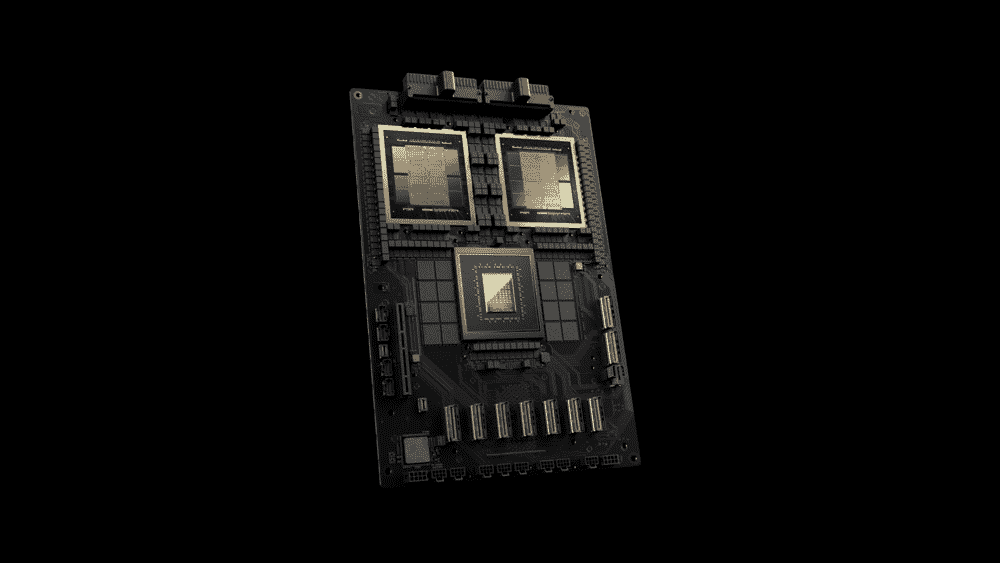
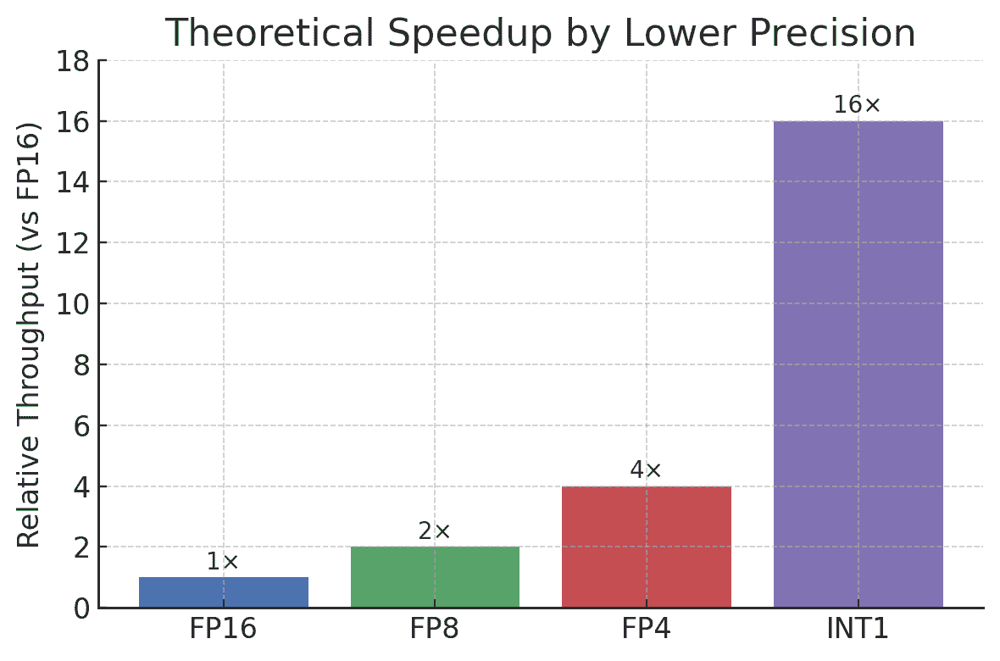
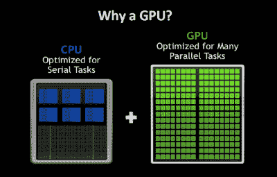
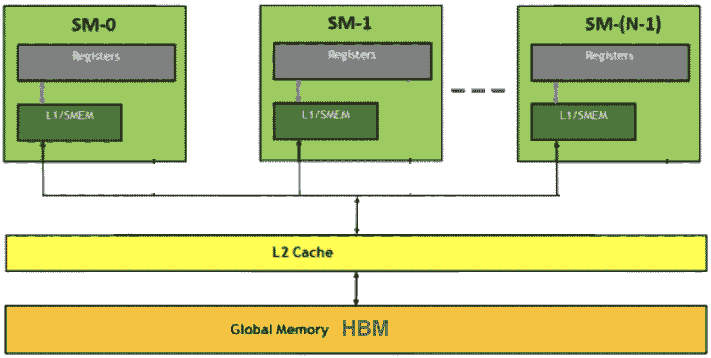
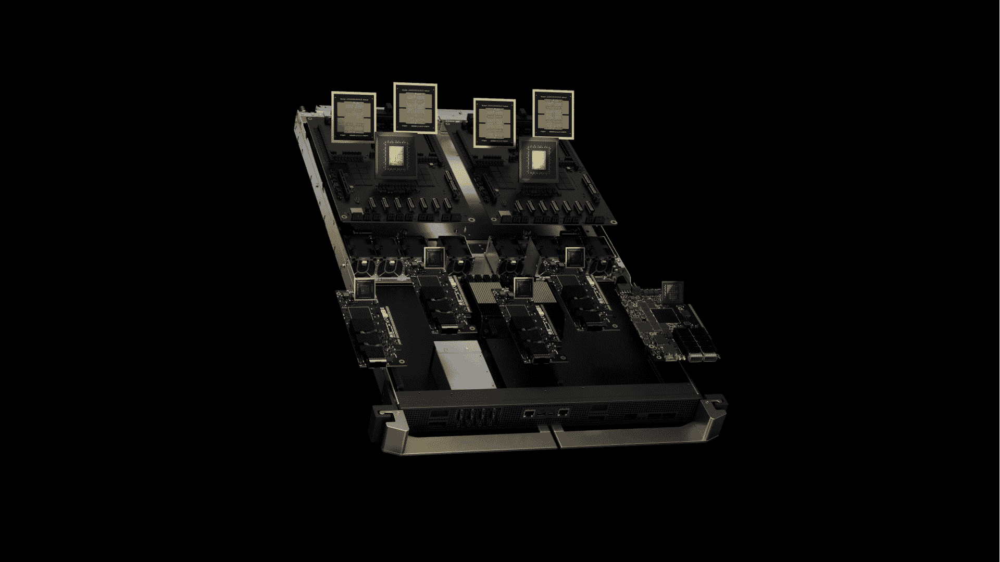
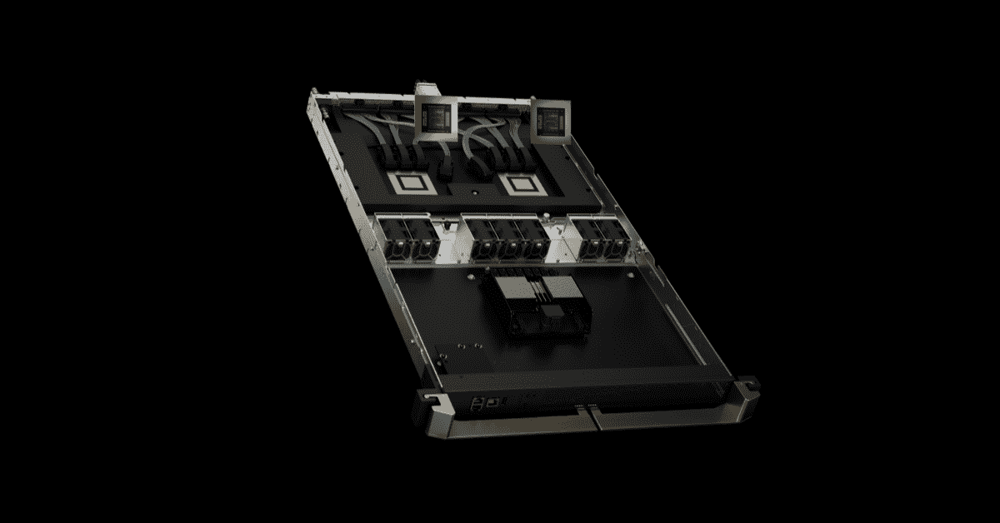
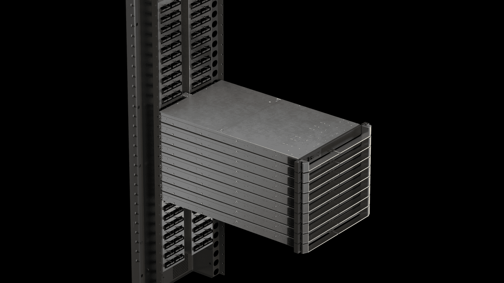
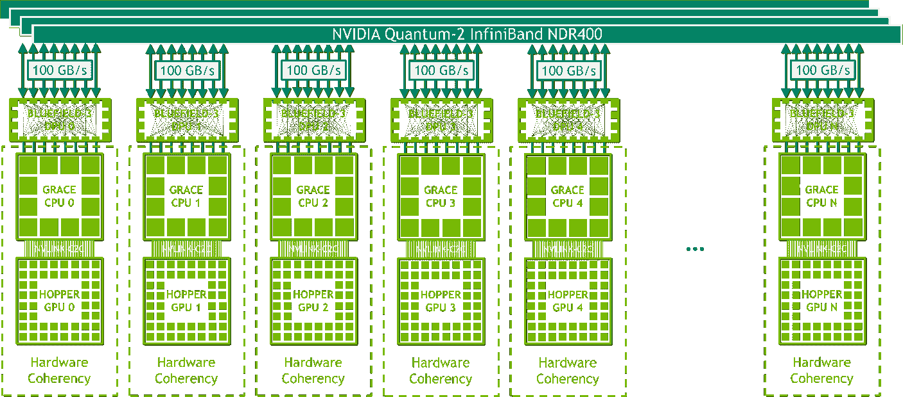

# 第 2 章 AI 系统硬件概述

想象一下，将相当于一台超级计算机的 AI 硬件浓缩进单个机架中。NVIDIA 的最新架构正是这样做的。在本章中，我们将深入探讨 NVIDIA 如何将 CPU 和 GPU 融合成强大的“超级芯片”，然后用超高速互连将几十个这样的芯片连接起来，打造出一台一体化 AI 超级计算机。我们将探索基本的硬件构建模块——Grace CPU 和 Blackwell GPU——并了解它们紧密的集成和巨大的内存池如何让 AI 工程师的工作更加轻松。

然后，我们将向外扩展，探讨把 72 个这类 GPU 连接得如同一台机器般的网络结构。在此过程中，我们将重点介绍计算性能、内存容量和效率上的巨大飞跃，正是这些赋予了该系统超能力。最终，你会认识到这种尖端硬件如何让训练和部署数万亿参数模型成为可能——这在以前似乎是不可能实现的。

## CPU 与 GPU“超级芯片”

# NVIDIA 扩展 AI 规模的方法

NVIDIA 扩展 AI 规模的方法始于单个 CPU+GPU 组合的“超级芯片”模块。从 Hopper 一代开始，NVIDIA 将基于 ARM 的 CPU 与一个或多个 GPU 封装在同一单元中，并通过高速接口紧密连接。最终形成一个行为类似统一计算引擎的单一模块。

第一款产品是 Grace-Hopper (GH200) 超级芯片，它将一个 Grace CPU 与一个 Hopper GPU 配对。接下来是 Grace-Blackwell (GB200) 超级芯片，它在同一封装内将一个 Grace CPU 与两个 Blackwell GPU 配对。本质上，Grace CPU 位于模块中央，两侧是两个 Blackwell GPU 芯片，所有部分连接成一个连贯的整体，如图 2-1 所示。

**图 2-1.** NVIDIA Grace-Blackwell 超级芯片模块：单个模块上集成一个 Grace CPU（居中）和两个 Blackwell B200 GPU（顶部），并共享内存地址空间。

## 统一内存架构的优势

将 CPU 和 GPU 融合在一起有什么优势？一句话——内存！在传统系统中，CPU 和 GPU 拥有独立的内存池，并通过相对较慢的总线（如 PCIe）通信，这意味着数据必须来回拷贝。NVIDIA 的超级芯片通过名为 NVLink-C2C（芯片到芯片）的定制高速总线将 CPU 和 GPU 连接起来，从而消除了这一障碍；该总线在 Grace CPU 与每个 GPU 之间的带宽约为 900 GB/s。

NVLink-C2C 的互连速度比典型 PCIe 快几个数量级。更重要的是，它具备缓存一致性。缓存一致性意味着 CPU 和 GPU 共享统一的内存地址空间，并且始终看到相同的数据值。实际上，超级芯片上的 Grace CPU 和 Blackwell GPU 都可以直接访问彼此的内存，如同面对一个巨大的内存池。GPU 可以直接读写 CPU 内存中的数据，反之亦然，而无需显式复制。这种统一内存架构常被 NVIDIA 称为扩展 GPU 内存（Extended GPU Memory，EGM），它实际上模糊了“CPU 内存”和“GPU 内存”之间的界限。

每个 Grace-Blackwell 超级芯片都拥有海量内存。Grace CPU 自带数百 GB 的 LPDDR5X DRAM，每个 Blackwell GPU 也有自己的高速 HBM 堆栈。在 GB200 超级芯片中，Grace CPU 提供 480 GB 内存，两个 Blackwell GPU 合计提供 384 GB HBM3e 内存（每个 GPU 192 GB）。因此，在统一地址空间中，GPU 和 CPU 可访问的内存总计达 864 GB。

简而言之，每个超级芯片拥有近 1 TB 的快速统一内存可供使用。这对大型 AI 模型来说堪称颠覆性变革。在较旧的系统中，单个 GPU 的内存可能被限制在 <100 GB，这意味着更大的模型必须被分区或卸载到较慢的存储中。而在这里，GPU 可以无缝地将 CPU 内存作为扩展来使用。

如果某个神经网络层或大型嵌入表无法放入 GPU 本地 HBM，它可以驻留在 CPU 内存中，GPU 仍可通过 NVLink-C2C 使用它。从程序员的角度来看，数据搬运由硬件负责；只需分配内存，然后使用它即可。统一内存和缓存一致性意味着，在 CPU 与 GPU 内存之间手动搬运张量的时代已基本结束。

当然，GPU 内存仍然比 CPU 内存快得多，也更靠近 GPU 核心——你可以把 CPU 内存看作一个大容量但速度稍慢的扩展。访问 LPDDR5X 数据不如访问 GPU 上的 HBM 快。它的带宽大约低一个数量级（10 倍），延迟也更高。智能运行时会最频繁使用的数据保存在 192 GB HBM 中，并用 CPU 的 480 GB 内存存放溢出数据或对速度不太敏感的数据。

关键在于，内存溢出不再需要借助 SSD 或跨网络。GPU 可以大约 900 GB/s 的速度从 CPU 内存中获取数据（半双工，每个方向 450 GB/s），虽然比 HBM 慢，但远比从 NVMe 存储中获取要快得多。这种灵活性极具价值。这意味着，一个例如 500 GB 的模型（对单个 GPU 的 HBM 来说太大）仍然可以完整放入一个超级芯片模块（192 GB HBM + 其余放入 CPU 内存）中运行，而无需将模型拆分到多个 GPU 上。GPU 只会在需要时透明地从 CPU 内存中拉取额外数据。

本质上，只要模型总量能放入超级芯片的 CPU+GPU 合并内存，内存大小就不再是容纳超大规模模型的硬性限制。许多研究者都曾因模型无法装入 GPU 而遭遇可怕的“内存不足（out of memory）”错误——这一架构的设计目标正是大幅突破这一边界。

## NVIDIA Grace CPU

Grace CPU 本身也绝非等闲之辈。它是一款高核心数（72 核）ARM CPU，由 NVIDIA 针对带宽和效率专门打造。它在超级芯片中的任务是处理通用任务、预处理数据并馈送给 GPU，同时管理其附带的海量内存。它的时钟频率不算高，但凭借巨大的内存带宽——到 LPDDR5X 内存约 0.5 TB/s——以及大量缓存（包括数十 MB L3 缓存）弥补了这一点。

其设计理念是：在向 GPU 输送数据时，CPU 绝不能成为瓶颈。它可以从存储中流式读取数据，或执行分词（tokenization）、数据增强等即时数据转换，从而通过 NVLink-C2C 非常高效地供给 GPU。如果你的部分工作负载更适合在 CPU 上运行，Grace 核心可以处理这些任务，并让 GPU 立即访问其结果。

这是一种和谐的耦合：CPU 在 GPU 表现较弱的领域（如随机内存访问或控制密集型代码）扩展 GPU 的能力，而 GPU 则在 CPU 跟不上趟的数字密集计算上加速。CPU 与 GPU 之间的低延迟链路意味着它们可以不用承担常规开销就能交换任务。例如，从 CPU 启动一个 GPU 内核的速度比传统系统快得多，因为命令无需经过缓慢的 PCIe 总线。CPU 和 GPU 本质上位于同一块主板上。这应该类似于调用快速本地函数与较慢远程函数的区别。

现在让我们来谈谈 Blackwell GPU——这颗超级芯片的蛮力引擎。

## NVIDIA Blackwell GPU

Blackwell 是 NVIDIA 对这一代 GPU 的代号，它在计算能力和内存方面都相比上一代 Hopper（H100）GPU 有了显著飞跃。GB200 超级芯片中的每个 Blackwell B200 GPU 并不是单一芯片，而实际上是一个多芯片模块（MCM），在一个封装上包含两个 GPU die。

这是 NVIDIA 旗舰数据中心 GPU 首次采用 chiplet 方法。这实际上将原本一个巨大的 GPU 分成两个相当大的 die，并将它们连接在一起。为什么要这么做？因为单一单晶片受限于制造工艺，芯片在硅片上的尺寸是有限制的。通过将两个物理 die 组合成一个 GPU，NVIDIA 可以将 GPU 的总晶体管预算翻倍。

以 Blackwell 为例，每个 die 约有 1040 亿个晶体管，因此 GPU 模块合计约有 2080 亿个晶体管。这是一个惊人的电气复杂度与精密程度。这两个 die 通过一种专用的高速 die-to-die 互连进行通信，它们之间的带宽为 10 TB/s，使得两个 die 作为一个统一的 GPU，对运行在其上的软件层表现为一个整体。

从系统的角度来看，一个 Blackwell“GPU”是一个单一设备，拥有大容量内存池（192 GB HBM）和大量执行单元，但在底层是两个芯片协同工作。NVIDIA 的软件和调度机制确保工作负载在两个 die 之间平衡，内存访问保持一致。这使得开发人员基本上可以忽略这种复杂性，因为正如 NVIDIA 所设计的那样，它们表现为一个 GPU。

每个 Blackwell GPU 模块拥有 192 GB 的 HBM3e 内存，分布在两个 die 上（每个 96 GB）。这使上一代 Hopper H100 GPU 的 96 GB 翻倍，为模型参数、激活值和输入数据提供了更大的余量。内存也更快，因为 Blackwell 的 HBM3e 每个 GPU 的聚合带宽约为 8 TB/s。作为比较，Hopper H100 提供了约 3.35 TB/s 的带宽，所以 Blackwell 的内存子系统吞吐量大约是前者的 2.4 倍。

以每秒 8 TB 的速度供数意味着 GPU 核心能够在大矩阵计算中保持忙碌，而不会频繁停滞等待数据。NVIDIA 还增强了片上缓存，Blackwell 共有 100 MB 的 L2 缓存（每个 die 50 MB）。这种缓存是 GPU 上一块虽小但超快的内存，用于保存最近使用的数据。与 H100 的 50 MB L2 缓存相比，Blackwell 将 L2 缓存大小翻倍，从而可以在片上保存更多的神经网络权重或中间结果，避免额外访问 HBM。这同样有助于确保 GPU 的计算单元很少因数据不足而受限。

## NVIDIA GPU Tensor Core 与 Transformer Engine

说到计算单元，Blackwell 引入了专门针对 AI 工作负载的增强功能。核心是 NVIDIA 的 Tensor Core 技术和 Transformer Engine。Tensor Core 是 GPU 每个流式多处理器（SM）内的专用单元，能够以非常高的速度执行矩阵乘法运算。

Tensor Core 在之前的几代产品中已经有，但 Blackwell 的 Tensor Core 支持更多数值格式，包括 8 位和 4 位浮点等极低精度格式。低精度的想法很简单：用更少的比特来表示数字，就能同时执行更多操作——更不用说内存容量更大了，因为表示相同数字所用的比特更少。当然，这前提是你的算法能够容忍一定的数值精度损失。如今，许多 AI 算法在设计时就已经考虑到了低精度数值格式。

NVIDIA 首创了 Transformer Engine（TE），用于在深度学习中自动调整并使用混合精度，其中关键层使用较高精度（FP16 或 BF16），不太关键的层使用 FP8。TE 自动优化精度平衡，目标是在较低精度下保持模型精度。

在 Hopper 一代中，Transformer Engine 首次引入 FP8 支持，其吞吐量是 FP16 的两倍。Blackwell 更进一步，引入了一种更低精度的格式 FP4，这是一种 4 位浮点格式，用 FP8 一半的比特来表示数字。FP4 非常小，其计算吞吐量有可能是 FP8 的两倍。

事实上，一块 Blackwell GPU 使用 FP4 Tensor Core 运算可实现约 9 PFLOPS（每秒 9 千万亿次运算）的计算能力。这大约是 FP8 速率的 2 倍，是 FP16 速率的 4 倍。作为对比，早期的 H100 GPU 在 FP16 下的峰值约为 1 PFLOP，因此 Blackwell 在 FP16 下大约快 2 到 2.5 倍，而在使用 FP8/FP4 时则快得多。图 2-2 展示了 FP8 和 FP4 相对于 FP16 的加速比。

**图 2-2.** FP8 和 FP4 相对于 FP16 的加速比。

一个完整的 NVL72 机架（72 个 GPU）在 4 位精度下拥有超过 1.4 exaFLOPS（即 1.4×10¹⁸）的理论 Tensor Core 吞吐量。这是一个令人难以置信的数字，使单个机架跻身全球最快超级计算机之列——尽管是在低 FP4 精度下。即使真实工作负载并不总能达到这一峰值，但这种能力就在那里，堪称惊人。

Blackwell 配备了 NVIDIA Transformer Engine（TE）第 2 版。这正是让 FP8 和 FP4 变得实用的神奇酱料。它在训练或推理过程中动态选择神经网络每一层的精度，尝试使用仍然能保持模型精度的最低精度。例如，TE 可能会将神经网络的前几层保持在 FP16，因为早期层可能对噪声敏感。但是，基于启发式算法，它可以决定对更靠后且更容忍噪声的层使用 FP8 或 FP4——或者对于巨型嵌入矩阵，因为高精度并不那么关键。

这一切都在 NVIDIA 的库中自动完成。作为用户，你只需启用混合精度，然后放行。其结果就是本质上“免费”获得的巨大加速。如今许多大语言模型（LLM）都使用 FP8 进行训练，原因就是它相比 FP16 有效加倍了训练速度——同时精度损失可以忽略不计。Blackwell 的构建目标就是让 FP8 和 FP4 不仅是理论上的选项，而是日常工具。

事实上，测试表明，在某些情况下，Blackwell 使用 FP4 相比 FP16 可提供近 5 倍的 AI 吞吐量提升。这些格式还大幅削减了内存占用。使用 FP4 相比 FP8，每个参数所需内存减半，这意味着可以将更大的模型装入 GPU 内存。

NVIDIA 实际上押注了 AI 的未来在于低精度运算，并赋予了 Blackwell 在这方面大放异彩的能力。这对大规模模型的推理服务尤为关键，因为在那里吞吐量（每秒 token 数）和延迟是重中之重。

为了说明从 Hopper 到 Blackwell 的代际飞跃，NVIDIA 报告称，基于 H100 的系统在运行一个 1.8 万亿参数的混合专家（MoE）大模型时，每个 GPU 每秒只能生成大约 3 到 5 个 token——首 token 延迟超过 5 秒。这对于交互式使用来说太慢了。

基于 Blackwell 的系统（NVL72）运行同一模型时，每个 GPU 每秒可生成约 150 个 token，并将首 token 延迟降低到约 50 毫秒。这大约带来了 30 倍的吞吐量提升和巨大的延迟降低，将一个不实用的模型变成了一个几乎可以实时响应的模型。

这种惊人的加速源于原始 FLOPs，以及更快的 GPU、更低精度（FP4）的使用和保持 GPU 数据供给的 NVLink 互连三者的结合。这凸显了跨越计算和通信的整体设计如何转化为现实世界的性能提升。

本质上，Blackwell GPU 比其前代产品更强大、更智能，数据供给也更充足。得益于 Tensor Core、Transformer Engine 和低精度，它们能更快地完成数学运算。此外，系统架构借助巨大的内存带宽、大容量缓存和 NVLink，确保数据能够快速就位。

在继续之前，让我们快速讨论一下 GPU 内部的层级结构，因为这对之后理解性能调优很有帮助。

## 流式多处理器、线程与线程束

每个 Blackwell GPU 与其前代产品一样，由许多流式多处理器（SM）组成。可以将它们视为 GPU 的"核心"，如图 2-3 所示。

**图 2-3.** CPU 核心与 GPU 核心的对比（[*https://www.cudocompute.com/blog/nvidia-gb200-everything-you-need-to-know*](https://www.cudocompute.com/blog/nvidia-gb200-everything-you-need-to-know)、[modal.com](https://modal.com/gpu-glossary/device-hardware/streaming-multiprocessor#:~:text=Streaming%20Multiprocessors%20,performance%20CPUs)）。

每个 SM 包含一组算术单元（用于 FP32、INT32 等）、用于矩阵运算的 Tensor Core、用于内存操作的加载/存储单元，以及一些用于超越函数等运算的特殊函数单元。GPU 还有自己的小型超快内存池，包括寄存器、共享内存和 L1 缓存。

SM 以 32 个为一组（称为线程束）来执行线程，每个线程束包含 32 个线程。它可以并行执行许多活跃的线程束，从而在某个线程等待内存数据时帮助掩盖延迟。想象一个 SM 同时有数十个线程束（数百个线程）在并发执行。如果一个线程束在等待内存读取，另一个线程束就可以运行。这称为延迟隐藏。我们将在本书中反复讨论延迟隐藏。这是你的调优工具箱中一个非常重要的性能优化工具。

像 Blackwell 这样的高端 GPU 大约有 140 个 SM。每个 SM 能够并发运行数千个线程。正是通过这种方式，我们才能在一个 GPU 上承载数万个活动线程。所有这些 SM 共享一个大型 100 MB L2 缓存（如前所述），并共享连接到 HBM 的内存控制器。内存层次结构包含寄存器（每个线程）→ 共享内存/L1 缓存（每个 SM）→ L2 缓存（GPU 上，由所有 SM 共享）→ HBM 内存（片外），如图 2-4 所示。

**图 2-4.** GPU 内存层次结构

为了获得最佳性能，数据需要尽可能停留在该层次结构的高层。如果每个操作都要访问 HBM，即使带宽高达 8 TB/s，GPU 也会因访问片外内存的更高延迟而频繁停顿。通过将可重用数据保存在 SM 本地内存或 L2 缓存中，GPU 可以实现巨大的吞吐量。Blackwell 架构将缓存和带宽翻倍，目的正是为了让 GPU 这头巨兽保持喂饱且状态良好。

作为性能工程师，我们会看到许多内核的性能既受计算限制，也受内存流量和吞吐量限制的例子。NVIDIA 显然在设计 Blackwell 时就考虑到了：对于许多 AI 工作负载，FLOPs 与内存带宽之间应达到良好匹配。粗略地说，在 FP4 模式下，这一平衡约为每字节内存带宽对应 2–3 个 FLOPs 的计算量。对于密集线性代数运算来说，这是一个合理的比率。这意味着，在代码优化得当的前提下，GPU 通常会忙于计算而不是等待数据。请注意，某些操作（如大规模归约或随机内存访问）仍然可能受内存限制，但更新后的 GPU、内存和互连硬件使这个问题变得不那么严重了。

## 超大规模网络：将众多 GPU 视为一个整体

将两个 GPU 和一个 CPU 封装进一个超级芯片，为我们带来了一个极其强大的节点——但 NVIDIA 并没有止步于单个节点。下一个挑战是将许多这样的超级芯片连接在一起，以扩展到更大规模的模型训练。

# 使用 GB200 超级芯片的旗舰配置

使用 GB200 超级芯片的旗舰配置就是 NVIDIA 所称的 NVL72 系统，它本质上是一台封装在单个机架中的 AI 超级计算机。NVL72 代表一个拥有 72 个 Blackwell GPU——以及 36 个 Grace CPU——全部通过 NVLink 互连的系统。

GB200 NVL72 由 18 个计算节点（每个均为 1U 尺寸）构建而成，每个节点包含两个 GB200 超级芯片，因此每个计算节点共有 4 个 Blackwell GPU + 2 个 Grace CPU，如图 2-5 所示。

**图 2-5.** GB200 NVL72 机架内的一个 1U 计算托盘，带有两个 Grace-Blackwell 超级芯片，每个超级芯片模块包含一个 Grace CPU 和两个 Blackwell GPU 芯片。NVL72 有 18 个这样的托盘连接在一起（来源：[developer.nvidia.com](https://developer.nvidia.com/blog/nvidia-gb200-nvl72-delivers-trillion-parameter-llm-training-and-real-time-inference/#:~:text=The%20GB200%20compute%20tray%20is,7%20TB%20of%20fast%20memory)）。

通过将 18 个计算节点连接在一起，GB200 NVL72 将 72 个 Blackwell GPU（18 个节点 × 4 个 GPU）和 36 个 Grace CPU（18 个节点 × 2 个 CPU）互联，形成一个强大、统一的 CPU-GPU 集群。NVL72 的非凡之处在于，每个 GPU 都能以极高的速度与任何其他 GPU 通信，仿佛全部 72 个 GPU 都位于同一块主板上。NVIDIA 通过 GPU 上的 NVLink 5 连接与名为 NVSwitch 的专用交换芯片相结合实现了这一目标。

## NVLink 与 NVSwitch

每个 Blackwell GPU 拥有 18 个 NVLink 5 端口，每个端口支持 100 GB/s 的双向数据传输，或单向 50 GB/s。综合来看，单个 GPU 通过 NVLink 与对等 GPU 之间可以传输高达 1.8 TB/s（18 个 NVLink 端口 × 100 GB/s）的数据。这是上一代每 GPU NVLink 带宽的两倍，因为 Hopper H100 使用的是 NVLink 4，其双向 900 GB/s 的速度仅为 NVLink 5 的一半。

GPU 通过 NVSwitch 芯片以网络方式互联布线。NVSwitch 本质上是一种与网络交换机类似的交换芯片，但它是专为 NVLink 打造的。这意味着任何 GPU 都可以通过某个 NVSwitch 芯片以全带宽单跳访问任何其他 GPU。图 2-6 展示了 NVL72 中使用的 NVLink Switch 托盘。

**图 2-6.** 来自 NVL72 的一个 NVLink Switch 托盘（来源：[developer.nvidia.com](https://developer.nvidia.com/blog/nvidia-gb200-nvl72-delivers-trillion-parameter-llm-training-and-real-time-inference/#:~:text=Fifth,System)）。

每个交换托盘包含两颗 NVSwitch 芯片（图中可见的大芯片）和多个高速端口（蓝色线缆代表 NVLink 连接）。在 NVL72 机架中，如图 2-7 所示，9 个这样的交换托盘提供了完全连接 72 个 Blackwell GPU 的交换结构。

**图 2-7.** NVL72 机架内 9 个托盘的 NVSwitch 系统

每个交换托盘包含两颗 NVSwitch 芯片，因此整个系统共有 18 颗 NVSwitch 芯片。该网络采用全交叉开关（full crossbar）布局，每个 GPU 都与每个 NVSwitch 相连，每个 NVSwitch 也与每个 GPU 相连，从而在任意一对 GPU 之间提供高带宽路径。

具体来说，每个 GPU 使用其 18 个 NVLink 端口连接到 18 颗 NVSwitch 芯片（每个交换机一条链路）。这意味着任意 GPU 最多经过两次跳转（GPU → NVSwitch → GPU）即可到达另一个 GPU，沿途带宽极为可观。

整个 72-GPU 网络的带宽，即聚合对分带宽（aggregate bisection bandwidth），在机架内约为 130 TB/s。打个比方，这比类似规模的顶级 InfiniBand 集群还要高出许多倍。这种设计基本上将整个机架变成了一台巨大的共享内存机器。

## 多 GPU 编程

从编程模型的角度来看，一个 GPU 可以直接通过 NVLink 从另一个 GPU 的 HBM 内存执行内存加载，甚至可以从另一个节点的 Grace CPU 加载，并在微秒级时间内获取数据。换句话说，这些 GPU 可以在整个机架的全局共享内存空间中运行，非常类似于单台服务器内核心共享内存的方式。这就是为什么 NVL72 常被描述为“一个大 GPU”或“机架中的 AI 超级计算机”。

RDMA（远程直接内存访问）等软件库通过提供简洁的编程接口（如跨 GPU 的原子操作），屏蔽了全局共享内存空间的复杂性。分布式训练和推理工作负载需要在多个 GPU 之间频繁同步和交换信息。传统上，GPU 位于不同的计算节点和机架中，因此同步通过相对较慢的网络链路（如 InfiniBand 和 Ethernet）进行。在扩展到多个 GPU 以支持大型 AI 模型时，这往往是瓶颈。

借助 GB200 NVL72 系统，这些数据交换通过 NVLink 和 NVSwitch 以极快的速度完成。这意味着你可以将训练任务或推理集群扩展到 72 个 GPU，且通信开销极小。由于 GPU 花在等待彼此数据上的时间大大减少，整体吞吐量在扩展到 72 个 GPU 时接近线性增长。相比之下，考虑在由 9 台独立计算服务器（每台配备 8 个 Hopper H100 GPU）组成的相似规模 72-GPU H100 集群上运行相同的任务。这种配置需要 InfiniBand，这将产生网络瓶颈，从而大幅降低集群的扩展效率。

让我们用具体数字来分析和比较 GB200 NVL72 与 72-GPU H100 集群。在单个 NVL72 机架内，GPU 到 GPU 的带宽约为 100 GB/s 以上，小消息的延迟约为 1–2 微秒。在传统 InfiniBand 网络中，每个 GPU 的带宽可能约为 20–80 GB/s（取决于网卡数量及其速率），延迟可能为 5–10 微秒甚至更高。就节点间 GPU 通信而言，NVL72 网络比最好的 InfiniBand 网络具有更高的吞吐量（每个 GPU 提升 2 倍或更多）和更低的延迟（提升 3–5 倍）。在实际场景中，跨 GPU 聚合梯度的 `all-reduce` 集合操作在基于 InfiniBand 的 H100 集群上可能占用迭代时间的 20–30%，而在基于 NVLink 的 NVL72 集群上仅占用 2–3%。

NVIDIA 的一项真实测试证明了这一点，该测试显示，基于 NVL72 的单个系统比类似的基于 H100 的集群快约 4 倍，这主要归功于通信效率。关键要点是，在单个 NVL72 机架内，通信速度非常快，通信瓶颈几乎被完全消除，因此不再是优先考虑的问题。而在传统 InfiniBand 和 Ethernet 集群中，通信往往是主要瓶颈，需要在软件层面进行精心优化和调优。

总之，设计和实现软件时应充分利用 NVL72 的配置，尽可能将工作负载的通信保持在机架内部（“机架内”），以发挥高速 NVLink 和 NVSwitch 硬件的优势。只有在绝对必要时，才使用基于 InfiniBand 或 Ethernet 的较慢机架间（“机架间”）通信，以扩展超出 NVL72 的计算和内存资源。

## 基于 NVIDIA SHARP 的网络内聚合

另一个硬件加速优化是 [NVIDIA SHARP](https://developer.nvidia.com/blog/advancing-performance-with-nvidia-sharp-in-network-computing/)，全称是 Scalable Hierarchical Aggregation and Reduction Protocol（可扩展分层聚合与归约协议）。SHARP 直接集成在 NVSwitch 硬件中，能够在网络硬件本身直接执行聚合操作（例如 `all-reduce`、`all-gather` 和 `broadcast`）。NVSwitch 交换结构直接合并部分结果，无需将数据经由 GPU 转发。通过将集合通信操作从 GPU 和 CPU 卸载到交换机硬件本身，SHARP 大幅提高了效率、降低了延迟，并减少了网络中传输的数据量。

SHARP 的效率提升意味着在分布式训练期间，聚合梯度或同步参数的重任由 NVSwitch 专用的 SHARP 引擎承担。结果是在机架内和机架间配置下都能实现更高效的扩展。即使 GPU 数量增加，SHARP 也能实现接近线性的性能提升。这种网络内计算能力对于训练超大规模模型尤其关键，因为在集合操作上节省的每一微秒都能转化为可观的整体加速。

## 多机架与存储通信

接下来，我们来讨论一个 NVL72 机架如何与另一个 NVL72 机架或外部存储系统（如共享文件系统）通信。正如我们前面所述，在 NVL72 机架内部，NVLink 覆盖了所有 GPU 到 GPU 的流量。但在机架外部，则依赖更传统的网络硬件。

NVL72 中的每个计算节点都配备了高速网络接口卡（NIC）和数据处理器（DPU）。在 GB200 NVL72 参考设计中，每个节点有 4 个 ConnectX InfiniBand 网卡和 1 个 BlueField-3 DPU。这 4 个 InfiniBand 网卡每个运行速率为 400 Gb/s。合计起来，这些网卡向外部发送和接收数据的速率约为 1.6 Tbit/s（1600 Gbit/s），如图 2-8 所示。

**图 2-8.** InfiniBand 与 BlueField DPU 网卡

在单个机架的 18 个计算节点中，若充分利用，机架外部总吞吐量接近 30 Tbit/s（1.6 Tbit/s × 18 个计算节点）的聚合网络容量。关键在于，NVIDIA 预见了被称为“AI 工厂”的多机架部署，因此他们确保 NVL72 可以通过每个节点上的这 4 个网卡接入更大的网络结构。

**提示**

NVIDIA 还提供基于 Ethernet 的解决方案，使用 Spectrum 交换机并采用融合以太网上的 RDMA（RoCE）作为互连替代方案，称为 Spectrum-X。

每个节点中的 BlueField-3 DPU 有助于卸载诸如 RDMA、TCP/IP 和 NVMe 存储访问等网络任务。这确保了 Grace CPU 不会因管理网络中断而陷入困境。DPU 本质上充当智能网络控制器，利用 NVIDIA 名为 GPUDirect 的 RDMA 软件，在网卡和 GPU 内存之间直接移动数据，无需 CPU 参与。这在从存储服务器流式传输大型数据集时尤其有用，因为 DPU 可以处理数据传输并直接将数据存入 GPU 内存，而 CPU 则专注于数据预处理等其他任务。

当扩展到多个 NVL72 机架时，NVIDIA 使用 Quantum 系列 InfiniBand 交换机。多个 NVL72 机架可通过这些 InfiniBand 交换机互连，形成大型 NVL72 机架集群，如图 2-9 所示。

**图 2-9.** 使用 InfiniBand 扩展 NVL72 集群

例如，一个包含 8 个机架、总计 576 个 GPU 的 NVL72 集群可以通过第二层 InfiniBand 交换机构建，尽管跨机架的 InfiniBand 通信性能将低于单个机架内的 NVLink/NVSwitch 通信。

## 预集成机架设备

由于 NVL72 是一个复杂的系统，NVIDIA 将其作为预集成机架“设备”在单个机柜中交付。它组装好了所有 18 个计算节点、全部 9 个 NVSwitch 单元、内部 NVLink 线缆、电源分配和冷却系统。其理念是，组织可以将其作为一个整体订购，到达后即可投入使用。只需将机架连接到设施电源，接好水冷接口，将 InfiniBand 线缆连接到网络，然后开机即可！无需单独为 72 个 GPU 布线 NVLink，因为 NVIDIA 已在机架内为您完成。即使是液冷配置也是自包含的，我们稍后将讨论。

这种设备化方法加速了部署，并确保系统构建正确且经过 NVIDIA 验证。该机架还包含 NVIDIA Base Command Manager 集群管理软件，以及用于集群作业调度和编排的 SLURM 和 Kubernetes。换句话说，NVL72 机架的设计目标是直接集成到您的环境中。

## 共封装光学：网络硬件的未来

随着网络数据吞吐率攀升至 800 Gbit/s 甚至更高，传统的可插拔光模块方法开始触及功率和信号极限。这种方法在交换机处将电信号转换为光信号时会消耗大量功率。NVIDIA 正通过在其网络设备中集成共封装光学（CPO）来解决这一问题。

采用共封装光学，光发射器直接集成在交换机芯片旁边。这大幅缩短了电路路径，使得机架间能够实现更高带宽的链接，降低功耗，并提高整体通信效率。NVIDIA 正将 CPO 集成到计划于 2025 年底或 2026 年推出的 Quantum-3 InfiniBand 交换机中。

实际上，像 CPO 这样的技术正为将成百上千个机架（“AI 工厂”）连接成一个统一网络铺平道路，使机架间带宽不再成为瓶颈。这些光网络技术进步对于实现高性能的机架间带宽至关重要，以确保网络在超大规模下能够跟上 GPU 的发展。

总而言之，在 NVL72 机架内部，NVIDIA 使用 NVLink 和 NVSwitch 在 72 个 GPU 之间构建了一个极速的全互连网络。这些互连速度如此之快且均匀，使得 GPU 实际上像一个整体一样工作。在机架之外，高速 NIC（例如 InfiniBand 或以太网）将机架连接到其他机架或存储，并由 DPU 高效管理数据移动。

NVL72 是一个极其强大的独立系统，也是更大规模 AI 超级计算机的基本构建模块。NVIDIA 与 CoreWeave、Lambda Labs、AWS、Google Cloud、Azure 和 Equinix 等云服务提供商合作，提供基于 NVL72 的机架，企业可以快速租用或部署。

AI 工厂——由多个此类机架组成的大规模 AI 数据中心——的概念正在成为现实。NVIDIA 的硬件和网络路线图明确瞄准实现 AI 工厂愿景。简而言之，NVL72 展示了协同设计能走多远：GPU、网络和物理机架硬件携手构建，以尽可能无缝高效地扩展到成千上万个 GPU。

## 计算密度与功率需求

NVL72 机架在计算密度方面非常惊人，这意味着单个机架的功耗非常高。满载的 NVL72 在最大负载下可消耗高达约 120 kW 的功率。而 NVIDIA 上一代 AI 机架的功耗约为 50–60 kW。将 72 个尖端 GPU 以及所有支持硬件装入一个机架，已触及数据中心基础设施可处理的极限。

要为 NVL72 机架提供 120 kW 电力，不能只使用单一标准电源线路。数据中心通常会配置多条大容量电路来提供这种功率。例如，可以为机架输入两路独立电源以实现冗余，每路电源可承载 60 kW。正常运行时，负载在两路电源之间均衡分配。如果一路电源发生故障，系统可以削减部分负载或限制 GPU 性能，以保持在剩余电源的容量范围内。这种冗余对于防止电路烧断导致您长达数月的训练任务中断非常重要。

在机架内部，电力被分配到每个 1U 计算节点的电源。电力从 AC 转换为 DC，供本地电子设备使用。NVL72 中的每个计算节点包含 2 个 Grace-Blackwell 超级芯片，它们合计消耗约 5-6 kW 功率。18 个计算节点的总功耗约为 100 kW。NVSwitch 托盘、网络交换机和冷却泵约占 20 kW，因此整个 NVL72 机架总功耗为 120 kW。

在典型的数据中心电压（例如 415 V 三相交流电）下，电流巨大，因此所有设备都针对高电流进行了工程设计。运维人员必须仔细规划才能容纳这样的机架，这通常需要专用的电源分配单元（PDU）和仔细监控。电源瞬变也是一个考虑因素，因为 72 个 GPU 从空闲状态升至满功率时，可能在短短几毫秒内迅速消耗数十千瓦的功率。良好的设计应包含电容器或时序控制，以避免较大的电压跌落。

系统可能会以微小的时间间隔错开 GPU 的加速时钟，使其不会在同一微秒内全部达到峰值，从而平缓电流冲击。这些就是让 120 kW 机架变得可管理的电气工程细节。

将处于高密度计算前沿的 NVL72 机架称为“迷你电力变电站”并不夸张。8 个这样的机架组合在一起，共 572 个 GPU，将消耗近 1 MW 的功率（8 个机架×每个机架 120 kW），这相当于一个小型数据中心的全部容量！值得庆幸的是，尽管 120 kW 在一个机架中算很大，但每瓦功耗也能完成更多工作。事实上，如果一台 NVL72 取代几台旧设备机架，整体效率会更高。但您绝对需要支持这种集中功耗的基础设施。任何容纳 NVL72 机架的设施都必须确保其具有足够的功率容量和冷却能力，我们接下来将讨论这一点。

## 液冷与风冷

在一个机架中冷却 120 kW 的功率超出了传统风冷的能力范围。要让风吹过 72 个每个可散热 1000+ 瓦的 GPU，需要飓风般的气流，而且会非常嘈杂且效率低下——更不用说排出的热风会非常猛烈。因此，对于运行在这种功率密度下的 `NVL72` 机架来说，液冷是唯一实用的解决方案。

`NVL72` 是一个全液冷系统。每个 `Grace-Blackwell` 超级芯片模块和每个 `NVSwitch` 芯片都附有一个冷板。冷板是一种带有内部管道的金属板，直接安装在组件上。水基冷却液流经管道带走热量。所有这些冷板通过软管、歧管和泵连接在一起，使冷却液在整个系统中循环。

通常，机架上的每个节点都配有快速断开接头，这样你可以在不泄漏冷却液的情况下将服务器滑入或滑出。然后，机架通过供水和回水连接与外部设施的冷冻水系统相连。通常，会有一个称为冷却分配单元（`CDU`）的热交换器，要么内置在机架中，要么紧邻机架。`CDU` 将热量从机架的内部冷却液回路传递到数据中心的冷却水回路。

设施提供 20-30°C 的冷冻水。水通过热交换器吸收热量。升温后的水被泵送回冷水机或冷却塔再次冷却。在现代设计中，甚至可以采用温水冷却，即冷冻水以 30°C 进入系统，以 45°C 离开。然后水可以通过蒸发冷却塔冷却，无需主动制冷，从而提高整体效率。关键在于，水或液体冷却剂在单位流量下能携带的热量远多于空气，因此在狭小空间内高功率运行时，液冷远比风冷有效。

通过将 GPU 和 CPU 的温度保持在远低于风冷时的水平，液冷减少了 GPU 的热降频现象。GPU 可以在不触及温度限制的情况下维持其最高时钟频率。此外，让芯片在更低的温度下运行还能提高可靠性和效率，因为温度较低时漏电功耗更低。

`NVL72` 在负载下将 GPU 温度保持在 50-70°C 范围内，对于这类高功耗设备来说非常出色。冷板和冷却液回路经过精心设计，使每个 GPU 能向系统释放 1000 W 热量，每个 CPU 能释放 500 W。此外，冷却液的流速必须足以快速带走这些热量。粗略估算，系统需要每分钟流过约 10 升以上的水，才能在合理的温升范围内消散 120 kW 的功率。

系统无疑配备了用于冷却液温度、压力和泄漏检测的传感器和控制装置。如果滴液或压力损失传感器检测到泄漏，系统可以快速关闭或隔离相应部分。建议使用自密封接头——或许再配一个二次收集托盘——以最大程度降低液体泄漏的风险。

这种级别的机架液冷曾经非常罕见，但现在已成为这些大规模 AI 集群的标准。Meta、Google 和 Amazon 等公司都在为其 AI 集群采用液冷，因为风冷根本无法支持这些系统所需的大功率。

因此，虽然 `NVL72` 需要更复杂的设施，包括液冷回路，但许多数据中心现在在建设时就已经考虑了液冷。`NVL72` 机架凭借其内置的内部液冷，可以直接连接到冷却回路。

内部液冷的一个副作用是机架的重量。`NVL72` 机架在装满硬件和冷却液后，重量约为 3000 磅（1.3–1.4 吨）。对于机架来说，这非常重，大约相当于一辆小型汽车的重量，但却集中在几平方英尺的地板上。采用架空地板的数据中心必须检查地板能否承受以磅/平方英尺为单位的这种载荷。通常，高密度机架会被放置在加固地板上或用额外的支柱支撑。移动这样的机架需要叉车等专用设备。这些都是部署考虑因素的一部分，因为你安装的是一台 AI 超级计算机，它带来了独特的物理和后勤挑战。

NVIDIA 还通过机架管理控制器的形式集成了管理和安全功能，该控制器负责监管冷却液泵、阀门位置、功耗等，并监控每个节点的状态。管理员可以通过它与系统交互，例如更新所有节点的固件，或安全地关闭系统。

所有这些考虑都说明，`NVL72` 是与数据中心基础设施协同设计的。NVIDIA 与负责电力输送和冷却的系统工程师协同设计计算架构，同时与负责规定安装和运行方式的设施工程师协同工作。这不仅仅是关于快速的芯片——更是关于提供一个均衡、可用的系统。

这种复杂性带来的回报是巨大的。通过突破功耗和冷却的极限，NVIDIA 成功地将海量计算能力集中到一个机架中。这转化为前所未有的每平方英尺计算量和每瓦计算量。没错，120 kW 确实很大，但分摊到每个 GPU 或每个 TFLOP 上，与将这些 GPU 分散到多个机架且冷却效率较低的情况相比，这实际上很高效。

## 实践中的性能监控与利用率

当你拥有一台如此强大且昂贵的机器时，你会想确保物尽其用。有效运营 `NVL72` 需要仔细监控性能、利用率和功耗。NVIDIA 提供了像 `DCGM`（数据中心 GPU 管理器）这样的工具，可以跟踪每个 GPU 的指标，例如 GPU 利用率百分比、内存使用量、温度和 `NVLink` 吞吐量。

作为性能工程师，在训练运行和推理工作负载期间，你会密切关注这些指标。理想情况下，你希望 GPU 在训练任务的大部分时间内接近 100% 利用率。如果你看到 GPU 利用率为 50%，这意味着有某种原因让它们有一半时间处于空闲状态。也许是数据加载瓶颈或同步问题。

同样，你可以监控 `NVLink` 的使用情况。如果 `NVLink` 链路频繁饱和，通信很可能就是罪魁祸首。`BlueField DPUs` 和网卡（NICs）有自己的统计信息，用于监控以确保在读取数据时不会使存储链路饱和。像 `NVL72` 这样的现代系统会公开这些遥测数据。

功耗监控也至关重要。在约 120 kW 的功率下，即使是很小的低效或错误配置也会浪费大量电力和金钱。系统可能会让你监控每个节点或每个 GPU 的功耗。如果不需要全部性能，管理员可能会限制 GPU 的功率或时钟频率以节省能源。

NVIDIA GPU 允许设置功率限制。例如，如果你运行的任务较小，不需要榨干每一分性能，你可以调低 GPU 时钟频率以提高效率——以每瓦性能来衡量——同时仍然满足吞吐量要求。这样做可以节省数千瓦的电力。在数周的训练中，这可以转化为显著的节省和成本效益。

## 共享与调度

另一个方面是在 `NVL72` 上共享和调度工作负载。很少有单个任务需要全部 72 个 GPU。你可能会有多个团队或多个实验在 GPU 子集上运行。使用像 `SLURM` 或 `Kubernetes` 这样的集群调度器并配合 NVIDIA 的插件，你可以划分出，例如，8 个 GPU 给一个用户，16 个给另一个用户，48 个给第三个用户——所有这些都在同一个机架内。

此外，NVIDIA 的多实例 GPU（MIG）功能可让你将单个物理 GPU 拆分为多个在硬件层面进行分区的小型 GPU。例如，一块配备 192 GB GPU 显存的 Blackwell GPU 可以被拆分为更小的分区，从而并发运行许多小型推理任务。例如，192 GB 的 GPU 显存可以被拆分为四个 24 GB 分区和两个 48 GB 分区（`4 * 24 + 2 * 48 = 192 GB`）。类似地，GPU 的 SM 也可以与 GPU HBM 显存一并拆分到各个分区中。

在实践中，对于如此大型的 GPU，MIG 可以用于在一张 GPU 上服务多个模型的推理场景。BlueField DPU 的存在还实现了安全的多租户能力，因为 DPU 可以充当防火墙和虚拟交换机。这能为不同的作业和用户隔离网络流量。这意味着一个组织可以安全地让不同部门甚至外部客户使用系统的分区，而不会相互干扰——类似于云提供商如何将一台大型服务器分区给多个客户，并提供安全的多租户隔离。

从成本角度来看，像 NVL72 这样的系统是价值数百万美元的资产，而且每月可能消耗数万美元的电费。因此，你确实希望尽可能多地完成有用工作，即有效吞吐。如果它闲置在那里，就会浪费大量资本和运营成本。这就是为什么监控随时间变化的利用率很重要的原因。你可以跟踪已使用的 GPU 小时数对比可用小时数。

如果你发现系统利用率不足，你可能希望整合工作负载，或将其提供给更多团队以运行更多项目。一些组织会实施一种费用分摊（chargeback）模式，即内部团队使用自己的预算按 GPU 小时数支付使用费用。这有助于鼓励高效使用，并将电费与折旧成本纳入考量。这种透明度能确保人们重视该资源。毕竟，在所有 72 块 GPU 上运行 1 小时可能就是 72 个 GPU 小时，其电费加上分摊的硬件成本可能价值数百美元。

## 升级硬件的投资回报率

人们可能会问，投资这种最前沿的硬件是否值得。在分析投资回报率（ROI）时，答案通常归结为每美元带来的性能。如果 NVL72 能完成比如四台旧一代机架的工作，从长远来看，它实际上可能会在硬件和电力方面节省成本。本章前面我们讨论了在吞吐量方面，一块 Blackwell GPU 如何替代 2–3 块 Hopper GPU。这意味着，如果你升级，完成同样的工作可能需要的 GPU 总数会更少。

让我们分析一个快速的案例研究。假设你目前有一百块 H100 GPU 来处理你的工作负载。你或许可以用 50 块 Blackwell GPU 来处理，因为每块的性能是其两倍以上（使用 FP8/FP4 时甚至更高）。因此，你可以只买 50 块而不是 100 块 GPU。即使每块 Blackwell 比 H100 更贵，购买一半数量也能做到成本持平甚至更优。在功耗方面，一百块 H100 可能消耗 70 kW，而五十块 Blackwell 在完成相同工作时可能消耗 50 kW。这是显著的电力节省。

一年下来，这种电力差异可以节省数万美元。此外，更少的 GPU 意味着需要维护的服务器更少，这意味着这些服务器在 CPU、内存和网络方面的开销更少，从而带来进一步的节省。总而言之，在某些情况下，如果你有足够的工作负载让它保持忙碌，升级到新硬件可以在 1–2 年内收回成本。

这个计算显然取决于具体价格和使用模式，但重点是，对于大规模部署而言，采用最新 AI 硬件的 ROI 可能非常高。除了有形的 ROI 之外，还有一些软性收益，例如使用一个强大的系统而非多个较小的系统可以简化你的系统架构。这种简化通过降低功耗和降低网络复杂性来提高运营效率。

例如，由于内存限制而无需将模型拆分到多个旧 GPU 上，这可以简化软件并降低工程复杂性。此外，拥有最新的硬件可以确保你利用最新的软件优化，并跟上同样在升级的竞争对手。没有人愿意自己在训练和服务模型的速度上只有对手的一半。升级将提升你的性能，同时还能支持更大的模型、更快的迭代和更迅速的响应。

有效运行 NVL72 既是一项硬件壮举，也同样是一项软件和管理挑战。硬件赋予你巨大的潜力，但要发挥硬件的全部能力，需要工程师们监控性能、保持高利用率并智能地调度作业。

好消息是，NVIDIA 提供了丰富的软件栈来监控和提升性能，包括驱动程序、性能分析器、容器运行时和集群编排工具。在本书的其余部分，我们将了解如何优化软件，以充分利用 GB200 NVL72 等系统。目前，你需要记住的是：当你拥有一个具有百亿亿次浮点运算级性能的盒装 AI 系统时，你需要同样先进的策略让每一次浮点运算和每一字节都发挥价值。

## 展望未来：NVIDIA 的路线图

在撰写本文时，Grace-Blackwell NVL72 平台代表了 AI 硬件领域的最先进水平。当然，NVIDIA 已经在准备下一步的飞跃。值得简要看一下 NVIDIA 未来几年的硬件路线图，因为它展示了一个清晰的扩展模式。NVIDIA 打算继续在性能、内存和集成度上加倍投入。

### Blackwell Ultra 与 Grace-Blackwell Ultra（2025 年末）

2025 年 3 月，NVIDIA 发布了名为 Blackwell “Ultra”（B300）的增强版 Blackwell，以及相应的 Grace-Blackwell Ultra 超级芯片（GB300）。这些 Ultra 版本计划于 2025 年末推出，它们将是 NVL72 架构的即插即用升级。每块 Blackwell Ultra GPU 的性能预计比当前的 B200 提升约 50%，每颗 GPU 的显存也将从 192 GB 增加到 288 GB。

一个 GB300 超级芯片模块将包含 1 颗 Grace CPU + 2 颗 Blackwell Ultra GPU，总 HBM GPU 显存为 576 GB（`2 * 288 GB = 576 GB`），再加上 Grace CPU 的 480 GB DDR 内存。这样，每个 Grace-Blackwell Ultra 超级芯片模块的内存超过 1 TB。由这些超级芯片组成的 72 GPU 机架将拥有约 20 TB 的 GPU 和 CPU 组合内存。

GB300 NVL72 Ultra 中的机架内 NVLink 和 NVSwitch 网络与 GB200 NVL72 一样，基于同代 NVLink 5 技术。GB300 NVL72 Ultra 每个机架可提供约 1.1+ exaFLOPS 的 FP4 性能——进一步迈入百亿亿次计算时代。

GB300 NVL72 Ultra 的功耗和散热为 120 kW，采用液冷，但好处是在与 GB200 NVL72 相同的占地面积内实现更多的计算和内存。NVIDIA 声称，凭借更强大的 GPU 以及大量使用 FP4 精度，在生成式 AI 工作负载方面，机架级性能相比 GB200 提升了 1.5 倍。NVIDIA 瞄准的是实时 AI 智能体和多模态模型等需要最大吞吐量的用例。本质上，GB300 是一次演进式升级，因为它采用了相同的架构，但各方面都更多，包括更多的 SM、更大的内存和更高的时钟频率。

### Vera-Rubin 超级芯片（2026）

Vera-Rubin 超级芯片（VR200）以科学家维拉·鲁宾（Vera Rubin）的名字命名，是预计于 2026 年推出的下一个重大架构进步。Vera 是 Grace CPU 的基于 ARM 的继任者，而 Rubin 是 Blackwell 之后的新一代 GPU 架构。NVIDIA 延续了超级芯片的概念，将一颗 Vera CPU 与两颗 Rubin GPU 组合在单个模块（VR200）中，类似于 Grace-Blackwell（GB200）的配置。

Vera CPU 预计将采用台积电的 3 纳米半导体工艺，拥有更多 CPU 核心和更快的内存，例如 LPDDR6 或某种面向 CPU 设计的类 GPU 高带宽内存（HBM）。这可能将 CPU 内存带宽推向 1 TB/s。Rubin GPU 预计将采用 HBM4 内存，每个 GPU 的带宽可能跃升至 13–14 TB/s。

NVLink 也有望升级到第六代 NVLink 6，这将使 CPU 到 GPU 以及 GPU 到 GPU 的链路带宽翻倍。还有猜测认为，Vera-Rubin 可能允许每个机架容纳更多节点，或每个 NVLink 域容纳更多机架，从而超越 8 机架 GB200 NVL72 集群的 576 GPU 限制，但截至撰写本文时细节尚未确认。

归根结底，Vera-Rubin 这一代在大多数指标上又是一次约 2 倍的跃升，包括更多核心、更多内存、更高带宽和更多 TFLOPS。Rubin GPU 可能会显著增加 SM 数量，达到每个芯片约 200 个 SM，而 Blackwell 大约为 140 个。这还能进一步提升效率。它们还可能集成第二代 FP4 甚至实验性的 2 位精度等新特性，尽管目前这还只是猜测。

另一个特别有趣的可能是，由于 Rubin 预计配备的 288 GB HBM 内存对于大型 AI 模型来说仍然是瓶颈，NVIDIA 可能会直接在 GPU 模块中为 GPU 加入二级内存。例如，他们可能在 GPU 模块底部直接放置一些 LPDDR 内存，作为 GPU 更大但更慢的内存池，与 Vera 的 CPU DDR 内存分开。如果实现，单个 GPU 模块可以拥有超过 500 GB（256 GB HBM + 256 GB LPDDR）的缓存一致性统一内存。这将进一步模糊 CPU 与 GPU 内存之间的界限，因为 GPU 将拥有自己的多层级内存体系。无论这在 Rubin 上是否实现，这都是一个值得关注的方向。

总体而言，一个 Vera-Rubin 机架在相似或略高的功耗下，性能可能是 GB200 NVL72 的 1.5 到 2 倍。它还可能显著增加每个机架的总内存——72 个 Rubin GPU 可提供 20+ TB 的 HBM（每个 GPU 288 GB HBM × 72 个 GPU），外加数十 TB 的 CPU 内存。机架内的 NVLink 6 将进一步降低通信开销，使 72 个或更多 GPU 表现得像一个紧密耦合的整体。

### Rubin Ultra 与 Vera-Rubin Ultra（2027 年）

按照这一模式，Rubin（R300）和 Vera-Rubin 的“Ultra”版本预计将在首发一年后问世。有报道称，届时 NVIDIA 可能会转向 4 芯片 GPU 模块。这将把两个双芯片 Rubin 封装组合在一起，形成四芯片 Rubin GPU。这种假设的 R300 GPU 模块将在单个封装上拥有 4 个 GPU 芯片，并可能配备 16 个 HBM 堆栈，在一个 R300 GPU 模块上总共提供 1 TB 的 HBM 内存。4 个芯片合计约为双芯片 B300 模块核心数的两倍。这可以使每个 GPU 模块提供近 100 PFLOPS 的 FP4 性能！

那么，如何集成这些模块呢？它们可能会减少每个机架的模块数量，但增加每个模块的 GPU 数量。具体来说，整个机架可能有 144 个这样的芯片，也就是 36 个模块（每个模块 4 个芯片），或者其他等效组合。还有提到 NVL576 配置，意味着一个 NVLink 域中有 576 个 GPU。到 2027 年，每个机架的计算性能可能达到 3-4 exaFLOPS，GPU HBM 内存合计 165 TB（每个 Rubin GPU 288 GB HBM × 576 个 GPU）。虽然这些数字只是推测，但向着超大规模 AI 系统发展的趋势是明确的——计算量达到大量 exaFLOPS，GPU HBM 内存达到 TB 级。

### Feynmann GPU（2028 年）与每年翻倍

NVIDIA 已将 Rubin 之后的一代命名为 Feynmann，计划于 2028 年发布。目前细节还很少，但 Feynmann GPU 很可能会采用更精细的台积电 2 纳米工艺节点。它可能会使用 HBM5，并在模块内集成更多 DDR 内存。也许还会将芯片数量从 4 个加倍到 8 个。

到 2028 年，预计推理需求必将主导 AI 工作负载——尤其是随着推理能力在 AI 模型中持续演进。推理所需的推理时计算量远比以前的非推理模型大得多。因此，芯片设计可能会针对大规模推理效率进行优化，可能包括更多新颖的精度格式、更多的片上内存，以及封装上光链路，以进一步提升 NVLink 的吞吐量。

NVIDIA 似乎每一代都在翻倍，只要可能每年都翻倍。某年他们翻倍内存，另一年翻倍芯片数量，再一年翻倍互连带宽，如此类推。几年下来，这种翻倍的复合效应非常巨大。事实上，从 2024 年到 2027 年，人们将看到 NVIDIA 激进的上升曲线：GPU 数量从 72 个翻倍到 144 个芯片，NVLink 吞吐量从 900 GB/s 翻倍到 1.8 TB/s，每 GPU 内存从 192 GB 翻倍到 288 GB。

NVIDIA 反复强调“AI 工厂”的概念，其中机架就是 AI 模型的生产线。NVIDIA 设想通过其合作伙伴提供“机架即服务”，让企业可以租用超级计算机的一部分，而不必自己构建一切。这一趋势可能会持续下去，因为尖端硬件将以可部署的集成算力舱形式交付。每一代产品都允许你更换新的算力舱，以翻倍容量、提升性能并降低成本。

对于我们这些性能工程师来说，重要的是硬件将不断解锁新的规模水平。如今不可行的模型可能会在几年后成为常规操作。这也意味着我们必须不断调整软件，以利用新的精度格式、更大的内存池和改进的互连等。这是一个激动人心的时代，因为前沿模型的进步与这些硬件创新密切相关。

## 关键要点

以下创新共同使 NVIDIA 的硬件能够以前所未有的速度、效率和可扩展性处理超大型 AI 模型。

- **集成超级芯片架构：** NVIDIA 将基于 ARM 的 CPU（Grace）与 GPU（Hopper/Blackwell）融合到单个“超级芯片”中，从而创建统一的内存空间。这种设计无需在 CPU 和 GPU 之间手动传输数据，简化了数据管理。

- **统一内存架构：** 统一内存架构和一致性互连降低了编程复杂性。开发者无需担心显式的数据移动即可编写代码，从而加速开发并有助于专注于改进 AI 算法。

- **超高速互连：** 通过使用 NVLink（包括 NVLink-C2C 和 NVLink 5）和 NVSwitch，系统实现了极高的机架内带宽和低延迟。这意味着 GPU 之间的通信几乎就像同一个大型处理器的组成部分一样，这对于扩展 AI 训练和推理至关重要。

- **高密度超大规模系统（NVL72）：** NVL72 机架在一个紧凑系统中集成了 72 个 GPU。这种整合式设计将高计算性能与巨大的统一内存池相结合，支持大规模模型，能够完成在传统架构上不可行的任务。

- **先进散热与电源管理：** NVL72 每个机架功耗约 120 kW，依赖精密的液冷和稳健的配电系统。这些对于管理高密度、高性能组件并确保可靠运行至关重要。

- **显著的性能与效率提升：**

与 Hopper H100 等前代产品相比，Blackwell GPU 在计算和内存带宽方面提供了约 2 至 2.5 倍的提升。这带来了训练和推理速度的显著提升——在[某些情况](https://developer.nvidia.com/blog/nvidia-gb200-nvl72-delivers-trillion-parameter-llm-training-and-real-time-inference/)下推理速度可提高达 30 倍——同时还能通过减少 GPU 数量来节省成本。

### 面向未来的路线图

英伟达的发展路线图（包括 Blackwell Ultra、Vera-Rubin、Vera-Rubin Ultra 和 Feynman）承诺计算吞吐量和内存带宽等关键参数将持续翻倍。这一发展轨迹旨在支持未来更大规模的 AI 模型和更复杂的工作负载。

## 结论

NVIDIA NVL72 系统——凭借其 Grace-Blackwell 超级芯片、NVLink 互联结构和先进散热技术——体现了 AI 硬件设计的前沿水平。在本章中，我们看到了每个组件如何协同设计，以服务于加速 AI 工作负载这一唯一目标。CPU 和 GPU 融合为一个单元，消除了数据传输瓶颈，并提供了巨大的统一内存。

数十块 GPU 通过超高速网络连接在一起，使其表现得像一块巨大的 GPU，通信延迟极小。内存子系统也得到扩展和加速，以满足 GPU 核心的巨大“胃口”。甚至供电和散热管理也被推向了新的高度，以支撑这种计算密度。

最终的结果是，单个机架就能提供以往只有在多机架超级计算机中才能看到的性能。NVIDIA 将整个计算堆栈——芯片、板卡、网络、散热——进行了端到端优化，从而能够以超大规模训练和部署海量 AI 模型。

但这样的硬件创新也伴随着挑战，因为你需要专门的设施、对电力和散热的周密规划，以及复杂的软件来充分利用它。但回报也是巨大的。研究人员现在可以尝试前所未有的规模和复杂度的模型，而无需等待数周或数月才能获得结果。

在旧基础设施上可能需要一个月才能训练完成的模型，在 NVL72 上可能只需几天。曾经几乎无法交互的推理任务（每次查询需要数秒）现在已成为实时（毫秒级）的现实。这为以前不可行的 AI 应用打开了大门，例如拥有数万亿参数的交互式 AI 助手和智能体。

NVIDIA 快速的路线图表明这仅仅是个开始。Grace-Blackwell 架构将演进为 Vera-Rubin、Feynmann 乃至更远的未来。正如 NVIDIA 首席执行官黄仁勋所说：“AI 正以光速发展，各公司正竞相构建能够扩展以满足需求的 AI 工厂。”

NVL72 及其后继产品是 AI 工厂的核心。它们是重型机械，将处理海量数据以产生惊人的 AI 能力。作为性能工程师，我们站在这一硬件创新的肩膀上。它为我们提供了巨大的原始能力，而我们的角色就是通过开发软件和算法来充分利用这一创新，最大限度地发挥硬件的潜力。

在下一章中，我们将从硬件转向软件。我们将探讨如何优化 NVL72 等系统上的操作系统、驱动程序和库，以确保这些出色的硬件不会被闲置。在后续章节中，我们将研究内存管理以及补充软件架构的分布式训练/推理算法。

本书的主题是协同设计。正如硬件是为 AI 协同设计的一样，我们的软件和方法也必须协同设计以充分利用硬件。现在，在清晰理解硬件基础知识之后，我们已经准备好深入探讨提升 AI 系统性能的软件策略。AI 超级计算的时代已经到来，充分利用它将是一段激动人心的旅程。

让我们开始吧！
