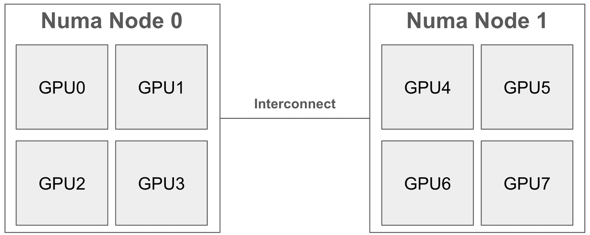
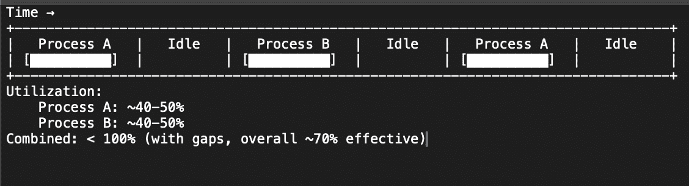
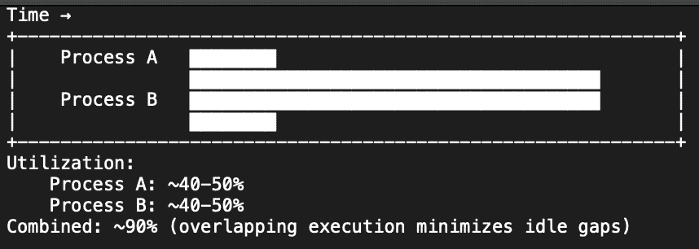

# 第 3 章 针对 GPU 环境的操作系统、Docker 与 Kubernetes 调优

即使拥有高度优化的 GPU 代码和库，系统级瓶颈仍然可能限制大规模 AI 训练的性能。最快的 GPU 也取决于向它提供数据和指令的环境。在本章中，我们将探讨如何调优操作系统和容器运行时，让 GPU 充分发挥其潜力。

在本章中，我们首先探索基础的 GPU 软件栈。然后深入了解关键的 CPU 和内存优化，如 NUMA 亲和性和大页。这些确保数据从存储经 CPU 高效地流向 GPU。同时，我们讨论关键的 GPU 驱动程序设置，如持久模式、多进程服务（Multi-Process Service）和 GPU 多实例分区（Multi-Instance GPU）。这些有助于通过减少开销和有效同步资源来保持最大 GPU 利用率。

借助 NVIDIA 容器工具包（NVIDIA Container Toolkit）、容器运行时、Kubernetes 拓扑管理器（Kubernetes Topology Manager）和 Kubernetes GPU Operator 等解决方案，你可以为 GPU 环境创建统一且高度优化的软件栈。这些解决方案支持在单节点和多节点 GPU 环境中实现高效的资源分配和工作负载调度，并确保 GPU 能力得到充分利用。

在此过程中，你将建立起对这些优化为何重要的直观认识。从本质上讲，它们能最小化延迟、最大化吞吐量，并确保 GPU 持续获得数据并以峰值性能运行。最终形成一个健壮、可扩展的系统，为训练和推理工作负载都带来显著的性能提升。

## 操作系统

操作系统是一切运行的基础。GPU 服务器通常运行 Ubuntu 和 Red Hat 等 Linux 发行版，其操作系统内核经过配置以支持特定硬件。NVIDIA 驱动程序会安装内核模块，通过创建诸如 `/dev/nvidia0` 之类的设备文件，使操作系统能够与 GPU 交互。操作系统还管理 CPU 调度、内存分配、网络和存储，所有这些都需要进行调优以获得更好的 GPU 使用效果。

操作系统需要配置为不干扰 GPU 任务。例如，默认情况下，Linux 在交换内存时可能过于激进，或者在线程调度时可能没有意识到非均匀内存访问（NUMA）。这两者都可能损害 GPU 性能。我们的部分工作就是调整这些操作系统设置，为 GPU 打造顺畅的运行环境。

面向 GPU 的服务器可能还需要运行额外的守护进程（后台进程），例如用于保持 GPU 初始化的 NVIDIA 持久化守护进程（NVIDIA Persistence Daemon）、在带有 NVSwitch 的系统上用于管理 GPU 互联拓扑的 Fabric Manager，以及用于监控 GPU 系统健康指标的 NVIDIA Data Center GPU Manager（DCGM）。

## GPU 驱动程序与软件栈

运行一个多千万亿次浮点运算（multi-petaFLOP）的 GPU 集群，不仅仅需要编写高级的 PyTorch、TensorFlow 或 JAX 代码。支撑 GPU 运行的是一个完整的软件栈，每一层都可能影响性能。最底层是 NVIDIA GPU 驱动程序，它充当 Linux 操作系统和 GPU 硬件之间的接口。驱动程序管理底层 GPU 操作，包括设备上的内存分配、GPU 核心上的任务调度，以及为多租户使用而进行的 GPU 分区。

### GPU 驱动程序

GPU 驱动程序能够开启 GPU 的功能并保持硬件持续处理工作。保持驱动程序更新很重要，因为新的驱动版本通常会带来性能改进，并为最新的 CUDA 功能提供额外支持。`nvidia-smi` 等工具随驱动程序一起提供，允许你监控温度、测量利用率、查询纠错码（ECC）内存状态，以及启用持久模式等不同的 GPU 模式。

### CUDA 工具包与运行时

在驱动程序之上是 CUDA 运行时和一组称为 CUDA 工具包的库。该工具包包含 CUDA 编译器 `nvcc`，用于编译 CUDA C++ 内核，我们将在下一章中看到。编译时，CUDA 程序会链接到 CUDA 运行时（`cudart`）。CUDA 运行时直接与 NVIDIA 驱动程序通信，以启动工作并在 GPU 上分配内存。

此外，CUDA 工具包还提供了许多优化的神经网络库，包括用于神经网络原语的 cuDNN、用于线性代数的 cuBLAS，以及用于多 GPU 通信的 NCCL。这些 CUDA 库为你的更高级代码提供了高性能构建模块，这样你就不必从头重新发明诸如矩阵乘法之类的原语。我们将在后续章节中更详细地讨论 CUDA 编程和优化。

了解 GPU 的计算能力（CC）并确保使用与之匹配的最新版 CUDA 工具包非常重要。CUDA 工具包将对你的 GPU 内核执行即时编译，针对特定 GPU 架构优化你的代码，并将你的代码升级到最新的硬件。

#### 提示

GPU 编程的一个重要特性是，生成的 PTX（即 GPU 的汇编代码）与旧版 NVIDIA GPU 硬件向后兼容，同时与新硬件向前兼容。这是 NVIDIA 编程模型的一大卖点，NVIDIA 首席执行官黄仁勋在每一次新硬件发布时都会强调这一点。

### C++ 和 Python CUDA 库

虽然大多数 CUDA 工具包库都是基于 C++ 的，但 NVIDIA 正推出越来越多以“Cu”为前缀、基于 C++ 工具包构建的 Python 库。例如，CuTile 和 CuPyNumeric 是 2025 年初推出的 Python 库。它们旨在降低 Python 开发者使用 CUDA 为 NVIDIA GPU 构建应用的门槛。

CuTile 是一个 Python 库，旨在简化在 GPU 上处理大型矩阵的工作，它将矩阵拆分为更小、更易于管理的子矩阵，称为“tiles”。它提供了一种基于 tile 的高级抽象，使分块计算、优化内存访问模式和高效调度 GPU 内核变得更加容易。通过将大矩阵划分为多个 tile，CuTile 帮助开发者充分利用 GPU 的并行性，而无需手动管理底层细节。这种方法可以改善缓存使用，并在需要密集矩阵计算的应用中带来整体更好的性能。

CuPyNumeric 是流行的 `numpy` Python 库的即插即用替代品，并利用了 GPU。它提供几乎与 NumPy 相同的函数、方法和行为，因此开发者通常只需对代码进行极少的修改即可切换。在底层，CuPyNumeric 利用 CUDA 在 GPU 上并行执行操作。这为大规模数值计算、矩阵运算和数据分析等计算密集型任务带来了显著的性能提升。通过将工作卸载到 GPU，CuPyNumeric 加速了计算，并提高了处理海量数据集的应用的效率。它的目标是降低 Python 开发者利用 GPU 力量的门槛，而无需学习一套全新的接口，使其成为高性能计算中 NumPy 的强大即插即用替代品。

### PyTorch 和更高级的 AI 框架

一些基于 CUDA 的流行 Python 框架包括 PyTorch、TensorFlow、JAX 和 Keras。这些框架为深度学习提供了高级接口，同时利用了 NVIDIA GPU 的强大性能。本书主要关注 PyTorch。

当你使用 GPU 对 PyTorch 张量执行操作时，它们会从 CPU 移动到 GPU，这看起来只是一次 Python 调用。然而，这一次调用实际上会转化为对 CUDA 运行时的一系列调用，并利用各种 CUDA 库。例如，当你执行矩阵乘法时，PyTorch 会将这些任务委托给 cuBLAS 等库。cuBLAS 是 CUDA 工具包的一部分，并针对 GPU 执行进行了优化。在幕后，PyTorch 确保前向和反向传播等操作使用底层优化过的 CUDA 函数和库来执行。

简而言之，PyTorch 抽象了直接 CUDA 编程的复杂性，让你能够编写直观的 Python 代码，这些代码最终会调用高度优化的 CUDA 例程，从而在开发便利性和高性能两方面都带来好处。我们将在第 4 和第 5 章讨论 CUDA 编程和优化——并在第 6 章讨论 PyTorch 优化。

所有以上组件——操作系统、GPU 驱动程序、CUDA 工具包、CUDA 库和 PyTorch——必须协同工作，才能创建理想的基于 GPU 的开发环境。当研究人员提交训练作业时，调度器会预留节点，操作系统通过 NVIDIA 驱动程序提供 GPU 设备和内存分配，容器提供正确的软件环境，包括经过优化且感知硬件的 CUDA 库。用户代码（例如 PyTorch、TensorFlow、JAX）使用这些 CUDA 库，这些库最终与驱动程序和硬件通信。

本章中描述的优化旨在使这个堆栈中的每一层都尽可能高效。它们将帮助 GPU 保持忙碌，处理实际有用的训练和推理工作——而不是让 GPU 等待 CPU、等待内存或磁盘 I/O，或等待其他 GPU 同步。一个调优良好的系统可确保分布在数十个 GPU 上的模型不会因 I/O 或操作系统开销而成为瓶颈。系统级调优常常被忽视，人们更倾向于模型优化，但系统级优化可以带来显著的性能提升。在某些情况下，只需对你的操作系统级配置做一些小调整，就能获得两位数的百分比改进。在一个大型 AI 项目的规模下，这可以在计算时间上节省数万甚至数十万美元。

## 为 GPU 环境配置 CPU 和操作系统

导致 GPU 无法充分利用的最常见原因之一是 CPU 未能为 GPU 持续提供有用的工作。在典型的训练循环中，CPU 负责准备下一批数据，包括从磁盘加载数据、对数据进行分词、转换等。此外，CPU 还负责调度 GPU 内核，并协调线程和进程。如果这些 CPU 端任务很慢，或者操作系统对它们的调度不佳，昂贵的 GPU 可能会发现自己处于空闲状态，晶体管空转，等待下一个任务或数据批次。为了避免这种情况，我们需要优化 CPU 和操作系统处理 GPU 工作负载的方式。这包括仔细的 CPU 亲和性设置，使正确的 CPU 核心处理正确的数据；适当的内存分配策略，以避免 NUMA 惩罚；以及其他影响较大的操作系统级设置，以消除不必要的延迟，我们接下来将讨论这些。

### NUMA 感知与 CPU 绑定

现代服务器 CPU 有数十个核心，通常被划分为多个非一致内存访问（NUMA）节点。NUMA 节点是 CPU、GPU、NIC 和内存在物理上彼此靠近的逻辑分组。了解系统的 NUMA 架构对于性能调优非常重要。在单个 NUMA 节点内访问资源比访问其他 NUMA 节点中的资源更快。

例如，如果 NUMA 节点 0 中 CPU 上运行的进程需要访问 NUMA 节点 1 中的 GPU，则必须通过节点间链路发送数据，这会带来更高的延迟。事实上，一项[实验](https://frankdenneman.nl/2022/09/21/sub-numa-clustering/#:~:text=Latency%20,9)表明，跨 NUMA 节点访问内存时，内存访问延迟几乎会翻倍。该实验测得本地 NUMA 节点内存访问延迟为 80 ns，而跨 NUMA 节点访问内存时为 139 ms。差别巨大。将进程绑定到与 GPU 处于同一 NUMA 节点的 CPU 上，我们可以避免这种额外开销。关键思路就是让 CPU 执行和内存访问都保持在其所服务的 GPU 本地。

###### 提示

值得注意的是，默认情况下，Linux 调度器不会使用 NUMA 感知的调度算法。


为了防止出现这种情况，关键是要将进程或线程“固定”到与 GPU 连接在同一 NUMA 节点上的特定 CPU。这种 CPU 亲和性通常称为 CPU 固定（CPU pinning）。假设一个节点中有 8 个 GPU，其中 4 个连接到 NUMA 节点 0，另外 4 个连接到 NUMA 节点 1。如果你启动 8 个训练进程，每个 GPU 一个进程，那么你应该将每个训练进程绑定到与这些 GPU 处于同一 NUMA 节点的 CPU 核心（或一组 CPU 核心）。在这个例子中，GPU 0-3 连接到 NUMA 节点 0，GPU 4-7 连接到 NUMA 节点 1 的核心，如 图 3-1 所示。



###### 图 3-1. 节点中的 8 个 GPU：其中 4 个连接至 NUMA 节点 0，另外 4 个连接至 NUMA 节点 1

这样，当 CPU 进程要向 GPU 5 提供数据时，它应该运行在与 NUMA 节点 1 相连的 CPU 上，因为 GPU 5 连接至 NUMA 节点 1。Linux 提供了相应工具，包括`numactl --cpunodebind=<node>`，它可以启动一个绑定到指定 NUMA 节点的进程。你还可以使用`taskset`将进程绑定到特定的核心 ID。下面是一个使用`numactl`将`train.py`脚本绑定到与 GPU 5 相同的 NUMA 节点 1 中某个 CPU 上的示例。

```
numactl --cpunodebind=1 --membind=1 python train.py --gpu 5 &
```

该命令中的`--membind`部分同样重要。我们将在下一节讨论 NUMA 友好的内存分配和内存固定。

许多深度学习框架还允许你通过编程方式设置线程亲和性。例如，PyTorch 的`DataLoader`允许为基于 CPU 的工作进程设置 CPU 亲和性，如下所示。

```
import os
import psutil
import torch
import torch.distributed as dist
from torch.nn.parallel import DistributedDataParallel as DDP
from torch.utils.data import DataLoader, Dataset

# Set CPU affinity for the main process (the DDP process)
def set_main_process_affinity():
    available_cpus = list(range(psutil.cpu_count()))
    rank = int(os.environ.get("RANK", "0"))
    # For demonstration, pin the main process to one specific CPU based on its rank
    main_affinity = [available_cpus[rank % len(available_cpus)]]
    process = psutil.Process(os.getpid())
    process.cpu_affinity(main_affinity)
    print(f"Main process (rank {rank}) pinned to CPU core(s): {main_affinity}")

# Set CPU affinity for each DataLoader worker
def worker_init_fn(worker_id):
    available_cpus = list(range(psutil.cpu_count()))
    rank = int(os.environ.get("RANK", "0"))
    # Example mapping: assign each worker a CPU based on the rank and worker ID
    assigned_cpu = available_cpus[(rank * 10 + worker_id) % len(available_cpus)]
    process = psutil.Process(os.getpid())
    process.cpu_affinity([assigned_cpu])
    print(f"DataLoader worker {worker_id} (rank {rank}) pinned to CPU core {assigned_cpu}")

# main() function that combines DDP with a DataLoader using the affinity settings
def main():
    # Initialize the distributed process group as required 
    ...
    
    # Set affinity for the main DDP process
    set_main_process_affinity()
    
    # Create your dataset (Fictitious dataset)
    dataset = Dataset()
    
    # Create DataLoader with the worker_init_fn to set affinity for each worker
    dataloader = DataLoader(
        dataset,
        batch_size=32,
        num_workers=4,
        pin_memory=True,
        worker_init_fn=worker_init_fn # set affinity
    )
    
    # Create and move your model to the current device (GPU)
    model = torch.nn.Linear(224 * 224 * 3, 10)  # Example model
    model = model.to("cuda")
    
    # Wrap the model in DistributedDataParallel (DDP)
    ddp_model = DDP(model, device_ids=[
torch.cuda.current_device()
])
    
    # Training loop 
    ...
```

`set_main_process_affinity()`函数根据进程 rank 将主 DDP 进程分配给特定的 CPU 核心。`worker_init_fn()`函数被传给`DataLoader`，以便每个 worker 子进程都固定到特定的 CPU 核心上。这可以最大限度地减少跨 NUMA 流量，并提高数据预处理和传输效率。

在实践中，固定（pinning）可以消除不可预测的 CPU 调度行为。它能确保诸如 GPU 数据加载线程之类的关键线程不会在训练或推理过程中突然被操作系统迁移到另一个 NUMA 节点的核心上。实际上，仅仅通过消除跨 NUMA 流量和 CPU 核心迁移，就可能看到 5-10% 的训练吞吐量提升。这也有助于减少性能抖动和方差。

许多高性能 AI 系统还会禁用 CPU 超线程，以获得每个 CPU 核心更可预测的性能。有些甚至专门预留几个核心给操作系统后台任务，让其余核心完全专用于训练或推理工作负载。

需要特别指出的是，对于 NVIDIA 的 Grace-Blackwell 这类集成式 CPU-GPU 超级芯片，许多传统上对 CPU 到 GPU 数据传输的顾虑都已得到缓解，因为 CPU 和 GPU 共享同一物理内存，并且属于统一架构的一部分。这意味着跨 NUMA 延迟等问题被最小化，数据可以在 CPU 和 GPU 之间更直接地流动。

###### 提示

NVIDIA 将 CPU 和 GPU 集成到单个超级芯片上以解决硬件中的 CPU 到 GPU 瓶颈，这并非巧合。可以预期 NVIDIA 会继续通过硬件创新解决越来越多的瓶颈问题。

即使采用紧密耦合的 CPU-GPU 超级芯片架构，仍然需要通过确保硬件和软件配置正确来优化整个技术栈，使集成系统以最高效率运行。即使在这样紧密耦合的架构中，也要尽量减少数据处理中任何不必要的延迟，以保持 GPU 的充分利用。这包括配置大页、使用高效预取以及固定内存，你将在接下来的章节中看到。

### NUMA 友好的内存分配与内存固定

默认情况下，进程会从当前运行 CPU 所在的 NUMA 节点分配内存。因此，如果你将进程固定到 NUMA 节点 0，其内存自然会来自 NUMA 节点 0 的本地 RAM，这是理想情况。然而，如果操作系统调度器迁移了线程——或者某些内存在你进行绑定之前就已经被分配——你最终可能会遇到不理想的情况：运行在 NUMA 节点 0 中的进程却在使用 NUMA 节点 1 的内存。在这种情况下，每次内存访问都必须跳到另一个 NUMA 节点，从而抵消了 CPU 固定的好处。

为了避免这种情况，`numactl --membind`选项会强制从特定的 NUMA 节点分配内存。在代码中，也有 NUMA API 甚至环境变量可以影响此配置。一般原则是让内存靠近与 GPU 相近的 CPU。这样，从内存到 CPU 再到 GPU 的数据移动链就都在同一个 NUMA 节点内。以下是与之前相同的示例，但使用了`--membind=1`来强制从包含 NUMA 节点 1 的首选 NUMA 节点分配内存。

```
numactl --cpunodebind=1 --membind=1 python train.py --gpu 5 &
```

GPU 内存的另一面称为页锁定（page pinning）、页锁定（page locking）或内存固定（memory pinning）。在向 GPU 传输数据时，固定（页锁定）的主机内存可以显著提高吞吐量。通常，操作系统可以决定将内存页换入换出——或根据需要移动它们。但是，如果你分配了固定内存，操作系统会保证这些内存页保留在物理 RAM 中，不会被换出或移动。内存固定允许 GPU 以高速执行直接内存访问（DMA）传输，而无需担心操作系统可能带来的开销。从固定主机 CPU 内存复制到 GPU 通常比从常规可分页 CPU 内存复制快 2–3 倍。

深度学习框架提供了使用固定内存进行数据加载的选项。例如，PyTorch 的`DataLoader`有一个标志`pin_memory=True`，当为真时，意味着加载的批次将被放置在固定 RAM 中。这加速了`tensor.to(device)`操作，因为 CUDA 驱动程序不必即时固定页面。当你使用大批次或每次迭代读取大量数据时，这尤其有益。许多从业者注意到，只需在 PyTorch 中开启`pin_memory=True`就能通过减少数据传输瓶颈显著提升性能。

###### 提示

操作系统对用户可锁定（固定）的内存量有限制。这可以通过`ulimit -l <最大锁定内存>`命令设置。如果你计划使用大的固定缓冲区，请确保此限制设置得较高——或者为你的用户设置为无限制——否则分配可能会失败。通常，对于大型 AI 工作负载和 HPC 应用程序，会将其设置为无限制。

### 透明大页

除了固定内存并将其绑定到 NUMA 节点之外，我们还应该讨论透明大页（THP）。Linux 内存管理通常使用 4 KB 页面，但当你的进程使用数十甚至数百 GB 内存时（如深度学习数据集、预取批次、模型参数等），管理数百万个微型页面是低效的。

大页——2 MB 甚至 1 GB 的页面——可以通过增大内存块来减少虚拟内存管理的开销。主要好处是减少缺页错误次数，并减轻转换后备缓冲区（TLB）的压力。TLB 是 CPU 用于将虚拟地址映射到物理地址的缓存。更少的、更大的页面意味着 TLB 可以用相同数量的条目覆盖更多内存，从而减少缺失。

通常建议为大型内存工作负载启用大页。Linux 使用 THP，它会尝试尽可能自动使用 2 MB 页面。在现代发行版中，它通常默认启用，采用`madvise`或`always`模式。你可以通过读取`/sys/kernel/mm/transparent_hugepage/enabled`来检查设置。

对于大多数深度学习训练任务，启用 THP 是有益的，这样它对程序是透明的。在这种情况下，你不必更改代码，但会获得 CPU 效率的提升。请注意，大页带来的增益并非在每个场景中都很大。你可能只会看到因缺页错误减少而带来的几个百分点的吞吐量提升。对于极大的内存使用场景，可以使用`hugetlbfs`（Linux 伪文件系统）来预留显式大页，用于分配 1 GB 页面。然而，这需要更多的手动设置和配置。启用 THP 是一种更简单、更直观的收益。一旦启用，操作系统将自动用 2 MB 页面支持大分配，从而减少内核开销。

现在，除了 CPU 和内存固定之外，还有一些其他操作系统级别的调整值得一提。这些包括线程调度、虚拟内存管理、文件系统缓存和 CPU 频率设置。

### 调度器和中断亲和性

在繁忙的系统上，你要确保重要的线程（如数据管道线程）不会被频繁中断。Linux 默认使用完全公平调度器（CFS），在大多数情况下表现良好。但如果你有一个对延迟敏感的线程，例如向 GPU 提供数据的线程，你可以考虑为该线程使用实时先入先出（FIFO）或轮询（RR）优先级调度。这将确保运行不会被普通线程抢占。但是请谨慎使用，因为实时线程如果管理不当可能会使其他进程饿死。不过在实际中，如果你已将线程固定到专用核心，通常不需要调整实时线程优先级，但值得留意。

另一个技巧是使用`cset`或内核启动参数（如`isolcpus`内核选项）完全隔离核心供你的进程使用。在这种情况下，操作系统调度器将这些 CPU 核心让给你，按你的程序意愿使用。

此外，你可以将硬件中断以 NUMA 感知的方式绑定到特定核心，以避免跨 NUMA 节点的中断可能驱逐另一个 NUMA 节点上有用的缓存数据。如果你的 GPU 或 NIC 在 NUMA 节点 0 中生成硬件中断，你希望这些中断由同一 NUMA 节点上的核心处理。否则，来自另一个 NUMA 节点的随机核心必须跨 NUMA 节点通信。可以配置像`irqbalance`这样的工具，例如，NUMA 节点 0 中 InfiniBand 卡的中断由 NUMA 节点 0 中的 CPU 核心处理。

### 虚拟内存和交换

无需多言，你应该始终尽量避免内存交换。如果进程的任何一部分内存被交换到磁盘，你会看到灾难性的、多个数量级的性能下降。GPU 程序往往会为数据缓存分配大量主机内存。如果操作系统决定将一些数据从内存换出到磁盘，GPU 在需要访问这些数据时会遇到巨大延迟。

我们建议设置`vm.swappiness = 0`，这告诉 Linux 除非在极端内存压力下，否则避免交换。此外，请确保有足够的内存用于你的工作负载，或者设置限制以防止过度使用。另一个相关设置是前面提到的`ulimit -l`用于锁定内存。如果要防止内存交换，你应该将该限制设置得高一些，否则可能会遇到过度的内存交换。同样，对于使用大量内存的大型 AI 工作负载，通常会将此限制设置为无限制。

### 文件系统缓存和写回

对于大型训练任务，最佳实践是将频繁的检查点写入磁盘，以防需要从已知的良好检查点重启失败的任务。然而，在检查点期间，大量突发数据可能会填满操作系统页面缓存并导致停滞。调整`vm.dirty_ratio`和`vm.dirty_background_ratio`可以控制写入刷新到磁盘之前可以缓冲的数据量。例如，如果你正在写入数 GB 的检查点，你可能希望允许大量脏页缓存累积并在后台刷新，这样你的训练进程不会被文件写入阻塞。另一个选择是在单独的线程中执行检查点。PyTorch 中一个较新的选项是从集群中的节点写入分布式检查点分区。在这种情况下，当故障重启后加载检查点时，检查点分区会被合并。

### CPU 频率和 C 状态

## CPU 与操作系统性能调优

默认情况下，许多计算节点会让 CPU 以节能模式运行，这种模式要么降低 CPU 主频，要么在空闲时让 CPU 进入睡眠状态。这有助于节省能源、减少热量并降低成本。在模型训练期间，由于 GPU 正在处理其数据集中的最后几个批次，CPU 可能不会始终达到 100% 的利用率。然而，这些电源管理特性可能会在系统因新任务到达而再次唤醒 CPU 时引入额外的延迟。

为了获得最大且一致的性能，AI 系统通常会将 CPU 频率调节器配置为“performance”模式，使 CPU 始终保持最高频率。这可以通过`cpupower frequency-set`命令或在 BIOS 中完成。

同样，禁用深层 C 状态可以防止核心进入低功耗睡眠状态。CPU C 状态是由系统 ACPI 规范定义的省电模式。当 CPU 核心空闲时，它可以进入 C 状态以节省能源。C 状态越深，节省的电力越多，但当工作到达时，核心“唤醒”所需的时间也可能越长。禁用更深的 C 状态可以消除过度的延迟尖峰。`C0`表示活动状态，高于`C0`的所有状态都代表更深的睡眠状态。

本质上，我们可以用一点额外的功耗来换取更灵敏的 CPU 行为。在 GPU 是主要功耗大户的训练场景中，只要能让 GPU 保持“喂饱”状态，稍微增加一点 CPU 功耗通常是没问题的。例如，如果数据加载线程因等待数据而睡眠，CPU 进入深度`C6`状态，此时 CPU 的很大一部分会被断电以最大化节能效果。

如果 CPU 进入更深的睡眠状态，它可能需要几微秒才能唤醒。虽然这段时间不长，但许多微秒累积起来，如果管理不当，可能会导致 GPU 气泡。气泡是指 GPU 等待 CPU 恢复数据处理的时段。通过让 CPU 保持就绪状态，我们可以减少这类卡顿。许多服务器 BIOS 都提供了禁用 C 状态（或至少限制它们）的设置。


总结一下 CPU 和操作系统调优的要点：你应该将工作负载绑定到硬件拓扑上，利用 NUMA 的优势，并消除操作系统干扰。确保将每个 GPU 的工作固定到最近的 CPU 核心和内存上。建议使用大页（huge pages）和锁定内存来加速内存操作。你应始终关闭任何可能引入不可预测延迟的功能，例如过多的上下文切换、频率缩放和内存到磁盘的换页。

最终的结果应该是：CPU 以 GPU 能够消耗的速度向 GPU 提供数据，而操作系统不会在错误的核上调度任务，也不会在错误的时间抢占 CPU 周期。在一台调优良好的 GPU 服务器上，你可能会注意到 CPU 使用率并不极高，因为 GPU 承担了繁重的工作，但 CPU 使用率应与 GPU 保持一致和同步。CPU 在 GPU 处理当前批次时保持足够活跃，以准备下一批次。每个 GPU 的利用率曲线都应保持在接近顶部的水平，仅在绝对必要的同步点才会下降——而不是因为 GPU 在等待数据或卡在缓慢的 CPU 上。

## 面向性能的 GPU 驱动与运行时设置

我们已经对 CPU 侧进行了优化，但 GPU 驱动和运行时也有一些重要设置会影响性能——尤其是在多 GPU 和多用户场景中。NVIDIA GPU 有几个可调参数，如果调校得当，可以减少开销并改善多个工作负载共享 GPU 的方式。我们将介绍 GPU 持久模式、多进程服务（Multi-Process Service）、多实例 GPU 分区，以及其他一些考虑因素，如时钟设置、ECC 内存和内存不足行为。

### GPU 持久模式

默认情况下，如果没有应用程序正在使用 GPU，驱动程序可能会将 GPU 置于较低功耗状态，并卸载部分驱动上下文。当下一个应用程序出现并希望使用 GPU 时，初始化会产生成本。驱动程序重新启动所有功能可能需要大约一两秒的时间。对于周期性释放并重新获取 GPU 的工作负载，这一初始化开销可能会对性能产生负面影响。例如，考虑一个作业频繁启动和停止的训练集群。或者一个低流量的推理集群，每次新的推理请求到达时都必须唤醒 GPU。在这两种情况下，该开销都会降低整体工作负载的性能。

持久模式是通过`nvidia-smi -pm 1`启用的一项设置，它使 GPU 驱动程序保持加载状态，并让硬件处于就绪状态，即使没有应用程序处于活动状态也是如此。本质上，它要求系统在空闲时不要完全关闭 GPU。GPU 保持唤醒状态，因此下一个作业的启动延迟为零。

在 AI 集群中，通常会在服务器启动时就在所有 GPU 上启用持久模式。这样，当作业开始时，GPU 已经完成初始化，可以立即开始处理。这并不会让你的实际计算变得更快，因为它不会加速数学运算，但它能削减作业启动延迟，并防止冷启动延迟。

GPU 持久模式也有助于交互式使用：如果没有持久模式，你在空闲一段时间后发出的第一个 CUDA 调用可能会因驱动程序重新初始化 GPU 而停顿。启用持久模式后，该调用会快速返回。唯一的缺点是空闲功耗会略高一些，因为 GPU 保持在更高的就绪状态，但对于大多数数据中心 GPU 来说，这是为了性能一致性而可以接受的权衡。一旦具有`sudo`权限的管理员设置了 GPU 持久模式，你就可以享受其好处，并继续处理其他优化工作。

### 多进程服务（MPS）

通常，当多个进程共享单个 GPU 时，GPU 的调度器会在它们之间进行时间片调度。例如，如果两个 Python 进程各自有一些内核要在同一个 GPU 上运行，GPU 可能会先执行一个进程的内核，然后再执行另一个进程的内核，以此类推。如果这些内核很短，并且它们之间存在空闲间隔，GPU 最终可能会利用率不足，因为它正在进行“乒乓”式的上下文切换，而没有让工作重叠。

NVIDIA 的多进程服务（MPS）是一项功能，它创建了一个“保护伞”，让多个进程可以在 GPU 上并发运行，而无需严格的时间片调度。借助 MPS，只要 GPU 资源（流式多处理器、张量核心等）可用，GPU 就可以同时执行来自不同进程的内核。MPS 本质上将各进程的上下文合并到一个调度器上下文中。这样，你就不必承担独立进程之间切换和空闲的全部成本。

MPS 何时有用？对于模型训练，如果你通常每个 GPU 运行一个进程，可能不需要使用 MPS。但如果你有这样的场景：在一台大型 GPU 上运行多个推理作业，MPS 就是改变游戏规则的关键。假设你拥有一个强大的 GPU 或 GPU 集群，但你的推理作业——或一组多个推理作业——并没有充分利用它。例如，考虑在一个 40 GB 的 GPU 上运行四个独立的推理作业，每个作业使用 5-10 GB 内存，且仅使用 30% 的 GPU 计算能力。默认情况下，每个推理作业获得一个时间片，因此在任何时刻，只有一个作业的工作实际上在 GPU 上运行。这导致 GPU 平均有 70% 的时间处于空闲状态。

如果你为这些推理作业启用 MPS，GPU 可以交错执行它们的工作，这样当一个作业在等待内存时，另一个作业的内核可能会填满 GPU，等等。结果是整体 GPU 利用率更高。在实践中，如果两个进程各自使用一个 GPU 的 40%，启用 MPS 后，你可能会看到 GPU 以 80-90% 的利用率同时服务这两个进程。例如，两个训练进程各自单独运行需要 1 小时——如果它们在同一个 GPU 上顺序运行则需要 2 小时——在 MPS 下它们可以并行运行，总共只需略多于 1 小时即可完成，而不是顺序运行 2 小时。这种 2 倍加速是将两个训练进程的工作合并起来并让 GPU 保持完全忙碌的结果。

为了便于理解，可以想象在没有 MPS 的情况下，进程 A 和进程 B 各自周期性地启动内核。GPU 的调度可能会呈现 A-B-A-B 的交替模式，并且中间存在间隙，因为每个进程都在等待，如 图 3-2 所示。



**图 3-2.** GPU 在运行进程 A 的内核和进程 B 的内核之间交替切换，并产生空闲间隙：一个进程在等待，而另一个进程处于活动状态。

启用 MPS 后，调度更接近于 A 和 B 重叠执行：只要 A 没有使用 GPU 的某些部分，B 的工作就可以同时使用这些部分，反之亦然。这种重叠消除了空闲间隙，如 图 3-3 所示。



**图 3-3.** 消除进程 A 和 B 的调度间隙后，原本单独使用利用率约为 40% 到 50% 的两个进程，在结合 MPS 后可以达到约 90% 的利用率。

设置 MPS 需要运行一个 MPS 控制守护进程（`nvidia-cuda-mps-control`），它会启动一个 MPS 服务器进程来调度 GPU 访问。在现代 GPU 上，MPS 更加精简，因为客户端（也就是这些进程）可以直接与硬件通信，计算节点本身的干预极少。通常，你会在一个节点上启动 MPS 服务器——通常每个 GPU 一个或每个用户一个——然后通过一个环境变量将你的 GPU 作业连接到 MPS。该服务器下的所有作业将并发共享 GPU。

MPS 的另一个特性是能够为每个客户端设置活跃线程百分比。这限制了客户端可以使用多少个流式多处理器（本质上就是 GPU 核心）。如果你想保证服务质量（QoS），这个特性会很有用；例如，两个作业各自最多只能获得 GPU 执行资源的 50%。如果没有显式设置，这些作业就会互相竞争，尽可能占用它们能获得的 GPU 资源。

请注意，MPS 不会对 GPU 显存进行分区，因此所有进程将共享完整的 GPU 显存空间。MPS 主要涉及计算共享和调度。问题在于，某个进程可能会请求大量 GPU 显存，从而导致 GPU 上发生显存不足（OOM）错误，并导致该 GPU 上运行的所有其他进程被终止。这会造成很大的破坏。此外，如果某个程序本身就将 GPU 的利用率占满到 100%，MPS 也无法神奇地让它运行得更快，因为利用率不可能超过 100%。只有当单个作业留出一些空闲资源、让其他作业可以填补时，MPS 才有价值。

MPS 的另一个限制是，默认情况下，所有 MPS 客户端必须以同一个 Unix 用户身份运行，因为它们共享一个上下文。在多用户集群中，这意味着 MPS 通常是在调度器级别配置的，使得同一时间只有一个用户的作业共享 GPU。否则，你也可以配置一个系统级的 MPS，让所有用户共享，但要知道，从安全角度来看，这些作业之间并没有隔离。最近的 NVIDIA 驱动程序引入了多用户 MPS 的概念，但截至本文撰写时，它在生产环境中仍不太常见。

MPS 的一个具体替代方案是 Kubernetes 中对 GPU 进行时间切片的功能。Kubernetes 上的时间切片允许设备插件按时间将不同的 Pod 调度到同一块 GPU 上。例如，四个 GPU 各自会获得 25% 的时间。这有点像一种自动化的分时算法，不需要 MPS。然而，这并不会重叠执行，它只是比默认驱动程序更快地切换。时间切片可能适用于交互式工作负载，在这种情况下，你更希望获得隔离，而代价是一些空闲时间。对于高吞吐量作业，使用 MPS 重叠执行，或使用多实例 GPU 对 GPU 进行切分，通常比细粒度的时间切片更好，这一点将在下文讨论。

### 多实例 GPU

从 NVIDIA A100 Ampere 一代开始，GPU 可以使用多实例 GPU（MIG）在硬件层面被划分为多个实例。MIG 允许将一块 GPU 切分为最多 7 个更小的逻辑 GPU——每个逻辑 GPU 都拥有自己专用的显存和计算单元（即流式多处理器，SM）。例如，一块 192 GB 的 Blackwell B200 GPU 可以被划分为 7 个实例，每个实例约 27 GB（192 GB / 7 个实例）和 20 个 SM（140 个 SM / 7 个实例）。从软件的角度来看，每个实例都像一块独立的 GPU，因为它拥有自己的显存、自己的流式多处理器，甚至独立的引擎上下文。

MIG 的好处在于强大的隔离性以及为每个作业提供有保障的资源。如果你有多个用户或多个服务，每个服务只需要例如 10 GB 的逻辑 GPU 显存，你可以把它们打包到一块物理 GPU 上，而不会让它们互相干扰彼此的内存或计算。这是一种虚拟化形式，但由硬件实现，因此开销非常低——可能只有几个百分点——但代价是失去了一些灵活性。如果某个实例处于空闲状态，它无法将自己的资源借给另一个实例，因为它们是硬性分区的。此外，如果你没有使用所有 MIG 切片，就会让这些资源处于碎片化状态，从而造成浪费。规划与工作负载匹配的分区大小非常重要。

一个重要的运维注意事项是：要使用 MIG，你通常需要在系统层面——或者至少是节点层面——进行配置。必须先将 GPU 置于 MIG 模式，创建切片，重启节点，然后这些切片才会作为独立设备出现在系统中。

**提示**

Kubernetes 设备插件会将 MIG 设备列为资源，例如`nvidia.com/mig-2g.10gb`对应一个 2 GPU、10 GB 的切片。

作业可以专门请求 MIG 设备，但你必须小心地进行调度，以便使用所有切片。例如，如果你有 7 个切片的配置，而某个作业只占用一个切片，那么其余 6 个切片应该用其他作业填满，否则你会让大量资源闲置。例如，你可以将集群中的某些节点配置为使用 MIG 来运行小型推理作业，并将其他节点配置为不使用 MIG 来运行大型训练作业。

对于跨多 GPU 的大规模模型训练作业和推理服务器，MIG 通常没有用处，因为我们希望使用全部 GPU。另一方面，对于可以运行较小 GPU 分区的多租户、小模型推理服务器，MIG 及其隔离特性可能会很有用。

总之，只有当你需要在同一块 GPU 上以强隔离方式运行多个独立作业时，才启用 MIG。不要将 MIG 用于跨 GPU 的大规模分布式训练或推理，因为你希望获得 GPU 及其高速互连的全部性能。

在我们的大型基于 Transformer 的模型训练和推理场景中，我们会关闭 MIG。但了解一下这个特性是件好事。也许某个集群可以动态切换模式：白天在大量小型训练或推理实验进行时运行 MIG，晚上关闭 MIG，以运行使用整块 GPU 的大型训练作业。

### GPU 时钟速度与纠错码

NVIDIA GPU 具有一个称为 GPU Boost 的功能，它会在功耗和热限制范围内自动调整核心时钟。大多数情况下，你应该让 GPU 自行管理。但有些用户为了结果一致性而喜欢锁定时钟，使 GPU 始终以固定的最高频率运行。这样一来，不同运行之间的性能就会保持稳定，不会受到功耗或温度变化的影响。在进行基准测试时，这一点极其重要，也是一个常见问题，因为后续运行可能会因过热而降频。如果你没有意识到这一点，你可能会无意中错误解读后续运行的不佳结果；这些结果不佳可能是因为前几次运行引发的过热导致 GPU 降频。

你可以使用`nvidia-smi -lgc`锁定核心时钟，并使用`-ac`锁定内存时钟。这有助于确保 GPU 以一致的频率运行，这对于基准测试或需要可重现的性能结果时尤其有用。通过锁定时钟，你可以防止默认自动加速（auto-boost）行为可能引起的波动，这种波动会随散热条件或供电情况而变化。

有些人可能会选择稍微降低 GPU 的时钟频率以减少热量，如果他们计划运行非常长久的作业，并希望在基准测试运行期间避免触发热降频。然而，除非你看到由于热节流而导致的 GPU 性能波动，否则通常不需要锁定时钟，因为数据中心 GPU 通常具有功率和温度余量，以及适当的空气或液体冷却。如果你追求极致的确定性和一致性，那么锁定时钟是需要留意的事情。不过，通常让 GPU 保持默认的自动加速模式即可。

GPU 上的纠错码（ECC）内存是另一个需要考虑的因素。ECC 可以确保，例如，如果出现由宇宙射线引起的单比特内存错误，内存能够在运行中即时纠正。如果出现双比特错误，该错误会被检测出来，并向调用代码抛出一个错误。NVIDIA 数据中心 GPU 通常默认启用 ECC。

禁用 ECC 可以释放少量内存，因为 ECC 需要额外比特进行错误检查。这也许能通过减少即时错误检查的开销而带来轻微的性能提升，但通常只有几个百分点。然而，关闭 ECC 也会移除关键的内存错误保护，这可能导致系统不稳定或数据损坏而未被察觉。

此外，在 NVIDIA 许多较新的数据中心 GPU（包括 Hopper 和 Blackwell）上，ECC 始终启用且无法禁用。这种设计选择有助于在严苛的高性能计算环境中确保可靠性和数据完整性。

对于在大型模型上进行的长时间训练或推理作业，一个单一的内存错误可能会使作业完全崩溃，甚至更糟的是，在没有任何预警的情况下静默破坏你的模型。因此，对于任何严肃的 AI 工作负载，建议始终保持 ECC 开启。唯一可能考虑关闭 ECC 的情况是在研究环境中，你愿意承担风险，因为你需要那额外的一丁点内存，以便让你的模型能够装进内存有限的 GPU 集群。

切换 ECC 模式需要重置 GPU，并且很可能需要重启当前正在该 GPU 上运行的作业。因此，这不是一个适合频繁切换的开关。让 ECC 保持开启以换取稳定性和可靠性。安心所带来的价值远超过关闭 ECC 所能带来的微不足道的加速。

### GPU 内存超订、碎片化与内存不足处理

与 CPU RAM 不同，默认情况下并不存在 GPU“交换”内存这种东西。如果你尝试分配超过可用量的 GPU 内存，你会收到一个不友好的内存不足（OOM）错误，并且伴随一个更不友好的进程崩溃。有几种机制可以缓解这一问题，包括允许内存动态增长、CPU 与 GPU 之间的统一内存，以及内存池和缓存分配器。

默认情况下，一些框架（例如 TensorFlow）在启动时会占用所有可用的 GPU 内存，以避免碎片化并提高性能。如果你不了解这一点，在共享 GPU 的场景下可能会非常糟糕。PyTorch 默认只按需分配 GPU 内存。幸运的是，TensorFlow 有一个选项（`TF_FORCE_GPU_ALLOW_GROWTH=true`）可以使其从较小内存开始，并按需动态增长 GPU 内存使用量——类似于 PyTorch。当然，PyTorch 和 TensorFlow 都不会让你分配超过 GPU 可用容量的内存。但这种惰性分配方式在多租户场景下表现更好，因为两个进程不会从一开始就同时尝试分配最大可用 GPU 内存。

CUDA 的统一内存系统允许你分配内存，而无需预先决定它驻留在 CPU 还是 GPU 上。CUDA 运行时负责按需迁移页面。像 Hopper 和 Blackwell 这样的现代 NVIDIA GPU 包含了使用页面迁移引擎（PME）进行按需分页的硬件支持。当 GPU 可用内存不足时，PME 会自动在 GPU 内存和主机 CPU RAM 之间迁移内存页面。然而，虽然 PME 提供了灵活性，但与为工作负载准备足够的 GPU 内存相比，依赖它可能会带来性能损失。

不过，这种从 GPU 到 CPU 的内存卸载可能很慢，因为正如我们在前一章所学到的，CPU 内存 I/O 比 GPU 高带宽内存（HBM）I/O 更慢。这个机制主要是为了方便那些尝试运行超出 GPU RAM 容量的模型的从业者。然而，对于性能关键型工作负载，你通常应尽可能避免依赖统一内存超订。它是作为安全网而不是让脚本直接崩溃而存在的，但当 GPU 内存超订时，你的作业会运行得更慢。

像 PyTorch 这样的库使用缓存分配器，这样当你释放 GPU 内存时，它不会立即将内存返回给操作系统，而是保留它以供后续分配重用。这避免了内存碎片化，也避免了反复请求操作系统分配同一内存块的开销。你可以通过`PYTORCH_CUDA_ALLOC_CONF`等环境变量来配置 PyTorch 的分配器，以设置最大池大小。

如果你遇到 GPU OOM 错误（你迟早肯定会遇到），它很可能是由内存碎片化或过度内存缓存造成的。你可以尝试使用 PyTorch 的`torch.cuda.empty_cache()`清除缓存，但这几乎总是意味着你的工作负载确实需要那么多内存。

从操作系统的角度来看，你可以使用 Linux cgroups 或 Docker 的选项来对给定进程强制执行 GPU 内存限制。例如，使用 Docker 时，你可以通过`--gpus <device>:<mem_limit>`运行容器，人为地限制容器可分配的 GPU 内存量。这样，如果某个进程试图使用超过（比如说）10 GB 的内存，它会被终止或报错，而不会影响其他进程。在多租户节点上，这有助于隔离作业。在每 GPU 单作业的情况下，通常不会设置内存限制，因为你希望让作业尽可能多地使用可用的 GPU 内存。


一般来说，GPU 内存不足是可以在应用层解决的问题。例如，你可以减小数据批量大小、降低模型权重精度，甚至减少模型参数数量（如果可行的话）。一个最佳实践是在模型训练和推理期间使用`nvidia-smi`或 NVML API 监控 GPU 内存使用情况。如果你接近内存限制，可以考虑一些变通方法，例如减小批量大小、在训练中使用梯度检查点，或其他降低内存占用量的技术。

此外，你应该确保 CPU 内存没有被交换，因为这会间接损害 GPU 利用率和有效吞吐量（goodput）。每次 GPU 尝试从 CPU 主机获取数据时，如果主机内存页已被交换到磁盘，你的性能就会受到慢得多的磁盘 I/O 的瓶颈限制。因此，务必将这些降低内存占用的最佳实践与之前关于内存固定、增大`ulimit`、禁用`swappiness`等建议结合起来。

最后，建议始终让 GPU 驱动保持加载状态，而不要在作业之间卸载 GPU 驱动。这类似于 GPU 持久模式，但层次更深。某些集群为了释放操作系统内核内存和保证安全，会配置为在没有作业运行时卸载驱动。但是，如果你这样做，下一个作业就必须承担重新加载 GPU 驱动的开销，并且如果使用了 MIG，还需要重新配置 MIG 切片。通常，你希望驱动以及任何 MIG 配置在作业之间保持持久。只有在排查问题或升级驱动时，才需要卸载 GPU 驱动。因此，集群管理员通常会将系统配置为：机器启动后，NVIDIA 驱动模块始终存在。

## 面向 GPU 的容器运行时优化

许多 AI 系统使用编排工具和容器运行时来管理软件环境。Kubernetes 和 Docker 在 AI 基础设施中很常用。使用容器可以确保包括 CUDA 和库版本在内的所有依赖项保持一致。这避免了“在我机器上是好的”这类问题。容器会引入一些复杂性和少量开销，但只要配置得当，你就能在使用容器时获得接近裸机的 GPU 工作负载性能。

在节点上运行的容器并不是传统的虚拟机（VM）。与虚拟机不同，容器共享宿主机的操作系统内核，因此 CPU 和内存操作可以接近原生速度执行。同样，对于 GPU 工作负载，容器可以直接使用宿主机的 GPU 驱动和硬件，开销可以忽略不计。这得益于 NVIDIA 的容器工具包（Container Toolkit），它允许 Docker 容器直接使用宿主机上的 GPU。

### NVIDIA 容器工具包与 CUDA 兼容性

将容器与 GPU 结合使用的一个挑战是：确保容器内的 CUDA 库与宿主机上的驱动匹配。NVIDIA 通过其容器工具包和基础 Docker 镜像解决了这个问题。宿主机提供 NVIDIA 驱动，而你要记住，这个驱动与内核和硬件紧密集成。在容器内部，通常会有某个版本的 CUDA 运行时库。

一般规则是：宿主机的 NVIDIA 驱动版本必须至少与容器内 CUDA 版本所需的最低驱动版本一样[新](https://docs.nvidia.com/cuda/cuda-toolkit-release-notes/index.html)。如果你运行的是 CUDA 12.8 的容器，那么宿主机必须具有 570.124.06 或更高版本的 NVIDIA 驱动。如果宿主机驱动版本较旧，则 CUDA 12.8 的容器可能无法正常工作。

> **提示：** 最简单的方法是使用 NVIDIA 官方基础 Docker 镜像，这些镜像来自 NVIDIA GPU 云（NGC）或 DockerHub 镜像仓库。这些仓库中的镜像经过充分测试，并说明了它们在宿主机上需要的 NVIDIA 驱动版本。

### NVIDIA 容器运行时

另外，NVIDIA 的容器运行时实际上可以在运行时将宿主机的驱动库注入容器，因此你甚至不需要在镜像中附带 NVIDIA 驱动。相反，你只需依赖宿主机的驱动。再次强调，之所以可行，是因为容器不像传统虚拟机那样完全隔离。Docker 容器可以使用宿主机的设备、卷和库。

例如，容器内的代码会看到来自宿主机 CUDA 工具包的`libcudart.so`。它直接在宿主机上调用这个库，所以一切都能正常工作。如果你不匹配版本，比如在容器中使用较新的 CUDA 版本而宿主机驱动较旧，你很可能会遇到错误。因此，匹配 CUDA 和驱动版本非常重要。

关键要点是：在 GPU 容器中没有 Hypervisor 或虚拟化层。容器直接共享宿主机的内核和驱动，所以当内核在 GPU 上启动时，就像从宿主机启动一样。这意味着你不会因为 Docker 式虚拟化而损失性能——除非你使用的是 VMware 或 SR-IOV 虚拟 GPU 之类的技术，那是一种需要调优的特殊场景。使用 Docker + NVIDIA，基本上等同于裸机性能。

### 避免容器叠加文件系统开销

在 Docker 容器中运行与直接在宿主机上运行的主要区别可能在于 I/O。容器通常使用联合文件系统，它将多个底层文件系统（如宿主机文件系统和容器文件系统）透明地叠加成单一的统一视图。

在 OverlayFS 这类联合文件系统中，来自多个来源的文件和目录会显示为属于一个文件系统。这种机制对容器尤其有用，因为基础镜像层的只读文件系统会与可写的容器层结合在一起。

不过，使用叠加文件系统时会有一些开销。这种额外延迟来自：文件系统必须检查多个底层（包括只读和可写）以确定应返回哪个版本的文件。与从单个简单文件系统读取相比，额外的元数据查找和合并这些层的逻辑会增加少量开销。

此外，写入时还会涉及叠加使用的写时复制（CoW）机制。CoW 意味着当你修改只读层（例如基础镜像）中的文件时，必须先将文件复制到可写层。然后写操作会写入这个复制的可写文件，而不是原始的只读文件。如前所述，读取一个被修改的文件需要同时查看只读层和可写层，以确定应该返回哪个正确版本。

模型训练在读取数据集、加载模型和写入模型检查点时，往往涉及大量 I/O 操作。为了解决这个问题，你可以使用绑定挂载（bind mount）将宿主机目录或网络文件系统挂载到容器中。

绑定挂载会绕过叠加层，因此其性能类似于直接在宿主机上进行磁盘 I/O。如果宿主机的文件系统是 NVMe SSD 或 NFS 挂载，你能获得底层存储设备的全部性能。我们故意不将数 TB 的数据集打包进镜像，而是通过挂载将数据引入。

例如，如果你的训练数据在宿主机的`/data/dataset`目录下，你可以使用`-v /data/dataset:/mnt/dataset:ro`来运行容器，其中`ro`表示“只读”挂载。然后你的训练脚本从`/mnt/dataset`读取数据。这样，你就是直接从宿主机文件系统读取。

实际上，最佳实践是避免对容器的可写层进行大量数据读写。相反，将宿主机的数据目录和输出目录挂载到容器中。你要确保 I/O 不会因为容器写时复制机制的开销而成为瓶颈。

### 减小镜像体积以加快容器启动

如果镜像很大并且需要通过从网络拉取，容器启动时间可能会慢很多。但在典型的长时间训练循环中，几分钟的启动时间与几小时、几天甚至几个月的训练时间相比微不足道。不过，仍然值得让镜像保持相对精简，不要包含不必要的构建工具或临时构建文件。这样可以节省磁盘空间并缩短容器启动时间。

一些 HPC 中心更倾向于使用 Singularity（Apptainer）而不是 Docker，因为它可以在用户空间中运行镜像，而无需 root 守护进程。它还直接使用宿主机文件系统，并且除了操作系统已有的开销外，通常几乎为零开销。

无论是使用 Docker 还是 Singularity（Apptainer），研究和基准测试都已表明，只要配置得当，这些容器解决方案在容器内运行与直接在宿主机上运行之间的性能差异通常仅有几个百分点。本质上，如果有人给你一份 GPU 利用率和吞吐量的日志，你很难仅从日志本身判断任务是否运行在容器中。

## 面向拓扑感知的容器编排与网络的 Kubernetes

Kubernetes 是一种流行的容器编排器，广泛应用于包括 AI 训练和推理在内的各种场景。与 NVIDIA Container Toolkit 类似，NVIDIA 为其 GPU 提供了一款 Kubernetes 设备插件，名为 NVIDIA [GPU Operator](https://github.com/NVIDIA/gpu-operator)。当你使用该设备插件在 Kubernetes 上部署容器时，Kubernetes 会负责将 GPU 提供给容器使用。你只需在 Kubernetes Pod 规范中请求 GPU，设备插件就会为你挂载`/dev/nvidia*`设备。GPU Operator 设备插件还会将宿主机上的驱动库挂载到容器中。

当使用 Kubernetes 编排基于 GPU 的容器时，你希望它以感知硬件拓扑（包括 NUMA 节点和网络带宽配置）的方式为容器分配资源。然而，默认情况下，Kubernetes（K8s）并不具备拓扑感知能力。它将每个 GPU 视为一项资源，但并不知道`GPU0`和`GPU1`是否位于同一 NUMA 节点，或者它们是否使用相同的 NVLink 互连。这可能产生很大影响。

设想一台 8 GPU 服务器，其中两组各 4 个 GPU，每组之间通过 NVLink 连接。如果你向 Kubernetes 请求 4 个 GPU 用于一个任务，理想情况下 K8s 会分配给你 4 个全部通过 NVLink 互连的 GPU（因为它们可以更快地共享数据）。但如果 K8s 从系统中任意位置选择 4 个 GPU，你的任务可能会被分配到一个机架上的 2 个 GPU 和另一个机架上的 2 个 GPU。这会在 GPU 到 GPU 的通信路径中引入更慢的多机架（如 InfiniBand 或 Ethernet）互连，从而可能使 GPU 间带宽减半。

为避免资源争用，你应该尽量预留所需资源，或为任务请求整个节点。对于容器/Pod 的放置，应使用 [Kubernetes Topology Manager](https://kubernetes.io/docs/tasks/administer-cluster/topology-manager/) 组件将 Pod 与 CPU 亲和性和 NUMA 节点对齐，使容器分配的 CPU 与 GPU 绑定在同一 NUMA 节点上。

### 使用 Kubernetes Topology Manager 编排容器

幸运的是，Kubernetes Topology Manager 和 NVIDIA 硬件感知的 GPU Operator 设备插件可以提供详细的拓扑信息。例如，它们可以检测到 GPU 0 连接到 NUMA 节点 0、NVLink 域 A 和 PCIe 总线 Z。然后，Kubernetes 调度器可以利用这些信息，以最优化的方式将容器分配给 GPU，以实现高效处理和通信。

GPU 的拓扑感知调度仍在不断发展。在某些环境中，管理员可能仍使用节点标签显式标记 GPU 或节点拓扑，以确保多 GPU Pod 放置在 GPU 共享相同 NVLink 域或 NUMA 节点的宿主机上。

就我们的目的而言，如果你在 Kubernetes 中运行多 GPU 任务，请确保启用拓扑感知调度。这通常涉及配置 Kubernetes Topology Manager 策略，使用“`best-effort`”、“`restricted`”或某些情况下的“`single-numa-node`”等选项。

另外，请务必使用最新的 NVIDIA 设备插件，它支持将多 GPU Pod 打包到连接到同一 NUMA 节点的 GPU 上。此设置有助于确保最佳性能，方法是尽量减少跨 NUMA 节点通信并降低多节点 GPU 工作负载的延迟。

### 使用 Kubernetes 和 SLURM 进行作业调度

在多节点部署中，作业调度器对于最大化所有节点的资源利用率至关重要。通常，训练集群会部署 SLURM，而推理集群通常更青睐 Kubernetes。然而，集成了 SLURM 与 Kubernetes 的混合解决方案已经出现。开源 [Slinky](https://github.com/SlinkyProject) 项目和 CoreWeave 的 [SUNK](https://docs.coreweave.com/docs/products/sunk) 产品就是这类集成解决方案的示例，可简化跨训练和推理工作负载的集群管理。

这些系统负责将 GPU 分配给作业，并协调跨节点的进程启动。如果训练作业请求 8 个节点且每个节点 8 个 GPU，调度器将识别符合条件的节点，并使用`mpirun`等工具或 Docker 等容器运行时启动作业，确保每个进程都感知到作业中所有可用的 GPU。许多集群还依赖经过充分验证的 Docker 仓库（如 NVIDIA 的 NGC Docker 仓库）来保证所有节点上软件环境的一致性——包括 GPU 驱动、CUDA 工具包、PyTorch 库和其他 Python 包。

SLURM 也存在类似问题。SLURM 具有“通用资源”（generic resources）概念，你可以定义某些 GPU 连接到特定的 NUMA 节点或 NVLink/NVSwitch。然后在作业请求中，你可以要求获得例如连接到同一 NUMA 节点的 GPU。如果配置不当，调度器可能将所有 GPU 视为相同资源，从而为多 GPU 容器请求提供不理想的分配。正确的配置可以避免不必要的跨 NUMA 节点和跨 NVLink GPU 通信开销。

### 使用多实例 GPU（MIG）切分 GPU

如果你使用 NVIDIA 的多实例 GPU（MIG）将 GPU 切分为多个分区，调度器需要感知这些切片。例如，Kubernetes 会将每个 MIG 实例视为类似“`nvidia.com/mig-3g.20gb`”的资源。你可以请求两个这样的实例，K8s 会将你的 Pod 放置到至少有两个空闲 MIG 实例的节点上。

MIG 的一个运维缺点是，在 MIG 模式和普通（非 MIG）模式之间切换 GPU 需要重启计算节点以重置 GPU。因此，调度器不能很容易地为每个作业动态切换。通常，你需要预先创建 MIG 分区，并让该配置保持运行一段时间。你可以将一个 K8s 节点标记为“`mig-enabled`”，另一个标记为“`mig-disabled`”，然后让调度器相应地放置作业/Pod。这更多是运维层面的细节，但了解 MIG 是一种静态分区而非动态调度决策是很好的。

###### 提示

使用 MIG 时建议开启持久模式，这样即使没有任何作业在运行，MIG 配置也能在 GPU 上保持激活。这样，GPU 无需在每个周期性作业运行前反复重建切片。

### 优化 Kubernetes 的网络通信

当你使用容器以及 Kubernetes 运行多节点 GPU 工作负载时，Pod 之间需要相互通信。默认情况下，在 Kubernetes 中，每个 Pod 都有自己的 IP，不同节点上的 Pod 之间可能还存在 overlay 网络或网络地址转换（NAT）。这会引入复杂性和额外开销。

对于 GPU 集群而言，最简单的解决方案通常是对这些性能敏感型作业使用主机网络（host networking）。这意味着容器的网络不隔离，直接使用宿主机的网络接口。要在 Kubernetes 中启用此功能，可在 Pod 规范中设置`hostNetwork: true`。在 Docker 中，你可以使用`--network=host`运行。

使用主机网络可以使容器像宿主机一样直接访问 InfiniBand 互连——无需任何额外的转换或防火墙层。这对于 MPI 作业尤其有用，因为它消除了为每个 MPI rank 配置端口映射的需要。

然而，如果由于安全策略而无法使用主机网络，则必须确保你的 Kubernetes 容器网络接口（CNI）和任何覆盖网络能够处理所需的流量。在这种情况下，你可能需要打开特定端口以支持 NCCL 的握手和数据交换，并使用像`NCCL_PORT_RANGE`和`NCCL_SOCKET_IFNAME`这样的环境变量来帮助建立连接。

在覆盖网络上运行时，保持低延迟、在内核空间运行操作、并且没有用户空间代理限制节点间的流量至关重要，因为这些因素会显著影响性能。

### 减少 Kubernetes 编排抖动

运行像 Kubernetes 这样的编排器意味着每个节点上都会运行一些后台进程（例如 Kubernetes 的`kubelet`）、容器运行时守护进程，以及（理想情况下）监控代理。虽然这些服务会消耗 CPU 和内存，但消耗量大约只有单个核心的百分之几。因此，它们不会从基于 GPU 的训练任务中窃取明显的时间，因为这类任务会使用这些核心进行数据加载和预处理。

然而，如果训练任务运行在一个同时运行推理工作负载的节点上，你可能会遇到一些抖动。不过，这在任何多租户场景中都很常见。如果同一台机器上的另一个容器意外地使用了大量 CPU 或 I/O，它就会通过竞争相同的资源来影响你的容器——无论是训练还是推理。

**提示：** 从系统角度来看，同质工作负载（例如全训练或全推理）比训练和推理混合的异构负载更容易调试和调优。

### 改进资源保证

为了防止资源争用，Kubernetes 允许你为 Pod 定义资源请求（requests）和限制（limits）。例如，你可以指定训练任务需要 16 个 CPU 核心和 64GB 内存。然后，Kubernetes 会将这些资源专门保留给你的任务，并避免将其他 Pod 调度到相同的 CPU 上。

这些限制通过 Linux cgroups 强制执行，因此如果你的容器超出其分配额度，它可能会被限流，甚至被 OOM killer 终止。通常的做法是使用资源请求——并可选地使用 CPU Manager 功能来绑定核心——以确保性能关键型任务能够独占所需的 CPU 资源，从而防止其他进程从你保留的核心中窃取 CPU 时间。

另一个抖动来源是后台内核线程和中断，我们在第 2 章中讨论 IRQ 亲和性时已经提到过。在 Kubernetes 中也是如此，如果其他 Pod 与你的任务使用相同的网络或磁盘，它们可能会在承载你任务的计算节点上引发大量中断和额外的内核工作。这会导致抖动并影响任务性能。

理想情况下，GPU 节点应完全专用于你的任务。但如果不是这样，你应确保使用 Linux cgroup 控制器对节点进行仔细分区，以便在 I/O 和 CPU 方面隔离，从而使其他工作负载不会产生干扰。

幸运的是，Kubernetes 支持 CPU 隔离，这可以确保 Pod 获得它们请求的专用 CPU 核心和内存，并防止其他 Pod 被调度到与你相同的 CPU 核心上。这避免了上下文切换和资源争用带来的额外开销。


**提示：** 在实践中，对性能敏感的 Kubernetes 任务应请求给定节点的所有 CPU 和 GPU，以确保没有任何其他东西干扰或争用任务资源。这说起来容易做起来难，但从性能和一致性角度来看，这是理想的任务配置。

### 内存隔离与避免 OOM Killer

如果没有适当限制，内存干扰也可能发生。Kubernetes 提供了一流的内存隔离支持（使用 Linux cgroups）。然而，一个贪婪的容器如果不受约束，可能在主机上分配过多内存，导致主机将部分内存交换到磁盘。

如果一个不受限制的容器在主机上占用过多内存，臭名昭著的 Linux “OOM Killer” 就会开始杀死进程——可能包括你的 Kubernetes 任务——即使你的任务并不是那个占用过多内存的进程。

OOM killer 在决定杀死哪些 Pod 时会使用启发式算法。有时它会决定杀死正在运行的最大 Pod，而这很可能就是你的大型训练或推理任务——它在 CPU 内存中保存了大量数据以供给 GPU。为避免这种情况，你可以故意不设置严格的训练或推理容器内存限制。这样，它们就可以在需要时使用所有可用内存。

通过适当的监控和告警，你可以确保任务不会超出预期过度分配内存。如果你确实设置了内存限制，请确保它高于你实际预期使用的量。这样可以提供一点余量，避免长时间运行的训练任务在 3 天后被 OOM killer 杀死。

### 处理 I/O 隔离

在撰写本文时，遗憾的是 Kubernetes 并未提供开箱即用的原生一流 I/O 隔离。虽然 Linux 确实通过 cgroup 控制器支持 I/O 控制，但 Kubernetes 本身并不会像对 CPU 和内存那样自动强制实施 I/O 限制。

如果你需要确保 GPU 节点上的重型 I/O 工作负载不会相互干扰，你可能需要在节点级别手动配置 I/O 控制。这可能涉及调整`blkio`权重或使用其他操作系统级配置来划分 I/O 资源。简而言之，虽然 Kubernetes 通过调度和资源请求来防止 CPU 争用，但 I/O 隔离通常需要对底层 Linux 系统进行额外的手动调优。

需要特别注意的是，在容器内部，某些系统设置是从主机继承而来的。例如，如果主机将 CPU 频率缩放设置为性能模式，容器也会继承该设置。但如果容器运行在虚拟化环境（例如云实例）中，你可能无法更改这些设置。

始终确保主机已调优是个好主意，因为容器无法更改诸如巨页设置或 CPU 调速器限制等内核参数。通常，集群管理员通过基础操作系统镜像来设置这些参数和配置。或者，在 Kubernetes 环境中，他们可能会使用像 NVIDIA GPU Operator 这样的工具，在每个节点上设置持久化模式和其他`sysctl`参数。

## 关键要点

以下是本章的关键要点列表，涵盖操作系统、驱动程序、GPU、CPU 和容器层的优化。

- **数据和计算的位置局部性至关重要。** 确保数据尽可能存储在处理单元附近并进行处理。使用本地高速存储（如 NVMe 或 SSD 缓存）以最大限度地减少延迟，并减少对远程文件系统或网络 I/O 的依赖。

- **NUMA 感知配置和 CPU 亲和性。** 通过在同一个 NUMA 节点内对齐进程和内存分配来优化 CPU 到 GPU 的数据流。使用`numactl`和`taskset`等工具绑定 CPU，可防止跨节点内存访问，从而降低延迟并提高吞吐量。

- **最大化 GPU 驱动和运行时效率。** 微调 GPU 驱动程序设置，例如启用持久化模式以保持 GPU 处于就绪状态。考虑使用多进程服务（MPS）等功能，让单个 GPU 上的多个进程重叠工作。对于多租户环境，探索多实例 GPU（MIG）分区以有效隔离工作负载。

- **高效的数据预取和批处理。** 通过提前预取数据，并将小 I/O 操作合并为更大、更高效的读取，来保持 GPU 的供给。利用 PyTorch 的`DataLoader` `prefetch_factor`等预取机制，提前加载多个批次。

- **使用锁页内存进行数据加载。**

使用 PyTorch 的`DataLoader`（`pin_memory=True`）将数据预取与内存固定相结合，使用固定 CPU 内存（页锁定，不可交换到磁盘）以实现更快、异步的数据传输到 GPU。因此，数据加载和模型执行可以重叠，空闲时间减少，CPU 和 GPU 资源得到持续利用。

**内存传输优化：** 利用固定（页锁定）内存和巨页等技术加速主机与 GPU 之间的数据传输。这有助于减少复制开销，并允许异步传输与计算重叠。

**重叠通信与计算：** 通过将梯度同步和数据暂存等内存操作与正在进行的 GPU 计算重叠，减少数据传输的等待时间。这种重叠有助于保持较高的 GPU 利用率，并提升整体系统效率。

**可扩展网络调优：** 在多节点环境中，使用支持 RDMA 的网络（如 InfiniBand/以太网），并调整 TCP 缓冲区、MTU 和中断亲和性等网络设置，以在分布式训练和推理期间保持高吞吐量。

**使用容器化和编排确保一致性：** 使用 Docker 等容器运行时配合 NVIDIA Container Toolkit，以及 Kubernetes 等编排平台配合 NVIDIA GPU Operator 设备插件，确保整个软件栈（包括驱动程序、CUDA 库和应用代码）在节点间保持一致。这些解决方案有助于对齐 CPU-GPU 亲和性，并根据硬件拓扑管理资源分配。

**消除容器运行时开销：** 虽然容器提高了可重现性和部署便捷性，但要确保正确配置 CPU 和 GPU 亲和性、主机网络和资源隔离，以最大限度减少容器开销。

**使用编排与调度的最佳实践：** 像 Kubernetes 这样强大的容器编排器是确保高效资源分配的关键组件。高级调度技术（如 Kubernetes 拓扑管理器）有助于确保具有快速互连的 GPU 聚集在一起。

**通过动态适应和扩展实现灵活性：** 编排层负责分发工作并动态管理跨节点的工作负载分段。这种灵活性对于扩展训练任务以及在数据负载和请求模式变化很大的推理场景中确保高效运行至关重要。

**持续与增量调优：** 系统级优化并非一劳永逸。随着工作负载的变化，定期监控性能指标，调整 CPU 亲和性、批大小和预取设置，并累积这些小的改进以取得显著的性能提升。

**减少整个技术栈中的瓶颈：** 最终目标是确保从操作系统和 CPU 到 GPU 驱动程序和运行时的所有组件协同工作。消除某一层中的瓶颈（如 CPU 内存分配或驱动程序初始化）可以释放 GPU 的全部潜力，这直接转化为更快的训练、更低的成本和更高效的资源使用。

这些策略共同作用，以最大程度地减少数据传输摩擦、缩短等待时间，并确保您的硬件得到充分利用，以实现高效的训练和推理。

## 结论

本章表明，即使是最先进的 GPU 也可能因其周边环境的低效而受阻。精心调优的操作系统和 GPU 软件栈构成了高性能 AI 系统默默无闻的支柱。通过 NUMA 感知的固定和本地存储方案将数据与计算对齐，将通信与计算重叠，并微调主机系统和 GPU 驱动程序，您可以显著降低延迟并提高吞吐量。精心调优的操作系统、容器运行时、集群编排器和软件栈构成了高性能 AI 系统的支柱。

将整个系统视为一台精密打造的跑车，其中每个组件（CPU、内存、GPU、网络、容器、编排器和编程栈）都必须无缝协作才能发挥最大性能。一些小调整，例如启用持久模式或优化 CPU 调度，单独来看可能微不足道，但将其组合并扩展到大型 GPU 集群时，可以节省大量时间和成本。无论您是训练大规模 Transformer 模型还是运行复杂的推理流水线，这些优化都能确保 GPU 持续在其峰值效率附近运行。

随着领域的发展和模型的不断增大，系统级调优的重要性只会日益增加。本章讨论的技术使性能工程师和系统架构师能够充分利用每一分硬件潜力。这有助于实现更快的迭代周期和更具成本效益的 AI 部署。最终，深度优化的系统能加速研究，使前沿 AI 应用更容易被更广泛的受众所使用。

最后，请记住，虽然硬件和软件栈可能看起来像是一堆难以管理的相互关联的旋钮和开关，但小的调整可以转化为时间和成本上的显著节省。通过持续监控性能指标并逐步优化技术栈的每一层，您可以将潜在的瓶颈转化为提高效率的机会。让数据引导您，您将释放 AI 系统的全部潜力。
