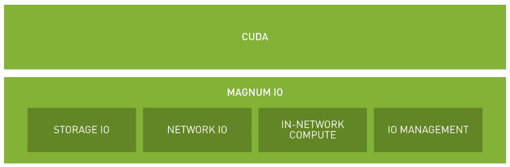
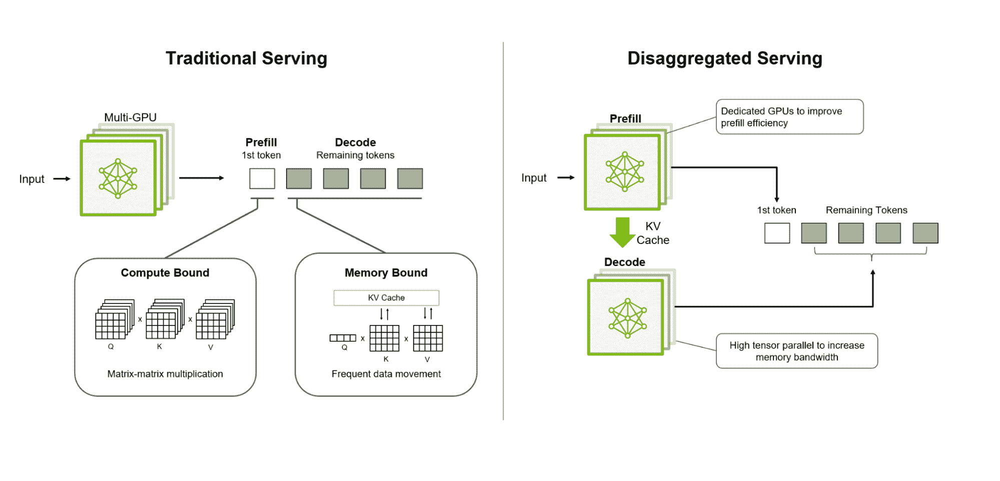
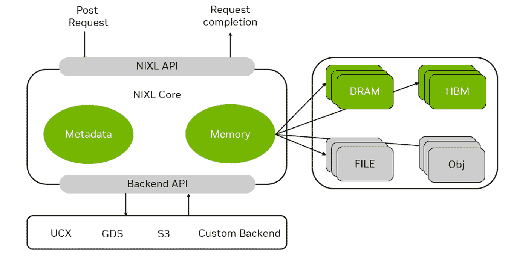

# 第 4 章 分布式通信与 I/O 优化

在当今高性能 AI 领域，GPU、存储和网络接口之间无缝且高效的数据移动需求比以往任何时候都更为关键。第四章深入探讨了最先进的分布式通信库，如 RDMA、NCCL，以及较新的用于推理的 NIXL。

本章重点阐述存储和网络系统如何充当数据与计算之间的关键纽带。在大型系统中，即使最快的 GPU 也可能因内存和磁盘的低效通信与数据传输而受到阻碍。因此，我们讨论了加速顺序数据传输、合理数据分片，以及允许 GPU 将通信与计算重叠并直接与快速存储子系统协同工作的高级技术。

我们将讨论使用 Nvidia 的 I/O 加速平台 [Magnum IO](https://www.nvidia.com/en-us/data-center/magnum-io/) 的组件（包括 NCCL、NIXL、GPUDirect RDMA 和 GPUDirect Storage）来重叠通信与计算的重要性。然后我们将探讨如何使用这些库来降低通信延迟、减少 CPU 开销，并在多节点、多 GPU AI 系统的各层中最大化吞吐量。通过利用 NVLink、InfiniBand 甚至高带宽以太网等高速互连，这些底层库使 PyTorch 等高级 AI 框架能够有效地重叠计算和通信。

无论您是训练非常大的模型，还是将分布式推理扩展到数百万用户，将这些技术集成到您的 AI 系统都代表了一种加速通信和数据管道的整体方法——确保每个组件都为峰值性能而调优。性能工程师需要仔细配置和调整网络与存储配置，以保持高水平的 GPU 利用率和有效吞吐量。

## 重叠通信与计算

重叠通信与计算在构建大规模高效训练和推理 AI 系统中起着关键作用。在这些环境中，重要的是保持 GPU 忙碌，减少等待数据的时间。主要思想是确保数据传输与正在进行的计算同时发生，这样当一个任务完成时，下一阶段所需的结果已经在进行中或已送达。PyTorch 等 AI 框架支持这些异步操作，例如，all-reduce 通信操作可以与计算任务并行运行。这减少了 GPU 空闲时间，提高了整体系统吞吐量。

基于 CUDA 的库利用多个 CUDA 流的能力。当一个流执行计算密集的矩阵乘法时，另一个流处理聚合梯度等通信任务。随着神经网络的每一层完成计算，之前的输出已经在传输途中用于聚合或进一步处理。这种重叠确保系统在没有不必要等待的情况下产生结果，并保持稳定高效的数据流。

增加通信事件之间执行的计算量进一步最小化通信开销。当系统处理更大的数据批次时，它在需要停下来交换信息之前执行更多的计算。在分布式训练中，这种方法表现为梯度累积，其中来自几个小批量的更新合并为单个同步步骤。通过降低通信事件的频率，系统降低了每次数据交换的相对成本，并提高了整体响应能力。

支持计算与通信无缝重叠的另一种技术是压缩。压缩减少了需要传输的数据量。当模型在发送梯度之前压缩梯度时，网络移动的数据量更小。这减少了传输时间并缓解了拥塞。更短的传输时间意味着通信阶段对计算阶段的干扰更小。虽然压缩并不直接发起重叠，但它缩短了数据在网络中移动的时间窗口，并允许计算工作更有效地并行继续。

将大型张量拆分为更小的桶进一步优化了计算与数据传输之间的平衡。像 PyTorch 这样的框架自动将大的梯度或激活分割成多个桶，这些桶在可用时立即传输。这意味着不必等待整个数据集准备好，部分数据可以立即开始传输。通过调整桶大小并适当调度这些传输，可以实现一定程度的重叠，有助于防止通信延迟阻塞计算流水线。PyTorch Profiler 和 NVIDIA Nsight Systems 等性能工具提供了洞察，使工程师能够动态调整这些参数。

通过将更大的批大小、梯度累积、异步传输、压缩和分桶组合成一个统一的策略，大型分布式 AI 模型克服了网络限制并减少了冗余传输。这种设计最小化了同步事件，同时实现了高吞吐量和最佳的 GPU 利用率。结果是一个训练系统，不仅减少了整体训练和推理时间，而且更有效地利用可用的硬件资源。这使工程师不必重新发明低层网络例程，而是专注于创新模型架构和调整高层参数，而不是编写复杂的数据传输机制。

## NVIDIA Magnum IO 优化栈

NVIDIA 的总体 I/O 加速平台称为[Magnum IO](https://www.nvidia.com/en-us/data-center/magnum-io/)。Magnum IO 汇集了一系列技术，以加速跨 GPU、CPU、存储和网络接口的数据移动、访问和管理。Magnum IO 架构有四个关键组件，包括存储 I/O、网络 I/O、网络内计算和 I/O 管理，如图 4-1 所示。



**图 4-1. NVIDIA Magnum IO 加速平台的四个组件**

第一个组件是网络 I/O。该组件包括[GPUDirect RDMA](https://network.nvidia.com/products/GPUDirect-RDMA/)、[NCCL](https://developer.nvidia.com/nccl)、[NVSHMEM](https://developer.nvidia.com/nvshmem)、UCX 和[HPC-X](https://developer.nvidia.com/networking/hpc-x)等技术，以实现跨节点的 GPU 之间的直接高速数据传输，绕过 CPU。

第二个组件，存储 I/O，由 NVIDIA [GPUDirect Storage](https://developer.nvidia.com/gpudirect-storage)（GDS）和[BlueField SNAP](https://docs.nvidia.com/networking/display/bluefielddpuosv470/bluefield+snap)（软件定义网络加速处理）代表。这些技术允许 GPU 直接从 NVMe SSD 等设备访问存储数据，而无需执行到主机系统内存的不必要复制。

第三个组件，网络内计算，包括专用设备，如 NVIDIA [BlueField DPU](https://www.nvidia.com/en-us/networking/products/data-processing-unit/)和协议，如[NVIDIA SHARP](https://developer.nvidia.com/blog/advancing-performance-with-nvidia-sharp-in-network-computing/)，用于在网络本身内执行数据聚合和归约。这降低了大规模集合操作（如 all-reduce）的延迟。

最后，I/O 管理包括 NVIDIA [NetQ](https://www.nvidia.com/en-us/networking/ethernet-switching/netq/)和 NVIDIA [Unified Fabric Manager](https://www.nvidia.com/en-us/networking/infiniband/ufm/)（UFM）等平台。这些技术提供实时遥测、诊断和数据中心 I/O 结构的生命周期管理。

这些组件通过灵活的 API 和可扩展的 SDK 协同工作，这些 API 和 SDK 隐藏了底层细节的复杂性。它们有助于为大规模 AI 和分析工作负载最大化性能和可扩展性。让我们深入研究其中几个组件，并演示如何分析和调优它们。

## 利用 RDMA 实现高速、低开销的数据传输

远程直接内存访问（RDMA）是一种针对低延迟、高吞吐量数据传输进行优化的技术，它允许组件之间直接进行内存到内存的数据传输，而无需为每个数据包传输使用 CPU。RDMA 绕过了传统网络堆栈的大部分，并确保 CPU 线程亲和性，以减少传输完成中断的开销。它还使通信与计算重叠，支持分布式文件系统，并持续监控 GPU 和网络。建议尽可能使用 RDMA。

NVIDIA 的 RDMA 实现称为 GPUDirect RDMA，它允许 GPU 通过 InfiniBand 或 RoCE 等支持 RDMA 的网络直接与远程设备（如其他 GPU）交换数据，绕过 CPU 进行数据传输。这最大限度地减少了多节点环境中的延迟和 CPU 开销。

现代 InfiniBand 硬件本质上支持 RDMA，一些实现 RoCE（融合以太网上的 RDMA）的高速以太网硬件也支持。RoCE 是一种基于以太网构建的 InfiniBand 风格的 RDMA 技术。InfiniBand 必须正确配置，并安装所有必需的驱动程序。

使用 RDMA 与使用基于标准 TCP 的以太网（不带 RDMA）之间的性能差异可能非常巨大。例如，InfiniBand 可能提供 <10 微秒的延迟和高吞吐量，而标准 TCP 的延迟可能高出 5-10 倍。不过，对于大型 all-reduce 操作而言，吞吐量比延迟更重要。在高吞吐量网络中，即使每条消息开始传输所需的时间稍长（更高的延迟），只要网络能够维持较高的数据传输速率，操作仍然会很快完成。相反，如果网络延迟很低，但传输数据的吞吐能力有限，大型 all-reduce 的整体性能就会受到影响。

如果你只有以太网，请尽量确保其带宽尽可能高——至少 100 Gbit/s。同时，确保你的以太网网络协议栈经过调优，使用如 9000 字节这样的大型 MTU 巨型帧，这样你发送的是更少的大数据包，而不是许多小数据包。这与大文件与小文件的直觉相同。更少、更大的数据包比更多、更小的数据包产生的开销更少。最后，确保你的 TCP 缓冲区大小足够大，以便系统能容纳大量在途数据。


要调优基于以太网的网络，你可以使用 Linux 网络 `/etc/sysctl.conf` 参数：`net.core.rmem_max`、`net.core.wmem_max` 用于设置最大缓冲区大小，`net.ipv4.tcp_rmem`/`tcp_wmem` 用于设置默认值和自动调优范围。对于 100 Gbit/s 的链路，你可以将最大缓冲区设置为几 MB 以充分利用它。此外，使用像 BBR 这样的现代 TCP 拥塞算法可以改善高延迟带宽网络上的吞吐量，但如果这是一个受控、专用且受管制的集群网络，默认的 [CUBIC](https://en.wikipedia.org/wiki/CUBIC_TCP) TCP 拥塞控制算法通常就足够了，因为网络条件通常是可预测的，网络在设计上就避免了拥塞。

> **提示：** 要在 AWS 等云环境中创建受控的集群网络，你的本地数据中心需要使用 AWS Direct Connect 与 AWS 建立专用、受管制的链路。但是，如果你的本地数据中心与 AWS 之间的连接以任何方式通过公共互联网传输，那么由于拥塞多变且网络条件不可预测，这通常不能被称为受控的集群网络。

尽管 RDMA 可以在不占用 CPU 拷贝数据的情况下移动数据，但 CPU 仍然扮演着关键角色。CPU 负责建立 RDMA 连接、发起传输、处理完成中断，并管理控制路径。因此，你应确保网络中断和线程被绑定到与你的 InfiniBand 主机通道适配器（HCA）相同的 NUMA 节点上的 CPU。例如，如果一个 InfiniBand HCA 位于 NUMA 节点 0，你希望它的中断由运行在连接到同一 NUMA 节点 0 的 CPU 核心上的线程处理，以减少延迟并提高整体效率。

## 用于分布式多 GPU 通信的 NCCL

Nvidia 集体通信库（NCCL - 发音为“nickel”）是一个面向一组（即一个集合）GPU 的多对多通信库。它是大多数分布式训练和推理工作负载的基础。该库充当 GPU 组之间协调数据通信交换的骨干。当在多个 GPU、计算节点、机架和集群之间执行模型训练和推理时，需要尽可能快地交换数据，以让 GPU 持续忙于有用的工作。

在模型训练期间，每个 GPU 在反向传播过程中针对自己的数据块计算梯度。然后系统执行一次 all-reduce 通信操作，以聚合所有 GPU 的梯度。

在模型推理期间，随着请求在网络中移动，GPU 会在前向传播过程中交换激活值。这种交换使用发送和接收通信操作。所有这些通信操作都在 NCCL 中实现。

### NCCL 中的拓扑感知

拓扑感知在 NCCL 中也扮演着重要角色。NCCL 会检测 GPU 之间的物理连接方式，并相应地调整其通信模式。在像 GB200 NVL72 这样具有相对扁平、高速互连的系统中，每个 GPU 都可以直接与其它 GPU 以最高速度通信。在更碎片化的系统中，NCCL 会自动将设备分组为更小的集群，其中繁重的工作在通过快速链路连接的 GPU 上完成。这减少了通过较慢连接进行的通信量。

NCCL 会自动选择可用的更快互连——无论是 PCIe、NVLink 还是 InfiniBand——然后为数据选择最佳算法和路由。如果网络硬件支持 RDMA，NCCL 会自动使用 RDMA。这使开发者无需微观管理通信交换的每个细节。

如果你的 GPU 之间拥有非常快的互连，例如计算节点内 GPU 之间的 NVLink/NVSwitch，或不同计算节点 GPU 之间的 InfiniBand，那么通信成本非常低。但通常情况下，尤其是基于以太网的集群，网络可能会拖慢速度。

### NCCL 通信策略

NCCL 提供了多种通信技术，以便在分布式操作期间在 GPU 之间高效地交换数据。这些方法被称为 NCCL 环形（ring）、树形（tree）、集合网络（CollNet）和并行聚合树（PAT）算法。

环形方法将 GPU 排列成一个环形，每个 GPU 将小块数据段传递给下一个 GPU。在这种配置中，随着数据在环中传递，每个设备逐渐累积集合结果的一部分。每个 GPU 将小块数据发送给其邻居，直到完整结果在环中循环一圈。这种方法在许多设备上表现稳定，并且在处理通信成本相对均匀的环境中管理大消息时表现出色。

树形策略将 GPU 组织成层次化的树状结构。在这种方法中，GPU 两两配对，将数据合并为部分结果，然后在树的上层进一步合并。该策略允许跨层级同时合并数据，从而减少通信步骤的数量。递归倍增遵循类似的思路，在连续多轮中反复在两两配对的 GPU 之间交换数据。在每一轮中，有效组大小翻倍，直到完整数据集到达每个 GPU。这个过程尤其有利于设备数量为 2 的幂次的集群，因为它最大限度地减少了所需的阶段数。

CollNet 代表了一种更高级的策略。它利用 GPU 之间专用的高速互连来形成一个集合网络。其思路是将 GPU 划分为多个较小的树，这些树同时聚合数据，从而使通信工作负载更均匀地分布，并减少缓冲需求。这种方法最大限度地减少了通信阶段的数量，在大型集群中尤其有效，可以从几个 GPU 优雅地扩展到数千个 GPU。

最近，[并行聚合树](https://developer.nvidia.com/blog/new-scaling-algorithm-and-initialization-with-nvidia-collective-communications-library-2-23)（PAT）策略已成为一种在大型集群中提高可扩展性和负载均衡的方法。PAT 扩展了树形方法，将 GPU 组织为多个并行运行的较小树状结构，以更好地利用可用的互连带宽。每个树并行聚合自己那部分数据，所有树的部分结果在最终合并中组合在一起。这种并发聚合最大限度地减少了缓冲需求，并均匀地分散了通信负载，最终降低了延迟并提高了吞吐量。

系统还可以在自动模式下运行，NCCL 会根据拓扑、消息大小和系统条件动态选择最优策略。通过这种方式，NCCL 确保每个 GPU 都能以高效的方式进行通信，从而在集合操作期间最大化吞吐量并最小化延迟。

在实践中，像 `NCCL_ALGO` 这样的环境变量允许你强制指定特定算法，例如 `Ring`、`Tree`、`CollNet` 或 `PAT`。NCCL 会继续完善这些选项，以适应不同的工作负载和系统架构。

### NCCL 性能分析与调试

要对 NCCL 进行调试，可以使用 [NCCL Profiler Plugin API](https://developer.nvidia.com/blog/new-scaling-algorithm-and-initialization-with-nvidia-collective-communications-library-2-23/#new_profiler_plugin_api%C2%A0) 来监控 GPU 通信的内部时间线，并定位系统中的任何落后设备或瓶颈。NCCL Profiler Plugin API 旨在解决那些随着 GPU 集群规模扩大而越来越难以诊断的性能问题。

NVIDIA 创建了这个灵活的 API，以简化第三方性能分析工具（例如 [PyTorch Kineto](https://github.com/pytorch/kineto)）与 NCCL 的集成，并确保在运行时以清晰、分层且低开销的方式监控和捕获复杂的通信活动。`NCCL_PROFILER_PLUGIN` 环境变量以类似于其他 NCCL 插件的方式控制此插件的加载和初始化。

加载后，NCCL Profiler Plugin 会配置一个事件激活掩码，这是一个 32 位整数，其中每一位对应一个不同的 NCCL 事件，如组事件、集合事件、点对点事件以及各种与代理相关的操作。这种结构创建了自然的事件层次结构，有助于以有意义的方式呈现详细的性能信息并快速定位问题。

NCCL Profile Plugin API 定义了五个函数回调。`init` 回调通过提供不透明的上下文并确定应分析哪些事件来设置插件。`startEvent` 回调从 NCCL 接收事件描述符并分配一个新的事件对象，返回一个 NCCL 用于后续操作的不透明句柄。`stopEvent` 回调标记事件完成，以便回收其资源。`recordEventState` 回调允许插件在事件经历不同状态时更新事件。`finalize` 回调在分析完成后释放与分析器上下文关联的所有资源。

### NCCL 性能调优

NVIDIA 的集合通信库（NCCL）通过高效地处理 GPU 之间的数据交换，在分布式训练中发挥着关键作用。其中一个关键的性能方面是数据如何通过诸如节点内用户缓冲区注册等机制在 GPU 之间直接传输。

NCCL 会注册 GPU 内存，用于通过 NVLink 等高速互连甚至直接到网卡进行直接数据传输，从而避免了通过主机内存移动数据的额外开销。这种直接路径对于在 all-reduce 等操作（跨 GPU 聚合梯度）中最小化延迟和最大化吞吐量至关重要。

为了优化这些数据传输，NCCL 提供了几个环境变量，以便根据你的工作负载需求定制其行为。下面列出了一些关键的 NCCL 环境变量，它们可以让你精细控制 NCCL 的通信行为。

- `NCCL_DEBUG`：这控制 NCCL 日志记录的详细程度。将其设置为 `INFO` 或 `WARN`/`VERSION` 以对应不同级别，可以帮助你诊断性能问题，并了解 NCCL 如何选择算法和接口。在排查性能低下或意外行为时，这是一个有用的第一步。

- `NCCL_ALGO`：通过此变量，你可以强制 NCCL 使用特定的集合通信算法（例如 `Ring`、`Tree`、`CollNet` 或 `PAT`）。根据你的工作负载、网络拓扑和梯度大小，某一种算法可能比其他算法表现更好。在此处进行试验有时可以带来性能一致性方面的显著改善。

- `NCCL_NTHREADS`：这控制每个 GPU 在 NCCL 网络操作中使用的 CPU 线程数。如果你发现 CPU 资源未被充分利用，增加 `NCCL_NTHREADS` 可以允许更并发地处理网络任务，从而提高整体网络链路利用率。在需要通信大量梯度数据的分布式训练中，分配更多线程来管理这些传输有助于减少瓶颈并提高同步速度。

- `NCCL_BUFFSIZE`：这决定了 NCCL 在 all-reduce 等通信操作期间使用的缓冲区大小。通过增加缓冲区大小，NCCL 可以在每个通信步骤中发送更大的数据块。这在聚合大型梯度时尤其有利，因为它减少了所需的通信迭代次数，从而降低了同步过程的总体开销。但是请注意，虽然更大的缓冲区可以减少操作次数，但它们也会消耗更多内存，因此在缓冲区大小和可用系统资源之间取得平衡非常重要。

- `NCCL_PROTO`：这允许你选择 NCCL 应采用的协议。例如，`LL`（低延迟）或 `Simple` 是典型的值。低延迟协议可能对较小的消息大小有利，而简单协议可能对较大的消息更有效。

- `NCCL_IB_HCA`：此设置指定 NCCL 用于通信的 InfiniBand 主机通道适配器（HCA）。在存在 RDMA 的多节点环境中，此变量允许你显式选择所需的接口，这在具有多个 IB 适配器的节点上尤其有用。

- `NCCL_IB_TIMEOUT`：使用此项可调整 InfiniBand 操作的超时设置。默认值可能并非针对你的网络条件的最优选择，因此调整超时有助于减少在 all-reduce 操作期间通信停滞或意外超时的可能性。

- `NCCL_SOCKET_IFNAME`：对于 NCCL 回退到 TCP（或直接使用以太网）的设置，你可以指定应使用哪个网络接口。在多宿主主机上，当你希望通信通过特定的高速接口而不是无关接口进行时，这一点至关重要。

- `NCCL_LL_THRESHOLD`：这控制消息大小的阈值，低于该阈值时 NCCL 使用其低延迟（LL）协议进行通信。调整此阈值可以帮助你优化小消息的性能，确保在最重要的时候使用最快的协议。

- `NCCL_MIN_NCHANNELS` 和 `NCCL_MAX_NCHANNELS`：这些变量允许你控制 NCCL 使用的通信通道数量。合适的通道数量可以确保数据在多个 GPU 之间高效流动，尤其是在互连或网络成为限制因素时。

- `NCCL_NCCL_MAX_RINGS`：你可以使用此变量指定在集合操作（如 all-reduce）期间 NCCL 应使用的最大环数。环算法对环的数量很敏感，调整此设置有助于在聚合大型梯度时减少通信开销。

通过仔细调整这些环境变量，使其更好地匹配你的工作负载和系统拓扑的具体情况，你可以优化 NCCL 管理 GPU 间通信的方式。这可以降低同步开销，使你的训练和推理工作负载能够更有效地利用可用带宽，并确保你的 GPU 将更多时间花在实际计算上，而减少等待数据传输的时间。

最佳设置通常取决于你的具体硬件配置、数据传输量以及特定的网络环境。反复试验和性能剖析至关重要。首先使用 `NCCL_DEBUG` 启用调试，通过 `NCCL_IB_HCA` 和 `NCCL_SOCKET_IFNAME` 验证预期的互连是否按预期被使用，然后根据需要微调与吞吐量相关的变量 `NCCL_NTHREADS`、`NCCL_BUFFSIZE` 和 `NCCL_LL_THRESHOLD`。

将这些工具与其他系统级优化手段结合使用，可以带来显著的性能提升，尤其是在大规模多 GPU 和多节点环境中。如果将这些调整与调优良好的操作系统和 CPU 配置相结合，你的整体基础设施将能更好地保持 GPU 的数据供给，并使其以最高效率运行。

### 使用 NVIDIA SHARP 和 NCCL 进行网络内层次化聚合

当使用支持 NVIDIA 可扩展层次化聚合与规约协议（SHARP）的网络硬件时，还能获得额外优势，因为 SHARP 将 all-reduce 操作的部分繁重工作从 GPU 转移到了网络交换机上。网络交换机本身会在数据通过时合并梯度数据。NVIDIA 的一份[报告](https://developer.nvidia.com/blog/advancing-performance-with-nvidia-sharp-in-network-computing/)显示，在大型 AI 系统上使用 SHARP 可使 all-reduce 提速 2-5 倍。

SHARP 需要特殊的硬件、固件和驱动程序。你可以使用 `ibv_devinfo -d <device>` 并检查输出中与 SHARP 相关的内容来确认是否支持 SHARP。假设 SHARP 已启用，你的 PyTorch 应用将自动在 all-reduce 等集合操作中使用它，因为 PyTorch 使用的 NCCL 内置了对 SHARP 的支持。在需要以受控方式约束环境来排查性能问题的场景中，你也可以使用 `NCCL_SHARP_ENABLE=0` 来禁用 SHARP。

工程师可以通过诊断命令验证 SHARP 支持情况，并在需要时调整应用设置。SHARP 与 NCCL 无缝协作，进一步展示了硬件与软件如今如何携手高效管理数据移动。

### 用于加速数据传输与推理的 NIXL

NVIDIA 推理传输库（NIXL）是一个较新的通信库。NIXL 于 2025 年初发布，其设计初衷是让模型推理服务器能够通过在 GPU 之间高效传输 KV-cache 等资源来实现水平扩展。NCCL 非常适合群体通信，而 NIXL 则专为满足分布式模型推理的独特需求而设计。

对于持续生成 token 流的模型（例如 AI 助手），管理和复用 Transformer 注意力机制生成的计算密集型键值张量至关重要。具体来说，在与基于 Transformer 的模型对话时，发送到模型推理服务器的每个新 token 都会通过 Transformer 的注意力机制生成键/值（KV）张量。这些 KV 张量在生成响应的新 token 时会被复用。因此，我们使用 KV-Cache，它需要在分布式推理集群中的不同 GPU 和计算节点之间共享。

#### Prefill 与解码推理阶段

基于 Transformer 的模型的推理路径实际上分为两个不同的阶段。第一阶段通常是计算受限的，因为它使用大量矩阵乘法从传入的请求数据（即“提示词”）构建 KV-cache。第二阶段通常是内存吞吐受限的，因为它需要从 GPU HBM 内存中收集模型权重，以计算下一组 token（即“补全”或“响应”）。在许多先进的高性能推理系统（如 NVIDIA Dynamo 和 vLLM）中，这两个阶段运行在不同的 GPU 或计算节点上，如图 4-2 所示。



*图 4-2. 分离式服务将 prefill 和解码阶段分配到不同的 GPU 上*

一组 GPU 负责填充 KV-cache，而另一组则负责生成最终响应。在这种情况下，KV-cache（在长提示词中可能达到数十 GB）必须实时无缝地从一台处理单元移动到另一台处理单元。

传统方法通过 CPU 内存甚至存储来传递数据，无法满足所需的速率和低延迟体验。NVIDIA 在 2025 年初创建了 NIXL 来应对这一场景。我们真正想要的是直接的、高带宽的 GPU 到 GPU 传输（跨越计算节点和机架），并且让数据传输与计算重叠进行。这样，专注于解码的 Stage 2 GPU 在从专注于 prefill 的 Stage 1 GPU 接收下一组输入 token 的 KV-Cache 时，就可以开始计算下一个 token。

NIXL 提供了一条直接通道，用于将数据从一块 GPU 传输到另一块 GPU 或一小群 GPU，可跨越计算节点甚至机架。系统会查看所有可用路径，并始终选择最快到达目的地的路径。无论数据是通过服务器内的 NVLink、机架内的 NVSwitch、机器间的 InfiniBand 传输，还是按需使用 NVMe 存储，NIXL 都会自动选择最快的通道。

#### 用于高效数据传输的 NIXL 核心 API

开发人员通过一个非常直接的 API 与 NIXL 交互。他们只需提交一个包含数据指针和目标标签的请求，其余工作由库完成。例如，NIXL 可以接受将 KV-Cache 数据发送到多种目标地址的请求，如图 4-3 所示。




# 图 4-3. NVIDIA 推理传输引擎（NIXL）架构

来源：[`developer.nvidia.com/blog/introducing-nvidia-dynamo-a-low-latency-distributed-inference-framework-for-scaling-reasoning-ai-models/`](https://developer.nvidia.com/blog/introducing-nvidia-dynamo-a-low-latency-distributed-inference-framework-for-scaling-reasoning-ai-models/)

`NIXL` 核心负责管理元数据和内存缓冲区。`NIXL` 后端 API 与各种传输后端（如 `UCX`、`GPUDirect Storage`、`S3` 或自定义后端）对接。`NIXL` 可以高效地在不同层之间移动数据，例如 GPU HBM、CPU 内存（DRAM）、文件存储（NVMe SSD）和对象存储。`NIXL` API 抽象了在分布式推理环境中跨异构内存和存储设备传输数据的复杂性。

`NIXL` 会为每次数据传输选择最高效的路径，并尽可能使用零拷贝传输以避免不必要的复制步骤。例如，`NIXL` 避免将数据复制到主机 CPU 内存中的反弹缓冲区。

该库还提供通知和回调，让你的代码知道传输何时完成。通知和回调对于与计算同步至关重要，因为如果数据尚未到达，你不会希望开始使用它。

需要重点指出的是，`NIXL` 是对 `NCCL` 的补充，而非替代。当一大组 GPU 需要紧密协作以完成诸如并行运行巨型模型时的同步等任务时，`NCCL` 仍扮演着关键角色。`NCCL` 负责协调群体通信，而 `NIXL` 专注于将大量数据从一块 GPU 发送到另一块 GPU，或在需要时发送到存储。

## NIXL 内部依赖

在底层，`NIXL` 使用 Nvidia 的 [Unified Communication X](https://docs.nvidia.com/doca/sdk/doca+ucx/index.html)（`UCX`）。`UCX` 是一个专为高性能点对点通信设计的框架。它提供了抽象的通信原语，使应用程序能够充分利用先进的硬件特性，包括主动消息、带标签的发送和接收操作、远程内存读写、原子操作以及各种同步例程。`UCX` 支持多种硬件类型，例如 InfiniBand 和 RoCE 提供的 RDMA、TCP 网络、GPU 和共享内存。

`UCX` 框架通过提供隐藏底层细节的高级应用程序编程接口来加速开发，同时仍然提供卓越的性能和可扩展性。它基于从大型数据中心和超级计算机上运行的应用中学到的行业最佳实践，并能高效处理各种大小的消息。

`NIXL` 还使用 `GPUDirect RDMA` 和一种称为 [InfiniBand GPU Direct Async](https://developer.nvidia.com/blog/improving-network-performance-of-hpc-systems-using-nvidia-magnum-io-nvshmem-and-gpudirect-async/)（`IBGDA`）的技术，让 GPU 无需等待 CPU 介入即可启动数据传输。在较早的系统中，即使数据通过 RDMA 传输，中央处理器也需要协调传输。`NIXL` 突破了这一瓶颈，使 GPU 可以直接将数据块发送到另一个 GPU。

一旦阶段 1 中的 GPU 将 KV-cache 写入其 GPU HBM，数据就会立即通过网络资源发送到目标 GPU。如果目标 GPU 正忙于阶段 2 并计算解码响应，它将在后台接收 KV-cache，从而高效地重叠计算和通信。`NIXL` 还支持不将数据排列在连续块中的传输。它也能处理分散的数据。

### 使用 NIXL 进行 KV-Cache 卸载

`NIXL` 的优势在于它不仅能管理 GPU 内存，还能管理其他数据。如果您的应用程序需要将数据从 GPU 内存溢出到 CPU 或 NVMe 驱动器，`NIXL` 仍然可以高效地处理这些传输。它与 NVIDIA 的 [GPUDirect Storage](https://docs.nvidia.com/gpudirect-storage/overview-guide/index.html)（`GDS`）集成，后者通过直接与 GPU 内存交互，为读写 NVMe 驱动器提供了一条优化的路径。

> **提示**
>
> `GPUDirect Storage` 与 `GPUDirect RDMA` 的作用类似，关键区别在于它是为加速磁盘 I/O 而设计，而非直接的 GPU 到 GPU 通信。

你可以把 `NIXL` 视为一个统一的数据访问层。无论你的数据当前位于何处（例如 GPU、CPU、磁盘），或者需要传输到哪里，你都可以使用相同的 `NIXL` API，它将选择最快的可用路径来读写你的数据。

这为基于 NVMe 的 KV cache 卸载铺平了道路，使系统能够在不需要时自动将 KV-Cache 溢出到 NVMe 存储，并在需要时将其流式读回。如果对话或会话进入空闲状态，其上下文可以暂存在 SSD 上，以释放 GPU 内存供其他任务使用，之后 `NIXL` 可以将其取回。

基于 NVMe 的 KV-caching 扩展了可用于服务模型的有效内存，因为你可以通过使用磁盘作为溢出来支持更长的对话或更多的并发会话。当对话或会话暂停时，上下文安全地存放在快速存储上，为其他任务释放宝贵的内存。

当然，访问 NVMe 比 HBM 慢得多，但通过巧妙的重叠、现代 SSD 的巨大带宽以及 `GPUDirect Storage` 直接读入 GPU 内存的能力，部分基于 NVMe 的 KV-cache 卸载延迟可以隐藏在计算背后。

### NIXL 与 NVIDIA Dynamo 等高性能推理系统

`NIXL` 对性能的影响对于 NVIDIA Dynamo 等分布式推理系统来说是巨大的，Dynamo 也于 2025 年初发布。NVIDIA 已经[证明](https://developer.nvidia.com/blog/introducing-nvidia-dynamo-a-low-latency-distributed-inference-framework-for-scaling-reasoning-ai-models/#:~:text=match%20at%20L169%20DeepSeek,model%20on%20NVIDIA%20GB200%20NVL72)，与不重叠传输或使用较慢方法的朴素实现相比，使用 Dynamo 和 `NIXL` 可以将多节点 LLM 推理吞吐量提升高达 30 倍。

曾经是一个主要延迟障碍的问题——在节点之间传输数十 GB 的上下文数据——在 `NIXL` 下变成了一个相对快速、异步的操作。我们将在第 9 章深入介绍 Nvidia Dynamo、TensorRT、vLLM 以及各自的模型推理优化。

## 存储 I/O 优化

在深度学习训练中，向 GPU 提供数据与计算本身同等重要。考虑一个在数百个 GPU 上训练的 100 万亿参数模型。虽然计算能力巨大，但如果数据不能及时准备好，计算就会停滞。存储和网络的读写都可能成为瓶颈。当从磁盘向 GPU 流式传输大型数据集时，单个训练进程可能每秒读取数百兆字节或数 GB 的数据。如果存储子系统跟不上，GPU 将会因等待数据而停滞。这会降低系统的整体有效吞吐量。

大型 GPU 集群受益于使用高性能存储解决方案，例如并行文件系统（如 Lustre 或 GPFS）、高速网络附加存储（NAS），或每个计算节点中用于缓存数据的本地 NVMe SSD。随着 GPU 速度越来越快，对数据管道的需求也在增加。在这里，我们将讨论如何优化存储、数据加载和网络使用，以保持 GPU 持续有数据可用。本节涵盖使用更快的存储硬件、预取和缓存数据、读取少量大文件与大量小文件、使用 `GPUDirect Storage`、重叠计算和通信，以及为大规模分布式训练和推理集群调整网络设置。

### 快速存储与数据局部性

大型模型训练任务通常需要读取海量数据集。例如，常见的有数十亿和数万亿的文本 token、数十亿张图片、数十万小时的音频等。如果你试图从单个机械硬盘流式读取这些数据，你会浪费大量金钱，因为你的 GPU 将因数据不足而饥饿，机械硬盘无法足够快地流式传输数据。这就是为什么大多数严肃的 AI 系统会使用并行存储系统或大型、快速的本地固态硬盘（SSD）。

像 Lustre 这样的并行文件系统会将数据条带化到许多服务器和磁盘上，因此你可以获得每秒数 GB 的聚合读取吞吐量。云端类似方案是构建在 Amazon S3 之上的 Amazon FSx for Lustre。然而，在很多情况下，从业者通常会在本地暂存数据，即将数据从 Amazon S3 复制到本地 SSD 以获得性能。不过，AWS 推荐的方法是使用 Amazon FSx for Lustre。另外，如果你使用类似网络文件系统（NFS）的方案，你可能会在集群中运行多个 NFS 服务器——每个服务器提供一部分数据。AWS 云上的对应方案是 Amazon 的 Elastic File System（EFS）。

一个不错的策略是在每个节点上预加载和缓存数据。如果每个节点都有快速的 NVMe SSD，你可以在训练开始前将一部分数据集复制到其中。假设你有 100 TB 数据和 100 个节点——每个节点在本地获取 1 TB 的数据分片。以 5-6 GB/s 的速度（顺序读取，而非随机读取）从 NVMe 磁盘读取，将比通过网络从远程存储读取更快、更稳定。即使你无法将所有分片数据都放入本地 NVMe，你也可以逐批次缓存。在这种情况下，你会在后台加载下一批次的数据分片。有些团队会使用在训练任务之前运行的数据暂存作业。这个数据暂存作业负责对数据进行分片并分发到集群中的各个节点。

当使用共享文件系统时，数据不容易拆分。你可以启用 Linux 的页缓存（page cache）来自动将文件内容缓存到 RAM 中——前提是你的数据集能放进 RAM。在这种情况下，数据会被缓存，后续的 epoch 读取数据会快得多——无需从 NVMe 磁盘读取。如果数据集无法完全放入 RAM，对于能放入的部分你仍然会获得性能提升。还有一些用户空间缓存解决方案，比如 Linux 的 `fscache`，它可以帮助缓存共享文件系统中经常访问的文件。

### 顺序读与随机读模式

GPU 作为大规模并行处理器，更喜欢大块的数据。幸运的是，读取少量大文件比读取大量小文件更高效，因为每次读取都会产生系统调用（syscalls）、磁盘寻道时间（虽然对 SSD 来说很低）等开销。因此，如果你的数据集由数百万个小文件组成，你应该考虑将它们打包成更大的文件。事实上，这也是 TensorFlow 引入 TFRecord 文件格式的原因之一。

使用 TFRecord，可以将许多小文件（通常是文本格式）合并成几个大文件（二进制格式）。PyTorch 并不强制使用某种格式，但你可以使用类似 Parquet 格式——甚至只是普通的 numpy 文件——来打包数据。其思路是进行更少数量的大的顺序读取——并避免随机读取。例如，如果你能顺序读取 1 GB 的数据，任何像样的 SSD 都能在毫秒内完成。但如果你在这里随机读一个 1 KB 文件，在那里随机读另一个 1 KB 文件，你就会受到过多 I/O 延迟的瓶颈限制。

另一个技巧是使用并行和异步读取。大多数操作系统和语言允许你一次发出多个读取请求。如果你有 8 个 CPU 核心负责数据加载，那么每个核心可以并行读取不同的文件。你的存储系统能够处理的并行请求越多，你获得的吞吐量就越大——前提是 CPU 与存储系统（NVMe 本地磁盘、远程共享文件系统等）之间的链路能够支持来自并行数据加载器的整体吞吐量。

在 Python 中，使用带有 `num_workers > 0` 的 `DataLoader` 会通过跨更多 CPU 派生更多 worker 数据加载进程来实现并行读取。在后台，操作系统会让磁盘尽可能保持忙碌。现代 NVMe 驱动器有多个队列，可以处理许多并发请求。

如果你的访问模式主要是流式读取，请考虑增加块设备的预读（read-ahead）设置，因为这会让操作系统预读比请求更多的数据，以应对后续的顺序读取。你可以通过在设备上使用 `blockdev --setra <kilobytes>` 或向 `/sys/block/<device>/queue/read_ahead_kb` 写入千字节数来配置预读设置。

预读有助于隐藏重复顺序读取的延迟。如果你的数据加载器从磁盘请求 4 MB 数据，操作系统实际上可能会获取 8 MB 数据，因为它知道你很可能很快就会请求接下来的 4 MB。

在某些场景下，使用内存映射文件（`mmap`）也可能很高效。`mmap` 将文件映射到进程的地址空间，使文件 I/O 由操作系统的虚拟到物理内存映射子系统管理。这很高效，因为它让操作系统按需将数据加载到 OS 页缓存中。

当 `mmap` 配合大页（huge pages）使用时，虚拟到物理地址转换的性能会受益于更大的页面大小，以及维护转换映射数据的 TLB 带来的更少缓存未命中。这减少了开销，并提高了顺序和可预测访问模式（如将数据集加载到训练任务中）的性能。

### 调优 NVMe 和文件系统

现代 Linux 系统使用一个名为 `blk-mq` 的多队列框架来高效地调度和分发 I/O 请求到多个硬件队列。当你使用 NVMe SSD 时，这些设备已经带有高度优化的固件级调度。因此，为了避免 OS 在固件级调度之上产生额外的调度开销，你可以选择将操作系统 I/O 调度器设置为更简单的类型，例如 `noop` 或 `mq-deadline`。

这种配置意味着 `blk-mq` 多队列框架继续管理请求的分布，但它使用一个更简单的 `noop` 调度器，基本上将请求直接传递给 NVMe 固件调度器来分发 I/O 请求。

另外，请确保 NVMe 驱动程序使用所有可用的队列——默认情况下应该如此。这将最大化 I/O 吞吐量。如果你在虚拟环境中，请确保 `virtio` 驱动程序是最新的，以确保最佳的 I/O 性能。

像 XFS 和 EXT4 这样的文件系统很常见，两者都应该进行调优。XFS 通常被推荐用于多核系统上的并行吞吐量。确保挂载选项不会引入开销。例如，你可能希望禁用 `atime`（访问时间），并在不需要这些信息时避免写入额外的元数据。

### 使用 GPUDirect Storage（GDS）

`GDS` 是一个相对较新的功能，它允许 GPU 直接从存储或网络拉取数据，而无需通过 CPU 来复制数据。通常，从磁盘读取的数据会通过页缓存或你提供的缓冲区进入 CPU 内存。然后你需要将该缓冲区复制到固定（不可分页）的 CPU 内存缓冲区。只有这样，GPU 的直接内存访问（DMA）引擎才能将该固定的 CPU 内存缓冲区拉入其 GPU 内存。

使用 `GDS` 后，GPU 的 DMA 引擎可以直接从存储设备发起读取，将数据读入 GPU 内存。使用 `GDS` 将数据读入 GPU 内存，跳过了经过 CPU 内存缓冲区的额外中转。`GDS` 的明显好处是减少了 CPU 使用率，因为 CPU 不管理这些数据传输——也不会以任何方式接触数据。它还可以略微降低延迟。

然而，在实践中，并非所有的存储栈都已为 `GDS` 做好准备，因为 `GDS` 需要特殊的硬件、软件和驱动程序。不过，许多现代高端 NVMe 驱动器和 RAID 控制器现在都支持 `GDS`。在编程上，你可以通过 NVIDIA 的 `cuFile` 库来使用 `GDS`，使用 `cuFileRead` 读取文件，直接将数据检索到 GPU 的内存缓冲区中。

来自 VAST Data 的[报告](https://www.vastdata.com/blog/to-infinity-and-beyond-ai-gpudirect-storage-is-happening#:~:text=,the%20client%20by%20nearly%209X)显示，在特定 AI 工作负载上使用 `GDS` 可使读取吞吐量提升 20%。在他们的实验中，他们展示了仅使用单个 GPU 的 `GDS` 就能使 100Gb/s 网络链路饱和，获得额外 20% 的吞吐量，并大幅降低 CPU 使用率。随着 `GDS` 日益成熟并变得更加标准化，更多的训练流水线将采用它——尤其是在处理超高数据加载速率时，此前 CPU 曾是 I/O 的瓶颈。

重要的是要认识到，某些工作负载在 I/O 期间并不受 CPU 瓶颈限制。它们通常受磁盘的 I/O 吞吐量限制。如果你有多个 GPU 各自从 NVMe 进行随机小读取，`GDS` 通常会大放异彩。GPU 可以并行进行这些随机读取，而 CPU 不会因为处理每个小读取通常产生的所有中断而成为瓶颈。

即使没有 `GDS`，关键原则依然存在：将 I/O 与计算重叠始终是理想的。当 GPU 正在处理一个批次时，你的代码应该已经在读取和解压缩下一个批次以发送给 GPU。这样，当 GPU 准备好接收下一个输入时，数据已经准备好并位于 GPU 内存中。否则，如果 GPU 完成计算后不得不等待数据转换和加载，这会在你的数据流水线中产生一个需要消除的气泡。

### 分布式和并行文件系统

接下来，让我们从网络与通信的角度来考虑分布式文件系统。当所有计算节点都从单一存储服务器读取数据时，该服务器就会成为瓶颈，因为它的资源（尤其是文件访问相关的资源）会不堪重负。为了缓解这一问题，最好的做法是将数据分区（或分片）到多个存储节点上，这样每个计算节点只读取其指定的数据子集。

将数据分片到多个存储节点可以减轻任何一个单一存储节点的负载——前提是数据分布均匀，且没有任何特定分片会成为“热点”。在这种情况下，包含热点的存储节点可能会过载，你又回到了最初单存储节点性能瓶颈的老问题上——尽管定位和分析问题可能需要更长时间。

然而，如果你的数据集包含许多小文件，即使是分片良好的文件分布也可能使文件系统的元数据服务器过载。即使只是检索文件大小、权限和修改时间等简单的元数据属性，在大规模执行时也可能会集体引发性能问题。

如前文存储部分所述，解决“小文件”问题的一种常见方法是将许多小文件打包成数量更少、体积更大的文件。如果无法打包，则可能需要扩展元数据服务本身，以支持额外的元数据请求。

最终目标是实现大规模顺序读取，而并行文件系统可以高效地处理这种读取，因此监控网络以及 GPU 和 CPU 非常重要。如果你发现 GPU 在等待，请使用 `nvidia-smi dmon` 或 NIC 计数器等工具检查网络的吞吐量。确保你没有超出网络的带宽。


如果每个节点有 8 个 GPU，每个 GPU 以 1 GB/s 的速度进行梯度全归约通信，而你的网络是 100 Gbit/s（12.5 GB/s）。在这种情况下，你的通信大约只占网络总带宽的 1/12，因此你并没有超出网络带宽——当然，前提是网络上没有其他流量。

但如果每个节点有 16 个 GPU，该节点以总计 16 GB/s 的速度进行全归约通信，那么你显然超出了网络的总带宽容量。这时就应该探索压缩、累积和批处理等技术。缺点在于这些技术可能会影响模型精度。这是一个需要仔细监控、分析和调优的权衡，因为它与你的 AI 工作负载和用例密切相关。

### 监控存储 I/O 指标

在监控方面，你可以使用工具近乎实时地显示资源使用情况。例如，`iostat` 显示磁盘 I/O 吞吐量，`ifstat` 显示网络利用率，`nvidia-smi` 显示 GPU 使用情况。如果在训练的高负载阶段 GPU 使用率未接近 90-100%，请查明原因。GPU 是在等待磁盘或网络的数据吗？还是 GPU 因基于 CPU 的数据加载和预处理管道变慢而停滞？通过系统地排查存储、CPU 和网络等各个相关组件，你可以提高 GPU 利用率及整体效率。

有时快速修复就能奏效。将数据加载工作进程数量翻倍，GPU 利用率可能会从 70% 提升到 85%。或者从加载原始文本改为加载预计算的 token 张量。这样可以减轻 CPU 在 GPU 数据供给管道中执行分词的压力，从而更快地喂给 GPU。这些在优化 AI 管道时都是唾手可得的成果。

通过应用这些策略，你往往能显著提高资源利用率、性能和效率。这会直接转化为更短的训练时间、更快的推理响应以及整体成本节约。在超大规模场景下，这种节约是巨大的。

## 调优数据管道

让我们更详细地讨论数据加载和预处理。PyTorch 等深度学习框架提供了并行加载和预取批量数据的工具。

GPU 可以承担计算密集型的预处理任务，例如文本分词、多模态图像、视频和音频的转换。NVIDIA 的数据加载库通过提供优化的增强数据集管道来加速预处理。

数据集的质量同样重要，尤其是用于大语言模型（LLM）的数据集。NVIDIA 的 Nemo Curator 帮助将原始文本转化为精炼的、领域特定的数据集。该框架自动化了清理、过滤、去重和数据聚合等任务，以生成高质量的训练材料。

调优数据管道在处理需要额外关注的多类型数据时尤为重要。它让主训练循环可以专注于模型计算，而无需等待冗长的数据准备步骤。

### 高效的数据加载与预处理

将数据传输与计算重叠对于保持高吞吐量和最小化空闲时间至关重要。调整工作进程数量、预取因子和锁页内存等配置非常重要，这样你可以微调数据管道，使其匹配你的工作负载和系统配置。

配置 PyTorch 的 `DataLoader` 并设置 `num_workers` 会生成 `num_workers` 个工作进程。这些工作进程从磁盘获取数据、应用任何转换，并将数据放入队列。主进程中的训练循环从该队列获取批次。

如果 `num_workers` 设置得当，当模型处理完第 N 个批次时，第 N+1 个批次已经就绪或即将就绪。通常会将许多 CPU 核心专门用于数据加载和转换——尤其是在数据复杂的情况下。如果你有 32 个核心，可能会分配 8-16 个给加载线程。是的，这很多，但例如如果你的文本需要增强和分词，这些额外的核心很容易被充分利用。

理想的工作进程数量取决于任务和系统资源。你需要通过监控和反复调整配置，针对自己的工作负载和环境进行调优。假设你将 PyTorch 的 `num_workers` 从 2 增加到 4 再到 8 个 CPU。如果你看到 GPU 利用率上升、迭代时间下降，那就说明你在取得进展。到某个点后会进入平台期，此时继续增加 `num_workers` 不再有帮助，因为要么磁盘吞吐量已饱和，要么过度使用 CPU 开始产生收益递减。

解决这个问题的一种常见模式是使用生产者-消费者管道。生产者是在 CPU 上运行的数据加载工作进程，它们不断用准备好的批次填充 CPU 上的队列内存缓冲区。消费者是在 GPU 上运行的训练循环，它们不断从 CPU 上的该队列内存缓冲区中获取数据。

在生产者-消费者数据管道中，你可以微调预取的数据量，以便在不让系统内存过载的情况下持续为 GPU 提供输入。例如，PyTorch 的 `DataLoader` 有一个 `prefetch_factor` 参数（默认为 2），意味着每个工作进程会提前获取两个批次。使用 8 个工作进程时，最多可能提前加载 16 个批次。虽然这种方法通过提前准备数据来最小化空闲时间，但监控内存使用情况也很重要。如果批次较大或预取过于激进，你可能会消耗过多的 RAM。在使用大批次时，关注系统内存非常重要。

为了进一步提升效率，PyTorch 的 `DataLoader` 可以通过设置 `pin_memory=True` 来使用固定（页面锁定）的 CPU 内存。固定内存分配在不会被换出的固定物理区域中，这对于高性能直接内存访问（DMA）传输至关重要。使用固定内存后，GPU 到 CPU 以及 CPU 到 GPU 的传输可以异步执行。这意味着当你在一个批次上调用 `.to(device, non_blocking=True)` 时，该操作会被调度到后台流中，从而让下一次数据传输与 GPU 计算重叠进行。请看下面的 PyTorch 代码片段：

```
import torch
from torch.utils.data import DataLoader

# Create a DataLoader that prefetches 2 batches per worker into pinned CPU memory.
loader = DataLoader(
    dataset,
    batch_size=B,
    num_workers=8,
    pin_memory=True,
    prefetch_factor=2
)

for batch in loader:
    # Asynchronously copy the batch to the GPU.
    batch = batch.to(device, non_blocking=True)
    # While the copy is still happening in the background, the GPU may begin processing the current batch.
    outputs = model(batch)  # This call will block only if the copy isn't yet complete.
    # Continue with training steps...
```

在这个例子中，8 个 worker 进程中的每一个都会将数据批次预加载到固定内存中。由于主机内存是固定的，异步的 `.to(device, non_blocking=True)` 传输可以利用 DMA 进行高速数据复制。因此，当 GPU 处理当前批次（第 N 批）时，`DataLoader` 已经在并行地准备并传输下一批次（第 N+1 批）。这种重叠至关重要。如果没有固定内存，系统就需要在每次传输时临时固定内存，这会产生不必要的延迟。本质上，固定内存确保了 CPU 到 GPU 的数据传输能够更快地进行，并与 GPU 计算并发执行，从而最大化整体吞吐量。

另外，请务必考虑将数据预处理（例如文本分词）放到 CPU worker 进程中完成。将这些工作异步地卸载到 CPU 上，与运行主训练过程的 GPU 分开，意味着 GPU 不必浪费计算周期去执行这些数据预处理。新一批预处理好的数据会从 CPU 的固定内存中及时到达 GPU 的内存缓冲区，供 GPU 立即开始处理。这提高了 GPU 的利用率和有效工作（即 goodput）。

### 使用 NVIDIA DALI 库进行多模态数据处理

在某些特殊情况下，你可能希望 GPU 执行计算密集型的预处理，例如在多模态模型训练中解码图像、视频或音频。这时，GPU 可以使用 NVIDIA 的 [数据加载库](https://github.com/NVIDIA/DALI)（DALI），它提供了用于解码和增强图像、视频及音频数据输入的优化流水线。如果你注意到 CPU 在数据预处理期间成为瓶颈，那么绝对应该考虑让 GPU 来承担这些计算密集型的任务，以提升整体模型训练性能。

一般的准则是：对数据流水线进行性能分析，找出流水线中哪一部分是限制因素。如果你的 GPU 相对空闲，利用率只有 50%，并且你发现每个批次的加载时间都很长，那么很可能需要调整数据流水线。

调整数据流水线的一些选项包括：增加 `num_workers`、使用更快的磁盘/存储，以及使用更简单的数据格式。很多时候，对数据流水线做出相对较小的改动，就能让输入流水线从停滞不前变得顺畅高效。

为了提升数据流水线性能，可以考虑使用多个 worker 而不是单个 worker，启用固定内存，或者从 `CSV` 或 `JSON` 这类简单的基于文本的文件格式切换到机器友好的二进制格式。当然，使用二进制格式的缺点在于，你需要一条新的流水线（或作业）来将数据从 `CSV`/`JSON` 转换为二进制，不过这通常可以在离线状态下以批处理方式完成。

### 使用 NVIDIA NeMo Curator 框架创建高质量 LLM 数据集

NVIDIA NeMo Curator 是一个[开源](https://github.com/NVIDIA/NeMo-Curator)框架，旨在帮助你为 LLM 训练整理和准备自定义数据集。它是更广泛的 NVIDIA NeMo 框架的一部分，后者为对话式 AI 及相关应用提供端到端解决方案。[Curator](https://developer.nvidia.com/blog/curating-custom-datasets-for-llm-training-with-nvidia-nemo-curator/) 通过提供一系列功能，简化了将原始文本数据转换为高质量、领域特定数据集的过程，包括数据清洗、过滤、去重和聚合。

通过自动化这些流程，Curator 使数据科学家和开发人员能够高效地提取和精炼训练或微调 LLM 所需的数据，确保模型获得一致且相关的数据。这一能力对于希望在专业领域构建性能出色的定制语言模型的组织尤其有价值。

## 关键要点

本章的关键经验提醒我们，AI 系统的性能取决于包括软件和硬件生态系统在内的整个全栈。

- **端到端 I/O 优化至关重要。** AI 系统的性能取决于计算、存储和网络子系统的紧密集成。本章明确指出，只有当数据从存储通过网络高效地流向加速器时，强大 GPU 的优势才能得到充分发挥。每一层都应该进行调整以跟上 GPU 的步伐，包括用于本地缓存的 NVMe SSD 和用于海量数据集的并行文件系统。

- **软硬件协同设计。** 诸如 GPUDirect RDMA、NCCL、NIXL 和 SHARP 等专用 NVIDIA 库，将复杂、底层的操作封装为 API，从而支持直接的零拷贝传输。它们降低了 CPU 开销，最大限度地减少了延迟，并使系统能够利用先进的硬件特性（如网络内计算和统一数据访问层）来加速训练和推理。

- **针对多样化工作负载的定制通信策略。** 该架构利用多种通信算法（例如 ring、tree、CollNet、PAT），确保集合操作无论系统拓扑或工作负载大小如何，都具有可扩展性并得到优化。选择最佳策略将在延迟和吞吐量之间取得平衡——尤其是在大规模 GPU 同步、梯度聚合和键值缓存场景中。

- **优化的数据传输技术。** 零拷贝传输、将 CPU 线程绑定到合适的 NUMA 节点、以及让异步数据通信与计算重叠等技术，有助于保持数据持续流动。这些策略确保计算和传输并发进行，最大化整体系统效率并最大限度地减少 GPU 空闲时间。

- **统一且可扩展的 I/O 框架支持超大规模。** 统一的 API 和可扩展的 SDK 对于抽象底层硬件的复杂性非常重要。诸如 NVIDIA Magnum IO 之类的框架，集成了存储 I/O、网络 I/O、网络内计算和 I/O 管理，提供了一个能够从几张 GPU 扩展到数千张 GPU 的统一基础。

- **智能存储 I/O 流水线与数据预取。** 高效的数据流水线依赖于优化的存储解决方案和周密的缓存策略。通过高速 NVMe SSD 在本地预加载数据、使用 GPUDirect Storage 将数据直接读入 GPU 内存、以及采用并行异步文件读取，可以确保数据在需要时准确可用，而不会使计算停滞。

- **自适应网络调优以及通信与计算的重叠。**

设置合适的缓冲区大小、在可用时利用 RDMA，并调整拥塞算法（例如 CUBIC），对于发挥最大网络带宽至关重要。与此同时，通过异步传输和梯度累积等技术将通信任务与 GPU 计算重叠也很重要，这将进一步理顺数据流水线。

### 监控、性能分析和持续调优

NCCL Profiler、PyTorch Profiler、NVIDIA Nsight Systems 等工具，以及 NetQ 和 UFM 等实时遥测解决方案，对于识别瓶颈不可或缺。主动的性能调优循环——调整通信策略、重新配置数据预取并重新审视存储参数——将确保系统适应不断变化的工作负载和硬件环境。

### 面向未来的架构增强

NIXL 等新兴技术以及 SHARP 等高级网络内聚合表明，创新步伐正引导 AI 系统设计走向数据移动与计算之间更紧密的耦合。这些增强有望进一步降低延迟，实现高效的键值缓存卸载，并扩展 NVIDIA Dynamo 和 vLLM 等推理平台，以满足下一代需求。

### 整体性与协作式系统设计

在现代 AI 基础设施中实现峰值性能，并不是要优化某一个单一组件。相反，它需要一种整体性方法，协调计算、存储、网络和软件编排。构建这样的系统是一项协作努力，涉及硬件调优、软件性能分析以及来自真实工作负载的迭代反馈，确保技术栈的每一部分协同工作，以降低训练时间和推理延迟。

## 结论

分布式多 GPU 通信库和策略的演进标志着高性能深度学习的关键转变。通过采用专用库，例如用于集合通信的 NCCL、用于高效推理数据传输的 NIXL，以及用于超低延迟通信的 RDMA，系统可以显著减少数据移动瓶颈。容器运行时、Kubernetes 编排和智能调度的集成进一步确保这些优化的流水线直接转化为训练和推理性能的提升。此外，通过 GPUDirect Storage 和智能数据缓存等先进技术应对存储和 I/O 挑战，现代 AI 部署即使在模型复杂性不断扩展的情况下也能维持高吞吐量。

归根结底，本章强调的是，没有任何单一组件能独自提供峰值性能。正是高速通信、高效数据处理和系统级调优之间的精心协调，才能构建出可扩展且稳健的 AI 系统，以应对当今计算环境中一些最具挑战性的需求。这种集成视角不仅简化了 AI 工作流，也为分布式深度学习的未来创新奠定了坚实基础。

对实践者而言，要点在于无需发明自定义的网络和存储 I/O 解决方案。NVIDIA 提供了专门构建的库，因此你可以专注于模型、应用和系统逻辑，而不是网络和 I/O 底层细节。对于性能工程师而言，经验是快速数据移动和放置与原始计算能力同样关键。如果世界上最快的 GPU 持续等待来自另一块 GPU 或存储的数据，就无法带来加速。RDMA、NCCL、NIXL、GPUDirect Storage 和 Magnum IO 等库和技术，是保持分布式 AI 系统中网络和数据流水线顺畅流动的整体方法的一部分。
