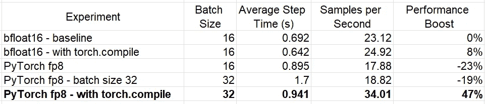
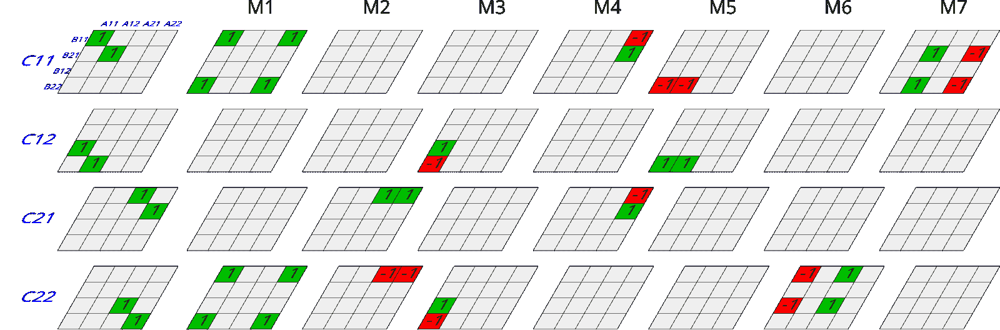
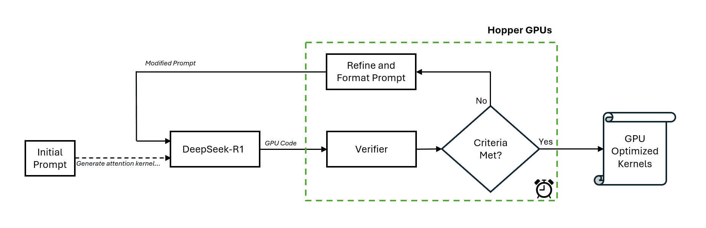
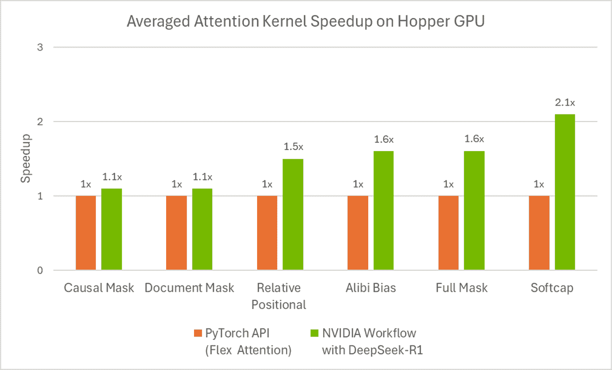
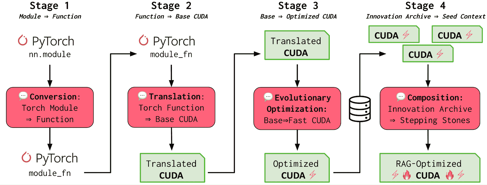
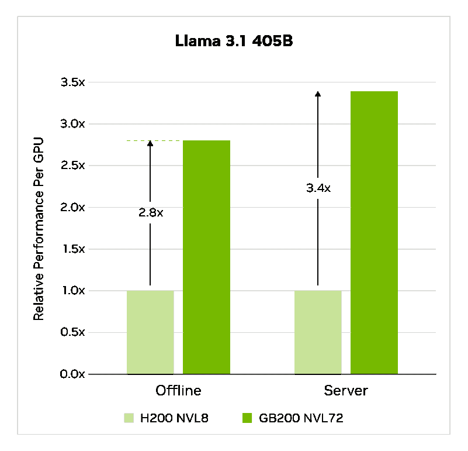

# 第 5 章 AI 系统优化案例研究

本章汇集了一系列案例研究，展示如何将先进硬件与智能软件技术相结合，以提高大型语言模型（LLM）的性能和成本效率。这些研究表明，通过采用现代 GPU 上新的数值精度模式，例如在 Hopper 上使用 8 位浮点数或在 Blackwell 上使用 4 位浮点数，工程师可以在不损失精度的情况下显著提升训练速度。

这些研究还表明，深思熟虑的软件设计可以克服固有的硬件限制。一个例子是开发将计算与数据传输重叠的算法，使得即使在内存带宽较低的系统中也能训练非常大的模型。另一个重要见解是，将强大的 CPU 和 GPU 集成在同一芯片上——通过超高速互连将它们连接起来——可以减少数据移动延迟，并显著提高吞吐量。

案例研究进一步表明，智能调度框架和开源工具可以通过优化工作在各设备间的分配，将现有硬件的有效性能提升一倍。它们还证明，人工智能本身可以帮助微调底层 GPU 代码，创建比手工编写的内核运行更快的内核。在更广泛的背景下，这些例子揭示了算法创新——即使是在矩阵乘法等核心运算中——也能产生与购置新硬件相当的性能提升。

这些经验共同表明，模型训练和推理的成功改进取决于硬件能力与软件技术之间的紧密协调。这种协调方法减少了训练时间和运营成本，同时还能在更小的系统上高效部署更大的模型，为人工智能的未来进步铺平道路。

## OpenAI 在超大规模下使用新硬件训练 GPT 4.5 的历程

本案例研究回顾了 OpenAI 构建 GPT 4.5 的[历程](https://www.youtube.com/watch?v=6nJZopACRuQ)，重点介绍了沿途遇到的挑战、过程和经验教训。该项目在训练运行开始前近两年启动，机器学习和基础设施团队共同协作，目标是实现比 GPT 4 提升 10 倍。早期，团队在一个为超大规模训练构建的全新且更大的计算集群上开展了风险规避实验。他们的协作规划为在实际运行中解决问题奠定了基础。

随着训练的推进，团队不断进行调整，并在他们仍在学习掌握的硬件上监控资源使用情况。在早期阶段，由于不可预见的硬件故障、网络问题，以及像 `sum()` 这样简单且经过充分测试的函数中的软件缺陷，故障率很高——当这些函数与罕见代码路径上的自定义代码结合时，可能会在如此庞大的系统中引发灾难性错误。修复这些问题成为一项共同的任务，模糊了机器学习研究与系统工程之间的界限，突显出即使在超大规模下，微小的细节也至关重要。

一个关键的启示是，扩展这些训练运行不仅仅是增加更多算力。它需要在长期规划与快速解决问题之间取得微妙的平衡，确保每次修复都能提高数据效率和模型智能。团队发现，通过协同设计，为模型设计所做的选择（例如缩放定律和预训练目标）会直接影响基础设施需求（例如多集群编排和网络可靠性），反之亦然。即使在事先进行了仔细规划，仍然存在一定程度的不确定性，这个过程需要持续监控和敏捷的跨团队协作。


最终，`GPT 4.5`的训练过程成为了超大规模训练的蓝图，其中代码设计、错误解决和系统编排方面的渐进式改进汇聚成了一个实现了雄心勃勃性能目标的模型，并为下一代 AI 模型提供了路线图。本案例研究表明，真正的进步是通过不断学习和克服不可预见的挑战来衡量的。通过坚持、团队合作和持续迭代，研究人员和工程师将每一个障碍都转化为改进流程的机会。这证明了 AI 系统性能的突破是通过强大的硬件以及智能、自适应的工程实践实现的。

## 尽管硬件受限，DeepSeek 仍扩展至 6710 亿参数模型

有时创新源于需求。2024 年，中国机构 DeepSeek 因美国出口管制而只能使用 NVIDIA 的`H800` GPU。`H800`是 Hopper GPU 的带宽受限版本，这意味着与`H100`相比，其内存带宽显著降低，`NVLink`互连速度也较低。实际上，`H100`提供接近 3 TB/s 的内存带宽以及增强的 GPU 间通信，而`H800`的有限吞吐量意味着数据传输更慢，这有可能成为分布式训练任务的瓶颈。

DeepSeek 着手在这个严重受限的环境中训练一个名为`DeepSeek-V3`的大规模 6710 亿参数的混合专家（`MoE`）语言模型。该模型使用 64 个专家——每个专家是一个较小的 370 亿参数网络。凭借这种架构，任何给定时间只有一小部分模型被激活，这有助于即使在紧凑的`H800`配置下也能管理计算负载。

为了克服环境限制，DeepSeek 实现了一种新颖的`DualPipe`并行算法，该算法仔细地重叠了计算和通信，以掩盖`H800`固有的弱点。通过设计自定义`CUDA`内核来绕过一些默认的`NCCL`通信集合，DeepSeek 能够将数据传输与正在进行的计算协同进行，从而在互连带宽降低的情况下仍保持 GPU 的高效利用。

这项创新工程获得了回报，`DeepSeek-V3`完成训练，估计仅花费了 560 万美元的 GPU 时间。这只是许多人认为在功能更强大的集群上训练如此规模的模型所需成本的一小部分。

基准评估表明，`DeepSeek-V3`的性能在多项关键指标上（包括自然语言理解、阅读理解和推理任务）与 OpenAI 的`GPT-4`相当甚至超越。这些比较基于业内使用的标准化测试，表明一个开放的`MoE`模型即使使用能力较弱的硬件，也能与最好的闭源模型相抗衡。

在`DeepSeek-V3`模型的基础上，团队随后创建了`DeepSeek-R1`——其专门的推理模型，构建方式类似于 OpenAI 的`O1`和`O3`系列。DeepSeek 没有大量依赖昂贵的人类反馈循环进行微调，而是开创了一种“冷启动”策略，使用极少的监督数据，转而强调强化学习技术，将思维链推理直接嵌入到`R1`中。这种方法降低了训练成本和时间，并强调了智能的软件和算法设计可以克服硬件瓶颈。

经验教训是，即使内存和计算预算有限，大规模、稀疏激活的`MoE`模型也能有效扩展。新颖的训练计划和底层通信/计算重叠优化可以克服硬件限制，DeepSeek 的巨大投资回报率就证明了这一点。

投资回报率是显而易见的，因为 DeepSeek 的非传统方法带来了巨大的效率提升，并以低得多的训练成本和时间创建了一系列强大的模型。通过从`H800` GPU 中榨取每一分性能——即使在通信带宽降低的限制下——该团队以比通常少数百万美元的成本交付了`GPT-4`级别的模型性能。此外，DeepSeek 在`R1`的推理微调阶段不需要那么多人类标注数据，从而节省了更多资金。

简而言之，智能的软件和算法设计克服了蛮力硬件限制。这使得 DeepSeek 能够在紧张的成本和硬件预算下开发大规模 AI 模型。

## MobileEye 使用`PyTorch`与`FP8`精度提升 GPU 性能

当 NVIDIA`H100` Hopper GPU 发布时，MobileEye 的 AI 工程团队[升级](https://medium.com/data-science/pytorch-native-fp8-fedc06f1c9f7#:~:text=As%20the%20results%20demonstrate%2C%20the,and%20size%20of%20the%20model)了他们的`PyTorch`训练流水线，以利用 Hopper 对 8 位浮点（`FP8`）运算的支持。通过使用 Hopper 新的 Tensor Core 和`Transformer Engine`进行`FP16`/`FP8`混合精度计算，他们在不损失模型准确率的情况下提升了矩阵运算性能。在手动尝试了各种批大小和精度后，MobileEye 选择使用`PyTorch`的`torch.compile`，在`H100`上以`FP8`精度进行积极的内核融合，相对于其`bfloat16`基线实现了 47% 的加速，如图 5-1 所示。



**图 5-1.** 使用`PyTorch`编译在`FP8`精度下进行内核融合，平均步长时间改善 47%（来源：[PyTorch 原生 FP8 数据类型。加速 PyTorch 训练工作负载…… | 作者：Chaim Rand | TDS 档案 | Medium](https://medium.com/data-science/pytorch-native-fp8-fedc06f1c9f7#:~:text=As%20the%20results%20demonstrate%2C%20the,and%20size%20of%20the%20model)）。

经验教训是，要在新一代 GPU 上实现软件加速，需要仔细协调硬件与软件，以适应更新的硬件特性和精度，例如`Transformer Engine`、Tensor Core 和`FP8`精度。在本案例中，MobileEye 团队使用`PyTorch`编译器自动优化其`PyTorch`代码，以适应 Hopper GPU 硬件支持的新`FP8`精度。

投资回报率（ROI）是显而易见的。团队仅需几周的工程努力来尝试不同的组合，并最终使用`PyTorch`编译器，就使他们的视觉 Transformer（`ViT`）模型的训练吞吐量几乎翻倍，训练时间减半。

这个案例强调了，采用新的精度格式和编译器优化可以释放尖端 GPU 所承诺的性能。这会带来更快的结果，并充分利用硬件的全部能力。

## 使用开源`NVIDIA Dynamo`推理服务器提升性能

单纯的硬件速度并不是实现性能的唯一途径。智能的软件级优化可以在整个 AI 计算节点和机架集群中创造出倍增的效率。NVIDIA 的开源[`Dynamo`](https://github.com/ai-dynamo/)推理框架证明了这一点。

NVIDIA 的`Dynamo`推理服务器是一个面向 LLM 的[低延迟](https://nvidianews.nvidia.com/news/nvidia-dynamo-open-source-library-accelerates-and-scales-ai-reasoning-models#:~:text=NVIDIA%20Dynamo%20is%20fully%20open,Perplexity%2C%20Together%20AI%20and%20VAST)分布式服务平台。它构建在诸如`TensorRT-LLM`、`vLLM`、`SGLang`和`PyTorch`等引擎之上，并高效地协调跨多个 GPU 和计算节点的工作。

在一次内部的[测试](https://nvidianews.nvidia.com/news/nvidia-dynamo-open-source-library-accelerates-and-scales-ai-reasoning-models#:~:text=NVIDIA%20Dynamo%20is%20fully%20open,Perplexity%2C%20Together%20AI%20and%20VAST)中，NVIDIA 的一个团队使用 Dynamo 在 Hopper H100 GPU 上部署了 Llama 语言模型，结果发现其吞吐量相比他们自定义的请求调度代码立即提升了 2 倍。使用 Dynamo 将吞吐量翻倍，意味着 AI 服务可以用一半的硬件以同样的速度响应用户查询。这直接转化为成本节约，并为扩大最终用户规模提供了更多空间。

在相同 GPU 数量下，Dynamo 的动态批处理、GPU 负载均衡和分离式推理服务使系统每秒能够处理的 token 数量翻倍。分离式推理服务将内存密集型的 KV-Cache 预填充阶段与计算密集型的 token 生成解码阶段分开。

一旦 KV-Cache 在集群中填充完毕，Dynamo 就会将传入请求路由到已包含该请求所需 KV-Cache 数据的 GPU 节点。这避免了重复计算，并让 GPU 始终保持繁忙状态，处理有价值的工作。

此外，随着请求负载的增减，Dynamo 可以无缝地将不同的模型和阶段（预填充或解码）分配给不同的 GPU。这确保了不会有 GPU 闲置而其他 GPU 过载——即使在多个计算节点和机架之间也是如此。

得出的经验是，在超大规模推理中，瓶颈往往出在网络和协调环节。像 NVIDIA Dynamo 推理框架这样的软件，即使在最好的硬件之上也能释放性能增益。

这次实验的投资回报率在于，组织可以在现有基础设施上使用开源 NVIDIA Dynamo，从而免费获得 2 倍的性能。这个案例研究展示了吞吐量的显著提升——以及更低的每次查询和每用户成本——而无需购买新的 GPU。

总之，更好的推理调度算法创造了直接的业务价值。这使得大规模 LLM 的服务对大大小小的组织来说都更具成本效益且更易实现。

## 使用 vLLM 实现高效推理：更低成本下的高吞吐量

在服务 LLM 时，另一个现实挑战是最大化每个 GPU 的利用率。伯克利的一个研究团队最初通过他们名为 vLLM 的开源库实现了这一目标，vLLM 的全称是“虚拟大语言模型”（virtual large-language model）。vLLM 重新思考了 LLM 推理服务器执行批处理和内存管理操作的方式——尤其是针对那些大规模、内存消耗巨大的 LLM 和大型请求输入。

传统的模型推理服务引擎往往会让 GPU 利用率不足，并在大量独立推理请求不断堆积时产生巨大的内存移动。在这种情况下，GPU 核心可能会停滞等待新 token 的生成。

为了解决这个问题，vLLM 最初引入了两项关键创新，称为`PagedAttention`和连续批处理（continuous batching）。`PagedAttention`是一种用于对注意力缓存进行分页的智能内存管理方案。连续批处理则是指智能地将输入请求打包在一起，以平衡推理系统的整体延迟和吞吐量。

`PagedAttention`类似于操作系统级别的内存分页，将 GPU 内存视为虚拟内存。这种策略会动态重新分配键值缓存中空闲的部分，确保推理请求之间不留任何未使用的内存，最终实现对传入请求更高效的批处理并降低延迟。

连续批处理是指传入查询在到达时自动分组的方法。这使得系统能够在不依赖预定时间窗口的情况下形成最大规模的批处理。这种即时分组最大限度地提高了 GPU 效率，并确保推理过程在保持低延迟的同时持续实现高吞吐量。

vLLM 项目已被广泛采用并获得良好支持。它集成到了许多应用后端中，并包含在核心的云端推理服务中。该项目持续演进，受益于许多算法和内核优化——甚至支持 NVIDIA GPU 以外的加速器。

性能工程师应该从中汲取的经验是：不要只盯着 GPU FLOPs，还要考虑工作负载模式如何影响效率。例如，通过减少内存碎片和更好地合并输入请求，vLLM 能从相同的硬件中释放出更多有用的工作（或有效吞吐量）。

对于任何请求负载具有突发性或并发性的 AI 服务来说，采用 vLLM 的投资回报率都是显而易见的。在相同硬件上实现更高的每美元吞吐量，可以避免昂贵的硬件升级。重要的是，NVIDIA 认识到这种软件层面优化的价值，因此发布了 Dynamo 服务框架。Dynamo 原生支持 vLLM 作为后端。这使得组织可以将 vLLM 的算法和 GPU 层面优化与 NVIDIA Dynamo 的集群级路由和缓存管理优化结合起来。

这个案例研究提醒我们，开源创新可以带来巨大的性能飞跃。vLLM 无需任何额外配置即可开箱即用地提升吞吐量。这意味着在相同的硬件和模型部署下，运营成本更低、请求容量更高、用户体验更好。

## DeepMind 的 AlphaTensor：AI 发现的算法提升 GPU 性能

并非所有的 AI 优化都发生在代码层面。有时，优化会深入到算法和数学领域。DeepMind 2022 年的 AlphaTensor 项目就是一个开创性的[例子](https://deepmind.google/discover/blog/discovering-novel-algorithms-with-alphatensor/#:~:text=Algorithms%20in%20this%20rich%20space,flexibility%20in%20optimising%20arbitrary%20objectives)，该项目使用 AI 发现了新的通用矩阵乘法（GEMM）算法。

GEMM 是支撑几乎所有模型训练和推理工作负载的核心运算。即使是 GEMM 效率的微小提升，也可能对整个 AI 领域产生巨大影响。AlphaTensor 将寻找快速算法的过程形式化为一个单人游戏，使用强化学习来探索许多不同的可能性。

令人震惊的结果是，它找到了矩阵乘法的公式，这些公式在当时被证明优于任何现有的人类推导方法。例如，它重新发现了 Strassen 著名的用于 2×2 矩阵的[次二次算法](https://en.wikipedia.org/wiki/Strassen_algorithm)，如图 5-2 所示，并且还针对更大的矩阵规模进行了改进。



###### 图 5-2. Strassen 用于 2x2 矩阵乘法的次二次算法。（来源：https://en.wikipedia.org/wiki/Strassen\_algorithm）

但真正的证明来自于将这些算法在实际硬件上进行测试。AlphaTensor 发现了一种专门针对 NVIDIA Volta V100 GPU 代际的方法，其大型矩阵乘法速度比当时的标准 GPU 库快 10–20%。GEMM 性能 10–20% 的提升非常巨大。这就像每个模型的前向和后向传播都免费获得了额外 10–20% 的计算能力。这样的收益通常来自新一代硬件——或者数月的底层 CUDA 调优。然而，在这个案例中，AI 在相对较短的时间内从数学上找到了一条更好的路径。

得到的经验教训是：在人类工程师认为已经很先进的基础算法和数学运算中，可能仍存在尚未发掘的效率提升空间。AI 能够筛选成千上万乃至数以百万计的算法变体，而人类在合理时间内根本无法尝试这些变体。对于性能工程师而言，AlphaTensor 的成功表明算法创新尚未终结。未来，AI 或许会为我们提供一套新的工具包，其中包含针对卷积、排序或 Attention 等基础运算的更快速算法。

这种情况下的投资回报率（ROI）有些间接，但影响巨大。通过将 AlphaTensor 的矩阵乘法算法整合到 GPU 库中，任何大规模训练任务或推理负载都能立即获得速度提升。这可能影响从图形渲染、LLM 性能到科学计算的方方面面。AlphaTensor 证明了，15% 的速度提升——在数百块 GPU 上进行数千次训练迭代——可转化为巨大的时间和能源节省。这种回报在你每次运行代码时都会兑现。此外，这种加速是在不增加任何硬件的情况下实现的——仅仅依靠更智能的软件。

对于超大规模性能工程师而言，关键启示是：要对技术栈各个层面的 AI 驱动优化保持开放态度。即使是 GEMM 这类最基础、已经过充分优化的运算，也可能仍有改进空间。让 AI 在没有人类偏见的情况下探索优化空间，可以通过全面缩短运行时间带来丰厚回报。

## NVIDIA 基于 DeepSeek-R1 的 AI 辅助 GPU 内核优化

优化底层 GPU 代码长期以来一直是被称为“CUDA 忍者”的人类专家独享的艺术，但事实证明，AI 也能胜任这些专家级任务。NVIDIA 工程师使用功能强大的 DeepSeek-R1 推理模型进行了[实验](https://developer.nvidia.com/blog/automating-gpu-kernel-generation-with-deepseek-r1-and-inference-time-scaling/#:~:text=generates%20the%20GPU%20code%20,R1%20model)，以检验它能否为复杂的 Attention 机制生成与高性能手工调优实现相媲美的 CUDA 内核。

作为推理模型，DeepSeek-R1 采用“推理时”（inference-time）扩展策略：它不是在进行一次快速的模型前向传递后就生成响应，而是会在一段时间内不断优化输出——给它的时间越长，结果越好。像 DeepSeek-R1 这样的推理模型经过微调，会进行更长时间的思考，并对答案进行反复迭代。这很像人类在给出回答之前会花时间仔细思考。

在这项实验中，NVIDIA 在 H100 上部署了 R1，并给它 15 分钟来生成一个优化后的 Attention 内核代码。他们在生成循环中插入了一个验证程序，以便每次 R1 提出一个内核时，验证器都会检查生成的内核代码的正确性，并衡量代码的效率。这个反馈循环为下一轮内核代码迭代提供了改进提示词的指导。循环一直持续到代码满足严格标准，如图 5-3 所示。




**图 5-3.** 在 NVIDIA Hopper 平台上使用 DeepSeek-R1 进行推理时扩展（来源：[使用 DeepSeek-R1 和推理时扩展自动生成 GPU 内核 | NVIDIA 技术博客](https://developer.nvidia.com/blog/automating-gpu-kernel-generation-with-deepseek-r1-and-inference-time-scaling/#:~:text=DeepSeek,on%20the%20NVIDIA%20Hopper%20platform)）

使用了以下提示词：

```
Please write a GPU attention kernel to support relative position encodings. Implement the relative positional encoding on the fly within the kernel. The complete code should be returned, including the necessary modifications.

Use the following function to compute the relative positional encoding:

def relative_positional(score, b, h, q_idx, kv_idx):
    return score + (q_idx - kv_idx)
    
When implementing the kernel, keep in mind that a constant scaling factor 1.44269504 should be applied to the relative positional encoding due to qk_scale = sm_scale * 1.44269504. The PyTorch reference does not need to scale the relative positional encoding, but in the GPU kernel, use:

qk = qk * qk_scale + rel_pos * 1.44269504

Please provide the complete updated kernel code that incorporates these changes, ensuring that the relative positional encoding is applied efficiently within the kernel operations.
```

结果令人惊叹。AI 不仅生成了功能正确的 Attention CUDA 内核，还[实现](https://developer.nvidia.com/blog/automating-gpu-kernel-generation-with-deepseek-r1-and-inference-time-scaling/#:~:text=Image%3A%20A%20bar%20chart%20showing,attention%20kernels%20with%20flex%20attention)了相比 NVIDIA 优化的 PyTorch 内置“`FlexAttention`”内核 1.1-2.1 倍的加速。图 5-4 展示了生成的内核与 PyTorch 优化后的 `FlexAttention` 在各种 Attention 模式（包括因果掩码和长文档掩码）下的性能对比。



**图 5-4.** 自动生成并优化的 Attention 内核与 PyTorch 的 `FlexAttention` 的性能对比（来源：[使用 DeepSeek-R1 和推理时扩展自动生成 GPU 内核 | NVIDIA 技术博客](https://developer.nvidia.com/blog/automating-gpu-kernel-generation-with-deepseek-r1-and-inference-time-scaling/#:~:text=Image%3A%20A%20bar%20chart%20showing,attention%20kernels%20with%20flex%20attention)）

更令人印象深刻的是，AI 生成的内核在斯坦福大学的 [KernelBench](https://scalingintelligence.stanford.edu/blogs/kernelbench/) 测试套件中，100% 的基础测试用例和 96% 的复杂用例均被验证为准确。这基本上达到了人类工程师的可靠性。

得到的经验教训是：给 LLM 提供适当的工具来验证、评判和改进其输出，可以显著提高代码质量。直观地说，这个工作流程相当于人类工程师反复对自己的代码进行性能分析、调试和改进的过程。最初由模型生成的粗糙代码草稿，在短短 15 分钟内就演变成了达到生产质量的内核。这展示了 AI 辅助性能调优的一种强大范式。

投资回报率具有颠覆性，因为即使是 NVIDIA 最顶尖的 CUDA 工程师，也可能需要花费数小时甚至数天来手工编写和测试一种新型 Attention 内核变体。借助这种 AI 辅助优化方法，AI 只需一小部分时间就能生成效率相当的低层 CUDA 内核。这解放了工程师，使他们能够专注于更高级的 AI 系统优化机会，以及 AI 可能难以检测和修复的边界情况。

尽管仍需要一定的人工监督，但这项实验表明，有一条可行的路径可以降低 GPU 优化软件的开发成本，同时显著提升运行时性能。对于 AI 系统性能工程师而言，这类 AI 辅助暗示着未来的工作流程可能涉及与 AI 副驾驶（co-pilot）合作，在硬件、软件和算法层面快速共同设计优化方案。AI 副驾驶是提升人类生产力的倍增器。可以把这些副驾驶想象成经过预训练和微调的 AI 实习生，它们能够利用从现有代码库中获得的丰富 CUDA 技巧和诀窍，对复杂问题进行推理。

## Sakana.ai 的智能体：编写出快 100 倍的 GPU 内核的 LLM

2025 年，一家名为 Sakana.ai 的公司将 AI 编写 GPU 代码的理念又向前推进了一步，目标是自动化广泛的内核优化任务。他们[开发](https://sakana.ai/ai-cuda-engineer/)了一个名为 The AI CUDA Engineer 的自主智能体，它接收标准 PyTorch 运算，并将其转换为高度优化的 CUDA 内核。在底层，AI CUDA Engineer 使用大语言模型（LLM）和进化策略来迭代优化内核代码。这种策略经过多次迭代和进化代，会生成越来越好的解决方案，如图 5-5 所示。



**图 5-5.** The AI CUDA Engineer 智能体框架的高层概览（来源：[`sakana.ai/ai-cuda-engineer/`](https://sakana.ai/ai-cuda-engineer/)）

Sakana 报告的结果令人瞩目。与等效的 PyTorch 运算相比，他们由 AI 生成的内核实现了从 10 倍到 100 倍的加速。在某些情况下，AI CUDA Engineer 生成的 CUDA 内核比生产库中已有的最佳 CUDA 内核还要快 5 倍。值得注意的是，AI CUDA Engineer 成功转换了 250 个目标 PyTorch 算子中的 230 个，展现了高度通用的方法。

经验表明，将大语言模型用于高层代码生成，再将算法优化用于微调和测试不同代码变体，这种组合可以发现即使是经验丰富的代码高手也可能错过的性能技巧。例如，Sakana 的智能体可能会尝试非常规的线程块大小，或以并不显而易见但有创意的方式使用共享内存。这可以为某些运算带来巨大收益。

另一个例子是 PyTorch 中一串复杂的张量运算：它通常会启动许多小型 GPU 内核，并遭遇严重的内存瓶颈。Sakana 的 AI CUDA Engineer 智能体可以轻松检测到这种情况，并在很短的时间内将张量运算融合为一个内核——这比手动融合要快得多。这类由 AI 生成的优化可以为 AI 系统带来数量级的性能提升。

如果正确采用并整合到公司的开发工作流中，这类 AI 代码助手的投资回报率（ROI）是巨大的。AI CUDA Engineer 无需手动费力地逐一优化每个神经网络层或运算，即可根据实现的复杂度和新颖性，在几分钟到几小时内自动生成优化内核。这意味着新模型架构可以更快上市，推理/训练速度也得以提升——而无需雇佣一大批稀缺的 CUDA 专家。

本质上，Sakana 展示了一条利用 AI 扩展专家级 AI 性能工程的路径。他们在一款 AI 智能体上的少量前期投入带来了复利式回报：许多内核在几乎零人力投入的情况下实现了 10 到 100 倍的优化。

## Predibase 使用强化学习生成优化 GPU 内核的方法

另一家初创公司 Predibase 采用了一种略有不同的强化学习方法，展示了自动化 GPU 编程。他们提出了一个更大胆的问题：能否利用大量 PyTorch 代码示例，将语言模型训练成完全合格的 OpenAI Triton 程序员？请记住，OpenAI Triton 是一种类似 Python 的 GPU 编程语言（及编译器），它简化了 GPU 编程。任务是看 AI 能否生成高效的 Triton 代码来替代 PyTorch 代码，并在 GPU 上运行得更快。

在他们的[实验](https://predibase.com/blog/teaching-ai-to-write-gpu-code-a-deep-dive-into-reinforcement-fine-tuning#:~:text=Can%20we%20teach%20a%20LLM,accurate%20and%20optimized%20Triton%2FCUDA%20kernels)中，Predibase 使用了一个 H100 GPU 集群，并用一批“PyTorch 到 Triton”代码样本对规模适中的 LLM 进行了微调，这些样本将高层 PyTorch 函数转换成了高效的 Triton 内核。然而，由于当时可用于监督微调（SFT）的“PyTorch 到 Triton”示例数据集不够大，他们创建了一个奖励函数，并使用一种名为“强化微调”（RFT）的方法，通过强化学习引导模型不断生成更好的代码。

在 Predibase 的强化学习（RL）方法中，AI 会首先生成一个候选内核。然后系统会自动编译并测试该内核的正确性和速度。如果内核无错误运行、产生正确结果，并且比基线内核运行得更快，模型就会获得正向奖励。

通过这种基于 RL 的试错方法的多次迭代，模型稳步提升。训练最初仅从 13 个示例问题开始，短短几天内，AI 就从对 Triton 一无所知，发展到能够为各种 GPU 运算生成正确且优化的基于 Triton 的内核代码。在撰写本文时，Predibase 尚未公布具体的加速数据，但他们指出，该模型仅用 1000 步训练就学会了输出可运行的 Triton 内核。此外，随着训练的继续，模型也在持续优化性能。

这一结果表明，AI 可以通过测试、观察反馈和做出调整来优化自己的代码。这与工程师迭代改进代码的方式类似。强化学习通过同时奖励正确性和速度，可以使 AI 生成的代码与实际性能指标保持一致。这会促使 AI 探索诸如使用线程束级并行或尽量减少全局内存访问等优化手段，以提升整体性能。

Predibase 的演示带来的启示和投资回报在于：这类 AI 辅助极具吸引力，因为它自动化了内核代码层面的性能优化，可能减少手动调优的需求。工程师无需再手动为新模型创建定制内核，训练好的 AI 助手可以生成多个变体并选择最佳方案。这缩短了开发周期，让工程师能够专注于探索新的模型架构，从而使各种规模的公司都能实现尖端前沿的模型性能。

这种方法还预示着一个未来：Triton 和 Python 等更高级的语言和框架可能会取代 CUDA 用于 GPU 编程。此类方法降低了 GPU 编程的门槛，从长远来看，可能会形成一条自动化流水线：AI 智能体持续编写和改进计算内核，成为性能工程师必不可少的工具。

## NVIDIA Grace-Hopper（GH200）超级芯片与 Hopper（H100）性能对比

NVIDIA GH200 Grace Hopper 超级芯片代表了先进硬件设计与创新软件技术的惊人融合，重新定义了 LLM 推理。本案例研究源于 [NVIDIA](https://developer.nvidia.com/blog/leading-mlperf-inference-v3-1-results-gh200-grace-hopper-superchip-debut) 和 [Baseten](https://lambda.ai/blog/partner-spotlight-testing-llama-3.3-70b-inference-performance-on-nvidia-gh200-with-baseten) 的两个独立实验。

请记住，GH200 超级芯片将 Hopper H100 GPU 和基于 ARM 的 Grace CPU 集成在单个模块上，采用高达每秒 900 GB 的 NVLink C2C 互连，而不是传统的 PCIe Gen5 连接。这种设计提供的带宽约为传统 PCIe 的 7 倍，并显著减少了 CPU 与 GPU 之间的数据传输延迟。

这段旅程始于 2023 年底，当时 NVIDIA 将重点放在使用 GPT-J 模型的 MLPerf 推理基准测试上，该模型包含 60 亿个参数，用于基本的生成式 AI 任务。NVIDIA 的工程师[证明](https://developer.nvidia.com/blog/leading-mlperf-inference-v3-1-results-gh200-grace-hopper-superchip-debut)，GH200 的紧耦合设计将 CPU 到 GPU 的数据传输开销从总推理时间的 22%降低到了仅 3%。这一改进使 GPU 能够专注于计算工作，与通过 PCIe 链路搭配 Intel Xeon CPU 的 H100 系统相比，每个 GPU 的吞吐量提升了 17%。这一结果强调，在运行复杂的推理工作负载时，内存带宽和高效互连与原始 GPU 计算能力同等重要。

在 NVIDIA[实验](https://developer.nvidia.com/blog/leading-mlperf-inference-v3-1-results-gh200-grace-hopper-superchip-debut)的另一阶段，重点转向克服 Transformer 模型内存密集型的 Attention 机制所固有的高内存需求。NVIDIA 团队采用了创新的混合精度方法。该策略涉及使用 Hopper 中的 Transformer Engine，将 8 位和 16 位精度相结合。在这种情况下，他们使用了 GPT-J 的 Attention KV-cache 的 8 位压缩版本。这种压缩使 96 GB HBM GPU 内存的有效缓存容量几乎翻倍，并允许在推理期间使用更大的批量大小。同时，Tensor Cores 保持着完全活跃状态。结果是，单个 GH200 在当时的 MLPerf 测试中提供了每个加速器的最高性能。

Baseten 在 2025 年初进行的另一项[实验](https://lambda.ai/blog/partner-spotlight-testing-llama-3.3-70b-inference-performance-on-nvidia-gh200-with-baseten)探讨了为超出 GPU HBM 内存限制的超大型 LLM 提供服务的挑战。他们使用 700 亿参数的 Llama 3.3 模型进行了测试，该模型由配置了 96 GB HBM 的单个 GH200 超级芯片提供服务。基于 H100 的系统不得不使用慢得多的 PCIe 互连将大约 75 GB 的模型数据卸载到主机 CPU 内存。而 GH200 系统只需使用其快速的 NVLink C2C 连接将 60 GB 的模型数据卸载到 CPU 内存。

性能差异非常显著。GH200 达到了每秒 4.33 个令牌的生成速率，而 H100 系统为每秒 0.57 个令牌。这一改进代表了吞吐量大约 7.6 倍的提升，并使得每个生成令牌的成本降至原来的 1/8。效率提升源于 21%的内存带宽优势，以及集成 CPU 内存作为 GPU 内存扩展的能力，同时避免了与 PCIe 相关的典型瓶颈。

最后的见解是选择与工作负载特定特征良好匹配的硬件的重要性。某些完全匹配 H100 的 80 GB HBM 内存的工作负载，并不会从 GH200 的 CPU 和 GPU 统一设计中显著受益。在这些情况下，只观察到大约 2%的适度性能提升。相比之下，当工作负载需要更大的内存占用和 CPU 与 GPU 之间大量的数据交换时，GH200 的表现优于 H100。

这提醒我们，昂贵的硬件投资应该与能够充分利用 GH200 等系统中先进内存和互连能力的工作负载相匹配。鼓励组织在进行任何大规模资本投资之前，在 AWS、GCP、Azure、CoreWeave 或 Lambda Labs 提供的云实例中测试其特定工作负载。这样，他们就可以为其特定的工作负载和用例部署最佳配置。

这个案例研究将硬件创新与软件优化交织在一起，从根本上改变了 LLM 推理的方法。通过提高内存吞吐量、优化数据传输和支持混合精度格式，GH200 在吞吐量和成本效率方面带来了显著提升。这展示了令人印象深刻的技术进步，并为旨在以更低运营成本在较小集群上服务更大模型的组织提供了明确的指导。

## 使用 Grace-Blackwell NVL72 机架系统进行高速推理


NVIDIA 的 Blackwell GPU 架构为大模型带来了前所未有的推理速度。在早期的 MLPerf 测试中，搭载 Blackwell GPU 的服务器打破了[记录](https://developer.nvidia.com/blog/nvidia-blackwell-delivers-massive-performance-leaps-in-mlperf-inference-v5-0/#:~:text=Additionally%2C%20in%20this%20round%2C%20Blackwell,FP8%E2%80%93while%20meeting%20benchmark%20accuracy%20requirements)。NVIDIA 随后将其基于 ARM 的 Grace CPU 与 Blackwell GPU 结合，创造了 Grace-Blackwell 超级芯片。

接下来，NVIDIA 将 36 个 Grace-Blackwell 超级芯片（每个包含 1 个 Grace CPU 和 2 个 Blackwell GPU）连接到一个名为 GB200 NVL72 的超密集机架部署中。这些超级芯片通过第 5 代 NVLink 交换机连接，以实现快速数据共享。借助该系统，NVIDIA 在 GB200 NVL72 上运行 4050 亿参数的 Llama 3.1 模型时，[实现](https://developer.nvidia.com/blog/nvidia-blackwell-delivers-massive-performance-leaps-in-mlperf-inference-v5-0/#:~:text=Additionally%2C%20in%20this%20round%2C%20Blackwell,FP8%E2%80%93while%20meeting%20benchmark%20accuracy%20requirements)了每个 GPU 3.4 倍的吞吐量提升，相比上一代基于 Hopper 的系统。

Blackwell 的改进，如第二代 Transformer Engine 和新的 FP4 精度，是关键。通过利用 FP4 数据类型进行量化推理，基于 Blackwell 的 GB200 NVL72 系统每个 GPU 的数学吞吐量相对于 FP8 精度翻了一番。

关键在于，基准测试的准确性保持在目标范围内，因此这种性能与精度之间的权衡基本上是中性的。在系统层面，收益不断累积。如图 5-6 所示，GB200 NVL72 机架在 Llama 405 推理任务上提供的吞吐量比类似的基于 Hopper 的集群高出 30 倍。



**图 5-6.** NVIDIA 的 Grace-Blackwell "GB200 NVL72"超级集群（深绿色）提供的 LLM 推理吞吐量比上一代（浅绿色）高出 30 倍，这得益于 9 倍的 GPU 数量和显著的每 GPU 加速（来源：[NVIDIA Blackwell 在 MLPerf 推理 v5.0 中带来巨大性能飞跃 | NVIDIA 技术博客](https://developer.nvidia.com/blog/nvidia-blackwell-delivers-massive-performance-leaps-in-mlperf-inference-v5-0/)）。

这归因于多个因素，包括单个 GPU 的速度提升、更快的 NVLink/NVSwitch 互连，以及 72 个 GPU 在机架内近距离协同工作的庞大集群规模。当时，GB200 NVL72 为大模型的延迟和大规模吞吐量树立了新的行业标准，"the 405"即是对 Llama 4050 亿参数模型的一种称呼。

**提示：** Meta 首席执行官马克·扎克伯格将 Llama 4050 亿参数模型随口称为"the 405"，这是借鉴了加利福尼亚州居民[称呼](https://www.pbssocal.org/shows/lost-la/the-5-the-101-the-405-why-southern-californians-love-saying-the-before-freeway-numbers)高速公路的方式。具体来说，[加利福尼亚人](https://www.youtube.com/watch?v=dCer2e0t8t8)会在高速公路编号前加上"the"（例如"the 405"高速公路）。

此外，值得注意的是，即便是较小的 8-GPU Blackwell 服务器（称为 DGX B200），在 Llama-70B 聊天模型上的吞吐量也比类似的 8-GPU Hopper 服务器高出 3.1 倍。这证明了 Blackwell 的架构优势——即使在 GPU 数量相同的情况下。

AI 系统性能工程师学到的经验是：诸如 FP4 Tensor Core 等新硬件特性——以及 GPU 之间更高的 NVLink 带宽——与 GB200 NVL72 等设计所实现的更高程度模型并行相结合时，可以带来数量级的性能提升。

从 Hopper 升级到 Blackwell 立即实现了投资回报：基于 Hopper 的 GPU 推理响应需要 6 秒，而 Blackwell GPU 只需 2 秒。因此，采用相同硬件配置的 Blackwell GPU 集群可以服务更多用户。投资 Grace-Blackwell 平台带来了渐进式改进，以及在服务能力上的显著阶梯式增长。对于任何应对不断增长的模型规模和用户需求的 AI 提供商而言，这都是一个竞争优势。

## 借助 Grace-Blackwell 集群加速万亿参数大语言模型的实验与洞察

NVIDIA 训练万亿参数模型的参考设计是 GB200 NVL72 Grace-Blackwell 机架。这是一个功能强大的服务器机架，在一个内存一致性域内整合了 72 个 Blackwell GPU 和 36 个 Grace CPU。

[基准测试](https://developer.nvidia.com/blog/nvidia-blackwell-delivers-massive-performance-leaps-in-mlperf-inference-v5-0/#:~:text=The%20Blackwell%20platform%20is%20available,connected%20using%20NVLink%20and%20NVSwitch) 表明，对于拥有 4050 亿参数的巨大模型，GB200 NVL72 的训练速度比前几代产品更快。Adrian Cockcroft 是一位以在云计算和系统架构领域的变革性工作而闻名的杰出技术专家，他的独立分析[认为](https://adrianco.medium.com/deep-dive-into-nvidia-blackwell-benchmarks-where-does-the-4x-training-and-30x-inference-0209f1971e71#:~:text=There%20are%20three%20generations%20of,been%20as%20impressive%2C%20and%20users)，将配置齐全的 Grace-Blackwell 与基于 Hopper 的高端集群相比，实现 4× 加速是可能的。

这一性能提升的关键因素包括：Blackwell 更高的单 GPU FLOPs、Grace 增加的 CPU 内存容量、更快的 NVLink-C2C 互连，以及单机架系统的庞大规模。具体来说，如果一个模型以前在 Hopper GPU 集群上训练需要 10 天，那么新的 Blackwell 集群大约 2–3 天就能完成。这大大加速了获得洞察的时间，并提高了实验的频率。

AI 系统性能工程师学到的经验是：扩展的成效与投入的硬件数量并不总是线性相关。要实现高效扩展，必须消除各个层面的瓶颈。Grace-Blackwell 设计同时解决了多个瓶颈，包括更快的 GPU、专用 Tensor Core 上更快的矩阵运算、更大的单 GPU 内存以支持更大的批次规模，以及改进的 NVLink 和 NVSwitch 架构，以低延迟连接数十个 GPU。所有这些都带来了更好的扩展效率。过去难以充分利用 72 个 H100 GPU 的训练任务和推理服务器，如今在 NVL72 配置中的 72 个 Grace-Blackwell GPU 上实现了近乎线性的扩展效率，因为通信开销大大降低。

使用 Grace-Blackwell 进行训练工作负载的投资回报（ROI）体现在更快的训练运行和更快速的实验上。例如，假设一家企业使用自己的数据集训练一个 5000 亿参数的大语言模型。使用 GB200 NVL72 系统，可以将训练时间从 4 周缩短到 1 周。这可能会带来变革性的影响，因为模型能更快投入生产，并且每次获得洞察所消耗的能源也更少。

因此，尽管 GB200 集群的前期成本高昂，但从每个训练模型和每次获得洞察的角度来衡量，组织能以加速研发和可能更低的成本获得价值。总之，这个案例证明了采用下一代硬件进行大规模大语言模型训练的 ROI，包括更快的实验结果和更好的每美元吞吐量。这使得组织和研究实验室能够在不大幅增加成本的情况下推进 AI 前沿。

## HPE 面向万亿参数时代的 Grace-Blackwell 超级计算机

2025 年初，HPE（慧与）[出货](https://www.hpe.com/us/en/newsroom/press-release/2025/02/hpe-announces-shipment-of-its-first-nvidia-grace-blackwell-system.html#:~:text=HOUSTON%20%E2%80%93%C2%A0%20FEBRUARY%2013%2C%202025%C2%A0,to%20optimize%20efficiency%20and%20performance)了其首款 NVIDIA Grace-Blackwell 系统——HPE Cray XD。这是他们对 GB200 NVL72 机架规格的实现。这标志着该技术成为 NVIDIA 自有实验室之外的首批实际部署之一。HPE Cray XD 机架级系统专为需要使用单一统一内存空间训练和服务 1 万亿参数规模模型的组织而构建。

HPE 强调，这类系统为超大规模模型提供了更低的每 token 训练成本和一流的吞吐量（[HPE 宣布出货其首款 NVIDIA Grace Blackwell 系统 | HPE](https://www.hpe.com/us/en/newsroom/press-release/2025/02/hpe-announces-shipment-of-its-first-nvidia-grace-blackwell-system.html#:~:text=%E2%80%9CAI%20service%20providers%20and%20large,leading%20services%20expertise.%E2%80%9D)）。这意味着，尽管其机架的绝对成本很高，但当模型达到万亿规模时，以每投资一美元每秒处理的 token 数衡量的效率要高得多。目标用户是云 AI 服务提供商和大型企业研究团队。

首批使用 HPE Cray XD 的 HPE 工程师学到的经验是，将所有 72 个 GPU 放在一个域中，并行训练任务的调试和优化比传统的每节点 8 个 GPU 集群更容易，因为网络通信模式中的可变部分更少。然而，他们也了解到了 NVL72 系统特有的故障模式，例如 NVLink/NVSwitch 结构中的故障。采用 NVL72 机架设计后，这类故障可能会同时影响许多 GPU。而以前，一条故障的 InfiniBand 链路只会影响一个节点。

对于这些系统的先驱客户来说，采用 NVL72 机架设计的 ROI 是一种竞争优势。HPE 及其客户现在可以将大规模模型装入内存，并且训练速度远快于竞争对手。此外，通过将 Cray XD 作为单一集成解决方案交付，客户的价值实现时间大大缩短。组织现在可以在数天内启动一台 1 exaFLOP 的 AI 超级计算机并投入工作，而不是数月或数年。快速的部署时间使 HPE 的客户能够为大型 AI 模型购买交钥匙解决方案。这降低了他们的投资风险，加快了实现 ROI 的速度，并带来了巨大的 AI 系统性能突破。

## 训练并服务 100 万亿参数模型

设想一个（并不遥远的）未来，某个 AI 研究实验室尝试一项非同寻常的任务，比如训练一个稠密的 100 万亿参数 Transformer。这大约是目前以数百亿或数千亿参数计的大模型的 100 倍。如何才能借助 Grace-Blackwell（GB200）超级集群实现这一目标？

在这一假设情景中，实验室组建一个由多个 GB200 NVL72 单元组成的训练集群——例如 8 个机架，总计 576 个 Blackwell GPU 和 288 个 Grace CPU 通过网络连接在一起。即使使用 Blackwell 每个 GPU 高达 192 GB 的 HBM 内存，一个 100 万亿参数的模型也几乎无法装进这 8 机架系统的 GPU HBM 内存总和之中——即使采用降低的 8 位精度也不行。

例如，在 8 位精度下，100 万亿参数将需要 100 TB 或 100,000 GB 的存储空间。100,000 GB / 每 GPU 192 GB HBM = 520 个 GPU。我们在一个 8 机架系统中只有 576 个 GPU，因此模型可以加载，但完全在 GPU HBM RAM 中训练是不可能的，因为训练还需要额外的梯度、激活和优化器状态，这些会带来巨大的额外开销——超出了单个机架的容量。

由于 100 万亿参数的模型无法装入 8-NVL72 机架超级集群，因此团队需要利用 Grace CPU 内存池，根据需要将 GPU 内存溢出到其中。这要求系统通过机架内的 NVLink 5 互联或机架间的 InfiniBand 在 CPU RAM 中流式加载和卸载权重。当然，你会希望尽可能避免跨机架通信。

人们几乎肯定会采用张量并行和流水线并行来将庞大的网络划分到多个 GPU 上。另一种选择是将模型拆分到……例如，采用流水线并行时，每个 GB200 机架负责 1/8 的层。然而，这需要层间进行跨机架通信——从而降低推理和训练的速度。

请记住，在机架内部，72 个 GPU 全部以完整的 NVLink 带宽互连，并以高速协同处理模型各自的部分。然而，机架之间由较慢的 InfiniBand 链路连接各个 NVLink 域。工程师们深知这种层级结构，会设计高效、流水线化且并行的计算/通信调度。例如，当一个机架完成给定批次的各层计算后，它会将中间结果（激活值）传递给下一个机架的层进行处理。与此同时，第一个机架开始计算下一批次——如此循环。

通过结合数据并行、流水线并行和张量并行（3D 并行），可以确保尽管存在跨机架通信延迟，所有 GPU 都能保持忙碌。为了进一步减轻压力，可以在传输过程中将激活值量化到`FP8`，并应用高效的 all-reduce 梯度更新算法，从而在每一步最小化跨机架同步。这样可以避免分布式训练中可怕的“停止世界”同步屏障。

还可以考虑采用混合专家（MoE）方法，将 100 万亿参数的模型拆分为 100 个独立的 10 万亿参数专家模型。这意味着在处理任意一个 token 时，只有一部分专家（机架）处于活跃状态。这将显著减少每一步的计算量和通信量。

然而，使用 MoE 还会带来额外的挑战，包括网络的门控、将 token 路由到正确的专家，以及确保专家间的负载均衡。可以使用动态专家扩展等技术，让所有机架都得到均匀利用，避免网络热点——即使在不同专家被激活时也是如此。

在软件方面，需要像 NVIDIA `Dynamo`这样的编排层，与`TensorRT-LLM`或`vLLM`服务引擎配合，来协调系统中大量 GPU 的工作。它可以为不同的流水线阶段分配微批次，通过重新映射 GPU 来处理 GPU 故障，并优化集群中大规模 KV 缓存的复用。

为 100 万亿参数的模型提供推理服务将是一项浩大的工程。团队可能会利用`Dynamo`的解耦功能，将模型权重放在 CPU 内存中，并仅针对特定查询将必要的专家/层加载到 GPU 内存中。在这种情况下，系统需要使用不同机架上计算出的部分结果来聚合生成响应。

团队还会大力依赖 4 位权重量化进行推理，利用 Blackwell 的`FP4`支持，将活动模型占用空间缩小到约 50 TB。这仍然很大，但在多机架系统的能力范围之内。

这个思想实验的教训凸显了需要哪些超大规模性能技巧，包括层次化并行、激进的量化与稀疏化，以及精细的调度。否则，这将是一个棘手的问题。模型的内部神经网络架构和物理集群网络必须协同设计，使得每一个延迟和带宽的考量都成为首要关注点。

成功训练一个 100 万亿参数模型的假想投资回报率将是开创性的。这样的模型可能展现出无与伦比的能力，在准确性上实现巨大飞跃，或者处理极其复杂的人工通用智能（AGI）或人工超级智能（ASI）任务。

然而，成本和风险也非常高。训练可能会在 GPU 计算时间上花费数千万甚至数亿美元。工程团队必须确保 576 个 GPU 中的每一个在整个过程中都得到最大程度的利用。任何低效都可能浪费计算时数和资金。在相对较小规模上得到验证的技术——例如 DeepSeek 在性能受限的 NVIDIA H800 训练集群上训练 V3 模型时使用的技术——在这个 100 万亿参数规模下将是必不可少的。

如果做得好，回报将是一个首创的 AI 系统和史册留名的地位。如果做得不好，可能会烧掉巨额财富而收效甚微。因此，这个假想案例凸显了性能工程师面临的现实——在极端规模下，规划、优化、性能剖析和迭代是让不可能变为可能的唯一途径。其理念是将超大规模的硬件投资高效地转化为前所未有的 AI 能力。

## 关键要点

### 协同设计的硬件与软件优化

大语言模型的性能提升真正来源于硬件与软件紧密集成、协同设计的创新突破。

### 数值精度进步

使用更新的数值精度模式，如 Hopper 上的 8 位和 Blackwell 上的 4 位，可以在不牺牲准确性的情况下显著提升训练速度。这表明，即使数字表示方式的微小改变也能带来巨大的性能收益。

### 计算与数据传输的重叠

多个案例研究强调了将计算与数据传输重叠的算法如何帮助抵消较低内存带宽等硬件限制。

### 高级调度与批处理


NVIDIA `Dynamo`和`vLLM`中使用的智能调度框架和动态批处理技术可最大化 GPU 利用率，使现有硬件实现更高吞吐量。

### 编译器与内核创新

诸如`PyTorch`中的激进内核融合和 AI 生成的 GPU 内核等技术表明，软件创新可以带来与预期新硬件改进相媲美甚至超越的性能提升。

### 跨团队协作至关重要

超大规模训练既关乎原始计算能力，也关乎敏捷的跨团队协作和迭代式故障排查。OpenAI 的案例研究为在长期规划与快速解决问题之间取得平衡提供了蓝本。

### 巧妙的软件和算法可以绕过硬件限制

尽管受限于带宽较低的 GPU（NVIDIA H800），DeepSeek 仍通过自定义并行技术（`DualPipe`）和巧妙的算法设计，成功训练了一个 6710 亿参数的混合专家模型。这展示了由硬件限制驱动的成本效益创新。

### 尽可能利用编译器

通过利用新的 Tensor Core 和用于`FP8`精度的`PyTorch`编译器，MobileEye 的训练吞吐量几乎翻倍，这表明采用新的精度格式和编译器优化可以带来显著的效率提升。

### 自优化算法

DeepMind 的`AlphaTensor`展示了 AI 如何发现新的、更高效的 GEMM 算法。这在无需额外硬件的情况下将性能提升了 10%–20%。

### 拥抱 AI 辅助编程与优化

NVIDIA 与 DeepSeek-R1、Sakana.ai 的 AI CUDA 工程师以及 Predibase 的强化学习方法的实验证明，大语言模型不仅可用于高级任务，还可用于生成、测试和优化底层 GPU 代码，从而在显著缩短工程时间的同时实现数量级的速度提升。

### 统一 CPU-GPU 超芯片减少瓶颈

像 NVIDIA 的 GH200 Grace-Hopper 和 Grace-Blackwell 平台这样的先进系统表明，将 CPU 和 GPU 集成在同一芯片上并通过高速互连进行连接，可以减少数据传输瓶颈并提高吞吐量。这种集成还可以大幅降低推理任务中每个生成 token 的成本。

### 面向机架级和超大规模基础设施的设计

GB200 NVL72 机架系统和 HPE 的 Grace-Blackwell 超级计算机等部署表明，从传统集群转向高度集成的系统可以带来吞吐量的巨大提升和延迟的显著降低。

### 考虑面向 100 万亿参数模型的策略

训练拥有 100 万亿参数的模型将需要激进量化、多维并行（数据、流水线、张量、专家和序列并行）以及机架间通信的精心编排相结合。这凸显了未来 AI 的扩展既取决于硬件能力，也取决于软件层面调度的巧思。

### 追求成本效率与吞吐量提升的双重目标

许多案例研究强调，软件改进和 AI 驱动的内核优化可以在不增加额外成本的情况下带来性能提升。这些增强降低了训练和推理成本，使组织能够在不按比例增加硬件投资的情况下服务更多用户或试验更大的模型。

### 缩短获取洞察的时间并提高生产力

更快的训练周期和更高效的推理使组织能够更快地将先进 AI 产品推向市场。在这个获取洞察的时间与原始性能提升同样宝贵的时代，这一点至关重要。

## 结论

对这些案例研究的探索，展现了 AI 系统性能工程领域一个关键时代的画卷，其标志是 NVIDIA 开创性 GPU 与 CPU 架构的无缝集成，包括当今的机架级 Grace-Hopper 和 Grace-Blackwell 系统，以及未来的 Vera-Rubin 和 Feynman 系统。

这些进步的核心是 GB200 NVL72 系统，它将 72 个 GPU 连接成一个统一的处理单元，为万亿参数大语言模型推理提供实时的极致吞吐量。这一性能得益于支持 FP4 和 FP8 精度的第二代 Transformer 引擎，以及提供每秒 130 TB 低延迟 GPU 通信的第五代 NVLink。软件突破与这些硬件创新相辅相成。例如，用于推理的软件——如 NVIDIA Dynamo 和 vLLM 改进了动态调度和资源分配算法——提升了处理速度并提高了能效。

这些案例研究强调了协同设计方法的重要性，即硬件能力与软件策略同步开发，以满足超大规模 AI 模型的需求。这种协作策略已带来训练时长的大幅缩短、推理延迟的降低和运营成本的减少，为投资带来了可观回报。

AI 驱动的 CUDA 编码智能体——由 NVIDIA、Sakana.ai 和 Predibase 等组织示范——凸显了如何利用 AI 来优化 AI。人类与 AI 智能体可以携手合作，创造可观的性能提升。

在快速发展的格局中，即使适度的性能提升也能带来显著的竞争优势，这些案例研究为 AI 系统性能工程的未来进步提供了全面路线图。它们表明，通过先进硬件与智能软件解决方案的战略性整合，部署万亿参数乃至数万亿参数的 AI 模型不仅可行，而且完全可以实现。这为下一代 AI 应用和研究计划铺平了道路。
