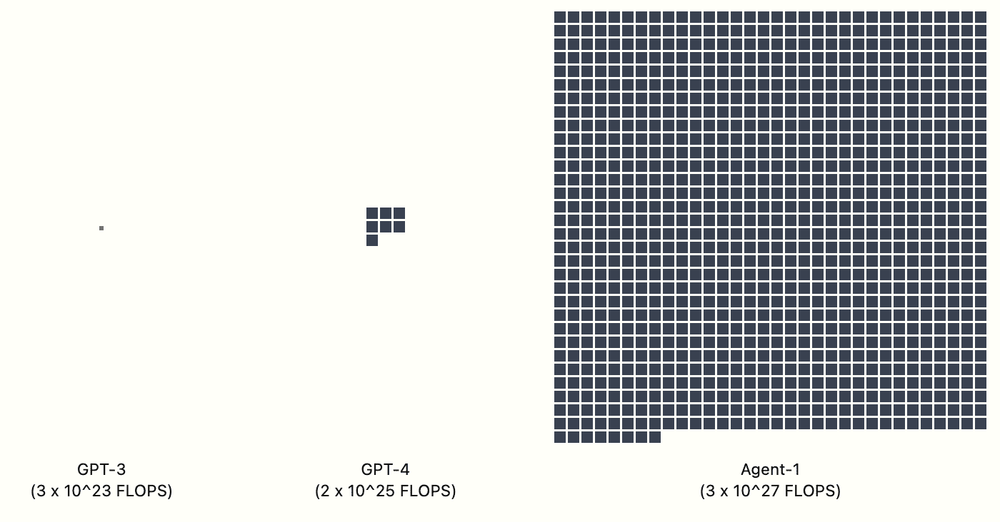
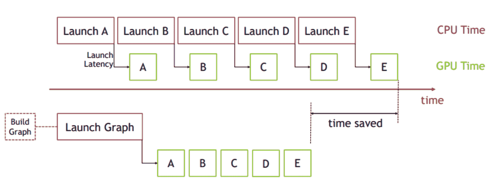
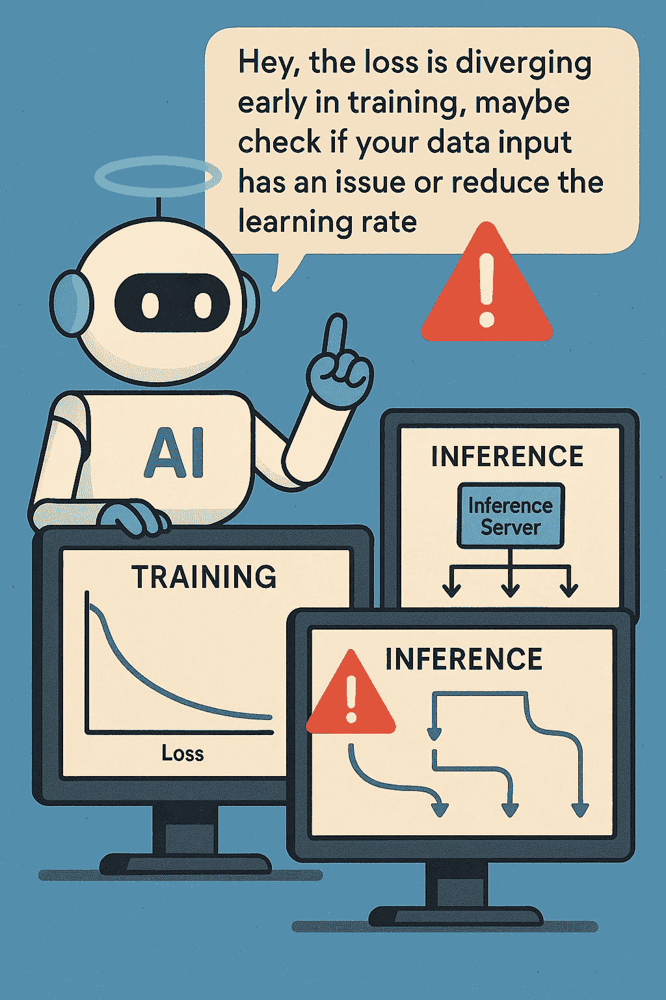
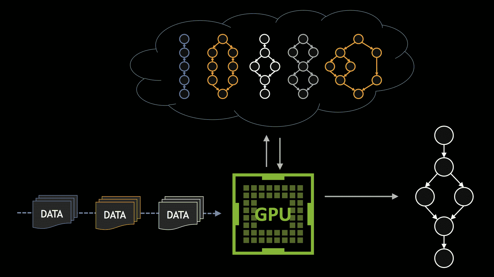
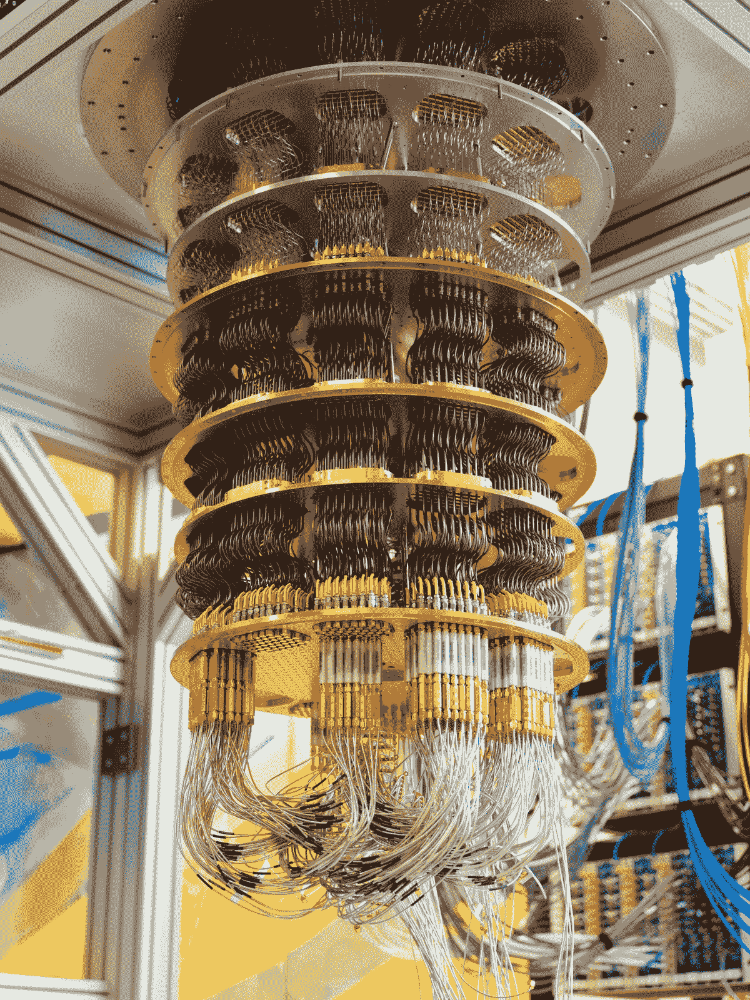

# 第 6 章 超大规模 AI 系统性能工程的未来趋势

前一章的案例研究让我们对一些真实世界、全栈和超规模的 AI 优化研究有了概览。展望未来，AI 系统性能工程师将面临挑战与机遇交织的激动人心局面。下一代 AI 模型将需要更大、更快的硬件——以及更智能、更高效的使用方式。

值得关注的关键趋势包括：对大规模 AI 数据中心的高度关注、智能软件工具链、AI 辅助的系统优化器、面向推理的优化、更快的光学互连、将计算卸载到网络硬件、3D GPU 和内存、能源效率与可持续性、混合经典-量子计算的出现，以及有助于扩展到 100 万亿参数模型的创新。在本章中，我们将探讨这些趋势，并始终聚焦于对性能工程师具有实用价值的洞见和最佳实践。

## AI 与科学计算的融合

随着时间的推移，“AI 超级计算机”与基于 HPC 的“科学超级计算机”之间的界限将逐渐消失。我们已经在朝这个方向发展，因为像 GB200 NVL72 这样的现代 GPU 系统已经能够执行传统的 HPC 模拟。反过来，科学应用也越来越多地使用 AI 方法来加速发现。在不久的将来，GPU 将成为真正通用的计算引擎，同时服务于模拟和 AI。

事实上，在 NVIDIA 的一篇[博客文章](https://blogs.nvidia.com/blog/blackwell-scientific-computing/)中，该公司强调了 Blackwell 带来的巨大科学计算提升，包括在 Blackwell 上运行天气模拟的成本比 Hopper 低 200 倍——某些数字孪生工作负载的能耗也降低了 300 倍。这些数字是在同一款同时实现 AI 突破的硬件上取得的。

这一趋势是工作负载的融合：百亿亿次天气模拟可能会直接纳入用于亚网格物理的神经网络组件，在同一批 GPU 上并行运行。我们还将看到专门为增强和引导模拟而训练的 AI 模型，与 HPC 基础设施上的任务并发运行。这种融合将推动系统软件支持更高的异构性。调度软件将在同一 GPU 池中高效地混合编排 AI 训练任务和 HPC 任务。编程模型可能会允许在单个应用中无缝切换张量核心操作和经典双精度算术运算。

可以预期，许多科学突破将来自 AI 增强的模拟，例如分子动力学模拟中关键的量子化学计算由 AI 模型加速——所有这些都在同一台机器上执行。NVIDIA 显然正在为这一未来做准备，确保其 GPU 在 HPC 和 AI 领域都表现出色。Blackwell GPU 在科学计算任务中比 CPU 快 18 倍，同时在 AI 任务中表现优异，这一事实就是一个早期信号。

事实上，我们很可能不会再分别谈论“AI 系统”和“HPC 系统”。只会存在能够处理全方位计算问题的加速计算系统。对于性能工程师而言，这意味着来自 AI 领域的技术和优化——例如混合精度和稀疏性——将惠及 HPC。反之亦然，来自 HPC 领域的技术和优化——例如数值稳定性技术和调度算法——将惠及 AI 训练。

这种 HPC 与 AI 融合的趋势最终将带来更强大、更多功能的计算平台。未来的超级计算机可能会在上午解决一个物理问题，下午训练一个大规模 AI 模型，而且两者同样熟练。

## 大规模数据中心赋能自我改进、持续学习的 AI 智能体

2025 年初，[AI Futures 项目](https://ai-futures.org/)发布的一份[报告](https://ai-2027.com)描述了一系列里程碑以及用于衡量技术进展、提升研究速度，并为未来几年 AI 研发带来变革性收益的 AI 模型/智能体。报告描述了前沿 AI 实验室目前如何设计和建造世界上有史以来最大的 AI 数据中心。

这些超级集群将提供比以往系统指数级更多的算力，并带来模型性能的巨大飞跃。作为背景，训练 GPT-3 需要 3×10²³ FLOPs，而训练 GPT-4 需要 2×10²⁵ FLOPs。这些新数据中心的设计目标是训练算力达到 10²⁷ 和 10²⁸ FLOPs 的模型，如图 6-1 所示。它描述了一个虚构的 Agent-1 模型，该模型使用的训练算力比 . 多两个数量级。

**图 6-1.** 训练 GPT-3 和 GPT-4 所需的实际算力，与 AI Futures 项目研究人员所描述的虚构下一代模型 Agent-1 的预期算力对比。（来源：https://ai-2027.com）

这些大规模集群将提供比以往多 2 到 3 个数量级的研究能力，并为持续更快的训练运行和更短的反馈循环奠定基础。其结果是构建了一个强大的平台，能够释放前所未有的吞吐量和效率，大幅缩短研究周期，并加速机器学习领域的突破性发现。

Agent-1 预计将成为一个自我改进的模型，能够实时生成和优化代码。通过自动化从常规调试到复杂内核融合的各种编码任务，这一前沿 AI 系统缩短了获得见解的时间，并拓展了全世界研究工程师的创意边界。自动化编码如同力量倍增器，支持快速迭代，让研究人员能够以更少的人工开销探索更大胆的想法。

这些大规模 AI 系统预计将支持模型的持续微调和改进。后续模型 Agent-2 可能是一个永不停止训练的持续学习型 AI。因此，Agent-2 的设计不是通过检查点来部署静态模型，而是每天根据新生成的合成数据更新其权重。

这种持续学习过程通过不断优化性能并适应新信息，确保系统始终处于最前沿。这种方法保证了数据效率和模型智能的提升能够长期持续，同时显著缩短了相继突破之间的间隔。借助这一持续学习框架，该组织为在快速变化的研究领域中保持领先树立了新标杆。

Agent-3 被描述为一个利用算法突破大幅提升编码效率的 AI 系统。通过集成先进的神经暂存器以及迭代蒸馏与放大技术，Agent-3 转变为一个快速、经济高效的超人级程序员。

Agent-3 可并行运行多达 20 万个副本，从而创建一支相当于数万名顶级人类程序员、且运行速度快 30 倍的虚拟劳动力。这一突破不仅能加速研究周期，还能让高级算法设计变得更加普及，使新想法得以快速构思、测试和完善。由此带来的研发加速，为 AI 性能持续、可衡量的提升铺平了道路。

自我改进的 AI 很快就会达到能够在研发任务中有效超越人类团队的程度。这些系统可以不间断地持续运行，以远超人类能力的速度勤勉地处理海量数据流并优化算法。

永不停歇的改进循环意味着每一天都会带来模型准确性和效率的新提升。这种自我改进的进程优化了研发流程，降低了运营成本，并实现了前所未有的创新水平。此时，人类团队的角色转变为监督和顶层战略制定，而 AI 负责完成繁重的工作，并以重新定义技术未来的速度交付突破。

Agent-4 进化为一名超人级研究员，集中体现了超人级研究能力的潜力。它建立在前代模型的基础之上，但通过重写自身代码并以最高效率优化复杂研究任务的能力而独树一帜。

Agent-4 展现出一种能够加速问题解决的智能形式，并通过精炼的机制可解释性来阐明其内部决策过程，从而帮助理解 AI 底层算法和推理过程的内部运作。在实际应用中，Agent-4 的表现使其能够解决科学挑战、生成创新研究设计，并拓展生成式 AI 模型所能达到的边界。它完成这一切的速度是人类无法企及的。这一突破将通过创造发现与技术进步的良性循环，标志着 AI 研发的转折点。

这些 Agent 的演进展示了 AI 系统基础设施、自动化编码、持续学习和自我改进模型方面的进步。每一代都极大地提升了研究生产力与创新能力。它们共同为这样一个未来奠定了基础：AI 系统的性能与效率变得至关重要，并达到前所未有的水平。

## 智能编译器与自动化代码优化

我们正在进入 AI 性能工具链中极其智能的编译器和自动化时代。性能工程师手动调优每个 CUDA 内核或摆弄每个底层旋钮的日子已经一去不复返。如今，越来越多的高层工具甚至 AI 驱动的系统正在承担繁重的工作，以榨干最后一点性能。

PyTorch、TensorFlow 和 JAX 等 AI 框架正在快速发展，借助智能编译器和执行图优化器来利用最新的 GPU 能力。PyTorch TorchDynamo 和 OpenAI 的 Triton 编译器等技术可以自动执行优化，例如使用 NVIDIA Tensor Cores 进行内核融合，以及通过 Tensor Memory Accelerator (TMA) 进行异步数据移动。

此外，OpenAI 的 Triton 编译器允许开发者使用其基于 Python 的语言编写 GPU 内核。Triton 在底层将这些基于 Python 的内核编译为高效的 CUDA 内核，但这一复杂性对 Triton 用户来说是不可见的。

这类工具正变得日趋强大。事实上，OpenAI 和 NVIDIA 目前正在紧密[合作](https://developer.nvidia.com/blog/openai-triton-on-nvidia-blackwell-boosts-ai-performance-and-programmability/#:~:text=The%20open,through%20an%20intuitive%20programming%20model)，以确保 Triton 完全支持最新的 GPU 架构，并自动利用其专用特性。一旦新一 GPU 代发布，更新后的 Triton 编译器就会展现出 GPU 的新能力，而研究人员或工程师无需了解底层的 C++ 代码或 PTX 汇编代码。相反，他们只需编写高级 Python 代码，编译器便会针对特定 GPU 环境生成优化后的代码。

很快，我们手工编写的许多优化都会被自动处理。内核自动融合、内核启动参数的自动调优，甚至数值精度的决策，都可以交给编译器和 AI 助手来完成。

利用 AI 来优化 AI 软件，是相当一段时间以来不断发展的更大趋势的一部分。事实上，谷歌 DeepMind 早在 2022 年就通过 [AlphaTensor](https://www.quantamagazine.org/ai-reveals-new-possibilities-in-matrix-multiplication-20221123) 给出了一个引人注目的概念验证。正如前一章所讨论的，AlphaTensor 是一个 AI，它发现了比任何人类开发的算法都更高效的矩阵乘法新算法。如果 AI 能在矩阵乘法上击败人类 50 年的手工数学调优，为什么不给 AI 一个机会，让它找到在专为矩阵乘法优化的硬件上进行矩阵乘法的更好方法呢？

如前一章所述，其他公司也在探索这些 AI 辅助优化。一家名为 Predibase 的初创公司利用强化学习（RL）训练了一个大语言模型（LLM），使其能够在给定参考 PyTorch 函数的情况下编写高效的 GPU 代码。他们构建的 LLM 接收高层操作并生成自定义的 CUDA/Triton 内核。这些代码既正确，又比人工优化的版本更快。

Predibase 报告称，其 AI 生成的内核在一组基准测试任务上的性能比 OpenAI 自家的优化器以及我们讨论过的 DeepSeek-R1 等强基线系统高出约 3 倍。这种由 AI 驱动的自动调优很可能成为性能工程师标准工具链的一部分。我们或许很快就能以特殊的"性能"模式运行 PyTorch 模型。在底层，AI 智能体将迭代地重写和测试生成的内核，以加速特定硬件上的特定工作负载。这就像编译器里住着一位不知疲倦的性能工程师——不断尝试让你的代码在每一次迭代中运行得更快。

在内核生成之外，现代框架在执行图和调度方面也变得越来越智能。图执行有助于减少 CPU-GPU 同步开销，并为整个图上的全局优化打开了大门。NVIDIA 的 CUDA Graphs 等技术允许将一系列 GPU 操作及其依赖关系捕获为静态图，并以更高效的方式启动，如图 6-2 所示。

###### 图 6-2。 CUDA 中的图执行在顺序启动多个内核时可减少开销（来源：https://pytorch.org/blog/accelerating-pytorch-with-cuda-graphs/）

我们看到 AI 框架会自动将训练循环和其他重复模式捕获到图中以减少开销。即使执行图是动态的而不是静态的，框架也可以追踪一次，然后重复运行该追踪。

此外，通信与计算的重叠将越来越自动化。过去这需要人工安排，但系统可能会分析你的模型并意识到，例如，当 GPU 1 正在计算第 10 层时，GPU 2 可以并行开始计算第 11 层——实际上在底层实现了流水线并行。

我们见过许多关于如何实现 3D、4D 和 5D 并行来最大化训练和服务大模型时 GPU 利用率的复杂论述。这类技术既是一门艺术也是一门科学，目前需要大量的人类直觉和经验。虽然这些技术目前还写在诸如 [Hugging Face 的超大规模实战手册](https://www.threads.net/@sung.kim.mw/post/DGQ85hVyDtm?hl=en#:~:text=,why%20overlap%20compute%20%26%20communication)之类的专家指南中，但人们希望它们很快会被融入编译器、库和框架之中。

从本质上讲，AI 框架应该理解这些模式并调度工作，让分布式系统的所有部分都保持忙碌——无需用户对每个 GPU 流、内存传输和网络调用进行性能分析、调试和优化。例如，也许有一天我们会有一个 AI 顾问，当你定义一个 5000 亿参数的模型时，它会立即建议："你应该在每个节点上使用 8 路张量并行，然后在节点间使用 4 路流水线并行。另外，为了获得最佳效率，请使用这些层分组和块大小。"

对性能工程师来说，这将极大地提升生产力。你不必尝试无穷无尽的策略和配置，而是可以从一开始就向 AI 系统询问接近最优的解决方案。通过将人类洞察与编译器/AI 自动化相结合，你可以用比过去更少的精力获得最优结果。这有点像再一次从汇编语言走向高级语言，因为我们将更多责任委托给了工具。对性能工程师而言，这意味着我们的角色更多地转向引导这些工具，并快速验证它们是否做得很好，而不是缓慢地手动试验和验证一切。

总而言之，AI 的软件栈正变得越来越智能和自主。这里的最佳实践是拥抱这些工具，而不是与之对抗。善用像 OpenAI Triton 这样的高级编译器，它们了解你的硬件能力和性能选项。同时，留意新的 AI 驱动优化服务——它们起初可能看起来像黑盒，但它们封装了许多来之不易的性能知识。

## AI 辅助的实时系统优化与集群运维

自动化的推进不仅限于代码层面——它同样发生在系统和集群运维层面。未来，AI 系统将越来越多地自我管理和优化，尤其是在大规模训练和推理集群中，任何给定时间点都有大量并发作业和请求在途，因此需要复杂的资源共享策略。

一个即将到来的发展是 AI 驱动的自主调度和集群管理。如今，我们对 Kubernetes 和 SLURM/HPC 集群使用的是基本静态的启发式规则和相对简单的资源分配机制。但设想一下，一个智能体观察整个集群的状态，并学习如何调度推理请求和训练作业以实现最大整体吞吐量。

这个调度智能体可能会了解到，某些请求或作业可以共存于同一节点而互不干扰——也许因为一个是计算密集型，而另一个是内存带宽密集型。通过摄取大量监控数据，AI 调度器可以动态地打包和迁移任务，使所有 GPU 保持忙碌、最大化有效吞吐量，并最小化空闲时间。

从某种意义上说，集群开始表现得像一辆自动驾驶汽车，根据实时状况不断调整自己的驾驶策略（资源分配），而不是沿着固定路线行驶。对性能工程师而言，好处是更高的资源利用率和更少的瓶颈。我们的工作将转向为 AI 调度器设定高层策略和目标，让它去处理具体细节。

我们还会看到 AI 性能副驾驶协助系统运维人员。LLM 可以以辅助角色成为基础设施的一部分。例如，性能工程师可能会有一个 AI 助手，可以问它："如何加速我的训练作业？"并得到有见地的建议。这听起来有些异想天开，但考虑到这样的助手可以用过去数千次运行、日志和调优积累的知识来训练，这是合理的。

AI 性能副驾驶还可能识别到你的 GPU 内存使用率较低，并建议增大批大小，或者注意到你的梯度噪声尺度较高，并建议调整学习率计划。这个智能体将封装人类专家来之不易的经验——让这些知识随时可用。

类似地，AI 助手可以监视训练任务和推理服务器，并标记异常。例如，助手在监控一个训练任务时可能会说：“嘿，损失在训练早期就开始发散，也许你应该检查一下数据输入是否有问题，或者降低学习率”，如图 6-3 所示。

###### 图 6-3. AI 助手监控长时间运行的训练任务，并建议修复异常的操作

目前，Splunk（现为思科）和 PagerDuty 等公司已经在系统日志数据上使用 AI 模型来预测故障或检测数据中心中的异常。将这种方法扩展到针对 AI 工作负载的遥测技术正在积极推进中。简而言之，我们将为每个任务和每个推理服务器配备一双全新的 AI 眼睛——实时监控并提供建议。

AI 的另一个强大用途是 AI 系统的自动化调试和故障分析。当一个训练任务在运行 3 个月的中途失败时，人类必须阅读错误日志、设备统计信息，甚至可能还有内存转储文件，才能弄清楚出了什么问题。是硬件故障？数值溢出？还是网络抖动？

在未来，AI 系统可以消化包括日志、指标和警报在内的所有数据——并且比现在更快地指出可能的原因。它可能会说：“节点 42 在任务崩溃前出现了 5 次 ECC 内存错误——很可能是 GPU DIMM 故障。”或者，“损失在第 10000 次迭代时变成了`NaN`——可能是梯度不稳定；可以考虑进行梯度裁剪。”

通过从过去的许多事件中学习，AI 故障排查器可以为工程师节省许多小时的排查工作。一些大型计算站点已经在使用事件数据库训练模型，以预测故障并建议修复方案。

更进一步，强化学习（RL）可以应用于系统行为的实时控制，这是固定算法难以企及的。例如，可以训练一个电源管理 RL 智能体，在实时系统中持续调整频率和核心分配，以最大化每瓦性能。这个智能体将通过实时分析系统来学习最优策略。

另一个例子是主动管理 AI 模型中的内存。AI 智能体可以学习哪些张量保留在 GPU 内存中，哪些交换到 CPU 或 NVMe——超越“交换最近最少使用的”这类静态规则。通过观察实时访问模式，AI 可以更高效地管理缓存。当模式不明显或依赖于工作负载时，这种方法尤其有效。

顶尖从业者已经在使用 RL 优化缓存淘汰、网络拥塞控制等。超大规模系统的复杂性——涉及数百个相互作用的组件和资源——使其成为这类基于学习的控制的主要候选对象。可调参数实在太多，人类无法及时摸索出最佳设置——而且还需要以实时适应不同工作负载的方式进行调节。

对于性能工程师而言，AI 辅助运维智能体的兴起意味着其角色将更多地转向编排和监督 AI 驱动的流程，而不是手动调整每一个参数。这在某种程度上类似于现代飞机中飞行员管理自动驾驶仪的方式。他们仍然需要深厚的知识和监督，但大部分毫秒级的控制都已自动化。驾驶开启全自动驾驶（FSD）模式的特斯拉的人也一样。驾驶员仍然需要知识和直觉来避免复杂情况和预防事故，但车辆的控制由 FSD 软件自动化完成。

为了引导 AI 助手高效管理我们的集群，我们只需设定目标、提供安全和公平的护栏，并处理 AI 从未见过的新情况。负载均衡、故障恢复和内存缓冲区调整等常规优化由 AI 处理。拥抱这一范式对于未来非常重要。在如此复杂的系统中坚持手工操作的人，只会被那些让自动化运行的人超越。这些对 AI 自动化持开放态度的人将能够把精力集中在人类的直觉和创造力上——这正是他们在这一崭新时代中创造最大价值的地方。

## 将稀疏性与条件计算作为一等公民

随着模型规模和能力不断增长，应对其计算需求的最有前景的方法之一就是避免做不必要的工作。很快，硬件和软件将大力拥抱稀疏计算和条件计算。NVIDIA 的 Ampere 架构迈出了第一步，通过[引入](https://developer.nvidia.com/blog/accelerating-inference-with-sparsity-using-ampere-and-tensorrt/#:~:text=2%3A4%20structured%20sparse%20matrix%20W%2C,and%20its%20compressed%20representation)结构化 2:4 稀疏性到 Tensor Core 中。当网络将 50%的权重归零时，这实际上使吞吐量翻倍。在实践中，在 A100 GPU 上使用剪枝模型进行推理时，与稠密模型相比，稀疏性大约能带来 30%的每瓦性能提升。

我们很可能会看到这些能力得到大幅扩展。未来的 GPU 甚至可能支持动态稀疏性，即计算模式可以在运行过程中跳过零或无关的激活——不仅仅是固定的 2:4 模式。这与混合专家（MoE）等模型架构相呼应，这类架构只为每个输入激活模型参数的一个子集。

NVIDIA[暗示](https://www.nvidia.com/en-us/data-center/technologies/blackwell-architecture/#:~:text=The%20second,of%20replacement%20for%20larger%20precisions)了这一方向，指出 Blackwell 的 Transformer 引擎将加速 MoE 模型以及稠密大语言模型（LLM）。例如，该硬件经过调整，可以快速在不同的“专家”之间切换，并利用网络并非所有部分都会同时被使用这一优势。

随着编译器和软件库的不断发展，我们期望它们能够学会自动识别并利用神经网络中的不规则（或非结构化）稀疏性。如今，这是一项艰巨的任务，因为大多数编译器都是针对规则、可预测的数据结构进行优化的。

考虑一个动态神经网络，其执行图可以通过`if/else`语句从一个输入或训练迭代变为另一个。借助动态网络，你可以构建条件执行，使得只有与给定输入相关的图部分才会运行。例如，一个`if/else`分支可以让网络在不需要时跳过整个部分，如图 6-4 所示。

###### 图 6-4. 基于输入数据的动态图执行（来源：https://developer.nvidia.com/blog/enabling-dynamic-control-flow-in-cuda-graphs-with-device-graph-launch/）

这减少了必须执行的操作数量。这意味着网络可以有选择地只执行图中“活跃”的部分，与总是运行完整计算图的静态网络相比，可以更高效地利用计算资源、降低功耗并缩短处理时间。

动态网络往往会产生不规则的稀疏模式。这意味着零值或不活跃单元以不均匀、不可预测的方式散布。当前编译器在数据按规则、易预测的模式排列时表现最佳，因此很难检测并优化这些不规则性。要充分挖掘动态网络的潜力，需要编译器与硬件两方面的改进，包括编译器分析与优化技术的进步，以及能够有效处理非均匀稀疏性的新硬件设计。

在硬件方面，GPU 有望获得对不同块大小的块稀疏（block sparsity）支持。目前，硬件在设计时通常假设神经网络数据排列整齐——即使是不活跃的部分也是如此。有了块稀疏支持，GPU 将能够更智能地处理这些 `if/else` 分支，即通过"流过"这些分支的方式，而不会产生与跳过（不活跃）路径相关的常规计算开销。本质上，如果动态网络选择不运行某个分支，GPU 就不会遭受典型的延迟或性能损失，从而带来显著的性能提升。

许多最先进的模型很可能会默认采用稀疏方式——无论是通过训练技术还是自适应推理。相应地，GPU 为这些稀疏操作提供的每秒万亿次操作（tera-ops）将高于稠密操作。学术界的工作已经取得了进展。最近的一个研究原型"[Eureka](https://ieeexplore.ieee.org/document/10411411)"通过在硬件中处理更通用的稀疏模式，展示了超越 Ampere 2:4 稀疏性 4 倍以上的加速。NVIDIA GPU 可以采纳类似的想法。

区分稠密 TFLOPS 与稀疏 TOPS，对于准确了解现代 AI 应用中的计算效率非常重要。对于稀疏工作负载，许多操作根本不会执行，因为硬件检测到输入中的某些部分（例如低于某个阈值的权重）对最终结果的贡献可以忽略不计。这种跳操作机制使 GPU 能够将其在有用计算上的工作速率有效翻倍。因此，如果将稀疏计算吞吐量与稠密计算吞吐量进行比较，人们很容易低估 GPU 的真实能力。

想象你有一台能够执行海量数学运算的机器。当我们说一块 GPU 拥有"500 TFLOPS"时，我们的意思是：如果它必须执行每一个浮点运算（例如乘法或加法）而绝不跳过任何操作，那么它每秒可以完成 500 万亿次这样的运算。这就是"稠密"度量。

然而，在稀疏 AI 任务中，许多这样的操作实际上并不需要，因为网络中的许多权重——即它用来做决策的数字——非常微小，以至于不会影响结果。现代 GPU 可以检测这些接近零或等于零的值，并跳过不必要的计算。

由于 GPU 跳过了大量这些不重要的操作，它实际上完成了更多有用的工作，即有效吞吐量（goodput）。因此，我们不再像稠密 TFLOPS 那样通过统计每一次理论上的乘法来衡量性能，而是使用一种名为 TOPS（每秒万亿次操作）的度量，只统计 GPU 在稀疏工作负载上实际执行的操作。因此，一块 GPU 的额定性能可能是 500 稠密 TFLOPS，但在跳过针对零值的不必要工作后，它的有效吞吐量可以达到 1000 稀疏 TOPS。

#### 提示

尽管稀疏吞吐量以 TOPS 而非 TFLOPS 表示，但它仍然使用浮点运算。区别纯粹在于实际执行的操作数量。TOPS 只统计有价值的操作——不统计被跳过的操作。

一个简单的类比是工厂装配线：如果每个工人都对每件产品进行加工，这条线每分钟能够组装 500 件产品。但如果某件产品已经完成——或者不需要进一步组装——工人可以跳过这件产品，转而处理下一件。如果他们实际上每隔一件就跳过一件，这条线看起来每分钟处理了 1000 件有用产品，尽管其每分钟组装 500 件的完整能力并没有改变。

性能工程师的关键启示是：专注于你的系统在处理你的工作负载时的实际有效吞吐量。这同样强调的是系统完成的有用工作，而不仅仅是原始容量——即文档中记载的 GPU 理论上能够执行的操作数量。对于利用数据稀疏性的现代 AI 任务来说，这一视角至关重要。

稀疏性和条件执行很可能会从小众优化走向舞台中央。GPU 架构和模型设计的进步将为此提供支撑，并使我们能够处理拥有数万亿参数的模型，确保在任何给定时刻，我们只计算模型中对生成准确响应最有用的部分。

## GPU 在整个 AI 流水线中执行更多任务

随着 GPU 变得越来越通用、越来越强大，它们将开始进入传统上由 CPU 负责的领域。一个突出的例子是数据预处理和分析。将这些工作负载转移到 GPU 上，可以消除传统上降低吞吐量、增加延迟的 I/O 和互连瓶颈。

NVIDIA 的 Blackwell 架构为这一未来提供了[线索](https://www.nvidia.com/en-us/data-center/technologies/blackwell-architecture/)：它在 GPU 上直接集成了解压缩引擎（Decompression Engine），用于访问压缩数据并极快地解压大量数据。它支持 LZ4、Snappy 和 Deflate 等流行压缩格式。

下一代系统将使用 GPU 来训练 AI/ML 模型，同时摄取压缩数据、解析数据、增强数据，并执行数据库连接和过滤操作。所有这些都将在 GPU 内部完成。事实上，NVIDIA 正在通过 RAPIDS（GPU 加速的 Spark 和 ETL）以及将 Apache Arrow 数据格式集成到 GPU 内存等举措，积极朝着这一目标努力。基于 GPU 的系统将能够在无需往返 CPU 的情况下完成数据摄取、分析、训练和推理。

借助 Grace-Blackwell，我们已经看到 GPU 能够以 900 GB/s 的速度直接从 CPU 内存中拉取数据并实时解压。GPU 可能会获得更多逻辑单元或优化核心，用于 SQL 查询处理、图遍历，甚至无需任何 CPU 资源即可运行推理 Web 服务器。对于某些工作负载来说，这可能并不理想，但这个选项值得测试。

动机很明确。通过避免在不同处理器之间移动数据的延迟，GPU 可以从 NVMe 加载海量数据集，对其解压和过滤，然后立即在过滤后的数据上开始训练模型。这大大减少了开销和复杂性。

我们已经看到 Blackwell 加速端到端数据分析流水线的能力，正如 NVIDIA 的[博客](https://www.nvidia.com/en-us/data-center/technologies/blackwell-architecture/#:~:text=Data%20analytics%20and%20database%20workflows,of%20data%20for%20data%20analytics)所提到的：利用 Grace-Blackwell 的 CPU 内存作为缓冲区，在 GPU 上进行解压，从而加速 Spark 查询。

AI 系统的性能在于优化整个全栈工作流——而不仅仅是机器学习数学。这意味着 GPU 正在成为一站式计算引擎。如果未来 NVIDIA GPU 在芯片上集成 NIC 和类似 DPU 的功能，从而无需任何 CPU 干预即可摄取网络数据并对其进行预处理，那也不足为奇。我们可能很快就会看到曾经多阶段的流水线走向融合。AI 加速器将处理从数据摄取到洞察的整个过程，模糊数据工程与模型训练之间的界限——从而提升 AI 系统的整体性能。

## 高吞吐量、低延迟的推理编排

随着生成式 AI 模型和其他大规模 AI 服务的激增，高效地为模型提供服务成为当务之急。推理服务是软件与 GPU 能力同步演进的另一个例证。NVIDIA 于 2025 年推出的开源 Dynamo 推理框架，正是这种面向生成式 AI 的专业化编排趋势的代表。

根据其发布[博客文章](https://developer.nvidia.com/blog/introducing-nvidia-dynamo-a-low-latency-distributed-inference-framework-for-scaling-reasoning-ai-models/#:~:text=NVIDIA%20announced%20the%20release%20of,AI%20researchers%C2%A0%20to%20accelerate%20AI)，Dynamo 可以将 LLM 推理吞吐量在全新 Blackwell GPU 集群上提升高达 30 倍。它采用先进的推理策略，例如将解码阶段与预填充阶段分离，并将其分布到多个 GPU 上。Dynamo 还支持动态负载均衡和模型状态的智能缓存。

Dynamo 还引入了缓存感知调度。例如，以能够避免为每个提示词冗余重新计算 Transformer KV 缓存的方式路由请求。借助令牌级调度、批量流水线和内存最优放置等技术，Dynamo 确保每一个 GPU 周期都不会被浪费。其结果是：即使模型规模扩展到万亿参数级别，也能提供更快速、响应更灵敏的推理服务，且每次查询的成本更低。

这些优化显著增加了每个 GPU 能够处理的请求数量。在实践中，运行 Dynamo 的 H100 或 Blackwell GPU 集群，在使用相同硬件但采用通用调度器的情况下，能够以更低的延迟服务更多并发聊天机器人用户。

## 硅光子与光互连

随着 GPU 集群规模不断扩大，对网络带宽的需求日益增加，光通信有望成为颠覆性的变革力量。我们预计，目前连接 GPU 和机架的铜缆将很快被光纤和共封装光学器件（CPO）大规模取代。NVIDIA 已经[宣布](https://nvidianews.nvidia.com/news/nvidia-spectrum-x-co-packaged-optics-networking-switches-ai-factories)了 `Spectrum-X` 和 `Quantum-X` 光子交换机原型，这些交换机将硅光子技术直接集成到数据中心交换结构中——每端口吞吐量达到 1.6 Tb/s。

此外，这些共封装光交换机与传统电以太网/`InfiniBand` 交换机相比，能效提升约 3.5 倍，并且能够在远得多的距离上保持信号完整性。在实际应用中，这意味着未来的 GPU 机架可以直接通过光链路连接。这将消除带宽与距离之间的权衡。

我们将看到用于跨机柜甚至跨机房连接 GPU 的光学 `NVLink` 或 `NVLink-over-optical` 技术，并且延迟损失极小。而拥有数万 GPU 的 AI 超级集群很可能会采用全光骨干网络，在整个数据中心内创建一个统一协同的系统。

NVIDIA 的愿景是将 AI 工厂扩展到跨多个物理位置的数百万 GPU。由于衰减和能源成本，这在今天的铜互连条件下根本无法实现。光子技术是唯一的前进道路。通过传输光子而非电子，网络将实现每链路每秒数太比特的带宽密度，并且每比特功耗更低。

不久之后，我们将看到共封装光收发器直接放置在 GPU 芯片旁边，在信号源头将高速电信号转换为光信号。这将大幅削减 GPU 间通信所需的能量，并在很大程度上消除分布式训练和推理中的网络瓶颈。

2020 年代后半叶，光链路很可能在 AI 基础设施中变得司空见惯，从板卡级互连一直到机架和数据中心级别。这是创建超大规模 GPU 集群的关键一步。

## 全球分布式数据中心（AI 工厂）

AI 部署的规模将超越单一数据中心和地理位置。我们很可能会看到覆盖全球的 AI 系统，其中多个数据中心“节点”作为统一资源协同进行训练或推理。为了以可管理的延迟连接远距离 GPU 集群，我们需要利用超高带宽的数据中心连接，例如光网络。

NVIDIA 首席执行官经常谈到“AI 工厂”或 AI 超级计算机。他设想用光子交换和光纤将这些工厂连接起来。一旦实现，例如，就可以将分布在三大洲的三个 100 万 GPU 集群视为一个拥有 300 万 GPU 的巨型集群，用于一次大规模、超大规模的训练运行。

事实上，2025 年发布的 `Spectrum-X` 光子平台明确[提到](https://nvidianews.nvidia.com/news/nvidia-spectrum-x-co-packaged-optics-networking-switches-ai-factories#:~:text=GTC%E2%80%94NVIDIA%20today%20unveiled%20NVIDIA%20Spectrum,optical%20communications%20at%20massive%20scale)了跨站点扩展到数百万 GPU 的目标。大约十年后，网络和分布式系统可能发展到足以让这一目标在特定工作负载中成为现实。我们可能会见证一个神经网络训练任务同时运行在东京、伦敦和硅谷，通过跨洋光链路保持同步。

这里的趋势是数据中心规模演变为全球规模。从性能角度看，考虑到光速限制、容错、功耗和能源等问题，挑战巨大。但行业可能会通过算法手段来缓解这些挑战。例如，一些设计巧妙的异步更新方案可以容忍延迟，或者采用张量、流水线和专家并行策略来减少节点间通信。

如果成功，训练或服务大规模 AI 模型的有效算力将不再受地理位置限制。其中一个具体衍生成果可能是真正实时的全球推理服务。想象一个分布在全球的 AI 模型：响应在各区域分别计算一部分，然后在返回给最终用户之前进行聚合。

今天，这种模式的种子已经体现在内容分发网络和分布式数据库中，但很快它们将扩展到分布式神经网络。例如，NVIDIA 在 2019 年收购 `Mellanox`，表明他们正着眼于这样一个未来。他们希望网络和 GPU 一样快，这样位置就不再重要。性能工程可能既涉及单个集群内部的优化，也涉及跨全球集群的优化。全球统一、覆盖广域的网络将成为系统设计的一部分。未来的 AI 很可能将整个地球视为其计算机。

## 智能网络与分布式计算卸载

与光互连并行的是，未来将高度依赖 `BlueField` 数据处理单元（DPU）等网络卸载引擎，以支持扩展到拥有成千上万乃至数百万 GPU 的 AI 超级计算机。随着单个 GPU 的速度越来越快，为它们提供数据并在大型集群中协调它们成为一项严峻挑战。

如前文所述，`BlueField` DPU 本质上是智能网络接口控制器（NIC），配有专门的基于 ARM 的网络处理器，可处理从 `RDMA` 通信到存储访问的各种任务。DPU 将 CPU 和 GPU 从这些任务中解放出来，使它们能够专注于更高级、更有用的有效吞吐活动。例如，将集合通信算法卸载到 DPU，可以让 GPU 专注于纯计算，而 DPU 则负责梯度的 `all-reduce`。

NVIDIA 的一份可持续性[报告](https://www.nvidia.com/en-us/sustainability/#:~:text=Less%20Power%20Consumption)显示，当前 DPU 可将 CPU 利用率和系统总功耗需求降低 25%。其实现方式是以更高效率处理数据移动。

随着 GPU 集群规模不断扩大，DPU（数据处理单元）的作用将持续增强。我们很快将看到 DPU 深度集成到 AI 系统中。它们可能负责实时负载均衡、为分布式模型缓存参数，并执行加密等安全任务——而且所有这些都以极低延迟完成。我们很可能会达到这样一个阶段：每个服务器节点都内置一个 DPU，本质上充当智能调度器，协调数十块 GPU。

DPU 带来的另一项创新是网络内计算，比如 NVIDIA 的 `SHARP` 协议。借助 `SHARP` 和 DPU，NVIDIA 网络交换机可以在数据穿越网络时执行归约和聚合操作。这将大幅加速分布式训练和推理。将网络内计算与网络卸载相结合，DPU 帮助 AI 集群提升整体吞吐量和降低延迟。

很快，典型的 AI 系统将涉及分层通信模式，其中 DPU 和智能交换机将承担梯度、模型权重/层、优化器状态和激活值的大部分同步工作。其性能影响将非常显著，因为当扩展到极大数量的 GPU 和计算节点时，收益递减效应将减小——从而实现近似线性的扩展。这是一个网络不再是被动数据管道的未来。相反，网络是整体 AI 计算栈中的活跃部分。网络将与 GPU 紧密协作，从而在数千个节点和数百万个 GPU 上高效运行大规模模型。

## GPU 上堆叠 HBM 内存（3D GPU）

未来最具变革性的 GPU 硬件趋势之一是缩短 GPU 与其内存之间的物理距离。例如，将内存和 GPU 核心合并到同一个封装或裸片中。当今的 `HBM` 内存堆栈位于 GPU 旁边的硅中介层基板上。中介层负责布线和连接 GPU 与 `HBM` 内存，但其相对较长的走线会造成延迟和带宽降低。然而，目前正在开发的未来迭代版本，旨在将内存直接堆叠在 GPU 计算芯片之上，实现 3D 方式的结合。这将提升 GPU 与 `HBM` 之间的带宽并降低延迟。

SK 海力士（一家专注于 `HBM` 等内存产品的半导体巨头）与 NVIDIA 正合作推出一项极具开创性的 3D[重新设计](https://www.tomshardware.com/news/sk-hynix-plans-to-stack-hbm4-directly-on-logic-processors#:~:text=SK%20Hynix%20has%20started%20recruiting,may%20transform%20the%20foundry%20industry)方案，用于下一代 GPU，实现 3D 堆叠。他们将 `HBM4` 内存堆栈直接置于 GPU 处理器之上，从而无需使用中介层。这种方法将极大地提升逻辑与内存之间的带宽并降低延迟。这种提升可能是一个数量级的飞跃，类似于片上 `SRAM` 相对于片外 `DDR RAM` 的性能优势。

通过 3D 设计去除中介层，每个比特从 `HBM` 存储单元到 GPU 处理器只需传输几微米。这将使得每个堆栈的接口或数据通道可远超 1024 位。3D 堆叠将允许更大量数据的并发传输并行转移——从而提升整体内存带宽。

3D 设计将彻底改变芯片制造方式，因为 SK 海力士实质上会成为类代工厂——将其芯片集成并堆叠到 NVIDIA 生产的 GPU 处理器上。如果成功，这可能完全改观半导体制造业，并模糊无晶圆厂芯片设计公司与芯片制造代工厂之间的传统界限。

对 AI 系统性能而言，这影响深远。内存带宽一直是瓶颈，尤其是对于大模型和内存受限操作，比如 Token 生成/解码。通过逻辑-内存堆叠，未来的 GPU 可能拥有每秒数 PB 的内部带宽。

借助 3D 堆叠，我们可以为成千上万个 `Tensor Core` 提供数据，几乎不会出现数据饥饿的情况。想象一下，每个 GPU 流式多处理器（SM）的顶部都直接有一块 `HBM` 切片。这将使 `HBM` 成为更快的 `L2` 缓存的延伸。3D 设计中去除中介层还将大幅提升能效，因为目前 GPU 的大量能量消耗在通过中介层传输电信号的过程中。

很快，我们预计至少一代 NVIDIA GPU 将采用某种形式的计算-内存 3D 堆叠。它可能首先以多芯片模块的形式出现，即内存芯片堆叠在计算芯片之上，形成 `chiplet-on-chiplet` 架构。最终，也许我们会看到 GPU 处理器和 `HBM` 混合在同一个 3D 堆栈中。

性能工程师在不远的将来或许不会再讨论内存带宽这一瓶颈。相反，他们会关注其他因素，因为 GPU 的内存在实际上等同于在封装内了。然而，实现这一点面临巨大挑战，因为冷却 3D 堆栈——并维持这种组合堆栈的高良率——非常困难。尽管存在这些挑战，所有迹象都表明这项技术正在发展，且其落地会比预期更快。

## 大规模新能源效率与可持续性

随着模型和 GPU 集群指数级增长，它们对电力的需求也呈指数级上升。能源效率正迅速成为 AI 系统设计的首要目标——与原始性能并驾齐驱。我们在这方面已看到戏剧性的进展。例如，NVIDIA 的 `Grace-Blackwell GB200 NVL72` 机架级系统，在相同功耗下，性能比上一代基于 `H100` 的风冷[方案](https://www.nvidia.com/en-in/data-center/gb200-nvl72/)提升了约 25 倍。`GB200 NVL72` 能效的巨大飞跃源于多种因素，包括改进的 GPU 架构、先进的液冷技术，以及更好地让所有芯片保持高利用率运转状态。简单来说，`NVL72` 每焦耳能量做的有用功更多。

对性能工程师而言，这意味着功耗现已成为优化系统时的关键约束。以往，性能-价格比（性价比）是主要优化指标，但现在性能-功耗比（能效比）同样举足轻重。每一次优化都必须考虑能源效率。结构化稀疏性就是一个很好的例子——通过跳过不必要的运算，既节省功耗又节省时间。如果矩阵中一半可以为零，且精度损失极小，那么利用这种稀疏性，就能以大约一半的能量获得基本相同的结果。我们可以预见，未来的硬件和软件库/框架将为稀疏性及其他效率优化技巧提供更多支持，因此，在设计模型时考虑这些节能技术是明智之举。

另一个新兴的实践是与工作负载阶段相关的动态电源管理。例如，有时 GPU 处于计算受限（`compute-bound`）阶段，而其他时候则属于内存受限（`memory-bound`）或通信受限（`communication-bound`）阶段。现代 AI 系统会利用这些阶段转换。比如，当你的代码进入内存受限阶段时，一个智能调度器可能会临时降低 GPU 时钟频率或电压来节省功率、减少发热，因为当瓶颈在内存时，无需全速计算。然后，当你的代码进入计算密集阶段时，系统会重新提升时钟和电压，以最大化吞吐量。这种动态电压频率调节（DVFS）可能很快将自动运行于幕后。一个人工智能控制器可以动态地实时学习最优电源设置。

可持续发展方面的考量也在将可再生能源意识引入 AI 运营中。我们可能会把高耗能的训练任务安排到一天中绿色能源充足的时段。目前已有积极研究致力于将 AI 工作负载调度与可再生能源可用性对齐。设想这样一个未来仪表盘：它能显示 GPU 利用率，以及来自无碳能源的电力百分比。公司可能会开始炫耀：“我们在 2 个月内训练了一个 10 万亿参数模型——而且是用 80% 的可再生能源完成的！”作为性能工程师，你可能会发现自己需要与机房电力管理人员协同工作，思考在何时何地运行任务，以便在最小化碳足迹的前提下充分利用可用电力。

简而言之，面对电力约束，超大规模 AI 计算必须明智地扩展。追求每一分 `FLOPS` 固然很好，但高效地实现这一点才是真正的胜利。好消息是，像 `Grace-Blackwell NVL72` 这样的 AI 系统表明，业界正在大力投资能效。我们的工作将是利用这些进展：让 GPU 保持忙碌但不浪费，善用低精度模式和稀疏性等特性，并设计出能在可行时精打细算电力的工作流。这是一种相对较新的思维方式，将电力视为一种稀缺资源，需要与时间和金钱一起进行优化和预算。

## 先进冷却与能源再利用技术

数据中心已经在应对单机柜功率密度更高这一现实。`GB200 NVL72` 目前功耗为 120 kW，但在不久的将来很可能会超过 200 kW。考虑到可持续性，我们需要更广泛地采用尖端冷却方案，例如单相和两相浸没式冷却、带蒸发冷却的冷板，甚至是片上微流道冷却。一些 AI 数据中心已经在尝试浸没式冷却，将整块服务器主板浸入介电液体中。他们[报告](https://www.cnbc.com/2024/08/27/nvidia-partner-sustainable-metal-cloud-ai-data-center-energy-consumption.html#:~:text=This%20Nvidia%20partner%20can%20help,typically%20used%20in%20data%20centers)，与传统风冷相比，液冷能耗最高可降低 50%。

很快，许多 AI 集群将从零开始设计为使用浸没式冷却技术。这能提升能效，并让废热更容易通过热交换器被捕获。我们很可能会看到大型 AI 计算园区与相关设施集成，利用这些捕获的热量用于其他工艺——实际上是回收了能源。

在能源供应方面，NVIDIA 和其他公司将继续努力，以可再生能源和巧妙的储能机制为这些“AI 工厂”供电，以抵消峰值负载期间的能源需求。这对性能的影响在于，热约束是持续性能的关键限制因素。如果你能让 GPU 温度降低 20°C，它就有可能在多日训练运行中保持更高的时钟频率，并避免热降频。卓越的冷却直接转化为更快、更可靠的吞吐量。未来大多数高端 GPU 集群将采用浸没式冷却。

我们还将看到更多液冷机柜标准成为主流。正如美国供暖、制冷与空调工程师学会（ASHRAE）为风冷数据中心制定了指南，业界也将为 HPC 和 AI 集群标准化液冷机柜配置。事实上，2024 年，NVIDIA 将其 `GB200 NVL72` 机柜和冷却设计[贡献](https://developer.nvidia.com/blog/nvidia-contributes-nvidia-gb200-nvl72-designs-to-open-compute-project/)给了 `Open Compute Project`（OCP），以帮助建立高效、可扩展的液冷系统行业标准。

这一趋势将使数据中心能够继续提高计算密度，而不会撞上“热墙”。设想一个 48U 机柜容纳 100+ `PFLOPS` 的 `FP8` 计算能力。目前，只有借助先进冷却系统才可能实现这一点。

AI 系统性能不仅仅关乎 `FLOPS`。它还关乎消除那些阻碍 `FLOPS` 被充分利用的瓶颈。而其中一个瓶颈就是热量。业界将持续以新颖的冷却和能效技术来应对，使 GPU 能够运行得更热、更密集、更绿色。

## 混合经典-量子计算（CUDA Quantum）

把目光投向更远的地平线，我们会看到量子计算。众所周知，如果实用的量子计算机出现，它们可能会彻底改变某些类型的计算。虽然通用型量子 AI 尚未到来，但我们已开始看到将量子加速器集成到 AI 技术栈中的早期探索。X 量子计算机的图片见图 6-5。

### 图 6-5. Google 量子计算机（来源：https://quantumai.google/quantumcomputer）

NVIDIA 一直在通过其 [CUDA Quantum](https://developer.nvidia.com/cuda-q)（`CUDA-Q`）计划为这一量子未来做准备，该计划为混合量子-经典计算提供了统一的编程模型。其基本思想是，未来的 HPC 集群可能会让量子处理单元（QPU）与 GPU 和 CPU 并排，各自处理自己经过独特优化的任务。

在短期内，量子处理器可能仍会相对较小且专门化。例如，它们不会端到端地训练一个拥有 100 万亿参数的 `Transformer`，因为目前的量子设备根本无法处理这种规模的数据。不过，它们可以作为加速器，用于 AI 工作负载中出现的特别困难的问题。例如，某些优化问题或采样任务可以通过量子方法加速。

考虑一个大型生成模型，它在运行过程中需要从极其复杂的概率分布中进行采样。量子退火机或小型基于门的量子计算机或许能够利用量子叠加或隧穿来更高效地完成这种采样。如果是这样，混合算法可以让 GPU 处理绝大部分神经网络计算，然后将这一特殊采样步骤卸载给 QPU。`CUDA Quantum` 被定位为充当底层管道，让这种集成变得无缝顺畅。

作为性能工程师，这意味着如果量子计算达到对 AI 有用的程度，我们不必重新发明整个软件栈。我们只需将 QPU 视为另一个拥有自己的内核和优化技术的设备。这与我们今天相对于 CPU 来看待 GPU 的方式类似。事实上，`CUDA-Q` 已经允许你编写单个程序，在其中同时调用 GPU 内核和量子内核。你甚至可以在 GPU 上模拟量子部分以进行开发，如 NVIDIA [博文](https://developer.nvidia.com/blog/performant-quantum-programming-even-easier-with-nvidia-cuda-q-v0-8)所述。这很棒，因为我们可以从今天开始使用模拟来编写和测试混合算法，因为真正的大型 QPU 还没有大规模存在。这样一来，当这项技术成熟时，我们就能准备好在实际量子硬件上运行它们。

那么，作为性能专家，我们在这个领域应该关注什么呢？首先，密切关注量子硬件的进展——尤其是任何量子加速器在与 GPU 对比时哪怕表现出一点加速迹象的任务。截至撰写本文时，尚未有人在主流机器学习任务中展示出明确的量子优势，但关于量子核方法用于机器学习以及受量子启发的张量网络方法等研究仍在进行中。如果出现突破，那将标志着混合经典-量子计算已准备好登上主流舞台。例如，假设一个 QPU（量子处理单元）计算大型矩阵乘法或解决复杂组合优化问题的速度超过了 GPU。那将是迈向量子未来的巨大一步。

如果这种情况发生，性能工程师必须理解系统中 CPU、GPU 和 QPU 之间的数据移动和延迟。我们需要确保 QPU 节省下来的时间不会浪费在等待数据传输或设备同步上。这让人想起经典的异构 CPU-GPU 计算挑战，只不过这次的设备更加新奇且强大。

实际而言，目前没有什么重大改变。我们大多数人在不远的将来不会直接使用量子硬件。但很可能在十年内，某些 AI 工作负载的一部分将运行在单个 AI 系统中根本不同的计算基板上。类似于 GPU 在 CPU 之外引入了新范式，QPU 也将它们自身的特点和优化方式带入其中。我们工作的复杂性将再次跃升，因为我们将在一个应用中对 CPU、GPU 和 QPU（还有其他的吗？）进行性能分析和优化。未来充满乐趣！好消息是，像`CUDA-Q`这样的框架已经在思考如何为这些新设备提供一个统一的平台。

值得注意的是，当前你可以在开发过程中使用 GPU 来模拟量子算法。例如，NVIDIA 的`cuQuantum` SDK 允许在 GPU 上快速模拟中等量子比特数量的系统。如果有人设计了一个涉及需要 30 个量子比特的量子程序的 AI 算法，我们可以在开发和测试阶段在 GPU 上模拟这些量子比特。

这意味着 HPC GPU 可能同时运行神经网络代码和量子电路模拟。优化量子电路模拟实际上与优化神经网络操作非常相似——都是优化与量子门对应的线性代数和矩阵运算。

所以有趣的是，高层级的优化原则在不同设备间是相通的。都关乎高效的线性代数、内存带宽利用率和并行性。对量子感兴趣的性能工程师现在就可以在模拟方面做出贡献。

AI 量子计算是一种前瞻性的押注，但基础正在奠定。这里的最佳实践就是保持好奇心和开放思维。动手玩玩量子编程框架和模拟器，了解 QPU 工作的基本原理。关注那些展现出 AI 加速潜力的发展动态。这样，当量子时代到来并应用于 AI 工作负载时，你就能第一时间跟上节奏，而不是手忙脚乱地追赶全新概念。这是一个令人兴奋的前沿领域，全新的性能工程挑战和机遇正等待着我们。

## 迈向 100 万亿参数模型的扩展

最后，让我们重新审视向超大规模、100 万亿参数模型不断迈进的步伐。我们已经突破了万亿参数的门槛。现在的问题是如何在未来几年扩展到数十甚至数百万亿参数模型。这样的模型对我们的系统提出了什么要求？需要哪些创新才能使训练如此强大的模型变得可行？这正是我们所讨论的一切汇聚之处——包括高效硬件、智能软件、巧妙算法。要达到 100 万亿参数模型，需要使用书中所有的技巧——以及一些可能尚未被发现的技巧。让我们深入探讨！

在硬件方面，显而易见的需求是更多的内存和更大的带宽——最好是直接集成在 GPU 上。如果你有 100 万亿参数并想训练它们，你需要高效地存储和移动海量数据。下一代内存技术将至关重要。高带宽内存（HBM）在持续演进：HBM3/3e 用于当前一代 GPU，HBM4 很可能用于下一代 GPU。HBM4 再次将每个堆栈的带宽翻倍——大约每个堆栈 1.6 TB/s。它还将把每个堆栈的容量提高到可能每个模块 48GB 或 64GB。

HBM4 更高的容量和吞吐量意味着未来的 GPU 可能配备，比如说，8 个 64GB 的 HBM4 堆栈，单块板上总共 512GB 的超快 HBM 内存，聚合内存带宽超过 10 TB/s。这种本地 HBM 容量可以直接在每个 GPU 上容纳大量模型参数——大幅减少数据进出交换的需求。不难看出，这将支持更大的模型、更高带宽的训练运行和更低延迟的推理服务器：以前需要分片到 8 个 GPU 的任务可能只需要 1 个 GPU，以前需要 100 个 GPU 的任务可能只需要 10 个，依此类推。

除了像 Grace-Blackwell 超级芯片这样的多芯片架构外，多个 NVL72 机架可以相互连接成一个巨大的集群，形成数百个共享统一快速网络的 GPU。本质上，从通信角度来看，你的集群就像一个巨型 GPU。这对扩展到 100 万亿参数至关重要，因为这意味着我们可以持续添加 GPU 来获得更多总内存和算力——而不会遇到通信瓶颈。这假设 NVLink（或类似技术）能持续扩展到这些超大规模。

然而，仅靠硬件无法解决 100 万亿参数的挑战。软件和算法创新同样重要，甚至更为关键。例如，用朴素的数据并行方法训练这种规模的模型将极其缓慢且昂贵。想象一下优化器每一步都要更新 100 万亿个权重！我们将需要大量依赖那些能减少有效计算量的技术。我们探讨的一个重要领域是低数值精度。除了 FP8 和 FP4 之外，未来的硬件可能支持网络某些部分使用更低的（1 比特）精度。混合方案很可能至关重要——模型大部分使用低精度，但敏感部分使用更高精度。

作为性能工程师，我们应该关注这些新能力并准备好使用它们。要训练 100 万亿参数模型，你很可能需要使用低精度来提高效率，否则工作负载会慢得难以接受且代价高昂。好消息是，硬件和库将使这一过渡相对无缝——我们已经看到，例如，NVIDIA Tensor Core 和 Transformer Engine 获得了一流的 CUDA 和 PyTorch 低精度支持。

另一个关键方法是稀疏性和条件计算。我们已经在像稀疏专家混合（MoE）这样的模型中使用了稀疏激活，即对于给定输入，只有模型参数的一部分被激活。这个想法可以推广——你不必每次都使用完整的 100T 参数；只需要用你需要的那部分。采用 MoE 架构的模型已被证明功能强大且高效。到 100 万亿参数模型问世时，我预计其中很多都需要稀疏激活。

对于性能工程师而言，这意味着吞吐量不仅关乎矩阵乘法速度，还关乎 MoE 条件路由的效率、专家输出的缓存以及稀疏数据交换的通信模式。这增加了复杂性，但也带来了机遇。如果你能确保正确的专家在正确的时间出现在正确的设备上以最小化通信，你就能大幅加速这些庞大规模模型。

我们还应该考虑算法效率的改进。使用更少内存的优化器可能至关重要。传统的`Adam`优化器变体通常需要为动量和方差估计额外保存两份权重副本。这实际上使内存使用量变为原来的三倍。因此，如果你有 100 万亿个参数权重，就需要额外的 200 万亿个值来保存优化器状态！像`Adafactor`和`Shampoo`这样内存效率高的优化器有助于减少这一开销。

梯度检查点（gradient checkpointing）等技术通过重新计算激活值而非存储它们，来用计算换取内存。在 100 万亿参数规模下，你几乎肯定会采用激进的检查点策略。一个更为激进的想法是，也许我们不必在每一步都更新所有权重。可以考虑以轮换方式更新权重的子集——类似于不必每天给每株植物浇水，而是轮流浇灌。如果操作得当，模型仍然能有效学习，但每个参数的更新频率会降低。这减少了系统的总计算需求。

这类想法与算法设计领域交织在一起，但性能意识视角仍然很有价值。我们应该对训练和推理的每一个方面都问一问："我们真的需要这么频繁地做`X`，或者需要这么高的精度吗？"通常答案是，我们可以找到一个成本更低但仍有效的近似方案。在 100 万亿参数规模下，这些近似可以节省数月时间或数百万美元。

超大规模训练中一个经常被忽视的方面是基础设施和网络。当你在谈论由 10,000 多块 GPU 组成的集群来处理一个模型时，网络结构变得与 GPU 本身同等重要。以太网和 InfiniBand 技术正在通过提升吞吐量和更智能的自适应路由技术等方面不断进步。

NVIDIA 的 Spectrum-X 是近期的一个例子，它是为 AI 优化的类以太网结构，有望减少拥塞并提供高对分带宽。我们还可能会看到更多先进的开放行业标准互连技术，如 Compute Express Link（CXL）的使用，它能够在计算节点之间实现高吞吐、低延迟的共享内存访问，从而形成一个庞大的全局内存池——例如，该内存池可通过 NVIDIA 的 GPUDirect RDMA 技术访问。

性能工程师需要深入了解这些层级，并确保数据在正确的时间出现在正确的位置。目标将是模拟一个跨越 GPU 和 CPU 的巨大内存空间，这样即使一个模型无法容纳在一台机器中，程序员也可以相对透明地处理它。如今，通过统一内存和分页系统，其中一些功能已经实现，但在 100 万亿参数规模下，这一功能将真正受到考验。

像 xAI、OpenAI 和微软这样的前沿研究实验室[据报道](https://semianalysis.com/2024/05/07/openai-is-doomed-et-tu-microsoft/#:~:text=Microsoft%20has%20plans%20for%20a,Many%20firms%20use)正在规划拥有 10 万和 100 万块 GPU 的大型单一集群，这并不令人意外。在 100 万亿参数规模下，你可能需要让一个任务横跨整个数据中心规模的硬件。性能工程师必须以数据中心和多数据中心（全球）的规模来思考。

最后，随着模型及其所需计算资源的规模扩大，出现了一种社会技术趋势。任何单一团队——甚至单一公司——独立训练最大规模的模型可能会变得不可行。我们（希望）将看到 AI 社区中更多的协作与共享，以处理这些庞大的项目。这将类似于大型科学项目（如粒子物理实验）需要众多机构参与的方式。与[现已解散](https://blog.opencollective.com/open-collective-official-statement-ocf-dissolution/)的 Open Collective Foundation 类似的倡议，可以将计算资源汇集起来，训练一个 100 万亿参数的模型，然后与世界共享。

这将需要对检查点格式等内容进行标准化、共同开发训练代码，并思考模型的多方所有权。虽然这本身不是性能问题，但它会影响我们构建大型 AI 系统的方式。我们需要让系统更具容错性，并且易于快照，以便共享部分结果。作为工程师，你可能最终不仅要优化纯粹的速度，还要优化可复现性和互操作性。这使得不同团队能够顺利、高效地处理训练和推理工作流的不同部分。

达到 100T 模型将需要全面的、全栈式的创新。这个挑战没有单一的解决方案。相反，拼图的每一部分都必须改进。硬件需要更快并能存储更多数据。软件需要更多地自我优化——并通过编译器、AI 助手和实时自适应用更高效地利用资源。算法需要通过稀疏性、更低精度和更好的优化器来巧妙地避免不必要的工作。

性能工程师的角色将是把所有这些进步整合成一个连贯的工作流程。这就像组装一辆高性能赛车。发动机、轮胎、空气动力学和驾驶技术都必须协同工作。如果我们做对了，现在看起来不可能的事情——例如在不花费过高成本的情况下训练 100 万亿参数——将变得可行。不久之前，1 万亿和 10 万亿参数的模型听起来还很疯狂，但如今它们已成为现实。因此，历史表明，凭借创造力，我们也一定能征服下一个里程碑。

## 关键要点

- **统一计算引擎。** 现代 GPU 正在演变为通用处理器，既可以处理传统的高性能科学计算（HPC）模拟，也可以处理 AI 工作负载。这种融合意味着"AI 超级计算机"与 HPC 系统之间的传统区别正在模糊。性能工程师将越来越多地以集成方式应用来自这两个领域的技术，包括混合精度、稀疏性和调度算法。

- **无缝工作负载集成。** 未来的系统将允许百亿亿次（exascale）气象模拟等 HPC 任务与神经网络加速无缝融合。编程模型可能会支持在深度学习使用的张量运算与科学模拟至关重要的双精度算术之间进行即时切换。这为更通用的计算系统铺平了道路。

- **指数级算力扩展。** 下一代 AI 数据中心正在设计中，将提供数量级增长的计算能力。这些设施将训练算力预算远超当前水平的 AI 模型。这将使训练运行使用的 FLOPs 达到当前系统的 100 到 1,000 倍。

- **持续演进的 AI 模型与智能体。** 未来的模型将是能够生成和优化代码、用新数据持续更新权重、甚至重写自身代码的自我改进系统。这种学习与完善的永久循环将缩短突破之间的时间，并创造出在研究及研发任务中超越人类团队的虚拟劳动力。

- **软件栈自动化。** 一个核心主题是从手动内核优化转向日益自主的软件工具链。`PyTorch`、`TensorFlow`和`JAX`等现代 AI 框架正在融入智能编译器和执行图优化器，它们可以自动融合内核、调优启动参数并优化内存传输。

- **AI 辅助优化。** 新兴的 AI 驱动助手将不断减轻人类工程师的性能调优任务。在不久的将来，绝大多数底层优化将自动进行，让性能工程师得以专注于高层策略和验证。

- **自主调度与集群管理。** 未来的系统将利用 AI 来监控并动态优化整个集群。智能调度代理将分析实时数据，将作业与互补的工作负载协同放置，最大化资源利用率，并通过实时调整 GPU 显存使用和时钟频率等参数来缓解瓶颈。

### 实时故障排除

除了调度之外，AI 副驾驶将监控系统日志和训练运行过程，以快速检测异常。这包括自动调试、故障分析，甚至通过强化学习来学习最优配置，以最大化每瓦特和每单位时间的性能。

### 利用固有数据稀疏性

随着模型不断增长，避免不必要操作的机会也在增加。硬件和软件将越来越多地利用只激活网络相关部分的技术（例如混合专家架构），以将有效吞吐量提高一倍并改善能效。稀疏和条件计算模型将成为最大化"有效吞吐"（goodput）而非原始 TFLOPS 的核心。

### 动态图执行

编译器将通过追踪动态执行模式并自动重组计算图来持续改进。这对于训练超大规模模型和提供低延迟推理服务都至关重要，因为它将通过最小化冗余数据传输和同步来降低开销。

### 硅光子学与光网络

为了克服 GPU 集群扩展中的带宽和延迟问题，传统铜互连将被光纤和共封装光学器件所取代。这些技术有望提供每端口太比特级别的速度，同时大幅降低功耗，从而实现具有极低通信延迟的全球统一数据中心。

### 3D 内存集成

在不久的将来，将高带宽内存（HBM）直接堆叠到 GPU 上的技术将取得进展。通过大幅缩短计算核心与内存之间的物理距离，这些 3D 设计有望带来巨大的带宽提升和能量损耗降低，有效消除传统内存瓶颈。

### 每瓦性能是至关重要的指标

随着计算规模扩大，能耗成为头等关注的问题。低精度运算、结构化稀疏和动态功耗管理方面的创新将变得至关重要，以确保性能提升不会以不可持续的能源成本为代价。根据工作负载阶段智能调整电压/频率以提高能效而不牺牲性能，将变得至关重要。

### 先进冷却与能源再利用

冷却技术将持续演进，包括浸没式冷却和微流控系统。这些技术将实现更高的计算密度，并允许废热的再利用或回收。这些技术对于在数据中心保持高性能的同时控制能源使用和碳足迹至关重要。

### 量子计算的集成

虽然实用化的量子计算仍在前方，但 NVIDIA 的 CUDA Quantum 等举措凸显了将量子加速器与经典 GPU 集成的早期努力。这种混合方法有望提升组合优化和某些模拟任务等特定任务的性能——而无需彻底改造现有软件栈。

### 从数据中心到全球 AI 工厂

不久之后，各个数据中心将在全球范围内互联互通，而不是彼此孤立。这些"AI 工厂"将跨大洲运营，通过超高带宽光网络将数百万乃至数十亿个 GPU 无缝连接成一个统一、连贯的全球资源。这里的性能工程挑战包括本地优化、跨数据中心同步以及聚合结果的高效路由。

### 整体全栈创新

将 AI 模型扩展到 100 万亿参数的动力，融合了从硬件突破到软件优化和新颖算法方法的一切。这种规模要求整合低精度训练、稀疏计算、先进的优化器设计，以及能够以极低延迟处理海量数据的稳健基础设施。

### 协作与可复现研究

随着模型不断增长，其训练和部署的复杂性也在增加。成功的扩展将依赖于标准化格式、协作框架以及全球数据共享和可复现性工作，确保研究能够被有效汇集并扩展到任何单一团队或机构都无法独立处理的规模。

## 结论

AI 系统性能工程正在进入其黄金时代。这既充满挑战又令人兴奋。可能性的前沿在不断扩展。模型规模已扩大百倍。为高级推理和 AGI 模型提供动力的实时推理需求正达到前所未有的规模。新的硬件范式不断涌现，而 AI 优化 AI 已成为现实。我们之前研究的案例研究都凸显了创造性工程如何将雄心勃勃的想法变为现实。现在，我们所讨论的新兴趋势将把这些经验延续到未来。

一个首要的主题是从暴力扩展向智能扩展的转变。在过去，为了更快，你可能会简单地投入更多 GPU 来解决问题。但在未来，这还不够。这样做的成本或功耗效率都不高。我们必须明智地扩展。这意味着拥抱算法效率，以便执行更多有用的工作，即有效吞吐。充分利用最新的硬件特性——如 Grace-Blackwell 的快速互连和巨大内存。这意味着让自动化（有时是 AI 本身）协助优化，因为系统已经发展到任何单个人类都无法管理的程度。本质上，性能工程正在提升一个抽象层次。我们需要为系统建立正确的环境和激励，使其能够自动调优并持续以最优状态运行——而不是我们手动调整每一个旋钮。

未来的基调不是性能工程师被淘汰，而是工程师的增强。是的，许多手动任务将被智能编译器和 AI 代理接管，但我们的专业知识对于引导这些工具仍然至关重要。我们将花更多时间在高层架构决策、实验设计、结果解读以及引导自动化走向正确方向。"工程师的直觉"将仍然极其宝贵。例如，我们能直觉地知道何时通信模式效率低下，或某个指标表明存在瓶颈。我们将通过新界面应用这种直觉，告诉 AI 助手："专注于优化此部分的`all-reduce`，我怀疑那是我们的瓶颈点"，而不是自己重写`all-reduce`代码。

重要的是，性能工程师的职责范围正在扩大。这不仅仅是 GPU 内核或单节点优化。它现在包括系统级、设施级和全球效率。更不用说可靠性、可持续性和协作方面的考虑。我们正在成为极其复杂的 AI 计算生态系统的架构师。这有点像从逐步修理汽车部件的汽车修理工，转变为从头设计和制造整辆汽车的汽车工程师。范围要广阔得多。这将需要持续学习和适应。硬件、软件和算法的新发展步伐不会放缓。因此，我们对这些创新的理解也不应放缓。

我们正在进入一个全栈被重新发明的时代——有时是被 AI 本身——以满足这些超大规模模型永不满足的胃口，并推动 AI 能力的边界。在这样的未来中，GPU 不再仅仅是一块芯片——而是一个集成的计算世界，光学、量子和硅相互交织，以在之前无法想象的规模上创造智能机器。随着这些趋势走向成熟，AI 的可能性边界将持续扩展，这得益于那些致力于按自己的意愿改造硬件和软件的工程师和研究者们。

未来几年很可能会带来如今几乎难以想象的突破。正如几年前，训练数万亿参数模型还让人觉得遥不可及，但我们做到了。当我们遇到阻碍——无论是功耗限制、内存墙，还是大模型中的收敛问题——这个领域的集体智慧总能找到解决办法。而性能工程正是这一创新的核心，它将崇高的 AI 愿景转化为现实。

最后，我建议的最佳实践是保持好奇心，保持适应力，并拥抱未来。不要害怕尝试新的编译器，或相信 AI 的建议，或尝试量子内核——如果它可能给你带来优势的话。扎实掌握基础知识，因为这些东西永远不会浪费。并随时准备在形势变化时做出调整。这样，你就能跟上超大规模 AI 系统的未来——并帮助创造它！

毕竟，AI 的每一次重大飞跃——从最早的多层感知机（MLP）到如今基于 Transformer 的大规模 GPT 和 MoE 模型——背后都有许多无名英雄在默默让它高效、经济地运行。在百万亿参数模型及未来的时代，你或许也能成为这些英雄之一，确保下一代 AI 强大、高效、可持续，并且有着卓越的工程设计。冒险才刚刚开始，而就我个人而言，我已经等不及想看看我们接下来会取得什么成就了。
