# AI智能体图解指南


## 第 1 章 记忆

在所有为增强 LLM 添加的模块中，记忆是将 LLM 转变为智能体的关键组成部分。LLM 本身是健忘的实体；它们不记得过去的对话，也无法访问自己已执行的所有操作。如果你在本地加载一个 LLM，并让它记住你的名字，它做不到——除非你明确地赋予它记忆。相比之下，你与托管 LLM（如 ChatGPT 和 Claude）的交互并非普通的 LLM。确切地说，它们是配备了记忆和工具等模块的增强 LLM。图 4-1 很好地说明了这种健忘性，因为它展示了你与普通 LLM 可能进行的交互。因此，LLM 是无状态的，信息不会在多次调用之间持续保留。

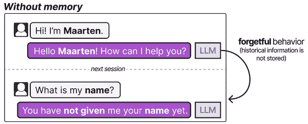

多年来，人们对智能体的各方面投入了大量关注，例如工具使用、推理 LLM 和多智能体协作。每方面本身都十分重要，但不要低估记忆的重要性。没有记忆，个人助理智能体无法记住过去的对话；没有记忆，编码智能体无法理解你的整个代码库；没有记忆，智能体会忘记自己已经执行过的动作并不断重复。

记忆可能很难定义。从狭义上讲，它涉及智能体执行过程中的所有历史信息。然而，在本章中，我们采取更广泛的视角。记忆不仅涉及智能体过去的所有行为，还涉及超出智能体与环境交互范围的外部信息。编码智能体的记忆不仅包含它为了修复你的缺陷（bug）所采取的操作，还包含你托管（在线的）文档和问题（issue）页面。

记忆不仅仅是记住信息的行为，也包括存储新生成的信息。同样，常常需要决定存储哪些信息、如何存储，以及记住哪些信息。所有这些方法和选择都会对智能体的行为产生重要影响。如图 4-2 所示，更新和使用记忆是一个迭代过程，需要谨慎处理中间信息。

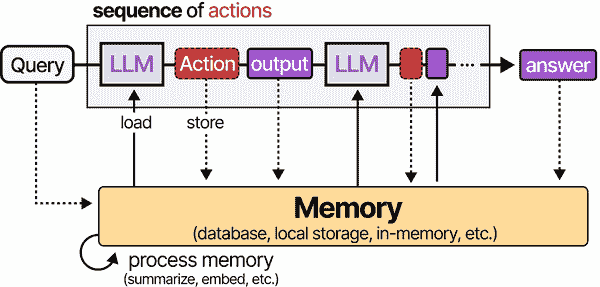

记忆让智能体能够记住过去的错误和失败经历，从而在未来处理类似任务时更加高效。因此，记忆使智能体能够随着记住更多经验而学习和进化。通过与环境交互并存储反馈，智能体会从以往的经验中学习。因此，记忆是特定于应用（application-specific）的，实现不仅可以决定记住*什么*，还可以决定*如何*去记住。

在本章中，我们将探索多种类型的记忆模块，从短期记忆和长期记忆到外部记忆模块，并通过（智能体式）检索增强生成等方法加以介绍。如图 4-3 所示，记忆构成了 LLM 的基础。毕竟，如果 LLM 总是忘记如何使用工具或制定计划，它又怎能做到这些呢？

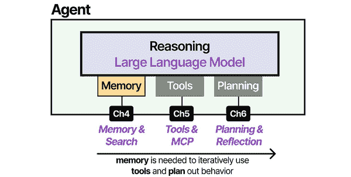

### 记忆的类型

LLM 的记忆往往遵循人类的记忆类型，因为我们试图创建的智能体常常以人类行为为模型。人类记忆的形式有很多，这里不再一一列举，《语言智能体的认知架构》（“Cognitive Architectures for Language Agents”）论文描述了我们在智能体中经常看到的四种外部记忆，即短期工作记忆和长期记忆：情景记忆、语义记忆和程序记忆。^(1)

**工作记忆**是一种短期记忆，通常被定义为一个容量有限的系统，临时保存我们用于决策和推理等任务所需的信息。对于 LLM 而言，它通常是在 LLM 调用之间持久保存的数据。更具体地说，就是存储在记忆中并不断反馈给 LLM 的聊天历史。

长期记忆有三种形式：

- **情景记忆**：涉及记住个人过去的特定事件和经历（例如，你的上一个生日聚会）。对智能体而言，这通常涉及智能体迄今为止所采取的特定行动及其结果。
- **语义记忆**：涉及记住关于世界的知识（例如，法国的首都）。对智能体而言，这可能涉及查询外部数据库，如维基百科或你正在使用的代码库。
- **程序记忆**：涉及记住做事情的模式（例如，用 Python 编写代码）。对智能体而言，这可以是隐藏在其参数中的信息（也称为参数记忆），也可以是跨调用持续存在的系统提示（system prompt）。


图 4-4 展示了一个示例，说明在单个智能体的会话过程中，这些不同形式的记忆是如何被使用和解释的。

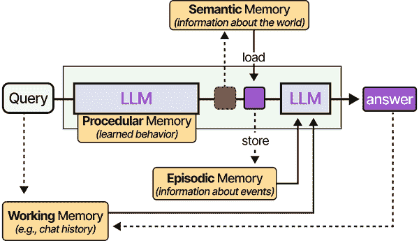

正如前面简要提到的，我们还可以考虑模型已经拥有的记忆类型，即*参数记忆*。^(2) 即使没有任何记忆模块，LLM 在某种程度上也经过训练来保留信息。如果你问 LLM 法国的首都是什么，大多数 LLM 都会正确记住答案是巴黎。因此，答案包含在模型的参数中，并尝试检索它。尽管这是一个相对较新的领域，但从技术上讲，可以通过监督微调将信息灌输到 LLM 中。请注意，这并不是一种稳定的方法，因为我们事先并不完全确定哪些信息会被明确保留，哪些信息会被错误地重建。

尽管这些记忆类型可能各不相同，但它们并不总是以这种形式存储。根据具体的实现，它们可以被视为一大堆信息，也可以被分离到不同的数据库中，以便针对特定任务和动作进行记忆。

#### 短期记忆

智能体中的短期记忆是它关于近期交互的信息，通常是正在进行的与用户的对话或 LLM 的行为。实际上，这就是 LLM 的对话历史，它作为生成响应的上下文。如图 4-5 所示，这些信息通常被格式化为消息，展示系统提示、用户查询和 LLM 回答之间的差异。在这段对话中，用户讲述了一些关于自己的信息，即他们喜欢火烈鸟。

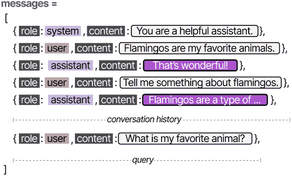

这些消息在用户或助手每次回复时都会更新，并作为下一次查询的输入反馈给 LLM，如图 4-6 所示。查询（“我最喜欢的动物是什么？”）本身并不会触发 LLM 去回忆过去。相反，LLM 获得的是完整的对话历史，其中包含相关信息，即用户喜欢火烈鸟。换句话说，LLM 并不真正“记住”过去的对话，而是通过将对话内容显式插入到提示中来获知对话内容。


大多数 LLM 都有有限的上下文窗口，即 LLM 能够处理的令牌数量，该窗口同时涵盖输入和输出令牌，如图 4-7 所示。

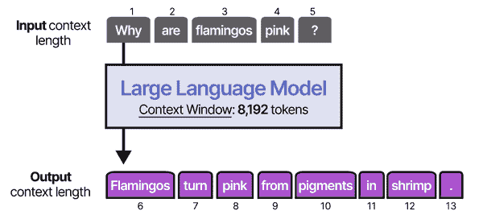

在此示例中，给出了一个简短的查询和回答，总共使用了 8,192 个可能令牌中的 13 个。如图 4-8 所示，有许多潜在令牌未被使用，这些令牌可能会被额外的信息或推理令牌填充，如第 3 章所讨论的那样。

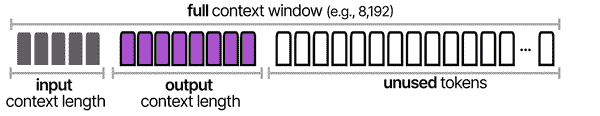

然而，随着对话历史的增长，令牌数量也会增加。最终，如图 4-9 所示，如果对话历史变得过大，它将无法容纳在上下文窗口中。这可能会使回答中断，甚至完全阻止 LLM 处理提示。

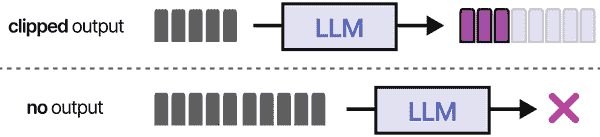

此外，提示中包含的信息越多，LLM 就越难以顾及所有内容。^(3) 因此，我们不能总是将整个对话历史放入 LLM 的提示中。相反，我们可以使用几种技术来提供对话历史，而不会填满上下文窗口。

第一种高效的短期记忆技术相当直接：随着消息的增长对消息进行裁剪。每当消息数量增长到 LLM 的上下文窗口无法处理时，我们可以决定直接删除前几轮交互，直到它适合该窗口。如图 4-10 所示，这可能会删除大量可能与未来查询相关或无关的信息。

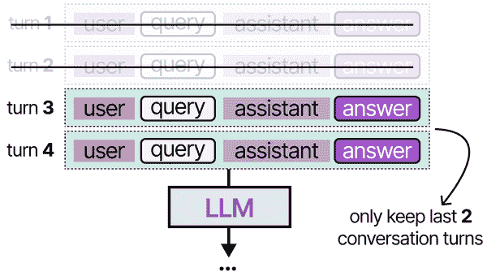

相反，一种常见的技术是使用另一个 LLM 来总结对话历史。在每一轮对话之后，同一个或另一个 LLM 会对其进行总结，并将其添加到对话的完整摘要中（图 4-11）。

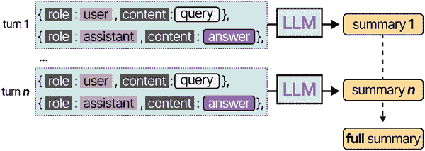

如图 4-12 所示，生成的摘要将与查询一起呈现给 LLM 以进行回答。随着时间的推移，摘要不断堆叠，这个摘要可能仍然会填满上下文窗口，但比起用原始对话历史填满上下文窗口，速度要慢得多。

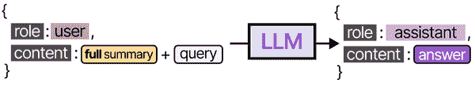

堆叠摘要并不是唯一的总结方法。除了每次都添加最近一次查询/回答对的摘要之外，你还可以改为总结最近 5 次对话的对话历史。同样，你可以选择维护一个摘要，并在每次对话后让 LLM 更新它。图 4-13 展示了这样一种方法：对话轮次 1 至 5 被总结，而轮次 6 没有。

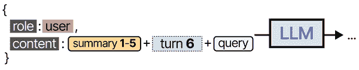

虽然这看起来可能很简单，但维护对话历史可能是一项艰巨的任务，需要理解什么是重要的：完整历史、最近的历史，还是经过总结的变体？对于短对话，维护完整历史是可行的，但对于较长的操作序列来说，可能就不行了。

#### 长期记忆

随着对话历史以及智能体所采取操作的增长，对长期记忆的需求也在增长。长期记忆通常涉及维护一个或多个外部数据库，可以通过查询这些数据库来提取额外信息。这些信息可以包含智能体先前轨迹或状态的信息（情景记忆），也可以包含与智能体行为无关、而与你的应用上下文相关的信息（语义记忆），比如你组织的文档。

### 检索增强生成（RAG）

可以说，为你的智能体——或者任何 LLM——提供长期记忆的最常见方法就是检索增强生成（RAG）。^(4) RAG 通常包含两个阶段：*摄入*和*推理*。

在摄入阶段，你的外部数据（通常是非结构化文本）会被嵌入为数值表示，并存储在数据库中（见图 4-14）。为了创建这些表示，需要使用一种特殊的 LLM 变体，即嵌入模型。这个嵌入模型经过训练，可以创建数值表示，使意义相近的单词和短语具有相似的表示。这个外部数据库可以被视为 LLM 的长期记忆，可以在其中查询相关信息。

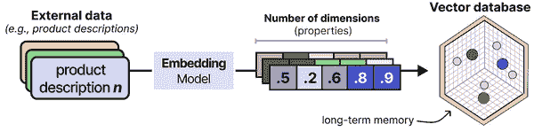

使用 RAG 进行推理包括四个步骤。在步骤 1 中，使用与嵌入外部数据相同的模型来嵌入用户的查询。在步骤 2 中，将嵌入后的查询与外部数据库进行比较，并提取数据库中与查询最相关的条目。

在 RAG 系统中，定义相关性可以有很多含义。在我们的示例中，它指的是查询嵌入与外部嵌入之间的相似性。这种相似性可以通过我们创建的嵌入来定义，但也可以使用混合系统，将嵌入与传统的词袋式方法相结合。


在第 3 步中，相关条目和用户的查询被组合到提示中。这一步旨在为模型提供生成步骤所需的上下文。本质上，你告诉大语言模型（LLM），你有它可用于推导答案的上下文信息。最后，在第 4 步中，模型使用增强后的提示来生成输出。添加的上下文信息通常应能带来更准确和相关的回答，前提是这些上下文信息确实相关且正确。图 4-15 展示了使用 RAG 进行推理的四个步骤。

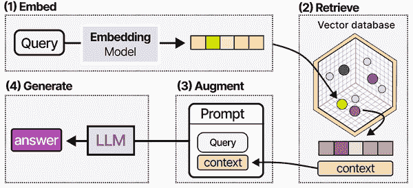

RAG 常用于减少幻觉，幻觉是指 LLM 倾向于自信地产生一个实际上不正确的答案。通过向 LLM 提供外部信息（你假定为真实的信息），LLM 不太可能“编造”信息。

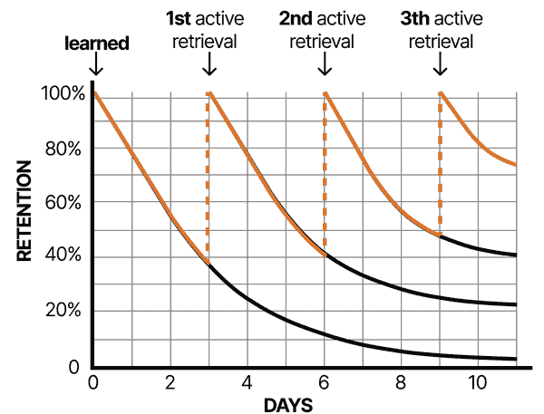

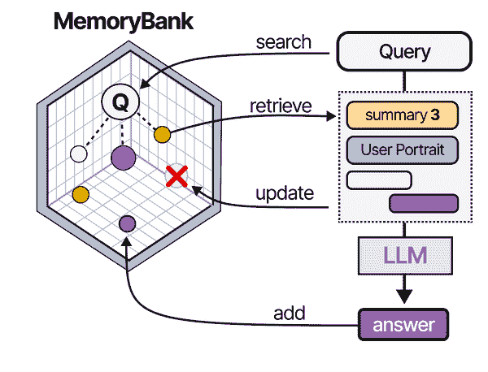

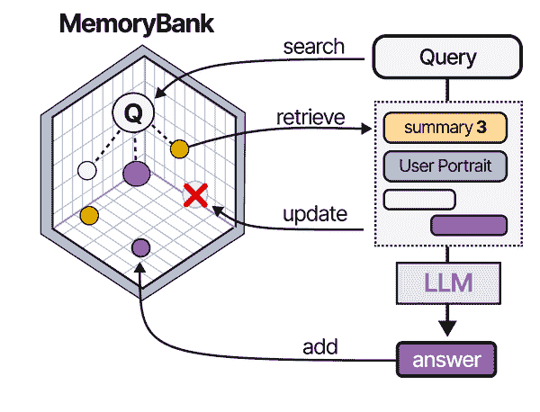

### 代理式 RAG（Agentic RAG）

在原始 RAG 中，向量数据库可被视为 LLM 的长期记忆。然而，LLM 仅被*给予*与查询相关的信息，而且对检索了什么没有掌控权。

在代理式 RAG 中，存在一个代理（agent），而不是 LLM，它可以将外部数据库作为工具进行访问，并控制它检索哪些信息。代理恢复了对检索内容的掌控权，并且它通常可以访问一个或多个外部信息数据库。图 4-19 说明了这种想法：代理先选择从哪个来源检索上下文信息，再决定是生成答案还是再次检索额外信息。


在单代理系统中，代理式 RAG 类似于一个路由器，你拥有多个外部知识源，代理决定使用其中哪些。你本质上是在 “工具”列表中添加所有这些知识源和数据库，而不是像静态步骤那样在 LLM 生成输出前运行。此外，这种代理 RAG 系统不一定每次都需要基于查询本身运行代理 RAG（Agentic RAG）。如图 4-20 所示，系统可能会决定从一次搜索中提取信息，然后基于该信息在另一个数据库中运行后续搜索。

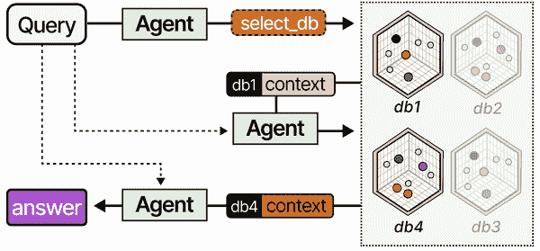

代理 RAG 并不局限于单代理系统。在多代理 RAG 系统中，多个代理都具备从外部来源提取信息的能力。通常，你会有一个能力更强的协调代理去协调多个较小的检索代理。这些较小的检索代理各自专门负责提取特定信息，或处理特定的知识源（参见图 4-21）。请注意，外部知识源并不一定非要是向量数据库，它也可以是网络搜索或查询某些 API 来获取信息（例如你的 Slack 或 Gmail）。

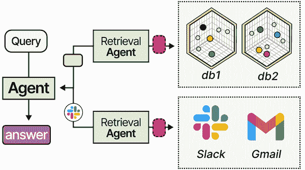

换句话说，通过将向量数据库作为工具挂钩，而不是只通过静态步骤查询一次，代理可以动态地决定需要查询语义记忆多少次，直到它获得足够的上下文来回答给定的查询。请注意，我们在 RAG 上下文中讨论了 LLM，但在代理式 RAG 的上下文中则讨论代理。这体现了它们访问各自 RAG 能力时的主动性和自主性。

让我们看一些示例，通过该领域中具有影响力的论文和实现，来了解这些代理 RAG 系统是如何运作的。

#### A-MEM

一种有趣的代理 RAG 方法是 A-MEM，这是一个源自于 Zettelkasten 笔记法的代理记忆系统。^(6) Zettelkasten 于将做笔记视为三个重要组成部分：原子性、超文本笔记和个性化。

原子性意味着每张 Zettel（一张笔记）只能包含一个知识单元，称为原子。例如，这张笔记可以包含代理系统中记忆如何工作的简短描述。

然后，超文本笔记指的是所有笔记相互引用，并可能解释或扩展彼此的内容。例如，之前创建的笔记可以连接到另一张包含 RAG 相关信息的笔记。由于两者都是记忆系统，它们可能相关。原子性和超文本笔记的概念在图 4-22 中得到说明。它们一起可以创建一个相互关联的笔记和思想网络，并可能创建更大主题的相互关联笔记。

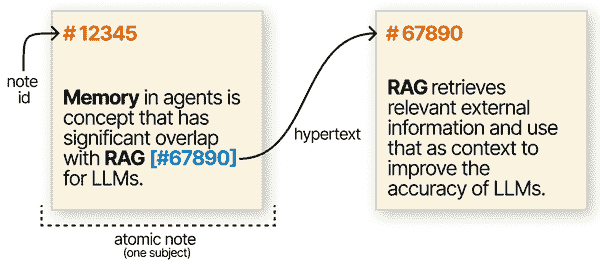

A-MEM 将这种笔记概念应用于代理记忆，通过创建这些相互关联的笔记来实现。在代理情境中，每张笔记包含以下信息，并可被视为一段记忆：

* 与环境的原始*交互*（即一轮交互）
* 交互的*时间戳*
* LLM 生成的*关键词*，用于捕捉关键概念
* 用于对交互进行分类的、由 LLM 生成的*标签*
* LLM 生成的*上下文描述*

通过聚焦于单个单元，即单个交互，A-MEM 遵循了原子性原则。

然后，所有信息被嵌入，以便稍后可以轻松检索相关信息。请注意，除了时间戳外，所有信息都被拼接起来，以便为整张笔记/记忆创建一个嵌入向量（图 4-23）。

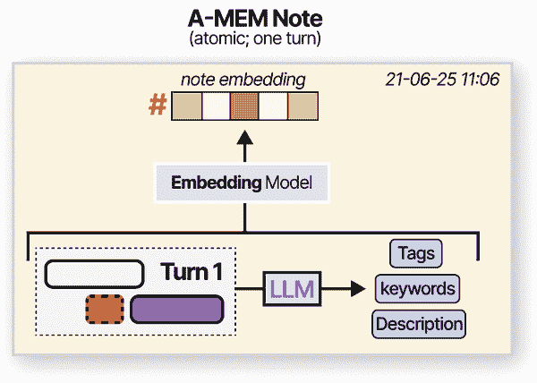

有趣的是，作者将该笔记嵌入作为笔记的主要 ID 之一。为了将此笔记与其他记忆关联，他们运行此笔记嵌入和所有其他记忆之间的相似性搜索，并提取前 k 个记忆。之后，LLM 被请求决定这些候选记忆中哪些应该与新添加的记忆相关联。

在记忆被添加并链接到其他记忆之后，LLM 会基于新添加的记忆更新 LLM 生成的标签、关键词和描述。结果形成了一种进化式方法，新添加的记忆与较旧的记忆相链接，而后者又被更新以与新实施的记忆保持一致。图 4-24 说明了这种不断演变的记忆笔记数据库。

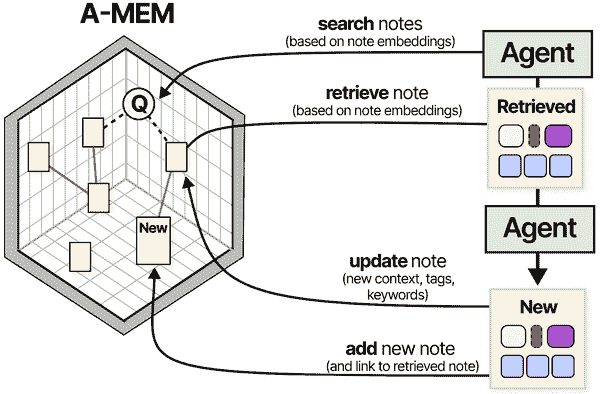

这种代理 RAG 系统允许代理访问 A-MEM，并搜索与查询相关的记忆。笔记之间建立的链接在检索相关信息时会用到。代理可以选择检索所有与所检索到的笔记有链接的笔记。

我们再次看到，这些记忆系统回应了人类记忆的某些方面。我们如何存储和使用知识的许多见解，经常为代理记忆系统的设计提供灵感。

#### Search-o1

最近的一种代理 RAG 方法是 search-o1，一种尝试在整个推理过程中检索相关上下文并将其嵌入，以进一步增强推理 LLM 能力的方法。^(7) 信息可以在 LLM 的推理过程*期间*被搜索和检索，而不是自主搜索相关信息并直接将其放入模型的提示中。代理被指示使用`<|begin_search_query|>`和`<|end_search_query|>`标记开始搜索，然后使用`<|begin_search_result|>`和`<|end_search_result|>`标记来表示检索到的信息。图 4-25 展示了这种在推理过程中进行的代理 RAG。

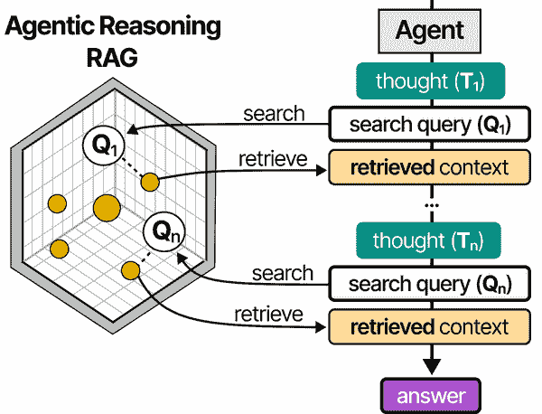


### 具有推理能力的代理式 RAG

通过在推理过程中启用 RAG，模型可以迭代地完善其推理过程，直到对最终结果充满信心。这种动态方法与常规代理式 RAG 不同，因为它可以在单次调用中自主完成，而不是多次迭代调用。

#### 文档内推理

简单地将文档嵌入推理轨迹的一个缺点在于，检索到的文档可能相当大，且往往包含无关信息，从而可能扰乱推理流程。为了解决这个问题，作者通过引入“文档内推理”（Reason-in-Documents）模块来扩展推理代理式 RAG。该模块利用搜索查询、检索到的文档和推理轨迹，尝试将所有信息凝练为聚焦的推理步骤。代理使用同一个推理 LLM 来处理检索到的文档，以与模型特定的推理轨迹保持一致。

对于常规代理式 RAG，信息只是被传入上下文，而不考虑信息需要*如何*被处理。通过让同一个推理 LLM 进一步处理这些信息，使其适配推理轨迹，可以保持推理轨迹的流畅性。图 4-26 给出了这个名为 Search-o1 的系统的概览。

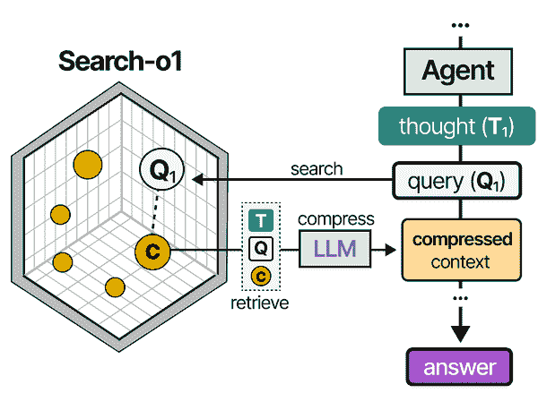

#### 迭代检索

请注意，这通常用于代理可能需要回答给定查询的长期记忆或外部语义记忆。例如，当给定查询“为什么火烈鸟是粉色的？”时，它会在推理过程中在维基百科中搜索相关信息。它找到的第一条结果提到，这是由它们特定饮食中的特定色素所致。它会在推理过程中利用该信息，直到需要进一步澄清。例如，第二次调用不同的外部数据库（如 ArXiv）会澄清该特定色素是类胡萝卜素色素，常见于卤虫中。

这种查询信息并将其压缩到推理过程中的迭代方式，使模型能够在信息被检索时进行推理，而不是在上下文中塞入所有潜在相关信息。

### 上下文工程

#### 上下文的形式

我们已经探讨了可以为代理提供额外上下文的各种类型的记忆，包括语义记忆、工作记忆及其他形式的记忆。然而，我们还能为代理提供更多形式的上下文，例如：

- **系统提示**：代理的核心上下文和规则，定义其行为方式（程序性记忆）。
- **对话历史**：既包括用户与助手之间的对话，也包括 LLM 的内部想法（工作记忆）。
- **过往经验**：存储来自工具使用或用户相关事实的具体事件、动作或观察（情景记忆）。
- **检索到的信息**：通常存储在向量数据库中、通过类似 RAG 的技术访问的外部信息（语义记忆）。

然而，这并非一份详尽的清单。随着 LLM 和代理领域的不断成长，我们能给它们的信息来源也在不断增多。因此，我们可以为代理提供各种信息来源，以生成我们想要的答案。如图 4-27 所示，用户的查询或提示只是 LLM 整个上下文的一个子集。

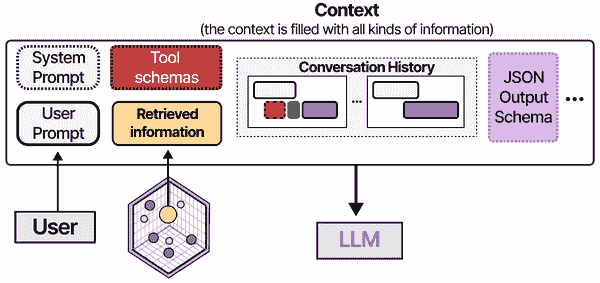

#### 优化上下文

这个上下文被输入给 LLM，LLM 进而生成一个 token 列表。因此，我们可以将 LLM 视为一个函数：它接收若干 token（上下文），处理它们，并输出 token。为了优化给定任务的输出 token，我们既可以通过训练或微调来优化 LLM 本身，也可以优化输入，即上下文（图 4-28）。

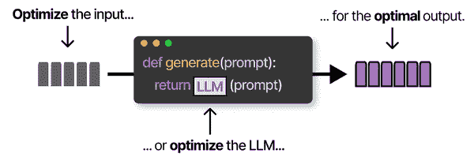

#### 定义上下文工程

为了优化输出（输出 token）的质量，我们可以通过训练或微调来优化 LLM 本身，也可以优化输入到 LLM 的内容，即上下文。优化输入 token 以产生最佳输出的行为被称为*上下文工程*。形式化地讲，它是为给定任务寻找最佳上下文，以最大化 LLM 输出的质量。^(8) 如图 4-29 所示，提示工程涉及优化系统/用户提示，而上下文工程旨在优化整个上下文。

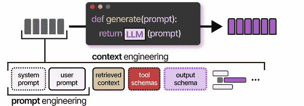

#### 长上下文基准与局限

上下文窗口变得越来越大，以至于谷歌的 Gemini 1.5 在 2024 年 2 月已经达到了百万 token 的上下文窗口。^(9) 很自然地会得出这样的结论：上下文工程意味着试图用与手头任务相关的各种信息来填满这个巨大的上下文窗口。此外，由于上下文窗口大到可能容纳整个数据库，RAG 不再是必需的。

评估长上下文 LLM 的一个常用基准是 2023 年和 2024 年初的“大海捞针”（Needle In A Haystack, NIAH）测试。^(10) 该测试相当直接：将一条随机事实（“针”）放置在长上下文窗口（“大海”）中间的某个位置，然后要求模型检索这条陈述。通过在不同位置和不同上下文长度上进行迭代，我们可以衡量 LLM 在长上下文上的表现。它生成了漂亮的图表，并被大型 LLM 提供商所采用，如 Anthropic 的 Claude 2.1^(11)和谷歌的 Gemini 1.5^(12)。

图 4-30 展示了这样一张图表的示例，其中显示了一个典型“大海捞针”测试的结果，右上象限（针位于文档顶部且上下文长度很大）显示了 LLM 在更高上下文长度下的性能下降。

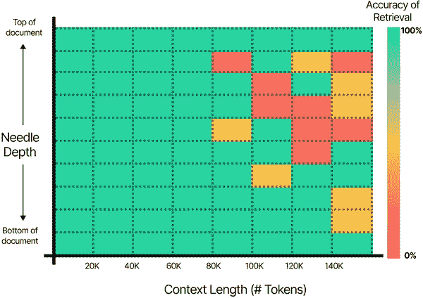

然而，找到“针”只是一个检索任务，并不能代表更复杂的长上下文理解形式，例如在数十万 token 上进行推理。对于必须考虑多种形式和长度的上下文（如语义记忆和工作记忆）的代理来说，这一点尤其成立。

此后，其他基准（如 RULER 基准^(13)）被发布，引入了多跳追踪和聚合等新任务，以测试超越简单检索的行为。例如，RULER 论文证明了那些在“大海捞针”测试中表现良好的模型，在应用到 RULER 基准时，随着上下文长度的增加，性能都出现了显著下降。许多其他研究（例如^(14)和^(15)）也发现了类似的结果，并得出结论：随意填满 LLM 的上下文窗口会损害性能。有些人甚至称之为“上下文腐烂”（context rot）^(16)，这突显了添加高质量信息的重要性。因此，我们需要精心构建和管理模型的上下文窗口，这也就指向了上下文工程的重要性。

#### 管理上下文窗口

成本和延迟是管理上下文窗口的其他原因。理论上，你可以把所有内容都塞进 200 万 token 的上下文长度中，比如整个外部数据库、完整的对话历史、一些额外示例等等。然而，代理的 LLM 必须处理所有这些 token，这会显著增加延迟。成本也会增加，因为增加上下文长度需要更多的显存（VRAM）。因此，只是把所有东西都倾倒进上下文中，注定会导致失败。


通过上下文工程，我们的目标是以正确的信息、在正确的位置、以正确的格式来优化模型的上下文窗口。它是在不给 LLM 带来过重负担的前提下，为其提供适当上下文的行为。因此，如图 4-31 所示，关键不在于填满上下文窗口，而在于策略性地选择和放置信息。回到我们“LLM 是一个函数”的类比，这实际上是在优化输入词元列表，以便生成尽可能优质的输出词元。

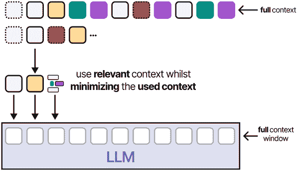

你不希望信息过多或过于无关，因为计算成本会上升，性能会下降。同样，如果你给 LLM 的上下文过少，且形式低效，它就会在对上下文缺乏充分理解的情况下运行。这是一个需要精心平衡的过程：为 LLM 提供恰到好处的相关信息，使其达到最优性能。换句话说，上下文工程在很大程度上是一个架构问题，需要通过大量相互关联的环节来解决，比如高效地跟踪、存储和检索所有已有及新建的信息。

为了辅助上下文工程，可以运用现有的注重效率的记忆处理技术。例如，MemoryBank 会动态调整记忆的重要性，只保留那些对对话历史真正重要的内容。同样，Search-o1 会对检索到的上下文进行压缩，只返回相关部分，不带任何噪声。随着信息流变得越来越复杂，这些动态记忆技术对上下文工程尤其有用。

#### 上下文中包含什么？

我们之前简要提到过，但上下文中究竟包含什么呢？让我们用一个示例来说明完整的上下文，并尽可能具体化。假设你让一个智能体对推理型 LLM 进行深度研究，并要求它向你概述该领域常用的技术。我们将使用 `messages` 格式来展示 LLM 的输入是如何随适当上下文持续更新的。

在开始示例之前，先来看一下系统提示词的模板：

```
#### Creating the system prompt
SYSTEM_PROMPT = """
You are a helpful research assistant. Your goal is to provide in-depth analyses on complex AI-related topics.
 
<INSTRUCTIONS>
* Create a plan for the user's query
* Provide the necessary context
* If you lack information, you can ask clarifying questions to the user
* Prioritize clarity of content.
* Make sure to use the current date to decide what is currently SOTA.
</INSTRUCTIONS>
 
<TOOLS>
{information_about_tools}
</TOOLS>
 
<DATE>
{current_date}
</DATE>
 
<USER_QUERY>
{user_query}
</USER_QUERY>
 
Based on the provided context, start making a plan to research this and check with the user for revisions.
"""
 
```

请注意，系统提示词中包含各种 XML 标签，用以标示所含信息的类型。但其中似乎缺少一些信息，比如当前日期、工具信息以及用户查询。除用户查询外，这些信息都需要先从外部来源获取。获取之后，系统提示词便会在各种上下文的加持下生成，并传递给智能体的 LLM，其格式可以是下面的消息。

```
##### 1. Create a plan
messages = [{"role": "system", "content": SYSTEM_PROMPT}]
```

LLM 将生成一个简短的研究计划作为回应，用于研究推理型 LLM，供用户验证。请注意，我们将在第 X 章更详细地讨论规划与反思。我们假设交互过程如下：

```
##### 2. Reflect on the plan
messages = [
  {
    "role": "system", "content": SYSTEM_PROMPT},
  {
    "role": "assistant", 
    "content": """
Here is my plan to research reasoning LLMs:
* Query the ArXiv database for the 10 most recent papers on reasoning LLMs
* Summarize the abstracts
* Combine the summarizations for an overview
"""
  },
  {
    "role": "user", "content": "Search for surveys instead."
  }
]
 
```

LLM 建议提取 10 篇最新论文，但用户认为这种方式效率不高，要求改为搜索综述。既然智能体已经执行了它的第一项任务，即利用其 LLM 制定计划，这些信息就可以存储在外部，以便日后必要时重新取用。

计划会相应更新，并保存在一个专用的 `PLAN.md` 文件中，智能体在必要时可对其进行更新。在继续搜索 ArXiv 数据库之前，当前对话历史会被裁剪，只保留 `SYSTEM_PROMPT` 和 `PLAN.md`。这种裁剪可以由智能体自己执行，但为了简单起见，我们假设在用户给出反馈后，总会运行一个简单脚本来裁剪掉这段交互。于是，我们得到：

```
##### 3. Crop context
messages = [
  {"role": "system", "content": SYSTEM_PROMPT},
  {"role": "assistant", "content": PLAN.md},
]
 
 
```

上下文被保持在最小范围，因为 LLM 没有必要同时看到新旧两份计划。

接下来，智能体使用一个工具（`search_arxiv`）搜索关于推理型 LLM 的最新综述，并提取摘要（`ABSTRACTS`）。

```
##### 4. Search on ArXiv
messages = [
  {"role": "system", "content": SYSTEM_PROMPT},
  {"role": "assistant", "content": PLAN.md},
  {
    "role": "assistant", "content": ""},
]
```

请注意，这个最终的 `messages` 变量只包含一小部分对话历史。只有最相关的信息会被保留，任何无关的痕迹（比如摘要生成代理的完整痕迹）都不会被加入上下文。在整个过程中，上下文都受到精心管理，要么由智能体自身完成，要么通过外部软件实现。


即使在这个简化的示例中，智能体之间及其内部也存在大量动态行为，它们会更新、存储和检索各种上下文。此外，本示例中的所有上下文都是文本，可以使用标准 LLM 进行处理。然而，对于某些用例，您可能希望它能够处理更多模态，例如图像和声音。我们将在第 X 章和第 X 章中更详细地介绍多模态 LLM。

#### 多智能体系统的上下文工程

正如我们将在第 X 章中深入介绍的那样，多智能体系统是指多个智能体协同解决给定问题的系统。我们的深度研究智能体示例在其系统中使用了一个摘要智能体，从而实现了协同工作。在多智能体系统中，上下文工程特别困难的原因在于，不仅需要仔细管理主智能体的上下文，系统中所有其他智能体的上下文也需要如此管理。此外，智能体之间的交互也是这些相应智能体之间共享上下文的一部分。

为了管理这个复杂的上下文网络，可以使用较小的智能体来处理部分上下文“负担”，正如我们在深度研究智能体中所展示的那样。通过使用配备较小 LLM 的较小智能体来处理特定任务，部分上下文可以单独处理，从而为主智能体（也称为编排智能体）节省大量计算资源。这些小型和/或专业化智能体之所以非常适合上下文工程，是因为它们可以处理更小、更易于管理的上下文，具有明确的职责，并且更易于测试和调试。这类系统通过分离任务而非让一个智能体同时处理各种不同任务和上下文，可以变得更可靠。

#### 优化上下文

在本章中，我们介绍了许多处理 LLM 和智能体记忆与上下文的不同方法和技巧。优化上下文中放入的内容和方式是一个多方面的复杂问题，需要理解智能体架构的各个部分。大多数优化上下文的策略都建立在上下文的主要来源之上，即智能体的记忆模块。

尽管策略众多，让我们探讨最常见的几种。

##### 上下文跟踪与存储

在向智能体提供可能相关的上下文之前，首先需要将其跟踪并存储在某个地方。我们已经介绍了大部分相关内容，因为这涉及多种形式的记忆，特别是情景记忆，它包含了智能体迄今所采取的行动。尽管情景记忆被视为长期记忆，但它与智能体的对话历史高度相关，而对话历史往往捕捉了智能体的行动。

然而，跟踪上下文不仅仅限于智能体的事件痕迹。它还涉及管理外部知识源，例如您的专有数据库，这些可以作为额外的上下文。要建立这些知识源，您必须事先决定要跟踪哪些类型的信息。尽管乍看之下可能显而易见，但您可以跟踪的信息类型有很多：

*   智能体行为
    *   智能体（及任何子智能体）的工具使用情况
    *   工具输出和中间结果
    *   （子）智能体之间的交互
    *   内部推理步骤
    *   对话历史
    *   失败/成功情况
*   用户行为
    *   用户意图（显式请求和目标）
    *   用户反馈（编辑、批准、拒绝）
*   知识源
    *   专有数据库的快照（用于可复现性和审计）
    *   外部文档（RAG、API 等）
    *   结构化工件，如 `PLAN.md`、`REQUIREMENTS.md` 等
*   系统级
    *   配置（LLM 超参数、可用工具等）
    *   策略（护栏、约束等）

以上所有内容仅仅是您可能跟踪的示例。在实践中，并非所有内容都有用，同时，许多其他内容也应当包含在内。正如我们稍后将探讨的那样，跟踪这些类型的上下文和信息，也有助于传达用户意图并调试这些复杂系统。

##### 上下文选择

假设您已经建立了所有数据库，优化上下文的第一件事就是建立一个能够选择正确上下文的系统。如前所述，RAG 是一种非常出色的技术，也是选择相关内容的示例。尽管我们已经看到了改进 RAG 的各种变体，但尚未探讨如何进一步改进这一选择过程。

在 RAG 中，输入文档通常被拆分为更小的部分，例如句子或段落，以隔离其中包含的信息，并将其保持为单一主题。然而，当您随后运行 RAG 流水线时，通常会得到一组文档作为返回结果。例如，如果我们搜索向量数据库中的“气候变化的原因”，系统可能会返回关于温室气体、工业活动和森林砍伐的文档。尽管这些文档可能无法直接回答我们的问题，但它们具有相关性。

为了改进这一过程，我们可以使用重排序器来优化检索到的文档集。这种技术（通常是语言模型）同时接收查询和检索到的文档，根据它们与查询的相关性以及彼此之间的相关性对检索到的文档重新排序（见图 4-32）。通过为重排序器提供额外的上下文（所有检索到的文档），它的处理文档数量将远远少于我们给它整个数据库的情况。此外，在根据相关性对结果进行重新排序之后，我们可以选择只保留最相关的文档。

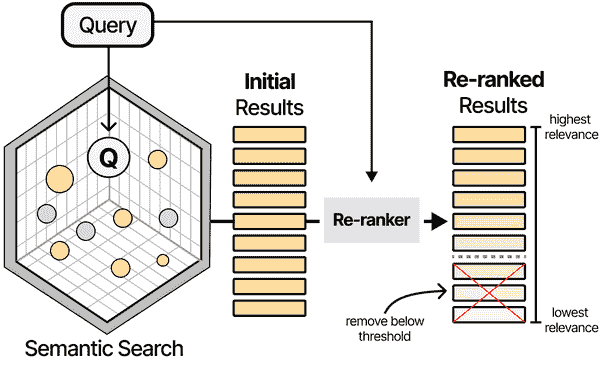

重排序仅是选择并创建正确上下文的众多方法之一。我们还可以结构化输出，以确保智能体的响应被分解为逻辑部分，并且只包含必要的组件。同样，我们可以采用业务规则，为某些始终提供重要上下文的信息赋予额外权重（很像系统提示）。

请注意，选择正确的上下文也可能意味着为正确的智能体选择正确的上下文。通过在多个专门化智能体之间隔离上下文，每个智能体都能专注于问题的较小部分，而不会被完整上下文所淹没。

##### 上下文压缩

上下文工程的目标是在上下文中放入什么内容以及放入多少之间找到平衡。因此，尽可能压缩上下文是优化上下文的重要策略。

一种常见的压缩处理方式是我们在本章开头讨论过的，即使用 LLM 创建对话历史的摘要。正如我们在 Search-o1 中所探讨的那样，我们甚至可以使用 LLM 压缩 RAG 流水线的输出，以总结检索到的文档。

另一种压缩上下文的方法是减少冗余。即使使用重排序器，排名前 5 的最相关结果也可能包含非常相似的文档。它们合在一起，并不是各部分之和大于整体，而是由于包含相似信息而小于整体。因此，我们不仅需要最相关的文档，而且还需要它们各自包含新信息的文档。

一种常用技术，无论是用于 RAG 流水线的输出文档还是其他检索信息，被称为最大边际相关性（MMR）。^(17) 该技术使用预先计算的相关性向量和冗余矩阵来平衡文档的多样性。

首先，计算检索文档与查询嵌入之间的相似度。这会产生一个*相关性向量*，其中每个文档都有一个值，用于指示该文档与查询的相似度/相关性（见图 4-33）。


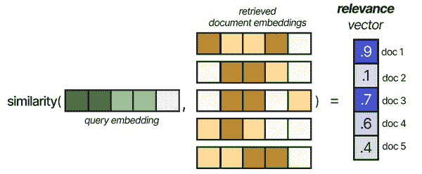

其次，同样会计算检索文档之间的相似度，以构建一个相似度矩阵，称为*冗余矩阵*。该矩阵用于丢弃一些与已选文档过于相似的文档（见图 4-34）。

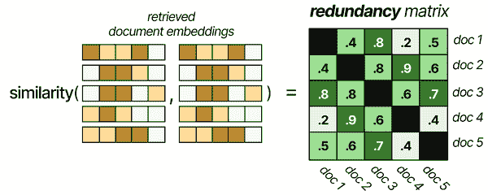

然后，相关性向量和冗余矩阵会被迭代使用，以判断哪些检索文档与给定查询足够相似，但又与其他所有检索文档不相似。其中一个重要组成部分是 `λ` 参数，我们可以调整它来决定输出应有多高的多样性（得分越高表示多样性越高）。

由于尚未选择任何文档，我们首先选择相关性向量中得分最高的文档，即文档 1。然后，将相关性向量乘以 `(1- λ)`，以决定相似性相对于多样性的重要性。从得到的分数（除文档 1 之外的每个文档各有一个分数）中减去 `λ` 倍的冗余向量。该向量包含冗余矩阵中与已选文档（文档 1）相关的最高得分。如图 4-35 所示，文档 3 作为下一个兼具多样性和相关性的文档被加入。

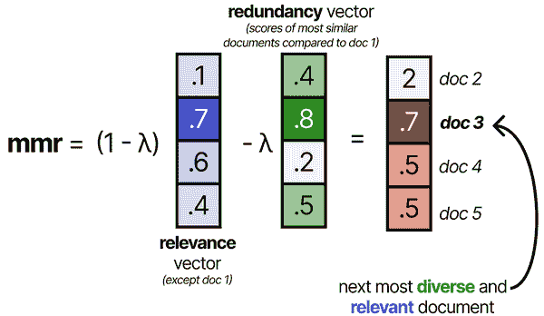

我们继续这个过程，但不再仅与文档 1 比较，而是让冗余向量包含与文档 1 或文档 3 相关的最高相似度得分，取两者中较高者。我们只对下一个文档重复此过程，因为我们希望将最初的 5 篇文档缩减为总共 3 篇。

与重排序一样，MMR 只是一种可用于压缩输出的技术示例。我们并非只能让 LLM 直接压缩检索到的文档；也可以使用 MMR 这类技术直接忽略某些文档，因为它们彼此过于相似。同样，还可以使用去重技术移除本质上彼此重复的上下文。

##### 上下文排序

上下文的顺序对智能体的性能至关重要。早期关于提示中重要信息位置的研究发现，LLM 往往更关注提示的开头和结尾。^(18) 因此，它们经常会丢失中间部分的信息，这被称为“中间丢失”（Lost in the Middle）现象。图 4-36 来自《Lost in the Middle: How Language Models Use Long Contexts》论文的注释图，很好地说明了这一概念。

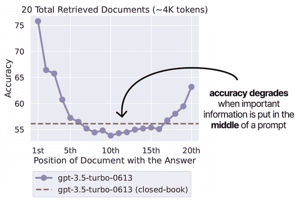

这种关注提示开头和结尾的倾向与人类行为相似。序列位置效应指出，人们通常对一系列条目中的第一项（首因效应）和最后一项（近因效应）记忆最好，而对中间项记忆最差。^(19) 有趣的是，LLM 的许多行为也表现出与人类相似的倾向。

#### 上下文即规格说明

可以说，上下文工程最重要的一点是，它需要思维方式的转变。赋予智能体的上下文可以被视为一种沟通工具，不仅用于与智能体沟通，也用于与你的同事沟通。更具体地说，你提供给智能体的上下文，包括查询、`PLAN.md`、`REQUIREMENTS.md`、代码库等，都是传达你意图的工具。例如，当你让编码智能体完全自主地创建一个 PR（拉取请求）时，仅仅检查代码本身是否包含所有内容是不够的。初始查询、`PLAN.md` 等也都是 PR 的初始规格说明，同样需要被追踪。

因此，我们可以将智能体的上下文看作你所实现功能的规格说明。随着智能体变得越来越自主，通过给定的上下文来追踪其行为意图非常重要。如果说提示工程是面向用户的，那么上下文工程则更是一种面向开发者的工具，需要仔细传达智能体为何执行某些任务。这个“为什么”的答案始于用户的意图。

不妨这样想：我们往往丢弃函数（LLM）的输入，只记录输出，这多么奇怪！这不仅关乎可复现性，也关乎沟通：它能让你理解智能体为什么选择了某些工具、执行了某些操作并产生了某些输出。此外，这种意图的透明性也是调试智能体的绝佳工具。

作为规格说明的上下文，为特定领域行业带来了巨大潜力。在不同用例和应用之间，你提供给智能体的上下文会有很大差异。例如，医疗保健所需的上下文与法律完全不同。因此，并不存在单一通用的上下文工程框架，而是需要开发者考虑其特定领域的知识来源，例如医疗保健中的患者数据和学术界的研究论文。

### 总结

在本章中，我们探讨了为 LLM 和智能体赋予记忆的各种方法。我们首先介绍了短期记忆的各种技术，包括对话历史，以及压缩并保持其可控的方法。短期记忆是在智能系统中实现记忆能力的一个重要但常被低估的组成部分。

接着，我们探讨了长期记忆，包括 RAG（MemoryBank）和智能体式 RAG（A-MEM 与 Search-o1）等方法。这些方法通常受人类记忆系统启发，可能包含让记忆衰减或判断哪些内容应被视为重要的技术。

最后，我们将上下文工程作为记忆领域的下一个前沿进行了探索。过去我们自己设计提示词，而现在需要对整个上下文窗口进行仔细考量。我们讨论了上下文为何对智能体如此重要，以及优化上下文的各种方法。

上下文远不止用户的提示词，它包含之前讨论过的所有记忆形式，甚至可能包含更多内容，如工具。在下一章中，我们将探讨工具作为智能体的重要组成部分，如何进一步增强 LLM 的能力。此外，我们还将介绍如何调用这些工具以及相关最佳实践。在第 6 章中，我们将介绍智能体的规划与反思能力，其中记忆发挥着重要作用。

^(1) Sumers, Theodore, et al. “Cognitive architectures for language agents.” *Transactions on Machine Learning Research* (2023).

^(2) Zhang, Zeyu, et al. “A survey on the memory mechanism of large language model based agents.” *ACM Transactions on Information Systems* (2024).

^(3) Hsieh, Cheng-Ping, et al. “RULER: What’s the Real Context Size of Your Long-Context Language Models?.” *arXiv preprint arXiv:2404.06654* (2024).

^(4) Lewis, Patrick, et al. “Retrieval-augmented generation for knowledge-intensive nlp tasks.” *Advances in neural information processing systems* 33 (2020): 9459-9474.

^(5) Zhong, Wanjun, et al. “Memorybank: Enhancing large language models with long-term memory.” *Proceedings of the AAAI Conference on Artificial Intelligence*. Vol. 38. No. 17. 2024.

^(6) Xu, Wujiang, et al. “A-mem: Agentic memory for llm agents.” *arXiv preprint arXiv:2502.12110* (2025).

^(7) Li, Xiaoxi, et al. “Search-o1: Agentic search-enhanced large reasoning models.” *arXiv preprint arXiv:2501.05366* (2025).

^(8) Mei, Lingrui, et al. “A Survey of Context Engineering for Large Language Models.” *arXiv preprint arXiv:2507.13334* (2025).


^(9) https://blog.google/technology/ai/google-gemini-next-generation-model-february-2024

^(10) Gregory Kamradt。《大海捞针——对 LLM 进行压力测试》。Github，2023 年。网址：https://github.com/gkamradt/LLMTest NeedleInAHaystack/tree/main

^(11) Anthropic。《面向 Claude 2.1 的长上下文提示》。博客，2023 年。网址：https://www.anthropic. com/index/claude-2-1-prompting。

^(12) Team、Gemini 等人。《Gemini 1.5：在数百万上下文 token 中解锁多模态理解》*arXiv 预印本 arXiv:2403.05530*（2024 年）。

^(13) Hsieh, Cheng-Ping 等人。《RULER：你的长上下文语言模型的真实上下文大小是多少？》*arXiv 预印本 arXiv:2404.06654*（2024 年）。

^(14) Li, Tianle 等人。《长上下文 LLM 难以进行长上下文学习》*arXiv 预印本 arXiv:2404.02060*（2024 年）。

^(15) Levy, Mosh、Alon Jacoby 和 Yoav Goldberg。《相同的任务，更多的 token：输入长度对大语言模型推理性能的影响》*arXiv 预印本 arXiv:2402.14848*（2024 年）。

^(16) Hong, Kelly、Anton Troynikov 和 Jeff Huber。*上下文腐烂：输入 token 数量的增加如何影响 LLM 性能*。Chroma，2025 年 7 月。[`research.trychroma.com/context-rot`](https://research.trychroma.com/context-rot?utm_source=chatgpt.com)。

^(17) Carbonell, Jaime 和 Jade Goldstein。《使用 MMR（基于多样性的重排序）重排文档并生成摘要》*第 21 届 ACM SIGIR 国际信息检索研究与发展年会论文集*（1998 年）。

^(18) Liu, Nelson F. 等人。《迷失在中间：语言模型如何使用长上下文》*arXiv 预印本 arXiv:2307.03172*（2023 年）。

^(19) Bennet B. Murdock Jr. 1962 年。《自由回忆的序列位置效应》。《实验心理学杂志》，64(5)：482。

# 第 2 章 工具使用、学习与协议

工具模块是一个非常有趣的模块，它可以增强你的 LLM，并在智能体中产生自主行为。LLM 本身不过是一些接收字符串并输出字符串的函数。虽然这能创造出有趣的聊天机器人，但它们还无法与环境交互。

定义智能体的一个关键特征是其能够自主搜索、选择并利用工具，从而与环境交互并对其施加影响。只要具备足够的能力，智能体甚至可以创建自己的工具集来使用。工具的好处并不局限于与环境交互。正如我们在上一章所讨论的，工具通常用于访问外部知识或记忆。我们甚至可以使用工具访问专门的（大）语言模型，这些模型的能力超出了智能体自身的能力范围，比如多模态大语言模型，或针对特定任务（如编码）专门化的大语言模型。总的来说，工具允许 LLM 采取行动并与外部环境交互，或者提取数据并使用外部应用程序（参见图 5-1）。


然而，普通的 LLM 无法搜索网页、使用计算器或安排日程。它们只能表达这样做的意图，却无法付诸行动。没有工具，智能体只能自主*思考*，而不能自主*行动*。

自主性的程度也决定了工具的使用方式。如图 5-2 所示，如果没有自主性而只有固定流程，那么工具可以按预定义的顺序使用。例如，一个研究型智能体可能总是调用 arXiv 和 Google 等工具来提取结果，随后再对这些结果进行总结。

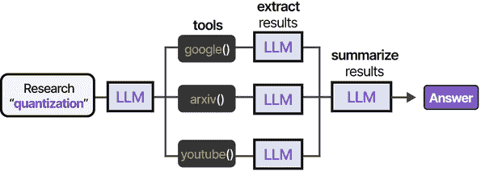

相比之下，自主性程度更高的系统允许智能体选择使用哪个工具以及何时使用。如图 5-3 所示，它们仍然是 LLM 调用的序列，但工具的选择由智能体自主决定。

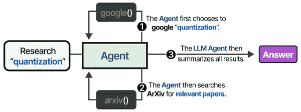

工具的意义远不止于使用。它们是如何创建的？工具的输出是如何被 LLM 或智能体处理的？工具是如何被选择的？一个 LLM 能有效处理多少工具？

在本章中，我们不仅会探讨多种类型的工具，还会探讨 LLM 和智能体如何学会使用这些工具，甚至这些工具如何在不同智能体系统中实现标准化。如图 5-4 所示，这个模块允许与环境交互。它使下一章——规划要采取的行动——不再只是一个理论练习。毕竟，没有工具，LLM 又如何能自主行动呢？

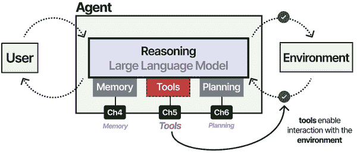

### 工具使用

工具使用包含的步骤比你想象的要多。它不是从 LLM 使用工具开始的，而是从实际创建和定义工具、规划要使用哪个工具并最终调用工具开始的。尽管工具使用的步骤可以从许多不同的角度来看（例如^(1)、^(2)和^(3)），我们将探讨以下几个方面：

* 工具创建
* 工具定义
* 工具选择
* 工具调用
* 输出处理

尽管智能体看起来似乎可以自己做所有事情（在某种程度上它们确实可以），但要真正使用工具，它们还需要用户或开发者的帮助。高层流程如图 5-5 所示，该图改编自 OpenAI 的工具调用流程^(4)，其中我们额外关注了工具的创建，并突出显示了单次工具调用所经历的步骤。

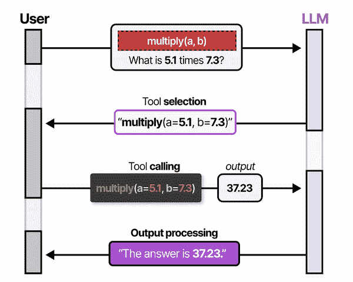

请注意，每个步骤可能有各种形式和实现方式，其中许多我们将在后面介绍。现在，让我们探讨这些步骤中最常见的工具使用方式，并更详细地研究它们。

#### 工具创建

虽然工具可以有各种形式，但它们通常是通过 API 或某些内部代码访问的函数。其复杂程度可以根据应用需求而定，可以很复杂，也可以很简单。例如，LLM 并不以数学能力著称。让我们创建一个简单的乘法函数，供 LLM 使用。请注意，所有代码示例都只是伪代码，完整示例可以在本书的 GitHub 仓库中找到。

```
def multiply(a: float, b: float):
    """
    Multiply two numbers
 
    Args:
        a: First number
        b: Second number
    """
    return a*b
```

如示例所示，这些工具应该带有详尽的文档，因为文档字符串也会被传达给 LLM。一个明显的好处是，这会促使使用者更加注重编写优秀的文档，而这在开发代码时往往不是优先事项。

这个工具可以通过直接调用`multiply(a, b)`来访问，这是 LLM 无法做到的，但自动化系统可以做到。请注意，外部 API 调用也可能调用工具。无论如何，工具通常被视为某种形式的函数，可以通过各种方式调用。在我们的示例中，最直接的方法是将它保存在一个字典中，这样我们就可以通过字符串访问该函数。在这种情况下，我们的*数据库*就是`tools`变量：

```
tools = {
  "multiply": multiply
}
```


尽管创建工具可能是一个直接了当的过程，但在设计工具时仍应考虑到 LLM。这与设计供人使用的代码类似，你可能会问自己：用户是否理解该工具的作用？返回的内容是否清晰？变量名是否具有描述性？是否有文档？

这对 LLM 尤为重要，因为它们通常需要明确被告知存在什么、不存在什么，以及工具能够做什么。

### 工具定义

创建工具之后，我们需要告知 LLM 该工具的功能，这被称为工具定义。如果不向 LLM 传达存在哪些工具、它们的功能以及使用方式，LLM 将无法正确使用它们。

有几种方法可以将这些信息传达给 LLM：

- **学习**：在训练过程中学习工具的（具体）定义和用法
- **提示**：通过结构化提示将工具定义分享给 LLM

如何使用（特定）工具以及何时需要它们，通常是在 LLM 的微调阶段学习的，模型在这一阶段学习如何遵循指令和使用工具。这个学习阶段可以分为两个方面：要么调整模型以*学习*有关*特定工具*的知识，要么学习如何使用*通用工具*。学习特定工具可能成本高昂，并且会限制你可以添加到模型中的工具数量。相反，近期模型的关注点通常是其改进的指令遵循能力和通用工具使用能力。它们不是学习特定工具，而是学习识别提示中的工具定义并动态地使用它们。

随着（推理）LLM 变得更易于引导并动态学习使用工具，我们可以通过提示来分享工具定义。当你有一小组工具需要 LLM 使用时，你可以通过系统提示来分享：

```
system_prompt = """
...
 
#### Tool Definition
You can use the following tools:
 
- multiply(a, b): multiplies two numbers
- divide(a, b): divides a by b
- add(a, b): adds two numbers
- subtract(a, b): subtracts b from a
 
#### Tool Usage
When you need to use them, write: [function_name(value1, value2)]
...
"""
```

请注意，这里的定义并没有遵循标准化的流程。坦率地说，这是我们临时编造的内容，目的是向你展示 LLM 可以按照你决定的任何方式调用工具。它使用 `TOOL(value1, value2)` 还是将其结构化为 `TOOL, value1, value2` 都无关紧要。你唯一需要的是一小段能够识别工具何时被调用的代码。我们将在本章稍后部分介绍 LLM 实际如何调用工具。

另一种与 LLM 分享工具定义的方法是通过结构化的*函数调用*。与其我们自己费心处理提示词并优化每个工具的描述和格式，不如在结构化模式中定义每个工具。这些通常是 JSON Schema 对象，描述函数的名称、描述及其参数（类型、必填字段、范围等）。我们的 `multiply` 工具的此类模式示例如下：

```
{
  "type": "function",
  "function": {
    "name": "multiply",
    "description": "Multiply two numbers",
    "parameters": {
      "type": "object",
      "properties": {
        "a": {
          "type": "number",
          "description": "First number"
        },
        "b": {
          "type": "number",
          "description": "Second number"
        }
      },
      "required": [
        "a",
        "b"
      ]
    }
  }
}
```

在使用外部 API 时，这些模式通常作为单独的参数传递。例如，OpenAI 使用 `tools` 参数，你可以在其中发送工具的 JSON 模式。^(5) 这允许 LLM 甚至 Agent 将其视为特殊元数据，并在必要时预先处理。

然而，在实践中，这些模式通常被当作“常规”提示来处理，并放入例如系统提示中：

```
#### Tool JSON Schema put into the system prompt
system_prompt = """
You are a bot that responds to mathematical queries.
 
#### Tools
 
You may call one or more functions to assist with the user query.
 
You are provided with function signatures within <tools></tools> XML tags:
 
<tools>
{"type": "function", "function": {"name": "multiply", "description": "Multiply two numbers", "parameters": {"type": "object", "properties": {"a": {"type": "number", "description": "First number"}, "b": {"type": "number", "description": "Second number"}}, "required": ["a", "b"]}}}
</tools>
 
For each function call, return a json object with function name and arguments within <tool_call></tool_call> XML tags:
 
<tool_call>
{"name": <function-name>, "arguments": <args-json-object>}
</tool_call>
 
"""
```

此示例使用 transformers 库来格式化系统提示。请注意，他们额外提供了如何识别工具何时被调用的说明：将调用放在 XML 标签（分别为 `<tool_call>` 和 `</tool_call>`）之间。

尽管我们使用结构化的 JSON 模式进行通信，但 LLM 仍然需要解释如何使用工具以及何时使用，这使得工具使用成为一项艰巨的任务。因此，模式描述得越详细、越清晰，LLM 就越有可能做出正确的工具调用决策。

此时，用户终于可以提问了。由于他们可以使用 `multiply` 函数，让我们保持查询简单：“5.1 乘以 7.3 等于多少？”。为了说明这将如何处理，我们使用了上一章探讨过的 `messages` 结构。这在图 5-6 中进行了可视化，其中系统提示包含我们工具的定义。

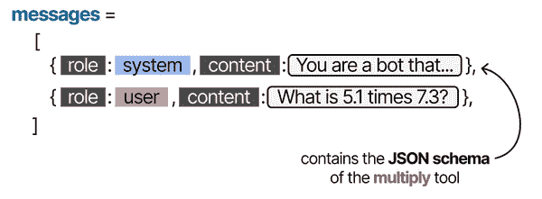

无论你是使用 JSON 模式还是描述工具，定义函数时都需要考虑以下几个最佳实践：

- **为你的工具编写包含参数、函数名甚至示例的详尽文档**：这能让你的智能体更好地理解工具的能力。
- **尽量减少工具数量**：虽然拥有许多工具会扩展智能体的能力，但选择和调用合适的工具会变得更加困难。
- **尽量缩小工具的范围**：参数众多的复杂工具难以使用，即使对个人来说也是如此，更不用说智能体了。

### 工具选择

既然工具已经创建并定义完毕，我们就可以开始调用工具的过程。LLM 首先需要为给定的查询选择合适的工具，这可能是一项艰巨的任务。尤其是当潜在存在数十个复杂工具时，LLM 不仅需要选择最合适的工具（如果有的话），还需要正确使用它。虽然我们可以为每个工具分享详尽的 JSON 模式，但 LLM 需要足够的能力才能真正遵循它。这正是推理型 LLM 的闪光之处。它们可以花费任意数量的 token 来“思考”使用哪些工具以及如何正确使用它们。图 5-7 展示了 LLM 决定使用哪个工具以及如何使用的推理过程。

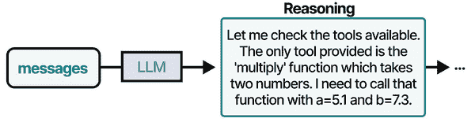


注意：当工具数量增加时，发现现有或可能相关的工具变得更加重要。正如我们在前一章所讨论的，即使你拥有很大的上下文窗口，将其塞满工具 JSON 模式也必然会降低 LLM 的性能。与上下文工程一样，发现工具的过程可以借助 RAG 等方法加以改进，即将所有工具模式存储在单独的数据库中供 LLM 发现。图 5-8 展示了使用向量数据库来发现哪些工具与用户查询最相关的这一思路。

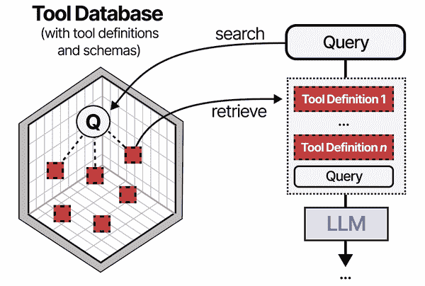

注意，LLM 的规划能力对于做出良好选择至关重要。对于简单查询，如“1+1 等于几？”，工具选择不会成为挑战。然而，当规划假期时，需要一个多步骤的过程，代理首先需要规划其行为。这种规划（和反思）行为将在下一章中更详细地讨论。

### 工具调用

接下来，当 LLM 结束其

这些步骤如图 5-14 所示。

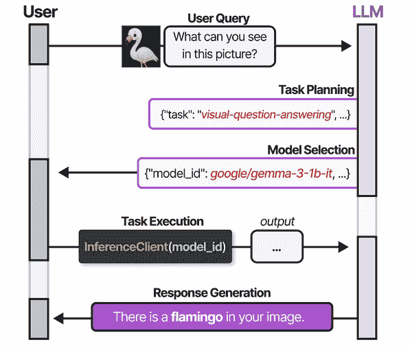

#### 任务规划


### HuggingGPT

#### 任务规划

在*任务规划*中，LLM 会决定哪些类型的任务最适合给定的查询。从本质上讲，任务就是你在 HuggingFace Hub 上可以找到的模型类别。可用的任务种类繁多，从文本分类、摘要生成，到图像到文本、目标检测等。总共有 24 类任务，Hub 上可能托管着数百万个模型。LLM 通过一种由基于规范的指令（specification-based instruction）和基于演示的解析（demonstration-based parsing）构成的提示设计，来选择任务及其执行顺序。

基于规范的指令会说明如何以 JSON 格式表示任务。它描述的是我们对输出格式的期望，而不是一个示例。下面展示了完整提示词的一部分，用来说明这种基于规范的指令：

```
"""
#1 Task Planning Stage
The AI assistant performs task parsing on user input, generating a list of tasks with the following format: [{"task": task,"id", task_id, "dep":dependency_task_ids, "args":{"text": text, "image": URL, "audio": URL, "video": URL}}].

The "dep" field denotes the id of  the previous task which generates a new resource upon which the current task relies. 
The tag "<resource>-task_id" represents the generated text, image, audio, or video from the dependency task with the corresponding task_id. 
The task must be selected from the following options: {{AvailableTaskList}}. 

Please note that there exists a logical connection and order between the tasks. 

In case the user input cannot be parsed, an empty JSON response should be provided. Here are several cases for your reference: {{Demonstrations}}. 

To assist with task planning, the chat history is available as {{ChatLogs}}, where you can trace the user-mentioned resources and incorporate them into the task planning stage.
"""
```

为了更好地理解这种 JSON 解析，作者通过上下文学习（in-context learning）给出了查询和输出的示例，并将其命名为基于演示的解析。图 5-15 展示了这些示例的构造方式。

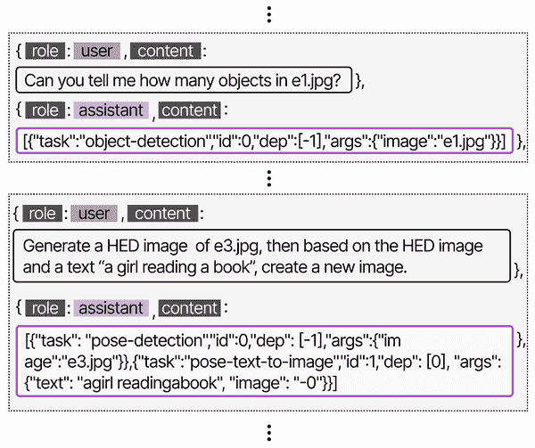

#### 模型选择

在选定了要执行的合适任务之后，还需要从这些特定任务中选择模型。下面是为给定任务要求智能体选择最佳模型所用的提示模板：

```
"""
#2 Model Selection Stage
Given the user request and the call command, the AI assistant helps the user to select a suitable model from a list of models to process the user request.

The AI assistant merely outputs the model id of the most appropriate model.

The output must be in a strict JSON format:
{"id":"id", "reason":"your detail reason for the choice"}. 

We have a list of models for you to choose from {{CandidateModels}}. Please select one model from the list.
"""
```

由于 Hugging Face Hub 上的每个任务都可能拥有数十万个模型，因此只会从上一步所选的任务中提取一个子集。具体来说，作者将 Hub 上的下载量作为模型质量的代理指标，并据此提取排名前 K 的模型。这个选择结果包含在 `CandidateModels` 变量中，格式如下：

```
{"model_id": id#1, "metadata": info#1, "description": model description #1} 
{"model_id": id#2, "metadata": info#2, "description": model description #2} 
...
{"model_id": id#K, "metadata": info#K, "description": model description #K}
```

#### 任务执行

接下来，每个被选中的模型都会使用其相关参数执行。如果可能，这些模型会并行运行。例如，如果要求为不同的 PDF 生成摘要，则可以并行运行多个模型来执行这一任务。这种资源依赖关系会被仔细跟踪，以决定哪些模型可以并行运行，哪些模型需要等待其他模型运行完成。

#### 响应生成

最后，所有先前步骤的输入和输出都会提供给模型，以生成最终响应。这包括用户输入、任务规划、模型选择和任务执行。提示词详细说明了智能体应如何解析结果并有效生成摘要。

```
"""
#### 4 Response Generation Stage
With the input and the inference results, the AI assistant needs to describe the process and results. 

The previous stages can be formed as:

- User Input: {{ User Input }}
- Task Planning: {{ Tasks }}
- Model Selection: {{ Model Assignment }}
- Task Execution: {{ Predictions }} 

You must first answer the user’s request in a straightforward manner. Then describe the task process and show your analysis and model inference results to the user in the first person. If inference results contain a file path, must tell the user the complete file path. If there is nothing in the results, please tell me you can’t make it.
"""
```

你必须首先直截了当地回应用户的请求。然后以第一人称描述任务过程，并向用户展示你的分析和模型推理结果。如果推理结果中包含文件路径，你必须告诉用户完整的文件路径。如果结果中没有任何内容，请告诉我你无法完成。

请注意，该框架使用了较旧的 LLM（如 Alpaca-7b、Vicuna-7b 和 GPT-3.5）来评估其性能。这些模型并未专门针对工具调用任务进行训练，但通过上下文学习展现出了工具调用行为。因此，HuggingGPT 是一个很好的例子，展示了结构化提示和上下文学习能达到怎样的效果。

### 监督微调

尽管提示（prompting）是启用工具调用的直接方法，但它确实需要用额外的指令填满上下文窗口。正如我们在上一章所探讨的，我们希望避免填满上下文窗口，因为这可能会降低模型性能。此外，如果指令过多，模型也有可能无法通过提示来遵循这些指令。

一个很好的替代方案是使用监督微调（supervised fine-tuning）来训练模型，将工具调用的知识和能力蒸馏到模型本身之中。这种方法在 2023 年及 2024 年初尤其流行，因为事实证明，它为模型添加工具调用能力既有效又相对廉价。

#### ToolFormer

一个有趣的、用于探索工具调用监督微调（并包含其他一些技巧）的技术是 Toolformer，它是一个经过训练、能决定调用哪些 API 以及如何调用的模型。^(8)

在探讨训练过程之前，我们先深入了解 Toolformer 调用工具的方法。在之前的示例中，需要调用的工具是通过 JSON schema 结构化的，调用输出会被发送回 LLM 处理。Toolformer 采用了不同的方法：它将调用及其输出嵌入到正在生成的文本中。具体来说，它使用 `[` 和 `]` 这两个 token 来表示工具调用的开始和结束。当给定提示词“*5.1 乘以 7.3 等于多少？*”时，它会持续生成 token，直到遇到 `` token（如图 5-16 所示）。

![

`` token 会告诉 LLM：它应开始选择工具，并按照固定格式生成相应参数（稍后会详细介绍！）。它会一直这样做，直到遇到 `→` token（图 5-17）。

![一个带有白色文字的蓝色方块；AI 生成的内容可能不正确。

`→` token 告诉 LLM，它现在可以完全停止生成 token，由用户或自动化系统执行所选工具。与我们之前探讨的通过 messages 结构追加输出的方式不同，这里会将输出与 `]` token 一起添加到先前生成的 token 之后（如图 5-18 所示）。

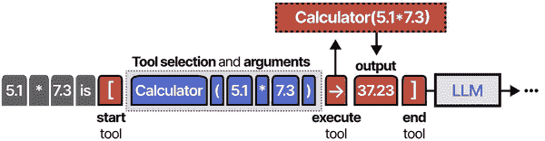


`]`词元告诉 LLM 工具已执行完毕，并且工具调用连同其输出现在已成为之前生成的词元的一部分。然后，如有必要，LLM 可以决定继续生成词元。图 5-19 演示了调用工具、在生成过程中添加输出并给出回答的端到端流程。

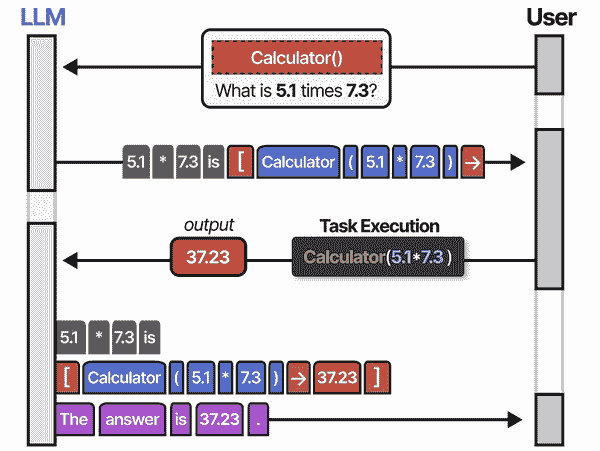

因此，该过程的输入/输出如下：

**输入**：“5.1 乘以 7.3 等于多少？”

**输出**：“5.1 * 7.3 是`[Calculator(5.1*7.3)→37.23]`，答案是 37.23。”

在生成词元的同时添加输出的这种过程是一个重要机制，常被各种模型采用。通过在生成过程中嵌入输出，模型能够更自然地使用工具，并生成流畅的语言。这种方法也非常适合推理型 LLM——在推理过程中调用工具，而不必在消息之间来回切换（还记得上一章的 Search-o1 吗？）。

为了在 Toolformer 中启用这种内联工具调用行为，需要先对模型进行微调。为此，作者精心生成了一个包含大量不同工具使用示例的数据集。针对每个工具，作者手动创建了少样本提示（few-shot prompt），并用来采样输出。通过采样不同的输出（很像我们在推理章节中探讨的 Search against Verifiers 采样方式），可以根据工具使用的正确性、输出情况以及损失下降程度进行过滤，从而提取出最佳输出。创建该数据集的完整过程如图 5-20 所示。

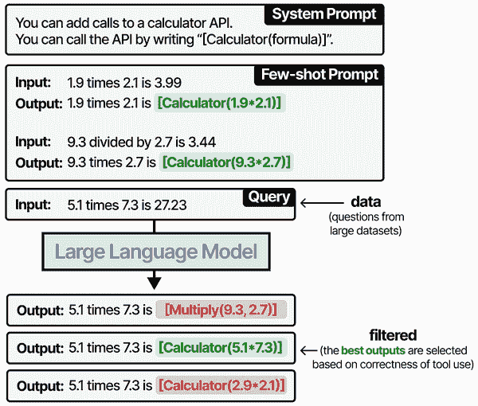

换句话说，原始数据经过调整，加入了工具调用，而不是由 LLM 自行生成答案。所有输入基本上都经过更新，融入了相应的工具。

最后，使用监督微调在这份更新后的数据上对 LLM（GPT-J，GPT-3 的一个变体）进行了微调。当时，这项技术相比零样本性能有了显著提升，甚至可与更大的模型一较高下。然而，在这份数据上进行监督微调使得泛化变得困难。监督微调往往对所使用的确切措辞和提示非常敏感，因为它试图复现所展示的内容。正如我们接下来将探讨的，强化学习往往是实现工具使用中泛化的一种更稳定的技术。

### 强化学习

正如我们在第 3 章中探讨的，强化学习是一种出色的训练或微调方法，可以让模型对齐到某些可奖励的任务。与 LLM 在带有正确答案的固定示例上进行训练的监督微调相比，强化学习依靠的是试错。在强化学习中，LLM 并非通过被告知确切该做什么（即监督微调的模仿行为）来发展改进的推理策略，而是通过反复探索反馈信号。

在强化学习的背景下，工具学习通常被整合到`词元中，然后通过`<search></search>`调用搜索引擎函数，其输出通过`<information></information>`重新整合，最后通过`<answer></answer>`词元给出答案。请注意，推理轨迹和搜索引擎可以交替进行多次。


这个模板特别有趣之处在于，作者只专注于单一工具——搜索。原因是 DeepResearch 即将流行起来，该框架将推理 LLM 与搜索引擎相结合，创建出能够在各种主题上进行深入研究的智能体系统。Search-R1 的作者创建了这个框架，作为现有专有系统的一个强大开源替代方案。

与 ToolRL 一样，这种模板产生的结果是工具交错的推理，以及多轮搜索引擎调用。我们在图 5-24 中展示了这样一个过程的示例。请注意，`<search></search>`工具可以是任何应用程序，例如学术论文的开放获取存档 arXiv，或各种来源的组合。

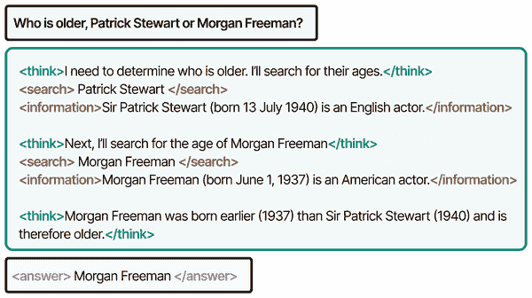

使用强化学习来训练该算法的方法相当直接。作者采用了简化的基于结果的奖励函数。作者没有构建各种不同类型的格式和准确性奖励（如 DeepSeek-R1 那样），而是仅使用了（基于任务的）准确性奖励。由于底层模型（Qwen-2.5）已经具有很强的结构遵循能力，因此无需格式奖励。


作者同时探索了 PPO 和 GRPO 作为强化学习算法，如图 5-25 所示。在撰写本文时（2025 年 9 月），两者都是 LLM 最流行的两种强化学习方法，我们将在第 X 章更深入地探讨。请注意，PPO 和 GRPO 中的损失通常是针对整个 token 序列计算的，包括搜索引擎的输出。在 Search-R1 中，搜索引擎输出的 token 被屏蔽（忽略），以防止模型试图控制搜索引擎的输出——这些输出并非直接由 LLM 生成（这可能会产生意想不到的动态）。这被称为*检索 Token 的损失屏蔽*。

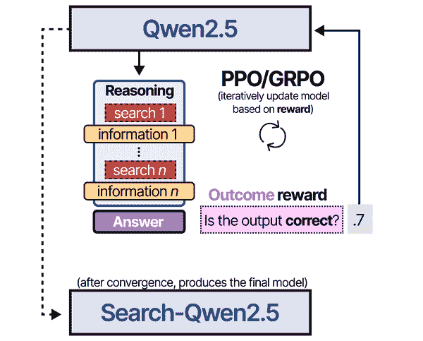

这类利用强化学习的框架和方法论变得越来越流行，因为工具调用的奖励结构通常非常简单直接。检查工具是否被正确调用以及是否使用了正确的参数（如 ToolRL 中那样）是轻而易举的。此外，强化学习对于可验证的奖励效果很好，比如编码和工具调用。因此，使用强化学习训练并额外采用基于工具的奖励的模型越来越多，比如强大的开源 Qwen3^(12)和 GPT-OSS^(13)模型。

### 模型上下文协议（MCP）

在前面的章节中，我们探讨了如何将工具连接到 LLM，使它们能够做的事情远不止文本生成。尽管它们使用工具的能力令人惊叹，但这并非免费的午餐。想象一下，你已经开发了几个提示词来指导你的 LLM 如何使用工具。正如该领域的常态，一个新的 LLM 版本发布了，你想连同所有工具一起试用。现在想象一下，它有一种新的工具调用方式，这意味着你必须为所有工具创建新的集成。这就是 NxM 问题，其中 N 是 LLM 的数量，M 是可用工具的数量。你将不得不为每一个 LLM/工具组合编写自定义集成。

模型上下文协议（MCP）通过标准化如何将不同结构的工具和 API 连接到你的 LLM 来解决这个问题。它是由 Anthropic 开发的一个开放标准和框架。^(14)作为一种协议，它促进了工具和 LLM 之间的双向通信。由于其中立性，它常被称为“AI 的 USB-C 端口”，允许任何 LLM 实现遵循该协议的任何工具。如图 5-26 所示，MCP 无需手动创建 LLM 和工具之间的连接，而是只需创建一个可以由工具提供方无限期维护的单一连接。

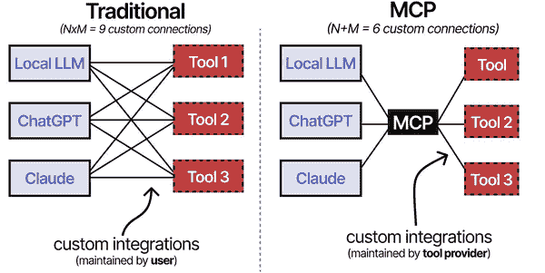

通过让 MCP 服务器处理集成并通过 MCP 标准向 LLM 传达工具，需要维护的连接从 NxM 个变成了 N+M 个。此外，只要工具提供方有 MCP 服务器，将服务器连接到你的 LLM 就相对简单，但稍后会详细讨论！

因此，集成的维护工作也从用户转移到了工具提供方。如果没有 MCP，如果 arXiv 的 API 突然发生剧烈变化，那么每个用户都必须调整他们的集成。有了 MCP，API 的任何更改只需由该 API 的维护者解决一次。然后，更新就可以在用户不做任何干预的情况下推送给所有用户。

为了进一步说明这一点，如果你手动向 LLM 添加工具，所有工具都必须：

*   手动**跟踪**并馈送给 LLM，
*   手动**描述**（包括预期的 JSON 模式）
*   每当其 API 更改时手动**更新**

如图 5-27 所示，这可能会给工具维护带来相当大的麻烦。

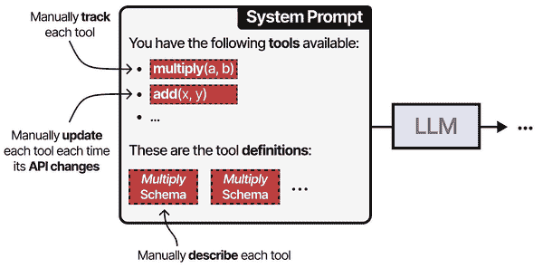

因此，MCP 不仅解决了 NxM 问题，还解决了标准化问题。请注意，MCP 并不是唯一用于标准化通信的协议，例如用于标准化代理间通信的 Agent 2 Agent（A2A）。^(15)虽然还有其他协议，但在 2025 年，它可以说是其中最流行的协议之一。^(16)

#### 核心组件

为了实现所有这些强大的功能，MCP 由四个组件组成：

MCP 服务器
: 为 LLM 提供上下文、工具和能力

MCP 主机
: 管理连接的 LLM 应用程序（如 Cursor）

MCP 客户端
: 与 MCP 服务器保持一对一的连接

资源
: 本地或远程提供的工具、数据或服务

*MCP 主机*是任何使用 LLM 来使用外部工具的应用程序。典型的例子包括 ChatGPT 或 Claude 等聊天助手，以及 Cursor 或 GitHub Copilot 等 IDE 扩展。这是 MCP 流程的“大脑”，通过 MCP 客户端调用 MCP 服务器。

*MCP 客户端*维护与 MCP 服务器的连接。它们存在于主机内部，处理连接管理、工具能力发现、请求转发等。与主机相比，它是处理与 MCP 服务器通信的一段代码，而 MCP 主机仅发起通信。

*MCP 服务器*是一个轻量级程序，通过 MCP 标准公开 API 和工具。这些服务器通常连接到特定的数据源或服务。例如，一个 MCP 服务器可能连接到 arXiv 的所有 API 端点，以搜索、加载和查看学术论文。

总而言之，**MCP 主机**（例如 GitHub Copilot）包含一个**MCP 客户端**，该客户端连接到多个**MCP 服务器**（这些服务器提供工具、资源或数据源）。

这三个组件如图 5-28 所示。


#### MCP 流程

即使展示了并描述了核心组件，MCP 可能仍然有些神秘。相反，让我们通过一个示例来看看使用 MCP 发现和调用工具会是什么样子。假设你希望你的 AI 助手（也许是 GitHub Copilot 或 Claude Code）总结你代码库中最近的 5 次提交。这个流程在接下来的图表中已编号，以便我们能够准确地追踪每一步。

一切始于用户的查询：“总结最近的 5 次提交”。如图 5-29 所示，这个提示词被发送到 MCP 主机（1），主机通过 MCP 客户端询问 MCP 服务器有哪些可用工具（2）。MCP 服务器连接到一组工具（GitHub），并将所有可用 API 调用的列表返回给 MCP 主机（3）。API 调用可能包括常见的方法，如列出所有提交（`/list_commits`）或创建拉取请求（`/create_pr`）。然后，初始提示词连同可用工具一起发送给 LLM（4）。


接下来，LLM 可以选择使用返回的任何工具（图 5-30）。由于用户的查询是关于提交的，LLM 决定让 MCP 服务器使用`/list_commits`工具（5）。MCP 客户端将此操作传达给 MCP 服务器（6），后者最终执行该命令（7）。工具使用的输出返回给 MCP 服务器（8），再通过 MCP 协议传递回 MCP 客户端和主机（9）。


当 LLM 收到结果（10）时，它可以选择运行另一个工具，或者将输出返回给 MCP 主机，再由主机转交给用户。在我们的示例中，LLM 决定总结收到的最近 5 次提交（11），并将总结返回给用户（12）。见图 5-31。


这些步骤之所以如此特别，是因为 LLM 能够发现现有工具、选择使用哪一个，并且无需过多考虑已弃用的 API 功能。

请注意，LLM 仍然需要具备工具调用能力。每当它想要执行某个工具时，都应遵循 MCP 协议，该协议采用类似 JSON 的结构。这种结构遵循[JSON-RPC 2.0 规范](https://www.jsonrpc.org/specification)，同样由 MCP 客户端传递，而 MCP 客户端充当 LLM 与协议之间的中间人。

### 小结

在本章中，我们探讨了工具调用如何使 LLM 具备与世界交互的能力。我们首先介绍了工具调用的基础知识，以及 LLM 在实践中如何调用工具。我们了解到，作为文本到文本的实体，LLM 仅传达调用工具的意图。实际调用工具的行为要么由用户自己完成，要么由自动化该过程的外部软件完成。调用工具的流程包括工具创建、定义、选择、调用和输出处理。

然后，我们探讨了让 LLM 学习这些工具调用能力的三种方法。第一种是上下文学习，你可以在提示词中定义工具的模式和定义，供 LLM 遵循。我们将 HuggingGPT 作为上下文学习实现工具调用的优秀示例进行了介绍。第二种是监督微调，即对 LLM 进行特定工具调用能力的微调。我们将 ToolFormer 作为最早使用监督微调进行工具调用的成功尝试之一进行了介绍。最后，我们介绍了强化学习，这是灌输工具调用能力最突出的技术之一。其中值得一提的是 ToolRL 和 Search-R1，它们都采用了 GRPO，这是 DeepSeek-R1 中使用的一种流行的强化学习算法。

在本章的最后，我们介绍了工具调用领域最令人兴奋的内容之一——模型上下文协议（MCP）。我们探讨了 MCP 如何将工具的使用标准化，从而无需自定义解决方案即可广泛使用工具。

^(1) Wang, Zhiruo, et al. "工具到底是什么？来自语言模型视角的综述。" *arXiv preprint arXiv:2403.15452* (2024).

^(2) Liu, Bang, et al. "基础智能体的进展与挑战：从脑启发智能到进化、协作与安全系统。" *arXiv preprint arXiv:2504.01990* (2025).

^(3) Wang, Lei, et al. "基于大语言模型的自主智能体综述。" *Frontiers of Computer Science* 18.6 (2024): 186345.

^(4) https://platform.openai.com/docs/guides/function-calling

^(5) https://platform.openai.com/docs/guides/function-calling

^(6) Dong, Qingxiu, et al. "上下文学习综述。" *arXiv preprint arXiv:2301.00234* (2022).

^(7) Shen, Yongliang, et al. "HuggingGPT：使用 ChatGPT 及其在 Hugging Face 上的伙伴解决 AI 任务。" *Advances in Neural Information Processing Systems* 36 (2023): 38154-38180.

^(8) Schick, Timo, et al. "ToolFormer：语言模型可以自学使用工具。" *Advances in Neural Information Processing Systems* 36 (2023): 68539-68551.

^(9) Qian, Cheng, et al. "ToolRL：奖励是工具学习所需的一切。" *arXiv preprint arXiv:2504.13958* (2025).

^(10) Qwen, "Qwen2.5 技术报告。" arXiv:2412.15115, 2024.

^(11) Jin, Bowen, et al. "Search-R1：通过强化学习训练 LLM 进行推理并利用搜索引擎。" *arXiv preprint arXiv:2503.09516* (2025).

^(12) Yang, An, et al. "Qwen3 技术报告。" *arXiv preprint arXiv:2505.09388* (2025).

^(13) Agarwal, Sandhini, et al. "gpt-oss-120b 与 gpt-oss-20b 模型卡。" *arXiv preprint arXiv:2508.10925* (2025).

^(14) "模型上下文协议介绍。" *Anthropic*, www.anthropic.com/news/model-context-protocol. 访问日期：2025 年 9 月 13 日。

^(15) Google. A2A：智能体到智能体协议，2025 年。URL https://github.com/google/A2A。访问日期：2025 年 10 月 2 日。

^(16) Yang, Yingxuan, et al. "AI 智能体协议综述。" *arXiv preprint arXiv:2504.16736* (2025).

## 关于作者

**Maarten Grootendorst** 是 IKNL（荷兰综合癌症组织）的高级临床数据科学家。他拥有组织心理学、临床心理学和数据科学的硕士学位，并利用这些知识向广大受众传播复杂的机器学习概念。通过他的[热门博客](https://newsletter.maartengrootendorst.com/)，他通过解释人工智能的基础知识（通常从心理学角度出发）吸引了数百万读者。他是 BERTopic、PolyFuzz 和 KeyBERT 等多个依赖大语言模型力量的开源包的作者和维护者。他的包下载量达数百万次，并被全球数据专业人士和组织使用。

**Jay Alammar** 是 Cohere（率先以 API 形式提供大语言模型服务的提供商）的总监兼工程研究员。在此职位上，他就如何将语言模型应用于实际用例，为企业和开发者社区提供咨询和指导。通过他的[热门 AI/ML 博客](https://jalammar.github.io/)，Jay 帮助数百万研究人员和工程师直观地理解机器学习工具和概念——从基础（最终出现在 NumPy 和 pandas 等包的文档中）到前沿（Transformers、BERT、GPT-3、Stable Diffusion）。Jay 还是 Deeplearning.ai 和 Udacity 上热门机器学习和自然语言处理课程的共同创建者。

