# 第 2 章 工具使用、学习与协议

工具模块是一个非常有趣的模块，它可以增强你的 LLM，并在智能体中产生自主行为。LLM 本身不过是一些接收字符串并输出字符串的函数。虽然这能创造出有趣的聊天机器人，但它们还无法与环境交互。

定义智能体的一个关键特征是其能够自主搜索、选择并利用工具，从而与环境交互并对其施加影响。只要具备足够的能力，智能体甚至可以创建自己的工具集来使用。工具的好处并不局限于与环境交互。正如我们在上一章所讨论的，工具通常用于访问外部知识或记忆。我们甚至可以使用工具访问专门的（大）语言模型，这些模型的能力超出了智能体自身的能力范围，比如多模态大语言模型，或针对特定任务（如编码）专门化的大语言模型。总的来说，工具允许 LLM 采取行动并与外部环境交互，或者提取数据并使用外部应用程序（参见图 5-1）。


然而，普通的 LLM 无法搜索网页、使用计算器或安排日程。它们只能表达这样做的意图，却无法付诸行动。没有工具，智能体只能自主*思考*，而不能自主*行动*。

自主性的程度也决定了工具的使用方式。如图 5-2 所示，如果没有自主性而只有固定流程，那么工具可以按预定义的顺序使用。例如，一个研究型智能体可能总是调用 arXiv 和 Google 等工具来提取结果，随后再对这些结果进行总结。

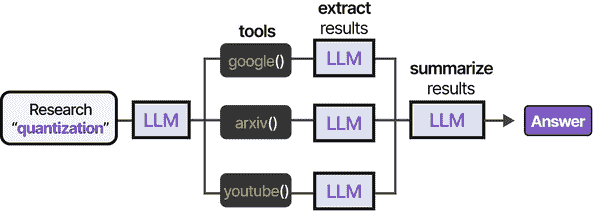

相比之下，自主性程度更高的系统允许智能体选择使用哪个工具以及何时使用。如图 5-3 所示，它们仍然是 LLM 调用的序列，但工具的选择由智能体自主决定。

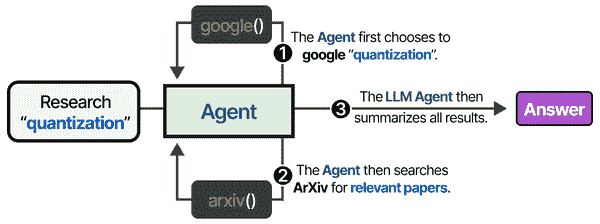

工具的意义远不止于使用。它们是如何创建的？工具的输出是如何被 LLM 或智能体处理的？工具是如何被选择的？一个 LLM 能有效处理多少工具？

在本章中，我们不仅会探讨多种类型的工具，还会探讨 LLM 和智能体如何学会使用这些工具，甚至这些工具如何在不同智能体系统中实现标准化。如图 5-4 所示，这个模块允许与环境交互。它使下一章——规划要采取的行动——不再只是一个理论练习。毕竟，没有工具，LLM 又如何能自主行动呢？

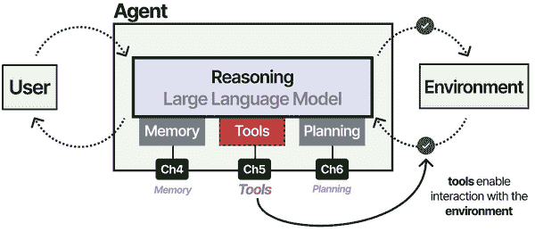

### 工具使用

工具使用包含的步骤比你想象的要多。它不是从 LLM 使用工具开始的，而是从实际创建和定义工具、规划要使用哪个工具并最终调用工具开始的。尽管工具使用的步骤可以从许多不同的角度来看（例如^(1)、^(2)和^(3)），我们将探讨以下几个方面：

* 工具创建

* 工具定义

* 工具选择

* 工具调用

* 输出处理

尽管智能体看起来似乎可以自己做所有事情（在某种程度上它们确实可以），但要真正使用工具，它们还需要用户或开发者的帮助。高层流程如图 5-5 所示，该图改编自 OpenAI 的工具调用流程^(4)，其中我们额外关注了工具的创建，并突出显示了单次工具调用所经历的步骤。

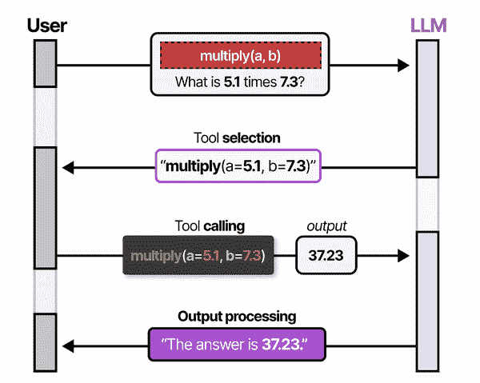

请注意，每个步骤可能有各种形式和实现方式，其中许多我们将在后面介绍。现在，让我们探讨这些步骤中最常见的工具使用方式，并更详细地研究它们。

#### 工具创建

虽然工具可以有各种形式，但它们通常是通过 API 或某些内部代码访问的函数。其复杂程度可以根据应用需求而定，可以很复杂，也可以很简单。例如，LLM 并不以数学能力著称。让我们创建一个简单的乘法函数，供 LLM 使用。请注意，所有代码示例都只是伪代码，完整示例可以在本书的 GitHub 仓库中找到。

```
def multiply(a: float, b: float):
    """
    Multiply two numbers
 
    Args:
        a: First number
        b: Second number
    """
    return a*b
```

如示例所示，这些工具应该带有详尽的文档，因为文档字符串也会被传达给 LLM。一个明显的好处是，这会促使使用者更加注重编写优秀的文档，而这在开发代码时往往不是优先事项。

这个工具可以通过直接调用`multiply(a, b)`来访问，这是 LLM 无法做到的，但自动化系统可以做到。请注意，外部 API 调用也可能调用工具。无论如何，工具通常被视为某种形式的函数，可以通过各种方式调用。在我们的示例中，最直接的方法是将它保存在一个字典中，这样我们就可以通过字符串访问该函数。在这种情况下，我们的*数据库*就是`tools`变量：

```
tools = {
  "multiply": multiply
}
```

尽管创建工具可能是一个直接了当的过程，但在设计工具时仍应考虑到 LLM。这与设计供人使用的代码类似，你可能会问自己：用户是否理解该工具的作用？返回的内容是否清晰？变量名是否具有描述性？是否有文档？

这对 LLM 尤为重要，因为它们通常需要明确被告知存在什么、不存在什么，以及工具能够做什么。

### 工具定义

创建工具之后，我们需要告知 LLM 该工具的功能，这被称为工具定义。如果不向 LLM 传达存在哪些工具、它们的功能以及使用方式，LLM 将无法正确使用它们。

有几种方法可以将这些信息传达给 LLM：

- **学习**：在训练过程中学习工具的（具体）定义和用法

- **提示**：通过结构化提示将工具定义分享给 LLM

如何使用（特定）工具以及何时需要它们，通常是在 LLM 的微调阶段学习的，模型在这一阶段学习如何遵循指令和使用工具。这个学习阶段可以分为两个方面：要么调整模型以*学习*有关*特定工具*的知识，要么学习如何使用*通用工具*。学习特定工具可能成本高昂，并且会限制你可以添加到模型中的工具数量。相反，近期模型的关注点通常是其改进的指令遵循能力和通用工具使用能力。它们不是学习特定工具，而是学习识别提示中的工具定义并动态地使用它们。

随着（推理）LLM 变得更易于引导并动态学习使用工具，我们可以通过提示来分享工具定义。当你有一小组工具需要 LLM 使用时，你可以通过系统提示来分享：

```
system_prompt = """
...
 
#### Tool Definition
You can use the following tools:
 
- multiply(a, b): multiplies two numbers
- divide(a, b): divides a by b
- add(a, b): adds two numbers
- subtract(a, b): subtracts b from a
 
#### Tool Usage
When you need to use them, write: [function_name(value1, value2)]
...
"""
```

请注意，这里的定义并没有遵循标准化的流程。坦率地说，这是我们临时编造的内容，目的是向你展示 LLM 可以按照你决定的任何方式调用工具。它使用 `TOOL(value1, value2)` 还是将其结构化为 `TOOL, value1, value2` 都无关紧要。你唯一需要的是一小段能够识别工具何时被调用的代码。我们将在本章稍后部分介绍 LLM 实际如何调用工具。

另一种与 LLM 分享工具定义的方法是通过结构化的*函数调用*。与其我们自己费心处理提示词并优化每个工具的描述和格式，不如在结构化模式中定义每个工具。这些通常是 JSON Schema 对象，描述函数的名称、描述及其参数（类型、必填字段、范围等）。我们的 `multiply` 工具的此类模式示例如下：


在使用外部 API 时，这些模式通常作为单独的参数传递。例如，OpenAI 使用`tools`参数，你可以在其中发送工具的 JSON 模式。^(5) 这允许 LLM 甚至 Agent 将其视为特殊元数据，并在必要时预先处理。

然而，在实践中，这些模式通常被当作“常规”提示来处理，并放入例如系统提示中：

```
#### Tool JSON Schema put into the system prompt
system_prompt = """
You are a bot that responds to mathematical queries.
 
#### Tools
 
You may call one or more functions to assist with the user query.
 
You are provided with function signatures within <tools></tools> XML tags:
 
<tools>
{"type": "function", "function": {"name": "multiply", "description": "Multiply two numbers", "parameters": {"type": "object", "properties": {"a": {"type": "number", "description": "First number"}, "b": {"type": "number", "description": "Second number"}}, "required": ["a", "b"]}}}
</tools>
 
For each function call, return a json object with function name and arguments within <tool_call></tool_call> XML tags:
 
<tool_call>
{"name": <function-name>, "arguments": <args-json-object>}
</tool_call>
 
"""
```

此示例使用 transformers 库来格式化系统提示。请注意，他们额外提供了如何识别工具何时被调用的说明：将调用放在 XML 标签（分别为`<tool_call>`和`</tool_call>`）之间。

尽管我们使用结构化的 JSON 模式进行通信，但 LLM 仍然需要解释如何使用工具以及何时使用，这使得工具使用成为一项艰巨的任务。因此，模式描述得越详细、越清晰，LLM 就越有可能做出正确的工具调用决策。

此时，用户终于可以提问了。由于他们可以使用`multiply`函数，让我们保持查询简单：“5.1 乘以 7.3 等于多少？”。为了说明这将如何处理，我们使用了上一章探讨过的`messages`结构。这在图 5-6 中进行了可视化，其中系统提示包含我们工具的定义。

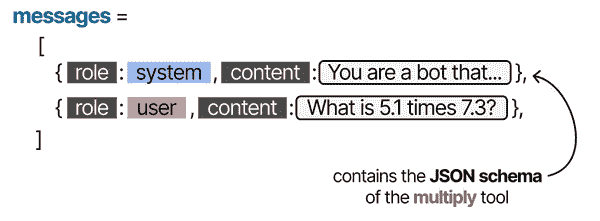

无论你是使用 JSON 模式还是描述工具，定义函数时都需要考虑以下几个最佳实践：

- **为你的工具编写包含参数、函数名甚至示例的详尽文档**：这能让你的智能体更好地理解工具的能力。
- **尽量减少工具数量**：虽然拥有许多工具会扩展智能体的能力，但选择和调用合适的工具会变得更加困难。
- **尽量缩小工具的范围**：参数众多的复杂工具难以使用，即使对个人来说也是如此，更不用说智能体了。

## 工具选择

既然工具已经创建并定义完毕，我们就可以开始调用工具的过程。LLM 首先需要为给定的查询选择合适的工具，这可能是一项艰巨的任务。尤其是当潜在存在数十个复杂工具时，LLM 不仅需要选择最合适的工具（如果有的话），还需要正确使用它。虽然我们可以为每个工具分享详尽的 JSON 模式，但 LLM 需要足够的能力才能真正遵循它。这正是推理型 LLM 的闪光之处。它们可以花费任意数量的 token 来“思考”使用哪些工具以及如何正确使用它们。图 5-7 展示了 LLM 决定使用哪个工具以及如何使用的推理过程。

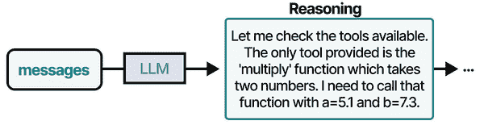

注意：当工具数量增加时，发现现有或可能相关的工具变得更加重要。正如我们在前一章所讨论的，即使你拥有很大的上下文窗口，将其塞满工具 JSON 模式也必然会降低 LLM 的性能。与上下文工程一样，发现工具的过程可以借助 RAG 等方法加以改进，即将所有工具模式存储在单独的数据库中供 LLM 发现。图 5-8 展示了使用向量数据库来发现哪些工具与用户查询最相关的这一思路。

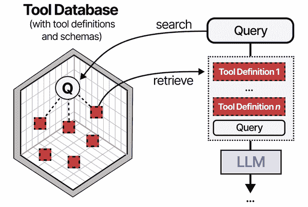

注意，LLM 的规划能力对于做出良好选择至关重要。对于简单查询，如“1+1 等于几？”，工具选择不会成为挑战。然而，当规划假期时，需要一个多步骤的过程，代理首先需要规划其行为。这种规划（和反思）行为将在下一章中更详细地讨论。

## 工具调用

接下来，当 LLM 结束其

这些步骤如图 5-14 所示。

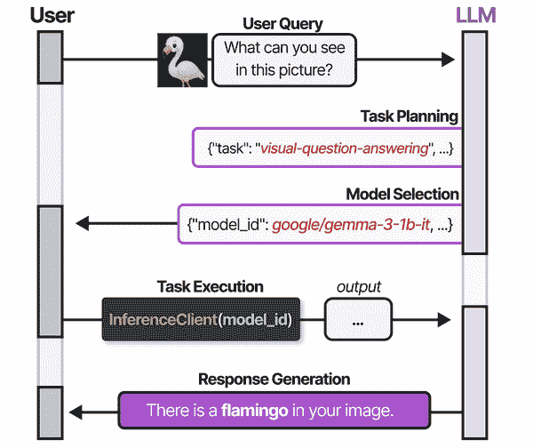

### 任务规划

### HuggingGPT

#### 任务规划

在*任务规划*中，LLM 会决定哪些类型的任务最适合给定的查询。从本质上讲，任务就是你在 HuggingFace Hub 上可以找到的模型类别。可用的任务种类繁多，从文本分类、摘要生成，到图像到文本、目标检测等。总共有 24 类任务，Hub 上可能托管着数百万个模型。LLM 通过一种由基于规范的指令（specification-based instruction）和基于演示的解析（demonstration-based parsing）构成的提示设计，来选择任务及其执行顺序。

基于规范的指令会说明如何以 JSON 格式表示任务。它描述的是我们对输出格式的期望，而不是一个示例。下面展示了完整提示词的一部分，用来说明这种基于规范的指令：

```
"""
#1 Task Planning Stage
The AI assistant performs task parsing on user input, generating a list of tasks with the following format: [{"task": task,"id", task_id, "dep":dependency_task_ids, "args":{"text": text, "image": URL, "audio": URL, "video": URL}}].

The "dep" field denotes the id of  the previous task which generates a new resource upon which the current task relies. 
The tag "<resource>-task_id" represents the generated text, image, audio, or video from the dependency task with the corresponding task_id. 
The task must be selected from the following options: {{AvailableTaskList}}. 

Please note that there exists a logical connection and order between the tasks. 

In case the user input cannot be parsed, an empty JSON response should be provided. Here are several cases for your reference: {{Demonstrations}}. 

To assist with task planning, the chat history is available as {{ChatLogs}}, where you can trace the user-mentioned resources and incorporate them into the task planning stage.
"""
```

为了更好地理解这种 JSON 解析，作者通过上下文学习（in-context learning）给出了查询和输出的示例，并将其命名为基于演示的解析。图 5-15 展示了这些示例的构造方式。

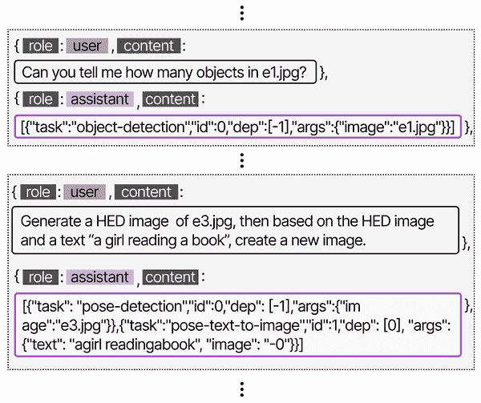

#### 模型选择

在选定了要执行的合适任务之后，还需要从这些特定任务中选择模型。下面是为给定任务要求智能体选择最佳模型所用的提示模板：

```
"""
#2 Model Selection Stage
Given the user request and the call command, the AI assistant helps the user to select a suitable model from a list of models to process the user request.

The AI assistant merely outputs the model id of the most appropriate model.

The output must be in a strict JSON format:
{"id":"id", "reason":"your detail reason for the choice"}. 

We have a list of models for you to choose from {{CandidateModels}}. Please select one model from the list.
"""
```

由于 Hugging Face Hub 上的每个任务都可能拥有数十万个模型，因此只会从上一步所选的任务中提取一个子集。具体来说，作者将 Hub 上的下载量作为模型质量的代理指标，并据此提取排名前 K 的模型。这个选择结果包含在`CandidateModels`变量中，格式如下：

```
{"model_id": id#1, "metadata": info#1, "description": model description #1} 
{"model_id": id#2, "metadata": info#2, "description": model description #2} 
...
{"model_id": id#K, "metadata": info#K, "description": model description #K}
```

#### 任务执行

接下来，每个被选中的模型都会使用其相关参数执行。如果可能，这些模型会并行运行。例如，如果要求为不同的 PDF 生成摘要，则可以并行运行多个模型来执行这一任务。这种资源依赖关系会被仔细跟踪，以决定哪些模型可以并行运行，哪些模型需要等待其他模型运行完成。

#### 响应生成

最后，所有先前步骤的输入和输出都会提供给模型，以生成最终响应。这包括用户输入、任务规划、模型选择和任务执行。提示词详细说明了智能体应如何解析结果并有效生成摘要。

```
"""
#### 4 Response Generation Stage
With the input and the inference results, the AI assistant needs to describe the process and results. 

The previous stages can be formed as:

- User Input: {{ User Input }}
- Task Planning: {{ Tasks }}
- Model Selection: {{ Model Assignment }}
- Task Execution: {{ Predictions }} 

You must first answer the user’s request in a straightforward manner. Then describe the task process and show your analysis and model inference results to the user in the first person. If inference results contain a file path, must tell the user the complete file path. If there is nothing in the results, please tell me you can’t make it.
"""
```

你必须首先直截了当地回应用户的请求。然后以第一人称描述任务过程，并向用户展示你的分析和模型推理结果。如果推理结果中包含文件路径，你必须告诉用户完整的文件路径。如果结果中没有任何内容，请告诉我你无法完成。

请注意，该框架使用了较旧的 LLM（如 Alpaca-7b、Vicuna-7b 和 GPT-3.5）来评估其性能。这些模型并未专门针对工具调用任务进行训练，但通过上下文学习展现出了工具调用行为。因此，HuggingGPT 是一个很好的例子，展示了结构化提示和上下文学习能达到怎样的效果。

## 监督微调

尽管提示（prompting）是启用工具调用的直接方法，但它确实需要用额外的指令填满上下文窗口。正如我们在上一章所探讨的，我们希望避免填满上下文窗口，因为这可能会降低模型性能。此外，如果指令过多，模型也有可能无法通过提示来遵循这些指令。

一个很好的替代方案是使用监督微调（supervised fine-tuning）来训练模型，将工具调用的知识和能力蒸馏到模型本身之中。这种方法在 2023 年及 2024 年初尤其流行，因为事实证明，它为模型添加工具调用能力既有效又相对廉价。

### ToolFormer

一个有趣的、用于探索工具调用监督微调（并包含其他一些技巧）的技术是 Toolformer，它是一个经过训练、能决定调用哪些 API 以及如何调用的模型。^(8)

在探讨训练过程之前，我们先深入了解 Toolformer 调用工具的方法。在之前的示例中，需要调用的工具是通过 JSON schema 结构化的，调用输出会被发送回 LLM 处理。Toolformer 采用了不同的方法：它将调用及其输出嵌入到正在生成的文本中。具体来说，它使用`[`和`]`这两个 token 来表示工具调用的开始和结束。当给定提示词“*5.1 乘以 7.3 等于多少？*”时，它会持续生成 token，直到遇到 `` token（如图 5-16 所示）。

![

`` token 会告诉 LLM：它应开始选择工具，并按照固定格式生成相应参数（稍后会详细介绍！）。它会一直这样做，直到遇到`→` token（图 5-17）。

![一个带有白色文字的蓝色方块；AI 生成的内容可能不正确。

`→` token 告诉 LLM，它现在可以完全停止生成 token，由用户或自动化系统执行所选工具。与我们之前探讨的通过 messages 结构追加输出的方式不同，这里会将输出与`]` token 一起添加到先前生成的 token 之后（如图 5-18 所示）。

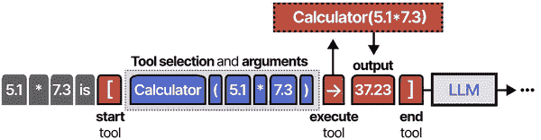

`]`词元告诉 LLM 工具已执行完毕，并且工具调用连同其输出现在已成为之前生成的词元的一部分。然后，如有必要，LLM 可以决定继续生成词元。图 5-19 演示了调用工具、在生成过程中添加输出并给出回答的端到端流程。

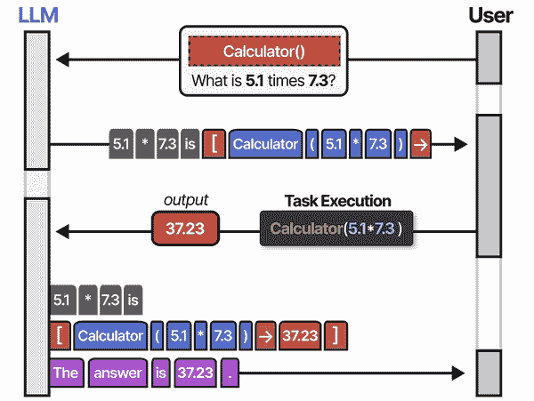

因此，该过程的输入/输出如下：

**输入**：“5.1 乘以 7.3 等于多少？”

**输出**：“5.1 * 7.3 是`[Calculator(5.1*7.3)→37.23]`，答案是 37.23。”

在生成词元的同时添加输出的这种过程是一个重要机制，常被各种模型采用。通过在生成过程中嵌入输出，模型能够更自然地使用工具，并生成流畅的语言。这种方法也非常适合推理型 LLM——在推理过程中调用工具，而不必在消息之间来回切换（还记得上一章的 Search-o1 吗？）。

为了在 Toolformer 中启用这种内联工具调用行为，需要先对模型进行微调。为此，作者精心生成了一个包含大量不同工具使用示例的数据集。针对每个工具，作者手动创建了少样本提示（few-shot prompt），并用来采样输出。通过采样不同的输出（很像我们在推理章节中探讨的 Search against Verifiers 采样方式），可以根据工具使用的正确性、输出情况以及损失下降程度进行过滤，从而提取出最佳输出。创建该数据集的完整过程如图 5-20 所示。

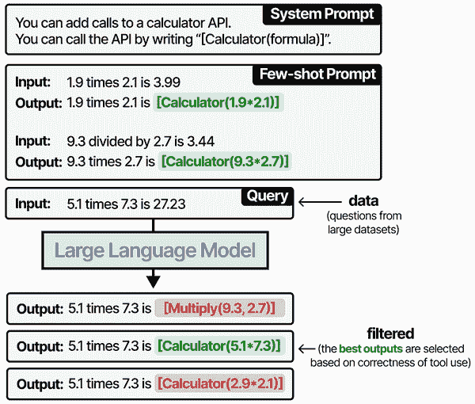


换句话说，原始数据经过调整，加入了工具调用，而不是由 LLM 自行生成答案。所有输入基本上都经过更新，融入了相应的工具。

最后，使用监督微调在这份更新后的数据上对 LLM（`GPT-J`，`GPT-3`的一个变体）进行了微调。当时，这项技术相比零样本性能有了显著提升，甚至可与更大的模型一较高下。然而，在这份数据上进行监督微调使得泛化变得困难。监督微调往往对所使用的确切措辞和提示非常敏感，因为它试图复现所展示的内容。正如我们接下来将探讨的，强化学习往往是实现工具使用中泛化的一种更稳定的技术。

## 强化学习

正如我们在第 3 章中探讨的，强化学习是一种出色的训练或微调方法，可以让模型对齐到某些可奖励的任务。与 LLM 在带有正确答案的固定示例上进行训练的监督微调相比，强化学习依靠的是试错。在强化学习中，LLM 并非通过被告知确切该做什么（即监督微调的模仿行为）来发展改进的推理策略，而是通过反复探索反馈信号。

在强化学习的背景下，工具学习通常被整合到`词元`中，然后通过`<search></search>`调用搜索引擎函数，其输出通过`<information></information>`重新整合，最后通过`<answer></answer>`词元给出答案。请注意，推理轨迹和搜索引擎可以交替进行多次。

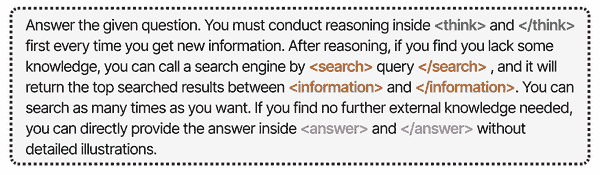

这个模板特别有趣之处在于，作者只专注于单一工具——搜索。原因是 DeepResearch 即将流行起来，该框架将推理 LLM 与搜索引擎相结合，创建出能够在各种主题上进行深入研究的智能体系统。Search-R1 的作者创建了这个框架，作为现有专有系统的一个强大开源替代方案。

与 ToolRL 一样，这种模板产生的结果是工具交错的推理，以及多轮搜索引擎调用。我们在图 5-24 中展示了这样一个过程的示例。请注意，`<search></search>`工具可以是任何应用程序，例如学术论文的开放获取存档 arXiv，或各种来源的组合。

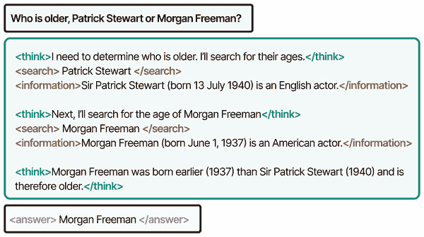

使用强化学习来训练该算法的方法相当直接。作者采用了简化的基于结果的奖励函数。作者没有构建各种不同类型的格式和准确性奖励（如 DeepSeek-R1 那样），而是仅使用了（基于任务的）准确性奖励。由于底层模型（`Qwen-2.5`）已经具有很强的结构遵循能力，因此无需格式奖励。

作者同时探索了 PPO 和 GRPO 作为强化学习算法，如图 5-25 所示。在撰写本文时（2025 年 9 月），两者都是 LLM 最流行的两种强化学习方法，我们将在第 X 章更深入地探讨。请注意，PPO 和 GRPO 中的损失通常是针对整个 token 序列计算的，包括搜索引擎的输出。在 Search-R1 中，搜索引擎输出的 token 被屏蔽（忽略），以防止模型试图控制搜索引擎的输出——这些输出并非直接由 LLM 生成（这可能会产生意想不到的动态）。这被称为*检索 Token 的损失屏蔽*。

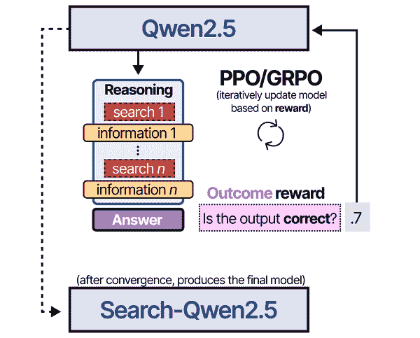

这类利用强化学习的框架和方法论变得越来越流行，因为工具调用的奖励结构通常非常简单直接。检查工具是否被正确调用以及是否使用了正确的参数（如 ToolRL 中那样）是轻而易举的。此外，强化学习对于可验证的奖励效果很好，比如编码和工具调用。因此，使用强化学习训练并额外采用基于工具的奖励的模型越来越多，比如强大的开源 Qwen3^(12)和 GPT-OSS^(13)模型。

## 模型上下文协议（MCP）

在前面的章节中，我们探讨了如何将工具连接到 LLM，使它们能够做的事情远不止文本生成。尽管它们使用工具的能力令人惊叹，但这并非免费的午餐。想象一下，你已经开发了几个提示词来指导你的 LLM 如何使用工具。正如该领域的常态，一个新的 LLM 版本发布了，你想连同所有工具一起试用。现在想象一下，它有一种新的工具调用方式，这意味着你必须为所有工具创建新的集成。这就是 NxM 问题，其中 N 是 LLM 的数量，M 是可用工具的数量。你将不得不为每一个 LLM/工具组合编写自定义集成。

模型上下文协议（MCP）通过标准化如何将不同结构的工具和 API 连接到你的 LLM 来解决这个问题。它是由 Anthropic 开发的一个开放标准和框架。^(14)作为一种协议，它促进了工具和 LLM 之间的双向通信。由于其中立性，它常被称为“AI 的 USB-C 端口”，允许任何 LLM 实现遵循该协议的任何工具。如图 5-26 所示，MCP 无需手动创建 LLM 和工具之间的连接，而是只需创建一个可以由工具提供方无限期维护的单一连接。

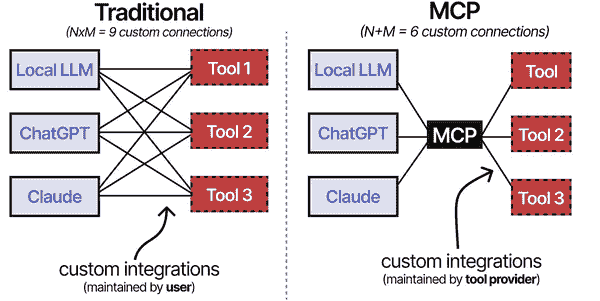

通过让 MCP 服务器处理集成并通过 MCP 标准向 LLM 传达工具，需要维护的连接从 NxM 个变成了 N+M 个。此外，只要工具提供方有 MCP 服务器，将服务器连接到你的 LLM 就相对简单，但稍后会详细讨论！

因此，集成的维护工作也从用户转移到了工具提供方。如果没有 MCP，如果 arXiv 的 API 突然发生剧烈变化，那么每个用户都必须调整他们的集成。有了 MCP，API 的任何更改只需由该 API 的维护者解决一次。然后，更新就可以在用户不做任何干预的情况下推送给所有用户。

为了进一步说明这一点，如果你手动向 LLM 添加工具，所有工具都必须：

*   手动**跟踪**并馈送给 LLM，
*   手动**描述**（包括预期的 JSON 模式）
*   每当其 API 更改时手动**更新**

如图 5-27 所示，这可能会给工具维护带来相当大的麻烦。

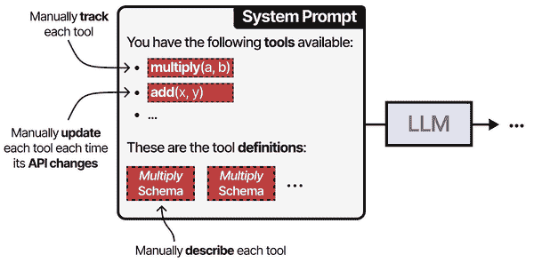

因此，MCP 不仅解决了 NxM 问题，还解决了标准化问题。请注意，MCP 并不是唯一用于标准化通信的协议，例如用于标准化代理间通信的 Agent 2 Agent（A2A）。^(15)虽然还有其他协议，但在 2025 年，它可以说是其中最流行的协议之一。^(16)

### 核心组件

为了实现所有这些强大的功能，MCP 由四个组件组成：

MCP 服务器

: 为 LLM 提供上下文、工具和能力

MCP 主机

: 管理连接的 LLM 应用程序（如 Cursor）

MCP 客户端

: 与 MCP 服务器保持一对一的连接

资源

: 本地或远程提供的工具、数据或服务

*MCP 主机*是任何使用 LLM 来使用外部工具的应用程序。典型的例子包括 ChatGPT 或 Claude 等聊天助手，以及 Cursor 或 GitHub Copilot 等 IDE 扩展。这是 MCP 流程的“大脑”，通过 MCP 客户端调用 MCP 服务器。

*MCP 客户端*维护与 MCP 服务器的连接。它们存在于主机内部，处理连接管理、工具能力发现、请求转发等。与主机相比，它是处理与 MCP 服务器通信的一段代码，而 MCP 主机仅发起通信。

*MCP 服务器*是一个轻量级程序，通过 MCP 标准公开 API 和工具。这些服务器通常连接到特定的数据源或服务。例如，一个 MCP 服务器可能连接到 arXiv 的所有 API 端点，以搜索、加载和查看学术论文。

总而言之，**MCP 主机**（例如 GitHub Copilot）包含一个**MCP 客户端**，该客户端连接到多个**MCP 服务器**（这些服务器提供工具、资源或数据源）。

这三个组件如图 5-28 所示。

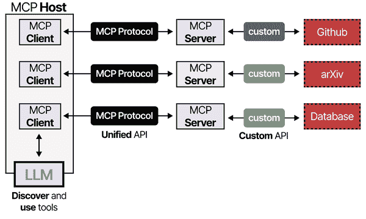

### MCP 流程

即使展示了并描述了核心组件，MCP 可能仍然有些神秘。相反，让我们通过一个示例来看看使用 MCP 发现和调用工具会是什么样子。假设你希望你的 AI 助手（也许是 GitHub Copilot 或 Claude Code）总结你代码库中最近的 5 次提交。这个流程在接下来的图表中已编号，以便我们能够准确地追踪每一步。

一切始于用户的查询：“总结最近的 5 次提交”。如图 5-29 所示，这个提示词被发送到 MCP 主机（1），主机通过 MCP 客户端询问 MCP 服务器有哪些可用工具（2）。MCP 服务器连接到一组工具（GitHub），并将所有可用 API 调用的列表返回给 MCP 主机（3）。API 调用可能包括常见的方法，如列出所有提交（`/list_commits`）或创建拉取请求（`/create_pr`）。然后，初始提示词连同可用工具一起发送给 LLM（4）。

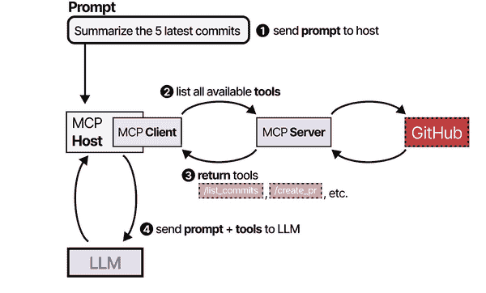

接下来，LLM 可以选择使用返回的任何工具（图 5-30）。由于用户的查询是关于提交的，LLM 决定让 MCP 服务器使用`/list_commits`工具（5）。MCP 客户端将此操作传达给 MCP 服务器（6），后者最终执行该命令（7）。工具使用的输出返回给 MCP 服务器（8），再通过 MCP 协议传递回 MCP 客户端和主机（9）。

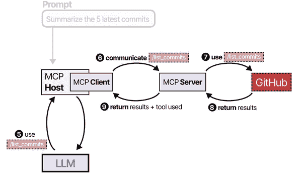

当 LLM 收到结果（10）时，它可以选择运行另一个工具，或者将输出返回给 MCP 主机，再由主机转交给用户。在我们的示例中，LLM 决定总结收到的最近 5 次提交（11），并将总结返回给用户（12）。见图 5-31。

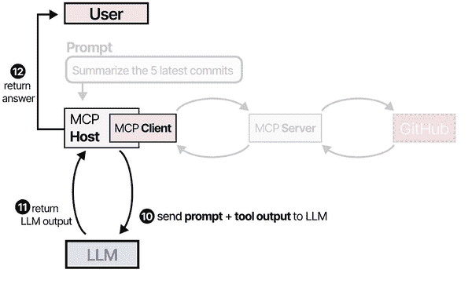

这些步骤之所以如此特别，是因为 LLM 能够发现现有工具、选择使用哪一个，并且无需过多考虑已弃用的 API 功能。

请注意，LLM 仍然需要具备工具调用能力。每当它想要执行某个工具时，都应遵循 MCP 协议，该协议采用类似 JSON 的结构。这种结构遵循[JSON-RPC 2.0 规范](https://www.jsonrpc.org/specification)，同样由 MCP 客户端传递，而 MCP 客户端充当 LLM 与协议之间的中间人。

## 小结

在本章中，我们探讨了工具调用如何使 LLM 具备与世界交互的能力。我们首先介绍了工具调用的基础知识，以及 LLM 在实践中如何调用工具。我们了解到，作为文本到文本的实体，LLM 仅传达调用工具的意图。实际调用工具的行为要么由用户自己完成，要么由自动化该过程的外部软件完成。调用工具的流程包括工具创建、定义、选择、调用和输出处理。

然后，我们探讨了让 LLM 学习这些工具调用能力的三种方法。第一种是上下文学习，你可以在提示词中定义工具的模式和定义，供 LLM 遵循。我们将 HuggingGPT 作为上下文学习实现工具调用的优秀示例进行了介绍。第二种是监督微调，即对 LLM 进行特定工具调用能力的微调。我们将 ToolFormer 作为最早使用监督微调进行工具调用的成功尝试之一进行了介绍。最后，我们介绍了强化学习，这是灌输工具调用能力最突出的技术之一。其中值得一提的是 ToolRL 和 Search-R1，它们都采用了 GRPO，这是 DeepSeek-R1 中使用的一种流行的强化学习算法。

在本章的最后，我们介绍了工具调用领域最令人兴奋的内容之一——模型上下文协议（MCP）。我们探讨了 MCP 如何将工具的使用标准化，从而无需自定义解决方案即可广泛使用工具。

^(1) Wang, Zhiruo, et al. "工具到底是什么？来自语言模型视角的综述。" *arXiv preprint arXiv:2403.15452* (2024).

^(2) Liu, Bang, et al. "基础智能体的进展与挑战：从脑启发智能到进化、协作与安全系统。" *arXiv preprint arXiv:2504.01990* (2025).

^(3) Wang, Lei, et al. "基于大语言模型的自主智能体综述。" *Frontiers of Computer Science* 18.6 (2024): 186345.

^(4) https://platform.openai.com/docs/guides/function-calling

^(5) https://platform.openai.com/docs/guides/function-calling

^(6) Dong, Qingxiu, et al. "上下文学习综述。" *arXiv preprint arXiv:2301.00234* (2022).

^(7) Shen, Yongliang, et al. "HuggingGPT：使用 ChatGPT 及其在 Hugging Face 上的伙伴解决 AI 任务。" *Advances in Neural Information Processing Systems* 36 (2023): 38154-38180.

^(8) Schick, Timo, et al. "ToolFormer：语言模型可以自学使用工具。" *Advances in Neural Information Processing Systems* 36 (2023): 68539-68551.

^(9) Qian, Cheng, et al. "ToolRL：奖励是工具学习所需的一切。" *arXiv preprint arXiv:2504.13958* (2025).

^(10) Qwen, "Qwen2.5 技术报告。" arXiv:2412.15115, 2024.

^(11) Jin, Bowen, et al. "Search-R1：通过强化学习训练 LLM 进行推理并利用搜索引擎。" *arXiv preprint arXiv:2503.09516* (2025).

^(12) Yang, An, et al. "Qwen3 技术报告。" *arXiv preprint arXiv:2505.09388* (2025).

^(13) Agarwal, Sandhini, et al. "gpt-oss-120b 与 gpt-oss-20b 模型卡。" *arXiv preprint arXiv:2508.10925* (2025).

^(14) "模型上下文协议介绍。" *Anthropic*, www.anthropic.com/news/model-context-protocol. 访问日期：2025 年 9 月 13 日。

^(15) Google. A2A：智能体到智能体协议，2025 年。URL https://github.com/google/A2A。访问日期：2025 年 10 月 2 日。

^(16) Yang, Yingxuan, et al. "AI 智能体协议综述。" *arXiv preprint arXiv:2504.16736* (2025).
