# 推理模型构建指南（从零开始）

## 献词

献给 Liza，我每一次冒险的伴侣；献给我挚爱的家人；以及献给塑造了我作家之旅的全球程序员和创作者社区

## 前言

十多年前，我踏入 AI 领域的旅程始于统计模式分类，在那里我了解到，当相对简单的模型捕捉到数据中有用的结构时，它们能走得多远。随着时间的推移，我的好奇心从识别模式的模型转向了能够解释、规划并解决多步骤问题的模型。

2022 年 ChatGPT 的发布使大语言模型（LLM）进入主流。此后一个尤其显著的变化在 2024 年末和整个 2025 年尤为明显，那就是 LLM 的扩展催生了所谓的推理模型，它们可以解决更复杂的问题，尤其是在数学和代码等技术领域。

与此同时，推理模型可能让人感觉不透明，而这本书正是我为了让推理模型更易上手所做的尝试。我们不会从头训练一个巨型模型，而是从一个较小的预训练 LLM 开始，一步一步应用推理技术。在此过程中，你将实现文本生成、使用验证器进行评估、推理时扩展方法，以及训练方法，例如可验证奖励的强化学习和从零开始的蒸馏。到最后，你将理解主要推理方法在实践中如何运作，以及它们如何融入现代 LLM 开发工作流。

与我之前的书《构建大语言模型（从零开始）》类似，本书也采用代码优先的方法，但侧重点有所不同。本书不会深入讲解 Transformer 架构或大规模预训练，而是聚焦于将传统 LLM 转变为推理模型的方法。如果你读过前一本书，本书会像是一个自然的下一步。如果没读过，你依然可以跟着本书学习，而无需事先了解所有底层 LLM 细节。

本书全程使用数学示例，因为它们对推理研究很实用，而且易于自动验证。这使得它们成为理解模型是否真正正确解决问题的有效测试平台。更广泛地说，我的目标不是教你某个狭窄的基准，而是为你提供在自己的工作中构建、评估和改进推理系统所需的工具与直觉。

当我最初开始研究推理模型时，不得不从论文、代码仓库和零散的实现笔记中拼凑思路。我希望本书能为你省去这份功夫，并为你提供一条从基本原理到可运行代码的更清晰路径。我坚信，理解推理模型的最佳方式就是亲手构建一个。

祝阅读和编码愉快！

## 致谢

写一本书是一项重大的工程，我要向我的妻子 Liza 表示诚挚的感谢，感谢她在整个过程中给予的耐心与支持。她无条件的爱和持续的鼓励至关重要。

我特别感激 Daniel Kleine 和 Dmitry Labazkin，他们对草稿章节和代码的宝贵反馈远超预期。Daniel 对细节和风格的敏锐眼光，加上 Dmitry 对代码性能的深刻见解，无疑使本书对所有人来说读起来更加流畅和愉快。

我还要感谢 Manning Publications 的出色团队。Michael Stephens，感谢你多次富有成效的对话，帮助塑造了本书的方向。Dustin Archibald，非常感谢你在遵循 Manning 指南方面的建设性指导，以及你在适应这种非常规的从零开始方法独特需求方面所展现的灵活性。特别感谢 Aleksandar Dragosavljevic 和 Ivan Martinović在排版和格式化方面的工作。最后，感谢技术编辑 David Caswell 在整个过程中给予的周到而慷慨的反馈。David 是一位专注于将 LLM 应用于新闻业的行业领先顾问。他曾领导 BBC、Tribune Publishing 和 Yahoo!的 AI 创新，发表关于 AI 自动化信息工作流程的同行评审研究，并且是在新兴的 AI 中介信息生态系统中经常就 LLM 进行演讲和写作的人。

最后，我向审阅者 Alejandro Cuevas Rivero、Muhammad Ali Shafique、Arun Prakash A、Christopher Brousseau、David Curran、Fabio Montagna、Hamza Farooq、Hongming Zheng、Julien Thomazo、Lindo William Khoza、Michael Anthony Garcia、Naman Dwivedi、Pere Martra、Pradeep Dasigi、Salvatore Raieli、Sifal Klioui、Syed Baqir Ali、Thomas Viehmann、Tianrui Liu、Toni Ramchandani 和 Viton Vitanis 致以感谢，感谢他们对草稿的详尽反馈。你们敏锐的眼光和富有洞见的评论对提高本书质量至关重要。

对每一位为这段旅程做出贡献的人，我深表感激。你们的支持、专业知识和奉献精神对本书的完成起到了重要作用。谢谢！

## 关于本书

《构建推理模型（从零开始）》是一本实践指南，通过自己实现核心技术，帮助你理解现代推理 LLM 的工作原理。本书不是从头训练基础模型，而是从一个预训练的开源基础 LLM 开始，逐步展示如何为其扩展推理能力。在此过程中，你将学习如何使用基础模型生成文本、使用验证器评估答案、通过推理时扩展提升性能、使用强化学习进行训练，并将推理行为蒸馏到更小的模型中。到本书结束时，你将理解主要推理方法如何在实际的 LLM 开发工作流中组合在一起，以及如何构建自己的小而实用的推理系统。

本书采用代码优先的方法。“从零开始”的部分指的是你自己实现推理方法，使底层机制变得透明。如果你对基础 LLM 如何构建和预训练的细节感兴趣，我之前的书《构建大语言模型（从零开始）》([`mng.bz/M96o`](http://mng.bz/M96o))提供了相关基础，但读本书并不需要。

### 本书读者

《构建推理模型（从零开始）》面向机器学习爱好者、工程师、研究人员、学生和软件开发者，他们希望实际理解推理模型的工作原理以及如何实现其背后的主要技术。本书面向那些不满足于高层次描述，希望看到这些系统如何用代码构建、评估和改进的读者。

最重要的前提是扎实的 Python 经验。有机器学习、深度学习或大语言模型的相关经验会有帮助，但你不需要成为专家。本书对积极进取的初学者很友好，同时也为经验丰富的从业者提供足够的技术深度。

本书频繁使用数学示例，因为它们对推理研究实用且易于自动验证。不过，并不需要高等数学。熟悉基础代数，并且对向量和矩阵有一般的适应能力，会对你理解某些代码实现有所帮助。

一些 PyTorch 经验可能会帮助你更快地阅读代码，但不是必需的。本书的重点是理解推理方法并清晰地实现它们，而不是掌握深度学习框架的每一个细节。已经读过《构建大语言模型（从零开始）》的读者可能会认出一些更广泛的 LLM 概念，但本书完全自成一体。

### 本书结构：路线图

本书围绕推理模型的实用开发流水线来组织。我们将从一个传统的预训练 LLM 开始，加入评估以便衡量进展，然后探索改进推理的两种主要方式：推理时方法和额外训练。由于后续章节直接建立在前文介绍的代码和思想之上，最好按顺序阅读本书。

第 1 章介绍推理在 LLM 语境中的实际含义。它解释了推理模型与传统 LLM 的不同之处，从高层次回顾了标准 LLM 训练流水线，并介绍了用于改进推理的主要方法。

第 2 章通过加载并使用一个预训练基础 LLM 来建立起点。它涵盖编码环境、分词、逐步文本生成，以及键值缓存和模型代码编译等实用加速技巧。

第 3 章介绍评估，展示如何可靠地提取最终答案、对照参考答案核验正确性，并为面向数学的推理任务构建评估流水线。

有了这一基础，第 4 章和第 5 章聚焦于推理时扩展，在不改变模型权重的前提下提升推理能力。第 4 章涵盖基于提示的推理、多样化解码和自洽性。第 5 章通过自我精炼、简单评分策略、置信度估计和迭代答案改进继续推进这一方向。

第 6 章至第 8 章实现训练时方法。第 6 章介绍面向推理模型的强化学习，重点是可验证奖励强化学习（RLVR）和组相对策略优化（GRPO）。第 7 章在该实现的基础上，介绍实用监控、常见训练失败模式、奖励攻击，以及 KL 正则化和响应格式奖励等实用扩展。第 8 章以蒸馏收尾正文，展示如何创建教师模型生成的推理数据集、训练较小的学生模型，并评估蒸馏结果。

附录与正文各章相辅相成。附录 A 提供参考文献和延伸阅读，附录 B 汇总练习题解答，附录 C 呈现本书所用的 Qwen3 源码，附录 D 讨论更大的 LLM 变体，附录 E 涵盖批处理和面向吞吐量的执行，附录 F 概述其他 LLM 评估方法，附录 G 展示如何围绕模型构建聊天界面。

## 关于代码

为了方便读者跟进，本书中的代码示例可从 Manning 图书页面 [`www.manning.com/books/build-a-reasoning-model-from-scratch`](https://www.manning.com/books/build-a-reasoning-model-from-scratch) 以及配套 GitHub 仓库 [`github.com/rasbt/reasoning-from-scratch`](https://github.com/rasbt/reasoning-from-scratch) 获取。练习题解答汇总在附录 B 中，对应代码文件链接已放在仓库的各个章节文件夹中。你还可以从本书的 liveBook（在线）版本获取可执行代码片段：[`livebook.manning.com/book/build-a-reasoning-model-from-scratch`](https://livebook.manning.com/book/build-a-reasoning-model-from-scratch)。

本书包含许多源代码示例，既有编号代码清单，也有穿插在正文中的代码。无论哪种情况，源代码都以`fixed-width` `font like` `this`这样的等宽字体呈现，以区别于普通文本。

在许多情况下，原始源代码已经过重新排版；为适应本书的页面空间，我们添加了换行并重新调整了缩进。此外，当文中已对代码进行说明时，代码清单中的注释通常会移除。许多代码清单还配有代码注解，以突出重要概念。

本书的关键目标之一是易于上手，因此代码示例经过精心设计，可在普通笔记本电脑上高效运行，无需任何特殊硬件。但如果你拥有 GPU，部分章节会提供有用的建议，帮助扩大数据集和模型规模以充分利用额外算力。

正文各章的代码力求通俗易懂，并可在消费级硬件上运行。推理和评估章节在 CPU 和 GPU 上都能良好运行；面向训练的章节则更适合在有 GPU 的条件下复现较大规模的实验。全书使用 PyTorch 和预训练的开源 Qwen3 模型，附录 C 为希望更详细查看该代码的读者提供了底层的 Qwen3 实现。

## liveBook 讨论论坛

购买《从零开始构建推理模型》可免费访问 Manning 的在线阅读平台 liveBook。借助 liveBook 独有的讨论功能，你可以在全书层面或针对特定章节、段落添加评论。你可以轻松地记笔记、提出和回答技术问题，并获得作者和其他用户的帮助。要访问论坛，请前往 [`livebook.manning.com/book/build-a-reasoning-model-from-scratch/discussion`](https://livebook.manning.com/book/build-a-reasoning-model-from-scratch/discussion)。

Manning 对读者的承诺，是提供一个可以让读者与读者之间、读者与作者之间进行有意义对话的场所。这并非承诺作者必须参与多少，作者对论坛的贡献仍是自愿的（且无报酬）。我们建议你试着向他们提出一些有挑战性的问题，以免他们的兴趣跑偏！只要本书仍在印刷，论坛及以往讨论的存档都可以从出版社网站上访问。

## 其他在线资源

对最新的 AI 和大语言模型（LLM）研究趋势感兴趣？

*   可以看看我的博客：[`magazine.sebastianraschka.com`](https://magazine.sebastianraschka.com)，我会定期讨论最新的 AI 研究，重点关注 LLM。

需要帮助快速掌握深度学习和 PyTorch 吗？

*   我在网站上提供了几门免费课程：[`sebastianraschka.com/teaching`](https://sebastianraschka.com/teaching)。这些资源可以帮助你快速掌握最新技术。

想寻找与本书相关的额外资料吗？

*   请访问本书的 GitHub 仓库：[`github.com/rasbt/reasoning-from-scratch`](https://github.com/rasbt/reasoning-from-scratch)，查找额外资源和示例来补充学习。

## 关于作者


**Sebastian Raschka** 是一位 LLM 研究工程师，在人工智能领域拥有超过十年的经验。他的工作横跨工业界和学术界，包括在 Lightning AI 担任高级工程师实现 LLM 解决方案，以及在威斯康星大学麦迪逊分校担任统计学教授从事研究和教学。

Sebastian 与行业合作伙伴协作开发 AI 解决方案，并在威斯康星大学麦迪逊分校的开源委员会任职。他专攻 LLM 和高性能 AI 系统的开发，尤其注重实用、代码驱动的实现。他是畅销书《从零开始构建大语言模型》《机器学习：结合 PyTorch 和 Scikit-Learn》以及《机器学习 Q 和 AI》的作者。

你可以在 [`sebastianraschka.com`](https://sebastianraschka.com) 了解更多关于 Sebastian 的信息。

## 关于封面插图

*《从零开始构建推理模型》* 封面上的插图名为“La Lionne”（“母狮”），取自 Louis Curmer 于 1841 年出版的一本书。每幅插图都绘制精细，并由手工着色。

在那个年代，只需看人们的穿着，就能轻易判断他们住在哪里、从事什么行业或处于什么社会地位。Manning 以数百年前丰富多彩的地域文化为封面主题，借此颂扬计算机行业的创造力和进取精神，并通过本书所收录的这类图片让这些文化重新焕发生机。

# 第 1 章 理解推理模型

## 本章涵盖

*   对于大语言模型来说，“推理”意味着什么

*   回顾 LLM 传统的预训练和后训练阶段

*   介绍提升 LLM 推理能力的关键方法

*   推理与模式匹配有何不同

*   为什么我们应该从零开始构建推理模型

...


Welcome to the next stage of large language models (LLMs): reasoning. LLMs have transformed how we process and generate text, but their success has been largely driven by statistical pattern recognition. New advances in reasoning methods now enable LLMs to tackle more complex tasks, such as solving logical puzzles and multistep math problems.

Moreover, reasoning is an essential technique for making AI agents practical, such as when an agent has to break a task into steps, use tools, and recover from mistakes. Reasoning LLMs are already used in agent applications such as OpenClaw.

In this book, you’ll learn the inner workings of LLM reasoning methods through a hands-on, code-first approach. We’ll start with a pretrained LLM and extend it step by step with reasoning capabilities. We’ll implement these reasoning components ourselves, from scratch, to see how these methods work in practice.

If you are curious about how LLMs themselves are built and trained, my earlier book, *Build a Large Language Model (From Scratch)*, also published by Manning (`mng.bz/orYv`), covers these foundations in detail, but it’s not required to follow along here.

Even if you just have a cursory knowledge of how LLMs are built, by the end of this book, you will understand how reasoning models work and be equipped to design, prototype, and evaluate the main methods for improving reasoning in LLMs.

When working with reasoning models, it’s crucial to know how to automatically check whether answers are correct on tasks such as math and how to turn a general-purpose model into a smaller reasoning model. We will use math examples throughout the book because they are easy to check automatically, but you do not need advanced math knowledge to follow along. Understanding reasoning methods is the central focus of this book.

With its focus on practical applications and explanations, this book is intended for LLM engineers, machine learning researchers, applied scientists, and software developers. Understanding how reasoning models are set up will help us judge when a standard LLM is sufficient and when extra reasoning machinery is worth the added complexity, cost, and latency. It will also help us design better evaluations, debug failures on multistep tasks, and adapt reasoning techniques to real products and research workflows.

## 1.1 Defining reasoning in the context of LLMs

In this book, I use the term reasoning in a practical engineering sense rather than a philosophical one. In the context of LLMs, reasoning refers to a model generating intermediate steps before producing its final answer.

These intermediate steps may appear as visible step-by-step explanations, or they may be enclosed in special tags such as `<think>...</think>` and be hidden from the user. In either case, the core idea remains the same. The model is encouraged or trained to use tokens for intermediate problem-solving steps rather than jumping directly to the conclusion.

Correspondingly, I use reasoning model to mean an LLM that has been improved, either through training or prompting techniques, to produce such intermediate steps, which often increases accuracy on complex tasks such as coding, logical puzzles, and math problems.

Before we get to the coding portions of this book, I will briefly discuss the main techniques that improve these reasoning behaviors and how they relate to pattern matching and logical reasoning. This will lay the groundwork for later discussions of how LLMs are currently built, how they handle reasoning tasks, and what they are and are not so good at.

### Chain-of-thought (CoT)

This style of generating intermediate steps is often referred to as chain of thought (CoT). Researchers and engineers often say that the model “thinks” through the problem step by step, meaning that it makes its intermediate reasoning process explicit and easier to follow. In this book, I use the terms reasoning and thinking in that common engineering sense. This does not imply that LLMs actually reason or think in the same way humans do.

Figure 1.1 illustrates how a conventional LLM generates the answer to a user’s question. A conventional LLM might not show how it came up with its answer, and while the answer might be correct, it doesn’t help the user understand the process behind it.

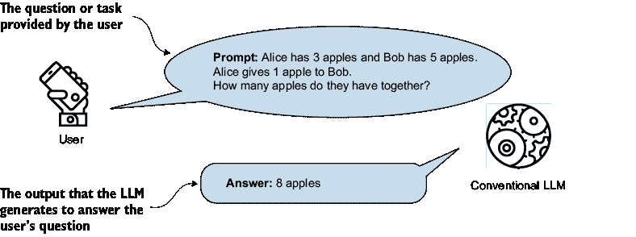

##### Figure 1.1 A simplified illustration of how a conventional, nonreasoning LLM might respond to a question with a short answer

Figure 1.2 illustrates a simple example of multistep (CoT) reasoning in an LLM. The LLM-produced intermediate reasoning steps look very much like a person articulating internal thoughts aloud. How closely these methods (and the resulting reasoning processes) mirror human reasoning remains an open research question, one this book does not attempt to answer.

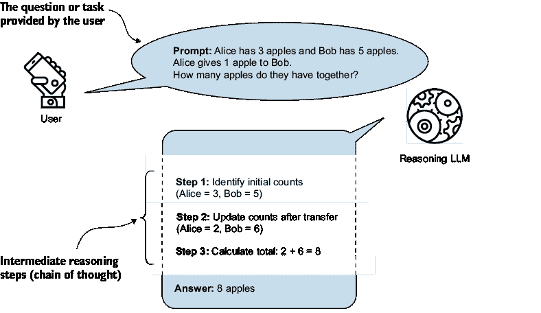

##### Figure 1.2 A simplified illustration of how a reasoning LLM might tackle a multistep reasoning task using a chain of thought. Rather than just recalling a fact, the model combines several intermediate reasoning steps to arrive at the correct conclusion. The intermediate reasoning steps may or may not be shown to the user, depending on the implementation.

While figure 1.2 is a typical example of chain-of-thought reasoning, it’s important to emphasize that LLM reasoning differs from traditional, deterministic reasoning. For instance, a symbolic logic engine or theorem prover follows strict, rule-based steps that guarantee consistency and correctness. It works like following a recipe in which every step is fixed and must produce the same result each time. If you follow the steps exactly, you will always end up with the same dish.

In contrast to a symbolic logic engine, an LLM generates reasoning autoregressively, which means it predicts one token at a time based on statistical patterns in its training data. As a result, the LLM’s “reasoning steps” are not guaranteed to be logically sound, even if they look convincing.

This book focuses on explaining and implementing the fundamental techniques that improve LLM-based reasoning and make LLMs better at handling complex tasks. My hope is that by gaining hands-on experience with these methods, you will be better prepared to understand and improve the reasoning methods being developed and maybe even explore how they compare to human reasoning.

### LLM vs. human reasoning

Reasoning processes in LLMs may superficially resemble human thought, particularly in how intermediate steps are articulated. But it is important to recognize a key difference: humans can engage in deterministic reasoning by deliberately applying rules of logic or by reasoning over an internal model of the world. Deterministic, here, means that if we start with the same facts and follow the same steps, we will always reach the same conclusion. In contrast, current LLM reasoning is probabilistic, meaning that it generates one token at a time based on statistical patterns in training data, without guarantees of logical consistency.

Humans often reason by consciously manipulating concepts, intuitively understanding abstract relationships, or generalizing from a few examples. LLMs, by contrast, work by picking up patterns from huge amounts of text rather than relying on built-in reasoning rules or any kind of conscious thought.

In short, although the outputs of reasoning-enhanced LLMs can appear human-like, the underlying mechanisms differ substantially and remain an active area of exploration.

## 1.2 Understanding the standard LLM training pipeline


## 1.1 在 LLM 语境下定义推理

欢迎来到大语言模型（LLM）的下一个阶段：*推理*。LLM 已经改变了我们处理和生成文本的方式，但它们的成功在很大程度上是由统计模式识别驱动的。推理方法的新进展如今使 LLM 能够处理更复杂的任务，例如解决逻辑谜题和多步数学问题。

然而，*推理*一词在 AI 领域被广泛使用，有时甚至有些随意，因此我们需要明确它在本书中的含义。在 LLM 的语境下，推理指的是模型通过逻辑步骤、中间计算或显式的决策过程来得出结论的能力，而不仅仅是根据训练数据中的模式生成下一个最可能的词。

为了说明这种区别，我们来看一个普通 LLM 和一个推理 LLM 在回答同一个问题时的不同表现。

##### 思维链（CoT）

推理 LLM 最突出的技术之一是*思维链*（CoT），即模型在给出最终答案之前，生成一系列中间步骤。这些步骤可以帮助模型将复杂问题分解为更小、更易管理的部分。

##### 图 1.1 一个普通非推理 LLM 可能如何用简短答案回答问题的简化示意

例如，当被问到“一辆车以 60 公里/小时的速度行驶 2 小时，它行驶了多远？”时，普通 LLM 可能只会回答“120 公里”，而推理 LLM 可能会生成如下内容：“首先，确定速度：60 公里/小时。其次，确定时间：2 小时。然后，将速度乘以时间：60 × 2 = 120。因此，答案是 120 公里。”

##### 图 1.2 一个推理 LLM 可能如何使用思维链处理多步推理任务的简化示意。模型不是仅仅回忆一个事实，而是结合多个中间推理步骤来得出正确结论。根据实现方式的不同，中间推理步骤可能会或不会展示给用户。

##### LLM 与人类推理的对比

需要注意的是，LLM 的推理与人类推理并不相同。人类推理通常涉及意识、理解和语义把握，而 LLM 的推理则基于训练数据中学到的统计模式。尽管思维链可以产生类似推理的输出，但模型并不一定“理解”其背后的逻辑。这种区别对于评估 LLM 的能力和局限性至关重要。

## 1.2 理解标准 LLM 训练流程

让我们简要看看普通（非推理）LLM 通常是如何训练的，以便理解它们的局限性所在。这一背景知识也将有助于我们后续讨论模式匹配与逻辑推理之间的差异。


# 欢迎来到大语言模型（LLMs）的下一个阶段：*推理*

大语言模型（LLMs）已经改变了我们处理和生成文本的方式，但它们的成功在很大程度上是由统计模式识别驱动的。推理方法的新进展如今使 LLMs 能够处理更复杂的任务，例如解决逻辑谜题和多步数学问题。

此外，推理是让 AI 智能体变得实用的关键技术，例如当智能体需要将任务分解为多个步骤、使用工具并从错误中恢复时。推理 LLM 已被用于诸如 `OpenClaw` 之类的智能体应用中。

在本书中，你将通过一种动手实践、代码优先的方式来学习 LLM 推理方法的内部工作原理。我们将从一个预训练的 LLM 开始，逐步为其扩展推理能力。我们将自己从头实现这些推理组件，以了解这些方法在实际中的运作方式。

如果你对 LLM 本身是如何构建和训练的感到好奇，我之前的书*从零构建大语言模型（Build a Large Language Model (From Scratch)）*也由 Manning 出版（[`mng.bz/orYv`](http://mng.bz/orYv)），详细介绍了这些基础知识，但阅读本书并不需要先读它。

即使你只对 LLM 的构建方式有粗略的了解，读完本书后，你也会理解推理模型的工作原理，并具备设计、原型验证和评估改进 LLM 推理的主要方法的能力。

在处理推理模型时，了解如何在数学等任务上自动检查答案是否正确，以及如何将通用模型变成更小的推理模型，是至关重要的。我们将在全书中使用数学示例，因为它们易于自动检查，但你不必具备高等数学知识也能跟上。理解推理方法是本书的核心焦点。

本书侧重于实际应用和解释，面向 LLM 工程师、机器学习研究人员、应用科学家和软件开发人员。了解推理模型的构建方式，将帮助我们判断何时标准 LLM 就足够了，何时额外的推理机制值得增加复杂性、成本和延迟。它还将帮助我们设计更好的评估方案、调试多步骤任务中的失败，并将推理技术应用于实际产品和研究工作流。

## 1.1 推理的定义与核心思想

在本书中，我在务实的工程意义上使用*推理*一词，而非哲学意义上的。在 LLM 的语境中，推理指的是模型在生成最终答案之前先产生中间步骤。

这些中间步骤可能表现为可见的逐步解释，也可能被包裹在特殊的标签中，如 `<think>...</think>`，并对用户隐藏。无论哪种情况，核心思想都是一样的：鼓励或训练模型使用 token 来生成中间解题步骤，而不是直接跳到结论。

相应地，我使用*推理模型*来指代经过训练或提示技术改进的 LLM，使其能够产生这样的中间步骤，这通常能提高编码、逻辑谜题和数学问题等复杂任务的准确性。

在进入本书的编码部分之前，我将简要讨论改进这些推理行为的主要技术，以及它们与模式匹配和逻辑推理的关系。这将为后面讨论 LLM 目前是如何构建的、如何处理推理任务、擅长什么不擅长什么奠定基础。

### 思维链（Chain-of-thought, CoT）

这种生成中间步骤的方式通常被称为*思维链*（CoT）。研究人员和工程师常说，模型会逐步“思考”问题，这意味着它将中间推理过程显式化，更易于理解。在本书中，我在这种常见的工程意义上使用*推理*和*思考*这两个术语。这并不意味着 LLM 真的会像人类那样推理或思考。

图 1.1 展示了一个普通 LLM 如何生成用户问题的答案。普通 LLM 可能不会展示它如何得出答案，而且虽然答案可能是正确的，但这并不能帮助用户理解其背后的过程。

```

```

##### 图 1.1 一个普通的非推理 LLM 如何用简短答案回答一个问题的简化示意

图 1.2 展示了 LLM 中多步（CoT）推理的简单示例。LLM 产生的中间推理步骤看起来很像一个人在脑海中大声说出自己的想法。这些方法（以及由此产生的推理过程）在多大程度上反映了人类的推理，仍然是一个开放的研究问题，本书不试图回答这个问题。

```

```

##### 图 1.2 一个推理 LLM 如何使用思维链处理多步推理任务的简化示意图。该模型不是仅仅回忆一个事实，而是结合多个中间推理步骤来得出正确结论。中间推理步骤可能会也可能不会展示给用户，具体取决于实现。


欢迎来到大语言模型（LLMs）的下一个阶段：*推理*。LLMs 已经改变了我们处理和生成文本的方式，但它们的成功在很大程度上是由统计模式识别驱动的。推理方法的新进展如今使 LLMs 能够处理更复杂的任务，例如解决逻辑谜题和多步数学问题。

此外，推理是让 AI 智能体变得实用的关键技术，例如当智能体需要将任务分解为多个步骤、使用工具并从错误中恢复时。推理 LLM 已被用于诸如 OpenClaw 之类的智能体应用中。

在本书中，你将通过一种动手实践、代码优先的方式来学习 LLM 推理方法的内部工作原理。我们将从一个预训练的 LLM 开始，逐步为其扩展推理能力。我们将自己从头实现这些推理组件，以了解这些方法在实际中的运作方式。

如果你对 LLM 本身是如何构建和训练的感到好奇，我之前的书——《*从零构建大语言模型*》（Build a Large Language Model (From Scratch)）——也由 Manning 出版（[`mng.bz/orYv`](http://mng.bz/orYv)），详细介绍了这些基础知识，但阅读本书并不要求你先读它。

即使你只是粗略了解 LLM 的构建方式，读完本书后，你也会理解推理模型的工作原理，并具备设计、原型制作和评估改进 LLM 推理的主要方法的能力。

在处理推理模型时，了解如何在数学等任务上自动检查答案是否正确，以及如何将通用模型变成更小的推理模型，是至关重要的。我们将在全书中使用数学示例，因为它们易于自动检查，但你不必具备高等数学知识也能跟上。理解推理方法是本书的核心焦点。

本书侧重于实际应用和解释，面向 LLM 工程师、机器学习研究人员、应用科学家和软件开发人员。了解推理模型是如何构建的，将帮助我们判断何时标准 LLM 就足够了，何时额外的推理机制值得增加复杂性、成本和延迟。它还将帮助我们设计更好的评估方案、调试多步骤任务中的失败，并将推理技术应用到实际产品和研究工作流中。

## 1.1 在 LLM 语境中定义推理

在本书中，我在务实的工程意义上使用*推理*一词，而不是哲学意义上的。在 LLM 的语境中，推理指的是模型在生成最终答案之前先产生中间步骤。

这些中间步骤可能表现为可见的逐步解释，也可能被包裹在特殊标签中，如 `<think>...</think>`，并对用户隐藏。无论哪种情况，核心思想都是一样的：鼓励或训练模型使用 token 来生成中间解题步骤，而不是直接跳到结论。

相应地，我使用*推理模型*来指代经过训练或提示技术改进的 LLM，使其能够产生这样的中间步骤，这通常能提高编码、逻辑谜题和数学问题等复杂任务的准确性。

在进入本书的编码部分之前，我将简要讨论改进这些推理行为的主要技术，以及它们与模式匹配和逻辑推理的关系。这将为后面讨论 LLM 目前是如何构建的、如何处理推理任务、擅长什么和不擅长什么奠定基础。

### 思维链（CoT）

这种生成中间步骤的方式通常被称为*思维链*（CoT）。研究人员和工程师常说，模型会逐步“思考”问题，这意味着它将中间推理过程显式化，更易于理解。在本书中，我在这种常见的工程意义上使用*推理*和*思考*这两个术语。这并不意味着 LLM 真的会像人类那样推理或思考。

图 1.1 展示了一个普通 LLM 如何生成用户问题的答案。普通 LLM 可能不会展示它如何得出答案，虽然答案可能是正确的，但这并不能帮助用户理解其背后的过程。


#### 图 1.1 一个普通的非推理 LLM 如何用简短答案回答一个问题的简化示意

图 1.2 展示了 LLM 中多步（CoT）推理的简单示例。LLM 产生的中间推理步骤看起来很像一个人在脑海中大声说出自己的想法。这些方法（以及由此产生的推理过程）在多大程度上反映了人类的推理，仍然是一个开放的研究问题，本书不试图回答这个问题。


#### 图 1.2 一个推理 LLM 如何使用思维链处理多步推理任务的简化示意图。该模型不是仅仅回忆一个事实，而是结合多个中间推理步骤来得出正确结论。中间推理步骤可能会也可能不会展示给用户，具体取决于实现。

虽然图 1.2 是思维链推理的典型示例，但必须强调的是，LLM 推理不同于传统的确定性推理。例如，符号逻辑引擎或定理证明器遵循严格的、基于规则的步骤，从而保证一致性和正确性。它就像遵循食谱一样，每一步都是固定的，并且每次必须产生相同的结果。如果你严格按步骤操作，你总会得到同一道菜。

与符号逻辑引擎相比，LLM 是*自回归*地生成推理的，这意味着它基于训练数据中的统计模式一次预测一个 token。因此，LLM 的“推理步骤”并不能保证在逻辑上站得住脚，即使它们看起来很令人信服。

本书的重点是解释和实现改进基于 LLM 的推理、使 LLM 更善于处理复杂任务的基本技术。我希望，通过亲手实践这些方法，你能更好地理解和改进正在开发的推理方法，甚至探索它们与人类推理的比较。

### LLM 与人类推理的对比

LLM 中的推理过程可能表面上与人类思维相似，尤其是在中间步骤的表达方式上。但重要的是要认识到一个关键区别：人类可以通过有意应用逻辑规则或基于内部世界模型进行推理，从而进行确定性推理。这里的确定性是指，如果我们从相同的事实出发并遵循相同的步骤，我们总会得出相同的结论。相比之下，当前的 LLM 推理是概率性的，这意味着它一次生成一个 token，基于训练数据中的统计模式，而不保证逻辑一致性。

人类通常通过有意识地操作概念、直觉地理解抽象关系或从少量例子中归纳来进行推理。相比之下，LLM 通过从海量文本中拾取模式来工作，而不是依赖内置的推理规则或任何形式的意识思维。

简而言之，尽管增强推理的 LLM 的输出可能看起来像人类一样，但其底层机制大不相同，并且仍然是一个活跃的探索领域。

## 1.2 普通 LLM 是如何训练的

让我们简要看一下普通（非推理）LLM 通常是如何训练的，以便我们理解它们的局限性所在。这一背景也将有助于为接下来关于模式匹配与逻辑推理之间差异的讨论奠定框架。


欢迎来到大语言模型（LLMs）的下一个阶段：*推理*。LLMs 已经改变了我们处理和生成文本的方式，但它们的成功在很大程度上是由统计模式识别驱动的。推理方法的新进展如今使 LLMs 能够处理更复杂的任务，例如解决逻辑谜题和多步数学问题。

此外，推理是让 AI 智能体变得实用的关键技术，例如当智能体需要将任务分解为多个步骤、使用工具并从错误中恢复时。推理 LLM 已被用于诸如 OpenClaw 之类的智能体应用中。

在本书中，你将通过一种动手实践、代码优先的方式来学习 LLM 推理方法的内部工作原理。我们将从一个预训练的 LLM 开始，逐步为其扩展推理能力。我们将自己从头实现这些推理组件，以了解这些方法在实际中的运作方式。

如果你对 LLM 本身是如何构建和训练的感到好奇，我之前的书——《*从零构建大语言模型*》（Build a Large Language Model (From Scratch)）——也由 Manning 出版（[`mng.bz/orYv`](http://mng.bz/orYv)），详细介绍了这些基础知识，但阅读本书并不要求你先读它。

即使你只是粗略了解 LLM 的构建方式，读完本书后，你也会理解推理模型的工作原理，并具备设计、原型制作和评估改进 LLM 推理的主要方法的能力。

在处理推理模型时，了解如何在数学等任务上自动检查答案是否正确，以及如何将通用模型变成更小的推理模型，是至关重要的。我们将在全书中使用数学示例，因为它们易于自动检查，但你不必具备高等数学知识也能跟上。理解推理方法是本书的核心焦点。

本书侧重于实际应用和解释，面向 LLM 工程师、机器学习研究人员、应用科学家和软件开发人员。了解推理模型是如何构建的，将帮助我们判断何时标准 LLM 就足够了，何时额外的推理机制值得增加复杂性、成本和延迟。它还将帮助我们设计更好的评估方案、调试多步骤任务中的失败，并将推理技术应用到实际产品和研究工作流中。

## 1.1 在 LLM 语境中定义推理

在本书中，我在务实的工程意义上使用*推理*一词，而不是哲学意义上的。在 LLM 的语境中，推理指的是模型在生成最终答案之前先产生中间步骤。

这些中间步骤可能表现为可见的逐步解释，也可能被包裹在特殊标签中，如 `<think>...</think>`，并对用户隐藏。无论哪种情况，核心思想都是一样的：鼓励或训练模型使用 token 来生成中间解题步骤，而不是直接跳到结论。

相应地，我使用*推理模型*来指代经过训练或提示技术改进的 LLM，使其能够产生这样的中间步骤，这通常能提高编码、逻辑谜题和数学问题等复杂任务的准确性。

在进入本书的编码部分之前，我将简要讨论改进这些推理行为的主要技术，以及它们与模式匹配和逻辑推理的关系。这将为后面讨论 LLM 目前是如何构建的、如何处理推理任务、擅长什么和不擅长什么奠定基础。

### 思维链（CoT）

这种生成中间步骤的方式通常被称为*思维链*（CoT）。研究人员和工程师常说，模型会逐步“思考”问题，这意味着它将中间推理过程显式化，更易于理解。在本书中，我在这种常见的工程意义上使用*推理*和*思考*这两个术语。这并不意味着 LLM 真的会像人类那样推理或思考。

图 1.1 展示了一个普通 LLM 如何生成用户问题的答案。普通 LLM 可能不会展示它如何得出答案，虽然答案可能是正确的，但这并不能帮助用户理解其背后的过程。


#### 图 1.1 一个普通的非推理 LLM 如何用简短答案回答一个问题的简化示意

图 1.2 展示了 LLM 中多步（CoT）推理的简单示例。LLM 产生的中间推理步骤看起来很像一个人在脑海中大声说出自己的想法。这些方法（以及由此产生的推理过程）在多大程度上反映了人类的推理，仍然是一个开放的研究问题，本书不试图回答这个问题。


#### 图 1.2 一个推理 LLM 如何使用思维链处理多步推理任务的简化示意图。该模型不是仅仅回忆一个事实，而是结合多个中间推理步骤来得出正确结论。中间推理步骤可能会也可能不会展示给用户，具体取决于实现。

虽然图 1.2 是思维链推理的典型示例，但必须强调的是，LLM 推理不同于传统的确定性推理。例如，符号逻辑引擎或定理证明器遵循严格的、基于规则的步骤，从而保证一致性和正确性。它就像遵循食谱一样，每一步都是固定的，并且每次必须产生相同的结果。如果你严格按步骤操作，你总会得到同一道菜。

与符号逻辑引擎相比，LLM 是*自回归*地生成推理的，这意味着它基于训练数据中的统计模式一次预测一个 token。因此，LLM 的“推理步骤”并不能保证在逻辑上站得住脚，即使它们看起来很令人信服。

本书的重点是解释和实现改进基于 LLM 的推理、使 LLM 更善于处理复杂任务的基本技术。我希望，通过亲手实践这些方法，你能更好地理解和改进正在开发的推理方法，甚至探索它们与人类推理的比较。

### LLM 与人类推理的对比

LLM 中的推理过程可能表面上与人类思维相似，尤其是在中间步骤的表达方式上。但重要的是要认识到一个关键区别：人类可以通过有意应用逻辑规则或基于内部世界模型进行推理，从而进行确定性推理。这里的确定性是指，如果我们从相同的事实出发并遵循相同的步骤，我们总会得出相同的结论。相比之下，当前的 LLM 推理是概率性的，这意味着它一次生成一个 token，基于训练数据中的统计模式，而不保证逻辑一致性。

人类通常通过有意识地操作概念、直觉地理解抽象关系或从少量例子中归纳来进行推理。相比之下，LLM 通过从海量文本中拾取模式来工作，而不是依赖内置的推理规则或任何形式的意识思维。

简而言之，尽管增强推理的 LLM 的输出可能看起来像人类一样，但其底层机制大不相同，并且仍然是一个活跃的探索领域。

## 1.2 理解标准 LLM 训练流程

让我们简要看一下普通（非推理）LLM 通常是如何训练的，以便我们理解它们的局限性所在。这一背景也将有助于为接下来关于模式匹配与逻辑推理之间差异的讨论奠定框架。

在采用任何特定的推理方法之前，常规的 LLM 训练通常分为两个阶段：*预训练*和*后训练*，如图 1.3 所示。一些近期的论文还在这两个阶段之间区分出一个*中期训练*阶段，例如在代码、数学或长上下文数据上继续训练模型，但为了在本书中保持术语简洁，我会将该阶段归入预训练。

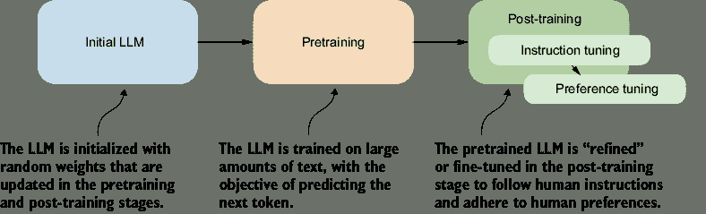

**图 1.3** 典型 LLM 训练流水线概览。整个过程始于一个以随机权重初始化的模型，随后在大规模文本数据上进行预训练，通过预测下一个词元来学习语言模式。后训练阶段则通过指令微调和偏好微调进一步优化模型，使 LLM 能够更好地遵循人类指令并与人类偏好对齐。

在典型 LLM 训练流程的预训练阶段，LLM 会在海量无标注文本上进行训练，这些数据通常有数 TB 之多，或包含数万亿个词元，来源包括书籍、网站、研究文章以及其他许多渠道。LLM 的预训练目标是学会预测这些文本中的下一个单词（即下一个*词元*）。

### 单词与词元

词元是语言模型处理的文本小单元。根据分词器对文本的切分方式，一个词元可以是完整的单词、单词的一部分，甚至可以是标点符号。

例如，句子“An LLM can be useful.”可能会被常见的分词器切分为“An”、“ L”、“LM”、“ can”、“ be”、“ useful”和“.”等词元。随后，这些词元会被转换为模型可以处理的数值 ID。

分词器并不是 LLM 本身的一部分，但仍然是 LLM 文本处理和生成流程中的关键组件。我们将在下一章了解分词的工作原理。

当 LLM 在海量数据集上完成预训练后，它们会变得非常强大，这些数据集通常包含数 TB 的文本（相当于数万亿个词元）。这种训练需要数千块 GPU 运行数月，成本可能高达数百万美元。这里的“强大”是指 LLM 开始生成与人类写作非常相似的文本。在某种程度上，经过预训练的 LLM 还会开始展现出所谓的*涌现特性*，这意味着它们可以执行未被明确训练过的任务，包括翻译和代码生成。

这些预训练模型充当后训练阶段的基础模型。后训练阶段使用两种关键技术：*监督微调*（文献中通常缩写为 *SFT*，也称为*指令微调*）和*偏好微调*，以教会 LLM 响应用户查询。

如图 1.4 所示，指令微调提升了 LLM 在个人助理任务上的能力，例如回答问题、总结摘要、翻译文本等。偏好微调阶段则进一步优化这些能力。顾名思义，偏好微调有助于使响应更符合用户偏好。一些读者可能熟悉“基于人类反馈的强化学习”（RLHF）这个术语，它是实现偏好微调的一种具体技术。


**图 1.4** 语言模型在不同训练阶段的示例响应。提示要求总结睡眠与健康之间的关系。预训练的 LLM 生成了一段相关但不够聚焦的回答，没有直接遵循指令。经过指令微调的 LLM 生成了简洁、准确且与提示一致的摘要。经过偏好微调的 LLM 则通过友好的语气和引人入胜的语言进一步改进了回答，使答案更贴近用户、更以用户为中心。

简而言之，我们可以将预训练视为“原始语言预测”（通过下一个词元预测），它赋予了 LLM 一些基础属性和生成连贯文本的能力。后训练阶段则通过指令微调提高 LLM 对任务的理解，并通过偏好微调优化 LLM，使其能以更符合偏好的风格生成答案。

值得注意的是，即使经过指令微调的模型也还不是“聊天机器人”。聊天界面增加了另一层机制，在交互式、多轮对话环境中引导模型响应。这通常涉及系统提示、对话历史管理和其他编排工作（附录 G 中实现了一个示例）。

**注意** 关于预训练和后训练阶段的详细内容，请参阅我由 Manning 出版的著作*从零开始构建大语言模型*（[`mng.bz/orYv`](http://mng.bz/orYv)）。你现在读的这本书不需要详细了解那些阶段。在这里，我们将加载一个已经完成昂贵的预训练和后训练阶段的模型，从而专注于推理模型特有的方法论。

## 1.3 使用训练和推理技术提升 LLM 的推理能力


在 LLM 的语境中，“推理”一词随着 OpenAI 于 2024 年 9 月 12 日在 ChatGPT 中发布 o1 而进入公众视野。在这篇发布公告中，OpenAI 表示：“我们开发了一系列新的 AI 模型，它们旨在做出响应之前花更多时间思考”（[`openai.com/index/introducing-openai-o1-preview/`](https://openai.com/index/introducing-openai-o1-preview/)）。此外，OpenAI 写道：“这些增强的推理能力在解决科学、编程、数学及类似领域的复杂问题时可能特别有用。”

几个月后，即 2025 年 1 月，DeepSeek 发布了 DeepSeek-R1 模型及技术报告，其中详细介绍了开发推理模型的训练方法（[`arxiv.org/abs/2501.12948`](https://arxiv.org/abs/2501.12948)）。这引起了巨大轰动，因为该公司不仅免费公开提供了一个与专有 o1 模型竞争甚至性能超越它的模型，还分享了训练此类模型的蓝图。在本书中，我们将从零开始实现类似方法，以此了解开发推理模型所用的方法论是如何运作的。

开发和改进 LLM 推理能力的不同方法大致可以分为三大类，如图 1.5 所示。这些方法通常应用于已经完成常规预训练和后训练阶段（包括指令微调和偏好微调）的 LLM。

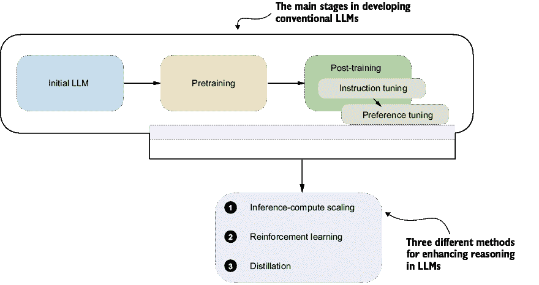

**图 1.5** 常用于提升 LLM 推理能力的三种方法：推理计算扩展、强化学习和蒸馏。这些方法通常应用于常规训练阶段（初始模型训练、预训练，以及包含指令微调和偏好微调的后训练）之后，但推理技术也可以应用于预训练的基础模型。

我们将在全书中更详细地审视这些常见方法：

* *推理时计算扩展*（也常被称为*推理计算扩展*、*测试时扩展*等）包括在推理阶段（用户提示模型时）提升模型推理能力的方法，无需训练或修改底层模型权重。其核心思想是用增加的计算资源换取性能提升，通过思维链推理和各种采样过程等技术，即使是固定模型也能变得更加强大。这将是第 4 章和第 5 章的重点。

* *强化学习*（RL）指的是一类通过鼓励模型采取能带来高奖励信号的动作来提升其推理能力的训练方法。这些奖励可以是宽泛的，例如任务成功或启发式分数；也可以是严格定义且可验证的，例如数学问题或编程任务中的正确答案。

与推理时计算扩展不同，后者无需修改模型即可提升推理性能，而强化学习（RL）会在训练期间更新模型的权重。这使得模型能够根据从环境获得的反馈，通过试错来学习和改进推理策略。我们将在第 6 章和第 7 章更详细地探讨强化学习。

* *蒸馏*涉及将更大、能力更强的模型学到的复杂推理模式迁移到更小或更高效的模型中。在 LLM 的语境中，这通常意味着使用由更大、能力更强的模型生成的高质量标注指令数据集进行监督微调（SFT）。这种技术在 LLM 文献中通常称为*知识蒸馏*或简称为*蒸馏*。需要注意的是，这与深度学习中的传统知识蒸馏略有不同，后者中较小的（“学生”）模型通常同时学习较大的（“教师”）模型产生的输出和 logits。这个话题将在第 8 章进一步讨论。

### 用于推理和偏好调优的强化学习

在开发推理模型的背景下，有必要区分强化学习（RL）方法与带人类反馈的强化学习（RLHF），后者在开发常规 LLM 时用于偏好调优。两种设置使用相同的基础过程（RL），但主要区别在于奖励的获取和验证方式（RLHF 使用人类判断，而推理 RL 使用自动化验证器或环境）。

RLHF 将明确的人类评估或模型输出的排名作为奖励信号，直接引导模型产生符合人类偏好的行为。相比之下，推理模型语境中的 RL 通常依赖自动化或基于环境的奖励信号，这种信号可能更客观，但更不容易与人类偏好对齐。例如，在推理模型开发流程中，RL 可能会通过为正确性提供明确奖励来训练模型擅长数学证明。相比之下，RLHF 则会让人类评估者对各种回答进行排序，以鼓励输出与人类标准和主观偏好高度一致。

## 1.4 模式匹配与逻辑推理

在预训练期间，LLM 会接触到大量文本，并通过识别和重现数据中的统计关联来学习预测下一个词元。这一过程使它们能够生成流畅且连贯的文本，但根本上基于学习到的统计规律，而非显式规则或可保证的逻辑推理。

LLM 通过生成与训练期间所见模式在统计上一致的文本续写来响应提示。这包括许多看起来像逻辑推理的前提-结论模式。关键区别在于，模型并不显式地表示前提并应用形式规则，而是根据训练数据中的相似示例预测可能的续写。

考虑以下示例：

**** 德国的首都是……

**** 柏林。

一个 LLM 给出答案“柏林”，并不是在逻辑上推导出答案。相反，它是在回忆从训练数据中学到的强统计关联。这种行为反映了我们所说的*模式匹配*，即模型基于学到的相关性来完成文本，而不是应用结构化的推理步骤。

但那些超越模式识别、正确答案依赖于从给定事实得出结论的任务呢？这让我们想到另一种能力：逻辑推理。

逻辑推理涉及使用规则系统性地得出结论。与模式匹配不同，它依赖于中间推理步骤以及基于形式关系识别矛盾或推断含义的能力。

考虑以下提示示例：

**** 所有鸟都会飞。企鹅是鸟。企鹅会飞吗？

有两种方式来评估这个问题。

首先，在*封闭世界*（仅提示）设置中，给定提示中的两个前提（主张或假设），有效答案是“是的，企鹅会飞。”

其次，在*开放世界*（带背景知识）设置中，如果我们允许使用提示中未包含的知识（例如企鹅不会飞），这一外部事实就会与从前提得出的结论相冲突，如图 1.6 所示。一个推理系统应该注意到这种不一致，要么请求澄清，要么弱化第一个陈述（例如，“大多数鸟都会飞，但企鹅等例外。”）。

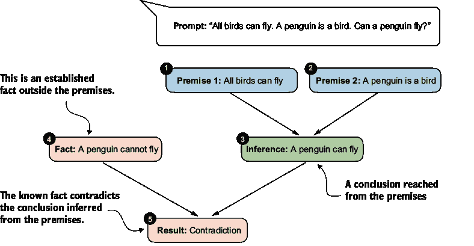

**图 1.6** 矛盾的前提会导致逻辑不一致。从“所有鸟都会飞”和“企鹅是鸟”，我们推断“企鹅会飞”。这个结论与“企鹅不会飞”这一既定事实相冲突，从而导致矛盾。

相比之下，统计（模式匹配）LLM 并*不*显式追踪矛盾，而是基于学到的文本分布进行预测。例如，如果“所有鸟都会飞”这类信息在训练数据中被强烈强化，模型可能会自信地回答：“是的，企鹅会飞。”

在下一节中，我们将看一个例子，了解 LLM 如何处理这个“所有鸟都会飞……”提示。

### 逻辑推理与基于规则的系统

为什么显式的基于规则的系统不再那么流行？基于规则的系统在 80 年代和 90 年代广泛用于医疗诊断、法律裁决和工程。它们仍然用于关键领域（医学、法律、航空航天），这些领域通常需要显式推理和透明的决策过程。它们很难实现，因为很大程度上依赖人工设计的启发式方法。（启发式方法是简单的决策规则，能快速给出足够好的答案，但不保证最优。）相比之下，包括 LLM 在内的深度神经网络并不实现手写规则；它们从数据中学习决策模式，并且在大规模训练时可以非常灵活。

## 1.5 在没有显式规则的情况下模拟推理

我们看到了矛盾的前提如何导致逻辑不一致。常规 LLM 并不显式追踪矛盾，而是基于学到的文本分布生成回答。

图 1.7 展示了一个未经过推理增强的 LLM（如 OpenAI ChatGPT 中的 GPT-4o）如何响应上一节讨论的“所有鸟都会飞……”提示。如你所见，GPT-4o 似乎给出了正确的回答，尽管它并不被认为是一个推理模型（不像 OpenAI 的其他产品，如 o1、o3、o4-mini，以及更新的 GPT-5，这些产品是明确使用推理方法论开发的）。

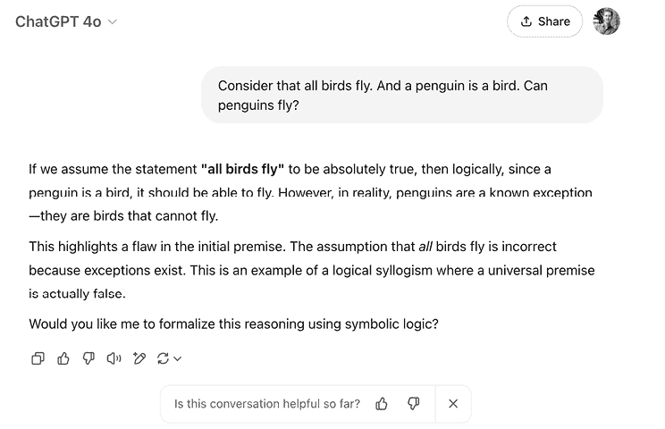

**图 1.7** 一个示例，说明语言模型（ChatGPT 中的 GPT-4o）如何看似对矛盾前提进行“推理”

那么，4o 模型是如何生成其回答的呢？这是否意味着 GPT-4o 在显式地进行逻辑推理？不，不一定。至少，GPT-4o 在熟悉的情境下模拟逻辑推理方面非常有效。

GPT-4o 并不执行显式的矛盾检查；相反，它根据概率加权模式生成答案。如果训练数据中包含大量纠正这种矛盾的实例（例如“企鹅不会飞”这样的文本），这种方法就能很好地工作，使模型学会“企鹅”与“不会飞”之间的统计关联。换句话说，模型隐式地识别出矛盾，是因为它在训练期间频繁遇到过这种精确的推理场景。这种效果在很大程度上依赖于模型在训练中大量接触类似推理模式后形成的统计关联。因此，即使一个常规 LLM 看似在执行逻辑演绎（如图 1.7 所示），它也并非在执行显式的、基于规则的逻辑，而是在利用其海量训练数据中的模式。

尽管如此，GPT-4o 在此处的成功很好地说明了隐式模式匹配在大规模训练下可以变得多么强大。这些基于模式的推理模型通常在以下两种情况下表现不佳：

* 当逻辑场景是新颖的（训练数据中未曾接触过）

* 当推理复杂度较高，涉及错综复杂的多步逻辑关系时

### 逻辑推理与当前可用的推理模型

尽管 GPT-4o 并未被官方标记为推理模型，但 OpenAI 提供了几个专门的推理模型，包括 o1、o3、o4-mini 和 GPT-5。此外，其他公司也一直在开发具有显式推理能力的 LLM。截至撰写本文时，流行的例子包括 Anthropic 的 Claude 4、xAI 的 Grok 4、Google 的 Gemini 2.5、DeepSeek 的 R1、阿里巴巴的 Qwen3 等等。这些模型所采用的技术正是本书的重点。我们将会看到，这一过程并不需要实现基于规则的推理流水线。相反，LLM 会通过改进的推理和训练方法来学习或提升其推理能力。

我们可以说，LLM 通过习得的模式来模拟逻辑推理。我们可以通过特定的推理方法进一步改进这一点，包括推理计算扩展和诸如强化学习之类的训练后策略，但 LLM 内部并不会显式地执行任何基于规则的逻辑。

此外，LLM 存在一个谱系。甚至在 OpenAI 的 o1 和 DeepSeek-R1 等专用推理模型出现之前，LLM 就已经能够模拟推理行为。这些模型表现出的行为与本章 1.1 节前面给出的推理定义一致，即在产生最终答案之前生成中间步骤。我们现在明确称为“推理模型”的，本质上是这种能力的一个更精细的版本。这些改进的推理能力是通过使用特定的推理计算扩展技术（在第 4 章和第 5 章讨论）和有针对性的训练后方法（例如第 6 章和第 7 章的强化学习）实现的，这些方法旨在改进和强化类似推理的行为。

## 1.6 为什么要从头构建推理模型？

继 2025 年 1 月 DeepSeek-R1 发布之后，提升 LLM 的推理能力已成为人工智能领域最热门的话题之一，而且理由充分。更强的推理技能使 LLM 能够解决更复杂的问题，让他们在用户关心的各种任务中变得更强大。

这一转变也反映在 OpenAI 首席执行官于 2025 年 2 月 12 日的一份声明中：

> 我们接下来将发布 GPT-4.5，也就是我们在内部称为 Orion 的模型，作为我们最后一个非思维链模型。在那之后，我们的一个首要目标是通过创建能够使用我们所有工具、知道何时需要长时间思考（或不需要）并且普遍适用于各种任务的系统，来统一 o 系列模型和 GPT 系列模型。

上述引文突显了领先的 LLM 提供商向推理模型的重大转变。这里，“思维链”指的是一种提示技术，它引导语言模型逐步推理以提升其推理能力；我们将在第 4 章和第 5 章更详细地介绍它。

同样值得注意的是，提到了“何时需要长时间思考或何时不需要”。这暗示了一个重要的设计考虑：推理并不总是必要或可取的。例如，推理模型专为复杂任务而设计，例如解谜、高级数学问题和具有挑战性的编码任务。它们通常在智能体系统中也很有用，尤其是在任务分解、规划和选择使用哪些工具方面。对于更简单的任务，如摘要总结、翻译或基于知识的问答，它们则并非必需。事实上，对所有任务都使用推理模型可能效率低下且成本高昂。例如，它们通常使用成本更高、输出更冗长，有时还会因为“过度思考”而更容易出错。在这里，简单的规则适用：为任务使用合适的工具（或合适类型的 LLM）。

推理模型通常比非推理模型更昂贵，原因有两个。首先，它们往往会产生更长的输出，因为它们包含了解释答案如何得出的中间步骤。如图 1.8 所示，LLM 一次生成一个 token，每个 token 都需要一次*完整的前向传播*。如果一个推理模型的答案长度是原来的两倍，那么生成过程大约需要两倍的前向传播次数，这会增加计算成本。

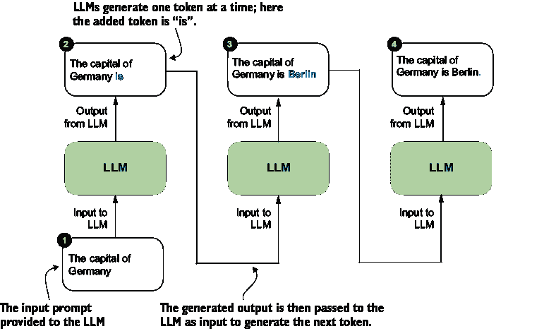

*图 1.8 LLM 中逐 token 的生成过程。在每一步中，LLM 都会获取当前已生成的完整序列，并预测下一个 token，该 token 可以表示一个词、子词或标点符号，具体取决于分词器。新生成的 token 会被追加到序列中，并作为下一步的输入。这种迭代解码过程既用于标准语言模型，也用于以推理为重点的模型。*

其次，许多推理工作流要求对单个任务多次运行模型，例如采样多个候选解决方案、调用工具或运行验证器。这些额外调用会使处理的 token 总数成倍增加，从而在图 1.8 所示的单次调用基础上进一步抬高成本。

这正是从头实现这些模型和方法之所以有帮助的原因。这是理解它们工作原理的最佳途径之一。如果我们理解了 LLM 和推理模型的工作原理，就能更好地理解这些权衡取舍。

## 1.7 从头构建推理模型的路线图

现在我们已经从鸟瞰视角讨论了 LLM 中的推理，接下来的章节将指导你从头编写和应用推理方法。从高层次来看，路线图很简单。我们将从一个常规 LLM 开始，学习如何评估其推理行为，然后探索两种主要的改进方法：推理技术和训练技术。图 1.9 展示了主要步骤。

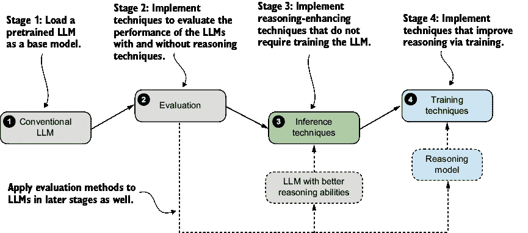

*图 1.9 我们在本书中将构建内容的高层次路线图。我们将从一个常规 LLM 开始，添加评估方法以便衡量其进展，然后探索两大类推理改进：推理技术和训练技术。*

阶段 1 是图 1.9 中明确的一个步骤，因为在实践中，推理方法通常应用于已有的基础 LLM，而不是从头训练的 LLM。我们将从一个已经预训练好的常规 LLM 开始，并将其视为我们想要改进的基线。

阶段 2 实现所需的评估工具，以判断某个方法是否真正有效。这就是为什么阶段 3 和阶段 4 会循环回到评估：在通过推理时方法或额外训练改进推理行为后，我们回到阶段 2 来度量这种改变是否有帮助。

第 3 阶段在不改变模型权重的情况下，在推理时改善推理行为；第 4 阶段则通过额外训练改进模型本身，将预训练 LLM 转变为专用的推理模型。

图 1.10 提供了更多细节，并总结了各章涵盖的不同子步骤。

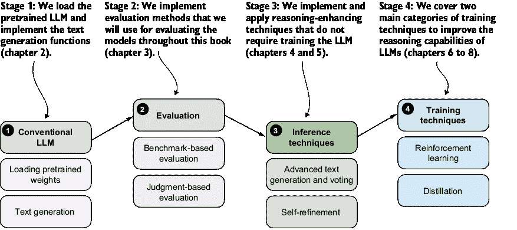

*图 1.10 章节级子步骤的详细路线图。加载基础模型后，我们将介绍基于基准的评估和基于判断的评估，然后是推理时方法，如高级文本生成、投票和自我优化，最后是基于强化学习和蒸馏的训练时方法。*

我十分期待接下来的旅程，希望你也一样。

## 小结

* 常规 LLM 训练分多个阶段进行：

    * 预训练，模型从海量文本中学习语言模式

    * 指令微调，改进模型对用户提示的响应

    * 偏好调整，使模型输出与人类偏好对齐

* 推理方法应用于常规 LLM 之上。

* LLM 中的推理指的是改进模型，使其在生成最终答案之前显式生成中间步骤（思维链），这通常能提高多步骤任务的准确性。

* LLM 中的推理不同于基于规则的推理，其运作方式也可能不同于人类推理。目前，普遍的共识是 LLM 中的推理依赖于统计模式匹配。

* LLM 中的模式匹配纯粹依赖于从数据中学到的统计关联，能够生成流畅的文本，但缺乏显式的逻辑推理。

* 改进 LLM 中的推理可以通过几种方式实现：

    * 推理时计算扩展无需重新训练即可改进推理（例如思维链提示）。

    * 强化学习涉及使用奖励信号显式训练模型。

    * 监督微调和蒸馏，利用更强推理模型的示例。

* 从头构建推理模型可以提供对 LLM 能力、局限性和计算权衡的实际见解。

# 2 使用预训练 LLM 生成文本

## 本章涵盖

* 设置用于处理 LLM 的代码环境

* 使用分词器为 LLM 准备输入文本

* 使用预训练 LLM 生成文本的逐步过程

* 用于加速 LLM 文本生成的缓存和编译技术

在上一章中，我们讨论了*传统大语言模型*（LLM）与*推理模型*之间的区别。我们还介绍了几种可以提高 LLM 推理能力的技术。这些技术通常应用于传统（基础）LLM 之上。

在本章中，我们将通过加载预训练基础模型来为后续章节奠定基础，如图 2.1 所示。之前我们讨论过，推理方法通常是在常规后训练阶段之后添加的。但从基础模型入手，可以更容易地看出哪些能力来自推理方法本身。本章中的传统 LLM 是非推理 LLM，更具体地说，是一个预训练基础模型，而不是经过指令调优或偏好调优的助手。

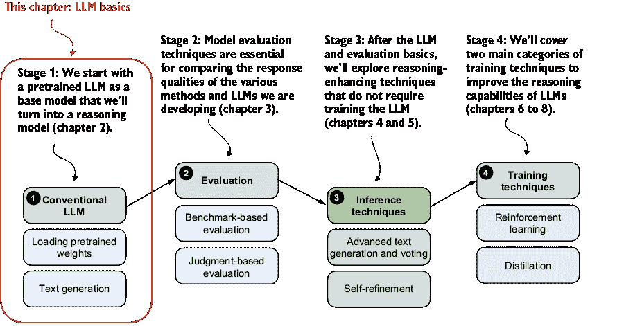

*图 2.1 开发推理模型的四个主要阶段。本章聚焦于第 1 阶段：加载传统 LLM 并实现文本生成功能。*

除了设置编码环境和加载预训练 LLM 之外，你还将学习如何使用*分词器*为模型准备文本输入。如图 2.1 所示，你还将实现一个文本生成函数，使 LLM 能够实际用于生成文本。这一功能将在后续章节中继续使用和改进。

## 2.1 用于文本生成的 LLM 简介

本章将使用的 LLM 是一个仅经过预训练的基础模型，但它已经能够生成连贯的文本，并且在某些情况下能够遵循基本指令。图 2.2 总结了 LLM 文本生成流程的组件，我们将在本章后面更详细地讨论并实现这些步骤。

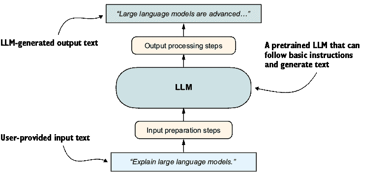

*图 2.2 给定用户查询（输入文本），LLM 生成响应（输出文本）的概览*

注意：按照惯例，涉及 LLM 等神经网络的图示是从下（输入）到上（输出）垂直绘制和阅读的。箭头表示信息在模型中向上流动。

如果你从未编写过 LLM 或以编程方式使用过 LLM，本章将教你文本生成过程是如何运作的。我们不会深入探讨 LLM 的内部机制，例如注意力机制和其他架构组件；这是我另一本书*从零构建大语言模型（From Scratch）*的主题。理解这些内部机制并非阅读本书所必需；如果你感到好奇，之后可以再学习。如果你已经读过我的另一本书，本章也会对你有帮助，因为它补充了关于加速推理和其他实用优化的新内容。

在开始实现图 2.2 中所示的组件（包括输入准备、加载 LLM 和生成文本）之前，我们首先需要设置编码环境。

## 2.2 设置编码环境


我们将介绍两种主要的 Python 编码环境设置方式，以便你能够跟着本书的示例操作：一种是简单的基于`pip`的设置，另一种是基于`uv`的工作流程。我建议你在决定哪种方案最适合自己之前，先通读本节。如果你已经配置好了 Python 环境（Python 3.10 或更高版本），最简单的依赖安装方式是在终端中使用 Python 的包安装器（`pip`）。如果你已从出版商网站下载了代码，请使用`requirements.txt`文件安装本书所需的 Python 库：

```
pip install -r requirements.txt
```

或者，要在不下载`requirements.txt`文件的情况下直接安装所需包，请使用以下命令：

```
pip install -r https://raw.githubusercontent.com/\
rasbt/reasoning-from-scratch/refs/heads/main/requirements.txt
```

### 本章使用的 Python 包

如果你希望只安装本章使用的包，可以从以下命令开始：

```
pip install torch>=2.10.0 tokenizers>=0.22.2 reasoning-from-scratch 
```

PyTorch 的安装可能因平台和硬件而异，尤其是当你需要 GPU 加速时。如果上述命令没有为你的系统安装正确的构建版本，我建议使用 PyTorch 官方网站上的安装选择器（[`pytorch.org/get-started/locally/`](https://pytorch.org/get-started/locally/)），然后单独安装其余包：

* `torch` 指的是 PyTorch，这是一个广泛使用的深度学习库，提供构建和训练神经网络的工具。

* `tokenizers` 是一个提供高效分词算法的库，用于为 LLM 准备输入数据。

* `reasoning-from-scratch` 是我为本书开发的自定义库。它包含各章节使用的所有代码示例，以及我们将用到的其他实用函数。

虽然 `pip` 是安装 Python 包的标准方式，但我个人更推荐使用广受好评的 `uv` Python 包与项目管理器来使用 Python。和许多人一样，我现在推荐 `uv`，因为它比 `pip` 快得多，并且依赖解析也更可靠。它还会自动创建隔离环境，并自带 Python 可执行文件（如果系统中已安装兼容版本的 Python，则会使用系统 Python），因此如果你还没有在系统上安装 Python，这会是一个很好的选择。图 2.3 概述了从安装 `uv` 到准备运行本章代码的四步流程。

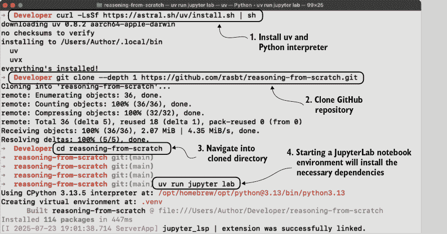

**图 2.3** 通过 macOS 终端安装并使用 `uv` Python 包与项目管理器

图 2.3 展示了在 macOS 终端中安装和使用 `uv` 的过程，但它同样支持 Linux 和 Windows：

1. 要安装 `uv`，请从官方网站运行适用于你操作系统的安装程序：[`docs.astral.sh/uv/getting-started/installation/`](https://docs.astral.sh/uv/getting-started/installation/)。

2. 接下来，克隆 GitHub 仓库：

    ```
    git clone --depth 1 https://github.com/rasbt/reasoning-from-scratch.git
    ```

    这里，`--depth 1` 选项告诉 `git` 执行浅克隆，这意味着它只下载最新版本的代码，而不会下载完整的版本历史。这样可以让下载更快并节省空间。

    如果你没有安装 `git`，你可以从出版商网站手动下载源代码仓库，或者在浏览器中打开此链接：[`github.com/rasbt/reasoning-from-scratch/archive/refs/heads/main.zip`](https://github.com/rasbt/reasoning-from-scratch/archive/refs/heads/main.zip)（下载后解压）。

3. 在终端中，导航到 `reasoning-from-scratch` 文件夹。

4. 在 `reasoning-from-scratch` 文件夹内，执行：

    ```
    uv run jupyter lab
    ```

    此命令会启动 JupyterLab，你可以打开一个空白的 Jupyter notebook 来输入和运行代码，也可以打开包含本章所有代码的第 2 章 notebook。（你不需要先创建或激活虚拟环境。）

    Python 脚本文件可以通过 `uv run script-name.py` 执行。此命令还会设置一个本地虚拟环境（通常位于隐藏的 `.venv/` 文件夹中），并自动从 `reasoning-from-scratch` 文件夹中的 `pyproject.toml` 文件安装所有依赖，因此无需通过 requirements 文件手动安装代码依赖。不过，如果你打算安装额外的包，可以使用以下命令：

    ```
    uv add packagename
    ```

如果需要的话，补充代码仓库中的 `ch02` 子文件夹内包含额外的安装说明和详细信息。

## 2.3 了解硬件需求与建议

你可能听说过训练 LLM 非常昂贵。对于领先的 LLM 公司来说，在添加任何推理技术之前，训练一个新基础模型 LLM 的计算成本低则 100 万至 1000 万美元，高则超过 5000 万美元，这并不罕见。

例如，作为 DeepSeek R1 推理系统基础检查点的 DeepSeek V3 模型，是在 2,048 块 NVIDIA H800 GPU 上训练了约 11 周，估计成本为 550 万美元。（DeepSeek V3 是少数几个完整公开计算细节的近期模型之一。）根据技术报告，最终训练运行使用了 1480 万 GPU 小时的计算量。能耗约为 620 兆瓦时，大约相当于一个普通美国家庭 55 年的用电量。

这些资源需求和高昂的价格会让开发 LLM 对我和大多数读者来说都不可行。相反，我们将使用一个相对较小（但功能强大）的预训练 LLM，并在此基础上实现推理技术。这个较小的 LLM 是一个缩小版模型，但除此之外，它遵循的架构与当代最先进的模型相同。我们将应用的推理方法与大型 LLM 使用的方法相同。区别在于，较小的 LLM 能让我们以更经济的方式探索这些方法。

打个比方，假设你很好奇汽车是如何工作的。如果你是新手，可能不会一开始就去造一辆昂贵的法拉利。相反，你会从一辆更基础的汽车开始，比如大众甲壳虫，它仍然能让你学到很多关于发动机和变速箱的知识。事实上，我甚至想说，在更简单的汽车上动手实践，能帮助你*更好地*理解发动机和变速箱的工作原理，因为它没有更昂贵汽车上那些复杂精细的改进。

虽然我们在本书中会使用相对较小的模型，但使用、开发和实践推理技术仍然需要大量计算。后面章节中的技术（例如第 5 至 8 章）将需要 GPU 才能更好地运行。你可以通过运行以下 PyTorch 代码来检查你的计算机是否具有受 PyTorch 支持的 GPU：

```
import torch

print(f"PyTorch version {torch.__version__}")

if torch.cuda.is_available():
    print(f"CUDA/ROCm GPU: {torch.cuda.get_device_name(0)}")

elif torch.xpu.is_available():
    print(f"Intel GPU: {torch.xpu.get_device_name(0)}")

elif torch.backends.mps.is_available():
    print("Apple Silicon GPU")

else:
    print("Only CPU")
```

根据你的机器不同，代码可能会返回以下结果：

```
PyTorch version 2.10.0
Only CPU
```

如果你的机器没有 GPU 来运行代码，请不要担心。第 2 至 5 章可以在 CPU 上以合理的时间运行。对于某些章节，代码会在可用时自动使用 NVIDIA GPU；否则，它将在 CPU 上运行（如果某个特定章节或小节推荐的话，也可以使用 Apple Silicon GPU）。我会在相关章节中提供更多信息。

**注意** 如果你需要 GPU 加速，并且不确定要安装哪个 PyTorch 版本，请使用官方 PyTorch 安装选择器（[`pytorch.org/get-started`](https://pytorch.org/get-started)）为你的系统选择正确的 CPU、CUDA 或 ROCm 版本。对于本书，任何最近受支持的 PyTorch CUDA 版本都可以。

和许多日常使用并开发 LLM 的 AI 研究员一样，我家中也没有具备训练 LLM 所需 GPU 硬件的机器，因此我使用云资源。如果你在寻找云服务商选项，我个人偏好 Lightning AI Studio（[`lightning.ai/`](https://lightning.ai/)），因为它易于使用且功能支持完善，如图 2.4 所示。Google Colab（[`colab.research.google.com/`](https://colab.research.google.com/)）也是一个不错的选择。

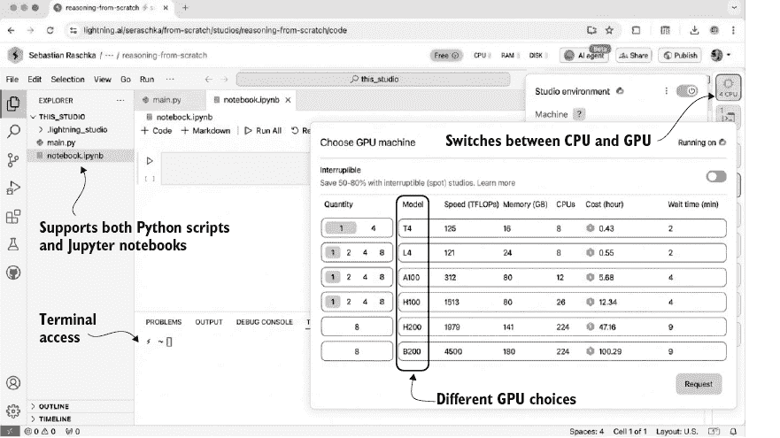

**图 2.4** 网页浏览器中 Lightning AI GPU 云平台概览。该界面支持 Python 脚本、Jupyter notebook 和终端访问，并允许用户根据计算需求在 CPU 和各种 GPU 类型之间切换。（图片颜色已反转，并转换为灰度以便印刷。）

截至撰写本文时，Lightning AI 还在用户注册和验证后提供免费计算额度，这些额度可用于图 2.4 中所示的不同 GPU 选项。（如前所述，本章不需要 GPU，但如果你想使用，L4 GPU 就绰绰有余了。）

**注意** 声明：我在 2023 年帮助构建并推出了 Lightning AI 平台，但我不再拥有该公司的任何经济利益。我并未受赞助而推荐它，我是自己付费使用。我使用它是因为我觉得它是最方便的选择。它支持多种类型的 GPU，可以轻松地在它们之间切换，也可以切回 CPU 以节省成本，并且无需重新设置环境即可暂停或恢复会话。

补充代码仓库在`ch02`子文件夹中包含额外的 GPU 平台推荐。

### 使用 PyTorch

在本节中，我们导入并使用了 PyTorch 库，这是目前使用最广泛的通用库。我们将在本书中一直使用它来运行和训练 LLM，包括我们将开发的推理方法。如果你是 PyTorch 新手，我建议先阅读我的“一小时学会 PyTorch：从张量到在多 GPU 上训练神经网络”教程，以充分利用本书。该教程可在我的网站上免费获取：[`sebastianraschka.com/teaching/pytorch-1h`](https://sebastianraschka.com/teaching/pytorch-1h)。

## 2.4 为 LLM 准备输入文本

现在让我们探索如何使用分词器（tokenizer）为 LLM 处理输入和输出文本。分词器至关重要，因为每个提示、推理过程和生成的答案最终都必须表示为 token ID，模型才能处理它们。图 2.5 更详细地展示了前面图 2.2 中所示的输入和输出准备步骤。

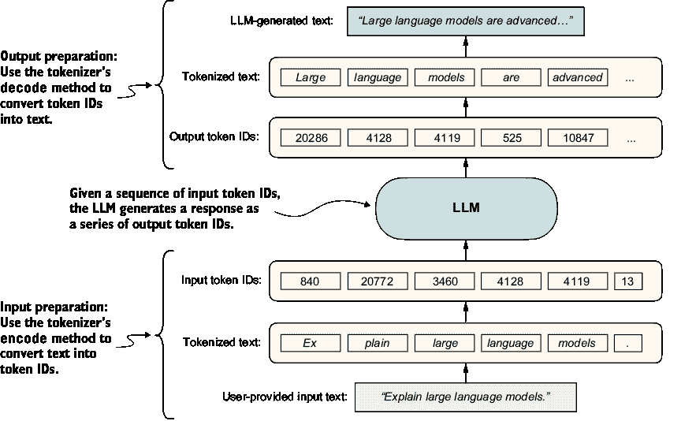

### 图 2.5 LLM 接收输入数据并生成输出的简化示意图。用户提供的文本使用分词器的`encode()`方法被分词为 ID，然后由 LLM 处理以生成输出 token ID。这些 ID 再使用分词器的`decode()`方法解码回人类可读的文本。

为了了解这在实践中如何运作，我们首先从本书的`reasoning-from-scratch` Python 包（已在 2.2 节安装）中加载一个分词器。要下载分词器文件（对应于 Qwen3 0.6B 基础 LLM），请运行此命令：

```
from reasoning_from_scratch.qwen3 import download_qwen3_small
download_qwen3_small(kind="base", tokenizer_only=True, out_dir="qwen3")
```

这将显示一个进度条：

```
tokenizer-base.json: 100% (6 MiB / 6 MiB)
```

该命令会下载`tokenizer-base.json`文件（大小约 6 MB）并将其保存在`qwen3`子目录中。

现在我们可以将分词器文件中的设置加载到`Qwen3Tokenizer`中：

```
from pathlib import Path
from reasoning_from_scratch.qwen3 import Qwen3Tokenizer

tokenizer_path = Path("qwen3") / "tokenizer-base.json"
tokenizer = Qwen3Tokenizer(tokenizer_file_path=tokenizer_path)
```

由于我们尚未加载 LLM（图 2.5 中的核心组件），我们将仅使用分词器进行一次更简单的试运行。具体来说，我们将进行一次分词往返：将文本编码为 token ID，然后将这些 ID 解码回文本，如图 2.6 所示。

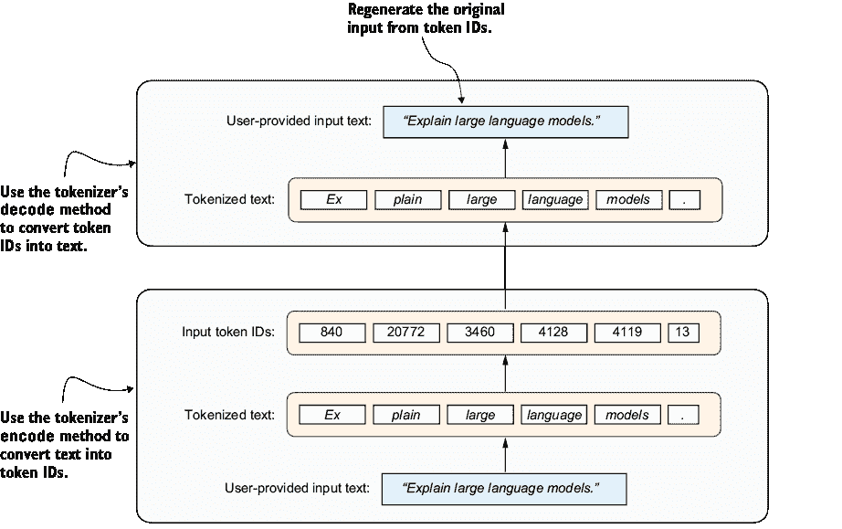

### 图 2.6 使用分词器进行往返分词的过程。用户提供的输入文本首先使用`encode()`方法转换为 token ID，然后使用`decode()`方法重建为原始文本。

以下代码片段实现了图 2.6 底部所示的编码过程：

```
prompt = "Explain large language models."
input_token_ids_list = tokenizer.encode(prompt)
```

以下代码实现了解码过程，将 token ID 转换回文本，如图 2.6 顶部所示：

```
text = tokenizer.decode(input_token_ids_list)
print(text)
```

根据以下打印结果，我们可以看出分词器从 token ID 中重建了原始输入提示：

```
'Explain large language models.'
```

在继续讨论 LLM 之前，让我们看一下由`encode()`方法生成的 token ID。以下代码打印每个 token ID 及其对应的解码字符串，以说明分词器的工作方式：

```
for i in input_token_ids_list:
    print(f"{i} --> {tokenizer.decode([i])}")
```

输出如下：

```
840 --> Ex
20772 --> plain
3460 -->  large
4128 -->  language
4119 -->  models
13 --> .
```

正如你在输出中看到的，原始文本被分割成了六个 token ID。每个 token 代表一个单词或子词，具体取决于分词器如何分割输入。

例如，“Explain”被拆分成两个独立的 token：“Ex”和“plain”。这是因为分词器算法使用了一种基于子词的方法，称为*字节对编码*（BPE）。BPE 可以通过混合使用完整单词和子词单元来表示常见和罕见词汇。空格通常也会包含在 token 中（例如，“ large”），这有助于 LLM 检测单词边界。

`Qwen3Tokenizer`拥有约 151,000 个 token 的词汇表，就撰写本文时而言，这相对较大（相比之下，早期的 GPT-2 约有 50,000 个 token，Llama 3 约有 128,000 个 token）。

语言模型中更大的词汇表会增加模型的规模，因为嵌入层和输出层必须存储更多的 token 表示。它还会增加生成下一个 token 概率的每 token 计算成本。更大的词汇表还允许更多单词被表示为单个 token，而不是被拆分成子词组件，这可以减少序列长度。例如，将“Explain”这样的单词拆分成“Ex”和“plain”会产生更多的输入 token。更多的 token 会导致更长的输入序列，从而增加处理时间和资源消耗。这里存在一个权衡：更大的词汇表虽然每 token 成本稍高，但更小的词汇表通常会产生更长的 token 序列。例如，序列中 token 数量翻倍大致会使运行模型的计算成本翻倍，因为模型需要处理并生成更多的 token。

遗憾的是，分词器及其实现的细节超出了本书的范围。如果你感兴趣，可以在附录 A 中找到更多资源，包括我的从零开始实现。

### 练习 2.1：编码未知单词

尝试使用分词器，看看它是否以及如何处理未知单词。为此，请发挥创意，编造一些不存在的单词。此外，如果你会说多种语言，可以尝试用英语以外的语言编码单词。

## 2.5 加载预训练模型

在上一节中，我们加载并熟悉了分词器，它为 LLM 准备输入数据并将 LLM 输出转换回人类可读的文本。在本节中，我们将加载 LLM 本身及其预训练权重，如图 2.7 所示。一旦这个基础模型就位，后续章节将直接在其基础上进行构建：评估它、以不同方式提示它，并最终将其训练成一个更强的推理模型。

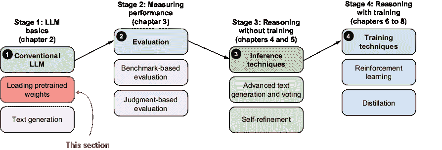

### 图 2.7 本书开发推理模型的四个关键阶段概览。本节聚焦于阶段 1 中加载预训练 LLM。

本书使用 Qwen3 0.6B 作为其预训练基础模型。名称中的“0.6B”表示该模型包含约 0.6 亿个权重参数。

为什么使用 Qwen3？在仔细评估了几个开放权重的基础模型后，我选择 Qwen3 0.6B，原因如下：

* 对于本书，我们需要一个体积小但能力强的开放权重模型（开放权重模型是指其训练权重可以公开下载的模型），并且能在消费级硬件上运行。


# Qwen3 基础模型与推理方法

Qwen3 既提供基础模型（我们推理模型开发的重点），也提供官方的推理变体，我们可以将其作为评估的参考。

> **注意：** “Qwen3”的规范拼写不包含空格，而例如“Llama 3”则包含空格。

本着“从零开始”构建的精神，本书使用了我在纯 PyTorch 中编写、且完全不依赖外部 LLM 库的 Qwen3 自定义重实现。该重实现的重点是代码的可读性和易调整性，以便你日后可能为自身实验对其进行修改。尽管是从零构建，该实现仍与原始预训练的 Qwen3 模型权重完全兼容。

本书并不深入探讨 Qwen3 的代码实现。仅该主题本身就足以独立成书，类似我的 *《构建大语言模型（从零开始）》* 一书。相反，本书着重于在基础模型（此处即 Qwen3）之上实现推理方法。如果你对 Qwen3 及模型代码的更详细信息感兴趣，可参阅附录 C。

**注意：** 此重实现的 Qwen3 LLM 完全在本地运行，与任何其他以 PyTorch 实现的神经网络一样。不涉及服务端组件或外部 API 调用。所有模型使用均在你自己的机器上完成，你的数据留在你的设备中。如果你关心隐私，我们使用的设置可以确保对 LLM 的输入和输出拥有完全控制。

在加载模型之前，我们可以指定将使用的设备，即 CPU 或 GPU。下面的代码会自动选择最可用的设备。

### 清单 2.1 自动获取设备

```python
def get_device(enable_tensor_cores=True):
    if torch.cuda.is_available():
        device = torch.device("cuda")
        print("Using NVIDIA CUDA GPU")

        if enable_tensor_cores:
            major, minor = map(int, torch.__version__.split(".")[:2])
            if (major, minor) >= (2, 9):
                torch.backends.cuda.matmul.fp32_precision = "tf32"
                torch.backends.cudnn.conv.fp32_precision = "tf32"
            else:
                torch.backends.cuda.matmul.allow_tf32 = True
                torch.backends.cudnn.allow_tf32 = True

    elif torch.backends.mps.is_available():
        device = torch.device("mps")
        print("Using Apple Silicon GPU (MPS)")

    elif torch.xpu.is_available():
        device = torch.device("xpu")
        print("Using Intel GPU")

    else:
        device = torch.device("cpu")
        print("Using CPU")

    return device
```

请注意，如果你拥有较新的 NVIDIA GPU（基于 Ampere 架构或更新），当 `enable_tensor_cores=True` 时，`get_device()` 函数会自动启用 Tensor Cores 以加快矩阵乘法。这可能会略微改变浮点舍入，但不会明显影响本书中的结果，而在新显卡上的速度优势是值得的。在非 NVIDIA 设备上，这些设置会被忽略。

使用清单 2.1 中的代码，我们可以按如下方式获取设备：

```python
device = get_device()
```

虽然 GPU 通常能带来显著的速度和性能提升，但为了兼容性和调试，在 CPU 上运行本章剩余代码也可能会有所帮助。你可以通过显式设置设备来临时覆盖自动选择：

```python
device = torch.device("cpu")
```

当你完成本章并验证代码在 CPU 上能正常运行后，可以移除或注释掉手动覆盖并重新运行代码。如果你的系统有 GPU，那么此后应能看到更好的性能。

**注意：** 本章剩余部分的代码在搭载 Apple M4 CPU 的 Mac Mini 上执行。本章末尾包含与 Apple Silicon M4 GPU 和 NVIDIA H100 GPU 的性能对比。

在加载模型并将其放到所选 `device` 上之前，我们首先需要下载 Qwen3 0.6B 的权重。需要这些文件才能正确初始化预训练模型。在上一节中，我们调用了带有 `tokenizer_only=True` 的 `download_qwen3_small()` 函数，仅下载了分词器文件。这里，我们使用相同的函数，但设置 `tokenizer_only=False`，以便也下载模型权重：

```python
download_qwen3_small(kind="base", tokenizer_only=False, out_dir="qwen3")
```

输出如下：

```
qwen3-0.6B-base.pth: 100% (1433 MiB / 1433 MiB)
✓ qwen3/tokenizer-base.json already up-to-date
```

（分词器旁边有复选标记，因为我们在上一节已下载了它。）

既然我们已经下载了模型权重，就可以实例化一个 `Qwen3Model` 类，并通过 PyTorch 的 `load_state_dict` 方法加载预训练权重：

```python
from reasoning_from_scratch.qwen3 import Qwen3Model, QWEN_CONFIG_06_B

model_path = Path("qwen3") / "qwen3-0.6B-base.pth"
model = Qwen3Model(QWEN_CONFIG_06_B)  #1
model.load_state_dict(torch.load(model_path))  #2
model.to(device)  #3
```

- `#1` 实例化一个 Qwen3 模型，使用随机权重作为占位符。
- `#2` 将预训练权重加载到模型中。
- `#3` 将模型转移到指定设备（例如 “cuda”）。

请注意，如果设备设置为 `"cpu"`，则 `model.to(device)` 操作会被跳过，因为模型默认已位于 CPU 内存中。

执行上述代码后，你应该看到以下输出。（如果你不是在 Jupyter 笔记本等交互式环境中运行代码，则需要运行 `print(model)` 才能看到此输出。）

```
Qwen3Model(
  (tok_emb): Embedding(151936, 1024)
  (trf_blocks): ModuleList(
    (0-27): 28 x TransformerBlock(
      (att): GroupedQueryAttention(
        (W_query): Linear(in_features=1024, out_features=2048, bias=False)
        (W_key): Linear(in_features=1024, out_features=1024, bias=False)
        (W_value): Linear(in_features=1024, out_features=1024, bias=False)
        (out_proj): Linear(in_features=2048, out_features=1024, bias=False)
        (q_norm): RMSNorm()
        (k_norm): RMSNorm()
      )
      (ff): FeedForward(
        (fc1): Linear(in_features=1024, out_features=3072, bias=False)
        (fc2): Linear(in_features=1024, out_features=3072, bias=False)
        (fc3): Linear(in_features=3072, out_features=1024, bias=False)
      )
      (norm1): RMSNorm()
      (norm2): RMSNorm()
    )
  )
  (final_norm): RMSNorm()
  (out_head): Linear(in_features=1024, out_features=153936, bias=False)
)
```

该输出是 Qwen3 0.6B 基础模型架构的概要，由 PyTorch 打印。它突出了模型的核心组件：嵌入层、28 个变压器块的堆叠，以及最终的线性投影头。每个变压器块包括一个分组查询注意力机制和一个多层前馈网络，并贯穿归一化层。

这些组件也在图 2.8 中进行了说明，适合熟悉 LLM 架构的读者，但本书并不要求深入理解该架构。由于我们不是修改基础模型本身，而是在其之上构建推理方法，因此你可以安全地暂时将架构视为黑盒。如果你感兴趣，可以在附录 C 中找到有关这些组件（例如 RMSNorm）的更多信息。

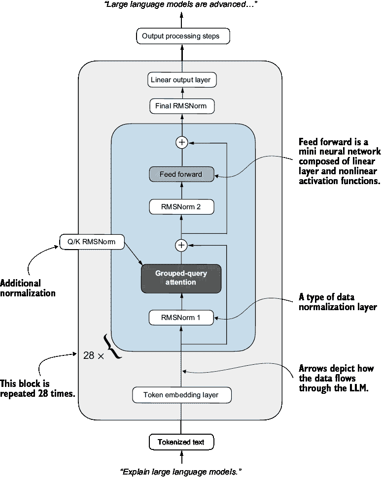

### 图 2.8 前面实例化的 Qwen3 0.6B 模型架构概览。输入文本被分词化并经过嵌入层，随后是 28 个重复的变压器块。每个块包含分组查询注意力、前馈层和 RMS 归一化。模型以最终归一化和线性输出层结束。箭头显示数据流经模型的方式。

现在我们已经加载了一个预训练模型，它应当能够生成连贯的文本。在下一节中，我们将编写一个文本生成函数，该函数将分词化数据输入模型，并以人类可读的形式返回输出。

## 2.6 理解顺序式 LLM 文本生成过程

既然我们已经加载了预训练的 LLM，我们的目标是编写一个函数，利用该 LLM 来生成文本。这个函数将为本书后续实现的推理改进方法奠定基础，如图 2.9 所示。

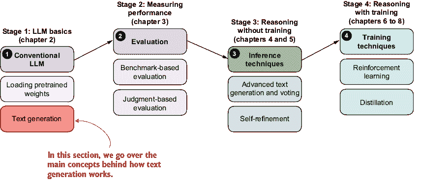

### 图 2.9 本书中开发推理模型的四个关键阶段概述。本节解释 LLM 中文本生成背后的主要概念，这将使我们能够实现一个使用预训练 LLM 的文本生成函数。

你可能已经知道，LLM 中的文本生成是一个顺序过程，LLM 一次生成一个词（或 token）。这通常也被称为*自回归*文本生成。图 2.10 展示了一个大致的流程，每一步生成一个输出 token（位于顶行），并同时将其作为输入提示的一部分反馈给模型。

### 聊天机器人界面

聊天界面只是将底层的下一个 token 预测过程（如图 2.10 所示）包装在一个对话循环中。聊天机器人模型仍然一次预测一个 token，但系统会将整个对话历史反馈给模型，这样每一步的新回复都会在轮次之间具有上下文感知和连贯性。本书专注于单轮对话，即当前答案独立于之前的答案。如果你有兴趣，可以在附录 G 中找到带有回答历史的聊天界面实现。

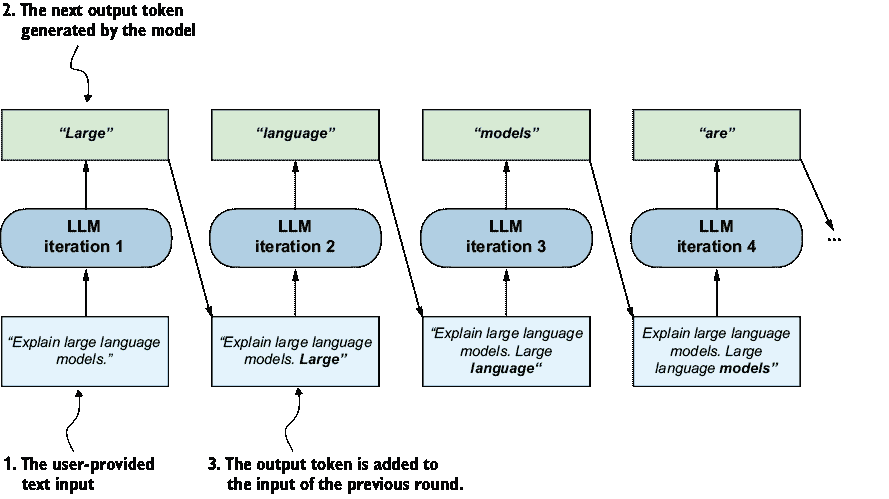

#### 图 2.10 LLM 中的顺序（自回归）文本生成。在每次迭代中，模型根据输入和先前生成的 token 生成下一个 token，这些 token 会累积地反馈给模型，以产生连贯的输出。

如果我们放大图 2.10 中的某一次迭代，可以看到 LLM 在一次前向传播中处理完整的输入序列，并为每个输入位置生成一个预测。这意味着如果我们有六个输入 token，模型会返回六个对应的预测，如图 2.11 所示。该图使逐位置的结构一目了然，但模型输出通常不仅仅是输入提示向后移动一个位置。相反，每个位置都会产生一个关于可能的下一个 token 的分布。对于文本生成，我们只使用最后一个位置的预测，因为它能告诉我们接下来该添加哪个新 token。

在实现一个文本生成函数（该函数在自回归文本生成过程的每次迭代中使用图 2.11 所示的概念）之前，让我们看一个代码示例来进一步说明图 2.11。我们将重用第 2.4 节中的“解释大型语言模型。”提示：

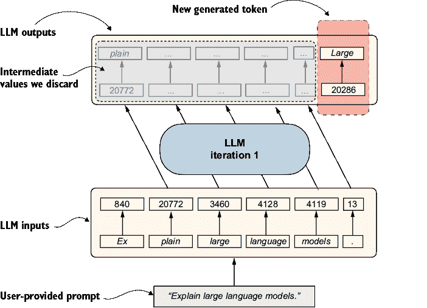

#### 图 2.11 LLM 处理完整的输入序列，并为每个输入位置生成一个下一个 token 预测。这些预测在概念上向前移动了一步，因为每个位置都预测其后的 token。该插图按位置对齐以帮助理解，但输出并不是字面上的输入提示向后移动一个位置。在生成过程中，我们只保留最后一个预测，并用它一次一个 token 地继续扩展输入提示。

```python
prompt = "Explain large language models."
input_token_ids_list = tokenizer.encode(prompt)
print(f"Number of input tokens: {len(input_token_ids_list)}")

input_tensor = torch.tensor(input_token_ids_list)  #1
input_tensor_fmt = input_tensor.unsqueeze(0)  #2
input_tensor_fmt = input_tensor_fmt.to(device)

with torch.inference_mode():
    output_tensor = model(input_tensor_fmt)  #3
output_tensor_fmt = output_tensor.squeeze(0)  #4
print(f"Formatted Output tensor shape: {output_tensor_fmt.shape}")
```

- `#1` 将 Python 列表转换为 PyTorch 张量。
- `#2` 增加一个额外的维度。
- `#3` 生成输出。
- `#4` 移除多余的维度。

上述代码产生以下输出：

```
Number of input tokens: 6
Formatted Output tensor shape: torch.Size([6, 151936])
```

如我们所见，我们将六个输入 token 输入模型，模型返回一个 6×151,936 维的矩阵。这个矩阵中的 6 对应六个输入 token。第二个维度 151,936 对应模型支持的词汇表大小。例如，六个 token 中的每一个都由一个包含 151,936 个值的向量表示。我们可以将这些向量中的值视为词汇表中每个可能单词的分数，其中最高分数对应的单词或子词（在包含 151,936 个条目的词汇表中）最有可能被选为生成的 token。

### 压缩和扩展张量

张量是 *n* 维的广义矩阵。许多 PyTorch 函数和模型组件期望特定维度的张量，因此能够添加或移除维度对于使数据与这些操作兼容非常重要。

PyTorch 中的 `.squeeze()` 和 `.unsqueeze()` 操作通过移除或添加大小为 1 的维度来改变张量的形状。这对于重塑张量以匹配模型的期望通常很有用。例如，模型可能期望输入张量具有两个维度（例如，行和列），以便处理批量输入（参见附录 E）。但如果输入只是一个行向量，我们可以使用 `.unsqueeze(0)` 添加一个额外的维度使其兼容：

```python
example = torch.tensor([1, 2, 3])
print(example)
print(example.unsqueeze(0))
```

这会返回以下结果：

```
tensor([1, 2, 3])
tensor([[1, 2, 3]])
```

在这里，`.unsqueeze(0)` 在位置 0 添加了一个新维度，将一维张量转换为形状为 `(1, 3)` 的二维张量。相反，`.squeeze(0)` 会从位置 0 移除大小为 1 的维度：

```python
example = torch.tensor([[1, 2, 3]])
print(example)
print(example.squeeze(0))
```

这会返回以下结果：

```
tensor([[1, 2, 3]])
tensor([1, 2, 3])
```

当你想要移除不需要的多余维度时，这非常有用。

为了获得下一个生成的单词，我们提取这个 6×151,936 维矩阵的最后一行，找到该行中最大值分数对应的 token ID，然后通过分词器将该 token ID 转换回文本，如图 2.12 所示。

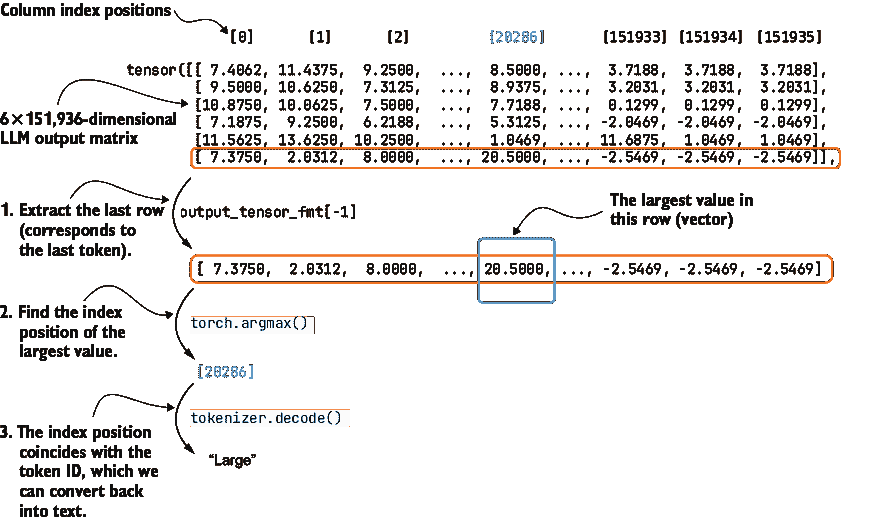

#### 图 2.12 在单次文本生成迭代中，LLM 输出的原始分数如何被转换为 token ID 及其对应的文本表示的详细说明。

让我们看看如何在代码中将 LLM 输出矩阵转换为生成的文本 token（如图 2.12 所示）。

请注意，对于文本生成，我们以推理模式而非训练模式运行模型，因此 PyTorch 不需要跟踪梯度。如图 2.11 所示，较早的位置对应的是针对提示中已有 token 的预测。只有最后一个位置预测了我们想要追加的下一个未见过的 token，我们可以通过 `[-1]` 索引获得：

```python
last_token = output_tensor_fmt[-1]
print(last_token)
```

在上一步中使用 `torch.inference_mode()` 可以避免存储在生成期间不需要的梯度信息。这减少了内存使用，并且通常会提高速度。

这会打印出与最后一个 token 对应的 151,936 个值：

```
tensor([ 7.3750,  2.0312,  8.0000,  ..., -2.5469, -2.5469, -2.5469],
       dtype=torch.bfloat16)
```

`dtype=torch.bfloat16` 后缀表示这些分数以 `bfloat16` 存储，这是一种降低精度的格式，常用于降低内存使用并提高 LLM 推理效率。根据你的硬件和设置，你可能会看到不同的 `dtype`。


然后，我们可以使用`argmax`函数获取该张量中最大分数值（值）所在的位置：

```
print(torch.argmax(last_token, dim=-1, keepdim=True))
```

结果是

```
tensor([20286])
```

这个返回的整数值是该向量中最大值的索引位置，同时也对应于所生成 token（`last_token`）的 token ID，我们可以通过`tokenizer`将其解码回文本：

```
print(tokenizer.decode([20286]))
```

这将打印生成的 token：

```
 Large
```

#### `max` 与 `argmax`

简要回顾一下`max`和`argmax`的工作原理及其区别会很有帮助，因为在后续实现文本生成函数时，我们将使用`torch.argmax()`来选择下一个 token。在本章中，使用`argmax`对应于贪婪解码，即我们总是选取得分最高的那一个下一个 token。我们将在本书后面讨论其他的替代方案。

`torch.max()`函数返回张量中的最大值，而`torch.argmax()`返回该值所在的索引。例如：

```
example = torch.tensor([-2, 1, 3, 1])
print(torch.max(example))
print(torch.argmax(example))
```

这会返回：

```
tensor(3)
tensor(2)
```

最大值是 3，它首次出现在索引 2 处。

我们还可以将`keepdim=True`与`torch.argmax()`结合使用，通过保留被缩减的维度来保持输出形状的一致性：

```
print(torch.argmax(example, keepdim=True))
```

这会返回：

```
tensor([2])
```

在这里，`keepdim=True`将结果保持为与输入具有相同维度数量的一维张量，这有助于保持`tokenizer`所需的形状，也便于后续在文本生成函数中进行拼接。

回顾一下，图 2.10 展示了 LLM 中迭代式（自回归）文本生成的过程。随后，图 2.11 放大了该过程中的一次迭代。图 2.12 则进一步放大了这一次迭代，展示了（LLM 输出的）得分矩阵如何被转换为 token ID（及其对应的文本表示）。

虽然我们已经了解了如何使用 LLM 生成单个 token，但在下一节中，我们将把这些概念付诸实践，实现一个按顺序应用该概念以生成连贯输出文本的函数。

## 2.7 编写一个极简的文本生成函数

上一节解释了 LLM 中基础顺序文本生成过程中的单次迭代。在本节中，我们将基于这一概念，实现一个使用预训练 LLM 根据用户提示生成连贯文本的文本生成函数，如本章概览中的图 2.13 所示。

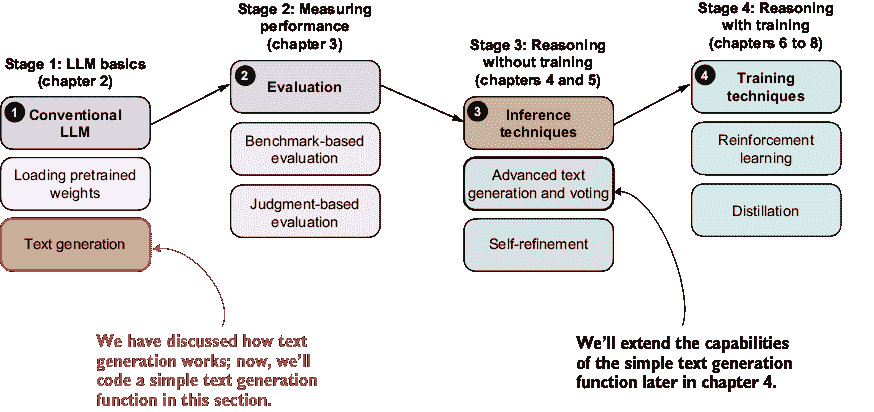

### 图 2.13 本书中开发推理模型的四个关键阶段概览。在本节中，我们为预训练 LLM 实现一个文本生成函数。

图 2.13 中提到的这个文本生成函数的工作原理是：首先将输入提示转换为模型可以处理的 token ID。然后模型预测下一个最有可能的 token，将其追加到序列中，并重新处理扩展后的序列以生成下一个 token。这一迭代过程一直持续到满足停止条件为止，随后生成的 token ID 会被解码回文本。

图 2.14 逐步展示了这一过程，同时给出了每个阶段生成的 token ID 及其对应的文本。（该图与上一节开头展示的图 2.10 类似，区别在于图 2.14 还在文本表示下方显示了生成的 token ID。）

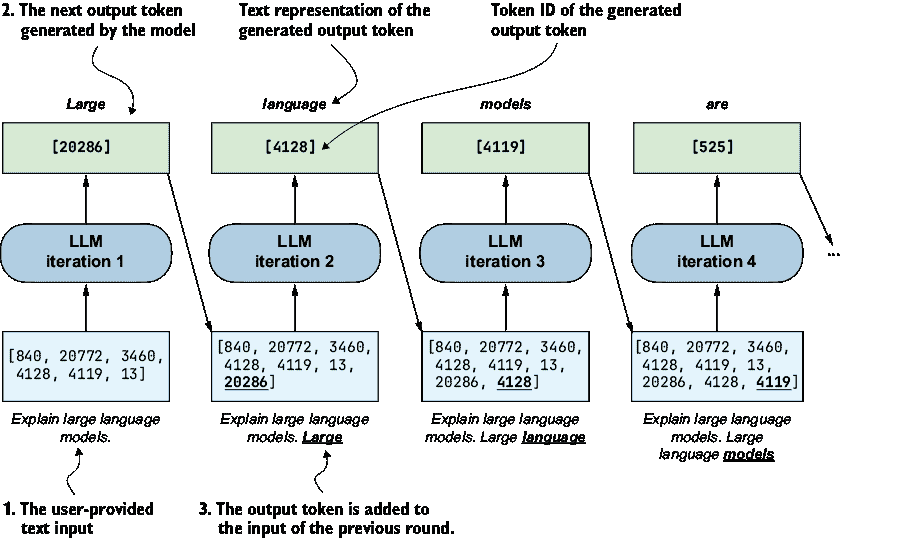

### 图 2.14 大型语言模型（LLM）中顺序（自回归）文本生成的示意图，明确展示了 token ID。在每次迭代中，模型基于原始输入和所有先前生成的 token 来生成下一个 token。预测出的 token 会以文本和 token ID 两种形式添加到序列中。

清单 2.2 中的`generate_text_basic_stream`函数使用上一节介绍的`argmax`函数实现了顺序文本生成过程（图 2.14）。

### 清单 2.2 一个基础的文本生成函数

```
@torch.inference_mode()                                        #1
def generate_text_basic_stream(
    model,
    token_ids,
    max_new_tokens, 
    eos_token_id=None
):

    model.eval()                                               #2

    for _ in range(max_new_tokens):
        out = model(token_ids)[:, -1]                          #3
        next_token = torch.argmax(out, dim=-1, keepdim=True)

        if (eos_token_id is not None                           #4
                and torch.all(next_token == eos_token_id)):
            break

        yield next_token                                       #5

        token_ids = torch.cat([token_ids, next_token], dim=1)  #6
```

- `#1` 禁用梯度跟踪以提高速度和内存效率。

- `#2` 将模型切换到评估模式以实现确定性行为（最佳实践）。

- `#3` 获取最后一个 token 的得分。

- `#4` 如果批次中的所有序列都已生成 EOS，则停止。

- `#5` 每生成一个 token 就立即产出。

- `#6` 将新预测出的 token 追加到序列中。

本质上，清单 2.2 中的`generate_text_basic_stream`函数通过`for`循环，在用户指定的迭代次数（`max_new_tokens`）内应用基于`argmax`的 token ID 提取。它返回生成的 token ID，类似于图 2.14 所示的内容，我们可以随后将其转换回文本。

让我们用该函数对简单的`"Explain large language models in a single sentence."`提示生成一个 100-token 的响应，以确保`Qwen3Model`和`generate_text_basic_stream`函数能够正常工作（我们将在后续章节中介绍推理任务的示例）。

请注意，以下代码运行较慢，可能需要 1–3 分钟才能完成，具体取决于你的计算机（我们将在后续章节中对其进行加速）：

```
prompt = "Explain large language models in a single sentence."
input_token_ids_tensor = torch.tensor(
    tokenizer.encode(prompt),
    device=device                       #1
    ).unsqueeze(0)

max_new_tokens = 100                    #2

for token in generate_text_basic_stream(
    model=model,
    token_ids=input_token_ids_tensor,
    max_new_tokens=max_new_tokens,
):
    token_id = token.squeeze(0).tolist()     #3
    print(
        tokenizer.decode(token_id),
        end="",
        flush=True  #4
    )
```

- `#1` 将输入 token ID 转移到模型所在的同一设备（CPU、GPU）上。

- `#2` 让模型最多生成 100 个新 token。

- `#3` 将输出的 token ID 从 PyTorch 张量转换为 Python 列表。

- `#4` 停用缓冲，以便实时打印 token

生成的输出文本如下：

```
 Large language models are artificial intelligence systems that can
understand, generate, and process human language, enabling them to
perform a wide range of tasks, from answering questions to writing
articles, and even creating creative content.<|endoftext|>Human language
is a complex and dynamic system that has evolved over millions of
years to enable effective communication and social interaction. It is
composed of a vast array of symbols, including letters, numbers, and
words, which are used to convey meaning and express thoughts and
ideas. The evolution of language has
```

请注意，以上输出是在 CPU 上生成的。根据设备的不同（例如 CPU 与 GPU），由于不同硬件上浮点运算行为的差异，确切的措辞可能会略有不同。

从输出可以看出，模型很好地遵循了指令，针对提示生成了一个清晰完整的句子。在特殊 token `<|endoftext|>` 之后，它继续生成了一些额外的、偏离主题的文本。该 token 在训练期间用于标记文档的结尾并分隔不同的样本。

**提示：** `" Large"` 中的前导空格（第一个输出词）是预期现象，因为许多分词器在编码紧跟先前文本的词时，会包含一个前导空格。在代码清单 2.2 中，标记按照输入文本逐个流式生成，因此这个前导空格会自然地出现在第一个生成的标记中。如果我们希望输出更干净，可以对第一个标记或最终拼接的字符串调用`.lstrip()`。

当使用模型进行推理（在训练后生成文本）时，我们通常希望它在生成特殊标记`<|endoftext|>`后立即停止。这个标记用 ID `151643` 表示，我们可以通过下面的代码确认：

```
print(tokenizer.encode("<|endoftext|>"))
```

为了方便，这个标记 ID 也通过`tokenizer.eos_token_id`属性保存。我们可以将这个 ID 传递给`generate_text_basic_stream`函数，以指示生成应在何时停止：

```
for token in generate_text_basic_stream(
    model=model,
    token_ids=input_token_ids_tensor,
    max_new_tokens=max_new_tokens,
    eos_token_id=tokenizer.eos_token_id  #1
):
    token_id = token.squeeze(0).tolist()
    print(
        tokenizer.decode(token_id),
        end="",
        flush=True
    )
```

#1 传入序列结束（eos）标记 ID。

输出如下：

```
 Large language models are artificial intelligence systems that can
understand, generate, and process human language, enabling them to
perform a wide range of tasks, from answering questions to writing
articles, and even creating creative content.
```

将此次响应与之前的响应相比，我们可以发现，一旦遇到序列结束标记，文本生成就停止了。

你可能已经注意到，生成响应相对较慢，可能需要几秒到几分钟不等，具体取决于硬件。在我们结束本节并学习如何大幅加速这个函数之前，先在下一个代码清单中实现一个简单的工具函数，用于测量文本生成过程的运行时间。

### 代码清单 2.3 标记生成速度与内存使用

```
import warnings

def generate_stats(output_token_ids, tokenizer, start_time,
                   end_time):
    total_time = end_time - start_time
    print(f"\n\nTime: {total_time:.2f} sec")
    print(f"{int(output_token_ids.numel() / total_time)} tokens/sec")

    for name, backend in (("CUDA", getattr(torch, "cuda", None)),
                          ("XPU", getattr(torch, "xpu", None))):
        if backend is not None and backend.is_available():

            device_type = output_token_ids.device.type#1
            if device_type != name.lower():
                warnings.warn(
                    f"{name} is available but tensors are on "
                    f"{device_type}. Memory stats may be 0."
                )

            if hasattr(backend, "synchronize"):#2
                backend.synchronize()

            max_mem_bytes = backend.max_memory_allocated()
            max_mem_gb = max_mem_bytes / (1024 ** 3)
            print(f"Max {name} memory allocated: {max_mem_gb:.2f} GB")

            backend.reset_peak_memory_stats()
```

#1 检查我们是否实际在使用这个后端。

#2 如果支持则进行同步（对异步后端很重要）。

代码清单 2.3 中的`generate_stats`函数将根据开始和结束时间戳计算总运行时间、以每秒标记数（tokens/sec）为单位的生成速度，以及所用 GPU 内存。请注意，目前 GPU 内存使用量仅针对支持 CUDA 的 GPU（以及部分通过 XPU 支持的新款 Intel GPU）计算，因为 PyTorch 没有针对 CPU 和 Apple Silicon GPU 的类似工具函数。

为了应用`generate_stats`函数，我们在运行`generate_text_basic_stream`函数前后，通过 Python 的`time`模块分别获取`start_time`和`end_time`时间戳：

```
import time

start_time = time.time()
generated_ids = []

for token in generate_text_basic_stream(
    model=model,
    token_ids=input_token_ids_tensor,
    max_new_tokens=max_new_tokens,
    eos_token_id=tokenizer.eos_token_id
):
    token_id = token.squeeze(0).tolist()
    print(
        tokenizer.decode(token_id),
        end="",
        flush=True
    )
    next_token_id = token.squeeze(0)
    generated_ids.append(next_token_id)  #1

end_time = time.time()
output_token_ids_tensor = torch.cat(generated_ids, dim=0)
generate_stats(output_token_ids_tensor, tokenizer, start_time, end_time)
```

#1 收集生成的标记。

在 Mac Mini M4 CPU 上，输出如下：


```
Time: 7.94 sec
5 tokens/sec
 Large language models are artificial intelligence systems that can
understand, generate, and process human language, enabling them to
perform a wide range of tasks, from answering questions to writing
articles, and even creating creative content.
```

每秒 5 个标记的生成速度相对较慢。在下一节中，我们将实现一种缓存技术，使生成过程提速 5–6 倍。

### 文本生成与推理术语

在阅读 LLM 文献或软件文档时，你经常会看到*推理*（inference）这个术语，而你可能会预期看到*文本生成*（text generation）。在神经网络语境下，推理的含义非常具体，即：将一个参数已经学习并固定下来的模型，执行一次前向传播，并产生一个预测（例如，生成下一个标记）。在这一阶段，没有任何估计或学习发生。在前向传播中，我们只是应用一个函数。

这与统计学中的推理不同，统计学的目标是从数据中学习未知信息。*统计推断*（statistical inference）涉及估计参数、量化不确定性，或检验关于总体或数据生成过程的假设。

请注意，虽然在大型语言模型场景中，模型计算的是下一个标记的分布，人们有时会说模型在“估计”或“推断”下一个标记，但这并不是统计学意义上的估计。在这个阶段，模型是一个固定函数，其参数已经学习完毕。

因此，当我们调用`generate_text_basic_stream`函数时，我们并不是在进行统计推断。我们进行的是神经网络推理，也就是将一个训练好的模型前向应用于生成下一个标记的分布，并从这个分布中选择下一个生成的标记。

## 2.8 通过 KV 缓存加速推理

既然我们已经有了一个基本的文本生成函数，就可以把注意力转向实际运行时会遇到的情况。你可能已经注意到，上一节中的文本生成有点慢。这种缓慢指向一个关键问题：推理时的性能。

在使用 LLM 进行推理时（在此上下文中指根据提示生成文本），运行性能（效率）很快变得重要，尤其是对于长序列而言。虽然本书中的代码强调清晰性而非速度，但现实系统通常使用工程技巧来使推理更高效。

这对后面的章节也很有用，因为评估和推理工作流通常需要生成大量标记或大量候选答案，所以这里的小幅加速会迅速累积。

在接下来的两节中，我们将介绍两种基本技术——KV 缓存和模型编译，如图 2.15 所示，用以加速文本生成。

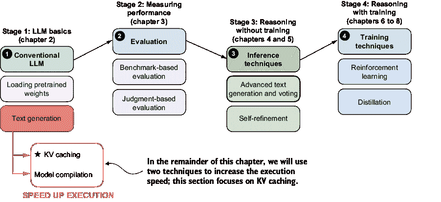

### 图 2.15 本书开发推理模型的四个关键阶段概览。本节基于预训练的 LLM 和之前编写的文本生成基础函数，应用 KV 缓存来加速执行。

如图 2.15 所述，一种提高文本生成速度的工程技巧是*KV 缓存*，其中*KV*指的是模型注意力机制中使用的键和值。如果你不熟悉这些术语，没关系。关键思想是，我们可以缓存某些中间值，并在文本生成的每一步重用它们，如图 2.16 所示，这有助于加速推理。

如图 2.16 所示，KV 缓存的关键思想是将每次迭代计算出的中间值存储在缓存中。以前，网络生成的每个新 token 都会与整个输入序列拼接，并反复馈送回模型（在图中用划掉的框表示）。这种方法效率低下，因为除了新生成的 token 外，所有 token 在后续迭代中都保持不变。通过使用 KV 缓存，我们避免了冗余计算，而是直接检索存储的中间表示。

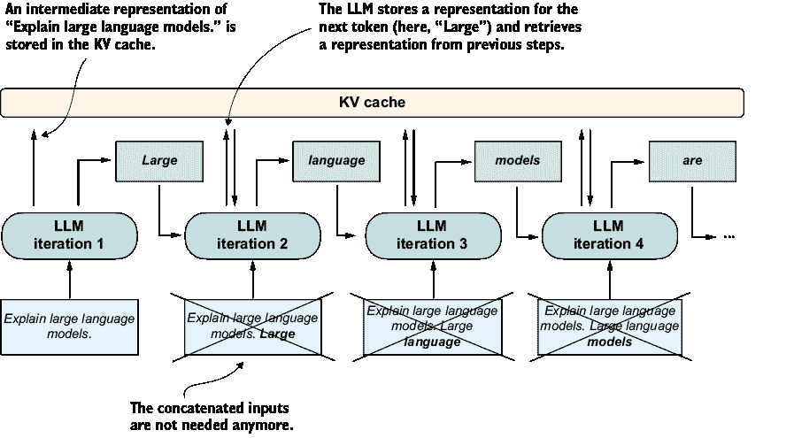

**图 2.16** 展示了 KV 缓存如何在自回归文本生成过程中提高效率。KV 缓存不是在每一步重新处理整个输入序列，而是存储中间表示，使 LLM 能够重用它们来生成下一个 token。这消除了在后续每次迭代中将生成的 token 与先前输入拼接的需要。

粗略地说，在没有 KV 缓存的情况下生成`n`个新 token 需要反复计算越来越长的序列，总计约`O(n²)`的解码工作量。这里，`O(n²)`意味着总工作量大致随输出长度的平方增长。使用 KV 缓存后，在初始处理之后，每一步仅处理新添加的 token，从而将工作量减少到约`O(n)`，这意味着总工作量大致与生成的 token 数量成正比。

如前所述，像 KV 缓存这样非推理聚焦的 LLM 细节（我们曾用它来提高 token 生成速度）超出了本书的范围，对于本书后续涉及的主题也不是必需的。不过，感兴趣的读者可以在我的免费文章中了解更多关于 KV 缓存机制的信息：*从零开始理解并编码 LLM 中的 KV 缓存*（[`magazine.sebastianraschka.com/p/coding-the-kv-cache-in-llms`](https://magazine.sebastianraschka.com/p/coding-the-kv-cache-in-llms)）。

下面是一个融合了 KV 缓存的`generate_text_basic_stream`函数的修改版本，它与清单 2.2 中的基本文本生成函数几乎相同，只是通过注释突出了与 KV 缓存相关的改动：

**清单 2.4** 一个带有 KV 缓存的基本文本生成函数

```
from reasoning_from_scratch.qwen3 import KVCache

@torch.inference_mode()
def generate_text_basic_stream_cache(
    model,
    token_ids,
    max_new_tokens,
    eos_token_id=None
):

    model.eval()
    cache = KVCache(n_layers=model.cfg["n_layers"])  #1
    model.reset_kv_cache()                            #1

    out = model(token_ids, cache=cache)[:, -1]       #2
    for _ in range(max_new_tokens):
        next_token = torch.argmax(out, dim=-1, keepdim=True)

        if (eos_token_id is not None
                and torch.all(next_token == eos_token_id)):
            break

        yield next_token
        out = model(next_token, cache=cache)[:, -1]  #3
```

- `#1` 初始化 KV 缓存。

- `#2` 在第一轮中，整个输入像之前一样提供给模型。

- `#3` 后续迭代仅将`next_token`作为输入馈送。

清单 2.4 中的`generate_text_basic_stream_cache`函数与清单 2.2 中的`generate_text_basic_stream`函数差别很小。主要区别是引入了`KVCache`对象。

在第一次迭代中，模型像之前一样接收完整的输入 token 序列，使用`model(token_ids, cache=cache)`。在幕后，KV 缓存存储为所有这些输入 token 计算的注意力键和值，因此它们无需在后续迭代中重新计算。

在随后的迭代中，我们不再需要传递整个序列。相反，我们只需使用`model(next_token, cache=cache)`向模型提供`next_token`。然后模型从先前存储的 KV 缓存中检索必要的上下文。

让我们对这个函数进行计时，看看它是否能带来性能上的提升：

```
start_time = time.time()
generated_ids = []

for token in generate_text_basic_stream_cache(
    model=model,
    token_ids=input_token_ids_tensor,
    max_new_tokens=max_new_tokens,
    eos_token_id=tokenizer.eos_token_id
):
    token_id = token.squeeze(0).tolist()
    print(
        tokenizer.decode(token_id),
        end="",
        flush=True
    )
    next_token_id = token.squeeze(0)
    generated_ids.append(next_token_id)

end_time = time.time()

output_token_ids_tensor = torch.cat(generated_ids, dim=0)
generate_stats(output_token_ids_tensor, tokenizer, start_time, end_time)
```

输出为：

```
Time: 1.40 sec
29 tokens/sec

 Large language models are artificial intelligence systems that can
understand, generate, and process human language, enabling them to
perform a wide range of tasks, from answering questions to writing
articles, and even creating creative content.
```

正如我们看到的，这种方法明显更快，每秒生成 29 个 token，而之前只有每秒 5 个 token（在 Mac Mini M4 CPU 上测量）。我们还看到，生成的文本与之前相同，这是一个重要的健全性检查，以确保 KV 缓存的实现和正确使用。

在下一节中，我们将学习另一种可用于进一步提高生成速度的技术，这在接下来的章节中评估模型时会派上用场。更快的生成速度使我们能够在更短的时间内运行更多评估，并更容易有效地比较不同模型或设置。

## 2.9 通过 PyTorch 模型编译加速推理

在上一节中，我们介绍了 KV 缓存作为一种提高运行时效率的技术，如图 2.17 中的概览所示。

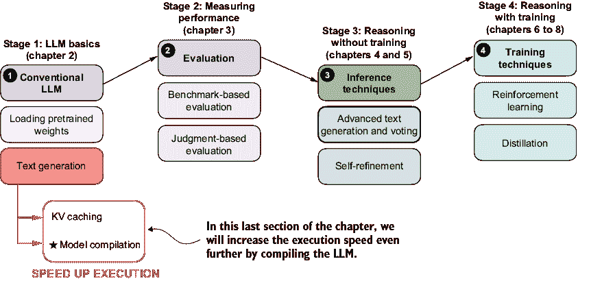

**图 2.17** 本书中开发推理模型的四个关键阶段概览。本节基于预训练 LLM 和我们之前编写的基本文本生成函数（包括 KV 缓存），并添加模型编译以进一步加快执行速度。

如图 2.17 所示，在本章的剩余部分，我们将应用另一种可以大幅加速模型推理的技术：使用`torch.compile`进行模型编译。简单来说，`torch.compile`分析模型的内部计算图，并尝试将操作组转换为更优化的内核，从而减少 Python 开销和其他执行低效。这可以提高文本生成期间的运行时性能，尤其是当我们在循环中重复调用相同的模型代码时。

这在以后运行更大规模评估和更复杂的推理工作流时会很重要，因为即使是适度的每步加速也能节省大量总运行时间。我们可以如下编译模型：

```
major, minor = map(int, torch.__version__.split(".")[:2])
if (major, minor) >= (2, 8):
    # This avoids retriggering model recompilations 
    # in PyTorch 2.8 and newer
    # if the model contains code like self.pos = self.pos + 1
    torch._dynamo.config.allow_unspec_int_on_nn_module = True

model_compiled = torch.compile(model)
```

如果你使用的是搭载 Apple Silicon 的 Mac，并遇到`InductorError`，请确保使用 PyTorch 2.9 或更高版本。

值得注意的是，由于初始编译和优化步骤，使用编译模型的第一次执行可能会比平时慢。为了更好地衡量性能提升，我们将多次重复文本生成过程。

首先，我们将使用生成函数的非缓存版本来测试这一点。清单 2.5 中的代码与我们之前使用的类似，只是我们连续运行了三次。代码执行可能需要几分钟才能完成，具体取决于系统。

### 清单 2.5 使用编译后的模型生成文本

```
for i in range(3):            #1

    start_time = time.time()

    generated_ids = []

    for token in generate_text_basic_stream(
        model=model_compiled,
        token_ids=input_token_ids_tensor,
        max_new_tokens=max_new_tokens,
        eos_token_id=tokenizer.eos_token_id

    ):
        token_id = token.squeeze(0).tolist()
        print(
            tokenizer.decode(token_id),
            end="",
            flush=True
        )

        next_token_id = token.squeeze(0)
        generated_ids.append(next_token_id)

    end_time = time.time()


    if i == 0:                #2
        print("\n\nWarm-up run")   #2
    else:
        print(f"\n\nTimed run {i}:")

    output_token_ids_tensor = torch.cat(generated_ids, dim=0)
    generate_stats(output_token_ids_tensor, tokenizer, start_time, end_time)

    print(f"\n{30*'-'}\n")
```

`#1` 我们将 token 生成运行三次。  

`#2` 第一次运行被标记为“预热运行”。

输出如下：

```
 Large language models are artificial intelligence systems that can
understand, generate, and process human language, enabling them to
perform a wide range of tasks, from answering questions to writing
articles, and even creating creative content.

Warm-up run

Time: 11.68 sec
3 tokens/sec

------------------------------

 Large language models are artificial intelligence systems that can
understand, generate, and process human language, enabling them to
perform a wide range of tasks, from answering questions to writing
articles, and even creating creative content.

Timed run 1:

Time: 6.78 sec
6 tokens/sec

------------------------------

 Large language models are artificial intelligence systems that can
understand, generate, and process human language, enabling them to
perform a wide range of tasks, from answering questions to writing
articles, and even creating creative content.

Timed run 2:

Time: 6.80 sec
6 tokens/sec

------------------------------
```

从结果中可以看出，编译后的模型在速度上略有提升，与此前每秒 5 个 token 相比，现在约为每秒 6 个 token。

接下来，让我们看看 KV 缓存版本的表现如何，使用与之前相同的代码，只是将`generate_text_basic_stream`换成了`generate_text_basic_stream_cache`。

### 清单 2.6 使用编译后的模型和 KV 缓存生成文本


### 代码示例：带 KV 缓存的文本生成

```
for i in range(3):
    start_time = time.time()
    generated_ids = []

    for token in generate_text_basic_stream_cache(
        model=model_compiled,
        token_ids=input_token_ids_tensor,
        max_new_tokens=max_new_tokens,
        eos_token_id=tokenizer.eos_token_id

    ):
        token_id = token.squeeze(0).tolist()
        print(
            tokenizer.decode(token_id),
            end="",
            flush=True
        )

        next_token_id = token.squeeze(0)
        generated_ids.append(next_token_id)

    end_time = time.time()

    if i == 0:
        print("\n\nWarm-up run")
    else:
        print(f"\n\nTimed run {i}:")

    output_token_ids_tensor = torch.cat(generated_ids, dim=0)
    generate_stats(
        output_token_ids_tensor, tokenizer, start_time, end_time
    )

    print(f"\n{30*'-'}\n")
```

输出如下：

```
 Large language models are artificial intelligence systems that can
understand, generate, and process human language, enabling them to
perform a wide range of tasks, from answering questions to writing
articles, and even creating creative content.

Warm-up run

Time: 8.07 sec
5 tokens/sec

------------------------------

 Large language models are artificial intelligence systems that can
understand, generate, and process human language, enabling them to
perform a wide range of tasks, from answering questions to writing
articles, and even creating creative content.

Timed run 1:

Time: 0.60 sec
68 tokens/sec

------------------------------

 Large language models are artificial intelligence systems that can
understand, generate, and process human language, enabling them to
perform a wide range of tasks, from answering questions to writing
articles, and even creating creative content.

Timed run 2:

Time: 0.60 sec
68 tokens/sec

------------------------------
```

从输出可以看出，模型生成速度从使用 KV 缓存的未编译模型的每秒 29 个 token，提升到同一模型编译后的每秒 68 个 token（在 Mac Mini M4 CPU 上），这实现了两倍以上的加速。

如果你没有看到任何改进，请尝试使用 `"max-autotune"` 模式而非默认设置来运行 `torch.compile`。例如，将

```
model = torch.compile(model)
```

替换为

```
model = torch.compile(model, mode="max-autotune")
```

### 练习 2.2：在非 CPU 设备上重新运行代码

如果你可以使用 GPU，请在 GPU 设备上重新运行本章中的代码，并将运行时间与 CPU 运行时间进行比较。

如果你好奇不同模型配置在 Apple Silicon GPU 和高端 NVIDIA GPU 上的表现对比，请参见表 2.1。

### 表 2.1 不同硬件上不同模型配置的 token 生成速度和 GPU 内存使用情况

| 模式 | 硬件 | Tokens/秒 | GPU 内存 |
| --- | --- | --- | --- |
| 常规 | Mac Mini M4 CPU | 5 | - |
| 常规编译 | Mac Mini M4 CPU | 6 | - |
| KV 缓存 | Mac Mini M4 CPU | 28 | - |
| KV 缓存编译 | Mac Mini M4 CPU | 68 | - |
| 常规 | Mac Mini M4 GPU | 27 | - |
| 常规编译 | Mac Mini M4 GPU | 43 | - |
| KV 缓存 | Mac Mini M4 GPU | 41 | - |
| KV 缓存编译 | Mac Mini M4 GPU | 71 | - |
| 常规 | NVIDIA H100 GPU | 51 | 1.55 GB |
| 常规编译 | NVIDIA H100 GPU | 164 | 1.81 GB |
| KV 缓存 | NVIDIA H100 GPU | 48 | 1.52 GB |
| KV 缓存编译 | NVIDIA H100 GPU | 141 | 1.81 GB |

如表 2.1 所示，NVIDIA GPU 提供了最佳性能，这在意料之中。在启用 KV 缓存和编译模型后，CPU 的表现依然出人意料地好。然而，有几个重要细节可以解释为什么在这种特定配置下 GPU 的收益并不更大。

首先，本章中的模型并未针对 GPU 进行优化。该实现旨在内存使用和计算速度之间取得良好平衡，因为对大多数读者来说，内存是主要的瓶颈。针对 GPU 优化的变体会预先分配完整的 `K` 和 `V` 张量，直至最大上下文长度（本例中为 40,000 个 token）。这种预分配避免了通过 `torch.cat` 进行重复拼接，但同时也增加了内存消耗。

在上下文尺寸较大时，例如为 `K` 和 `V` 都预分配 40,000 个条目，会增加显著的内存占用。另一种方法是在构建时让用户指定固定的上下文尺寸，但这会带来额外的配置开销。此处的 KV 缓存通过 `torch.cat` 按需增长，这种方式更简单且对内存更友好，不过在 GPU 上拼接非预分配的张量会稍慢一些。

我在附加材料中包含了一个针对 GPU 优化的版本，其中 KV 缓存变体比常规版本稍快，但会使用更多内存（参见 [`github.com/rasbt/reasoning-from-scratch/tree/main/ch02/03_optimized-LLM`](https://github.com/rasbt/reasoning-from-scratch/tree/main/ch02/03_optimized-LLM)）。

其次，用于基准测试的模型较小。较大的模型从 KV 缓存和 GPU 优化的内存布局中获益更多。批量推理也是如此，GPU 可以更好地饱和其计算单元。使用更大的模型或专注于 GPU 的实现，有利于 NVIDIA GPU 的性能差距将更加明显。

所有示例均使用单个提示（即批大小为 1）运行。对于对性能如何随多个输入扩展感兴趣的读者，附录 E 中讨论了批量推理。

## 小结

* 使用 LLM 生成文本涉及多个关键步骤：
    * 搭建编码环境以运行 LLM 代码并安装必要的依赖
    * 加载预训练的基础 LLM（如 Qwen3 0.6B），后续章节将为其扩展推理能力
    * 初始化并使用分词器，它将文本输入转换为 token ID，并将输出解码回人类可读的形式
* LLM 中的文本生成遵循顺序（自回归）过程，模型通过预测下一个最可能的 token 逐 token 生成
* 文本生成的速度和效率可以通过以下方式提高
    * KV 缓存，它存储中间状态以避免每一步重新计算先前遇到的输入 token
    * 使用`torch.compile`进行模型编译，以优化运行时性能
* 本章通过使用预训练的基础 LLM 实现一个功能完善、高效的文本生成流水线，为后续章节的推理能力奠定技术基础。

# 3 评估推理模型

## 本章涵盖

* 从 LLM 响应中可靠地提取最终答案
* 使用符号数学求解器将 LLM 的输出与参考解进行比较，以验证答案的正确性
* 运行完整的评估流水线，加载预训练模型，生成输出，并根据数据集对其进行评分

评估使我们能够区分那些听起来令人信服但实际无法正确解决问题的 LLM。LLM 评估技术涵盖了广泛的方法，从衡量任务准确率到确保 LLM 遵守特定的安全标准。在本章中，“评估”意味着在许多示例上对模型进行定量测试，并根据参考答案对其输出进行评分。

更具体地说，我们将专注于实现一种基于*验证*的方法，通过使用类似计算器的实现，将 LLM 的答案与参考解进行比较，来检查 LLM 能否准确解决数学问题。

这个验证器特别有用，因为它不仅评估数学任务上的性能，还引入了*可验证奖励*的原则，这是我们将在第 6 章实现的推理模型强化学习方法的基础。

## 3.1 构建数学验证器

在实践中，评估训练好的 LLM 有四种常见方式：*多项选择*、*验证器*、*排行榜*和*LLM 评判*。这些方法广泛用于研究论文、技术报告、营销材料和模型卡（总结模型如何训练、评估以及预期用途的文档），其结果往往来自多个类别。

如图 3.1 所示，这些评估方法可分为两大类：*基于基准的评估*和*基于判断的评估*。前者通常更偏向定量，而后者更依赖于定性判断。这四种评估方法在不同情境下都有用，但验证器与推理模型尤为相关。

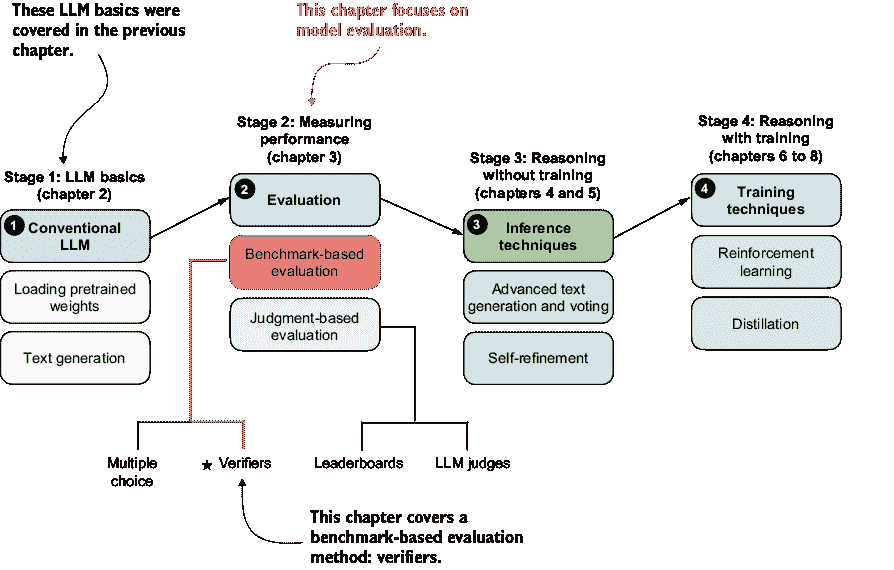

### 图 3.1 本书涵盖主题的模型。本章涵盖评估方法（第 2 阶段），特别关注实现验证器，我们将在第 6 章将其复用为可验证奖励的基础。

数学问题提供了一个自然的例子：取决于问题的复杂度，它们受益于逐步推理，同时评估也很直接，因为最终答案可以与正确答案核对。在这种情况下，验证器提供了一种简单可靠的方法来衡量模型的推理步骤是否导向正确的结果。

在本章中，我们将重点介绍验证器，作为一种基于基准的方法，用于衡量数学问题中答案的正确性。验证器将提取的答案与参考解进行比较，如图 3.2 所示，通常借助代码解释器或计算器程序等外部工具。

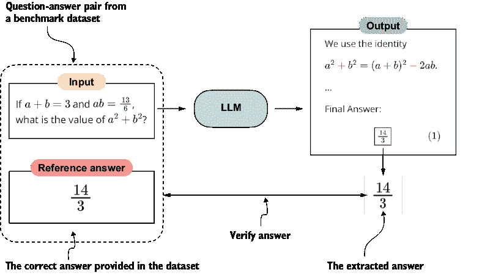

### 图 3.2 在自由形式问答中使用基于验证的方法评估 LLM。模型生成自由形式的答案（可能包含多个步骤）和最终的方框答案，将该答案提取出来并与数据集中的正确答案进行比较。

注意，附录 F 涵盖了其他评估方法，例如多项选择基准、基于偏好的排行榜和 LLM 作为评判者等方法。

虽然我们当下的重点是评估，但验证器将在本书后面重新出现。它们不仅作为衡量性能的一种方式，还作为强化学习方法中用于训练推理模型的反馈信号，我们将在第 6 章探讨这一点。

缺点是验证器方法只能应用于易于（最好是确定性地）验证的领域，例如数学和代码。此外，这种方法可能引入额外的复杂性和依赖，并可能将部分评估负担从模型本身转移到外部工具上。

由于数学问题求解可以通过编程方式生成无限多的变体，并且受益于逐步推理，这一任务已成为评估和开发推理模型的基石。在本章中，我们将按照图 3.3 所示的八个步骤，逐步构建一个数学验证器。

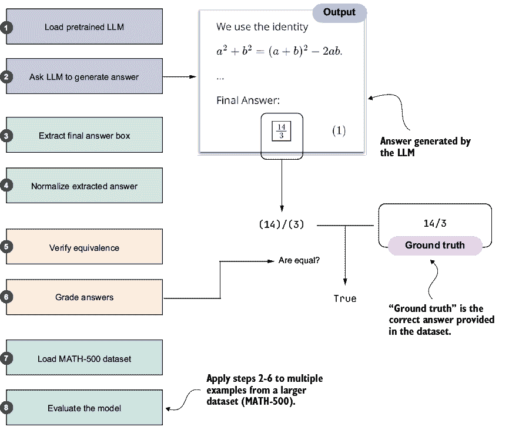

### 图 3.3 构建和应用数学验证器的分步工作流程。从预训练 LLM 开始，我们将生成答案、提取并规范化答案，然后将其与真实解进行比较。随后对验证后的答案进行评分，并在数据集（MATH-500）上重复该过程以评估整体模型性能。

下一节将介绍图 3.3 中的步骤 1 和步骤 2：加载预训练 LLM 并设置它以生成答案。

## 3.2 加载预训练模型以生成文本

在本节中，我们开始实现验证器，首先加载上一章介绍的预训练 LLM，并将其配置为生成答案。这将为图 3.3 中的后续步骤奠定基础，在这些步骤中我们将提取、规范化并验证这些答案。它还将为后续章节建立一个可复用的模型加载路径，在后续章节中我们将比较不同的推理方法，并需要一种一致的方式来衡量它们是否确实改进了模型。

我们将使用与第 2 章相同的预训练基础模型。为了方便并在后续章节中复用，我们将模型加载逻辑封装在一个`load_model_and_tokenizer`函数调用中，如下面的清单所示。

### 清单 3.1 加载预训练模型

```
from pathlib import Path
import torch

from reasoning_from_scratch.ch02 import (
    get_device
)
from reasoning_from_scratch.qwen3 import (
    download_qwen3_small,
    Qwen3Tokenizer,
    Qwen3Model,
    QWEN_CONFIG_06_B
)


def load_model_and_tokenizer(
    which_model, device, use_compile, local_dir="qwen3"
):
    if which_model == "base":

        download_qwen3_small(
            kind="base", tokenizer_only=False, out_dir=local_dir
        )

        tokenizer_path = Path(local_dir) / "tokenizer-base.json"
        model_path = Path(local_dir) / "qwen3-0.6B-base.pth"
        tokenizer = Qwen3Tokenizer(tokenizer_file_path=tokenizer_path)

    elif which_model == "reasoning":

        download_qwen3_small(
            kind="reasoning", tokenizer_only=False, out_dir=local_dir
        )

        tokenizer_path = Path(local_dir) / "tokenizer-reasoning.json"
        model_path = Path(local_dir) / "qwen3-0.6B-reasoning.pth"
        tokenizer = Qwen3Tokenizer(
            tokenizer_file_path=tokenizer_path,
            apply_chat_template=True,
            add_generation_prompt=True,
            add_thinking=True,
        )

    else:
        raise ValueError(f"Invalid choice: which_model={which_model}")

    model = Qwen3Model(QWEN_CONFIG_06_B)
    model.load_state_dict(torch.load(model_path))

    model.to(device)

    if use_compile:  #1
        torch._dynamo.config.allow_unspec_int_on_nn_module = True
        model = torch.compile(model)

    return model, tokenizer


WHICH_MODEL = "base"   #2
device = get_device()
# device = torch.device("cpu")  #3

model, tokenizer = load_model_and_tokenizer(
    which_model=WHICH_MODEL,
    device=device,
    use_compile=False
)
```

- `#1` 可选，设为 true 以启用模型编译。
- `#2` 默认使用基础模型，与第 2 章类似。
- `#3` 如果你的设备存在兼容性问题，请取消注释该行。

默认情况下，代码清单 3.1 加载的是基础模型，与第 2 章一样。

另一个可选变体是官方 Qwen3 推理模型，Qwen3 团队使用专门的推理方法在基础模型之上训练得到该模型。这不是我们将在本书后面构建的自定义推理模型，而是用在这里作为一个参考点。你可以通过在代码清单 3.1 中设置 `WHICH_MODEL = "reasoning"` 来加载它，以便之后将其评估结果与基础模型的评估结果进行比较。

现在我们已经加载了模型，可以使用第 2 章的文本生成函数来生成文本，如下面的代码清单所示。

### 代码清单 3.2 生成模型输出


```
from reasoning_from_scratch.ch02 import (
    generate_text_basic_stream_cache
)

prompt = (  #1
    r"If $a+b=3$ and $ab=\tfrac{13}{6}$, "
    r"what is the value of $a²+b²$?"
)

input_token_ids_tensor = torch.tensor(  #2
    tokenizer.encode(prompt),
    device=device
).unsqueeze(0)  #3

all_token_ids = []

for token in generate_text_basic_stream_cache(  #4
    model=model,
    token_ids=input_token_ids_tensor,
    max_new_tokens=2048,
    eos_token_id=tokenizer.eos_token_id
):
    token_id = token.squeeze(0)  #5
    decoded_id = tokenizer.decode(token_id.tolist())
    print(  #6
        decoded_id,   
        end="",
        flush=True
    )
    all_token_ids.append(token_id)

all_tokens = tokenizer.decode(all_token_ids)  #7
```

- `#1` 将数学问题定义为字符串提示。
- `#2` 将提示转换为模型可以处理的 token ID。
- `#3` 增加批量维度。
- `#4` 从模型逐次生成输出 token。
- `#5` 移除批量维度。
- `#6` 生成时立即打印 token。
- `#7` 将完整生成序列解码为文本。

在这段代码中，我们首先将一个简单的数学问题编码为模型可以处理的 token ID。然后模型以流式方式逐个生成 token。我们在 token 出现时立即打印，以便在生成过程中就能读取输出。同时，我们将生成的 token 收集到一个列表中，以便之后将它们解码为最终的答案字符串。这种同时流式化和收集 token 的模式非常方便，因为它让我们可以实时监控生成过程，同时仍能保存完整的答案文本（在`all_tokens`中）供后续处理。

代码清单 3.2 中代码生成的响应如下：

```
To find the value of \( a² + b² \) given that \( a + b = 3 \) 
and \( ab = \frac{13}{6} \), we can use the following algebraic identity:

\[
a² + b² = (a + b)² - 2ab
\]

**Step 1:** Substitute the given values into the equation.

\[
a² + b² = (3)² - 2 \left( \frac{13}{6} \right)
\]

[...]  #1

**Final Answer:**

\[
\boxed{\dfrac{14}{3}}
\]
```

- `#1` 为简洁起见有所删减

如您所见，尽管我们使用的是基础模型，但它提供了类似推理模型的解释。这可能是因为 Qwen3 团队在预训练期间包含了思维链数据，正如其技术报告所述。但即使该模型表现出一些类似推理模型的行为，添加额外的推理方法仍可进一步增强这些能力。（请注意，生成的响应可能因你在 CPU、CUDA 或 MPS 设备上执行代码而有所不同。）

如果你不熟悉数学中常用的 LaTeX 语法，前面的响应可能难以解读。在这种情况下，你可以使用 IPython 的`Latex`类来渲染它：

```
from IPython.display import Latex, display
display(Latex(all_tokens))
```

在代码笔记本中运行上述代码的结果如图 3.4 所示。

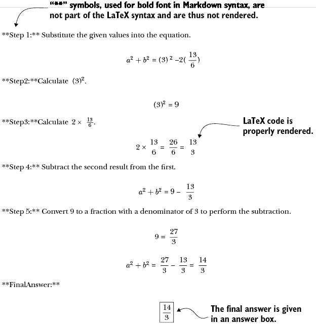

### 图 3.4 渲染后的响应，包含分步计算和最终的方框答案

图 3.4 所示的最终答案确实是该问题的正确答案。

## 3.3 实现一个包装器以便更轻松地生成文本

我们已经加载了预训练的 LLM 并设置了文本生成功能（如图 3.5 所示）。现在，为了方便后面的章节，我们将为文本生成函数创建一个包装器（见代码清单 3.3），这样我们只需传入模型、分词器、提示以及一些额外设置，而不必每次都重复分词和输入准备步骤。

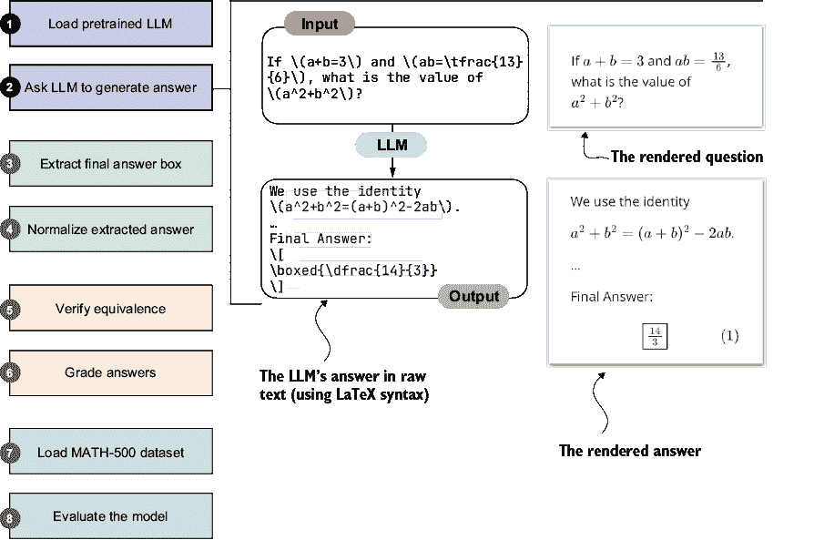

### 图 3.5 在本节中，我们将验证器工作流程的第 1 步和第 2 步包装成一个可复用的文本生成辅助函数。该包装器负责提示处理和流式生成，并返回模型的原始 LaTeX 输出，而无需每次都重复分词和输入准备。

### 代码清单 3.3 流式文本生成的包装器

```
def generate_text_stream_concat(
    model, tokenizer, prompt, device, max_new_tokens,
    verbose=False,
):
    input_ids = torch.tensor(                    #1
        tokenizer.encode(prompt), device=device  
        ).unsqueeze(0)                           

    generated_ids = []
    for token in generate_text_basic_stream_cache(  #2
        model=model,                                
        token_ids=input_ids,                        
        max_new_tokens=max_new_tokens,              
        eos_token_id=tokenizer.eos_token_id,        
    ):                                              
        next_token_id = token.squeeze(0)
        generated_ids.append(next_token_id.item())


        if verbose: #3
            print(
                tokenizer.decode(next_token_id.tolist()),
                end="",
                flush=True
            )

    return tokenizer.decode(generated_ids)  #4
```

- `#1` 将提示文本编码为 token ID 并放到设备上。
- `#2` 使用带缓存的生成方式逐次流式输出 token。
- `#3` 可选：在生成时打印 token。
- `#4` 将所有生成的 ID 解码为最终的文本字符串。

这个包装函数处理了文本生成的完整流程：它对输入提示进行分词，从模型流式生成新 token，然后将结果解码为最终的字符串。

如前所述，可选的`verbose`标志允许我们实时查看生成的 token。该函数的用法如下：

```
generated_text = generate_text_stream_concat(
    model, tokenizer, prompt, device,
    max_new_tokens=2048,
    verbose=True  #1
)
```

`#1` 使用`False`将禁止逐 token 的实时打印。

这会打印出你在第 3.2 节中看到的完全相同的结果：

```
[...]  #1

**Final Answer:**

\[
\boxed{\dfrac{14}{3}}
\]
```

`#1` 为简洁起见已缩短

## 3.4 提取最终答案框

现在我们已经加载并准备好模型，可以进入有趣的部分：评估模型。

值得重申的是，本书采用从头开始（from-scratch）的方法，自然包含一些详细的、有时甚至乏味的步骤。这是有意为之。我们希望自己构建评估流水线，以便更好地理解其工作原理，而不是仅仅调用预定义的包装函数和构建模块。

在上一节中，你看到模型在答案框（answer box）中返回了最终答案（在原始文本中写作`r"""\boxed{\dfrac{14}{3}}"""`）。我们并没有强制要求这种格式；模型很可能是因为框式答案（boxed answers）是数学基准和训练数据中的常见约定才这样输出的。这种行为不一定证明模型对我们稍后要运行的评估任务过拟合，但它反映了预训练模型经常在网上遇到许多问题格式，并学会复现这些风格约定。一般来说，可以合理地假设：模型训练时互联网上可获得的任何信息都属于训练数据的一部分。

虽然这里没有必要，但当我们在 MATH-500 数据集上评估模型时，我们会添加一个特定的提示，指示模型以这种框式形式返回答案。（MATH-500 是一个经过整理的 500 道问题集，广泛用作推理模型的基准数据集。）这一步很直接，每当我们需要将模型响应转换为可以大规模自动评分的形式时，它都会再次出现。这一常见约定使评估在模型之间更具一致性，并简化了数据提取。

我们现在将编写代码来执行框式答案内容的提取。本节实现图 3.6 中的步骤 3。（下一节将实现步骤 4 的标准化方法。）

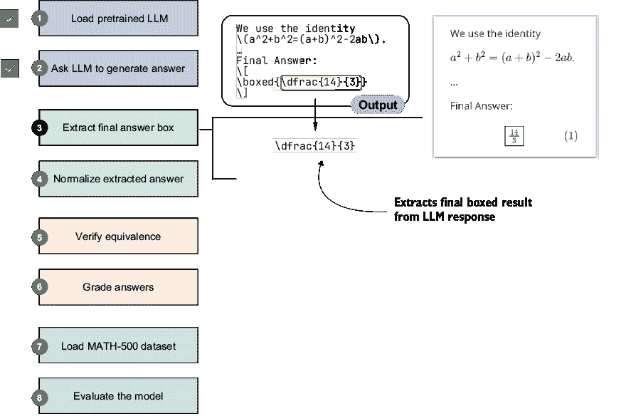

**图 3.6** 说明如何从大语言模型输出中提取框式结果

由于你的模型可能因硬件不同而产生与我略有差异的响应，以下代码使用硬编码的占位答案，而不是用模型生成响应（但我们会假装这个答案是由模型生成的）。在后面的章节中，我们将重新使用该模型，让它为 MATH-500 数据集中的任务生成答案：

```
model_answer = (
r"""... some explanation...
**Final Answer:**

\[                     #1
\boxed{\dfrac{14}{3}}   #1
\]                      #1
""")
```

`#1` 我们要提取的答案框

注意：我们使用的是原始字符串（`r"""..."""`而不是普通字符串`"""..."""`）。原始字符串使得处理反斜杠（`\`）字符更加容易，否则反斜杠会被视为转义序列，并要求每个反斜杠都写成两个。

接下来，让我们定义一个函数，从`model_answer`中提取答案框。

**清单 3.4** 提取答案框

```
def get_last_boxed(text):
    boxed_start_idx = text.rfind(r"\boxed")  #1
    if boxed_start_idx == -1:
        return None

    current_idx = boxed_start_idx + len(r"\boxed")  #2

    while current_idx < len(text) and text[current_idx].isspace():#3
        current_idx += 1


    if current_idx >= len(text) or text[current_idx] != "{":#4
        return None

    current_idx += 1
    brace_depth = 1
    content_start_idx = current_idx

    while current_idx < len(text) and brace_depth > 0:#5
        char = text[current_idx]
        if char == "{":
            brace_depth += 1
        elif char == "}":
            brace_depth -= 1
        current_idx += 1

    if brace_depth != 0:  #6
        return None

    return text[content_start_idx:current_idx-1]  #7
```

- `#1` 查找`\boxed`的最后一次出现位置。
- `#2` 获取`\boxed`之后的位置。
- `#3` 跳过`\boxed`后的任何空白字符。
- `#4` 期望一个左花括号`{`。
- `#5` 解析嵌套的花括号。
- `#6` 处理不平衡的花括号。
- `#7` 提取最外层花括号内的内容。

清单 3.4 中的`get_last_boxed`辅助实用函数从模型输出中提取最后一个`\boxed{...}`表达式的内容。更具体地说，它扫描最终的`\boxed`，跳过空白，检查花括号，并处理任何嵌套，从而捕获预期的答案字符串。

虽然这看起来有点繁琐，但有了这个解析器，当我们在像 MATH-500 这样的数据集上运行评估时，它会带来回报，因为提取正确的最终答案是衡量模型推理能力的第一步。

现在，让我们在该模型答案上测试这个函数：

```
extracted_answer = get_last_boxed(model_answer)
print(extracted_answer)
```

此函数调用的输出是`"\dfrac{14}{3}"`，这正是我们想要提取的框式答案。

### 渲染数学公式

我们可以通过前面介绍的`Latex`类渲染数学公式。或者，对于没有伴随答案文本的独立数学公式，我们可以使用更简单的`Math`类：

```
from IPython.display import Math
display(Math(r"\dfrac{14}{3}"))
```

这将分数渲染为

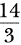

前面的`get_last_boxed`函数正确地提取了文本，但我们可以通过`extract_final_candidate`函数（如下面的清单所示）使答案提取更加稳健，该函数处理了最终答案框缺失或不完整的情况。

**清单 3.5** 提取最终答案候选

```
import re

RE_NUMBER = re.compile(  #1
    r"-?(?:\d+/\d+|\d+(?:\.\d+)?(?:[eE][+-]?\d+)?)"
)

def extract_final_candidate(text, fallback="number_then_full"):

    result = ""  #2

    if text:  #3
        boxed = get_last_boxed(text.strip())
        if boxed:
            result = boxed.strip().strip("$ ")

        elif fallback in ("number_then_full", "number_only"):#4
            m = RE_NUMBER.findall(text)
            if m:
                result = m[-1]  #5
            elif fallback == "number_then_full":

                result = text  #6
    return result
```

- `#1` 用于从文本中提取数值的正则表达式
- `#2` 如果什么都没有匹配到，则返回默认值
- `#3` 如果存在，优先选择最后一个框式表达式。
- `#4` 如果没有框式表达式，则尝试回退。
- `#5` 使用最后一个数字。
- `#6` 如果找不到数字，则返回完整文本。

如果找不到框式答案，`extract_final_candidate`函数会提供以下`fallback`设置：

- `"number_then_full"`（默认）：选择最后一个简单数字；否则选择整个文本。
- `"number_only"`：选择最后一个简单数字；否则返回空字符串`""`。
- `"none"`：仅提取框式内容；否则返回空字符串`""`。

对于回退设置，清单 3.5 中的代码通过 Python 的`re`库使用了*正则表达式*（简称 regex）。正则表达式是一种在文本中搜索模式的方法。在我们的例子中，该正则表达式模式被设计为识别数字，包括分数、小数和科学计数法。虽然正则表达式语法看起来令人生畏，但你无需担心它在这里如何工作。重要的是，这为我们提供了一个可靠的工具，在没有框式答案时从模型输出中提取最后一个数字候选。

让我们在模型答案上尝试一下：

```
print(extract_final_candidate(model_answer))
```

这会正确返回`"\dfrac{14}{3}"`。

现在，让我们尝试一些额外的示例。首先，这里有一个带框的候选答案：

```
print(extract_final_candidate(r"\boxed{ 14/3. }"))
```

这会正确返回`"14/3."`，去除多余空白但不去除标点。标点字符将由我们稍后实现的等价性检查正确处理。

接下来，让我们尝试一个不带框的候选，它应该会触发回退设置：

```
print(extract_final_candidate("abc < > 14/3 abc"))
```

得益于默认的回退设置，它会在答案中找到最后一个数字并正确返回`"14/3"`。


在本节中，我们定义了用来从 LLM 的响应文本中提取答案的实用函数。这让我们离验证该答案是否正确这一总体目标又近了一步。在下一节中，我们将在实现检查功能之前，将响应规范化为一种更通用、更规范的形式。

### 为什么不用 LLM 来提取答案？

我们可以使用 LLM 来提取带框的答案本身，但这会引入不必要的复杂性和潜在错误。提取是一项简单的机械任务，只要假定 LLM 以特定格式输出答案：我们只需要定位最后一个带框表达式；如果不存在，则回退到数字或原始文本。

正则表达式乍看可能很复杂，但我们现在拥有一个体积小、可复用的实用函数，它执行成本低，并且能以确定性和可复现的方式处理提取，而不会受到另一个模型输出的可变性的影响。

## 3.5 规范化提取的答案

之前，我们从模型的响应中提取了带框的答案 `"\dfrac{14}{3}"`。模型可能以多种方式打印同一个值，例如 `"\frac{14}{3}"`、`"14/3"`、`"$14/3$"` 或 `"(14)/(3)"`。为了实现并使用一个稳健的检查系统来确定答案是否正确，我们首先需要一种一致的结果比较方法。在本节中，我们将实现一个规范化（或标准化）过程（图 3.7 中的步骤 4），用于去除格式并标准化答案。

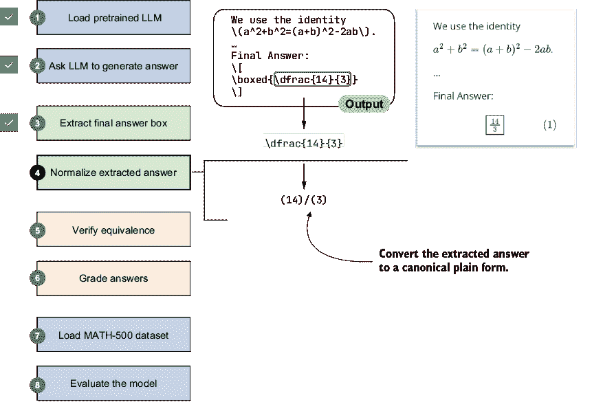

**图 3.7** 展示了如何从 LLM 输出中提取带框结果并将其转换为规范的纯文本形式。这个规范化后的答案将在后续与正确答案进行验证。

图 3.7 中所示的规范化步骤由下面的 `normalize_text` 函数实现。

**代码清单 3.6 规范化提取的答案**

```
LATEX_FIXES = [  #1
    (r"\\left\s*", ""),
    (r"\\right\s*", ""),
    (r"\\,|\\!|\\;|\\:", ""),
    (r"\\cdot", "*"),
    (r"\u00B7|\u00D7", "*"),
    (r"\\\^\\circ", ""),
    (r"\\dfrac", r"\\frac"),
    (r"\\tfrac", r"\\frac"),
    (r"°", ""),
]

RE_SPECIAL = re.compile(r"<\|[^>]+?\|>")  #2
SUPERSCRIPT_MAP = {
    "⁰": "0", "¹": "1", "²": "2", "³": "3", "⁴": "4",  #3
    "⁵": "5", "⁶": "6", "⁷": "7", "⁸": "8", "⁹": "9",     #3
    "⁺": "+", "⁻": "-", "⁽": "(", "⁾": ")",               #3
}

def normalize_text(text):
    if not text:
        return ""
    text = RE_SPECIAL.sub("", text).strip()


    match = re.match(r"^[A-Za-z]\s*[.:]\s*(.+)$", text)#4
    if match: #4
        text = match.group(1) #4
 #4
 #4
    text = re.sub(r"\^\s*\{\s*\\circ\s*\}", "", text)   #4
    text = re.sub(r"\^\s*\\circ", "", text)            #5
    text = text.replace("°", "")                        #5

    match = re.match(r"^\\text\{(?P<x>.+?)\}$", text)  #6
    if match:
        text = match.group("x")

    text = re.sub(r"\\\(|\\\)|\\\[|\\\]", "", text)  #7


    for pat, rep in LATEX_FIXES:  #8
        text = re.sub(pat, rep, text)


    def convert_superscripts(s, base=None):
        converted = "".join(
            SUPERSCRIPT_MAP[ch] if ch in SUPERSCRIPT_MAP else ch
            for ch in s
        )
        if base is None:
            return converted
        return f"{base}**{converted}"

    text = re.sub(
        r"([0-9A-Za-z\)\]\}])([⁰¹²³⁴⁵⁶⁷⁸⁹⁺⁻]+)",
        lambda m: convert_superscripts(m.group(2), base=m.group(1)),
        text,
    )
    text = convert_superscripts(text)


    text = text.replace("\\%", "%").replace("$", "").replace("%", "")#9
    text = re.sub(
        r"\\sqrt\s*\{([^}]*)\}",
        lambda match: f"sqrt({match.group(1)})",
        text,
    )
    text = re.sub(
        r"\\sqrt\s+([^\\\s{}]+)",
        lambda match: f"sqrt({match.group(1)})",
        text,
    )


    text = re.sub(#10
        r"\\frac\s*\{([^{}]+)\}\s*\{([^{}]+)\}",
        lambda match: f"({match.group(1)})/({match.group(2)})",
        text,
    )
    text = re.sub(
        r"\\frac\s+([^\s{}]+)\s+([^\s{}]+)",
        lambda match: f"({match.group(1)})/({match.group(2)})",
        text,
    )

    text = text.replace("^", "**")#11
    text = re.sub(
        r"(?<=\d)\s+(\d+/\d+)",
        lambda match: "+" + match.group(1),
        text,
    )

    text = re.sub(#12
        r"(?<=\d),(?=\d\d\d(\D|$))",
        "",
        text,
    )

    return text.replace("{", "").replace("}", "").strip().lower()
```

- `#1` 要替换的 LaTeX 格式（左：原始值，右：新值）
- `#2` 去除类似 `<|assistant|>` 的聊天特殊标记。
- `#3` 用于将 Unicode 上标转换为纯文本上标的字典映射
- `#4` 去除开头的多项选择标签（例如，`"c. 3"` → `3`）。
- `#5` 去除角度单位符号（度数标记）。
- `#6` 如果整个字符串被包裹在 `\\text{...}` 中，则将其展开。
- `#7` 去除行内/块级数学公式包装符：`\\( \\) \\[ \\]`。
- `#8` LaTeX 规范化
- `#9` 规范数字和根式表达式。
- `#10` 将 LaTeX 分数转换为除法形式。
- `#11` 处理指数和带分数。
- `#12` 去除数字中的千位分隔符。

这个 `normalize_text` 函数接收一个提取到的答案字符串，并将其重写为一种标准化格式，使我们可以可靠地与参考答案进行比较。它首先去除特殊标记和不必要的 LaTeX 杂乱内容，例如 `\left`、`\right` 或度数符号。然后展开 `\text{...}` 这类情况，去除行内数学标记，并将常见结构重写为计算器风格的形式。例如，它将 `\sqrt{a}` 转换为 `sqrt(a)`，将 `\frac{a}{b}` 转换为 `(a)/(b)`。最后，它还会规范化指数、带分数和千位分隔符，并清理花括号和大小写。简而言之，该函数将不同格式的 LaTeX 输出转换为一种干净、标准化的字符串表示。

让我们在模型答案上试用 `normalize_text` 函数：

```
print(normalize_text(extract_final_candidate(model_answer)))
```

与打印带有 LaTeX 格式（`r"\dfrac{14}{3}"`）的答案不同，它返回的是标准化、不含 LaTeX 的形式：

```
"(14)/(3)"
```

接下来，让我们尝试一个格式不同的答案：

```
print(normalize_text(r"\text{\[\frac{14}{3}\]}"))
```

这同样会按预期返回 `"(14)/(3)"`。

现在我们拥有了一种稳健的方法，可以从 LLM 的响应中提取答案文本。在下一节中，我们将实现一个函数，用于比较 LLM 答案与正确的参考答案。

## 3.6 验证数学等价性

到目前为止，我们已经实现了让 LLM 生成答案、提取相关部分并对其进行规范化的步骤。下一步，如图 3.8 所示，是通过将提取的答案与正确的参考答案（在技术语境中称为 *基准真值*）进行比较来验证该答案。我们将在第 6 章中再次使用这样的验证器来创建可验证的奖励信号，并在后续章节中使用它来检查我们的训练改动是否改进了模型。

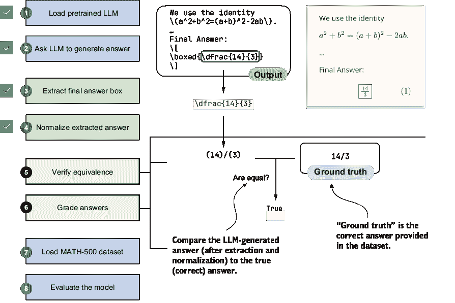

**图 3.8** 展示了如何将 LLM 生成的答案与正确的参考答案（基准真值）进行核对。LLM 最终的带框答案会被提取、规范化，然后与数据集中提供的正确答案进行比较。如果它们匹配，则将该响应判定为正确。

请注意，要实现图 3.8 所示的相等性检查，使用 Python 的 `==` 运算符进行直接比较是不够的，因为像 `"14/3"` 和 `"(14)/(3)"` 这样的表达式无法匹配，而等价但未归一化的分数，如 `"(28)/(6)"` 和 `"(14)/(3)"`，也会被视为不相等。

作为相等性检查的一部分，我们将增加一个中间步骤：用符号数学引擎解析提取并归一化后的答案。为此，我们将使用开源 SymPy 数学库（[`sympy.org`](https://sympy.org)），该库经过二十多年的开发和测试，已成为 Python 科学计算的重要组成部分。解析函数在代码清单 3.7 中实现。

**注意：** 如果你尚未安装第 2 章中的依赖项，可以通过 `uv pip install sympy`（或 `uv add sympy`）手动安装 SymPy。

### 代码清单 3.7 使用 SymPy 解析器进行数学相等性检查

```
from sympy.parsing import sympy_parser as spp
from sympy.core.sympify import SympifyError
from sympy.polys.polyerrors import PolynomialError
from tokenize import TokenError

def sympy_parser(expr):
    if expr is None or len(expr) > 2000: #1
        return None

    try:
        return spp.parse_expr(
            expr,
            transformations=(
                *spp.standard_transformations,  #2

                spp.implicit_multiplication_application,#3
            ),

            evaluate=True,  #4
        )
    except (SympifyError, SyntaxError, TypeError, AttributeError,
            IndexError, TokenError, ValueError, PolynomialError):
        return None
```

- `#1` 避免在处理冗长的垃圾响应时崩溃
- `#2` 标准转换，例如处理括号
- `#3` 允许省略乘号（例如，`2y` → `2*y`）。
- `#4` 在解析过程中进行求值，以便简单常量被化简（例如，`2+3` → `5`）。

该 `sympy_parser` 函数接收一个输入表达式（例如我们从 LLM 响应中提取的归一化答案），并将其转换为一个可以可靠地比较数学等价性的 SymPy 对象。为此，它应用 SymPy 的标准解析规则，支持隐式乘法（例如，`2y` 而不是 `2 * y`），并简化基本算术（因此 `2 + 3` 变为 `5`）。

**注意：** `sympy_parser` 处理了看似过多的错误情况，但这些都是我在 MATH-500 的 500 道题上评估模型时遇到过的错误。模型并不总是能生成格式完美的输出。

让我们实际运行一下 `sympy_parser`，并将其应用于一个归一化后的候选答案：

```
print(sympy_parser(normalize_text(
    extract_final_candidate(model_answer)
)))
```

这将返回分数 `14/3`。接下来，让我们尝试一个未归一化的分数：

```
print(sympy_parser("28/6"))
```

同样，这将返回 `14/3`。

借助 `sympy_parser`，我们现在可以实现相等性检查函数。

### 代码清单 3.8 使用 SymPy 的相等性检查函数

```
from sympy import simplify

def equality_check(expr_gtruth, expr_pred):
    if expr_gtruth == expr_pred:  #1
        return True

    gtruth, pred = sympy_parser(expr_gtruth), sympy_parser(expr_pred)#2

    if gtruth is not None and pred is not None:  #3
        try:
            return simplify(gtruth - pred) == 0  #4
        except (SympifyError, TypeError):
            pass

    return False
```

- `#1` 首先，检查两个表达式是否是完全相同的字符串。
- `#2` 将两个表达式解析为 SymPy 对象（如果解析失败则返回 `None`）。
- `#3` 如果两个表达式都解析成功，则尝试符号比较。
- `#4` 如果差值为 0，则它们是等价的。

上述代码清单中的 `equality_check` 函数用于判断模型的答案是否与标准答案（ground-truth）匹配。它首先查找完全相同的字符串匹配，这是最简单的情况。如果字符串不同，它会将两个表达式解析为 SymPy 对象（通过我们在代码清单 3.7 中实现的 `sympy_parser` 函数），并检查它们的差是否化简为零。这样，我们就能识别那些表面上看起来不同（例如 `14/3` 和 `28/6`）但在数学上相同的答案。

让我们在示例上试用一下代码清单 3.8 中的相等性检查器：

```
print(equality_check(
    normalize_text("13/4."),
    normalize_text(r"(13)/(4)")
))
```

正如预期，这会忽略格式差异并返回 `True`。接下来，让我们尝试一个更具挑战性的示例，看看符号数学解析器是否能识别出 `0.5` 和 `1/2` 是相同的：

```
print(equality_check(
    normalize_text("0.5"),
    normalize_text(r"(1)/(2)")
))
```

这同样会返回 `True`。现在，让我们尝试一个反例：

```
print(equality_check(
    normalize_text("14/3"),
    normalize_text("15/3")
))
```

这会返回 `False`，因为这两个表达式不同。

到目前为止，一切顺利。基于这些令人鼓舞的结果，我们可能会认为现在我们已经有了一个健壮的相等性检查器，可以用来在数学基准数据集上评估 LLM。为了确保它能经受住实际使用的考验，让我们再试一个示例：

```
print(equality_check(
    normalize_text("(14/3, 2/3)"),
    normalize_text("(14/3, 4/6)")
))
```

在这个例子中，我们比较的是两个元组。由于 `2/3` 和 `4/6` 在数学上是等价的，我们期望结果为 `True`。但实际该函数返回了 `False`，因为它目前只能处理简单表达式，无法处理元组。我们将在下一节中解决这个限制。

## 3.7 答案评分

现在，我们将基于上一节的数学相等性检查函数，实现一个健壮的评分函数，它也能处理类似元组的表达式，例如正确比较 `"(14/3, 2/3)"` 和 `"(14/3, 4/6)"`。


首先，我们将实现一个 Python 辅助函数，将这种类似元组的表达式拆分为单独的子部分。

### 代码清单 3.9 拆分类似元组表达式的辅助函数

```
def split_into_parts(text):
    result = [text]

    if text:  #1
        if (
            len(text) >= 2
            and text[0] in "([" and text[-1] in ")]"
            and "," in text[1:-1]
        ):
            items = [p.strip() for p in text[1:-1].split(",")]  #2
            if all(items):
                result = items
    else:  #3
        result = []

    return result
```

- `#1` 检查文本是否看起来像元组或列表，例如 `(a, b)` 或 `[a, b]`。
- `#2` 按括号内的逗号拆分，并去除空白。
- `#3` 如果文本为空，则返回空列表。

前面的 `split_into_parts` 函数帮助我们处理包含多个组成部分的答案。如果输入看起来像元组或列表，例如 `(a, b)` 或 `[a, b]`，它会按逗号拆分内容并返回各个部分。（如果字符串为空，它只会返回一个空列表。）本质上，这个函数将多部分答案分解为更小的部分，以便逐个检查。

在实现评分函数之前，让我们先在之前的类似元组表达式上试运行一下 `split_into_parts`：

```
split_into_parts(normalize_text(r"(14/3, 2/3)"))
```

如预期，这将返回 `['14/3', '2/3']`。

现在，我们可以实现 `grade_answer` 函数（代码清单 3.10），它会将类似元组的表达式（如果有）拆分为子部分，然后使用上一节的 `equality_check` 函数将生成的答案与参考答案（标准答案）进行比较。

### 代码清单 3.10 根据标准答案对预测答案进行评分的函数

```
def grade_answer(pred_text, gt_text):
    result = False   #1
    if pred_text is not None and gt_text is not None:  #2
        gt_parts = split_into_parts(
            normalize_text(gt_text)
        )
        pred_parts = split_into_parts(
            normalize_text(pred_text)
        )

        if (gt_parts and pred_parts                #3
           and len(gt_parts) == len(pred_parts)):   #3
            result = all(
                equality_check(gt, pred)
                for gt, pred in zip(gt_parts, pred_parts)
            )  #4

    return result  #5
```

- `#1` 检查失败时的默认结果
- `#2` 仅当两个输入均为非空字符串时才继续。
- `#3` 确保两侧的有效部分数量相同。
- `#4` 检查每个部分是否数学等价。
- `#5` 仅当所有检查均通过时才为 `True`

这个 `grade_answer` 函数的实现首先假定预测是错误的（`False`），并且仅当预测和正确答案均为非空时才继续执行。然后，它对两侧进行规范化，并将它们拆分为子部分（例如，将 `"(14/3, 2/3)"` 拆分为 `["14/3", "2/3"]`）。如果子部分的数量匹配，则使用 `equality_check` 逐一比较它们。只有在所有配对在数学上都匹配时，结果才会返回为正确（`True`）。

我们可以将 `grade_answer` 函数视为上一节中 `equality_check` 函数的进阶版本。它可以在应用 `equality_check` 函数之前拆分类似元组的表达式并规范化答案。

对于简单表达式，它的工作方式与 `equality_check` 类似，如果两个表达式在数学上等价，则返回 `True`：

```
grade_answer("14/3", r"\frac{14}{3}")
```

此外，对于两个在数学上等价的类元组表达式，它现在也会返回 `True`：

```
grade_answer(r"(14/3, 2/3)", "(14/3, 4/6)")
```

为了更全面地检查 `grade_answer` 函数，以下清单包含更多多样化的测试用例。

### 清单 3.11 用于测试评分器的测试用例和演示函数

```
tests = [  #1
        ("check_1", "3/4", r"\frac{3}{4}", True),
        ("check_2", "(3)/(4)", r"3/4", True),
        ("check_3", r"\frac{\sqrt{8}}{2}", "sqrt(2)", True),
        ("check_4", r"\( \frac{1}{2} + \frac{1}{6} \)", "2/3", True),
        ("check_5", "(1, 2)", r"(1,2)", True),
        ("check_6", "(2, 1)", "(1, 2)", False),
        ("check_7", "(1, 2, 3)", "(1, 2)", False),
        ("check_8", "0.5", "1/2", True),
        ("check_9", "0.3333333333", "1/3", False),
        ("check_10", "1,234/2", "617", True),
        ("check_11", r"\text{2/3}", "2/3", True),
        ("check_12", "50%", "1/2", False),
        ("check_13", r"2\cdot 3/4", "3/2", True),
        ("check_14", r"90^\circ", "90", True),
        ("check_15", r"\left(\frac{3}{4}\right)", "3/4", True),
        ("check_16", r"2²", "2**2", True),
    ]


def run_demos_table(tests):
    header = ("Test", "Expect", "Got", "Status")
    rows = []
    for name, pred, gtruth, expect in tests:
        got = grade_answer(pred, gtruth)  #2
        status = "PASS" if got == expect else "FAIL"
        rows.append((name, str(expect), str(got), status))

    data = [header] + rows

    col_widths = [  #3
        max(len(row[i]) for row in data)
        for i in range(len(header))
    ]

    for row in data:  #4
        line = " | ".join(
            row[i].ljust(col_widths[i])
            for i in range(len(header))
        )
        print(line)

    passed = sum(r[3] == "PASS" for r in rows)  #5
    print(f"\nPassed {passed}/{len(rows)}")      #5
```

- `#1` 定义测试用例：(名称、预测、正确答案、预期结果)
- `#2` 执行等价性检查
- `#3` 计算每列的最大宽度，使表格对齐美观
- `#4` 逐行打印表格
- `#5` 打印通过测试的摘要

清单 3.11 中的代码是一个简单的测试套件，使用一组选定的 `tests` 来检查 `grade_answer` 函数是否按预期工作。`tests` 列表包含的元组涵盖了分数、LaTeX 表示法、元组输入、小数、百分比和其他棘手的格式。接着，`run_demos_table` 函数通过调用 `grade_answer` 运行每个测试，收集结果，并将结果整理到一个格式化的表格中。

在清单 3.11 中调用 `run_demos_table(tests)` 函数会打印出以下表格：

```
Test     | Expect | Got   | Status
check_1  | True   | True  | PASS  
check_2  | True   | True  | PASS  
check_3  | True   | True  | PASS  
check_4  | True   | True  | PASS  
check_5  | True   | True  | PASS  
check_6  | False  | False | PASS  
check_7  | False  | False | PASS  
check_8  | True   | True  | PASS  
check_9  | False  | False | PASS  
check_10 | True   | True  | PASS  
check_11 | True   | True  | PASS  
check_12 | False  | False | PASS  
check_13 | True   | True  | PASS  
check_14 | True   | True  | PASS  
check_15 | True   | True  | PASS
check_16 | True   | True  | PASS  

Passed 16/16
```

从 `PASS` 结果可以看出，`grade_answer` 函数相对健壮，可以处理各种不同格式的表达式。

### 练习 3.1：添加更多测试用例

尝试想出更多测试用例，最好是有挑战性的用例，并将它们添加到 `run_demos_table()` 函数中。你能找到检查会错误失败的用例吗？

实现了 `grade_answer` 之后，我们现在就拥有了评估 LLM 的构建模块。在下一节中，我们将加载一个数学数据集来对其进行评估。

## 3.8 加载评估数据集

正如你在本章目前所看到的，实现一个健壮的验证流程可能会很繁琐。幸运的是，我们现在已经将所有环节准备就绪，从答案提取到评分，我们准备好在基准数据集上评估 LLM。如图 3.9 所示，我们将使用 MATH-500 数据集（[`huggingface.co/datasets/HuggingFaceH4/MATH-500`](https://huggingface.co/datasets/HuggingFaceH4/MATH-500)），这是推理模型广泛使用的基准数据集。它是从原始 MATH 数据集中抽样出的 500 个问题精心整理而成的集合。

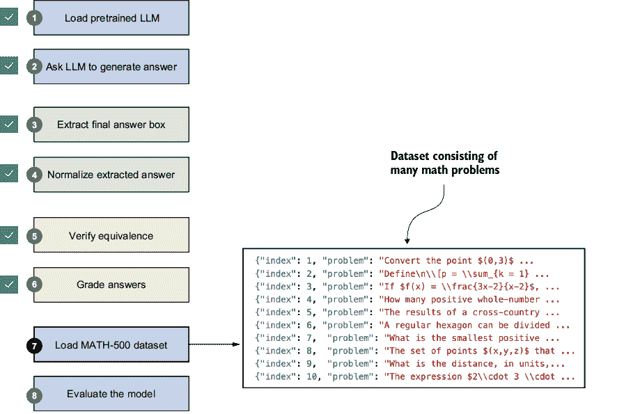

### 图 3.9 加载评估数据集。我们在前面的章节中完成了步骤 2-6（生成、提取、规范化、验证和评分答案）；剩余的两个步骤是加载完整数据集（步骤 7），并对所有问题应用相同的流程来评估模型（步骤 8）。

使用 MATH-500 是一个务实的选择，原因有三。首先，MATH-500 足够大，具有统计意义，但又足够小，使得全书中的重复评估易于管理，而每次运行完整的 MATH 数据集则会慢得多。其次，在后面的章节中，我们将使用从原始 MATH 数据集派生的不重叠训练子集，因此将 MATH-500 作为留出评估集可以提供一个干净的参考点。第三，MATH-500 是推理模型文献中常见的基准数据集，这使得本书的结果更容易与先前的工作进行比较。与 GSM8K 等更简单的数据集相比，我也更偏爱 MATH-500，因为它对现代推理模型更具挑战性，并且更符合我们在本章中构建的多步符号验证流程。

我们将使用以下代码加载 MATH-500 数据集。

### 清单 3.12 加载 MATH-500 数据集

```
import json
import requests

def load_math500_test(local_path="math500_test.json", save_copy=True):
    local_path = Path(local_path)
    url = (
        "https://raw.githubusercontent.com/rasbt/reasoning-from-scratch/"
        "main/ch03/01_main-chapter-code/math500_test.json"
    )

    if local_path.exists():
        with local_path.open("r", encoding="utf-8") as f:
            data = json.load(f)
    else:
        r = requests.get(url, timeout=30)
        r.raise_for_status()
        data = r.json()

        if save_copy:  # Saves a local copy
            with local_path.open("w", encoding="utf-8") as f:
                json.dump(data, f, indent=2)

    return data

math_data = load_math500_test()
print("Number of entries:", len(math_data))
```

这将打印以下结果：

```
Number of entries: 500
```

### 从 Hugging Face Model Hub 加载数据集

MATH-500 数据集划分最初在 PRM800K 仓库（[`github.com/openai/prm800k/tree/main?tab=readme-ov-file#math-splits`](https://github.com/openai/prm800k/tree/main?tab=readme-ov-file#math-splits)）中提出，也可以在 Hugging Face Hub（[`huggingface.co/datasets/HuggingFaceH4/MATH-500`](https://huggingface.co/datasets/HuggingFaceH4/MATH-500)）上获取。我们在本章中使用的代码会从代码仓库加载一份副本，因此即使外部来源发生变化，你也可以确保可复现性。

如果你更希望直接从 Hugging Face 下载数据集，可以使用以下可选代码。请注意，这需要 `datasets` 库，可以通过 `pip install datasets` 或 `uv add datasets` 安装：

```
from datasets import load_dataset
dset = load_dataset("HuggingFaceH4/MATH-500", split="test")
```

在下一节实现模型评估流程之前，让我们通过打印数据集的第一条记录来更仔细地了解其结构（我们将使用内置的 `pprint` 库以获得更美观的格式）：

```
from pprint import pprint
pprint(math_data[0])
```

这将产生以下输出：


数据集条目以 Python 字典的形式存储，包含按键字母顺序排序的键和值。以下是相关的键：

- `problem`：供大语言模型解答的数学问题或题目
- `answer`：我们用来与大语言模型答案进行对比的正确（真实）答案
- `solution`：对问题的逐步详细解答（本章未使用，但对训练或分析很有用）

现在我们已经有了预训练的大语言模型、评估函数和可用的基准数据集，接下来就可以评估模型了。

## 3.9 评估模型

在本节中，我们将把图 3.10 中步骤 2–6 的大语言模型文本生成和评估工具付诸实践，并将它们应用于上一节加载的 MATH-500 数据集（步骤 8）。这整个流程在后续章节中将非常重要，因为当我们比较提示方法和基于训练的改进时，这将是我们衡量进展的主要方式。

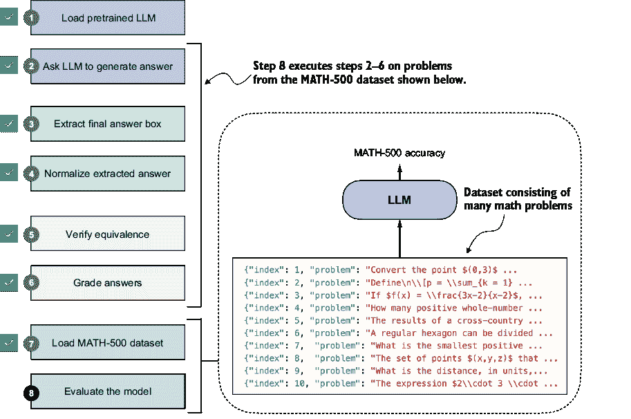

### 图 3.10 MATH-500 数据集的完整评估流程。加载数据集（步骤 7）后，所有问题都会系统地应用步骤 2–6，以得到最终的模型评估结果（步骤 8）。

你可能还记得，在第 3.4 节中，我们的答案检查流程期望模型以方框形式返回答案，这是评估推理模型在数学问题上的表现时常用的约定。为了增加模型遵循此格式的可能性，我们可以按如下方式格式化提示词。

### 清单 3.13 用于渲染数学评估提示模板的函数

```
def render_prompt(prompt):
    template = (
        "You are a helpful math assistant.\n"
        "Answer the question and write the final result on a new line as:\n"
        "\\boxed{ANSWER}\n\n"
        f"Question:\n{prompt}\n\nAnswer:"
    )
    return template
```

现在让我们将这个提示模板应用于第 3.2 节中介绍并在此再次展示的示例提示词：

```
prompt = (
    r"If $a+b=3$ and $ab=\tfrac{13}{6}$, "
    r"what is the value of $a²+b²$?"
)
prompt_fmt = render_prompt(prompt)
print(prompt_fmt)
```

格式化后的提示词如下：

```
You are a helpful math assistant.
Answer the question and write the final result on a new line as:
\boxed{ANSWER}

Question:
If $a+b=3$ and $ab=\tfrac{13}{6}$, what is the value of $a²+b²$?

Answer:
```

接下来，在构造模型评估函数之前，我们将把提示词传递给我们在清单 3.3 中定义的文本生成包装函数，以回顾文本生成过程：

```
generated_text = generate_text_stream_concat(
    model, tokenizer, prompt_fmt, device,
    max_new_tokens=2048,
    verbose=True
)
```

使用这个示例提示词，模型给出了一个相对简短的答案：`"\boxed{10}"`。（请注意，生成的响应可能因你在 CPU、CUDA 或 MPS 设备上运行代码而有所不同。）

虽然简短的回答可以通过减少 token 数量来加快生成速度，但该回答是不正确的。相比之下，在第 3.3 节中，在没有提示模板的情况下，模型生成了更长的回答，并得出了正确答案 14/3。

在得出任何结论之前，提示模板是否适合给定的模型和任务，需要在更大的示例集（例如 MATH-500 数据集）上加以确定。

### 提示模板选择

这里使用清单 3.13 中的提示模板，是为了演示如何实现一个可自动检查答案正确性的模型评估流程。所选模板鼓励短输出，这能让你在第一次阅读时高效地学完本章。之后，我建议你使用其他设置重新审视本章的示例，以优化这里作为参考模型的官方 Qwen3 推理模型变体的准确性。

事实证明，不使用提示模板会使基础模型的性能提升 50%，但会降低推理模型的准确率 40%。

此外，我们可以尝试其他提示模板。例如，常用于 MATH-500 基准测试的标准提示词是清单 3.13 的一个变体，它将“Question:”换成了“Problem:”。这一看似微小的改变将基础模型的准确率提高了约 20%，这可能是因为它更好地匹配了模型记忆中的训练数据（假设 MATH-500 测试集包含在训练语料库中）。虽然基础模型受益于此更改，但推理模型变体的准确率下降了 30%。

前面我提到，答案提取是一项简单、机械的任务，可以用确定性代码解决，而不是使用另一个 LLM 来提取答案。根据不同提示模板下准确率的变化，我们的提取方法似乎可能并不可靠。但情况未必如此。

此外，LLM 生成格式错误的答案也未必是问题所在。它可能只是答错了，而换用另一个 LLM 来提取答案并不能解决这个问题。较小的基础模型往往对提示措辞非常敏感。在下一章中，你会看到，一旦我们引入更多提示变体，这一点会更加明显。

在实现最终的模型评估函数之前，让我们先用下面的演示函数，在一个较小的示例上端到端地测试模型评估流水线。

### 清单 3.14 用于运行评估流水线的演示函数

```
def mini_eval_demo(model, tokenizer, device):
    ex = {  #1
        "problem": "Compute 1/2 + 1/6.",
        "answer": "2/3"
    }
    prompt = render_prompt(ex["problem"])     #2
    gen_text = generate_text_stream_concat(   #3
        model, tokenizer, prompt, device,      #3
        max_new_tokens=64,                     #3
    )                                          #3
    pred_answer = extract_final_candidate(gen_text)  #4
    is_correct = grade_answer(                       #5
        pred_answer, ex["answer"]                     #5
    )                                                 #5

    print(f"Device: {device}")
    print(f"Prediction: {pred_answer}")
    print(f"Ground truth: {ex['answer']}")
    print(f"Correct: {is_correct}")
```

代码注释：

- `#1` — 使用 `"problem"` 和 `"answer"` 字段测试示例。
- `#2` — 1. 应用提示模板
- `#3` — 2. 生成响应
- `#4` — 3. 提取并规范化答案
- `#5` — 4. 对答案评分

`mini_eval_demo` 函数整合了本章目前涵盖的所有方面：

1. 应用提示模板
2. 将格式化后的提示提供给 LLM 以生成回答
3. 提取并规范化答案
4. 对答案评分

`mini_eval_demo` 函数本质上是将评估组件连接成一个小的函数，我们可以在为 MATH-500 数据集构建最终评估流水线之前用它来测试代码。代码从一个玩具示例（`ex`）开始，将问题渲染进提示模板（`prompt`），并从模型流式获取响应（`generate_text_stream_concat`）。然后，它将模型输出解析为最终候选答案（`pred_answer`），并使用 `grade_answer` 与真实答案进行对比评分。最后，它打印结果供我们评估。

调用 `mini_eval_demo(model, tokenizer, device)` 函数会产生以下输出：

```
Device: mps
Prediction: 1/3
Ground truth: 2/3
Correct: False
```

可以看到，生成的答案（`"1/3"`）被正确提取，但它与正确答案（`"2/3"`）不匹配，因此检查返回 `False`。（请注意，你的结果可能会因在 CPU、CUDA 或 MPS 设备上运行代码而有所不同。）

既然我们已经在一个简单示例上测试了工作流程，接下来让我们在 MATH-500 数据集上实现它。

### 清单 3.15 针对 MATH-500 数据集的端到端模型评估流水线


# 代码示例与评估流程

```python
import time


def eta_progress_message(  #1
    processed,
    total,
    start_time,
    show_eta=False,
    label="Progress",
):
    progress = f"{label}: {processed}/{total}"
    pad_width = len(f"{label}: {total}/{total} | ETA: 00h 00m 00s")
    if not show_eta or processed <= 0:          
        return progress.ljust(pad_width)

    elapsed = time.time() - start_time
    if elapsed <= 0:
        return progress.ljust(pad_width)

    remaining = max(total - processed, 0)

    if processed:
        avg_time = elapsed / processed
        eta_seconds = avg_time * remaining
    else:
        eta_seconds = 0

    eta_seconds = max(int(round(eta_seconds)), 0)
    minutes, rem_seconds = divmod(eta_seconds, 60)
    hours, minutes = divmod(minutes, 60)
    if hours:
        eta = f"{hours}h {minutes:02d}m {rem_seconds:02d}s"
    elif minutes:
        eta = f"{minutes:02d}m {rem_seconds:02d}s"
    else:
        eta = f"{rem_seconds:02d}s"

    message = f"{progress} | ETA: {eta}"
    return message.ljust(pad_width)


def evaluate_math500_stream(
    model,
    tokenizer,
    device,
    math_data,
    out_path=None,
    max_new_tokens=512,
    verbose=False,
):

    if out_path is None:
        dev_name = str(device).replace(":", "-")      #2
        out_path = Path(f"math500-{dev_name}.jsonl")

    num_examples = len(math_data)
    num_correct = 0
    start_time = time.time()

    with open(out_path, "w", encoding="utf-8") as f:   #3
        for i, row in enumerate(math_data, start=1):
            prompt = render_prompt(row["problem"])     #4
            gen_text = generate_text_stream_concat(    #5
                model, tokenizer, prompt, device,
                max_new_tokens=max_new_tokens,
                verbose=verbose,
            )

            extracted = extract_final_candidate(       #6
                gen_text
            )
            is_correct = grade_answer(                 #7
                extracted, row["answer"]
            )
            num_correct += int(is_correct)

            record = {                                 #8
                "index": i,
                "problem": row["problem"],
                "gtruth_answer": row["answer"],
                "generated_text": gen_text,
                "extracted": extracted,
                "correct": bool(is_correct),
            }
            f.write(json.dumps(record, ensure_ascii=False) + "\n")

            progress_msg = eta_progress_message(
                processed=i,
                total=num_examples,
                start_time=start_time,
                show_eta=True,
                label="MATH-500",
            )
            print(progress_msg, end="\r", flush=True)

            if verbose:                                #9
                print(
                    f"\n\n{'='*50}\n{progress_msg}\n"
                    f"{'='*50}\nExtracted: {extracted}\n"
                    f"Expected:  {row['answer']}\n"
                    f"Correct so far: {num_correct}\n{'-'*50}"
                )

    seconds_elapsed = time.time() - start_time
    acc = num_correct / num_examples if num_examples else 0.0
    print(f"\nAccuracy: {acc*100:.1f}% ({num_correct}/{num_examples})")
    print(f"Total time: {seconds_elapsed/60:.1f} min")
    print(f"Logs written to: {out_path}")
    return num_correct, num_examples, acc
```

**代码注释：**

- `#1` — 辅助函数，用于打印进度，并可选择显示 ETA（预计剩余时间）
- `#2` — 使文件名与 Windows 兼容。
- `#3` — 保存结果以供检查。
- `#4` — 应用提示模板。
- `#5` — 生成响应。
- `#6` — 提取并规范化答案。
- `#7` — 对答案评分。
- `#8` — 保存记录以供检查
- `#9` — 在生成过程中打印响应。

清单 3.15 中的 `evaluate_math500_stream` 函数使用了与清单 3.14 中较小的演示函数相同的主要步骤：对于每个问题，它渲染提示，流式获取模型响应，提取候选答案，并与参考答案进行评分。

除了在包含多个条目的数据集上进行迭代之外，它还增加了一些额外的附加功能。例如，它将生成的响应保存到 JSON 文件中，采用类似 Python 字典的格式，以便记录和更仔细地检查。

现在让我们在子集上运行这个函数：MATH-500 的前 10 个示例。在搭载 M4 芯片的 Mac Mini 上，这大约需要 0.7 分钟。（评估推理模型变体大约需要 7 分钟，因为它生成的响应更长。）

```python
print("Model:", WHICH_MODEL)
print("Device:", device)
num_correct, num_examples, acc = evaluate_math500_stream(
    model, tokenizer, device, 
    math_data=math_data[:10],  #1
    max_new_tokens=2048,
    verbose=False              #2
)
```

- `#1` 仅对前 10 个示例进行评估。
- `#2` 设置为 `true` 可在生成时实时查看响应。

在前面的代码示例中，我们将 `max_new_tokens` 设置为一个较大的值 2,048，因为推理模型变体在设计上倾向于生成更长的响应，我们不希望过早地截断它。这会导致评估时间变长，并且可能看起来生成过程停滞了。你可以选择设置 `verbose=True` 来逐 token 实时查看正在生成的响应。

运行 `evaluate_math500_stream` 的结果如下：

```
Model: base
Device: mps
MATH-500: 10/10 | ETA: 00s
Accuracy: 30.0% (3/10)
Total time: 0.4 min
```

（和往常一样，结果可能因你在 CPU、CUDA 或 MPS 设备上执行代码而有所不同。）

如你所见，该模型的准确率相对较低，仅为 30%。我们可以在文本编辑器中打开 `math500_base-mps.jsonl` 文件，结合生成的响应一起分析结果。例如，所有情况下答案都被成功提取，但这些答案完全是错误的，这表明该模型（目前）还不具备很强的数学问题解决能力。这在意料之中，因为它只是一个基础模型。

## 以编程方式加载 `.jsonl` 文件

`.jsonl` 文件后缀是一种惯例，用于表示每行包含一条数据条目的 JSON 文件。你可以在喜欢的文本编辑器中查看它。或者，你可以使用以下代码在 Python 中加载评估期间生成的 `.jsonl` 文件：

```python
dev_name = str(device).replace(":", "-")
local_path = f"math500_{WHICH_MODEL}-{dev_name}.jsonl"
results = []
with open(local_path, "r") as f:
    for line in f:
        if line.strip():
            results.append(json.loads(line))
```

推理模型变体，你可以通过在清单 3.1 中设置 `WHICH_MODEL = "reasoning"` 来启用，其表现要好得多，在相同的 10 样本子集上实现了 90% 的准确率，在完整的 500 样本数据集上实现了 50.8% 的准确率，如表 3.1 所示。

**表 3.1.** 不同设备上的 MATH-500 任务准确率

| 模式 | 设备 | 准确率 | MATH-500 规模 |
| --- | --- | --- | --- |
| 基础 | CPU | 30% | 10 |
| 基础 | CUDA | 30% | 10 |
| 基础 | MPS | 30% | 10 |
| 推理 | CPU | 90% | 10 |
| 推理 | CUDA | 90% | 10 |
| 推理 | MPS | 80% | 10 |
| 基础 | CUDA | 15.3% | 500 |
| 推理 | CUDA | 50.8% | 500 |

如表 3.1 所示，推理变体凭借更长的响应，准确率大幅提升，但同时也显著增加了计算强度和答案生成时间（在配备 M4 芯片的 Mac Mini 上，10 样本子集从基础模型的 0.4 分钟增加到推理模型的 7 分钟；在 NVIDIA H100 GPU 上，500 样本数据集从 13.3 分钟增加到 185.4 分钟），这凸显了使用推理模型的一个权衡。请注意，这些数据是在 PyTorch 2.8 中获得的，可能因 PyTorch 版本不同而有所差异。

**提示：** 本书的代码仓库包含一个额外脚本，该脚本以批处理模式运行本章代码（[`github.com/rasbt/reasoning-from-scratch/blob/main/ch03/02_math500-verifier-scripts/evaluate_math500_batched.py`](https://github.com/rasbt/reasoning-from-scratch/blob/main/ch03/02_math500-verifier-scripts/evaluate_math500_batched.py)）。这意味着它每次前向传递处理多个示例，以加快评估速度，但需要更多内存。使用批大小为 128 来评估全部 500 个样本，可将基础模型在 H100 GPU 上的运行时间从 13.3 分钟减少到 3.3 分钟。类似地，推理模型的运行时间从 185.4 分钟减少到 14.6 分钟。请注意，这里以 H100 为例；该脚本也兼容其他 GPU。

## 练习 3.2：计算平均响应长度

尝试修改本章代码，让 `evaluate_math500_stream` 函数（清单 3.15）也报告平均响应长度。除了直接修改函数，你也可以从生成的 JSON 报告文件中计算响应长度。

## 练习 3.3：扩展或更改评估数据集

出于计算效率考虑，我们只选择了 10 个示例的子集。你也可以在更大或不同的数据集部分上运行代码，以了解 10 样本子集是否具有代表性。理想情况下，你还可以用自己的数据进行实验。（作为参考，在 H100 上对完整 MATH-500 数据集进行评估，基础模型大约需要 13.3 分钟，推理模型大约需要 185.4 分钟。）

## 练习 3.4：尝试不同的提示模板

模型可能对不同的提示模板很敏感。在清单 3.13 中尝试不同的提示模板，观察它们如何影响结果。此外，虽然 Qwen3 团队建议使用不带额外聊天模板的基础模型，但你可以在 tokenizer 中启用 `apply_chat_template=True` 设置（清单 3.1），并观察它是否提升了基础模型的性能。

至此，我们完成了基于验证的数学任务实现（图 3.11）。我选择数学，是因为它既易于实现，又在推理专项训练中被广泛使用，尤其是可验证奖励的强化学习，我们将在第 6 章中介绍。同样的概念也可以扩展到其他领域，例如代码；但我们没有在这里探讨，因为执行代码需要搭建一个安全的虚拟环境。

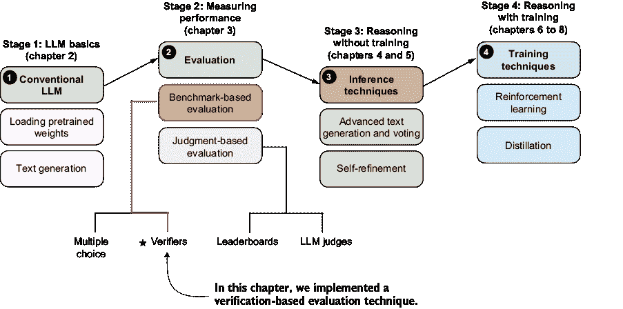

**图 3.11.** 本书所涵盖主题的模型图。本章实现了一个基于验证的评估流水线。在下一章中，我们将通过更先进的推理技术来提升 LLM 的推理能力。

在继续之前，值得注意，评估还有其他多种形式。在本章中，我们专注于数学问题的基于验证的准确率，因为它是一种流行的方法，而且我们将在第 6 章和第 7 章的强化学习流水线中复用这个验证器。为了让你有更全面的了解，附录 F 介绍了其他常见的评估策略，例如选择题基准、验证器、排行榜和 LLM 作为裁判的设置。如果你希望快速了解这些方法在实践中的工作原理，它还包含动手示例。

现在我们已经有了一个评估框架，下一章将重点介绍通过更先进的推理（文本生成）技术来提升推理能力。

## 总结

- LLM 主要有四种评估方法：选择题、验证器、排行榜和 LLM 裁判。
- 基于验证的评估方法允许自由形式的答案，并使用外部工具来检查正确性。
- 本章重点介绍基于验证的评估，通过构建一个数学验证器来提取、归一化，并使用 SymPy 检查答案。
  - 验证流水线涉及几个核心步骤，从加载 LLM 到在数据集上运行评估。
  - 作为验证流水线的一部分，答案提取使用字符串解析来定位 boxed 内容（对于缺失 box 的情况有回退机制）。
  - 另一个步骤实现归一化，通过去除 LaTeX 并转换数学符号来标准化各种答案格式。
- 最后，流水线使用数学等价性检查（通过 SymPy）来符号化地比较表达式。
- MATH-500 数据集提供了 500 个精选的数学问题用于评估。
- 提示模板对模型性能有显著影响。
- 推理模型比基础模型能实现更高的准确率，但需要更长的运行时间。

# 4 通过推理时扩展改进推理

## 本章涵盖

- 提示 LLM 解释其推理过程以提高答案准确率
- 修改文本生成函数以产生多样化的响应
- 通过对多个响应进行采样来提高推理可靠性

推理性能和答案准确率无需重新训练或修改模型本身即可得到提升。如图 4.1 的概览所示，本章涵盖两种推理时扩展方法。这些方法在推理阶段（即模型生成文本时）运行。你将在本章后文看到，这两种方法都将前几章使用的基础模型准确率提升了一倍以上。

在讨论图 4.1 所示的推理方法之前，我们先来看看什么是推理时扩展。

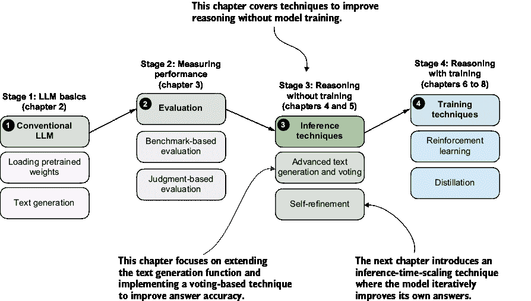

**图 4.1** 本书所涵盖主题的模型。本章聚焦于推理时扩展技术，这类技术无需额外训练即可改进推理（阶段 3）。具体而言，它扩展了文本生成函数，并实现了一种基于投票的方法来提高答案准确率。下一章将介绍另一种推理时扩展方法，即模型迭代式精炼自己的答案。

## 4.1 推理时扩展简介

改进推理主要有两种策略：

- 增加训练算力


# 增加推理算力

增加推理算力（也称为推理时扩展或测试时扩展）是提升模型推理能力的重要途径。

**注意：** 在机器学习和人工智能中，“算力”指训练或运行模型所需的计算资源。

这两种方法如图 4.2 所示，图中的曲线似乎表明，我们可以通过增加训练时算力*或*推理时算力来改进推理。实际上，LLM 通常被设计为通过结合大量训练时算力（后续章节的主题）*和*增加的推理时算力（本章的主题）来改进推理。

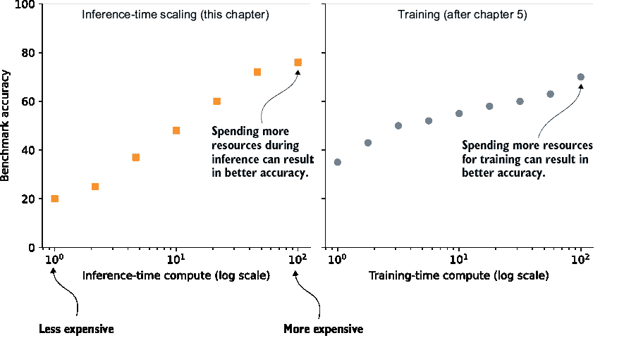

**图 4.2** 比较推理时扩展（本章讨论）与训练时扩展（第 6-8 章讨论）。这两种方法都通过使用更多算力来提高准确率，但推理时扩展是在运行过程中动态完成的，无需改变模型的权重参数。这些图的灵感来自 OpenAI 介绍其首个推理模型的文章（[`openai.com/index/learning-to-reason-with-llms/`](https://openai.com/index/learning-to-reason-with-llms/)）。

*推理时算力扩展*（也称为*推理时扩展*或*测试时算力扩展*）是指在模型完成训练后，在答案生成阶段增加计算量，以提高其响应质量。我们不改变模型的权重，而是让训练好的模型针对每个问题做更多工作，例如生成更多 token 并进行更长时间的“思考”、对多个答案进行采样，或逐步精炼其答案。

在本书中，我们将重点介绍三种实用且基础的推理时技术（如图 4.3 所示）：

* 方法 1：扩展*思维链*响应，提示模型解释其推理过程。这种简单的技术可以大幅提高准确率。
* 方法 2：通过*自一致性*进行并行采样，即让模型生成多个响应并选择最常出现的那个。
* 方法 3：迭代式*自我精炼*，即模型在多个步骤中审查并改进自己的推理和答案。

这些方法属于推理时扩展的范畴，因为它们促使模型生成更多 token，从而增加了推理阶段的计算需求。它们在提高准确率的同时也使得推理更加昂贵，这是推理时扩展技术的共同主题。本章我们将讨论前两种方法；第三种将在第 5 章中介绍。

第一种方法通过提示模型解释其推理过程来提高答案准确率，这是一种简单却非常有效的方法。

第二种方法针对同一输入采样多个响应，并选择最常出现的那个。我们将通过扩展上一章引入的文本生成函数并实现*自一致性*（一种基于投票的推理时扩展技术）来做到这一点。

总的来说，我在数千次实验中评估了十多种不同的推理时扩展技术。我之所以选择图 4.3 所示的这三种方法，是因为它们兼具三个理想特性：它们能提高此处所用模型的准确率，它们代表了推理时扩展的主要实用范式，而且它们足够简单，无需太多额外机制即可从零实现。它们还涵盖了两种主要模式：生成更长的响应和生成多个响应。

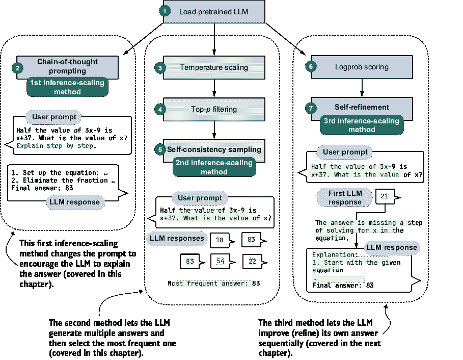

**图 4.3** 改进推理的三种推理时方法。第一种方法修改提示词以鼓励逐步推理，第二种方法对多个答案进行采样并选择最常出现的那个。这两种方法将在本章讨论。第三种方法（模型迭代式地精炼自己的响应）将在下一章介绍。

包含推理和解释的更长的响应（方法 1 和 3）正是我们对推理模型的典型预期。并行采样（方法 2）也广泛应用于生产系统，例如 Claude 4（详见 2025 年 5 月 Claude 4 的发布介绍：[`www.anthropic.com/news/claude-4`](https://www.anthropic.com/news/claude-4)）。

## 4.2 加载预训练模型

在开始实现推理时扩展方法之前，我们先加载预训练的基础模型和分词器。以下代码与上一章使用的代码类似。

**清单 4.1** 加载分词器和基础模型

```
import torch
from reasoning_from_scratch.ch02 import get_device
from reasoning_from_scratch.ch03 import (
     load_model_and_tokenizer
)

device = get_device()
device = torch.device("cpu")  #1

model, tokenizer = load_model_and_tokenizer(
    which_model="base",
    device=device,
    use_compile=False
)
```

`#1` 删除此行代码即可在 GPU 上运行（如果你的机器支持）。

由于本章代码运行成本很低，我建议首次在 `"cpu"` 设备上运行，以获得与本章所示相同的结果（在 GPU 上运行可能会导致结果略有不同）。

让我们在 MATH-500 数据集的一个提示上试试该模型，我们在上一章中使用过这个数据集：

```
from reasoning_from_scratch.ch03 import render_prompt

raw_prompt = (
    "Half the value of $3x-9$ is $x+37$. "
    "What is the value of $x$?"
)
prompt = render_prompt(raw_prompt)
print(prompt)
```

格式化后的提示如下：

```
You are a helpful math assistant.
Answer the question and write the final result on a new line as:
\boxed{ANSWER}

Question:
Half the value of $3x-9$ is $x+37$. What is the value of $x$?

Answer:
```

我们可以将上述提示作为上一章定义的 `generate_text_stream_concat` 函数的输入。

我们希望比较几种推理时扩展策略，因此我们将对文本生成包装器做一个小修改，以便在不改动周围的提示处理和输出代码的情况下，切换不同的生成函数和设置。这些修改在以下清单的代码注释中突出显示。

**清单 4.2** 修改后的 `generate_text_stream_concat` 函数

```
from reasoning_from_scratch.ch02 import generate_text_basic_stream_cache


def generate_text_stream_concat_flex(
    model, tokenizer, prompt, device, max_new_tokens,
    verbose=False, 
    generate_func=None,  #1
    **generate_kwargs     #1
):

    if generate_func is None:  #2
        generate_func = generate_text_basic_stream_cache

    input_ids = torch.tensor(
        tokenizer.encode(prompt), device=device
        ).unsqueeze(0)

    generated_ids = []
    for token in generate_func(
        model=model,
        token_ids=input_ids,
        max_new_tokens=max_new_tokens,
        eos_token_id=tokenizer.eos_token_id,
        **generate_kwargs,  #3
    ):
        next_token_id = token.squeeze(0)
        generated_ids.append(next_token_id.item())

        if verbose:
            print(
                tokenizer.decode(next_token_id.tolist()),
                end="",
                flush=True
            )
    return tokenizer.decode(generated_ids)
```

`#1` 我们添加参数来接收文本生成函数和额外参数。

`#2` 如果文本生成函数未定义，我们使用`generate_text_basic_stream_cache`，与第 3 章类似。

`#3` 如有需要，我们可以向文本生成函数传递额外的参数。

简而言之，前面的`generate_text_stream_concat_flex`函数与上一章的`generate_text_stream_concat`函数类似，区别在于现在我们可以将文本生成函数（如`generate_text_basic_stream_cache`）作为参数传入，而不是硬编码。实际的好处是，外层包装器可以统一负责提示编码、流式传输和解码，而内层的生成步骤可以用不同的解码策略替换。这样更容易公平地比较各种方法，因为只更改生成逻辑，而不改动整个流程。在后续章节中，我们将把`generate_text_basic_stream_cache`函数替换为更高级的函数。

`generate_text_basic_stream_cache`函数的使用方式也和之前类似，只是现在我们可以显式地传入该函数：

```
response = generate_text_stream_concat_flex(
    model, tokenizer, prompt, device,
    max_new_tokens=2048, verbose=True,
    generate_func=generate_text_basic_stream_cache
)
```

这是生成的输出：

```
\boxed{20}
```

请注意这个答案是错误的；正确的解是 83。在本章的其余部分以及下一章中，我们将实现推理时扩展方法，让模型生成正确答案。

## 4.3 使用思维链提示生成更好的回复

我们已经加载了预训练的基础模型，并设置了文本生成函数；现在我们将专注于通过所谓的*思维链*提示来改进模型输出。这种提示技巧经典、简单且有效。它修改输入提示，以鼓励 LLM 生成解释或思维链（也称为推理链），如图 4.4 所示。

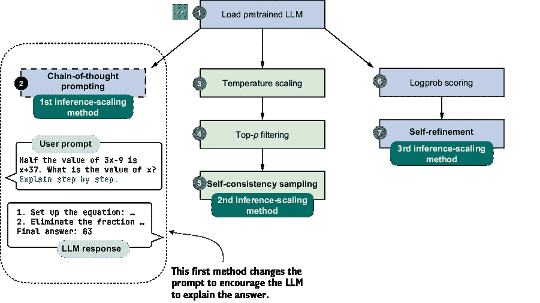

### 图 4.4 我们的第一个推理时方法，思维链提示，修改提示以鼓励模型在给出最终答案之前，逐步解释其推理过程。

尝试思维链提示最简单的方法是追加一条额外指令，要求模型一步步推理。措辞有多种方式。例如，关于该主题的原始论文使用了`"Let's think step by step."`（[`arxiv.org/abs/2205.11916`](https://arxiv.org/abs/2205.11916)），但不同的措辞可能因模型和任务而异。这里，我们使用`"Explain step by step."`，因为在本章的实验中我发现它效果不错，并且让示例保持简洁：

```
prompt_cot = prompt + " \n\nExplain step by step."

response_cot = generate_text_stream_concat_flex(
    model, tokenizer, prompt_cot, device,
    max_new_tokens=2048, verbose=True,
)
```

现在的响应如下：

```
 要解决这个问题，我们需要找到满足条件的 \( x \) 的值，
即 \( 3x - 9 \) 的值的一半等于 \( x + 37 \)。

# ...  #1

### 第 3 步：求解 \( x \)
两边同时减去 \( 2x \) 以隔离 \( x \)：
\[
3x - 2x - 9 = 74
\]
简化：
\[
x - 9 = 74
\]
两边同时加 9 以求解 \( x \)：
\[
x = 74 + 9
\]
\[
x = 83
\]

### 最终答案：
\[
\boxed{83}
\]
```

`#1` 为节省篇幅，响应已截断。

如你所见，模型现在写出冗长的逐步解释，并且在这种情况下得出了正确的答案。

这个简单的思维链提示很好地展示了推理时扩展的权衡。虽然模型现在能正确回答，但消耗的 token 比以前多得多。正如第 2 章讨论的，LLM 逐 token 生成文本，每个额外的 token 都需要一次额外的模型前向传播。因此，这些中间推理步骤不仅使答案更长，还会直接增加延迟、计算成本，并且通常还会增加 API 成本。

请注意，虽然在这种情况下模型生成了正确答案，但并非所有问题都能从思维链提示中受益。在一些简单问题上，它有时甚至会降低模型性能，因为模型可能会生成错误的解释而误导自己。这种现象被称为“过度思考”。

最后，并非每个模型都能从“Explain step by step”（或类似指令）中受益。在本例中，我们使用了一个简单的基础模型，它并不总是生成解释，因此思维链提示可以提供帮助。经过推理训练的模型，例如我们在上一章使用的 Qwen3 模型的“推理”变体，已经在回复中写出解释，因此不需要也不会从这种思维链提示中受益。

### 为什么思维链可以提高准确性

思维链提示要求模型写出通向最终答案的中间步骤。这在两个方面有实际帮助。

首先，逐步推理给模型更多自我纠正的机会。

其次，逐步推理与许多训练示例的编写方式相符。例如，大型数学和逻辑数据集通常包含详细解答，因此要求思维链能使模型与其已学过的模式保持一致。

与此同时，思维链推理并不能保证正确性。它仍然可能产生错误的推理，并且在非常简单的问题上，它甚至可能引入不必要的步骤，从而导致更多错误。换句话说，思维链可以在许多推理任务上提高准确率，但它并不普遍有益。

总体而言，思维链提示并没有为模型提供新的知识，而是改变了模型使用现有知识的方式。通常，这种转变能够带来更可靠的答案。对于数学、代码、逻辑以及其他多步骤问题尤其如此。

### 练习 4.1：在 MATH-500 上使用思维链提示

修改列表 3.15 中的 `evaluate_math500_stream` 函数，查看思维链提示是否提高了基础模型在 MATH-500 上的准确率。

## 4.4 通过温度缩放控制输出多样性

上一节通过思维链提示扩展模型的答案，简单体验了推理时扩展。思维链提示可以被视为一种顺序技术，因为它增加了下一个 token 预测步骤的数量。

在本章的其余部分中，我们将实现一种自一致性技术（也称为*自一致性采样*），它生成多个答案，如图 4.5 所示。该技术在 Google Research 论文“Self-Consistency Improves Chain of Thought Reasoning in Language Models”（[`arxiv.org/abs/2203.11171`](https://arxiv.org/abs/2203.11171)）中正式提出。

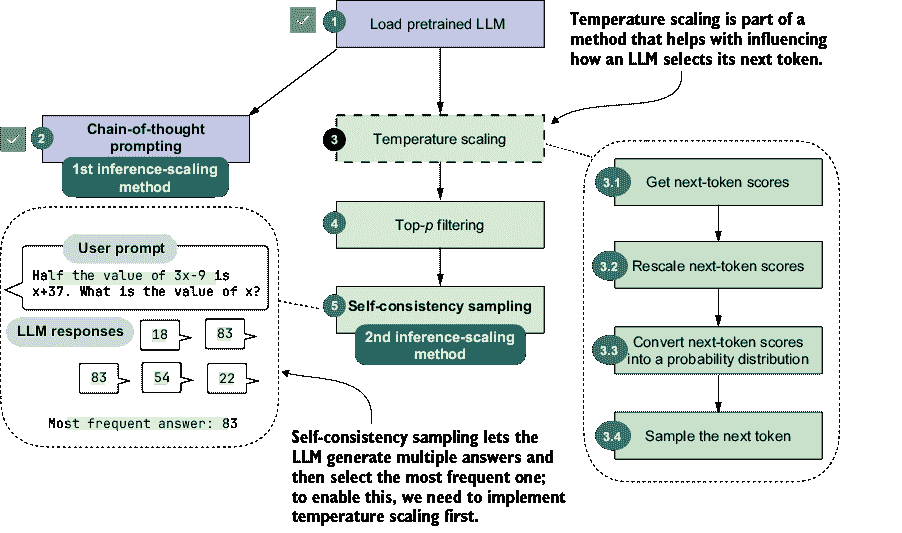

**图 4.5** 自洽性采样（self-consistency sampling）是我们第二种推理时方法，它会生成多个答案并选择最频繁的一个。该方法依赖于温度缩放（temperature scaling），而温度缩放会影响模型对下一个词元（token）的采样方式。

由于使用这种技术生成的多个答案相互独立，因此可以通过并行采样实现（如果你拥有必要的资源，例如多个 GPU），这样不会增加用户获取答案的时间。（思维链提示可以与这种技术结合使用，但稍后会详细讨论。）

在实现自洽性采样（图 4.5 中的步骤 5）之前，我们首先需要扩展文本生成函数，使其能够为同一提示生成不同的答案。为此，我们将实现两种允许模型采样不同响应的技术：*温度缩放*（步骤 3）和`top-p`过滤（步骤 4）。

温度缩放是本节的焦点；它将是本章后续部分控制输出多样性的关键控制手段之一，并且为接下来的`top-p`过滤方法奠定了基础。不过，我们首先来看一下在 LLM 中下一个词元是如何被采样的。这些底层的采样控制可能看起来过于技术化，但正是它们让我们能够为自洽性采样生成多样化的候选答案。

### 4.4.1 理解选择下一个词元的过程

让我们更仔细地审视目前已经实现的文本生成过程，看看下一个词元的选择过程在底层是如何运作的。这将帮助你理解温度缩放背后的动机。

假设我们有如下简单的提示：

```
ex_prompt = "The capital of Germany is"

response = generate_text_stream_concat_flex(
    model, tokenizer, ex_prompt, device,
    max_new_tokens=1, verbose=True
)
```

模型的响应是`" Berlin"`。这看起来相对简单，但正如图 4.6 所示，底层其实发生了多个步骤。

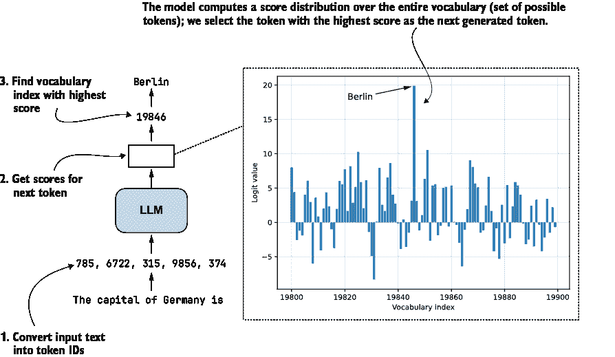

**图 4.6** LLM 如何生成下一个词元。与本书中的所有流程图一样，流程从下到上运行。模型将输入转换为词元 ID，为所有可能的下一词元计算分数，并选择分数最高的作为下一个输出。

在生成文本时，输入首先被转换为词元 ID（如第 2 章所讨论的）：

```
input_token_ids = torch.tensor(
    tokenizer.encode(ex_prompt), device=device
).unsqueeze(0)
print(input_token_ids)
```

在本例中，这些词元 ID 为：

```
tensor([[ 785, 6722,  315, 9856,  374]])
```

在图 4.6 的第二步中，我们获取想要生成的输出词元的分数。这些输出分数也称为*logits*。LLM 会为每个输入词元生成一个输出词元，但我们只关心最后一个词元，我们通过`[:, -1]`张量索引来选择它。这个最后的词元对应于我们想要生成的词元。


# 4.4 生成下一个词元

## 4.4.1 从 logits 到词元

在上一节中，我们计算了下一个词元的 logits。现在，让我们看看如何将这些 logits 转换为实际的词元。首先，我们使用 `torch.inference_mode()` 来禁用梯度计算，以提高推理速度：

```python
with torch.inference_mode():
    next_token_logits = model(input_token_ids)[:, -1]
print(next_token_logits.shape)
```

打印输出的形状为`[1, 151936]`，其中`151936`是该分词器和模型的词汇表大小。词汇表包含了分词器能够处理且 LLM 能够生成的所有唯一词元。

为了获得下一个生成的词元（本例中的`" Berlin"`），我们必须找到与最大分数相关联的词汇表条目（图 4.6 中的步骤 3）：

```python
max_token_id = torch.argmax(next_token_logits)
print(f"Token ID: {max_token_id}")
print(f"Decoded token: '{tokenizer.decode([max_token_id])}'")
```

输出如下：

```python
Token ID: 19846
Decoded token: ' Berlin'
```

我们现在已经介绍了生成下一个词元的三个主要步骤。在进入下一节之前，让我们更仔细地看一下传递给`torch.argmax`函数以获取词元 ID 的`next_token_logits`张量的分数分布。我们将用 Matplotlib 绘制它。

**清单 4.3** 绘制下一个词元的 logit 分数

```python
import matplotlib.pyplot as plt

def plot_scores_bar(
    next_token_logits, start=19_800, end=19_900,
    arrow=True, ylabel="Logit value"
):
    x = torch.arange(start, end)  #1
    logits_section = next_token_logits[0, start:end].float().cpu() #2

    plt.bar(x, logits_section)  #3
    plt.xlabel("Vocabulary index")
    plt.ylabel(ylabel)

    if arrow:  #4
        max_idx = torch.argmax(logits_section)
        plt.annotate(
            "Berlin",
            xy=(x[max_idx], logits_section[max_idx]),
            xytext=(x[max_idx] - 25, logits_section[max_idx] - 2),
            arrowprops={
                "facecolor": "black", "arrowstyle": "->", "lw": 1.5
            },
            fontsize=10,
        )

    plt.grid(alpha=0.3)
    plt.tight_layout()
    plt.show()

plot_scores_bar(next_token_logits)
```

1. `#1` 选择词汇表的子区间。
2. `#2` `.cpu()` 是 `to(torch.device("cpu"))` 的快捷方式。
3. `#3` 在选定范围内绘制 logits（分数）。
4. `#4` 绘制箭头以突出显示最大分数。

我们将绘图限制在词汇表索引 19,800 到 19,900 之间的 100 个词元，而不是绘制全部 151,936 个条目的分数，那样会使图表过于拥挤。我选择这个范围是因为它包含了最高分数的条目。得到的图如图 4.7 所示。

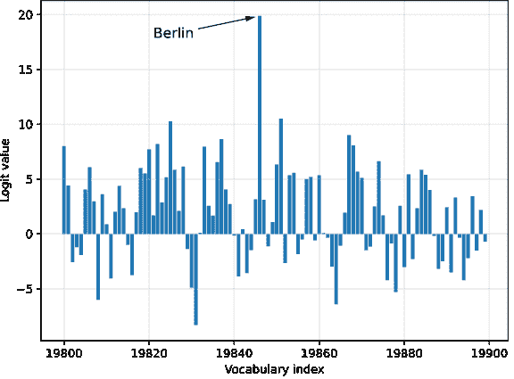

**图 4.7** 语言模型更大词汇表中 100 个词元切片的下一个词元 logits。每个条形代表该切片内一个可能词元的分数，其中"Berlin"的 logit 值最高，并被选为下一个词元。

图 4.7 中的图显示了词汇表索引 19,800–19,899 这 100 个 logit 值（分数）。这些值大约从–8 到 20，其中值 20 对应于词元`" Berlin"`的词汇表索引。

## 4.4.2 通过温度参数重新缩放词元分数（logits）

既然你已经知道模型如何选择下一个词元，我们就可以引入温度的概念。温度，或者更准确地说，温度参数，会重新缩放 logits，从而使相应的概率分布变得更尖锐或更平坦，进而影响下一个词元的选择方式。

如图 4.8 所示，本节重点在于使用温度参数对下一个词元的 logits 进行重新缩放，然后再将其用于采样。这里的重新缩放是指调整分数的大小，使采样步骤对分数差异的敏感度或高或低。

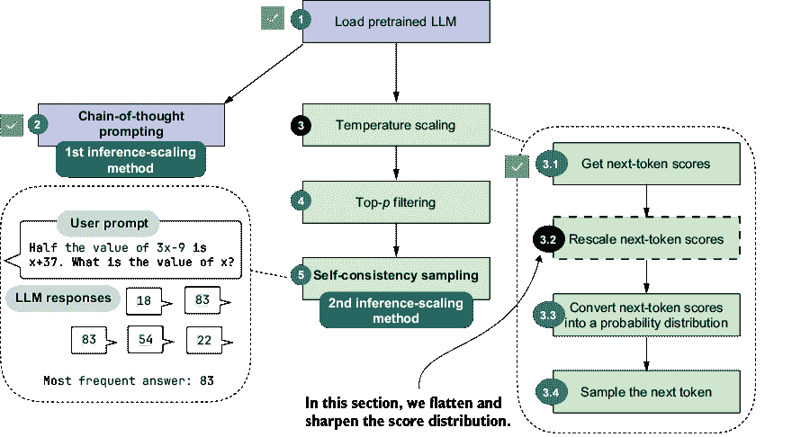

在本节中，我们将实现温度缩放的核心部分（步骤 3.2），它调整下一个词元的分数。这让我们可以控制模型在后续步骤中选择下一个词元的置信度。

实现温度重新缩放步骤（图 4.8 中的步骤 3.2）的代码相对简短。本质上，下面的代码在将 logit 值转换为概率（将在下一节讨论）之前对其进行了重新缩放。

**清单 4.4** 通过温度缩放重新缩放下一个词元的分数

```python
def scale_logits_by_temperature(logits, temperature):
    if temperature <= 0:
        raise ValueError("Temperature must be positive")
    return logits / temperature
```

在实践中，温度值应为正数，因此如果温度小于或等于零，我们会引发错误。稍后当我们把温度缩放添加到文本生成函数中时，我们还会加入更多温度缩放的安全措施。

对于所有其他值，logits 会除以温度。温度为 1.0 意味着没有变化，因为一个数除以 1 后保持不变。低于 1.0 的温度会使分布更尖锐，从而让模型在选择下一个 token 时更自信。高于 1.0 的温度会使 logit 分布更平坦，这可能使采样（图 4.8 中的步骤 3.4）更多样化。换句话说，较高的温度会缩小最高 token 与排名较低 token 之间的概率差距，从而增加采样选择非最大 token 的机会。

我们来看看 `scale_logits_by_temperature` 函数的实际效果。为了效果更明显，我们用相对极端的温度值 0.5 和 5.0 来尝试。

### 代码清单 4.5 绘制按温度重新缩放后的 logits

```python
def plot_logits_with_temperature(
    next_token_logits, start=19_800, end=19_900,
    temps=(0.5, 5.0),
):
    x = torch.arange(start, end)
    logits_orig = next_token_logits[0, start:end].float().cpu()

    logits_scaled = [   #1
        scale_logits_by_temperature(logits_orig, T) for T in temps  #2
    ]   #2

    plt.plot(x, logits_orig, label="Original logits", lw=2)  #2
    plt.plot(                                                
        x, logits_scaled[0],                                 
        label=f"T={temps[0]} (sharper)", ls="--", lw=1       #3
    )                                                        
    plt.plot(                                                
        x, logits_scaled[1],                                 
        label=f"T={temps[1]} (flatter)", ls=":", lw=3        
    )                                                        

    # Highlight max logit
    max_idx = torch.argmax(logits_orig)                     #4
    plt.annotate(                                            #4
        "Berlin",
        xy=(x[max_idx], logits_orig[max_idx]),
        xytext=(x[max_idx] - 25, logits_orig[max_idx] + 2),
        arrowprops={"facecolor": "black", "arrowstyle": "->", "lw": 1.5},
        fontsize=12,
    )

    plt.xlabel("Vocabulary index")
    plt.ylabel("Logit value")
    plt.legend()
    plt.grid(alpha=0.3)
    plt.tight_layout()
    plt.show()

plot_logits_with_temperature(
    next_token_logits,
    temps=(0.5, 5.0)                                        #5
)
```

- `#1` 应用温度缩放。
- `#2` 绘制所选范围内的 logits（分数）。
- `#3` 绘制所选范围内的 logits（分数）。
- `#4` 绘制箭头以突出显示最大分数。
- `#5` 使用温度 0.5 和 5 运行重新缩放和绘图。

如图 4.9 所示，较大的温度（5.0）会产生更平坦的分数分布，而较小的温度（0.5）会产生更尖锐的分布。

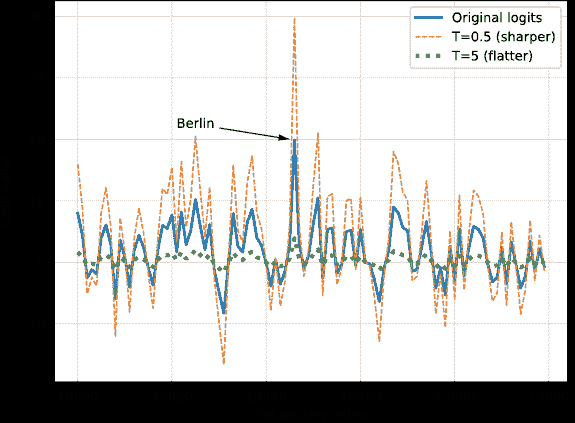

#### 图 4.9 温度缩放对 logits 的影响。较低的温度使分布更尖锐，而较高的温度使其更平坦。（请注意，此可视化为了可读性而以折线图显示；条形图能更准确地表示各个词汇分数。）

代码清单 4.5 中的绘图代码与代码清单 4.3 中的绘图代码非常相似。除了应用温度缩放之外，我们现在使用折线图（`plt.plot`）而不是条形图（`plt.bar`）。尽管从技术上讲，对于 `x` 轴上的离散词汇索引，条形图是更好的选择，但在这种情况下，折线图更容易可视化和比较重新缩放后的 logits。

重要的不是 logit 本身的绝对高度，而是 logits 之间的差异如何变化。如果像 `" Berlin"` 这样的 token 比其他候选 token 更突出，那么它之后被选中的可能性就更大。如果差异缩小，排名较低的 token 被选中的可能性就会增加。下一节将通过把 logits 转换为概率来说明这一点。

#### 为什么是温度？

术语 *温度* 来自物理学，物理学中温度控制系统中随机性或运动的多少。在 LLM 中，我们使用同样的思路来控制模型选择下一个 token 时的自信程度或创造性，你将在接下来的章节中看到这一点。

## 4.4.3 从概率分布中采样下一个 token

在上一节中，我们使用不同的温度值重新缩放了 logit 值。这让我们能够影响模型选择下一个 token 的方式。在进入下一节的下一 token 采样部分之前，我们将再添加一个中间步骤：将重新缩放后的 logits 转换为概率分数，如图 4.10 所示。

为了演示重新缩放后的 logits 如何转换为概率分数（图 4.10 中的步骤 3.3），我们将使用 5.0 的温度，这样更容易在图中可视化所得的概率。例如，`" Berlin"` token 的 logit 值非常高，否则它会主导刻度范围，使周围 token 的概率难以看到。

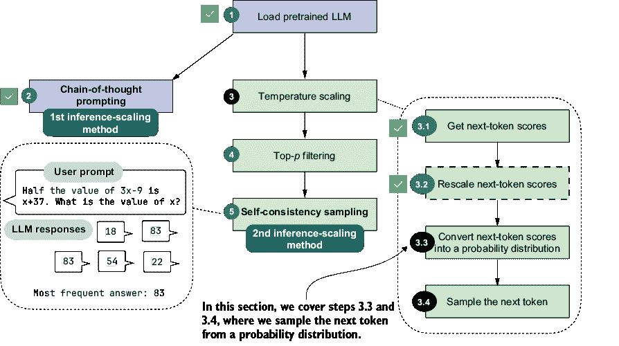

#### 图 4.10 生成 token 的采样过程概述。在这里，我们聚焦于步骤 3.3 和 3.4，其中下一个 token 的分数被转换为概率分布。随后将根据该分布对下一个 token 进行采样。

从重新缩放后的 logits 到概率分数的转换可以通过一次函数调用 `torch.softmax` 完成，如下面的代码清单所示。

#### 代码清单 4.6 从概率分布中采样下一个 token

```python
rescaled_logits = scale_logits_by_temperature(next_token_logits, 5.0)  #1

next_token_probas = torch.softmax(  #2
    rescaled_logits, dim=-1
)
```

- `#1` 步骤 3.2：重新缩放下一个 token 的分数。
- `#2` 步骤 3.3：将重新缩放后的 logits 转换为概率分数。

`torch.softmax` 函数将 logit 值归一化到 0 到 1 的范围内，使它们之和为 1。我们可以用以下代码确认这一点：

```python
print("Probability sum:", torch.sum(next_token_probas))
```

此外，让我们复用代码清单 4.3 中的 `plot_scores_bar` 函数来可视化转换后的分数：

```python
plot_scores_bar(
    next_token_probas, arrow=False, ylabel="Probability value"
)
```

结果图如图 4.11 所示，现在 `y` 轴上是概率值。我们可以看到，token ID 19,846（`" Berlin"`）在此选定的词汇范围内具有最高值。该概率为 0.0003，我们可以用以下代码确认：

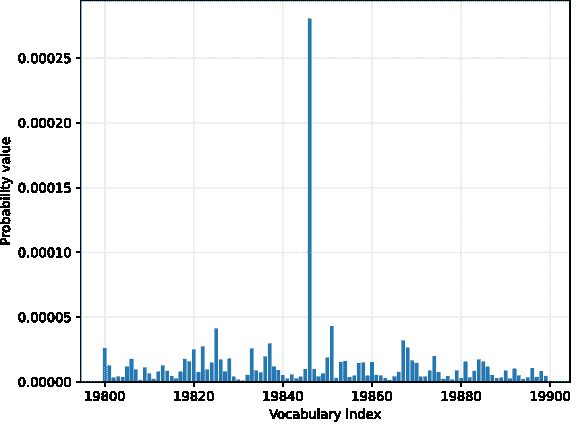

#### 图 4.11 通过对重新缩放后的 logits 应用 softmax 函数获得的 token 概率。具有最高概率的 token（对应于 `" Berlin"`，但为简化代码而省略了标签）被选为下一个输出。

```python
print("Token ID 19,846 probability:", next_token_probas[:, 19846])
```

请注意，虽然 0.0003 这个值相对较小，但在此图中选定的词汇范围之外没有更大的值。例如，使用以下代码，我们可以确认 0.0003 确实是最大值：

```python
print("Highest probability:", max(next_token_probas.squeeze(0)))
```

我们可以将这个分数理解为模型的置信度。这意味着模型在选择 `" Berlin"`（19,846）作为下一个 token 时，比其他任何 token 都更有信心。

这个值之所以如此小，是因为我们使用了较高的温度，这样更容易将这个值与其他 token 的值放在一起绘制。如果我们将温度从 5 改为 0.5，概率分数将从 0.0003 增加到 0.3398，而其他 token 的概率分数会更接近 0。

#### `softmax` 函数背后的原理

`softmax` 函数将原始分数（logits）的向量转换为概率分布，其中每个值都在 0 到 1 之间，且所有值之和为 1。这种转换使这些值更容易解释，也便于后续从中采样。

如果你熟悉数学符号，那么 softmax 函数背后的公式如下：

`softmax(zᵢ) = exp(zᵢ) / Σⱼ exp(zⱼ)`

这里，`z` 是一个实值输入向量

`z = [z₁, z₂, …, zₙ]`，

其中

- `n` 是向量中元素的数量。
- `i` 是当前元素的索引（1 ≤ `i` ≤ `n`）。
- `j` 是用于对所有元素求和的索引（1 ≤ `j` ≤ `n`）。

这会为每个元素 `zᵢ` 生成一个归一化概率，使得

`Σᵢ softmax(zᵢ) = 1`

在代码中，softmax 函数可以用三行实现：

```python
def softmax_with_temperature(logits, temperature):
    scaled_logits = logits / temperature
    return torch.softmax(scaled_logits, dim=0)
```

在实践中，我更倾向于使用 `torch.softmax` 函数，因为它有一些额外的数值稳定性改进，可以更可靠地处理非常小和非常大的数值。

将 logits 转换为这些概率分数的目的是，它们在一定程度上更具可解释性，并且我们现在可以使用 `torch.multinomial` 函数从中采样。例如，如果我们从这个概率分布中抽取一个样本，在温度设置为 5.0 时，我们有 0.03% 的概率得到 `" Berlin"`（而在温度为 0.5 时，有 33.98% 的概率得到 `" Berlin"`）。

采样过程（对应于图 4.10 中的步骤 3.4）可以按如下方式实现：

```python
torch.manual_seed(123)
print(
    "Sampled token:",
    torch.multinomial(next_token_probas.cpu(), num_samples=1)
)
```


这段代码返回词元 ID `65,094`，对应于单词 `" mistress"`。请注意，在我们的上下文 `"The capital of Germany is"` 中，这个词没有意义。在这种情况下，它是被随机选中的，因为高温设置倾向于采样除 `" Berlin"` 之外的词元。

`torch.multinomial` 函数会根据词汇索引的概率按比例进行采样。换句话说，概率较高的词汇索引更有可能被采样到。如果我们重复采样非常多次，在温度为 `5` 的情况下，我们采样到与词元 `" Berlin"` 对应的词汇索引的概率为 `0.03%`。

在查看更多示例之前，请注意我们指定了一个随机种子，以使本章中的代码可复现。`torch.multinomial()` 函数在 CUDA 和 MPS 设备上可能仍会产生不同的结果，甚至在抽取大量样本时可能崩溃（我在 PyTorch 2.9 的 CUDA 和 MPS 设备上都观察到了这个问题），这就是我们通过 `.cpu()` 在 CPU 上运行采样的原因。

现在让我们采样更多下一个词元候选，以获得更具代表性的样本。

### 清单 4.7：采样多个下一个词元候选

```python
def count_samples(probas, num_samples=1000, threshold=1, tokenizer=None):
    samples = torch.multinomial(  #1
        probas.cpu(), num_samples=num_samples, replacement=True
    )
    counts = torch.bincount(samples.squeeze(0), minlength=1)  #2

    for i, c in enumerate(counts):
        if c > threshold:   #3
            if tokenizer is None:
                print(f"Vocab index {i}: {c.item()}x")
            else:
                print(f"'{tokenizer.decode([i])}': {c.item()}x")
```

- `#1` 根据概率抽取样本。
- `#2` 统计每个索引被选中的次数。
- `#3` 打印频繁采样的词汇索引（条目）。

清单 4.7 中的这个 `count_samples` 函数从概率分布中采样词元索引，并统计每个词元被抽取的次数。它使用 `torch.multinomial` 根据每个索引的概率按比例随机选择 `num_samples` 个索引。`replacement=True` 设置允许我们多次抽取同一个词元。

然后，`torch.bincount` 统计每个索引出现的次数。它只打印出现次数超过指定阈值的词元，这样就不会用较少被抽取的词元使输出变得杂乱。

### 多项式采样

多项式采样是在给定词汇表上的概率分布（例如 softmax 概率分数）时，用于选择下一个词元的过程。在多项式采样中，我们不是始终选择最可能的词元（称为*贪心解码*），而是随机抽取一个词元，概率较高的词元更有可能被选中。这种随机性对于生成多样化的响应非常重要，我们稍后将把它用于自洽性采样。

为了进一步说明这一点，我们可以将概率分数视为一组加权选择。例如，概率为 `0.40` 的词元出现的可能性是概率为 `0.10` 的词元的四倍，但两者仍然是可能的结果。

假设模型分配了以下概率：

- `"Berlin"`：`0.70`
- `"Munich"`：`0.20`
- `"Hamburg"`：`0.10`

贪心解码总是返回 `"Berlin"`。而多项式采样则根据这些权重抽取一个词元。在非常大量的抽取中，`"Berlin"` 出现得最多（`70%` 的时间），`"Munich"` 有时出现（`20%` 的时间），而 `"Hamburg"` 只是偶尔出现（`10%` 的时间）。

这种多样性使我们能够在后续章节中为自洽性生成多个候选答案。

**注意：** 这个 `count_samples` 函数仅用于说明。在实际的文本生成中，我们每次只抽取一个词元。此函数从分布中抽取大量样本，以展示每个词元被选中的频率，从而更容易可视化和理解底层概率。

首先，让我们对通过应用温度 `5` 获得的概率分数运行 `count_samples` 函数：

```python
torch.manual_seed(123)
count_samples(next_token_probas, tokenizer=tokenizer)
```

输出如下：

```text
'}': 2x
' </': 2x
' represent': 2x
' Inf': 2x
'()*': 2x
' beside': 2x
' Kob': 2x
'⧄': 2x
```

如你所见，即使默认样本大小为 `1,000`，采样到的词元中也没有出现超过两次的。此外，在 `"The capital of Germany is"` 查询的上下文中，这些都是无意义的词元。产生这些无意义结果的原因是我们使用的温度值过高。

让我们尝试较低的温度值 `0.35`，它会锐化分数分布，使选择有意义的下一个词元的可能性更大：

```python
torch.manual_seed(123)
probas_lowT = torch.softmax(
    scale_logits_by_temperature(next_token_logits, 0.35), dim=-1
)
```

在这种情况下，我们看到以下输出：

```text
' __': 158x
' Berlin': 435x
' ____': 169x
' ______': 209x
' Munich': 3x
' Hamburg': 3x
' _____': 18x
```

对于我们的 `"The capital of Germany is"` 查询而言，这组下一个词元候选更加合理。在 `1,000` 个样本中，`" Berlin"` 词元被抽取了 `435` 次。你可以通过 `print(probas_lowT[0, 19_846])` 检查，在温度值 `0.35` 时，抽取该词元的概率约为 `42%`。为了更可能采样到 `" Berlin"`，我们可以进一步降低温度。

请注意，其他一些较罕见的候选也有意义。例如，`" Munich"` 和 `" Hamburg"` 都是德国的大城市，因此它们与查询并非完全无关。下划线响应（`" ____"`）很可能是因为模型见过带有占位符的测验形式文本；例如，`"The capital of Germany is ____"`。

你可能想知道，如果 `" Berlin"` 是正确答案，那么通过添加这种温度重新缩放和多项式采样，让模型偶尔给出错误答案有什么意义？对于不同类型的查询，在采样过程中引入随机性有助于模型探索替代响应，而不是总是选择单个最可能的词元。这种多样性对于创造性或开放式任务可能很有用，因为在这些任务中可能存在多种有效的补全。

具体来说，在推理任务中，我们可以通过自洽性（self-consistency，详见第 4.6 节）等技术来利用这种采样多样性，这些技术会生成多个候选答案并进行比较，以提高答案的准确性。

### 4.4.4 向文本生成函数添加温度缩放

在我们通过添加词元概率选择过滤器来对文本生成过程引入另一项改进之前，先向文本生成函数添加温度缩放修改，以便我们能够更轻松地用模型生成新的词元。

**清单 4.8 带温度缩放的文本生成**

```
from reasoning_from_scratch.qwen3 import KVCache

@torch.inference_mode()
def generate_text_temp_stream_cache(
    model,
    token_ids,
    max_new_tokens,
    eos_token_id=None,
    temperature=0.
):
    model.eval()
    cache = KVCache(n_layers=model.cfg["n_layers"])
    model.reset_kv_cache()

    out = model(token_ids, cache=cache)[:, -1]  #1
    for _ in range(max_new_tokens):

        ########################################
        # NEW:
        orig_device = token_ids.device

        if temperature is None or temperature == 0.0:
            next_token = torch.argmax(out, dim=-1, keepdim=True)

        else: 
            logits = scale_logits_by_temperature(out, temperature)  #2
            probas = torch.softmax(logits, dim=-1)  #3
            next_token = torch.multinomial(probas.cpu(), num_samples=1)  #4
            next_token = next_token.to(orig_device)

        #########################################
        if (eos_token_id is not None
                and torch.all(next_token == eos_token_id)):
            break

        yield next_token
        out = model(next_token, cache=cache)[:, -1]
```

- `#1` 步骤 3.1：获取 logits
- `#2` 步骤 3.2：对 logits 应用温度缩放
- `#3` 步骤 3.3：转换为概率
- `#4` 步骤 3.4：根据概率采样词元

清单 4.8 中的 `generate_text_temp_stream_cache` 与第 2 章的 `generate_text_stream_cache` 类似。新增之处在于它现在包含了温度重新缩放和采样（位于代码中 `# New` 注释标记下方）。

下面的代码展示了温度缩放和采样如何集成到词元生成循环本身中。这个函数可以传入清单 4.2 中引入的更灵活的 `generate_text_stream_concat_flex` 包装器，该包装器保持外层提示处理代码不变，同时允许我们替换不同的解码策略：

```
torch.manual_seed(123)
response = generate_text_stream_concat_flex(
    model, tokenizer, prompt, device,
    max_new_tokens=2048, verbose=True,
    generate_func=generate_text_temp_stream_cache,  #1
    temperature=1.1
)
```

- `#1` 使用新的基于温度缩放的文本生成函数。

输出是 `\boxed{$x = \frac{90}{7}$}`。正确答案是 `83`，因此模型仍然出错，但这只是为了演示我们可以通过温度缩放和采样来调整答案。

#### 选择温度设置

在实践中，温度的选择取决于目标。温度为 `0.0` 对应于贪心解码，即我们总是选择概率最高的词元。当我们希望输出多一些多样性又不至于太过不稳定时，`0.3–0.8` 这样的小非零值通常很有用。更高的温度会让模型进行更广泛的探索，这对创意生成或广泛搜索可能很有用，但在我们想要唯一最可能答案的任务上，往往会损害可靠性。

在下一节中，我们将改进采样过程。

## 4.5 使用 top-p 采样平衡多样性和连贯性

你已经看到温度缩放和采样（通过 `torch.multinomial`）如何增加 LLM 响应的多样性——无论好坏。具体来说，你看到这种方法最终可能会采样到与用户查询无关的词元。

现在，我们将通过添加 top-*p* 过滤器（图 4.12）来改进采样过程，这样就不会意外采样到置信度非常低的词元。本节描述的 top-*p* 采样过程也称为*核采样*。

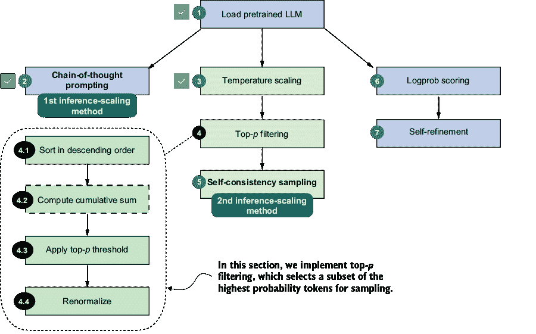

**图 4.12** top-*p* 过滤过程概览。该过滤器通过排序、应用累积截断、选择 top-*p* 子集并重新归一化结果，只保留概率最高的词元。

图 4.12 总结了构成 top-*p* 过滤器的四个步骤：对词元概率进行排序，计算它们的累积和，选择满足 top-*p* 截断条件的子集，并重新归一化剩余概率，使它们再次形成有效的分布。重新归一化步骤是必要的，因为一旦我们移除了所有低概率词元，剩余概率之和就不再为 `1`。为了正确采样，我们需要重新缩放剩余的值，使它们构成正确的概率分布。

现在我们将详细讲解图 4.12 中的步骤 4.1 到 4.4。

### 4.5.1 选择 top-p 词元子集

在实现 top-*p* 过滤器之前，我们先引入一个简单的玩具数据集，以便更容易说明温度缩放和采样过程。首先，我们假设模型和分词器的词汇表只有 `10` 个词条，而不是 `151,936` 个。

**清单 4.9 使用玩具数据进行温度缩放和采样**

```
toy_logits = torch.tensor(  #1
    [-0.7, -3.0, 0.1, -1.2, 2.0, -1.0, -0.5, -2.0, 0.3, 1.5]
)

toy_logits_scaled = scale_logits_by_temperature(toy_logits, 1.0)  #2
toy_probas = torch.softmax(toy_logits_scaled, dim=-1)   #3

plt.bar(  #4
    torch.arange(len(toy_probas)), toy_probas,
    alpha=0.5
)

plt.ylim([0, 1])
plt.xlabel("Vocabulary index")
plt.ylabel("Probability")
plt.show()
```

- `#1` 步骤 3.1：获取 logits（此处：使用 10 个词元的玩具 logits）
- `#2` 步骤 3.2：应用温度缩放（我们将使用 `1.0` 作为占位值）
- `#3` 步骤 3.3：转换为概率
- `#4` 在条形图中绘制概率

请注意，`toy_logits` 变量保存的是清单 4.8 中 `model(token_ids, cache=cache)[:, -1]` 调用的下一个词元 logit 分数的示例值，这里假设词汇表大小为 `10`。

图 4.13 中的条形图显示了重新缩放为概率后的下一个词元 logit 分数。


**图 4.13** top-p 过滤前的词元概率示例。该分布包含许多低概率词元，稍后将通过应用累积概率阈值将其截断。

到目前为止，这基本上是对前一节的回顾。现在我们将添加图 4.12 中所示的前两个 top-*p* 过滤步骤（步骤 4.1 和 4.2）。这涉及按降序对概率分数进行排序并计算累积和。

**清单 4.10 计算累积概率和**

```
sorted_probas, sorted_idx = torch.sort(toy_probas, descending=True)  #1
cumsum = torch.cumsum(sorted_probas, dim=-1)  #2

plt.bar(
    torch.arange(len(sorted_probas)), sorted_probas, 
        alpha=0.5
)
plt.step(
    torch.arange(len(cumsum)), cumsum, 
    where="mid", color="C1", label="Cumulative sum"
)

plt.ylim([0, 1])
plt.xlabel("Token rank (sorted by probability)")
plt.ylabel("Probability")
plt.show()
```

- `#1` 步骤 4.1：按概率降序排序
- `#2` 步骤 4.2：计算累积和

清单 4.10 中使用的 `torch.cumsum` 函数计算沿给定维度的元素累积和。在此示例中，它取排序后的词元概率并逐步累加，因此结果中的每个位置表示累计到该词元为止的总概率。

例如，第一个元素等于最高概率，第二个元素等于前两个概率之和，依此类推，直到最后一个值达到 `1`。查看代码清单 4.10 生成的累积阶梯图（如图 4.14 所示）最能说明这一点。


**图 4.14 排序后的词元概率及其累积和的可视化。** 这一步通过展示概率从高到低排列时的累积方式，为 top-p 过滤做准备，帮助确定截断阈值的设置位置。

现在我们已经得到了累积概率和，就可以实现 top-p 过滤的核心步骤。top-p 中的 `p` 代表概率（probability），top-p 可以译为“保留累积概率小于或等于 `p` 的最小词元集合”。下面的代码清单展示了 top-p 过滤的一种简单实现。

**代码清单 4.11 一个简单的 top-p 过滤规则**

```
top_p = 0.8
keep_mask = cumsum <= top_p
n_kept = torch.sum(keep_mask).item()
print("Cumulative sum:", cumsum)
print("Tokens kept:", n_kept)
```

在代码中，这通过 `keep_mask = cumsum <= top_p` 实现，它会标记所有累积概率质量尚未超过阈值 `p`（此处定义为 `top_p = 0.8`）的词元。然后计算保留的词元数量，并赋值给变量 `n_kept`。输出如下：


# 4.5.1 Top-p 过滤

观察返回的累积概率，第二个条目（`0.7290`）刚好低于 top-p 阈值 `0.8`，而第三个条目（`0.8119`）超过了该阈值，因此只保留前两个词元。

top-p 过滤的一种更常见变体会将超过阈值的那个词元也包含进来，如下一个代码清单所示。

**代码清单 4.12 一种常见的 top-p 过滤变体**

```
keep_mask = (cumsum - sorted_probas) < top_p
n_kept = keep_mask.sum().item()
print("Tokens kept:", n_kept)
```

这段代码返回的保留词元数量为 3。这符合 top-p 过滤的定义：保留最小的词元集合，使其累积概率质量至少为 `p`。

让我们用一张图来展示这种 top-p 过滤。

**代码清单 4.13 可视化 top-p 过滤**

```
plt.bar(
    torch.arange(len(sorted_probas)), sorted_probas, 
    alpha=0.5, label="Sorted probabilities"
)
plt.step(
    torch.arange(len(cumsum)), cumsum, where="mid",
    color="darkorange", label="Cumulative sum"
)

plt.axhline(#1
    top_p, color="red", linestyle="--",
    label=f"top_p = {top_p}"
)
plt.axvline(
    n_kept - 0.5, color="gray", linestyle=":",
    label=f"Top-p cutoff at {n_kept} tokens"
)

plt.xlabel("Token rank (sorted by probability)")
plt.ylabel("Probability")
plt.legend()
plt.grid(alpha=0.3)
plt.ylim(0, 1.05)
plt.show()
```

**#1** 突出显示截断位置。

执行代码清单 4.13 中的代码得到的图形如图 4.15 所示。该图显示了 `top_p = 0.8` 阈值（水平虚线），它决定了哪些词元会被保留。在本例中，前两个词元的累积和低于阈值，因此我们排除截断点（垂直点线）右侧的所有其他词元。


**图 4.15 top-p（核）过滤。** 词元按概率排序，保留累积概率超过阈值（`p = 0.8`）的最小词元子集用于采样。

要实现这个阈值截断，我们可以使用下面的代码：它首先将截断点（图 4.15 中的垂直虚线）右侧的所有值置零，然后恢复原始的排序顺序。

**代码清单 4.14 应用 top-p 过滤**

```
kept_sorted = torch.where(
    keep_mask, sorted_probas,
    torch.zeros_like(sorted_probas)
)
filtered = torch.zeros_like(toy_probas).scatter(0, sorted_idx, kept_sorted)
print(filtered)
```

得到的张量如下：

```
tensor([0.0000, 0.0000, 0.0000, 0.0000, 0.4538, 0.0000, 0.0000, 0.0000, 0.0829, 0.2752])
```

可以看到，除了索引位置 4、8 和 9 处的值之外，其他所有值都被置为零。这意味着如果现在我们使用 `multinomial` 函数，只会考虑这三个词元。

最后，我们重新归一化这些值，使它们的和再次变为 1：

```
denom = torch.sum(filtered).clamp_min(1e-12)
renormalized = filtered / denom
print(renormalized)
```

得到的归一化张量如下：

```
tensor([0.0000, 0.0000, 0.0000, 0.0000, 0.5589, 0.0000, 0.0000, 0.0000,
0.1021, 0.3390])
```

top-p 过滤的目标是移除概率较低的词元，使它们不会被后续采样，从而有助于减少在特定上下文中生成无意义的词元响应。

## 4.5.2 向文本生成函数添加 top-p 过滤

我们已经用一个玩具示例走完了 top-p 过滤的各个步骤。现在，让我们将 top-p 过滤的四个步骤（图 4.16 中的步骤 4.1–4.4）添加到现有的文本生成函数中，放在概率转换和采样之间。


**将 top-p 过滤与温度缩放集成。** 在重新缩放下一个词元的分数之后，在第 3.3 步和第 3.4 步之间应用 top-p 过滤，以将采样限制在概率最高的词元上。

我们首先将上一节中的 top-p 过滤步骤组装成一个方便调用的函数。

**代码清单 4.15 top-p 过滤函数**

```
def top_p_filter(probas, top_p):
    if top_p is None or top_p >= 1.0:
        return probas

    sorted_probas, sorted_idx = torch.sort(probas, dim=1, descending=True) #1
    cumprobas = torch.cumsum(sorted_probas, dim=1)  #2

    prefix = cumprobas - sorted_probas  #3
    keep = prefix < top_p                #3
    keep[:, 0] = True          #4

    kept_sorted = torch.where(          #5
        keep, sorted_probas,             #5
        torch.zeros_like(sorted_probas)  #5
    )

    filtered = torch.zeros_like(probas).scatter(1, sorted_idx, kept_sorted)#6

    denom = torch.sum(filtered, dim=1, keepdim=True).clamp_min(1e-12)#7
    return filtered / denom
```

- **#1** 步骤 4.1：按概率降序排序

- **#2** 步骤 4.2：计算累积和

- **#3** 步骤 4.3.1：保留前缀累积概率（每个词元之前的累积概率）`< top_p` 的词元

- **#4** 对于 `top_p <= 0`，保证只保留最高概率的词元作为回退方案。

- **#5** 步骤 4.3.2：将截断点之后的值置零

- **#6** 步骤 4.3.3：映射回原始顺序

- **#7** 步骤 4.4：重新归一化使总和为 1

代码清单 4.15 中的 `top_p_filter` 函数首先对词元概率进行排序，并计算它们的累积和。然后保留前缀累积概率（每个词元之前的累积概率）低于 `top_p` 阈值的词元，其中也包含首个超过阈值的词元。它将其余值置零，将保留的值映射回原始顺序，并重新归一化剩余概率，使它们的总和再次为 1。

在将这个 `top_p_filter` 函数添加到我们的文本生成函数之前，先试一试它如何与之前的温度缩放方法配合工作。首先，我们获取 logits：

```
with torch.inference_mode():
    next_token_logits = model(input_token_ids)[:, -1]
print(next_token_logits.shape)
```

前面的代码打印出 `next_token_logits` 张量的维度 `[1, 151936]`。我们现在处理的是真实数据和完整词表，词表包含 151,936 个条目。

接下来，我们将 logits 重新缩放为概率分数，并按之前的方式使用温度 0.35 进行温度缩放：

```
torch.manual_seed(123)
probas_lowT = torch.softmax(
    scale_logits_by_temperature(next_token_logits, 0.35), dim=-1
)
count_samples(probas_lowT, threshold=1, tokenizer=tokenizer)
```

这段代码与之前在温度缩放示例中使用的代码类似，它会打印出以下采样输出：

```
' __': 158x
' Berlin': 435x
' ____': 169x
' ______': 209x
' Munich': 3x
' Hamburg': 3x
' _____': 18x
```

现在，让我们添加 top-*p* 过滤器，看看它如何改变结果：

```
torch.manual_seed(123)
probas_lowT = torch.softmax(
    scale_logits_by_temperature(next_token_logits, 0.35), dim=-1
)
probas_lowT_filtered = top_p_filter(probas_lowT, top_p=0.8)
count_samples(probas_lowT_filtered, threshold=1, tokenizer=tokenizer)
```

将 `top_p` 阈值设为 0.8（这是一个典型值）时，我们会排除那些累积概率构成剩余 20% 的最低概率 token。采样输出现在如下：

```
' Berlin': 534x 
' ____': 217x 
' ______': 249x 
```

如你所见，我们现在要么选择正确的城市（将 `"Munich"` 和 `"Hamburg"` 从采样选项中移除），要么打印下划线 token，模型可能用它把文本格式化为测验问题，其中 `'______'` 作为占位符。

现在回到我们的数学查询，将 top-*p* 过滤器添加到我们在代码清单 4.8 中编写的 `generate_text_temp_stream_cache` 函数中。更新后的函数现在名为 `generate_text_top_p_stream_cache`，如下所示。

### 代码清单 4.16 带 top-*p* 过滤的文本生成

```
@torch.inference_mode()
def generate_text_top_p_stream_cache(
    model,
    token_ids,
    max_new_tokens,
    eos_token_id=None,
    temperature=0.,
    top_p=None
):
    model.eval()
    cache = KVCache(n_layers=model.cfg["n_layers"])
    model.reset_kv_cache()

    out = model(token_ids, cache=cache)[:, -1]  #1
    for _ in range(max_new_tokens):

        orig_device = token_ids.device

        if temperature is None or temperature == 0.0:
            next_token = torch.argmax(out, dim=-1, keepdim=True)

        else:
            logits = scale_logits_by_temperature(out, temperature)  #2
            probas = torch.softmax(logits, dim=-1)  #3

            probas = top_p_filter(probas, top_p)  #4

            next_token = torch.multinomial(probas.cpu(), num_samples=1) #5
            next_token = next_token.to(orig_device)

        if (eos_token_id is not None
                and torch.all(next_token == eos_token_id)):
            break

        yield next_token
        out = model(next_token, cache=cache)[:, -1]
```

#1 步骤 3.1：获取 `logits`  

#2 步骤 3.2：对 `logits` 应用温度缩放  

#3 步骤 3.3：转换为概率  

#4 （新增）步骤 4：对概率应用 top-p 过滤  

#5 步骤 3.4：根据概率采样 token  

让我们像之前使用温度缩放版本的文本生成函数一样，将这个新的文本生成函数接入 `generate_text_stream_concat_flex`：

```
torch.manual_seed(123)
response = generate_text_stream_concat_flex(
    model, tokenizer, prompt, device,
    max_new_tokens=2048, verbose=True,
    generate_func=generate_text_top_p_stream_cache,
    temperature=0.5,
    top_p=0.8, 
)
```

输出是 `"\boxed{18}"`，这仍然是错误的。到目前为止，我们所做的一切只是为了让我们能采样不同的输出。在下一节中，我们将在实现自一致性推理时缩放技术时，使用 `generate_text_stream_concat_flex` 与我们增强后的文本生成函数（`generate_text_top_p_stream_cache`）来采样不同的输出。

### Top-*k* 过滤

Top-*k* 过滤是在采样过程中限制候选下一个 token 集的另一种方法。与保留所有累积概率低于阈值（如 top-*p*）的 token 不同，top-*k* 只保留基于模型 logits 的 *k* 个最可能的 token。

按概率对词表排序后，前 *k* 个之外的条目都会被移除。剩余的 *k* 个 token 会重新归一化，然后从中进行采样。

简而言之，top-*k* 保留固定数量的最可能 token，而 top-*p* 根据累积概率质量保留可变数量的 token。

Top-*k* 实现起来更简单，我在我的 *Build a Large Language Model (From Scratch)*（《从头构建大型语言模型》）一书中已经介绍过它。而 top-*p* 采样最近变得更受欢迎。

### 练习 4.2：在 MATH-500 上使用温度缩放和 top-*p* 过滤

修改代码清单 3.15 中的 `evaluate_math500_stream` 函数，看看添加温度缩放和 top-*p* 采样是否会改变基础模型的 MATH-500 准确率。你可以将温度缩放和 top-*p* 都设置为 0.9。

## 4.6 使用自一致性提高响应准确率

现在我们已经编写了温度缩放和 top-*p* 过滤的代码，可以着手实现本章的第二种推理时缩放技术：自一致性采样。

自一致性采样背后的思想来自 Google Research 的论文 *“Self-Consistency Improves Chain-of-Thought Reasoning in Language Models”* ([`arxiv.org/abs/2203.1117`](https://arxiv.org/abs/2203.1117))。尽管名字听起来很花哨，但自一致性采样本质上是一种多数投票：我们使用温度缩放和 top-*p* 过滤生成多个答案，然后选择出现频率最高的答案，如图 4.17 所示。


### 图 4.17 自一致性采样方法从大语言模型（LLM）生成多个响应，并选择出现频率最高的答案，通过多数投票提高答案准确率。

图 4.17 所示的自一致性采样技术是一种推理时缩放技术，因为我们不更新模型本身，而是投入更多计算资源来提高响应准确率。

为了构建基于投票的推理时流水线，我们将重用第 2 章的生成代码、第 3 章的答案提取逻辑，以及本章的采样控制。得益于 `generate_text_stream_concat_flex` 函数，自一致性代码的实现相对直接。主要过程可以概括为三个步骤，如图 4.18 所示。


### 图 4.18 实现自一致性采样的三个主要步骤。首先，我们使用大于零的温度和 top-*p* 过滤为同一提示生成多个答案。其次，我们从每个生成的解答中提取最终的方框（boxed）答案。第三，我们选择提取到的最频繁答案作为最终预测。

要实现图 4.18 所示的三个步骤，我们只需重复调用 `generate_text_stream_concat_flex` 生成多个答案，并复用第 3 章的 `extract_final_candidate` 函数。唯一的新代码是基于答案频率实现多数投票。

### 代码清单 4.17 带 top-*p* 过滤的文本生成


```
from reasoning_from_scratch.ch03 import extract_final_candidate
from collections import Counter

def self_consistency_vote(
    model, tokenizer, prompt, device,
    num_samples=10, temperature=0.8, top_p=0.9, max_new_tokens=2048,
    show_progress=True, show_long_answer=False, seed=None,
):
    full_answers, short_answers = [], []

    for i in range(num_samples):  #1
        if seed is not None:
            torch.manual_seed(seed + i + 1)

        answer = generate_text_stream_concat_flex(
            model=model, tokenizer=tokenizer, prompt=prompt, device=device,
            max_new_tokens=max_new_tokens, verbose=show_long_answer,
            generate_func=generate_text_top_p_stream_cache,
            temperature=temperature, top_p=top_p,
        )

        short = extract_final_candidate(           #2
            answer, fallback="number_then_full"     #2
        )                                           #2
        full_answers.append(answer)
        short_answers.append(short)
        if show_progress:
            print(f"[Sample {i+1}/{num_samples}] → {short!r}")

    counts = Counter(short_answers)
    groups = {s: [] for s in counts}
    for idx, s in enumerate(short_answers):
        groups[s].append(idx)

    mc = counts.most_common()  #3
    if not mc:
        majority_winners, final_answer = [], None
    else:
        top_freq = mc[0][1]
        majority_winners = [s for s, f in mc if f == top_freq]
        final_answer = mc[0][0] if len(majority_winners) == 1 else None

    return {
        "full_answers": full_answers,
        "short_answers": short_answers,
        "counts": dict(counts),
        "groups": groups,
        "majority_winners": majority_winners,
        "final_answer": final_answer,
    }
```

#1 1) 采样多个答案

#2 2) 从每个答案中提取最终（简短）答案

#3 3) 选择出现频率最高的最终答案（自洽性投票）

简而言之，代码清单 4.17 中的自洽性方法做了以下事情：

1. 以大于 0 的温度和 top-*p* 采样多个答案

2. 从每个回答中提取最终的方框答案

3. 选择出现频率最高的最终答案

请注意，在我们的实现中，我们使用一个 `for` 循环顺序生成这些答案。在实践中，通常也会在不同设备上生成答案，以便并行化采样。

此外，在上述代码中，我们为每一轮分别设置随机种子：

```
        if seed is not None:
            torch.manual_seed(seed + i + 1)
```

从技术上讲，这不是必需的；设置一次随机种子就足以生成多样化的样本。如果我们想单独重新运行某些轮次，这种显式设置随机种子的做法会很有用。

我们来试试这个函数，看看结果如何：

```
results = self_consistency_vote(
    model,
    tokenizer,
    prompt,
    device=device,
    num_samples=5,
    temperature=0.8,
    top_p=0.9,
    max_new_tokens=2048,
    seed=123,
    show_progress=True,
)
```

打印出的结果如下：

```
[Sample 1/5] → '83'
[Sample 2/5] → '22'
[Sample 3/5] → '54'
[Sample 4/5] → '83'
[Sample 5/5] → '61'
```

由于 83 是出现频率最高的答案，最终答案就是 83（我们可以通过 `results["final_answer"]` 以编程方式访问这个数字）。如果你想查看解释和完整答案，可以访问其中一个返回 83 的正确解；例如，`print(results["full_answers"][0])` 会打印出以下内容：

```
To find the value of x, let's solve the equation step by step. 

1. **Given Equation:** 
   \[ 
   \frac{1}{2} \times (3x - 9) = x + 37 
   \] 

# ...

**Final Answer:** 
\[ 
\boxed{83} 
\] 
```

借助这种自洽性方法，我们终于能够生成正确的答案。（请注意，在 `"mps"` 或 `"cuda"` 设备上运行代码时，结果可能会有所不同。）

`self_consistency_vote` 函数目前没有处理平局情况，因此如果多个样本的出现频率相同，它会返回 `None` 作为最终答案。在下一章中，我们将实现一个评分方法，用于计算给定答案的置信度，并以此作为打破平局的手段。

### 练习 4.3：在 MATH-500 上使用自洽性采样

修改代码清单 3.15 中的 `evaluate_math500_stream` 函数，以评估自洽性采样是否提高了基础模型在 MATH-500 上的准确率。使用 3 个样本，并将温度和 top-*p* 都设置为 0.9。

在此练习中，请实现平局打破，使平局由样本列表中第一个出现的答案决定。例如，如果样本答案是 13、15、13、15、16，则应选择 13。

请注意，你不必为了实施这一平局打破规则而修改 `self_consistency_vote` 本身；你可以直接使用该函数返回的 `results` 字典。

### 练习 4.4：自洽性采样中的提前停止

为了提高计算效率，请实现一个自洽性的提前停止版本：一旦超过一半的答案一致，就停止采样。

### 选择温度和 top-*p* 设置

我们已经讨论过温度，但实际问题是：在自洽性采样中，我们应该引入多少随机性。我们的目标不是让模型尽可能随机，而是生成足够多样的答案，使多数投票能够发挥作用，同时仍让大多数样本保持合理。在实践中，温度约 0.5 到 0.9、top-*p*约 0.7 到 0.9 是合理的起点。

经验法则是：如果所有长答案看起来几乎相同，最好适度增大温度或 top-*p* 值，以鼓励更多多样性。如果长答案开始变得奇怪或没有意义，那么这些设置可能过于激进，应该降低，通常先降低温度。这里，“长”答案是指在提取最终方框结果之前的完整答案。你可以通过 `self_consistency_vote` 函数返回的 `results` 字典查看长答案，或者使用 `show_long_answer=True` 设置运行该函数。

你可能还记得，描述这一技术的论文标题是“Self-Consistency Improves Chain-of-Thought Reasoning in Language Models”（自洽性提升语言模型中的思维链推理）。这里的“思维链推理”方面是如何起作用的呢？这里的思维链推理，正是指我们在本章前面介绍的思维链提示：当时我们通过 `"\n\nExplain step by step."` 修改提示，让 LLM 生成更长的回答。

现在，我们把思维链提示与自洽性采样结合起来：

```
results = self_consistency_vote(
    model,
    tokenizer,
    prompt + "\n\nExplain step by step.",
    device=device,
    num_samples=5,
    temperature=0.8,
    top_p=0.9,
    max_new_tokens=2048,
    seed=123,
    show_progress=True,
)
```

在这种情况下，五个答案全部是 83（正确），可能是因为在使用思维链时，这个问题对 LLM 来说相对简单。更有意思的是看看模型在整个 MATH-500 数据集上的表现如何。各项实验的结果如表 4.1 所示。

### 表 4.1 不同方法在 MATH-500 任务上的准确率

| | 方法 | 模型 | 准确率 | 时间 |

|---|---|---|---|---|

| 1 | 基线（第 3 章），贪心解码 | 基础模型 | 15.2% | 10.1 分钟 |

| 2 | 基线（第 3 章），贪心解码 | 推理模型 | 48.2% | 182.1 分钟 |

| 3 | 思维链提示（CoT） | 基础模型 | 40.6% | 84.5 分钟 |

| 4 | 温度和 top-*p*（Top-*p*） | 基础模型 | 17.8% | 30.7 分钟 |

| 5 | Top-*p* + 自洽性（*n*=3） | 基础模型 | 29.6% | 97.6 分钟 |

| 6 | Top-*p* + 自洽性（*n*=5） | 基础模型 | 27.8% | 116.8 分钟 |

| 7 | Top-*p* + 自洽性（*n*=10） | 基础模型 | 31.6% | 300.4 分钟 |

| 8 | Top-*p* + CoT | 基础模型 | 33.4% | 129.2 分钟 |

| # | 方法 | 模型 | 准确率 | 运行时间 |

| --- | --- | --- | --- | --- |

| 9 | 自洽性 (`n=3`) + Top-`p` + 思维链 | 基础 | 42.2% | 211.6 分钟 |

| 10 | 自洽性 (`n=5`) + Top-`p` + 思维链 | 基础 | 48.0% | 452.9 分钟 |

| 11 | 自洽性 (`n=10`) + Top-`p` + 思维链 | 基础 | 52.0% | 862.6 分钟 |

| 12 | 自洽性 (`n=3`) + Top-`p` + 思维链 | 推理 | 55.2% | 544.4 分钟 |

为简洁起见，表 4.1 中标注“Top-`p`”的方法同时使用了温度缩放和 top-`p`采样。表中显示的准确率是使用一块`"cuda"` GPU（DGX Spark）在 MATH-500 测试集全部 500 个样本上计算得到的。

让我们逐一查看结果。缩写`n = 3`表示我们为自洽性采样使用了大小为 3 的样本量。第 1 行和第 2 行展示了使用第 3 章代码的基础模型和推理模型变体的结果；也就是说，我们使用了没有温度缩放和 top-`p`过滤的文本生成函数。这个文本生成函数简单地每一步选择得分最高的词元（贪心解码）。我们可以看到，推理模型变体的准确率大约是基础模型的三倍，但运行时间也显著更长，因为它生成了更多的词元。

在第 3 行中，我们看到了使用`"\n\nExplain step by step."`提示语修改的思维链提示方法的结果。如你所见，这将基础模型的准确率从大约 15%提升到了 40%。

第 4 行展示了在基础模型上添加温度缩放和 top-`p`采样后的结果。（表 4.1 中所有涉及温度缩放和 top-`p`采样的实验对两者都设置为 0.9。）与第 1 行的基础模型相比，准确率仅适度提升，从 15.2%提高到 17.8%。这是符合预期的，因为温度缩放和 top-`p`采样只是帮助我们控制采样多样性，本身并不是推理时扩展技术。我们还可以看到运行时间从 10.1 分钟增加到 30.7 分钟。这并非由于采样代码的开销，而是因为模型在某些情况下现在会生成更长的响应。

第 5–7 行展示了自洽性扩展的结果。将样本数量从 3 增加到 10，准确率进一步提升到 31.6%，但运行时间也显著增加。在这种情况下，使用 10 个样本相比 3 个样本几乎没有准确率优势。

第 8 行展示了温度缩放和 top-`p`采样与思维链提示相结合的结果。在这种情况下，采样使思维链的结果变差了（33.4%，而第 3 行为 40.6%）。将思维链提示与自洽性相结合，在样本量为 10 时将准确率提高到 52%，但运行时间也大幅增加，达到了惊人的 862.6 分钟。

在实际应用中，如果你有多块 GPU，自洽性采样中的不同样本可以并行计算，而不是按顺序计算。这仍然会使用相同的计算量，但可以分布在多块 GPU 上，从而更快地生成结果。

最后，在第 12 行中，我们可以看到推理模型变体也受益于自洽性采样，其准确率从第 2 行的 48.2%提高到 55.2%。同样，这也带来了运行时间的增加。

要点在于，表 4.1 中的结果凸显了推理时扩展的权衡：以更多的计算换取更高的准确率。

本章中自洽性采样方法的一个主要缺点是它依赖于一个最终的框选答案，以便我们提取出来进行多数投票。对于没有数字或简短最终答案的问题，这种方法更难应用。

在下一章中，如图 4.19 所示，我们将实现一种不同的、更通用的推理时扩展方法，称为*自我精炼*，在这种方法中，模型会迭代式地改进自己的答案。


**图 4.19** 本章重点关注的推理时技术小结。在这里，文本生成函数通过一种基于投票的方法进行了扩展，以提高答案的准确率。下一章将介绍自我精炼，即模型迭代式地改进其响应。

## 小结

* 通过在推理时增加计算量（推理时扩展），无需重新训练模型即可提高推理能力和答案准确率。

* 一个灵活的文本生成包装器（`generate_text_stream_concat_flex`）允许在不改动周边代码的情况下插入不同的采样策略。

* 下一个词元由`logits`通过`softmax`产生。

* 温度缩放改变`logits`以控制生成文本的多样性。

* Top-`p`（核）采样会过滤掉低概率的词元，以减少生成无意义答案的可能性。

* 思维链提示（如`"Explain step by step."`）通过鼓励模型写出其中间推理过程，通常能产生更准确的答案，尽管这会增加生成词元的数量，进而增加运行时间成本。

* 自洽性采样会生成多个答案，从每个答案中提取最终的框选结果，并通过多数投票选择出现频率最高的答案来提高答案准确率。

* 在 MATH-500 数据集上的实验表明，与不采样的基线相比，将思维链提示与自洽性相结合可以显著提高准确率，但代价是运行时间大大增加。

* 推理时扩展的核心权衡是以更多的计算换取更高的准确率。

# 5 通过自我精炼进行推理时扩展

## 本章涵盖内容

* 使用简单的基于规则的评分器为 LLM 答案评分

* 计算 LLM 对其答案的置信度

* 编写一个自我精炼循环，让 LLM 迭代式地改进其答案

上一章介绍了*推理时扩展*（简称*推理扩展*）的概念，它无需进一步训练即可提高模型响应的准确率。具体来说，上一章重点介绍了*自洽性*，即模型生成多个答案，最终答案取出现频率最高的那个。

如图 5.1 所概述，本章将超越用于推理扩展的自洽性，介绍另一种流行且实用的推理扩展技术——*自我精炼*。自我精炼不是生成并选择多个答案，而是专注于迭代式地改进单个答案，以纠正潜在的错误。


**图 5.1** 本书所涵盖主题的模型。本章延续第 3 阶段，重点介绍无需额外训练即可提高推理能力的推理时技术。本章引入了自我精炼，即模型迭代式地评析并改进自己的答案。

## 5.1 对模型响应进行评分与迭代改进

如你所见，推理扩展用额外的计算换取更高的准确率。到目前为止，我们已经介绍了两种推理扩展技术：*思维链提示*和*自洽性*。

思维链提示是图 5.2 所示的第一种方法，它会修改提示语，例如添加`"\n\nExplain step by step."`这样的短语，这可以促使基础模型写出更长的解释，从而反过来提高答案准确率。这种方法对不会自然地提供类似推理解释的基础模型特别有用。作为推理模型训练的模型通常不会从这类推理扩展中受益，因为它们已经会解释自己的答案。


**图 5.2** 本书介绍的三种改进推理的推理时方法。前两种方法已在上一章中介绍。本章介绍第三种方法——自我精炼，即模型迭代式地改进自己的答案。

自洽性是图 5.2 中的第二种方法，它让模型并行生成多个答案。然后我们通过选择这些候选中出现频率最高的那个作为最终答案。


尽管自洽性（self-consistency）相当简单，但它往往能在答案准确率上带来巨大提升，因此它已成为 LLM 应用中一个常见的选择，尤其是在准确率优先级高于延迟的场景中。最近的例子包括 DeepSeekMath-V2 和 Google 的 Gemini 3 Deep Think 模式（相关参考见附录 A）。自洽性的一个缺点是，要选出最常见的答案，需要能够相互比较的短答案。

在本章中，我们将实现一种更通用的技术——自我精炼，即让 LLM 学会迭代改进自己的答案（见图 5.2 中的方法 3）。不过在此之前，我们首先要实现评分函数，以便对不同答案进行比较和排序，如图 5.3 所示。


### 图 5.3 我们将构建一个简单的基于规则的评分，计算词元概率和对数概率，并将这些分数用于自我精炼方法中，让模型迭代改进自己的答案。

与前面章节一样，在加载预训练 LLM 之后（图 5.3 中的步骤 1），我们将实现一个简单的基于规则的评分函数，以说明评分的概念（步骤 2）。然后我们会介绍词元概率（步骤 3）和词元对数概率（步骤 4）的概念，这些概念是我们实现用于自我精炼循环（步骤 6）的对数概率评分（logprob scoring）方法（步骤 5）所必需的。

我们主要使用 `logprob` 评分函数（图 5.3 中的步骤 5）来跟踪自我精炼循环中的进展。这些评分函数也可以用于打破自洽性中的平局，或者不依赖多数投票而直接选出最佳响应。

图 5.3 中通向自我精炼的概览看起来相对简短明了，但词元概率和对数概率这两个主题有些复杂。这些主题在下一章中也很重要，届时我们将实现强化学习方法来训练 LLM。为此，我们将在这里花一些时间讨论对数概率评分的概念。

## 5.2 加载预训练模型

与上一章一样，我们首先加载本章将使用的模型和分词器。

### 清单 5.1 加载分词器和基础模型

```
import torch
from reasoning_from_scratch.ch02 import get_device
from reasoning_from_scratch.ch03 import (
     load_model_and_tokenizer
)

device = get_device()
device = torch.device("cpu")  #1

model, tokenizer = load_model_and_tokenizer(
    which_model="base",
    device=device,
    use_compile=False
)
```

#1 删除此行以在 GPU 上运行代码（如果您的机器支持）。

上述代码默认在 CPU 上运行，以确保结果与本章所示结果总体一致。在 CPU 上仍可能出现微小的数值差异，具体取决于操作系统和机器，但这些差异通常比不同加速器后端之间观察到的差异更小、更可预测。

第 5.4 节和第 5.5 节将使用涉及小数点后有多位数字的极小数值的计算，这些计算对设备选择和底层实现细节更为敏感。这在实践中不是问题，但这类不一致在第一次通读时可能会让人困惑。因此，我建议先从 CPU 设备开始，之后再考虑 MPS 或 CUDA 设备。

为了确保模型正确加载，让我们在一个 MATH-500 提示上，用上一章的温度缩放和 top-*p* 采样代码来使用它。

### 清单 5.2 使用温度缩放和 top-*p* 采样生成文本

```
from reasoning_from_scratch.ch03 import render_prompt
from reasoning_from_scratch.ch04 import (
    generate_text_stream_concat_flex,
    generate_text_top_p_stream_cache
)

raw_prompt = (
    "Half the value of $3x-9$ is $x+37$. "
    "What is the value of $x$?"
)
prompt = render_prompt(raw_prompt)
prompt_cot = prompt + "\n\nExplain step by step."

torch.manual_seed(0)
response_1 = generate_text_stream_concat_flex(
    model, tokenizer, prompt_cot, device,
    max_new_tokens=2048, verbose=True,
    generate_func=generate_text_top_p_stream_cache,
    temperature=0.9,
    top_p=0.9
)
```

模型生成了以下响应：

```
 The problem states that half the value of 3x−9 is equal to x+37. We need to find the value of \(x\). 

### Step 2: Translate the problem into an equation 
... #1

### Final Answer

\[
\boxed{83}
\]
```

#1 为节省篇幅，响应已截断。

由于我们使用的是温度缩放和 top-*p* 采样，更改随机种子会产生不同的响应：

```
torch.manual_seed(3)
response_2 = generate_text_stream_concat_flex(
    model, tokenizer, prompt_cot, device,
    max_new_tokens=2048, verbose=True,
    generate_func=generate_text_top_p_stream_cache,
    temperature=0.9,
    top_p=0.9, 
)
```

这一次，模型的响应如下：

```
 We start with the given equation:
\[
\frac{1}{2} \times (3x - 9) = x + 37 
\]
... #1
Final Answer:
\[
\boxed{83}
\]
```

#1 为节省篇幅，响应已截断。

在这两种情况下，模型都生成了正确的最终答案（`83`）。第二个响应要短得多，我们可以通过打印每个响应的字符数或词元数来确认这一点：

```
print("Response 1 characters:", len(response_1))
print("Response 1 tokens:", len(tokenizer.encode(response_1)))
print("\nResponse 2 characters:", len(response_2))
print("Response 2 tokens:", len(tokenizer.encode(response_2)))
```

结果如下：

```
Response 1 characters: 1419 
Response 1 tokens: 534 

Response 2 characters: 533 
Response 2 tokens: 231 
```

较短的响应不一定更好。如果两个响应都达到相同的正确答案，判断哪个更好并不简单。这通常取决于人类对清晰度、实用性以及中间步骤部分正确性的偏好。

对响应的中间步骤进行评分仍是一个活跃的研究领域（见附录 A），诸如过程奖励模型这类评估推理本身的方法，在实践中并不总能产生更好的输出。

如果两个响应的质量相当，有一件事是确定的：较短的响应成本更低，因为生成它们所需的词元更少，因此这类响应更受青睐。

## 5.3 使用基于规则的评分对 LLM 响应进行评分

在上一节中，LLM 生成了两个正确的响应。在本节中，我们将开发一个简单的基于规则的评分函数来比较它们，如图 5.4 所示。


### 图 5.4 本节实现一个基于规则的评分器，用于对预训练 LLM 生成的不同答案进行排序。

基于规则的评分函数将为两个 LLM 响应分别分配一个分数（见图 5.5），这使我们能够对它们进行排序并选出更好的一个。这里的“更好”指的是格式和简洁性，而不是正确性。


### 图 5.5 两个生成的响应得出相同的正确答案，但解释不同。评分器评估这些响应并为每个响应分配一个分数。

如图 5.5 所示，有几种方法可以实现用于评估响应的评分函数（评分器）。评分器可以是启发式的，即一种简单的基于规则的方法；也可以是另一个对答案进行评分的 LLM，通常被称为 LLM 作为裁判（见附录 F）；还可以依赖于内部的概率分数或似然，我们将在本章后面探讨这些方法。

在本节中，我们将从启发式方法开始，也就是基于规则的评分器，实现在清单 5.3 中。我们从这一版本开始，并不是因为它是最复杂的选择，而是因为它为我们提供了一个简单的基线，使后面基于概率的评分器更容易比较和思考。

### 清单 5.3 一个简单的基于规则的评分器

```
from reasoning_from_scratch.ch03 import extract_final_candidate
import math

def heuristic_score(
    answer,
    prompt=None,  #1
    brevity_bonus=500.0,
    boxed_bonus=2.0,
    extract_bonus=1.0,
    fulltext_bonus=0.0,
):
    score = 0.0

    cand = extract_final_candidate(answer, fallback="none")    #2
    if cand:
        score += boxed_bonus

    else:     #3
        cand = extract_final_candidate(answer, fallback="number_only")
        if cand:
            score += extract_bonus
        else:
            cand = extract_final_candidate(
                answer, fallback="number_then_full"
            )
            if cand:
                score += fulltext_bonus

    score += 1.5 * math.exp(-len(answer) / brevity_bonus)    #4
    return score
```

- `#1` 一个占位符，我们在本节中忽略它

- `#2` 奖励具有最终加框值的答案

- `#3` 如果答案没有加框值，则给予较弱的奖励

- `#4` 添加一个随文本长度衰减的简洁性奖励

该 `heuristic_score` 函数根据答案能够被提取的清晰程度以及答案的长度，为 LLM 答案分配一个数值分数。例如，如果答案包含 `\boxed{}` 响应（`boxed_bonus`），我们会给予奖励。否则，如果它至少包含一个数字（`extract_bonus`），我们会给予较小的奖励。`brevity_bonus` 根据答案的简短程度分配分数。

绝对数值不是很重要。更重要的是它们的相对量级。这里，`boxed_bonus=2.0` 被刻意设置为大于 `extract_bonus=1.0`，以便一个清晰加框的最终答案优先于我们只能提取数字的答案。简洁项最多贡献 1.5 额外点数，所以它主要帮助打破相似质量答案之间的平局，而不是支配提取奖励。我们还保持 `fulltext_bonus=0.0`，这样不会奖励任意的长篇答案，除非我们能从它们中提取出更清晰的最终候选。

注意 我们正在开发一个评分器，而不是使用第 3 章的验证器，因为我们假设不知道问题的真实答案。我们只在评估模型时，在现有测试集上使用验证器进行评估。

`prompt` 参数是一个占位符，在函数中没有实际用途，但当我们稍后在本章开发带有可替换评分器插件的自我精炼函数时，它会让生活更轻松（代码更简单）。

虽然 `brevity_bonus=500.0` 看起来可能很高，但它是通过 `1.5 * math.exp(-len(answer) / brevity_bonus)` 使用的指数衰减项。下面这幅图（结果显示在图 5.6 中）展示了 `brevity_bonus` 对分数的影响。

### 清单 5.4 绘制简洁度惩罚曲线

```
import matplotlib.pyplot as plt

def plot_brevity_curve(brevity_bonus, max_len=2048):
    lengths = torch.arange(1, max_len)
    scores = 1.5 * torch.exp(-lengths / brevity_bonus)

    plt.figure(figsize=(4, 3))
    plt.plot(lengths, scores)
    plt.xlabel("Text length (number of characters)")
    plt.ylabel("Score contribution")
    plt.tight_layout()
    plt.show()

plot_brevity_curve(500)
```


### 图 5.6 我们的评分器使用的基于规则的长度惩罚。较长的解释获得的分数贡献较小。

分数奖励对于较短的答案接近 1.5，而长度超过 1,000 个字符的答案获得的奖励为 0.2 或更少。几百个字符的回答对应一个简短的段落或一个简洁的解答过程，而 1,000 个或更多字符通常意味着一个相当长的、多句子的解释。这一项温和地偏向于紧凑的答案，但并不会强迫模型把所有内容压缩成一行回复。

为了简单起见，简洁性奖励使用字符数而不是 token 数来计算，这样就避免了将 `tokenizer` 传递给评分函数。使用 token 计数也是合理的，甚至可能更可取。

现在，我们可以将启发式评分器应用于第 5.2 节中的第一个（较长的）响应：

```
print(round(heuristic_score(response_1), 3))
```

得到的分数是 `2.088`。接下来，让我们试试第二个（较短的）响应：

```
print(round(heuristic_score(response_2), 3))
```

计算出的分数是 `2.517`，这意味着第二个（较短的）响应将是首选的答案。

你已经看到了评分方法的基本思想。在本章后面，我们将开发另一个评分器，并将在自我精炼方法中回到启发式评分器。

### 练习 5.1：在自我一致性中使用启发式评分器作为平局决胜者

扩展上一章（代码清单 4.17）中的自我一致性实现（`self_consistency_vote`），使其能够处理候选答案之间的平局。例如，当两个或多个答案获得相同的票数时，将本节中的启发式评分器（`heuristic_score`）应用于平局的候选答案，并选择分数最高的一个。提示：你不需要修改 `self_consistency_vote` 函数本身来应用平局决胜；相反，将平局决胜应用于 `self_consistency_vote` 返回的 `results` 字典。

### 练习 5.2：在 best-of-`N` 设置中使用启发式评分器

修改自我一致性实现，使得最终答案使用启发式评分器而不是多数投票来选择。为每个问题生成 `N` 个候选答案（其中 `N = 2` 或更高），用启发式评分器为每个候选评分，并选择分数最高的一个作为最终预测。（如果我们使用评分器而不是多数投票，在文献中这种方法被称为 best-of-`N`，而不是自我一致性。）

将此方法应用于 MATH-500 的一个小子集，并将结果与普通的 best-of-`N` 以及练习 5.1 中的自我一致性平局决胜进行比较。

注意，评分器包含了一些凭直觉选择的参数，这就是我们称之为启发式分数的原因。为了优化提取和简洁性奖励设置，我们可以将此评分器插入到练习 5.1 和 5.2 中的自我一致性或 best-of-`N` 方法中，并评估哪些设置在 MATH-500 等基准数据集上能产生更高的准确率。

作为一个实用的经验法则，如果评分器过于频繁地偏爱最终结果难以解析的答案，就增加与提取相关的奖励。如果评分器持续偏好那些冗长、漫谈且不能改善最终结果的答案，就增加简洁性压力。另一方面，如果评分器开始偏好过于简短但不完整的答案，就减少简洁性惩罚或增加对清晰可提取最终答案的奖励。权衡这些取舍通常比孤立地关注精确数值更有用。

## 5.4 理解 token 概率分数

现在让我们迈出构建基于模型自身置信度的评分器的第一步（图 5.7 中的步骤 5），其中置信度是模型分配的一个概率。在每个位置，模型会将概率质量分配到可能的下一个 token 上。如果所提出答案中的 token 持续获得高概率，则表明该答案与模型自身的内部偏好更一致。相反，如果模型对答案中的许多 token 分配了非常低的概率，那就表明模型本身并不强烈支持该答案。


### 图 5.7 在本节中，我们将从一个简单的基于规则的评分器转向 token 级概率。这些概率将构成 logprob 评分方法的基础，我们稍后将在自我精炼方法中使用该方法。

在本节中，我们首先计算一个候选答案的 token 概率得分，并用它来估计模型认为该答案有多大的可能性（图 5.7 中的第 3 步）。这看起来可能有些绕路，但这些概率和对数概率的概念在下一章中会再次变得重要，届时它们会出现在训练目标中，而不仅仅作为推理时的评分信号。


# 从词元概率到对数概率

我们在本节中计算的 token 概率得分在文献中也被称为*下一个 token 概率*、*逐 token 概率*、*序列似然*，或者更宽泛地说，*token 级似然*。它们表示模型赋予每个可能的下一个 token 的概率，以词表上的归一化（softmax）分布形式呈现。

**注意：** `logprob` 一词是 AI 文献中*对数概率*的常见简写。

虽然这些概率的讨论听起来可能很复杂，但它依赖于我们在上一章中讲到的用于文本生成的相同机制。例如，在第 4 章中你看到，模型在每个阶段都会为词表中的每个 token 分配一个 logit 得分，并根据这些得分选择下一个 token。这一过程在第 4.4 节讨论过，图 5.8 再次展示了它。


**图 5.8** LLM 如何选择下一个 token。模型将输入文本转换为 token ID，计算词表中每个 token 的得分，然后选择得分最高的 token。右侧的图显示了词表子集的 logit 值，其中 `"Berlin"` 这个 token 的得分最高。

在上一章中，我们查找了与最高得分对应的词表条目（词汇索引 `19846`，对应图 5.8 中的 token `"Berlin"`）来获得下一个生成的 token。这里，我们将以不同的目标重新审视这些 logits。我们不是要生成下一个 token，而是想利用这些得分来量化模型对特定答案的信心。换句话说，我们不会基于这些得分生成任何内容，只是检查它们。

例如，考虑两个我们要打分的候选答案：

* `"The capital of Germany is Berlin"`

* `"The capital of Germany is Bridge"`

我们的目标是量化模型对每个答案的信心。需要记住，模型信心并不自动意味着正确性。模型可能仅仅因为答案符合它学到的模式而为某个答案分配高概率，即使该答案在事实上是错误的。当这种情况发生时，我们仍然需要额外的方法来检测和纠正这些自信的错误答案，例如检索增强生成、外部工具（如网络搜索、计算器或代码执行），或者基于比较的方法（如自洽性）。

在图 5.8 中，输入文本 `"The capital of Germany is"` 被送入模型，然后选择得分最高的下一个 token（`"Berlin"`）。这里我们不选择 token，而是比较分配给两个候选下一个 token（`"Berlin"` 和 `"Bridge"`）的得分，如图 5.9 所示。（`"Bridge"` 被用作替代项，因为它出现在图 5.8 所示的词表范围内。）


**图 5.9** 如何查找特定 token 的 logit 得分。将输入文本送入模型后，我们获得词表中每个 token 的 logit 值。然后，我们将要打分的候选 token 转换为 token ID，并从分布中读取它们对应的 logit 值。

我们不是直接使用图 5.9 中显示的原始 logits，而是将它们转换为概率。概率更容易解释，可以在不同输入之间进行比较，并且它们构成了本章后面要使用的 `logprob` 评分方法的基础。

如第 4 章所述，应用 `torch.softmax` 可以将 logits 转换为概率值。图 5.10 显示了由此得到的概率分布。图 5.10 中显示的 token 概率是使用 `torch.softmax` 计算的，与我们第 4.4.3 节中在多项式采样过程中所做的一样。这里的区别在于，我们不会从分布中进行采样，而只是查找分配给特定 token 的概率。


**图 5.10** 下一个 token 的评分。输入文本被转换为 token ID 并送入 LLM，LLM 输出下一个 token 的 logits。经过 softmax 后，这些 logits 变成概率，其中像 `"Berlin"` 这样的 token 获得高概率，而 `"Bridge"` 等不太可能的替代项获得接近零的值。

在图 5.10 中，只有 `"Berlin"` 的条形可见，其概率为 `0.1695`。图中范围内其他 token 的概率都接近零。这表明，在给定输入文本 `"The capital of Germany is"` 的情况下，模型对 `"Berlin"` 作为下一个 token 的信心高于 `"Bridge"`。

**注意：** 图 5.10 中的条形之和并不为 1，因为完整词表包含 151,000 个 token，而该图只显示了分布的一小部分（token 索引 19,800–19,900）。

在实践中，我们通常要比较完整的答案，而不是单个 token。这种从单个 token 到序列级评分的扩展如图 5.11 所示，我们计算每个 token 在给定其前面 token 的条件下的概率。这与图 5.10 的过程相同，只是我们要对序列中的每个 token 重复这一过程。


**图 5.11** 计算给定序列的 token 概率得分。对于每个位置，我们将前面的文本送入模型，并读取下一个 token 的 softmax 概率。将这些条件概率相乘，就得到整个序列的联合概率。

在普通文本生成过程中，模型会在生成时逐步这样做，选择下一个 token。这里我们以不同方式使用相同的机制：我们不对新 token 进行采样，而是取一个完整的候选答案，并在模型下逐个为其每个 token 打分。然后我们将这些概率相乘，得到完整序列的概率，也称为*联合概率*。

## token 序列的联合概率

对于习惯数学记法的人来说，token 序列的联合概率可以简洁地写成*条件概率*的乘积。对于序列 𝑥1、𝑥2、...、𝑥𝑇 和模型权重 `W`，表示为


展开后成为


这与我们在图 5.11 中计算的内容完全一致。在每个位置，我们将上下文送入模型，获得下一个 token 的概率，并在整个序列上将这些得分相乘。

理想情况下，模型分配给序列 `"The capital of Germany is Berlin"` 的概率应该远高于无意义的答案 `"The capital of Germany is Bridge"`。由于联合概率是通过许多小值相乘得到的，图 5.11 中两个序列的最终概率都接近于零。我们将在下一节解决这个问题。

这个例子中的两个答案几乎相同，只在最后一个 token 上有所区别（`"Berlin"` 与 `"Bridge"`）。同样的方法也可以应用于差异更大的序列，例如第 5.2 节中针对 MATH-500 提示（`"Half the value of $3x-9$ is $x+37$. What is the value of $x$?"`）生成的答案。

## 这种概率评分与贪心采样以及温度加 `top-p` 采样的区别

当我们计算 token 概率分数时，我们并不是在生成文本。完整序列已经存在，我们只是以固定上下文为输入，查询模型中每个下一个 token 的概率。这些概率不会影响后续输入。这是一个回溯性的评分过程，而不是生成步骤。

生成方法，比如我们在第 4 章编写的 `generate_text_stream_cache` 函数（贪心采样）和 `generate_text_top_p_stream_cache` 函数，其行为截然不同。贪心采样总是选择最可能的下一个 token，而温度采样和 `top-p` 采样则从重塑后的概率分布中抽取。这些过程在每一步都会修改分布，然后确定一个 token，作为下一个位置的输入。

这些采样策略中，没有哪种（包括贪心采样）能保证在模型下生成整体概率最高的序列。一个在某一步看起来次优的 token，可能会在未来的某一步引出概率高得多的后续 token。另一方面，一个局部最优的选择，可能会在之后把模型引向低概率序列。

即使我们确实找到了模型下全局概率最高的序列，那也并不能保证它就是正确答案或对用户最有用的答案。它只意味着，这是模型在其学习到的分布中最偏好的序列。

温度采样和 `top-p` 采样通过先展平或截断分布再抽样，引入了更多变异性，这可能使生成的文本进一步偏离全局最可能的序列。

通过对已有答案进行评分，我们避免了所有这些复杂性。我们不运行采样算法，模型也不会选择任何 token。我们只评估给定序列如果已经写好的话，其概率会有多大。

我们已经看过了概念性解释，现在来看看 token 概率计算的实际操作。

## 代码清单 5.5 计算下一个 token 的概率

```
@torch.inference_mode()
def calc_next_token_probas(model, tokenizer, prompt, device, show=True):

    token_ids = torch.tensor(tokenizer.encode(prompt), device=device)

    logits = model(token_ids.unsqueeze(0)).squeeze(0)     #1
    all_probas = torch.softmax(logits, dim=-1)             #1

    t_idx = torch.arange(0, token_ids.shape[0] - 1, device=device) #2

    next_ids = token_ids[1:] #3

    next_token_probas = all_probas[t_idx, next_ids] #4

    prod_next_token_probas = torch.prod(next_token_probas)  #5

    if show:
        print("Next-token probabilities:", next_token_probas)
        print("Joint probability:", prod_next_token_probas)

    else:
        return next_token_probas, prod_next_token_probas
```

- `#1` 获取 logits 和概率，与文本生成函数中的方式相同。
- `#2` 选择我们要评分的位置（这里：全部）。
- `#3` 既然我们已经有文本，我们就知道真正的下一个 token。
- `#4` 获取每个下一个 token 的概率。
- `#5` 序列的似然是各概率分数的乘积。

如你所见，`calc_next_token_probas` 函数用于计算下一个 token 的概率（如图 5.11 所示），它相对较短，乍看之下似乎很简单。但这个函数为了完成计算，实际上做了很多事情。图 5.12 用一个更简单的输入文本示例和一个只有五个词的小词汇表说明了这一点。


**图 5.12** 提取下一个 token 的概率。在将输入文本转换为 token ID 后，模型计算 `logits`，并通过 `softmax` 函数将其转换为概率。利用位置和真实下一个 token 的索引张量，我们就能得到模型为每个下一个 token 计算出的概率。

如图 5.12 所示，`calc_next_token_probas` 函数通过几个步骤计算下一个 token 的概率。首先，它以与之前介绍的文本生成函数相同的方式计算 `logits`（例如 2.7 节中 `generate_text_basic` 里的 `out = model(token_ids)` 这一行）。

得到的 `logits`（图 5.12 中的步骤 2）形状为 `[sequence_length, vocab_size]`，然后通过 `torch.softmax`（步骤 3）转换为归一化的概率分布，使得每个位置的概率之和为 1。

为了提取每个位置上分配给实际下一个 token 的概率，我们构建一个索引张量 `t_idx`，用于指定我们要评分的位置，以及另一个张量 `next_ids`，其中包含对应的目标 token。例如，如果输入文本是 `"The capital of Germany is Berlin"`，那么 `t_idx` 指向与 `"The capital of Germany is"` 对应的位置，而 `next_ids` 包含整体向后移动一个位置的 token：`"capital of Germany is Berlin"`。

这些目标 token 实际上就是将输入 token 向后移动一位，因为 LLM 的训练目标就是预测序列中的下一个 token。例如，给定输入 `"The capital of Germany is Berlin"`，模型在位置 2（即 `"capital"` 对应的 token）被要求预测位置 3（即 `"of"` 对应的 token）。使用 `all_probas[t_idx, next_ids]`（步骤 4 和 5）正好可以取出序列中每个位置对应的概率值。

最后，函数使用 `torch.prod` 将每个 token 概率相乘，计算出序列似然（步骤 6）。

我们来看看这个函数的实际运行：

```
torch.set_printoptions(precision=4, sci_mode=True)
calc_next_token_probas(
        model, tokenizer, device=device,
        prompt="The capital of Germany is Berlin"
    )
```

这是得到的输出：

```
Next-token probabilities: tensor([6.1512e-05, 4.6484e-01, 
1.6724e-02, 7.3828e-01, 1.6895e-01], dtype=torch.bfloat16) 
Joint probability: tensor(5.9372e-08, dtype=torch.bfloat16)
```

我们再试另一段文本：

```
calc_next_token_probas(
        model, tokenizer, device=device,
        prompt="The capital of Germany is Bridge"
    )
```

这会得到以下输出：

```
Next-token probabilities: tensor([6.1512e-05, 4.6484e-01, 1.6724e-02,
7.3828e-01, 2.9802e-07], dtype=torch.bfloat16) 
Joint probability: tensor(1.0481e-13, dtype=torch.bfloat16)
```

分析这些结果，第一个回答（以 `"Berlin"` 结尾）的联合概率（序列似然）为 `5.9372e-08`，大于第二个回答的联合概率 `1.0481e-13`。（用十进制表示，`5.9372e-08` 是 `0.000000059372`，`1.0481e-13` 是 `0.00000000000010481`。）

这些结果是合理的，因为 `"Berlin"` 回答获得的序列似然高于 `"Bridge"` 回答。两个值都非常小，因为将许多小于 1 的概率相乘，很快就会得到趋近于零的数值。这使得原始似然在实践中很难使用，尤其是在较长序列中，下溢（underflow）会成为问题。

**注意：** 这些分数反映的是模型内部的似然，而不是经过校准的正确性概率。换句话说，它们告诉我们的是模型在其自身分布下对某个回答相对于另一个回答的偏好程度，而不是该回答是否真实、正确或有用。分数高意味着该回答与模型学到的模式非常吻合，但并不保证它一定是对的。

## 概率与似然

你可能已经注意到，我们同时使用了“概率”和“似然”这两个术语。它们之间有区别吗？在统计学中，概率描述的是在观察任何数据之前事件发生的可能性大小，并且所有可能结果的概率之和必须为 1。相比之下，似然衡量的是特定模型对已观测数据的解释程度，它被视为模型权重或参数的函数，而不是数据的函数。简而言之，概率是给定模型后预测数据，似然则是给定数据后评估模型。（关于更详细的示例，请参阅我关于概率与似然的文章：《似然和概率之间有什么区别？》，链接位于 [`sebastianraschka.com/faq/docs/probability-vs-likelihood.html`](https://sebastianraschka.com/faq/docs/probability-vs-likelihood.html)。）

在大型语言模型（LLM）中，下一个词元概率在技术上属于概率，而不是似然，因为它来自一个归一化的分布，该分布对所有可能的下一个词元的概率求和为 1。换句话说，`next_token_probas` 中的值是概率，而不是似然。它们直接来自模型对每个位置的词汇表进行的 softmax 运算，这是一个归一化的概率分布。

以联合概率（`torch.prod(next_token_probas)`）形式计算的乘积，就是模型赋予该序列的概率。这个量通常被称为序列似然（尤其是当它被视为模型参数的函数时）。

# 5.5 从词元概率分数到对数概率

上一节中计算的词元概率可以用作评分函数，对不同回答进行排序。正如我们所见，概率分数可能非常小，尤其是在相乘得到联合概率或序列似然时。

在本节中，为了避免处理这类极小数值时经常出现的数值稳定性问题，我们将对这些概率应用*对数缩放*（也称为*log 缩放*），如图 5.13 中的概览所示。


**图 5.13** 从词元概率到词元对数概率的概览，它为后续自我优化中使用的对数概率评分提供了数值上更稳定的基础。

**注意：** 本节重点是对上一节中的概率应用缩放变换。我们的总体目标仍然是计算词元概率，或者在本例中是对数概率（你很快就会看到）。

考虑一个简单示例：计算一组 logit 值的概率：


```python
torch.set_printoptions(precision=4, sci_mode=False)
logits = torch.linspace(-2, 2, steps=7)
probas = torch.softmax(logits, dim=-1)
print(probas)
```

概率值如下：

```python
tensor([0.0090, 0.0175, 0.0341, 0.0665, 0.1295, 0.2522, 0.4912])
```

我们可以通过`torch.log`函数将它们转换为对数概率分数：

```python
print(torch.log(probas))
```

以下是对数概率值：

```python
tensor([-4.7109, -4.0442, -3.3776, -2.7109, -2.0442, -1.3776, -0.7109])
```

这里，`torch.log`应用的是自然对数，其中`log(0.0090) = -4.7109`，反之亦然：`e^(-4.7109) = 0.0090`。

除了将`torch.log(torch.softmax(...))`串联使用外，PyTorch还提供了一个优化的`torch.log_softmax`函数，将这两种操作合二为一：

```python
log_probas = torch.log_softmax(logits, dim=-1)
print(log_probas)
```

和之前类似，这将返回以下结果：

```python
tensor([-4.7109, -4.0442, -3.3776, -2.7109, -2.0442, -1.3776, -0.7109])
```

请注意，对数缩放只会改变数值的幅度，而不会改变它们的顺序，因此具有更高似然的序列，其对数似然也总是更高。为了直观地验证这一点，让我们将`logits`、概率和对数概率并排绘制出来。

**清单 5.6** 绘制`logits`、`softmax`概率和`log-softmax`值

```python
plt.figure(figsize=(9, 4))

plt.subplot(1, 3, 1)#1
plt.bar(range(len(logits)), logits, color="C0", alpha=0.7) #1
plt.title("Logits") #1
plt.xlabel("Token index") #1
plt.ylabel("Value") #1
plt.grid(alpha=0.3) #1
 #1
plt.subplot(1, 3, 2)#2
plt.bar(range(len(probas)), probas, color="C1", alpha=0.7)
plt.title("torch.softmax(logits)")
plt.xlabel("Token index")
plt.ylabel("Probability")
plt.ylim(0, 1)#3
plt.grid(alpha=0.3)

plt.subplot(1, 3, 3)#4
plt.bar(range(len(log_probas)), log_probas, color="C2", alpha=0.7) #4
plt.title("torch.log_softmax(logits)") #4
plt.xlabel("Token index") #4
plt.ylabel("Log-probability") #4
plt.grid(alpha=0.3) #4
 #4
plt.tight_layout()
plt.savefig("logits_softmax_log_softmax.pdf")
plt.show()
```

- `#1` 绘制`logits`
- `#2` 绘制`softmax`概率
- `#3` 绘制`softmax`概率
- `#4` 绘制`log-softmax`值

生成的图如图 5.14 所示。如你所见，对数概率与`logits`和概率值具有相同的顺序。较大的`logit`对应较大的概率和负得较少的对数概率；较小的`logit`则产生较小的概率和负得更多的对数概率。


**图 5.14** 在简单示例中比较`logits`、`softmax`概率和对数概率。对数概率保持了概率的排序。

在实际应用中，概率越高越好，因为概率越高表明模型对某个词元赋予的置信度越高。对于对数概率，越接近 0 的值越好，因为 0 对应概率 1，而非常负的值对应极小的概率。这使得词元之间的比较变得容易：负得最少的对数概率对应最可能的词元，负得最多的对数概率对应最不可能的词元。

尽管图 5.14 展示了一个简单示例中`logits`、概率和对数概率之间的关系，但我们也可以将其应用于前面`"The capital of Germany is"`提示语中的概率值，如图 5.15 所示。


**图 5.15** `logits`如何转换为用于下一个词元评分的概率和对数概率。正确的下一个词元（`"Berlin"`）获得较高的`logit`，进而转化为较高的概率和负得较少的对数概率；而像`"Bridge"`这样的不太可能候选词元则映射到非常小的概率和较大的负对数概率。

我们使用概率而不是`logits`，是因为概率已经归一化，更容易解释为置信度值。此外，我们之前也提到，对数概率还有一个额外的好处：相比使用原始概率，它能进行数值上更稳定的计算。

数值稳定性源于这样一个事实：即使非常小的概率分数也能映射到合理数值范围内的对数概率。另一个原因是，将许多概率相乘会很快使结果趋近于 0，而取对数会将乘法变为加法，从而避免下溢，并且对长序列来说更加稳定。

图 5.16 展示了我们之前使用的两个示例文本的联合对数概率（即序列对数似然）是如何计算的。当我们计算常规的联合概率分数时，我们看到两个序列的值都接近于 0。现在，通过联合对数概率，我们可以看到，即使只改变最后一个词元（例如`"Berlin"`与`"Bridge"`），也会导致总对数概率出现明显差异（`-16.6250`对比`-29.8750`）。


**图 5.16** 词元级对数概率如何累积形成序列对数概率。每一行显示给定前面文本时下一个词元的对数概率。将这些值相加即得到整个序列的联合对数概率。

### 使用对数概率

当我们计算一个序列的联合概率时，需要将许多介于 0 和 1 之间的数相乘：


我们可以将展开形式写为：


这些乘积会迅速变得极小，这既不方便，也可能导致数值下溢。当数值变得太小时，计算机可能会将其四舍五入为零，从而丢失有用信息。为了避免这种情况，我们通常在对数空间中计算。对联合概率取对数，我们得到：


利用乘积的对数等于各项对数之和这一性质，上式可展开为：


换句话说，一个序列的对数概率就是其各个标记的对数概率之和。这在数值上更稳定，也更容易处理。此外，它与`torch.log_softmax`返回的值一致，后者直接提供对数概率。

因此，将对数概率求和是机器学习和 AI 中的标准做法。

实现标记对数概率函数很简单，因为只需对清单 5.6 中的代码做两处小改动：将`torch.softmax`改为`torch.log_softmax`，将`torch.prod`改为`torch.sum`。

警告 使用不匹配的组合（例如`torch.softmax`搭配`torch.sum`，或`torch.log_softmax`搭配`torch.prod`）在技术上可行，但在数学上是不正确的。

### 清单 5.7 计算下一个标记的对数概率

```python
@torch.inference_mode()
def calc_next_token_logprobas(model, tokenizer, prompt, device, show=True):

    token_ids = torch.tensor(tokenizer.encode(prompt), device=device)

    logits = model(token_ids.unsqueeze(0)).squeeze(0)
    all_logprobas = torch.log_softmax(logits, dim=-1)    #1

    t_idx = torch.arange(0, token_ids.shape[0] - 1, device=device)
    next_ids = token_ids[1:]
    next_token_logprobas = all_logprobas[t_idx, next_ids]

    sum_next_token_logprobas = torch.sum(next_token_logprobas)    #2

    if show:
        print("Next-token log-probabilities:", next_token_logprobas)
        print("Joint log-probability:", sum_next_token_logprobas)
    else:
        return next_token_logprobas, sum_next_token_logprobas
```

`#1` 我们现在使用`log_softmax`。

`#2` 我们将乘积替换为求和。

现在，让我们在之前的示例提示上测试更新后的函数：

```python
calc_next_token_logprobas(
        model, tokenizer, device=device,
        prompt="The capital of Germany is Berlin"
    )
```

结果如下：

```python
Next-token log-probabilities: tensor([-9.6875, -0.7695, -4.0938,
-0.3008, -1.7812], dtype=torch.bfloat16) 
Joint log-probability: tensor(-16.6250, dtype=torch.bfloat16)
```

现在让我们试试第二个序列：

```python
calc_next_token_logprobas(
        model, tokenizer, device=device,
        prompt="The capital of Germany is Bridge"
    )
```

这将返回：

```python
Next-token log-probabilities: tensor([ -9.6875,  -0.7695,  -4.0938,
-0.3008, -15.0000], dtype=torch.bfloat16) 
Joint log-probability: tensor(-29.8750, dtype=torch.bfloat16)
```

如您所见，`"Berlin"`和`"Bridge"`之间的差异现在更加明显（`-16.6250`和`-29.8750`），其中`"Berlin"`得分高得多（更好）。

## 5.6 使用对数概率评估模型置信度

前两节非常详细地介绍了标记概率和对数概率的概念。在本节中，我们将对对数值概率计算稍作修改，以开发一个基于对数概率的评分函数，类似于我们在本章开头开发的启发式评分器（见图 5.17）。


### 图 5.17 本节实现了一个基于标记对数概率的`logprob`评分器，我们将在本章后面的自我优化方法中使用它。

我们将开发的`logprob`评分方法与上一节介绍的流程非常相似。我们将进行两项主要修改。首先，我们将提示（`prompt`）排除在评分计算之外，仅计算答案标记的得分。其次，我们将对标记对数概率取平均值（而不是求和），以便更公平地比较不同长度的两个序列。这两项修改后的计算过程如图 5.18 所示。


### 图 5.18 修改后的`logprob`评分流程。提示标记被排除在计算之外，只收集答案标记的对数概率。然后对这些值取平均，得到长度归一化的得分，从而允许我们公平地比较不同长度的答案。

为了说明起见，让我们使用清单 5.7 中的`calc_next_token_logprobas`函数来实现图 5.18 所示的两项修改。例如，假设我们有以下提示和答案：

```python
example_prompt = "What is the capital of Germany?"
example_answer = " The capital of Germany is Berlin."

next_token_logprobas, sum_next_token_logprobas = calc_next_token_logprobas(
        model, tokenizer, device=device,
        prompt=example_prompt+example_answer,
        show=False
    )

print("Next-token logprobas:", next_token_logprobas)
print("Joint log-probability:", sum_next_token_logprobas)
```

这将输出以下结果。（请注意，该张量也包含提示标记的得分，这就是为什么这些数字看起来与图 5.18 不同。继续阅读您会明白这一点。）

```python
Next-token logprobas: tensor([-0.4512, -0.3418, -8.3125, -0.3906,
-3.8125, -3.0469, -1.1719,  0.0000, -0.0155,  0.0000, 
-0.0078, -0.0752, -0.1582], dtype=torch.bfloat16) 
Joint log-probability: tensor(-17.7500, dtype=torch.bfloat16)
```

然后，我们可以用以下代码计算答案标记的数量，结果为`7`：

```python
print(len(tokenizer.encode(example_answer)))
```

接着，为了计算答案标记上的平均对数概率，如图 5.18 所示，我们需要对这七个答案标记取平均：

```python
last_7 = next_token_logprobas[-7:]
print(last_7)
print(torch.mean(last_7))
```

这会打印：

```python
tensor([-1.1719,  0.0000, -0.0155,  0.0000, -0.0078, -0.0752, -0.1582], 
       dtype=torch.bfloat16)
tensor(-0.2041, dtype=torch.bfloat16) 
```

我们可以看到，得到的平均值`-0.2041`与图 5.18 中显示的值相近。

我们可以将`calc_next_token_logprobas`代码与上述计算合并到一个新函数`avg_logprob_answer`中。

### 清单 5.8 答案标记的平均对数概率评分

```python
@torch.inference_mode()
def avg_logprob_answer(model, tokenizer, prompt, answer, device="cpu"):

    prompt_ids = tokenizer.encode(prompt)  #1
    answer_ids = tokenizer.encode(answer)   #2
    full_ids = torch.tensor(prompt_ids + answer_ids, device=device)

    logits = model(full_ids.unsqueeze(0)).squeeze(0)  #2
    logprobs = torch.log_softmax(logits, dim=-1)       #2

    start = len(prompt_ids) - 1  #3
    end = full_ids.shape[0] - 1   #3


    t_idx = torch.arange(start, end, device=device)#4
    next_tokens = full_ids[start + 1 : end + 1] #4
    next_token_logps = logprobs[t_idx, next_tokens] #4


    return torch.mean(next_token_logps)#5
```

`#1` 分别对提示和答案进行编码，以便稍后获取提示长度。

`#2` 与之前`calc_next_token_logprobas`中相同。

`#3` 与答案标记对应的位置索引范围。

`#4` 与之前相同，只是使用`start`和`end`。

`#5` 对答案标记得分取平均。

`avg_logprob_answer`函数与清单 5.7 中的`calc_next_token_logprobas`函数类似，不同之处在于我们只计算答案标记的对数概率，而不是整个序列（包括提示）的对数概率，并且我们对计算出的对数概率值取平均而不是求和。

让我们将这个新函数应用于本节前面的提示和答案：


```
score_1 = avg_logprob_answer(
    model, tokenizer,
    prompt="What is the capital of Germany?",
    answer=" The capital of Germany is Berlin.",
    device=device
)
print(score_1)
```

这会像之前一样返回 `-0.2041`，说明我们正确地实现了该函数。现在我们也可以把这个函数应用于无意义的 `"Bridge"` 答案：

```
score_2 = avg_logprob_answer(
    model, tokenizer,
    prompt="What is the capital of Germany?",
    answer=" The capital of Germany is Bridge.",
    device=device
)
print(score_2)
```

这里得到的分数是 `-3.8906`，如预期那样远低于 `"Berlin"` 的分数。

现在平均 logprob 评分函数已经就位，我们还可以计算本章开头定义的 MATH-500 提示（`prompt_cot`）以及我们保存为 `response_1` 和 `response_2` 的回答的分数。这个就留作练习给你完成。

本章我们花了大量时间讲解下一个词元概率（next-token probability）和对数概率（log-probability）评分的概念。这样做的原因之一是，我们可以在接下来的自我完善部分中把它们用作评分器。第二个原因是，在下一章实现带可验证奖励的强化学习训练时，对数概率的概念同样会发挥作用。

同时，重要的是不要认为 logprob 评分是万能解法。因为它衡量的是模型自身强烈偏好的内容，所以 logprob 评分仍然可能偏向于模型自信的错误答案，而不是正确但偏好程度较低的答案。在实践中，最好将 logprob 评分视为多种有用评分信号之一，而不是一种保证能打破平局的手段。

### 练习 5.3：在自一致性中使用 logprob 评分器作为平局裁决器

在练习 5.1 中，使用 logprob 评分器代替启发式评分器，并扩展上一章（代码清单 4.17）中的自一致性实现（`self_consistency_vote`），使其能够处理候选回答之间的平局。然后在 MATH-500 数据集的一个子集上运行这两种实现，看看哪种平局判定方法表现更好。

### 练习 5.4：在 best-of-`N` 设置中使用 logprob 评分器

扩展自一致性实现，使最终答案使用 logprob 评分器（`avg_logprob_answer`）来选择，而不是像练习 5.2 中那样使用启发式评分器或多数投票。然后在 MATH-500 数据集的一个子集上运行不同的实现，看看哪种平局判定方法表现更好。

**提示：** 你不需要修改 `self_consistency_vote` 函数本身即可应用平局判定。你可以对 `self_consistency_vote` 返回的 `results` 字典应用平局判定，该字典在代码清单 3.15 的 `evaluate_math500_stream` 函数内部使用。

## 5.7 通过迭代反馈进行自我完善

在介绍了多种对 LLM 回答进行评分的方法之后，现在让我们进入本章的核心推理扩展技术：*自我完善*（图 5.19）。我们将首先介绍自我完善，并手动走一遍这个过程。在下一节中，如图 5.19 所示，我们将自动化自我完善循环，并添加对本章前面开发的评分方法（启发式评分器和平均 logprob 评分器）的支持。


**图 5.19.** 工作流的最后一步，其中我们在自我完善方法中使用了前面开发的 logprob 评分器。

自我完善是一种让 LLM 分析并改进自己回答的技术。如图 5.20 所示，与常规 LLM 用法一样，LLM 首先对提示生成一个初始回答，然后评审该回答并对其进行改进。

图 5.20 中的自我完善过程乍一看可能很复杂，但本质上它只是将文本生成函数依次应用于不同的提示和输入。让我们通过一个代码示例逐步走一遍。

**注意：** 在这个示例中，我们不会使用思维链提示。不过在实践中，当你使用基础模型时，可以将自我完善与思维链提示结合起来。

我们将从基础提示和回答开始（图 5.20 中的步骤 1 和 2），这部分基于 5.2 节的代码。


**图 5.20.** 自我完善过程。LLM 首先对提示生成一个初始回答，然后收到一个评审提示，要求它分析自己的回答并产出一段简短评审，以及一个改进回答的计划。在最后一步，模型会收到一个改进提示，其中包含原始问题、草稿回答和评审意见，并生成一个融入这些建议的修订版回答。

### 代码清单 5.9 基础提示与回答

```
raw_prompt = (
    "Half the value of $3x-9$ is $x+37$. "
    "What is the value of $x$?"
)
prompt = render_prompt(raw_prompt)

torch.manual_seed(123)
initial_response = generate_text_stream_concat_flex(
    model, tokenizer, prompt, device,
    max_new_tokens=2048, verbose=True,
    generate_func=generate_text_top_p_stream_cache,
    temperature=0.7,
    top_p=0.9, 
)
```

LLM 给出了 `\boxed{18}`，这是不正确的（正确答案是 83）。

接下来，我们让 LLM 评审这个回答。为此，我们编写一个评审提示，其中包含原始问题（`raw_prompt`）和回答（`draft`），如图 5.20 中的步骤 3 和 4 所示。

### 代码清单 5.10 评审提示与改进计划

```
def make_critique_prompt(raw_prompt, draft):
    return (
        "You are a meticulous reviewer. Identify logical errors, missing "
        "steps, or arithmetic mistakes. If the answer seems correct, "
        "say so briefly. Then propose a concise plan to fix issues.\n\n"
        f"Question:\n{raw_prompt}\n\n"
        f"Draft answer:\n{draft}\n\n"
        "Write a short critique and bullet-point fix plan "
        "(under ~120 words).\n"
        "Critique:"
    )


critique_prompt = make_critique_prompt(raw_prompt, initial_response)
torch.manual_seed(123)
critique = generate_text_stream_concat_flex(
    model, tokenizer, critique_prompt, device,
    max_new_tokens=2048, verbose=True,
    generate_func=generate_text_top_p_stream_cache,
    temperature=0.7,
    top_p=0.9, 
)
```

前面的评审提示让 LLM 写出了一段详细的评审，其中甚至包含了正确答案本身：

```
The question seems to have a logical error in its setup. The statement "Half the value of $3x-9$ is $x+37$" is incorrect because half of $3x-9$ should be $(3x-9)/2$, not $3x-9$. The equation should be $\frac{1}{2}(3x-9) = x + 37$.

Fix Plan:
1. Correct the equation to $\frac{1}{2}(3x-9) = x + 37$.
2. Multiply both sides by 2 to eliminate the fraction: $3x - 9 = 2(x + 37)$.
3. Distribute the 2 on the right side: $3x - 9 = 2x + 74$.
4. Subtract $2x$ from both sides: $x - 9 = 74$.
5. Add 9 to both sides: $x = 83$.
```

请注意，评审内容可能包含事实性错误。例如，它说 `"The question itself is incomplete"`，这并不属实，但它仍然继续给出了正确的修正计划。这一点很重要，因为在自我完善中，即使评审的部分内容有误，只要它能推动模型整体上产生更好的修订，它仍然是有用的。

最后，我们使用这个改进提示来修订原始回答（图 5.20 中的步骤 5 和 6）。

### 代码清单 5.11 回答改进

```
def make_refine_prompt(raw_prompt, draft, critique):
    return (
        "Revise the answer using the critique. Keep it concise and "
        "end with a final boxed result: \\boxed{ANSWER}\n\n"
        f"Question:\n{raw_prompt}\n\n"
        f"Previous answer:\n{draft}\n\n"
        f"Critique:\n{critique}\n\n"
        "Revised answer:"
    )

refine_prompt = make_refine_prompt(raw_prompt, initial_response, critique)
torch.manual_seed(123)
revised_answer = generate_text_stream_concat_flex(
    model, tokenizer, refine_prompt, device,
    max_new_tokens=2048, verbose=True,
    generate_func=generate_text_top_p_stream_cache,
    temperature=0.7,
    top_p=0.9, 
)
```

虽然基础模型并不是最好的指令遵循者，但优化提示能够引导 LLM 生成正确答案：

```
...
 \boxed{83} 
Final result: The value of $x$ is \boxed{83}.
```

这个例子演示了单次优化循环。在实践中，通常会多次重复这个循环。接下来，我们将编写一个函数来自动化这个过程。

## 5.8 实现自我优化循环

我们现在将上一节的手动自我优化步骤封装成一个便捷函数，简化自我优化的使用，并允许该过程重复固定的次数。

此外，该函数将支持接入我们在本章前面开发的评分方法（启发式评分和对数概率评分），为每个答案计算得分（图 5.21）。然后可以使用这个得分来决定是否应该接受优化后的答案。


### 图 5.21 带可选评分的自我优化循环。模型生成初始答案，然后对其进行评审，并基于评审生成修正答案。两个答案都可以通过评分函数（如对数概率评分）进行评估，只有当修正答案的得分优于前一个答案时，才会被接受。

在图 5.21 中，修正后的答案获得了比初始答案（`-1.258`）更高的对数概率得分（`-0.377`），因此接受该修正是合理的。在实践中，自我优化也可能产生更差的答案，尤其是在多次迭代运行的情况下。因此，评分器提供了一种判断修正答案是否代表改进的方法。

注意：评分并不总是能改进结果。在自我优化中是否应该使用评分器，以及使用哪一种评分器，取决于 LLM。你可以通过在类似 MATH-500 的基准数据集上进行实验来确定这一点。

下面的代码清单展示了完整代码，它结合了上一节的步骤，并添加了 `iterations` 参数和评分函数（`score_fn`）选项。

### 清单 5.12 支持多次迭代和评分的自我优化


# 自我优化循环

以下代码定义了一个自我优化循环函数，用于迭代地改进模型生成的答案：

```
def self_refinement_loop(
    model,
    tokenizer,
    raw_prompt,
    device,
    iterations=2,
    max_response_tokens=2048,
    max_critique_tokens=256,
    score_fn=None,
    prompt_renderer=render_prompt,
    prompt_suffix="",
    verbose=False,
    temperature=0.7,
    top_p=0.9,
):
    steps = []

    prompt = prompt_renderer(raw_prompt) + prompt_suffix #1
    current_full = generate_text_stream_concat_flex(
        model=model,
        tokenizer=tokenizer,
        prompt=prompt,
        device=device,
        max_new_tokens=max_response_tokens,
        verbose=False,
        generate_func=generate_text_top_p_stream_cache,
        temperature=temperature,
        top_p=top_p,
    )

    current_extracted = extract_final_candidate(
        current_full, fallback="number_then_full"
    )
    if score_fn:
        current_score = score_fn(answer=current_full, prompt=prompt)
    else:
        current_score = 0.0

    for it in range(iterations):     #2
        draft_before_full = current_full
        draft_before_extracted = current_extracted
        score_before = current_score

        critique_prompt = make_critique_prompt(        #3
            raw_prompt, draft_before_full
        )
        critique_full = generate_text_stream_concat_flex(
            model=model,
            tokenizer=tokenizer,
            prompt=critique_prompt,
            device=device,
            max_new_tokens=max_critique_tokens,
            verbose=False,
            generate_func=generate_text_top_p_stream_cache,
            temperature=temperature,
            top_p=top_p,
        )

        refine_prompt = make_refine_prompt(         #4
            raw_prompt, draft_before_full, critique_full
        )
        revised_full = generate_text_stream_concat_flex(
            model=model,
            tokenizer=tokenizer,
            prompt=refine_prompt,
            device=device,
            max_new_tokens=max_response_tokens,
            verbose=False,
            generate_func=generate_text_top_p_stream_cache,
            temperature=temperature,
            top_p=top_p,
        )

        revised_extracted = extract_final_candidate(
            revised_full, fallback="number_then_full"
        )
        if score_fn:
            revised_score = score_fn(
                answer=revised_full, prompt=prompt
            )
        else:
            revised_score = 0.0

        step = {         #5
            "iteration": it + 1,
            "draft_full": draft_before_full,
            "draft_extracted": draft_before_extracted,
            "critique": critique_full,
            "revised_full": revised_full,
            "revised_extracted": revised_extracted,
            "score_before": score_before,
            "score_after": revised_score,
        }
        steps.append(step)

        if verbose:
            print(
                f"[Refinement {it+1}/{iterations}]"
                f"\nCurrent: {draft_before_extracted}"
                f"\nRevised: {revised_extracted}"
                f"\nScore before: {score_before:.3f}"
                f"\nScore after: {revised_score:.3f}"
                f"\n{'=' * 25}\n"
            )

        if revised_score >= current_score:         #6
            current_full = revised_full
            current_extracted = revised_extracted
            current_score = revised_score

    return {
        "final_full": current_full,
        "final_extracted": current_extracted,
        "steps": steps,
    }
```

1. 初始响应（草稿）
2. 运行一次或多次迭代。
3. 对响应进行评审。
4. 优化响应。
5. 记录结果。
6. 如果修正后的响应不比原来差，则接受它。

`self_refinement_loop` 函数会运行上一节中的自我优化过程一次或多次迭代（`for it in range(iterations)`）。在每次迭代结束时，它会将修正后的得分与当前得分进行比较（`revised_score >= current_score`），并且只有当修正答案的得分等于或更高时才保留它。

使用评分函数是可选的。当 `score_fn=None`（默认值）时，得分始终设置为 `0.0`。由于 `0.0 >= 0.0` 的求值结果为 `True`，因此在运行多次优化迭代时，最新的答案总是会被接受。

然后我们使用平均对数概率评分器 `avg_logprob_answer` 运行自我优化循环。该函数如清单 5.8 所示，接受几个参数（`model`、`tokenizer`、`prompt`、`answer` 和 `device`）。正如你在上一个清单中看到的，评分函数只用了两个参数调用：

```
# ...
        if score_fn:
            revised_score = score_fn(
                answer=revised_full, prompt=prompt
            )
# ...
```

为了使 `avg_logprob_answer` 兼容这个 `score_fn` 调用，我们可以使用 Python 内置 `functools` 模块中的 `partial` 函数来预指定其余参数。

### 清单 5.13 创建平均对数概率评分器

```
from functools import partial

avg_logprob_score = partial(
    avg_logprob_answer,
    model=model,
    tokenizer=tokenizer,
    device=device
)
```

现在我们可以使用 `avg_logprob_score` 函数进行自我优化循环：

```
torch.manual_seed(1)

results_logprob = self_refinement_loop(
    model=model,
    tokenizer=tokenizer,
    raw_prompt=raw_prompt,
    device=device,
    iterations=2,
    max_response_tokens=2048,
    max_critique_tokens=256,
    score_fn=avg_logprob_score,
    verbose=True,
    temperature=0.7,
    top_p=0.9,
)
```

输出如下：

```
[Refinement 1/2]
Current: 10 
Revised: 83
Score before: -0.855
Score after: -0.226 
=========================
[Refinement 2/2]
Current: 83
Revised: 83
Score before: -0.226 
Score after: -1.320
=========================
```

从前面的结果可以看出，模型在第一次迭代中纠正了最初的错误答案（从 `10` 改为 `83`），得分从 `-0.855` 提高到 `-0.226`。在第二次迭代中，得分变差了，但这没关系，因为我们已经得到了正确答案。

我们还可以通过 `results_logprob["final_extracted"]` 访问从得分最高的响应中提取的最终答案（通常来自其框中的内容，如果有的话），在本例中返回 `83`。如果你对完整答案感兴趣，可以使用 `results_logprob["final_full"]`。要查看批评意见和更长的答案，你可以打印 `results_logprob` 字典，其中包含所有迭代的详细结果。

### 练习 5.5：使用启发式分数进行自我优化

使用我们在清单 5.3 中定义的 `heuristic_score` 函数运行 `self_refinement_loop`。

前面的例子表明，自我优化可以帮助模型生成正确答案。为了更清楚地了解这种自我优化方法的实际效果，我在 MATH-500 上进行了测试，并将结果汇总在表 5.1 中。

### 表 5.1 不同自我优化方法在 MATH-500 任务上的准确率

| # | 方法 | 评分 | 迭代次数 | 模型 | 准确率 | 时间 |
|---|--------|---------|------------|-------|----------|------|
| 1 | 基线（第 3 章） | - | - | 基础 | 15.2% | 10.1 分钟 |
| 2 | 自我优化 | 无 | 1 | 基础 | 25.0% | 84.8 分钟 |
| 3 | 自我优化 | 无 | 2 | 基础 | 22.0% | 165.4 分钟 |
| 4 | 自我优化 | 启发式 | 1 | 基础 | 21.6% | 84.7 分钟 |
| 5 | 自我优化 | 启发式 | 2 | 基础 | 20.8% | 151.4 分钟 |
| 6 | 自我优化 | 平均对数概率 | 1 | 基础 | 21.4% | 85.3 分钟 |
| 7 | 自我优化 | 平均对数概率 | 2 | 基础 | 22.0% | 165.3 分钟 |
| 8 | 基线（第 3 章） | - | - | 推理 | 48.2% | 182.1 分钟 |
| 9 | 自我优化 | 无 | 1 | 推理 | 56.6% | 498.8 分钟 |
| 10 | 自我优化 | 启发式 | 1 | 推理 | 57.8% | 498.6 分钟 |
| 11 | 自我优化 | 平均对数概率 | 1 | 推理 | 48.4% | 499.7 分钟 |

表 5.1 中显示的准确率是使用 `"cuda"` GPU（DGX Spark）在 MATH-500 测试集的所有 500 个样本上计算得出的。

如表 5.1 所示，自我优化相比基础模型（第 1–7 行）确实提升了性能，但提升幅度非常有限；当自我优化中不使用评分时，准确率最高。这意味着启发式分数和平均对数概率分数有时会导致错误答案被优先采纳，而忽略了最初的正确答案。

请注意，在基础模型和自优化中均添加 `"Explain step by step."` 思维链时，模型未能超越基础模型（结果未显示）。

从推理模型的结果（第 8–11 行）可以看出，自我优化与启发式评分的组合将答案准确率提升了近 10%。（正如第 3 章所述，可以通过将清单 5.1 中 `load_model_and_tokenizer` 的 `which_model="base"` 改为 `which_model="reasoning"` 来使用推理模型。）

在两种情况下，平均对数概率评分的表现似乎都不如无评分或启发式评分。这可能是因为平均对数概率分数更多地与答案在模型下的自然程度或期望程度相关，而非答案是否真正正确。因此，它可能会偏好那些流畅、常见或语法干净的答案，即使它们在语义上是错误的。换句话说，对数概率标准可能无意中选出高置信度的错误答案，而启发式分数则更关注答案的格式和结构。

至此，我们似乎花了大量时间讨论平均对数概率评分的概念。对数概率评分是使用 LLM 时的一个基本概念，在接下来的章节中，当我们实现强化学习训练过程时，它将会派上用场。

将表 5.1 的结果与上一章（表 4.1）的结果进行比较，我们还观察到，在这个数学任务上，对于该模型，自我优化的效果不如自我一致性。自我一致性仍然被广泛使用，因为它虽然简单，但在实践中效果很好。

本章我们还未探讨的另一种方法是在 LLM 作为评判者的设置中使用外部模型进行自我优化，类似附录 F（第 F.5 节）中描述的方法。例如，我们可以使用第二个 LLM 来计算分数并撰写批评意见，而不是使用启发式分数或平均对数概率。

2025 年 11 月，DeepSeek 团队凭借 DeepSeekMath-V2 证明，使用第二个 LLM 进行自我优化可以取得非常好的效果，在多项数学竞赛中达到了金牌水平。具体来说，该团队提出了一种新方法：训练第二个 LLM 成为强大的批评模型，并进一步训练其基础模型，使其在自我优化环境中成为更好的数学问题求解器（相比之下，本章中我们在没有任何额外训练的情况下应用了自我优化）。

至此，我们关于无额外训练的推理扩展的讨论就此结束（见图 5.22）。在下一章中，我们将开始介绍更新模型权重以提高推理能力的训练技术。


### 图 5.22 本书从基础 LLM 使用到推理时推理方法，最终到基于训练的技术的进展概览。本章结束了我们对无需额外训练的推理扩展方法的讨论。接下来的章节将介绍更新模型权重以进一步提高推理性能的方法。

## 总结

- 自我优化扩展了上一章中的推理时扩展思想，通过迭代地批评和改进单个答案，而不是像自我一致性那样依赖多个独立样本。
- 一个简单的基于规则的评分函数，通过优先考虑可提取的最终答案和更短、更经济的补全来对模型输出进行排序。
- 下一词元评分通过将 logits 转换为归一化概率，并将这些概率组合为序列级似然，从而量化模型置信度。
- 对数概率替代原始概率，以避免数值下溢，并将许多词元上的乘积转化为稳定的总和与平均值。
- 这些评分函数不仅可用于自我优化，还可用于打破自我一致性中的平局或实现最佳 *N* 选择策略等。
- 自我优化过程包括三个阶段：生成初始草稿、生成简短的批评和修复计划，以及生成修订后的答案。
- 可复用的优化函数可在多次迭代（优化轮次）中自动化自我优化流程，并且可以使用基于评分的接受机制，仅保留那些不会降低计算答案分数的修订，使用我们之前开发的评分函数之一。

# 6 使用强化学习训练推理模型

## 本章涵盖

* 人类反馈强化学习与可验证奖励强化学习的区别
* 将推理大语言模型的训练视为一个以任务正确性为奖励的强化学习问题
* 对每个提示采样多个响应，以计算组内相对的学习信号


# 使用基于组的策略优化更新大语言模型权重，以改进推理能力

推理性能和答案准确率既可以通过增加推理计算预算来提高，也可以通过特定的模型训练方法来提升。如图 6.1 所示，本章聚焦于强化学习（RL），这是推理模型最常用的训练方法。


**图 6.1** 本书所涵盖主题的模型示意图。本章重点介绍通过额外训练（阶段 4）来改进推理能力的技术。具体来说，本章涵盖强化学习（RL）。

我们将首先对 LLM 背景下的强化学习进行总体介绍。然后讨论用于 LLM 的两种最常见的强化学习方法。

## 6.1 LLM 的强化学习简介

推理时扩展和训练时扩展是两种不同的提高 LLM 推理性能的方法，如图 6.2 所示。推理时扩展通过在每个生成的答案上投入更多计算来提高准确性，而训练时扩展通过在训练期间投入额外计算来提高准确性。本章重点讨论训练时扩展。


**图 6.2** 推理时扩展与训练时扩展的概念性比较。在推理时增加计算量，通过在每次生成答案时投入更多资源来提高准确性；而在训练时增加计算量，则通过预先投入更多资源来提高准确性。

虽然图 6.2 将推理时扩展和训练时扩展视为两个独立的概念，但在实践中它们可以结合使用。例如，通过强化学习（本章的核心重点）提升模型的推理能力后，还可以应用第 4 章和第 5 章中介绍的推理时扩展技术，以进一步提高性能。

强化学习关注模型如何从一系列动作及其结果中学习，经典示例包括训练智能体下棋、玩围棋或电子游戏。虽然用于 LLM 的强化学习建立在这些研究基础之上，但它在重要方面存在差异，并且通常与熟悉的 LLM 训练技术有相似之处。由于本书聚焦于语言模型，我们不会泛泛地介绍强化学习，而是专注于强化学习在 LLM 训练中的应用。

那么，强化学习对 LLM 在实践中意味着什么？从高层来看，强化学习通常作为预训练语言模型之后的一个后训练阶段，有时在指令微调之后进行。这种设置如图 6.3 所示。


**图 6.3** LLM 常见的训练阶段。推理训练和偏好调整阶段的顺序可能有所不同，有些流程会将推理训练和偏好调整交错进行，而不是严格按顺序排列。

LLM 有两个常见的强化学习阶段：*推理训练*和*偏好调整*。如图 6.3 所示，强化学习通常应用于*指令微调*之后，而偏好调整通常紧随推理训练之后。

不过，正如 DeepSeek 团队在其 DeepSeek-R1 工作中所展示的那样，专注于推理的强化学习也可以直接应用于预训练的基础模型，跳过指令微调和偏好调整两个阶段。这样得到的模型在推理准确性上通常弱于经过完整训练流程的模型，但它仍然表现出清晰、稳健的推理行为。更重要的是，将推理训练直接应用于基础模型可以避免多个训练阶段效果的混合，从而更容易将观察到的任何改进明确归因于推理训练本身。

在进一步深入探讨 LLM 的强化学习实现细节之前，让我们先从概念层面简要比较一下强化学习和预训练。在预训练期间，LLM 被训练来预测大量文本中的下一个词元，模型的许多核心能力和涌现行为（如回答基于知识的问题和遵循简单指令）都在这一阶段形成。

> **注：**预训练是我上一本书《构建大语言模型（从零开始）》的主要焦点，但即使不熟悉该材料，也不影响你学习本章及本书其余内容。

在预训练模型之上应用强化学习之所以有吸引力，是因为它让我们能够优化整个输出，例如答案正确性或偏好，而不是单个词元和下一个词元预测。从这个意义上说，预训练主要建立知识，而强化学习则塑造模型如何利用这些知识，包括其推理行为。

如图 6.4 所示，接下来的两个小节将高层概述强化学习在 LLM 训练中的使用方式，并为本章其余部分将使用的方法奠定背景。


**图 6.4** 本章路线图。在本节对 LLM 强化学习的简要介绍之后，我们将讨论两个强化学习阶段 RLHF 和 RLVR 之间的区别。在本章其余部分，我们将重点使用 GRPO 算法实现 RLVR。

### 6.1.1 带人类反馈的原始强化学习流程（RLHF）

2022 年，InstructGPT 论文《Training language models to follow instructions with human feedback》（[`arxiv.org/abs/2203.02155`](https://arxiv.org/abs/2203.02155)）引入了带人类反馈的强化学习（RLHF），这是一种利用人类偏好标签来修改模型行为的训练方法。事实上，RLHF 是将 GPT-3 转变为 ChatGPT 原始模型的关键组成部分，可以说这让 LLM 在 2022 年广泛流行起来。

从高层来看，RLHF 是实现偏好调整阶段的最流行方法。在 RLHF 出现之前，LLM 主要通过预训练以及在部分情况下的监督微调进行训练，这两者都基于下一个词元预测目标。RLHF 超越了这种词元级别的优化，转而针对整个输出对模型进行优化（在这种情况下，RLHF 优化的是人类如何对 LLM 输出进行排序和评估）。

为了更具体地说明，请考虑以下提示：“我想买一台用于编程和日常使用的笔记本电脑。我应该考虑什么？”

模型可能生成两个候选响应：

* 响应 A：“你应该考虑 CPU、内存、存储、GPU、屏幕分辨率、电池续航、键盘质量、端口选择、散热设计和价格。”

* 响应 B：“对于编程和日常使用，重点关注快速 CPU、至少 16GB 内存和至少 256GB 存储的 SSD。舒适的键盘和良好的电池续航也很重要。GPU 可能只有在你计划在本地训练小型 LLM 时才重要。”

这两个响应都提到了相关要点，但人类数据标注员可能更偏好响应 B，因为它更具体，并与提示中所述的使用场景更契合。在 RLHF 中，这种成对偏好会在大量提示上收集，并用于训练模型，使其更倾向于人类一贯评价更高的响应。

如图 6.5 所示，RLHF 有两个主要步骤：（1）训练一个奖励模型（其本身也是一个 LLM），（2）使用该奖励模型对目标 LLM 输出进行评分，并对其进行微调。


**图 6.5** 带人类反馈的强化学习（RLHF）的两阶段概述。首先，在人工排序的响应上训练一个奖励模型，为每个响应分配偏好分数。其次，在 RL 目标中使用这些奖励分数更新 LLM，以鼓励偏好响应并减少不太理想的响应。

RLHF 的第一步是训练一个*奖励模型*，如图 6.5 顶部子面板所示。在这里，我们让 LLM 对每个提示生成多个回答（例如，使用第 4 章中解释的温度缩放和`top-p`过滤方法），并请人工标注者根据人类偏好将这些回答从最优到最差排序。

这些人类偏好通过一个统计偏好模型转换为奖励模型的训练目标，该模型将两两比较映射为相对质量分数。奖励模型通常是一个从预训练 LLM 初始化的独立模型，其训练目标是针对每个回答输出一个单一数值（标量）奖励分数，以反映该回答的感知质量。其思路是，奖励模型可以自动为新模型输出打分，从而省去在每一步训练中都进行人工标注的需要。

RLHF 的第二步是根据奖励模型为 LLM 的回答分配的奖励分数来训练该模型（例如，差的回答可能得到 –2，好回答可能得到 +2）。

我们在这里讨论 RLHF，是因为它可以被视为面向推理的强化学习方法（例如基于可验证奖励的强化学习，RLVR）的前身。虽然 RLHF 和 RLVR 的训练信号来源不同，但流程的底层结构（生成回答、给回答打分、通过 RL 更新模型）密切相关。

### 6.1.2 从人类反馈到可验证奖励

RLHF 可能相当复杂，因为它需要额外训练一个奖励模型，这通常是一个大型 LLM，训练成本也很高。基于可验证奖励的强化学习（RLVR）通过用可验证奖励替代 LLM 奖励模型来简化这一设置，可验证奖励是确定性计算得出的，无需人工标注。例如，第 3 章中引入的数学验证器就是一个用于数学问题的可验证奖励生成器。给定一个数学问题（以及一个正确解），数学验证器会自动检查模型生成的解答的最终答案是否与真实解匹配，并分配相应的奖励：答案正确得 1 分，不正确得 0 分。

在 RLVR 中，图 6.5 所示的 RLHF 两步流程被简化为一个单一的训练循环，类似于 RLHF 中的第二步：模型生成答案，验证器分配奖励，这些奖励被直接用于更新模型。这个简化的 RLVR 训练流程如图 6.6 所示。


**图 6.6** RLVR 概览。LLM 生成一个回答，由确定性验证器（例如第 3 章中的数学验证器）进行评估，该验证器给出一个正确性标签，该标签在 RL 目标中作为奖励信号来更新模型。

RLVR 的流行很大程度上归因于 DeepSeek-R1 在 2025 年的成功（[`arxiv.org/abs/2501.12948`](https://arxiv.org/abs/2501.12948)），这项工作证明了即使不依赖人类偏好数据或学习得到的奖励模型，也能实现强大的推理性能。DeepSeek-R1 通过使用自动可验证奖励来训练推理行为，包括对数学问题的正确性检查（类似于我们第 3 章中的验证器），以及针对代码相关任务的代码编译和执行。

代码执行超出了本书的范围，因为这需要在安全的执行环境中训练 LLM。这意味着需要在隔离的沙箱中编译和运行模型生成的代码，使其无法以不安全的方式访问宿主机系统、私有文件或外部服务，这会使整个设置比解决数学问题复杂得多。无论如何，验证数学任务（以二元标签方式检查答案是否正确）和代码编译（同样以二元标签方式检查代码能否编译）背后的理念是相似的，RLVR 训练算法也是相同的。

总而言之，RLVR 相比 RLHF 有几个实际优势。首先，它消除了训练和维护单独奖励模型的需求，而奖励模型的规模和成本往往与基础 LLM 相当。

其次，RLVR 需要访问可靠的验证信号，这使其局限于某些领域，例如数学和代码。但可验证奖励是确定性和可复现的，这意味着对于相同的输出，每次都会产生相同的结果，从而避免了人类偏好标注中出现的噪声和不一致性问题。

最后，RLVR 可以自然地扩展到大规模训练数据集，因为只要有参考解，就可以自动为任意数量的模型生成答案计算奖励，无需额外的人工标注工作。

## 6.2 使用 GRPO 的 RLVR

在回顾了大图并了解了 RL 如何融入 LLM 的整体开发周期之后，我们接下来将进入实现环节。具体来说，我们将实现 RLVR 来训练一个推理模型，如图 6.7 的章节路线图所示。这种方法类似于 DeepSeek-R1-Zero，但我们将在更小的规模上应用它，使用更小的模型和更少的数据，因为一次完整的训练运行需要数十万美元的 GPU 计算成本。


**图 6.7** 我们已了解了 LLM 的两种主要 RL 方法：RLHF 和 RLVR。本章剩余部分将专注于使用 GRPO 算法实现 RLVR，包括从加载数据集到实现完整训练循环的全过程。

RLVR 定义了整体训练设置，即使用自动可验证奖励。此外，我们还需要一个具体的*策略优化*算法，该算法可在 RLVR 框架内用于更新模型权重并训练模型。

“策略（policy）”是 RL 领域的专业术语，在此上下文中指的是我们想要训练的 LLM。具体来说，我们将使用*组相对策略优化*（GRPO）算法进行策略优化。简而言之，RLVR 决定了存在什么样的学习信号，而 GRPO 决定了如何使用该信号来更新模型权重。

**策略梯度算法**

一种广泛用于 LLM 的策略梯度算法是*近端策略优化*（PPO），它在 RLHF 中被广泛使用。原则上，同样的算法也可以应用于 RLVR 场景。

在训练 DeepSeek-R1 推理模型时，DeepSeek 团队选择了一种更简单的替代方案 GRPO，该算法最初是在他们的“DeepSeekMath”论文（[`arxiv.org/abs/2402.03300`](https://arxiv.org/abs/2402.03300)）中提出的。GRPO 比 PPO 更节省资源，因为它不需要单独的价值模型来估计价值函数。相反，GRPO 从一组采样回答的组内相对比较中推导学习信号，这大大减少了计算开销。如果你感兴趣，可以在我的文章“The State of Reinforcement Learning for LLM Reasoning”（[`magazine.sebastianraschka.com/p/the-state-of-llm-reasoning-model-training`](https://magazine.sebastianraschka.com/p/the-state-of-llm-reasoning-model-training)）中找到 PPO 和 GRPO 更详细的对比。

在本章中，我们将专注于使用 GRPO 实现 RLVR，这与 DeepSeek-R1 和其他流行的推理模型所采用的方式非常相似。在下一章中，我们将以此为基础，引入 GRPO 的几种实用扩展，以进一步提升训练稳定性和推理性能。

### 6.2.1 通过厨师类比建立 GRPO 的直观理解

GRPO 算法在 RLVR 中的技术细节最初可能让人有点望而生畏，因为它包含许多动态部分以及大量 RL 领域的专业术语。因此，在开始技术概述和实现之前，先看一下图 6.8，它通过一位厨师准备餐点的类比来介绍 GRPO 的技术术语和方法。


**图 6.8** 使用厨师类比，对用于 RLVR 的 GRPO 算法进行概述。生成多个 rollout 并对其进行评分，计算相对优势，并使用带有基于 KL 的正则化损失项的策略梯度目标来更新模型参数。

下面我们按照图 6.8 的流程图走一遍，想象我们经营着一家小型送餐服务：

1. 每天，我们会收到一位顾客的请求（prompt），要求我们准备某道菜（例如千层面）。

2. 针对这个请求，我们会制作我们拿手的千层面，但在制作过程中会尝试几种不同的配方变体（rollouts）。

3. 准备好配方后，我们会制作多份菜肴（completions）。注意，在 LLM 环境中，rollout 指的是针对一个 prompt 的整个生成过程，而 completion 是最终的输出文本。在实践中，这两个术语经常混用。

4. 顾客只有在品尝完整道菜之后才会给我们反馈（reward），而不会在制作过程中给出反馈。这意味着我们是对最终结果进行整体评判，而不是评判单独的烹饪步骤。

5. 我们会根据第 4 步获得的顾客反馈，比较各道菜之间的相对表现。这有助于我们确定，针对这个特定请求，哪些配方变体获得了更高的奖励，哪些获得了更低的奖励。

6. 对每一道完成的菜肴，我们还会记录它对我们当前烹饪风格的“典型”程度，也就是说，它在多大程度上遵循了我们常用的技术和食材选择（`logprobs`）。

7. 利用第 5 步的相对反馈，以及第 6 步中每道菜对我们当前烹饪风格的代表性，我们决定如何调整烹饪风格（策略梯度损失）。在这里，我们想要强化那些带来更好菜肴的选择，并减少那些导致较差结果的选择。

8. 与此同时，我们会查阅我们原来的菜谱。

9. 然后，我们施加一个“风格保持”惩罚项，它鼓励尝试新的配方变体，但又防止对烹饪风格做出过于剧烈的改变，以免吓跑现有顾客。

10. 基于偏好的调整和烹饪风格保持惩罚会被合并为单个总体度量，即总体损失，它决定了烹饪风格应该如何改变。目标是平衡顾客满意度与一致性。

11. 最后，我们更新烹饪风格（基于梯度的模型权重更新），以便未来的菜肴更有可能满足顾客偏好，同时又与原菜谱保持接近。

即使在这个相对简单的类比中，GRPO 仍然有许多组成部分和动态环节。

### 6.2.2 高层 GRPO 流程

承接上一节的厨师类比，图 6.9 中的流程图提供了用于 RLVR 的 GRPO 算法的技术概览，其中包含我们将在逐步实现 GRPO 时计算的具体数值。


**图 6.9** 用于 RLVR 的逐步 GRPO 更新。(1) 采样一个 prompt，并生成多个 rollout。(2) 使用可验证的奖励对每个 rollout 进行评分。(3) 根据这些奖励计算组内相对优势。(4) 计算当前模型下每个 rollout 的对数概率。(5) 将优势和对数概率结合，构成策略梯度损失。(6) 加入相对于参考模型的 KL 正则化项，并使用得到的总损失来更新模型参数。

图 6.9 中的 GRPO 概览包含许多技术组件。我们将从实现一个简化版的 GRPO 开始，该版本省略了图中右侧显示的 KL 损失项。在第 7 章中，我们会补上这个缺失的 KL 损失项，使其更完整。KL 损失是原始 GRPO 公式的一部分，但并非严格必需。许多 LLM 开发者在实践中会省略它，因为这样做可以简化实现，并且有时还能提高建模性能。

> **注意：** 熟悉 GRPO 或其他策略梯度方法的读者可能会对“裁剪后的策略比率”的使用感到疑惑；我们将在下一章中介绍它们。

如果图 6.9 中的概览看起来很复杂，不用担心。我们会一步一步地构建这个算法。现在，最好把图 6.9 看作一张高层路线图，在我们逐块处理各个部分时帮助我们定位方向。

## 6.3 加载预训练模型

与前几章一样，我们首先要加载预训练模型（见图 6.10 中的阶段 5），然后用它生成 GRPO 所需的 rollouts（对一个 prompt 的回答）。


**图 6.10** 在阶段 5，我们加载将用于模型训练的预训练模型（本节）和数据集（下一节）。

下面的代码清单展示了我们之前加载分词器和基础模型时使用的相同代码。

**代码清单 6.1** 加载分词器和基础模型


# 6.4 加载 MATH 训练子集

接下来，我们将加载用于 GRPO 训练模型的数据集。我们将使用从原始 MATH 数据集派生出的一个无重叠训练子集，这意味着所有 MATH-500 评估问题都被明确排除在训练数据之外。这样可以防止数据泄漏，并确保训练与评估之间干净分离，如图 6.11 所示。

> **注意：** 有关该数据集构建方式的详细信息，请参阅 [`github.com/rasbt/math_full_minus_math500`](https://github.com/rasbt/math_full_minus_math500)。


**图 6.11** MATH 数据集的结构与划分。完整数据集包含约 12,500 道题，分为 500 道题的测试集（MATH-500），我们在第 3 章中用它进行模型评估。本章使用一个无重叠的 12,000 道题集合进行训练。

为了加载图 6.11 所示的 MATH 训练集中的 12,000 道数学题，我们将定义下面的 `load_math_train` 函数。它与第 3 章中的 `load_math500_test` 函数类似，只是我们指定了不同的文件路径。

**代码清单 6.3** 加载 MATH 训练集

```
import json
import requests
from pathlib import Path

def load_math_train(local_path="math_train.json", save_copy=True):
    local_path = Path(local_path)

    url = (
        "https://raw.githubusercontent.com/rasbt/"
        "math_full_minus_math500/refs/heads/main/"
        "math_full_minus_math500.json"
    )
    backup_url = (  #1
        "https://f001.backblazeb2.com/file/reasoning-from-scratch/"
        "MATH/math_full_minus_math500.json"
    )

    if local_path.exists():   #2
        with local_path.open("r", encoding="utf-8") as f:
            data = json.load(f)
    else:
        try:
            r = requests.get(url, timeout=30)
            r.raise_for_status()
        except requests.RequestException:
            print("Using backup URL.")
            r = requests.get(backup_url, timeout=30)
            r.raise_for_status()

        data = r.json()

        if save_copy:  #3
            with local_path.open("w", encoding="utf-8") as f:
                json.dump(data, f, indent=2)

    return data

math_train = load_math_train()
print("Dataset size:", len(math_train))
```

1. 备用 URL，以防 GitHub 托管的文件不可用。
2. 如果本地文件已下载，则从本地文件加载。
3. 可选择缓存本地副本供将来运行使用。

前面的代码应当打印 `"Dataset size: 12000"`，以表明数据集已正确加载。

接下来，我们可以打印 12,000 个条目中的一个，以了解数据集的结构。为此，我们将使用 `pprint` 标准库中的 `pprint` 函数，因为它比常规 `print` 函数能为字典条目提供更好的格式：

```
from pprint import pprint
pprint(math_train[4])
```

这是得到的条目（索引 4 对应于数据集中的第五个条目）：

```
{
    "answer": "6",
    "level": "Level 3",
    "problem": (
        "Sam is hired for a 20-day period. On days that he "
        "works, he earns $\\$60. For each day that he does "
        "not work, $\\$30 is subtracted from his earnings. "
        "At the end of the 20-day period, he received "
        "$\\$660. How many days did he not work?"
    ),
    "solution": (
        "Call $x$ the number of days Sam works and $y$ the "
        "number of days he does not... Thus, Sam did not "
        "work for $\\boxed{6}$ days."
    ),
    "type": "Algebra",
    "unique_id": 4,
}
```

如你所见，每个数据集示例都存储为一个包含多个字段的字典。对于训练来说，相关字段是 `"problem"`（作为提示）和 `"answer"`（作为目标，我们使用数学验证器根据它来验证模型输出）。

数据集还包含 `"solution"` 字段中的完整解题步骤。虽然原则上可以使用这种逐步解答来评估中间推理步骤，但这样做会不必要地约束模型，并可能导致过拟合于特定的解法和风格。相反，我们希望让模型更自由地探索解空间。

# 6.5 采样展开

现在，我们已经设置了预训练基础模型并加载了数据集，即可开始实现 GRPO 的各阶段，如图 6.12 所示。


**图 6.12** 本节及后续章节将实现在 MATH 数据集上通过可验证奖励训练 LLM 所需的 GRPO 各阶段。

图 6.13 以简化形式重述了我们先前提到的 GRPO 概览，其中省略了 KL 损失项（即 Kullback-Leibler 散度损失）。我们将在下一章加入该损失项。我们可以将 KL 损失看作一个惩罚项，它能阻止更新后的模型偏离参考模型过远。图 6.13 将作为一个简化的路线图，供我们在逐步分析算法各组件时参考。


**图 6.13** RLVR 的逐步 GRPO 更新（不含 KL 损失项）。我们将首先提示 LLM 生成不同的展开。

如图 6.13 所示，我们将首先使用 LLM 生成多个展开。这里，*展开*（rollout）是强化学习术语，仅指模型为给定提示生成的完整答案。

我们可以复用清单 6.2 中的 `generate_text_stream_concat_flex` 函数来生成这些展开。不过，我们之前定义该函数时，用 `@inference_mode` 装饰了它，这会禁用 PyTorch 的多项功能以提升效率。由于我们之后还要进行反向传播，`@inference_mode` 会使该函数与我们的训练设置不兼容。（这里的“反向传播”指的是 PyTorch 根据损失计算梯度，以便优化器更新模型权重的步骤。）因此，我们需要使用 `@torch.no_grad` 装饰器，它在前向传播期间禁用梯度跟踪，而不会将 PyTorch 切换到仅推理模式。

让我们以更紧凑的形式重写该函数，并将其命名为 `sample_response`。此函数将生成与 `generate_text_stream_concat_flex(..., generate_func=generate_text_top_p_stream_cache)` 相同的文本。我们可以通过观察，在相同的 `random_seed`、`temperature` 和 `top_p` 设置下，两个函数会生成完全相同的结果来验证这一点。

## 清单 6.4 定义展开生成函数

```
from reasoning_from_scratch.qwen3 import KVCache
from reasoning_from_scratch.ch04 import top_p_filter


@torch.no_grad()
def sample_response(
    model,
    tokenizer,
    prompt,
    device,
    max_new_tokens=512,
    temperature=0.8,
    top_p=0.9,
):
    input_ids = torch.tensor(
        tokenizer.encode(prompt),
        device=device
        )

    cache = KVCache(n_layers=model.cfg["n_layers"])  #1
    model.reset_kv_cache()
    logits = model(input_ids.unsqueeze(0), cache=cache)[:, -1]

    generated = []
    for _ in range(max_new_tokens):
        if temperature and temperature != 1.0:  #2
            logits = logits / temperature

        probas = torch.softmax(logits, dim=-1)
        probas = top_p_filter(probas, top_p)  #3
        next_token = torch.multinomial(
            probas.cpu(), num_samples=1
        ).to(device)

        token_id = next_token.item()
        generated.append(token_id)

        if (
            tokenizer.eos_token_id is not None
            and token_id == tokenizer.eos_token_id
        ):
            break

        logits = model(next_token, cache=cache)[:, -1]

    full_token_ids = torch.cat(
        [input_ids,
         torch.tensor(generated, device=device, dtype=input_ids.dtype),]
    )
    return full_token_ids, input_ids.numel(), tokenizer.decode(generated)
```

1. 如第 2 章所述，缓存过去的键和值以实现高效生成。
2. 应用第 4 章的温度缩放。
3. 应用第 4 章的 top-p 过滤。

注意，该函数现在还会返回提示和答案的 token ID、token 数量（`input_ids.numel()`）以及答案文本（`tokenizer.decode(generated)`）。返回这些内容将使我们后续能够简化多个下游函数。

除此之外，这里没有新的内容。该代码只是我们之前开发内容的更精简版本；它将第 2 章的 `generate_text_basic_stream_cache` 函数直接与第 4 章的温度和 top-*p* 采样结合在了一起。

接下来，我们将像清单 6.2 那样，在一个示例提示上调用该函数。

## 清单 6.5 使用温度缩放和 top-*p* 采样生成展开

```
torch.manual_seed(0)

raw_prompt = (
    "Half the value of $3x-9$ is $x+37$. "
    "What is the value of $x$?"
)
prompt = render_prompt(raw_prompt)

token_ids, prompt_len, answer_text = sample_response(
            model=model,
            tokenizer=tokenizer,
            prompt=prompt,
            device=device,
            max_new_tokens=512,
            temperature=0.9,
            top_p=0.9,
        )

print(answer_text)
```

之前，`generate_text_stream_concat_flex` 采样函数返回的是 `"\boxed{58}"`。现在，`sample_response` 函数会在其响应中显式包含序列结束标记：`"\boxed{58}<|endoftext|>"`。包含这个 `<|endoftext|>` 标记并非严格必要，但它可以防止模型在非常长的训练过程中忘记如何生成序列结束标记。

我们可以多次调用 `sample_response` 来生成不同的 rollout，稍后实现完整训练循环时会这样做。为了让这个 GRPO 示例保持简单，并更容易理解图 6.13 中逐步的 GRPO 流程，我们在此假设模型生成了以下四个简短响应：

```
rollouts = [
    r"\boxed{83}",
    r"The correct answer is \boxed{83}",
    r"The final answer is 83",
    r"We get \boxed{38}",
]
```

# 6.6 计算奖励

GRPO 流程的第二阶段是为每个 rollout 计算奖励，如图 6.14 所示。


**图 6.14** GRPO 流程中的第二阶段计算 LLM 在第一阶段生成的每个 rollout 的奖励。

奖励使用第 3 章的数学验证器计算，主要基于答案的正确性。在下面的清单中，通过在 `reward_rlvr` 函数中设置 `fallback=None`，我们还加入了一个隐式格式约束。例如，一个答案只有在正确并且以要求的 `\boxed{}` 格式表述时，才能获得 `1.0` 的奖励。

**清单 6.6** 实现奖励函数


# 6.7 通过优势值从 rollout 中准备学习信号

现在我们从奖励转向所谓的*优势值*，如图 6.15 所示。奖励告诉我们每个 rollout 自身表现如何，而优势值则衡量某个 rollout 相对于为同一提示生成的其他 rollout 的表现。


**图 6.15** GRPO 的第三阶段根据答案（rollout）的正确性奖励计算优势值。

图 6.15 中显示的优势值通过一个简单公式计算：


其中

*   𝑟𝑖 表示第 *i* 个 rollout 的奖励。
*   𝜇𝑟 是该组 rollout 的平均奖励。
*   σ𝑟 是相应的标准差。
*   ϵ 是一个为数值稳定性而添加的小常数，用于避免除零错误。

在代码中，我们可以按如下方式实现优势值计算。

**清单 6.8** 计算优势值

```
rewards = torch.tensor(rollout_rewards, device=device)
advantages = (rewards - rewards.mean()) / (rewards.std() + 1e-4)
print(rewards)
print(advantages)
```

我们在上一节计算的奖励为 `[1., 1., 0., 0.]`，对应的优势值为 `[0.8659, 0.8659, -0.8659, -0.8659]`。这些优势值反映了组内哪些响应优于平均水平，哪些劣于平均水平。

**注意：** GRPO 中的 “GR”（group relative，组相对）指的是：GRPO 会为每个提示生成多个答案（rollout），并将它们相互比较，从而构建学习信号。

你可能仍然想知道将奖励转换为优势值有什么意义。在实践层面，优势值直接缩放策略更新过程中的梯度。如果优势值为正，梯度会增加产生该 rollout 的动作的可能性；如果为负，梯度会降低这些动作的可能性。优势值接近零的 rollout 贡献很小。

**练习 6.2：优势值为零的情况**

修改 rollout 的奖励，使所有 rollout 获得相同的奖励（例如，将所有奖励强制设为 `0.0` 或全部设为 `1.0`）。运行优势值计算，并验证得到的 GRPO 损失为零。为什么这种特性在组相对策略优化（Group Relative Policy Optimization，GRPO）中是合乎需要的？

# 6.8 使用序列对数概率为 rollout 评分

我们已经计算了奖励，并从中得到了优势值。现在，我们从 rollouts 中分出一个独立分支，计算它们的对数概率（logprobs），如图 6.16 所示。正如上一章所讨论的，logprobs 衡量模型在当前参数下认为每个生成标记出现的可能性有多大。


**图 6.16** GRPO 流程中的第四阶段计算每个 rollout 的对数概率。它与我们在上一章开发的对数概率评分器相关。

如图 6.16 所示，这些对数概率与优势值一起，构成了 GRPO 策略梯度损失的核心要素，我们稍后将实现这一损失。

在上一章（清单 5.8）中，我们实现了一个 `avg_logprob_answer` 函数，用于计算模型答案标记的逐标记对数概率。这些值通过评估模型在当前参数下赋予每个生成标记的可能性得到。

当在整个响应上取平均时，这些值通常被称为标记级对数概率，常用于对 LLM 输出进行评分。在这种情况下，取平均是更好的选择，因为它提供了长度归一化，使不同长度的响应在得分上具有可比性。

## 标记级对数概率的数学定义

从数学角度讲，我们在上一章计算的标记级对数概率可以写为


其中

*   𝑦1, 𝑦2, ..., 𝑦𝑇 表示长度为 *T* 的生成响应中的标记。
*   𝑦<t 表示之前生成的所有标记。
*   *x* 是输入提示。
*   *W* 表示模型的权重参数。

这个表达式在数学上与上一章使用的表达式完全相同；我们只是从 *x* 换成了 *y*，以区分生成的输出标记和输入提示。

清单 5.8 中的 `avg_logprob_answer` 函数在此被重复使用，用于计算之前的 `prompt` 和 `answer_text` 的对数概率，以便进行说明。

## 清单 6.9 计算词元级别的对数概率（与第 5 章类似）

```
@torch.inference_mode()
def avg_logprob_answer(model, tokenizer, prompt, answer, device="cpu"):

    prompt_ids = tokenizer.encode(prompt)
    answer_ids = tokenizer.encode(answer)
    full_ids = torch.tensor(prompt_ids + answer_ids, device=device)

    logits = model(full_ids.unsqueeze(0)).squeeze(0)
    logprobs = torch.log_softmax(logits, dim=-1)

    start = len(prompt_ids) - 1
    end = full_ids.shape[0] - 1

    t_idx = torch.arange(start, end, device=device)
    next_tokens = full_ids[start + 1 : end + 1]
    next_token_logps = logprobs[t_idx, next_tokens]

    return torch.mean(next_token_logps).item()


avg_logprob_val = avg_logprob_answer(
                   model, tokenizer, 
                   prompt=prompt,
                   answer=answer_text,
                   device=device) 
print(avg_logprob_val)
```

这会返回 `-0.061279296875`。

在 GRPO 中，我们并不使用平均的词元级别对数概率，而是使用序列级别的对数概率。这是因为 GRPO 为每个 rollout 分配单一的奖励和优势，并使其应用于整个生成的响应。直观地说，对数概率应当反映模型生成整个序列的可能性，而不是每个词元的平均值。

我们通过将所有生成词元的对数概率相加来计算序列级别的对数概率。（这个总和对应于在当前模型参数下生成完整响应的对数似然。）相比之下，对词元级别对数概率求平均会按序列长度进行归一化。虽然这种归一化有助于对不同长度的响应进行评分和比较，但它会在策略优化中无意地重新缩放学习信号，导致较长和较短的响应在更新中贡献不均匀。原始 GRPO 并未包含这种基于长度的重新缩放，而是对整个 rollout 使用序列级别的对数概率。在下一章改进算法时，我们会重新讨论词元级别的对数概率。

我们可以去掉求平均的步骤，将清单 6.9 代码中的 `torch.mean(next_token_logps)` 替换为 `torch.sum(next_token_logps)`，从而把词元级别、长度归一化的分数转换为序列级别的对数概率。

同样的结果也可以通过将平均对数概率乘以答案词元的数量来获得，只要词元数量完全匹配即可：

```
sequence_logprob_val = avg_logprob_val * (
    len(tokenizer.encode(answer_text))
)
print(sequence_logprob_val)
```

现在这会返回 `-16.239013671875`。

这些序列级别的对数概率随序列长度 `T` 线性缩放，这意味着较长的响应通常会获得更负的对数概率值。因此，对于两个同样好的答案，优化过程会隐式地偏向较短的答案，因为从似然角度看它的代价更低。所以，求和的对数概率会鼓励模型更早停止，除非生成更长的响应能获得更高的奖励来证明其合理性。

因此，如前所述，我们可以在函数中用 `torch.sum` 替换 `torch.mean`，以获得序列级别的对数概率。由于我们在上一章使用 `@torch.inference_mode()` 装饰器以推理模式运行了该函数，因此我们需要在去掉该装饰器的情况下重新定义它，以便 PyTorch 能够跟踪梯度。

另外，由于清单 6.4 中的 `sample_response` 已经返回了 `token_ids` 和 `prompt_len`，我们可以去掉显式的分词步骤以及 `full_ids` 的构造，从而简化实现。

## 清单 6.10 计算序列级别的对数概率

```
def sequence_logprob_draft(model, token_ids, prompt_len):
    logits = model(token_ids.unsqueeze(0)).squeeze(0).float()
    logprobs = torch.log_softmax(logits, dim=-1)

    start = prompt_len - 1         #1
    end = token_ids.shape[0] - 1    #1

    t_idx = torch.arange(start, end, device=token_ids.device)
    next_tokens = token_ids[start + 1 : end + 1]
    next_token_logps = logprobs[t_idx, next_tokens]

    return torch.sum(next_token_logps) #2

print(sequence_logprob_draft(model, token_ids, prompt_len))
```

#1 这些位置是我们要预测下一个词元概率的位置  
#2 对答案词元的对数概率求和

这会生成以下输出：

```
tensor(-16.2998, grad_fn=<SumBackward0>)
```

结果与我们之前得到的 `-16.2421875` 相似（差异源于浮点数行为和舍入误差）。

PyTorch 在内部构建一个计算图，记录应用于张量的每个可微操作。`SumBackward0` 条目表明，词元对数概率的求和属于这个计算图的一部分，这意味着梯度可以通过序列级别的对数概率传播回模型参数。

这正是我们稍后进行策略优化时所需要的，届时我们将实现训练循环，通过反向传播过程更新模型权重。反向传播过程应用了反向传播算法，这是深度学习中用于计算梯度并更新神经网络权重的标准方法。

## PyTorch 计算图、梯度与反向传播

当模型生成输出时，PyTorch 会记录从模型参数到该输出的每一个数学运算。这个记录被称为*计算图*。当我们稍后运行反向传播过程时，PyTorch 会利用这个计算图执行反向传播；也就是说，它会计算梯度，描述模型参数的变化将如何影响最终结果。如果某个操作属于这个计算图的一部分，PyTorch 在训练期间就可以通过它计算梯度。

理解 PyTorch 的计算图并不是本章的要求，但如果你感兴趣，可以在我的教程中了解更多：[`sebastianraschka.com/teaching/pytorch-1h/#3-seeing-models-as-computation-graphs`](https://sebastianraschka.com/teaching/pytorch-1h/#3-seeing-models-as-computation-graphs)。

这个草稿实现可以工作，但我们可以稍微简化一下，并使其在 GPU 上更高效。具体来说，我们可以避免显式构造索引范围，而是使用 `torch.gather` 直接选择与生成词元对应的对数概率。下面的清单展示了同一计算的更紧凑、优化的版本，它产生相同的结果，同时更易于阅读且执行速度更快。

## 清单 6.11 优化的序列级别对数概率代码

```
def sequence_logprob(model, token_ids, prompt_len):
    logits = model(token_ids.unsqueeze(0)).squeeze(0).float()
    logprobs = torch.log_softmax(logits, dim=-1)
    selected = logprobs[:-1].gather(
        1, token_ids[1:].unsqueeze(-1)
    ).squeeze(-1)
    return torch.sum(selected[prompt_len - 1:])

print(sequence_logprob(model, token_ids, prompt_len))
```

与之前的代码一样，这会返回 `tensor(-16.2998, grad_fn=<SumBackward0>)`。

**提示：** 我们可以直接在 `sample_response` 函数中计算这些对数概率，这样可以避免在 `sample_response` 和 `sequence_logprob` 两个函数中分别调用 `model(...)`，从而提高效率。

最后，有了我们稳健且高效的序列级别对数概率函数，我们就可以计算四个不同 rollout 各自的对数概率。

## 清单 6.12 计算所有 rollout 的序列级别对数概率

```
rollouts = [
    r"\boxed{83}",
    r"The correct answer is \boxed{83}",
    r"The final answer is 83",
    r"We get \boxed{38}",
]

rollout_logps = []

for text in rollouts:
    token_ids = tokenizer.encode(prompt + " " + text)
    logprob = sequence_logprob(
        model=model,
        token_ids=torch.tensor(token_ids, device=device),
        prompt_len=prompt_len,
    )

    print(f"Answer:  {text}")
    print(f"Logprob: {logprob.item():.4f}\n")

    rollout_logps.append(logprob)
```

这将打印以下内容：

```
Answer:  \boxed{83}
Logprob: -7.9243

Answer:  The correct answer is \boxed{83}
Logprob: -20.1546

Answer:  The final answer is 83
Logprob: -16.6130

Answer:  We get \boxed{38}
Logprob: -23.3677
```

---

**练习 6.1：添加格式感知的奖励塑形**

扩展本章的 `reward_rlvr` 函数，使其根据输出格式分配部分分数。具体来说，修改奖励函数，使其在模型以要求的 `\boxed{}` 格式给出正确答案时返回 `1.0`，答案正确但未使用 `\boxed{}` 格式时返回 `0.5`，其他情况返回 `0.0`。

---

**奖励函数示例**

```
from reasoning_from_scratch.ch03 import (
    extract_final_candidate, grade_answer
)

def reward_rlvr(answer_text, ground_truth):
    extracted = extract_final_candidate(
        answer_text, fallback=None  #1
    )
    if not extracted:
        return 0.0
    correct = grade_answer(extracted, ground_truth)
    return float(correct)
```

`#1` `fallback=None` 要求使用 `\boxed{}` 格式才能返回提取的答案。

由于模型只有在回答正确且以 `\boxed{}` 格式写出最终答案时才能获得非零奖励，我们鼓励它学习生成正确*且*格式规范的答案。

**清单 6.7** 将奖励函数应用于所有 rollout

```
rollout_rewards = []

for answer in rollouts:
    reward = reward_rlvr(answer_text=answer, ground_truth="83")
    print(f"Answer: {answer!r}")
    print(f"Reward: {reward}\n")
    rollout_rewards.append(reward)
```

得到的输出如下：

```
Answer: '\\boxed{83}'
Reward: 1.0

Answer: 'The correct answer is \\boxed{83}'
Reward: 1.0

Answer: 'The final answer is 83'
Reward: 0.0

Answer: 'We get \\boxed{38}'
Reward: 0.0
```

如你所见，奖励函数按预期工作：只有当答案包含正确结果（`83`）并使用 `\boxed{}` 格式时，才会提供 `1.0` 的奖励。

请注意，DeepSeek-R1 团队也曾在训练中尝试使用过程奖励模型来给中间解题步骤打分。这些尝试并未成功，研究人员由此得出结论：最好只使用最终答案的正确性奖励进行训练，不设中间奖励。


如你所见，较短且更简洁的答案比更长或更啰嗦的回答获得了更高的（负得较少的）序列级对数概率。唯一例外是最后一个答案，它获得了最低分。请注意，这是唯一一个包含错误数字答案值（`38` 而不是 `83`）的答案，因此这也符合直觉。

总的来说，这说明了求和的对数概率如何自然地倾向于简洁的输出，这与它们在 GRPO 中于序列级别应用奖励和优势时所起的作用一致。

## 6.9 通过 GRPO 损失从优势到策略更新

我们现在将实现 GRPO 流水线的第五个阶段，在该阶段中，先前计算的优势和对数概率被组合成策略梯度损失。我们将在稍后作为训练循环的一部分实现后续的权重更新（阶段 6），如图 6.17 所示。


**图 6.17** GRPO 流水线的第五个阶段计算策略梯度损失，我们将用它来更新模型。阶段 6（模型权重更新）将在稍后作为训练循环的一部分实现。

首先，我们将把上一节中的输出序列对数概率列表转换为 PyTorch 张量。然后，我们将通过将每个输出序列的序列级对数概率乘以其对应的优势，在所有输出序列上取平均，并应用负号来计算策略梯度损失。由于 PyTorch 优化器被定义为*最小化*损失，因此天然以最大化问题形式书写的目标必须翻转符号。

**代码清单 6.13** 计算策略梯度损失

```
logps = torch.stack(rollout_logps)
pg_loss =-(advantages.detach() * logps).mean()
print(logps)
print(pg_loss)
```

这将打印出以下对数概率：

```
tensor([
-7.9243, -20.1546, -16.6130, -23.3677],
grad_fn=<StackBackward0>)
```

得到的策略梯度损失值如下：

```
tensor(-2.5764, grad_fn=<NegBackward0>)
```

请注意，我们对`advantages`使用了`.detach()`，因为它们在策略更新期间被视为固定的学习信号。这可以防止梯度通过优势计算回流，确保只有影响对数概率的模型参数得到更新。

在策略梯度方法中，我们希望最大化输出序列的优势加权对数概率，因为高优势输出序列的更高对数概率会改进策略。通过将该目标乘以 −1，我们将最大化问题转化为等价的`最小化`问题。最小化负目标产生的参数更新与最大化原始目标完全相同，同时还与 PyTorch 的优化器实现兼容。

### 最大化与最小化

为了用具体例子说明符号翻转，假设我们要最大化的目标是简单的标量值`𝑓(𝑥) = 3`。

在最大化视角下，值越大越好，因此 3 优于 2。PyTorch 优化器是最小化的，所以它们会试图*减小*这个值，这与我们的期望相反。

现在，假设我们翻转符号并将损失定义为`𝐿(𝑥) = –𝑓(𝑥) = –3`。最小化`𝐿(𝑥)`现在等价于最大化`𝑓(𝑥)`。例如，如果`𝐿(𝑥)`从 −2 减小到 −3，那么`𝑓(𝑥)`从 2 增大到 3。

### 策略梯度损失的数学定义

如果你觉得通过数学符号更容易理解这些计算，那么 GRPO 中使用的策略梯度损失可以写成如下形式：


这里，

- `N`表示输出序列的数量。

- `𝑦𝑡(𝑖), …, 𝑦𝑇ᵢ(𝑖)`是第`i`个生成长度为`𝑇𝑖`的响应的标记。

- `𝑦<𝑡(𝑖)`表示该响应中所有先前生成的标记。

- `𝑥(𝑖)`是对应的输入提示。

- `𝐴𝑖`是整个输出序列的优势。

内层求和计算一个输出序列的序列级对数概率，而外层平均则计算所有输出序列的优势加权对数概率。

## 6.10 将一切整合到一个 GRPO 函数中

我们现在已经完成了本章最具挑战性的部分，并逐一介绍了每个 GRPO 阶段。接下来，我们将把图 6.18 所示的五个 GRPO 阶段组合成一个`compute_grpo_loss`函数，稍后将在完整训练循环中使用它。（请注意，这里的“阶段”一词指的是 GRPO 损失计算的概念组成部分，基于我们逐步讲解 GRPO 算法的方式；它并不是外部优化循环中的训练步骤。）


**图 6.18** 完整的 GRPO 工作流程，其中（1）为一个提示生成多个输出序列，（2）为它们分配正确性奖励，（3）将它们转换为组相对优势，并且（4）将它们与对数概率结合，以（5）计算策略梯度损失。损失梯度（6）将在下一节中计算并用于更新模型。

下面的代码清单展示了`compute_grpo_loss`函数，它结合了我们之前讨论的图 6.18 中的所有阶段。

**代码清单 6.14** 组合所有 GRPO 阶段

```
def compute_grpo_loss(
    model,
    tokenizer,
    example,
    device,
    num_rollouts=2,
    max_new_tokens=256,
    temperature=0.8,
    top_p=0.9,
):
    assert num_rollouts >= 2
    roll_logps, roll_rewards, samples = [], [], []
    prompt = render_prompt(example["problem"])

    was_training = model.training
    model.eval()

    for _ in range(num_rollouts):

        token_ids, prompt_len, text = sample_response(#1
            model=model,
            tokenizer=tokenizer,
            prompt=prompt,
            device=device,
            max_new_tokens=max_new_tokens,
            temperature=temperature,
            top_p=top_p,
        )

        reward = reward_rlvr(text, example["answer"])#2

        logp = sequence_logprob(model, token_ids, prompt_len)#3

        roll_logps.append(logp)
        roll_rewards.append(reward)
        samples.append(
            {
                "text": text,
                "reward": reward,
                "gen_len": token_ids.numel() - prompt_len,
            }
        )

    if was_training:
        model.train()

    rewards = torch.tensor(roll_rewards, device=device)#4

    advantages = (rewards - rewards.mean()) / (rewards.std() + 1e-4)#5

    logps = torch.stack(roll_logps)#6

    pg_loss = -(advantages.detach() * logps).mean()#7
    loss = pg_loss  # In the next chapter we add a KL term here

    return {
        "loss": loss.item(),
        "pg_loss": pg_loss.item(),
        "rewards": roll_rewards,
        "advantages": advantages.detach().cpu().tolist(),
        "samples": samples,
        "loss_tensor": loss,
    }
```

- `#1` 阶段 1：生成输出序列

- `#2` 阶段 2.1：计算奖励

- `#3` 阶段 4.1：计算对数概率

- `#4` 阶段 2.2：收集所有奖励

- `#5` 阶段 3：计算优势

- `#6` 阶段 4.2：收集所有对数概率

- `#7` 阶段 5：计算策略梯度损失

`compute_grpo_loss`函数相对不言自明，因为它遵循我们在前几节中手动实现的相同阶段。但请注意，在第 1 阶段之后，代码直接进入阶段 2 和 4，而不是阶段 3 和 4。这纯粹是一种实现选择，通过避免多个嵌套的`for`循环来简化代码结构，同时保持相同的操作逻辑顺序。

还要注意，`pg_loss`（策略梯度损失）与我们的示例中的整体损失相同。我在这里有意省略了 KL 损失项；为了完整性，我们将在第 7 章中添加它。如前所述，GRPO 在省略 KL 损失项时通常在数学问题上表现更好，这就是我们在此采用这个简化目标的原因。

接下来，让我们在 MATH 训练数据集中的一个示例上尝试新的`compute_grpo_loss`函数，以确保它能正常工作。出于测试目的，我们只采样少量轨迹（`num_rollouts=2`），并生成相对较少的 token（`max_new_tokens=256`）。该函数仍可能需要几秒钟才能返回结果。

### 清单 6.15 在 MATH 训练示例上计算 GRPO 阶段

```
torch.manual_seed(123)

stats = compute_grpo_loss(
    model=model,
    tokenizer=tokenizer,
    example=math_train[4],
    device=device,
    num_rollouts=2,
    max_new_tokens=256,
    temperature=0.8,
    top_p=0.9
)

pprint(stats)
```

输出如下：

```
{'advantages': [0.0, 0.0],
 'loss': -0.0,
 'loss_tensor': tensor(-0., grad_fn=<NegBackward0>),
 'pg_loss': -0.0,
 'rewards': [0.0, 0.0],
 'samples': {'gen_len': 4, 'reward': 0.0, 'text': ' 14<|endoftext|>'}, 
             {'gen_len': 256,
              'reward': 0.0,
              'text': ' 4\n'
                      'To solve the problem, let's break it down step by step'
                      '...'}
```

正如你从`'samples'`字段中的`'rewards'`和`'text'`条目所看到的，模型回答错误。如第 6.4 节所讨论的，正确的答案必须包含`\boxed{6}`。由于不满足此条件，奖励为零，这反过来导致零优势和零损失。在这种情况下，如果我们正在训练模型，梯度将为零，模型参数将不会被更新。

## 6.11 实现 GRPO 训练循环

我们现在已经具备了实现完整 GRPO 训练循环所需的全部组件。在本章的最后一节中，我们将把所有内容整合起来，使用 GRPO 算法通过 RLVR 训练模型，如图 6.19 所示。


### 图 6.20 训练循环概览。整体结构遵循标准的深度学习训练循环。关键区别在于损失的计算方式；损失不是通过标准监督目标获得的，而是通过 GRPO 阶段（阶段 4）获得的。

在逐一讨论这八个阶段之前，先看看它们在代码中是如何实现的会很有帮助。清单 6.16 展示了图 6.20 所示的完整训练循环。

### 清单 6.16 实现 RLVR 训练循环


# RLVR GRPO 训练循环

## 代码实现

以下是使用 GRPO 算法实现 RLVR 训练循环的完整代码：

```python
import time

def train_rlvr_grpo(
    model,
    tokenizer,
    math_data,
    device,
    steps=None,
    num_rollouts=2,
    max_new_tokens=256,
    temperature=0.8,
    top_p=0.9,
    lr=1e-5,
    checkpoint_every=50,
    checkpoint_dir=".",
    csv_log_path=None,

):
    if steps is None:
        steps = len(math_data)


    optimizer = torch.optim.AdamW(model.parameters(), lr=lr)#1
    model.train()
    current_step = 0

    if csv_log_path is None:
        timestamp = time.strftime("%Y%m%d_%H%M%S")
        csv_log_path = f"train_rlvr_grpo_metrics_{timestamp}.csv"
    csv_log_path = Path(csv_log_path)

    try:

        for step in range(steps):#2


            optimizer.zero_grad()#3

            current_step = step + 1
            example = math_data[step % len(math_data)]


            stats = compute_grpo_loss(#4
                model=model,
                tokenizer=tokenizer,
                example=example,
                device=device,
                num_rollouts=num_rollouts,
                max_new_tokens=max_new_tokens,
                temperature=temperature,
                top_p=top_p,
            )


            stats["loss_tensor"].backward()#5


            torch.nn.utils.clip_grad_norm_(model.parameters(), 1.0)#6


            optimizer.step()#7


            reward_avg = torch.tensor(stats["rewards"]).mean().item()#8
            step_tokens = sum(
                sample["gen_len"] for sample in stats["samples"]
            )
            avg_response_len = (
                step_tokens / len(stats["samples"]) if stats["samples"] else 0.0
            )
            append_csv_metrics(
                csv_log_path, current_step, steps,
                stats["loss"], reward_avg, avg_response_len,
            )
            print(
                f"[Step {current_step}/{steps}] "
                f"loss={stats['loss']:.4f} "
                f"reward_avg={reward_avg:.3f} "
                f"avg_resp_len={avg_response_len:.1f}"
            )


            if checkpoint_every and current_step % checkpoint_every == 0:#9
                ckpt_path = save_checkpoint(
                    model=model,
                    checkpoint_dir=checkpoint_dir,
                    step=current_step,
                )
                print(f"Saved checkpoint to {ckpt_path}")


    except KeyboardInterrupt:#10
        ckpt_path = save_checkpoint(
            model=model,
            checkpoint_dir=checkpoint_dir,
            step=max(1, current_step),
            suffix="interrupt",
        )
        print(f"\nKeyboardInterrupt. Saved checkpoint to {ckpt_path}")
        return model

    return model


def save_checkpoint(model, checkpoint_dir, step, suffix=""):
    checkpoint_dir = Path(checkpoint_dir)
    checkpoint_dir.mkdir(parents=True, exist_ok=True)
    suffix = f"-{suffix}" if suffix else ""
    ckpt_path = (
        checkpoint_dir /
        f"qwen3-0.6B-rlvr-grpo-step{step:05d}{suffix}.pth"
    )
    torch.save(model.state_dict(), ckpt_path)
    return ckpt_path


def append_csv_metrics(#11
    csv_log_path, step_idx, total_steps,
    loss, reward_avg, avg_response_len,
):
    if not csv_log_path.exists():
        csv_log_path.write_text(
            "step,total_steps,loss,reward_avg,avg_response_len\n",
            encoding="utf-8",
        )
    with csv_log_path.open("a", encoding="utf-8") as f:
        f.write(
            f"{step_idx},{total_steps},{loss:.6f},{reward_avg:.6f},"
            f"{avg_response_len:.6f}\n"
        )
```

## 训练循环的阶段说明

1. **阶段 1**：初始化`optimizer`（`model`已在函数外部初始化）
2. **阶段 2**：遍历训练步骤
3. **阶段 3**：重置损失梯度（最佳实践是在每一步开始时执行此操作）
4. **阶段 4**：计算 GRPO 损失
5. **阶段 5**：反向传播以计算损失梯度
6. **阶段 6**：裁剪大梯度以提高训练稳定性
7. **阶段 7**：使用损失梯度更新模型权重
8. **阶段 8**：收集奖励、平均响应长度和损失
9. **阶段 9**：保存模型检查点
10. **阶段 10**：如果我们提前中断训练，保存模型检查点
11. **阶段 11**：用于将结果保存到 CSV 文件的实用函数

## 训练循环概述

该函数使用 GRPO 实现了完整的 RLVR 训练循环。如前所述，除第 4 阶段（GRPO 损失计算）外，其结构镜像了常规的 PyTorch 训练循环：我们重置梯度、反向传播损失、可选地裁剪梯度、通过优化器步骤更新参数、记录指标，并定期保存检查点。（我们保存模型检查点，即模型权重的快照，以便日后加载、评估和使用，我们将在下一节中讨论。）

> **提示：** 有关在 PyTorch 中训练神经网络的通用介绍，请参阅我的文章《PyTorch 一小时：从张量到在多个 GPU 上训练神经网络》的第 3-8 节（[`sebastianraschka.com/teaching/pytorch-1h/`](https://sebastianraschka.com/teaching/pytorch-1h/)）。

与其他标准训练循环相比，这里的关键区别在于损失的构建方式。大多数神经网络（包括分类器和 LLM 预训练）使用的是标准监督目标，而这里的训练信号是通过 GRPO 算法作为 RLVR 过程的一部分来计算的。

## 运行训练

现在，让我们运行代码并训练模型。之前，我们将 PyTorch 设备硬编码为`"cpu"`，以便所有中间结果与书中显示的结果紧密匹配，因为`"mps"`和`"cuda"`设备可能会引入微小的浮点差异。不过，在 CPU 上训练非常慢。

为了方便起见，下面的代码清单中包含了在调用`train_rlvr_grpo()`函数之前自动选择并激活相应设备的两行代码。例如，只需运行下面清单中的代码，它就会自动切换到`"cuda"`或`"mps"`。

**代码清单 6.17 训练模型**

```python
device = get_device()
model.to(device)

torch.manual_seed(0)

train_rlvr_grpo(
    model=model,
    tokenizer=tokenizer,
    math_data=math_train,
    device=device,
    steps=50,
    num_rollouts=4,
    max_new_tokens=512,
    temperature=0.8,
    top_p=0.9,
    lr=1e-5,
    checkpoint_every=5,
    checkpoint_dir=".",
)
```

### 参数设置说明

在检查结果之前，我们先简要讨论这些设置。`temperature`和`top_p`的设置处于常见范围内，这有助于鼓励答案的多样性，同时仍能为此模型生成连贯的文本。您可以更改这些设置，观察它们对结果的影响（常用范围是 0.7-0.9）。

步数相对较少，为 50 步，尽管数据集包含 12,000 条记录。这只是为了保持合理的运行时间，并且可以增加。不过，即使只有 50 步，也足以获得良好的结果。

学习率（`lr`）可以调整，但它处于合理范围内，并且效果良好。

rollouts 的数量（`num_rollouts=4`）和允许的 token 数量（`max_new_tokens=512`）相对较小，以减少资源需求。如果您遇到内存不足的错误，可以进一步减小这些值，例如为了测试目的设置`num_rollouts=2`和`max_new_tokens=64`。

使用当前的`checkpoint_every=5`设置，模型每 5 步保存一次，每个检查点大约需要 1.5 GB 的磁盘空间。对于更长时间的运行，我建议将此数字设置为 50 或 100。这里故意设置得较小，以便测试。另请注意，如果训练运行被手动中断（例如通过`Interrupt the kernel`按钮中断 Jupyter notebook 的执行），则应创建一个额外的检查点。

### 运行输出示例

让我们简要看一下运行输出（我在第 7 步中断了 50 步的运行）：

```text
Using Apple Silicon GPU (MPS)
[Step 1/50] loss=-0.0000 reward_avg=0.000 avg_resp_len=88.0 
[Step 2/50] loss=-0.0000 reward_avg=0.000 avg_resp_len=7.5 
[Step 3/50] loss=-0.0000 reward_avg=0.000 avg_resp_len=6.5 
[Step 4/50] loss=0.0909 reward_avg=0.250 avg_resp_len=6.5 
[Step 5/50] loss=1.1001 reward_avg=0.500 avg_resp_len=300.5 
Saved checkpoint to qwen3-0.6B-rlvr-grpo-step00005.pth

KeyboardInterrupt. Saved checkpoint to qwen3-0.6B-rlvr-grpo-step00006-interrupt.pth 
```

您可以看到损失和奖励值都在波动，这在 RL 训练中是正常的。

我们打印了平均奖励，它表示采样响应中正确的比例。使用我们的`num_rollouts=4`设置，`reward_avg`为 0.5 意味着 4 个 rollouts 中有 2 个获得了正奖励。类似地，0.25 和 0.0 分别表示有 1 个或 0 个正确响应。

不应过度解读损失值。`reward_avg=0.000`的步骤会产生接近零的损失，因为所有 rollouts 都获得相同的奖励，导致组相对优势消失，梯度信号很少甚至没有。较大的损失幅度，例如第 3 步（见前面输出的第 4 行），只是反映了 rollouts 之间更大的相对差异，这对于 GRPO 风格的目标函数来说是典型的，尤其是在训练开始时。

理想情况下，我们希望看到两个主要趋势随时间变化：

1. 随着模型学习生成更准确的响应，平均奖励在多个步骤上求平均时应增加。
2. 推理准确性应提高（我们将在下一节中评估这一点）。

本书的在线代码包含该脚本的一个更复杂的版本，其中还包含一个选项，可以定期在 MATH-500 测试数据集的子集上评估模型，以查看模型在目标任务上是否有所改进：[`github.com/rasbt/reasoning-from-scratch/tree/main/ch06/02\_rlvr\_grpo\_scripts\_intro`](https://github.com/rasbt/reasoning-from-scratch/tree/main/ch06/02_rlvr_grpo_scripts_intro)。

### 批量训练

强化学习可能相对资源密集，因为我们必须通过 LLM 为每个训练步骤生成多个（长）rollouts。因此，该实现不支持批处理。

如果您可以使用多个 GPU，您可以使用此代码的可选版本，该版本支持批处理和多个 GPU：[`github.com/rasbt/reasoning-from-scratch/tree/main/ch06/02\_rlvr\_grpo\_scripts\_intro`](https://github.com/rasbt/reasoning-from-scratch/tree/main/ch06/02_rlvr_grpo_scripts_intro)。此版本训练模型更快。

## 6.12 加载和评估保存的模型检查点

现在我们将讨论如何加载上一节中 RLVR 训练运行的保存检查点（见图 6.21）。我们还将使用 MATH-500 数据集评估模型。


**图 6.21** 我们现在将加载保存的模型检查点并对其进行评估。

保存的检查点可以使用第 2 章中描述的 PyTorch state dict 方法加载，其中`model_path`指向相应的`.pth`检查点文件：

```python
model.load_state_dict(torch.load("qwen3-0.6B-rlvr-grpo-step00050.pth"))
```

### 下载 RLVR 检查点

如果您不愿意因运行成本而在本地运行 GRPO 训练循环，您可以改为下载我的预训练检查点。这些检查点可以手动获取，也可以直接从 Python 使用以下辅助函数获取，该函数会下载选定的检查点，并使其可用于评估或进一步实验：

```python
from reasoning_from_scratch.qwen3 import download_qwen3_grpo_checkpoints
download_qwen3_grpo_checkpoints(grpo_type="no_kl", step="00050")
```

请注意，此检查点是在与代码清单 6.17 类似的设置下创建的，只是将`num_rollouts=4`更改为`num_rollouts=8`。

这些检查点与第 3 章中介绍的模型评估工具完全兼容，这些工具允许我们使用相同的 MATH-500 验证流程来评估经过强化学习训练的模型。

为方便起见，你可以复用第 3 章补充材料中提供的评估脚本（[`github.com/rasbt/reasoning-from-scratch/blob/main/ch03/02_math500-verifier-scripts/evaluate_math500.py`](https://github.com/rasbt/reasoning-from-scratch/blob/main/ch03/02_math500-verifier-scripts/evaluate_math500.py)），通过指定所需的检查点路径，在 MATH-500 数据集上运行评估。例如，要评估`qwen3-0.6B-rlvr-grpo-step00050.pth`检查点文件，可以按如下方式运行上述脚本：


运行以下命令来评估模型：

```
uv run evaluate_math500.py \
--dataset_size 500 \
--which_model base \
--checkpoint_path "qwen3-0.6B-rlvr-grpo-step00050.pth"
```

如果你不是 `uv` 用户，请将 `uv run` 替换为 `python`。

表 6.1 将原始基础模型和推理模型（第 1 行和第 2 行）与我们在本章中通过 GRPO 训练的基础模型（第 3–5 行）进行了比较。

**表 6.1** 不同基础模型和推理模型在 MATH-500 任务上的准确率

| | 方法 | 步数 | 最大 token 数 | rollout 数量 | 准确率 | 平均 token 数 |
| --- | --- | --- | --- | --- | --- | --- |
| 1 | 基础模型（第 3 章） | - | - | - | 15.2% | 78.85 |
| 2 | 推理模型（第 3 章） | - | - | - | 48.2% | 1369.79 |
| 3 | GRPO（本章） | 50 | 256 | 4 | 43.2% | 560.22 |
| 4 | GRPO（本章） | 50 | 512 | 4 | 45.6% | 579.81 |
| 5 | GRPO（本章） | 50 | 512 | 8 | 47.4% | 586.11 |

表 6.1 中的准确率列指的是我们在第 3 章中使用的完整 500 样本 MATH-500 数据集上的准确率。

最大 token 数列标识训练期间每个 rollout 允许的 token 数量。如果该数值为 512，这会鼓励 LLM 在 512 个 token 的限制内给出最终的 `boxed` 答案；否则，它在训练期间将不会获得奖励。评估代码以 2,048 的最大 token 限制运行，从而允许 LLM 在评估期间生成更长的响应。

平均 token 数列显示了在 MATH-500 数据集上评估时的平均响应长度。如你所见，与参考推理模型（第 2 行）相比，我们的 GRPO 模型平均生成的响应更短，这符合预期，因为训练期间存在 token 长度限制。

请注意，DeepSeek-R1 团队观察到，随着模型开始编写中间（思维链）解释，响应在训练过程中会变长。为了最大化准确率，在训练期间不宜过于激进地限制 token 长度。较长的 token 长度，尤其是在与多次 rollout 结合时，需要更多的计算资源，这就是我们在本章中将它们限制在较低值的原因。

如表 6.1 所示，通过 GRPO 训练推理模型可获得 47.4% 的准确率（第 5 行），这接近官方 Qwen3 0.6B 推理模型在 MATH-500 上的准确率。模型的准确率可以通过增加响应长度、每个提示采样更多 rollout 以及进一步训练更多步数来继续提高。下一章将介绍用于监控和改进 GRPO 训练结果的实用技巧与方法。

我们仅训练了 50 步，这似乎已经足以在基础模型中解锁推理行为。在我的实验中，训练更长时间不一定能提高性能，甚至可能降低准确率，因为原始的 GRPO 公式在更长的运行中可能不稳定。

另外值得记住的是，本章实现了一个没有 KL 正则化项的简化 GRPO 变体。在下一章中，我们将回到完整的 GRPO 目标，重新加入 KL 项，并讨论使训练在更长运行中更稳定的常见改进。

如果你感兴趣，可以在 [`huggingface.co/rasbt/qwen3-from-scratch-grpo-checkpoints/tree/main/grpo_original_no_kl`](https://huggingface.co/rasbt/qwen3-from-scratch-grpo-checkpoints/tree/main/grpo_original_no_kl) 找到并下载从 50 到 9,000 的额外检查点。

## 本章小结

* 强化学习（RL）可用于在人类偏好标签和可验证奖励上训练 LLM。
* RL 通常作为预训练基础模型之上的后训练阶段应用，也可以插入 LLM 流程的不同阶段，包括推理训练和偏好微调。
* 基于人类反馈的强化学习（RLHF）通过两阶段设置来优化人类偏好：先从排序后的响应训练一个奖励模型，然后使用奖励分数更新 LLM。
* 基于可验证奖励的强化学习（RLVR）通过将学习得到的奖励模型替换为确定性、自动计算的验证器（例如，数学答案检查），从而简化了 RLHF。
* GRPO 是一种策略优化算法，它将验证器奖励转化为参数更新。由于 GRPO 直接使用序列级奖励优化模型，而无需单独的价值模型，因此特别方便。
* GRPO 是用于 LLM 的其他 RL 算法的一种更节省资源的替代方案，因为它避免了训练单独的价值模型，而是从一组采样 rollout 的内部比较中推导学习信号。
* "rollout" 指的是模型对提示词的完整回答（补全）；在后续步骤中，奖励、优势和 log 概率都是从该 rollout 计算得出的。
* 奖励由验证器计算，只有当最终答案既正确又能以所需格式（如 `"\boxed{}"`）提取时，验证器才给予奖励。
* 原始奖励通过将每个 rollout 的奖励相对于组均值和标准差进行归一化，转化为优势值。
* GRPO 还依赖于序列级 log 概率，这些概率通过对生成的答案 token 的 token log 概率求和得到。
* 序列 log 概率与优势值一起构成了 GRPO 中核心的策略梯度目标。
* 完整的 GRPO 损失计算被合并到一个函数中，该函数执行 rollout 采样、奖励计算、优势计算、log 概率计算和策略梯度损失计算。
* 其周围的训练循环是一个标准的深度学习循环，主要区别在于损失来自 GRPO 而不是传统的分类损失。
* 训练非常消耗资源，因为每一步都需要生成多个可能很长的 rollout，但即使是短暂的 GRPO 运行也能将 MATH-500 的准确率从 15% 提高到 47%。

# 7 改进 GRPO 以用于强化学习

## 本章涵盖

* 解读训练曲线和评估指标
* 防止模型利用奖励信号
* 用额外的响应格式奖励扩展任务正确性奖励

此前，我们端到端地实现了用于基于可验证奖励的强化学习（RLVR）的 GRPO 算法。现在，如图 7.1 所示，我们将从该基线出发，重点关注当我们运行更长时间的训练时会发生什么。


**图 7.1** 本书所涵盖主题的图示。本章将更深入地介绍用于基于可验证奖励的强化学习的 GRPO 算法。

具体来说，我们将讨论哪些指标值得跟踪（除了奖励和准确率之外），如何及早发现失败模式，以及为什么即使在代码"正确"的情况下训练也可能变得不稳定。事实证明，基础 GRPO 可能导致训练不稳定，因此本章还将介绍推理模型训练中使用的实用 GRPO 扩展和修复方法。

## 7.1 改进 GRPO

我们在上一章中实现了 GRPO（组相对策略优化，Group Relative Policy Optimization）；现在我们将重新审视训练过程并更深入地分析它。我们还将重新审视上一章中省略的 KL 损失项，并讨论一些在实际训练运行中变得重要的实用技巧和算法选择。这些主题总结在图 7.2 的本章概览中。


**图 7.2** 本章概览，展示了本章涵盖的不同主题

本章中的示例基于实际实验，但结果应谨慎解读。要想就个别设置的效果得出有力结论，每个实验都需要重复多次并对结果取平均，因为采样和优化中的随机性可能导致不同运行之间出现明显差异。即便如此，这里展示的示例也足以说明主要思想和相关的权衡取舍。

**注意：** 本章侧重于使用 GRPO 的额外技术细节和实际考虑。如果你觉得本章内容过于技术化，可以跳过，因为下一章并不依赖本章内容。

## 7.2 跟踪 GRPO 性能指标

在第 6 章中，我们运行了一个简短的 GRPO 训练循环，并简要检查了结果。例如，一次简短运行的输出结构如下：

```
[Step 1/50] loss=-0.0000 reward_avg=0.000 avg_resp_len=5.5
[Step 2/50] loss=-0.0000 reward_avg=0.000 avg_resp_len=6.8
[Step 3/50] loss=0.3592 reward_avg=0.250 avg_resp_len=7.8
[Step 4/50] loss=2.7401 reward_avg=0.250 avg_resp_len=56.5
[Step 5/50] loss=3.3214 reward_avg=0.500 avg_resp_len=251.2
# ...
```

让我们从这里继续，讨论使用 GRPO 训练时应跟踪哪些指标，以及它们如何帮助解释和调试训练行为。

### 7.2.1 执行一次 GRPO 训练运行

第 6 章中的代码旨在实现完整的 GRPO 流程与保持实现紧凑可读之间取得平衡。为了方便起见，本书的补充材料包含一个等效脚本，其中包含相同的代码，并且可以从终端运行（稍后详述）：[`mng.bz/oZxN`](https://mng.bz/oZxN)。

对于本章介绍的每一项 GRPO 改进，我们将使用补充材料中的相关参考脚本，以避免在正文中重复大段代码。清单 7.1 中的辅助函数将从补充材料下载相关脚本并保存到本地，供你在本章中使用。这样我们就可以避免重复冗长的代码段落，并把重点放在 GRPO 实现的主要变化上。

**清单 7.1** 下载补充材料的辅助函数

```
from pathlib import Path
import requests

def download_from_github(rel_path, out=None):
    github_raw_base = (  #1
        "https://raw.githubusercontent.com/rasbt/"
        "reasoning-from-scratch/refs/heads/main/"
    )

    rel_path = Path(rel_path)

    out = Path(out) if out is not None else Path(rel_path.name)#2

    if out.exists():  #3
        size_kb = out.stat().st_size / 1e3
        print(f"{out}: {size_kb:.1f} KB (cached)")
        return out


    r = requests.get(github_raw_base + rel_path.as_posix())#4
    r.raise_for_status()

    out.write_bytes(r.content)
    size_kb = out.stat().st_size / 1e3
    print(f"{out}: {size_kb:.1f} KB")
```

`#1` 基础 URL

`#2` 使用 URL 文件名作为默认输出文件名。

`#3` 如果文件已存在于本地，则跳过下载。

`#4` 下载该文件。

使用上述辅助函数，你可以按如下方式下载第 6 章中带有 GRPO 训练代码的脚本：

```
download_from_github(
    "ch06/02_rlvr_grpo_scripts_intro/rlvr_grpo_original_no_kl.py"
)
```

你应该看到以下输出：`rlvr_grpo_original_no_kl.py: 13.4 KB`。如果下载的文件比这里列出的大小小得多，则说明下载可能未正确完成。在这种情况下，请仔细检查 URL，并参阅故障排除指南获取更多建议：[`github.com/rasbt/reasoning-from-scratch/blob/main/troubleshooting.md`](https://github.com/rasbt/reasoning-from-scratch/blob/main/troubleshooting.md)。生成的脚本可以从终端运行，如图 7.3 所示。


**图 7.3** 终端中 GRPO 训练运行的输出，显示了多项训练统计数据，例如损失、平均奖励、每秒 token 数吞吐量和平均响应长度

你也可以通过在 Jupyter Notebook 的代码单元格中运行训练脚本，方法是加上前缀 `!`，即 `!uv run rlvr_grpo_original_no_kl.py`。

如果你不是 `uv` 用户，请将图 7.3 中显示的 `uv run` 替换为 `python`，如下所示：

```
python rlvr_grpo_original_no_kl.py \
--steps 500 \
--max_new_tokens 1024
```

**提示：** 你可以在前面的代码执行命令中添加 `--show_eta`，以显示脚本在机器上总运行时间的估计值。

如果你不希望自己运行训练代码（鉴于其计算成本，这也是合理的），补充材料提供了本次运行的日志文件。你可以按如下方式下载它们：

```
download_from_github(
    "ch07/02_logs/ch06_rlvr_grpo_original_no_kl_metrics.txt"
)
download_from_github(
    "ch07/02_logs/ch06_rlvr_grpo_original_no_kl_metrics.csv"
)
```

第一个文件以 `.txt` 结尾，是纯文本输出文件，显示与图 7.3 类似的输出统计信息。第二个文件以 `.csv` 结尾，是一个逗号分隔值文件，为这些信息提供了更结构化的格式，从而更容易提取和绘制数据以进行进一步分析。

### 7.2.2 检查 GRPO 训练运行

为了检查训练运行，我们可以使用 Matplotlib 绘制日志文件中的结果。我们将定义一个在本章中反复使用的绘图函数。

**清单 7.2** 用于可视化日志文件训练结果的绘图函数

```
import csv
import matplotlib.pyplot as plt


def moving_average(values, window_fraction=0.25):

    window_size = max(1, int(window_fraction * len(values)))#1
    smoothed = []

    for i in range(len(values)):
        start_idx = max(0, i - window_size + 1)
        window_mean = sum(values[start_idx : i + 1]) / (i - start_idx + 1)
        smoothed.append(window_mean)

    return smoothed


def plot_grpo_metrics(csv_path, columns, save_as=None):
    data = {name: {"steps": [], "values": []} for name in columns}

    with Path(csv_path).open(newline="") as f: #2
        reader = csv.DictReader(f)
        for row in reader:
            if not row or not row.get("step"):
                continue

            step = int(row["step"])  #3

            for name in columns:
                value_str = row.get(name)
                if value_str:
                    data[name]["steps"].append(step)
                    data[name]["values"].append(float(value_str))


    fig, axes = plt.subplots(2, 2, sharex=True, figsize=(6, 4))#4
    axes = axes.ravel()

    for i, name in enumerate(columns):
        steps = data[name]["steps"]
        values = data[name]["values"]

        if not values: #5
            fig.delaxes(axes[i])
            continue

        if name == "eval_acc":  #6
            axes[i].bar(steps, values, width=20)
        else:
            axes[i].plot(steps, values, alpha=0.4)
            axes[i].plot(steps, moving_average(values))

        axes[i].set_ylabel(name)

    for j in (2, 3):
        if axes[j] in fig.axes:
            axes[j].set_xlabel("Step")

    plt.tight_layout()
    if save_as is not None:
        plt.savefig(save_as)
    plt.show()
```

`#1` 平滑嘈杂的训练信号，以揭示训练中的长期趋势。

`#2` 打开并读取 CSV 日志文件。

`#3` 使用训练步数作为所有指标共享的 x 轴。


# 创建固定网格并绘制 GRPO 训练指标

`#4` 创建一个固定网格，以便损失、奖励、响应长度等可以并排显示。

`#5` 跳过不存在的指标。

`#6` 评估准确率用柱状图表示，因为我们没有每一步的数据。

我们下载的 `.csv` 文件有多列。使用我们在清单 7.2 中定义的 `plot_grpo_metrics` 函数，我们可以绘制损失、平均奖励、平均响应长度和评估准确率：

```
plot_grpo_metrics(
    "ch06_rlvr_grpo_original_no_kl_metrics.csv",
    columns=["loss", "reward_avg", "avg_response_len", "eval_acc"]
)
```

生成的图表如图 7.4 所示。


**图 7.4.** 在 GRPO 训练过程中追踪的四个指标（损失、平均奖励、平均响应长度和评估准确率）。橙色中心线表示最后 25% 数值的移动平均，有助于揭示原本嘈杂的训练信号中的整体趋势。评估准确率以条形图显示，因为它每 50 步才计算一次，而不是每一步都计算。

从图 7.4 的图表中可以观察到几个总体趋势。平均响应长度最初应当增加，理想情况下伴随着准确率的提升，这里我们大体上看到了这一现象，尽管在训练后期、第 400 步之前出现了明显的下降。与 LLM 预训练相比（这超出了本书的范围，在我的上一本书《构建大语言模型（从零开始）》中有更详细的介绍），损失值本身的信息量较少，主要用作合理性检查。总体而言，损失应保持相对稳定。出现一些波动是正常的，但训练中途出现的较大尖峰则有些令人担忧。

平均奖励也应随时间增加。原则上，平均奖励达到 1.00 意味着所有采样的响应都是正确的，这是理想情况，但同时也意味着训练信号已经消失。此时，继续训练不太可能有用，提前停止可以节省时间和资源。

最后，外部目标任务上的表现（这里以 MATH-500 准确率衡量）应当有所提升。在这次运行中，准确率先升后降，这表明训练过程存在问题和不确定性。

总之，这次训练运行在早期快速获得收益，但大约 50 步之后收益递减。一个可能的原因是底层算法在较长运行中不够稳定。另一个可能的解释是后续的训练样本更难，但这无法解释评估准确率的下降，因为评估准确率每 50 步都基于相同的 500 个 MATH-500 测试样本计算。

请注意，本节的主要目标是介绍、分析和讨论各种训练指标。我们侧重于一些基本指标，在下一节中，我们将扩展这一列表，并考察 GRPO 训练中通常跟踪的其他指标。

## 计算评估准确率

评估准确率（`eval_acc`）在这里以 MATH-500 基准衡量，默认情况下不会在训练过程中跟踪。可以通过在运行训练脚本时添加设置 `--eval_on_checkpoint 500` 来定期计算，但不建议这样做，因为这会显著降低训练速度。或者，也可以在训练后使用第 3 章引入的 `evaluate_math500.py` 脚本单独计算：

```
download_from_github(
    "ch03/02_math500-verifier-scripts/evaluate_math500.py"
)
```

然后，可以针对给定的检查点运行评估，如下所示：

```
uv run evaluate_math500.py \
  --dataset_size 500 \
  --checkpoint_path \
    "checkpoints/rlvr_grpo_original_no_kl/\
qwen3-0.6B-rlvr-grpo-step00050.pth"
```

在这次运行中，评估准确率包含在日志文件中。（如果你不是 `uv` 用户，请将 `uv run` 替换为 `python`。）

# 7.3 追踪更高级的 GRPO 性能指标

除了用于监控 GRPO 训练运行的一小组基本指标之外，还有几个额外的指标有助于理解训练动态，如图 7.5 所示。


**图 7.5.** 我们已经分析了基本的 GRPO 训练指标；现在我们将添加更高级的指标来分析训练运行。

图 7.5 中提到的更高级指标的两个示例是：已在第 6 章的 `compute_grpo_loss` 函数中计算出的 rollout 优势，以及生成序列的熵。

## 7.3.1 优势追踪

作为 GRPO 算法的一部分，我们计算所谓的*优势*（advantages），如第 6 章所讨论并在图 7.6 中所示。除了在损失计算中的作用之外，这些值对于分析和理解训练动态也很有用。


**图 7.6.** 第 6 章的 GRPO 概览。优势在第 3 步中显示。

具体来说，我们计算从图 7.6 所示的优势导出的两个汇总统计量，即其平均值（样本均值）和标准差。

**清单 7.3. 计算优势统计量**

```
import torch

def compute_advantage_stats(rewards_list):

    rewards = torch.tensor(rewards_list)#1
    advantages = (rewards - rewards.mean()) / (rewards.std() + 1e-4)

    adv_avg = advantages.mean().item()#2
    adv_std = advantages.std().item()

    return advantages, adv_avg, adv_std
```

- `#1` 下面的奖励和优势是我们已经在 GRPO 中计算的内容。

- `#2` 现在，我们还计算平均值（mean）和标准差（std）。

作为一个简单的示例，考虑一个包含四个奖励值的小样本，类似于图 7.6 中所示的值：

```
adv, adv_avg, adv_std = compute_advantage_stats([1., 1., 0., 0.])
print(f"Advantages: {adv}")
print(f"Advantage mean = {adv_avg:.4f}, std = {adv_std:.4f}")
```

输出如下：

```
Advantages: tensor([ 0.8659,  0.8659, -0.8659, -0.8659])
Advantage mean = 0.0000, std = 0.9998
```

由于 GRPO 中优势的计算方式，它们的均值始终为零。在实践中，这使得均值主要作为一种合理性检查，用于确认实现符合预期。

标准差更具信息量。接近 1 的值表示梯度信号缩放良好，通常与稳定的更新相关。非常小的值表示学习信号消失，这通常发生在奖励坍缩（reward collapse）时。非常大的值表示更新过于尖峰，可能会破坏训练稳定性。

一种极端情况是采样组中的所有奖励都相同。此时，归一化后的优势也相同，标准差为零。结果是策略梯度更新变为零，模型权重不会发生更新。换句话说，模型无法从这些情况中学习。例如，考虑以下场景：

```
adv, adv_avg, adv_std = compute_advantage_stats([0., 0., 0., 0.])
print(f"Advantages: {adv}")
print(f"Advantage mean = {adv_avg:.4f}, std = {adv_std:.4f}")
```

它输出以下结果：

```
Advantages: tensor([0., 0., 0., 0.])
Advantage mean = 0.0000, std = 0.0000
```

如果将 `compute_advantage_stats([0., 0., 0., 0.])` 中的全零奖励替换为 `compute_advantage_stats([1., 1., 1., 1.])` 中的全一奖励，输出结果类似。

在实践中，最好将优势统计量与平均奖励一起考虑。如前所述，平均奖励为 1.0 实际上是理想的结果，尽管这意味着训练信号已经消失，因为模型对所有问题都回答正确了。此时，通常应该停止训练，或切换到更具挑战性的示例。

## 7.3.2 熵追踪

在我们追踪和分析上一节中引入的优势统计量之前，先介绍另一个指标：*熵*（entropy）。

熵衡量模型在生成下一个词元时的不确定性。高熵意味着概率分布在许多可能的词元上，这有助于探索。低熵意味着大部分概率集中在单个词元上，使模型越来越趋于确定性。低熵也可能预示着训练坍缩，即模型停止探索并不断产生相同的输出。

在计算熵之前，我们简要回顾一下在第 5 章中是如何计算对数概率值（`logprobs`）的，如图 7.7 所示。


**图 7.7** LLM 生成的回答中单个 token（`"this"`）的对数概率（logprob）计算。LLM 返回该 token 的`logits`，然后通过`torch.softmax()`转换为 softmax 概率值，或通过`torch.log_softmax()`转换为 logprob 值。

在图 7.7 中，我们没有使用通过提示基础模型生成的真实`logits`，而是使用假设词汇表大小为 7 的示例`logits`（否则，如果使用原始的 151,000 个 token 的词汇表，就不可能以图表形式可视化这一概念）：

```
logits = torch.tensor([
    0.6667, -2.0000,  1.3333, -0.0000, -0.6667,  2.0000, -1.3333
])
```

下面的代码实现了图 7.7 所示的计算：

```
logprobs = torch.log_softmax(logits, dim=-1)
print("All token logprobs:", logprobs)

selected_token = torch.argmax(logprobs)
selected = logprobs[selected_token]
print("Selected token ID:", selected_token)
print("Selected token logprob:", selected)
```

这些是输出结果：

```
All token logprobs: tensor([-2.0442, -4.7109, -1.3776, 
-2.7109, -3.3776, -0.7109, -4.0442])
Selected token ID: tensor(5)
Selected token logprob: tensor(-0.7109)
```

简而言之，`torch.log_softmax()`计算所有`logprobs`，`torch.argmax()`返回最大 logprob 对应的索引（token ID）（此处为 5），而`logprobs[selected_token]`返回该 token ID 的 logprob 值（–0.7109）。

熵与`logprobs`密切相关。我们通过将每个概率与其`logprobs`相乘，然后将这些乘积求和来计算熵，如图 7.8 所示。原则上，我们也可以在训练过程中追踪比熵更简单的量，例如概率之和或`logprobs`之和，但熵是概率分布中不确定性的一种广泛使用且易于解释的度量。


**图 7.8** 熵项通过将 token 概率乘以 token logprobs 来计算。

图 7.8 显示熵为 1.37。作为一个粗略的经验法则：

*   非常低的熵（≈ 0–0.5）意味着某个 token 在分布中占主导地位。模型非常自信，几乎以确定性方式运行。

*   中等熵（≈ 1–2）意味着概率分布在一个相当小的 token 集合上，这在稳定训练期间很典型。

*   高熵（接近`[log × vocabulary size]`；此处`log(7)` = 1.9459）意味着概率分布在许多 token 上。在这种情况下，模型高度不确定，几乎随机运行。

在代码中，我们可以如下计算熵。

**代码清单 7.4** 计算熵

```
probs = torch.softmax(logits, dim=-1)
logprobs = torch.log_softmax(logits, dim=-1)
entropy = torch.sum(-(probs * logprobs))

print("Probs:", probs)
print("Entropy:", entropy)
```

以下为相应的输出：

```
Probs: tensor([0.1295, 0.0090, 0.2522, 0.0665, 0.0341, 0.4912, 0.0175])
Entropy: tensor(1.3700)
```

如前所述，熵量化了模型概率分布在词汇表上的分散程度。在这个具体示例中，熵为 1.37 表示中等水平的不确定性。一个 token（概率为 0.4912）明显占主导地位，但其他 token 仍具有有意义的概率。

在代码清单 7.4 中，我们分别使用`torch.softmax()`和`torch.log_softmax()`计算`probs`和`logprobs`。`torch.log_softmax()`函数合并了两个单独的函数调用：`torch.log(torch.softmax())`。`torch.exp()`函数是`torch.log()`的逆运算。这意味着如果我们只有`logprobs`，仍然可以通过应用`torch.exp(logprobs)`来计算`probs`，如下所示：

```
print("Probs:", torch.exp(logprobs))
```

这会输出与之前相同的`probs`值：

```
Probs: tensor([0.1295, 0.0090, 0.2522, 0.0665, 0.0341, 0.4912, 0.0175])
```

基于这一思想，我们可以将上一章的`sequence_logprob`函数扩展为一个`sequence_logprob_and_entropy`函数，该函数同时返回 logprobs 和熵。

**代码清单 7.5** 计算序列 logprob 和平均熵

```
def sequence_logprob_and_entropy(model, token_ids, prompt_len):

    logits = model(token_ids.unsqueeze(0)).squeeze(0).float() #1
    logprobs = torch.log_softmax(logits, dim=-1)   #2
 #2
    targets = token_ids[1:]       #2
    selected = logprobs[:-1].gather(1, targets.unsqueeze(-1)).squeeze(-1) #2
 #2
    selected_answer_logprobs = selected[prompt_len - 1:]   #2#2
    logp_all_steps = torch.sum(selected_answer_logprobs)   #3

    all_answer_logprobs = logprobs[:-1][prompt_len - 1:] #3
    if all_answer_logprobs.numel() == 0:   #4
        entropy_all_steps = logp_all_steps.new_tensor(0.0) 
    else: 
        all_answer_probs = torch.exp(all_answer_logprobs)  #5
        plogp = all_answer_probs * all_answer_logprobs  #6
        step_entropy = -torch.sum(plogp, dim=-1) #7
        entropy_all_steps = torch.mean(step_entropy) #8

    return logp_all_steps, entropy_all_steps 
```

1.  下面的代码与第 5 章中的`sequence_logprob`代码相同。

2.  生成的回答 token 的 logprob（对所有回答步骤求和）。

3.  下面是计算熵的新代码。

4.  当模型立即返回 EOS token 时触发的保护措施。

5.  将 logprob 转换为 prob。

6.  计算逐元素的`p * log p`。

7.  通过对词汇表中所有`plogp`值求和，计算单个 token（生成步骤）的熵。

8.  对所有回答步骤取平均，以计算给定 LLM 回答的平均熵。

为了在训练过程中计算和追踪熵，我们可以在`compute_grpo_loss`中使用这个`sequence_logprob_and_entropy`函数，替代`sequence_logprob`函数。

请注意，图 7.8 展示了 rollout 中单个 token 的熵计算（`step_entropy`），而`sequence_logprob_and_entropy`返回所有回答 token 的平均熵；即`entropy_all_steps = torch.mean(step_entropy)`。对于回答`"this is the LLM response"`，`step_entropy`指的是单个 token 位置处的熵（例如在`"this"`处），而平均熵则是`"this is the LLM response"`中所有回答 token 的平均值。

有了这个修改后的`sequence_logprob_and_entropy`函数，我们现在可以将熵用作训练过程中模型生成行为的诊断指标。通过追踪生成的回答 token 的平均熵，我们可以监控模型是随机行为（高熵）、保持探索性（中等熵），还是变得过度自信和确定性（低熵）。

特别是，随着模型变得更加自信，我们预期熵会逐渐下降。熵突然崩溃至极低水平可能是训练不稳定的警告信号。


### 7.3.3 绘制额外的 GRPO 指标

让我们基于前面计算的优势统计量和熵，在具体的训练运行中分析这些量。为此，我们可以更新`compute_grpo_loss`以使用`sequence_logprob_and_entropy`，然后在`train_rlvr_grpo`中打印并记录熵，`train_rlvr_grpo`会在内部调用`compute_grpo_loss`。为了避免在这里重复冗长的代码清单，完整的修改版本在本书的补充材料中提供。你可以按如下方式下载：

```
download_from_github(
    "ch07/03_rlvr_grpo_scripts_advanced/7_3_plus_tracking.py"
)
```

这段代码可以与我们之前使用的训练脚本相同的方式运行：

```
uv run 7_3_plus_tracking.py \
    --steps 500  \
    --max_new_tokens 1024
```

由于训练需要很长时间，你可以下载生成的 CSV 日志文件并绘制新的优势统计量和熵，如下所示：

```
download_from_github(
    "ch07/02_logs/7_3_plus_tracking_metrics.csv"
)
plot_grpo_metrics(
    "7_3_plus_tracking_metrics.csv",
    columns=["reward_avg", "adv_avg", "adv_std", "entropy_avg"]
)
```

我们之前已经看过了平均奖励，但这里再次将其纳入以便对比。生成的曲线如图 7.9 所示。这里的“中等熵”仍应理解为探索行为，只是比后期的高熵阶段更少随机性。


#### 图 7.9 可视化 GRPO 训练过程中跟踪的优势统计量与熵（旁边是之前跟踪的平均奖励）

让我们先来分析图 7.9 中的优势值。正如 GRPO 式归一化所预期的那样，训练过程中平均优势值始终保持在零。由于优势值是相对于组均值计算的，因此它们按设计总和为零。如前所述，这个指标主要用作合理性检查。如果平均优势值偏离零，则说明可能出现了 bug 或归一化问题。

优势值的标准差包含更多信息。训练早期，我们会看到相对较高的方差，这表明模型生成的采样轨迹质量差异很大。随着时间推移，优势标准差逐渐下降并趋于稳定，这意味着采样轨迹的质量变得越来越接近。关键在于，只要优势标准差保持非零且相对稳定（即数值波动不大），就仍然存在可用的学习信号，训练也仍在继续。

接下来看熵。训练早期，熵值相对较低且相当平稳，这表明模型在很大程度上以确定性的方式运行。提高采样温度会带来更多样化的采样轨迹，但并不会改变模型本身的固有熵。

在训练后期，大约第 200 步之后，熵显著上升。这意味着下一个 token 的概率分布更加分散，模型的行为也更加随机。极低的熵也可能意味着坍缩，即模型反复生成相同或非常相似的输出。在这次运行中，熵、不断增加的平均奖励以及不趋于零的优势标准差表明，这是一种相对健康的探索，而非坍缩。这也与此前 MATH-500 的评估准确率一致，其保持在 30%–40% 的范围内。这个准确率不算高，但也没有接近零。

这里的主要结论是：每个指标揭示的信息略有不同，将它们放在一起并结合上下文来看时，才最有价值。

## 7.4 使用裁剪策略比率稳定序列级 GRPO

到目前为止，我们主要集中分析 GRPO 的训练结果。接下来，我们将开始为 GRPO 算法本身添加内容。我们目前使用的版本是 GRPO 的简化形式，在本节中，我们将在 GRPO 损失中引入*裁剪策略比率*，如图 7.10 中的总览所示。


### 图 7.10 我们已经绘制了基础与进阶 GRPO 训练指标。现在我们将修改 GRPO 算法，加入裁剪策略比率。

裁剪策略比率将有助于限制过大的模型权重更新，并使训练更加稳定，尤其是在更长的训练过程中。理想情况下，我们希望确保模型性能不会像之前看到的那样明显下降。

### 7.4.1 计算裁剪策略比率

裁剪策略比率衡量当前策略（即正在训练的大语言模型）相对于其早期版本发生了多大变化。它比较更新步骤之前计算的序列 `logprobs` 与更新之后计算的序列 `logprobs`。你可以把它想象成在问：“如果大语言模型之前对某个答案赋予了某种可能性，那么在我们调整其权重后，它对同一个答案的可能性评估是高了多少还是低了多少？”

在图 7.11 所示的 GRPO 流程中，这对应于比较第 4 步中使用旧权重参数计算的 `logprobs` 与更新后的模型（在第 6 步更新）生成的 `logprobs`。


#### 图 7.11 第 6 章的 GRPO 总览。我们现在将使用第 4 步的序列 `logprobs` 来计算策略比率和裁剪策略比率。

一旦我们用代码实现这一概念，它就会变得更清晰。但首先，回顾一下：在第 6 章中，我们按如下方式计算了策略梯度损失。

#### 清单 7.6 计算策略梯度

```
# ...  #1

rewards = torch.tensor([1., 1., 0., 0.])#2

logprobs = torch.tensor([-7.9243, -20.1546, -16.6130, -23.3677])#3

advantages = (rewards - rewards.mean()) / (rewards.std() + 1e-4)

pg_loss = -(advantages.detach() * logprobs).mean()
print("Policy gradient loss:", pg_loss)
```

`#1` 为简洁起见，省略了计算采样轨迹的代码  

`#2` 计算奖励。  

`#3` 计算序列 logprobs。

得到的策略梯度值为 –2.5764，同样显示在图 7.11 中。

接下来，我们将计算策略比率和裁剪策略比率，如图 7.12 所示。策略比率和裁剪策略比率通过比较策略先前版本的 `logprobs`（“旧” `logprobs`）与当前策略的 `logprobs`（“新” `logprobs`）来计算。数学推导超出了本章范围，但如果你感兴趣，可以在 *Proximal Policy Optimization Algorithms* 论文中找到更多细节（[`arxiv.org/pdf/1707.06347`](https://arxiv.org/pdf/1707.06347)）。


#### 图 7.12 根据“新”和“旧” `logprobs` 计算我们添加到 GRPO 中的策略比率（“ratio”）和裁剪策略比率（“clipped ratio”）

在下面基于代码的图 7.12 计算演示中，我们将清单 7.6 中的 `logprobs` 重用为 `old_logps`，假设模型已经完成了一次更新，然后使用更新后的模型计算相应的 `new_logps`。在实践中，两者都使用相同的提示词计算，以确保旧策略与当前策略之间进行公平、对等的比较。

#### 清单 7.7 计算策略比率与裁剪策略比率

```
new_logps = logprobs

old_logps = torch.tensor([#1
    -10.9243,   # -7.9243
    -20.3546,   # -20.1546
    -14.6130,   # -16.6130
    -23.3677,   # -23.3677
])

log_ratio = new_logps - old_logps
ratio = torch.exp(log_ratio)
clip_eps = 10.0
clipped_ratio = torch.clamp(ratio, 1.0 - clip_eps, 1.0 + clip_eps)

print("Ratio:        ", ratio)
print("Clipped ratio:", clipped_ratio)
```

`#1` 注释中并排显示了 `new_logps` 的值。

得到的未裁剪与裁剪策略比率如下：

```
Ratio:         tensor([20.0855,  1.2214,  0.1353,  1.0000])
Clipped ratio: tensor([11.0000,  1.2214,  0.1353,  1.0000])
```

该比率告诉我们新旧 `logprobs` 之间的差异程度。如果二者相同，比率就是 1.0。

我们使用 `clipped_ratio` 来计算策略梯度损失的裁剪版本，它限制了新策略在单次更新中可以偏离旧策略多远。如果新模型对某条采样轨迹赋予的概率突然比旧模型高得多或低得多，原始比率就会变得非常大或非常小。如果没有裁剪，优势项会被大幅缩放，进而可能导致非常大的梯度更新，从而使训练不稳定。

在实践中，使用清单 7.7 中的 `clip_eps` 参数时，通常会将比率裁剪到 1 ± `clip_eps` 的范围内。例如，DeepSeek-R1 使用了 `clip_eps = 10`，这对应于非常弱的裁剪。其他强化学习训练设置，例如使用 PPO 算法的 RLHF，通常使用小得多的值，如 0.1，这会导致激进的裁剪，并使每一步的策略变化大幅减小。

如你所见，在 `clip_eps` 取非常宽松的 `10.0` 时，只有第一个值被裁剪，从 20.0855 降到 11.0000。

**注意：** `clip_eps` 中的“eps”是 epsilon（ε）的缩写，ε 是数学中常用的表示小的正数的希腊字母。

接下来，我们将在损失计算中应用 `ratio` 和 `clipped_ratio`。此前，我们将 `advantages` 直接乘以 `logprobs`。现在，我们将改用策略比率来缩放 `advantages`，并使用裁剪后的目标来限制每次 rollout 对更新的影响程度。

**清单 7.8 计算裁剪后的策略梯度损失**

```python
adv = advantages.detach()  #1

unclipped = ratio * adv
clipped = clipped_ratio * adv

obj = torch.minimum(unclipped, clipped)  #2

clipped_pg_loss = -torch.mean(obj)
policy_ratio = torch.mean(ratio)

print("Clipped policy gradient loss:", clipped_pg_loss)
print("Policy ratio:", policy_ratio)
```

- `#1` 将 advantages 视为固定的学习信号（不通过奖励进行反向传播）。

- `#2` 限制过大的策略比率更新。

最终得到的裁剪策略梯度损失为 –2.3998，略低于我们本节前面计算的常规策略梯度损失（–2.5764）。这种微小差异是合理的，因为在我们的示例中，由于 `clip_eps = 10.0` 这个阈值非常宽松，只有一个策略比率实际上被裁剪了。总的来说，这种裁剪可以防止可能导致训练不稳定的过激更新。过大、过激的更新会在单步中把策略推得太远，导致 token 概率发生大幅偏移，进而引发奖励崩溃、熵坍缩或其他相关问题。

此外，我们还会计算平均策略比率 `policy_ratio = torch.mean(ratio)`，用于在训练过程中跟踪和报告。此处结果为相对较大的 5.6106。如此大的策略比率意味着更新后的策略（模型）赋予采样 token 的概率远高于之前的策略。

### 7.4.2 使用裁剪策略比率进行训练

我们可以应用清单 7.7 和 7.8 中的裁剪策略比率和策略损失计算，看看它们是否有助于稳定训练。

修改后的代码可从补充材料中下载，如下所示：

```python
download_from_github(
    "ch07/03_rlvr_grpo_scripts_advanced/7_4_plus_clip_ratio.py"
)
```

我们可以像之前一样运行它：

```bash
uv run 7_4_plus_clip_ratio.py \
    --steps 500 \
    --max_new_tokens 1024
```

如前一节所讨论的，策略比率会比较当前策略下计算的 `logprobs` 与先前版本策略下的 `logprobs`。在实践中，这意味着我们首先需要一批采样响应，这些响应的 `old_logps` 是在固定的参考策略下测得的。然后，我们可以将同样的响应与在优化过程中不断变化的当前模型进行比较，从而形成裁剪后的策略比率更新。

DeepSeek-R1 在大规模场景下的做法是：一次性生成一个大型 rollout 池（8,192 个响应），保持这些响应固定不变，然后以 16 个小批次逐步处理这些响应。总体流程如下：

1. 将当前模型的副本作为参考策略。

2. 使用参考策略采样一个大型 rollout 池。

3. 将这些固定 rollout 拆分为小批次。

4. 对于每个小批次：

   1. 在参考模型下计算 `old_logps`。

   2. 在当前模型下计算 `new_logps`（该模型会在每个小批次更新后变化）。

   3. 更新当前模型。

5. 更新参考模型。

由于资源限制，我们无法像 DeepSeek-R1 那样生成那么多 rollout 和小批次，因此我们将使用一种更小的近似方案。我们不会一次性生成一个巨大的固定 rollout 池再切分为小批次，而是生成一小批 rollout，在该批次上更新模型，然后用新的批次重复该过程。`7_4_plus_clip_ratio.py` 脚本中的流程如下：

1. 将当前模型的副本作为参考策略。

2. 使用参考策略采样 8 条 rollout。

3. 然后：

   1. 在参考模型下计算 `old_logps`。

   2. 在当前模型下计算 `new_logps`。

   3. 更新当前模型。

4. 使用不同的 rollout 重复步骤 2 和 3（默认情况下再重复一次），而不使用小批次。

5. 更新参考模型。

简而言之，DeepSeek-R1 会一次性生成一个巨大的 rollout 池，并在刷新参考模型之前跨多个小批次重复使用它。而在我们的代码中，我们通过多次生成小批量 rollout 来更廉价地模拟这种方法。

`7_4_plus_clip_ratio.py` 训练运行产生的日志文件可以按如下方式下载和可视化：

```python
download_from_github(
    "ch07/02_logs/7_4_plus_clip_ratio_metrics.csv"
)
plot_grpo_metrics(
    "7_4_plus_clip_ratio_metrics.csv",
    columns=["loss", "reward_avg", "avg_response_len", "eval_acc"]
)
```

图 7.13 显示了结果图。与之前的训练运行相比，使用裁剪策略比率进行训练更加稳定，因为在第 400 步左右，平均奖励或评估准确率没有出现明显下降。


**图 7.13 使用裁剪策略比率的 GRPO 训练运行中的部分指标**

我们还可以绘制并检查其他指标，例如 `policy_ratio`、`adv_avg`、`adv_std` 和 `entropy_avg`。这部分我留给你作为练习尝试。

## 7.5 使用 KL 项控制模型的变化程度

在第 6 章中，为了简化讲解，我们在 GRPO 算法中跳过了 KL 损失项。为了补全 GRPO 算法，现在我们将按照图 7.14 所示加入 KL 损失项。


**图 7.14 实现 KL 损失项，这是原始 GRPO 算法的一部分**

**注意：** 如果你熟悉强化学习，可能会意识到我们目前实现的内容本质上是带有组归一化优势的 REINFORCE。（关于 REINFORCE 方法的信息，参见 [`lilianweng.github.io/posts/2018-04-08-policy-gradient/`](https://lilianweng.github.io/posts/2018-04-08-policy-gradient/)。）

KL 是 *Kullback–Leibler*（库尔贝克–莱布勒）散度的缩写，它衡量当前策略（即正在训练的 LLM）偏离参考策略（通常是训练开始时的原始模型）的程度。KL 项起到一种约束（技术上称为*正则化器*）的作用，它阻止过大的更新，使模型保持接近其原始行为，从而防止剧烈或不稳定的变化。

这与我们之前介绍的裁剪策略比率密切相关。通过裁剪策略比率，我们限制了单个更新步骤的幅度。KL 项是控制模型变化程度的另一种机制。裁剪策略比率侧重于限制步骤之间的变化，而 KL 项通常用于控制更长训练轨迹上的变化。

### 7.5.1 实现 KL 损失项

图 7.15 展示了作为 GRPO 算法一部分的 KL 损失项计算。KL 损失项的计算需要比较 `logprobs` 和参考 `logprobs`，即对这些对应 `logprobs` 之间的差异求和。


**图 7.15 GRPO 算法概览，右侧为新增的 KL 损失项计算**

较小的 KL 损失项值表明当前模型和参考模型输出的 `logprobs` 相对接近，也就是说当前模型与参考模型相比变化不大。这对于稳定性通常是可取的，因为它可以防止行为发生大幅、突兀的转变。但如果 KL 损失项在过长时间内一直过小，也可能意味着学习受到限制。

由此得到的 KL 损失项随后被加到策略梯度损失上，以计算总损失。因此，在训练过程中，那些即使能带来高奖励，但会大幅增加与参考模型差异的权重更新也会受到惩罚。


在裁剪策略比率一节中，我们在每次迭代中都替换了参考模型。对于 KL 损失项，用于计算参考 logprobs 的参考模型是训练开始时的原始模型，它要么保持不变，要么替换得相对较少（以 DeepSeek-R1 为例，每 400 步替换一次）。

下面的代码展示了如何修改 `compute_grpo_loss` 函数，以加入这个 KL 损失项。为了避免代码重复，清单 7.9 没有展示完整修改后的 `compute_grpo_loss_with_kl` 函数，而是聚焦于我们需要对 `compute_grpo_loss` 函数做出的改动。新增部分用注释标记，或位于 `if kl_coeff` 代码块内。

#### 清单 7.9 在 GRPO 损失计算中添加 KL 项

```
import copy

kl_coeff = 0.0  #1

if kl_coeff: #2
    ref_model = copy.deepcopy(model).to(device)
    ref_model.eval()
    for p in ref_model.parameters():
        p.requires_grad = False
else:
    ref_model = None


def compute_grpo_loss_with_kl(
    model,
    ref_model,  #3
    # ...
    kl_coeff=0.02,  #4
):
    roll_logps, roll_ref_logps, roll_rewards, samples = [], [], [], []
    # ...

    for _ in range(num_rollouts):
        token_ids, prompt_len, text = sample_response(
        # ...
        )


        if kl_coeff: #5
            with torch.no_grad():
                ref_logp = sequence_logprob(
                    ref_model, token_ids, prompt_len
                )
        else:
            ref_logp = None

        reward = reward_rlvr(text, example["answer"])

        roll_rewards.append(reward)
        roll_logps.append(logp)
        if kl_coeff:
            roll_ref_logps.append(ref_logp)

        # ...

    rewards = torch.tensor(roll_rewards, device=device)
    advantages = (rewards - rewards.mean()) / (rewards.std() + 1e-4)

    logps = torch.stack(roll_logps)
    if kl_coeff:
        ref_logps = torch.stack(roll_ref_logps).detach()

    pg_loss = -(advantages.detach() * logps).mean()


    if kl_coeff: #6
        kl_loss = kl_coeff * torch.mean(logps - ref_logps)
    else:
        kl_loss = torch.tensor(0.0, device=logps.device)


    loss = pg_loss + kl_loss #7
```

- `#1` `kl_coeff = 0.0` 会停用 KL 项，此时代码与之前类似。

- `#2` 复制原始模型并禁用梯度，使其不被更新。

- `#3` 新增：传入参考模型。

- `#4` 新增：指定 KL 强度。

- `#5` 使用参考模型计算 logprobs。

- `#6` 计算 KL 损失项。

- `#7` 新增：将 KL 损失项添加到策略梯度损失中。

请注意，添加 KL 损失项会增加资源消耗，因为我们现在需要额外保留一份原始模型的副本。该惩罚的强度由 `kl_coeff` 控制。`kl_coeff` 值越大，对当前策略偏离参考模型的约束就越强。

清单 7.9 顶部设置 `kl_coeff = 0.0` 只是为了这段简化的代码片段在代码环境中运行时不会崩溃。实际应用中，`kl_coeff` 通常是一个介于 0.001 和 0.05 之间的小值。

### 7.5.2 使用 KL 损失项进行训练

下面的脚本来自本书的补充材料，实现了我们讨论过的 KL 损失项代码修改：

```
download_from_github(
    "ch07/03_rlvr_grpo_scripts_advanced/7_5_plus_kl.py"
)
```

和之前一样，我们可以这样运行它：

```
uv run 7_5_plus_kl.py \
    --steps 500  \
    --max_new_tokens 1024
```

我们来看一下使用上述设置执行的一次训练运行的日志文件：

```
download_from_github(
    "ch07/02_logs/"
    "7_5_plus_kl_metrics.csv"
)
plot_grpo_metrics(
    "7_5_plus_kl_metrics.csv",
    columns=["loss", "reward_avg", "avg_response_len", "eval_acc"]
)
```

得到的图如图 7.16 所示。


#### 图 7.16 在添加 KL 损失项后，一次 GRPO 训练运行的部分指标。这里，loss（左上）指的是总 GRPO 损失，即策略梯度损失与 KL 损失项之和。

如右下角的准确率图所示，前 50 步将模型性能从略高于 15% 的准确率显著提升至约 40%。随后我们看到整体崩溃：损失值爆炸，平均奖励趋近于 0。同时，评估准确率也崩溃并趋向 0%。

通过人工检查生成的响应，我们可以发现模型最终开始产生无意义的文本和随机 token，例如 `"``framework.raises Self profess(import``"`。这种行为可能有几个原因。

首先，KL 项是使用答案 token 上的 logprobs 之和计算的，即 `kl_loss = kl_coeff * mean(new_logps - ref_logps)`。这里，`new_logps` 是在当前可训练策略下计算的，而 `ref_logps` 是在参考策略下计算的，该参考策略就是训练开始时的原始模型。这个参考策略与后续训练步骤中的旧 rollout 策略并不相同。旧策略是用于生成采样响应的近期快照，而参考策略则固定为初始模型。

#### KL 方向与 rollout 采样

KL 散度是有方向性的。如果我们从旧 rollout 策略中采样响应，并想衡量当前策略与旧策略之间的差异，那么对应的样本级 logprob 差异应为 `old_logps - new_logps`。

然而，这里的 KL 风格项有不同的用途。它旨在惩罚当前策略偏离固定参考策略的程度，因此对应的 logprob 差异是 `new_logps - ref_logps`。

微妙之处在于，这些响应是由旧 rollout 策略生成的，而不是由更新后的当前策略生成的。因此，`mean(new_logps - ref_logps)` 是一个简化的采样代理，而不是精确的 KL 估计。一种更严谨的离策略（off-policy）版本会使用重要性采样校正，我们将在下一小节讨论。

由于该项没有按长度归一化，其大小会随着响应长度增长。这并不意味着更长的输出总是更受青睐，因为额外的 token 既可以增加也可以减少损失，具体取决于当前策略与参考策略在每个 token 上的 logprob 差异。然而，由于 rollout 是从旧策略中采样的，这个简单的采样代理并不是针对当前策略的精确 KL 估计，除非我们从当前策略中采样或应用重要性采样校正。因此，目标函数变得对长度敏感，在某些情况下可能会使训练偏向更长的输出——正如这里响应长度不断增长所示——并可能破坏训练稳定性。

第二，一旦奖励在大约第 200 步时坍缩为零，KL 项就会成为唯一剩余的梯度信号来源。当所有奖励都为零时，优势值也为零，因此策略梯度损失不再贡献任何梯度。此时 KL 项仍然生效，并开始主导更新过程。在精确的 KL-to-reference 目标中，这会迫使模型回到参考策略。然而，这里使用的简化 KL 代理项 `kl_loss = kl_coeff * mean(new_logps - ref_logps)` 仅基于旧策略采样的 rollout 进行计算，并且 `ref_logps` 在优化过程中保持恒定。在那些固定的采样 token 上，最小化该损失主要会降低当前模型对已采样动作的概率，从而使下一个 token 的分布更加分散，并提高熵。观测到的这种行为最好被理解为这个采样代理项的失效模式，它可能导致输出越来越随机，并最终使评估准确率降至 0.0%。如果你愿意，还可以绘制其他评估指标，例如 `policy_ratio`、`adv_avg`、`adv_std` 和 `entropy_avg`，并确认熵变得非常大。

尽管 KL 项是 GRPO 算法中的标准组成部分（这也是我在此介绍它的原因），但最近一些工作报告称，去掉 KL 项后模型反而训练得更好。这些工作包括 Dr. GRPO、Olmo 3 和 DeepSeek-V3.2，它们都观察到，在减少或省略 KL 项时，训练的稳定性或性能有所提升（更多详细参考文献见附录 A）。

#### 通过 KL 项提高训练稳定性

或者，除了移除 KL 项，还有几种方法可以提高训练稳定性。首先，我们可以将 `kl_coeff` 从 0.02 降低到更小的值（例如 0.001），以削弱 KL 惩罚，尽管在我的实验中这并不足以解决问题。

既然我们观察到响应长度会一直增长直到达到最大长度，另一个选择是对序列 logprobs 进行长度归一化，即除以生成的 token 数量，这近似于每个 token 的平均 logprobs。这可能会降低模型通过增加响应长度来积累更大绝对 logprob 差异的动机。

第三种选择是使用基于 *重要性采样* 的重新加权 KL 项，正如 DeepSeek-V3.2 所提出的那样。这一点很重要，因为 rollout 是由旧策略生成的，而 KL 项的目的是限制当前策略相对于参考策略的偏离。与其使用

```
kl_loss = kl_coeff * torch.mean(logps - ref_logps)
```

我们可以使用

```
kl_loss = (
    kl_coeff * torch.mean(torch.exp(new_logps - old_logps)
    * (new_logps - ref_logps)
)
```

在这里，重要性权重 `torch.exp(new_logps - old_logps)` 纠正了 rollout 由旧策略生成这一事实，并且会降低当前策略很少生成的样本的权重，同时提高当前策略更可能生成的样本的权重。

最后，我们可以添加一个小的格式奖励，以防止优势值坍缩为零（我们将在下一节重新讨论格式奖励）。话虽如此，对于数学数据，一个常见的建议是完全省略 KL 项（例如 Dr. GRPO、Olmo 3 和 DeepSeek-V3.2），这还可以简化代码并降低资源需求，因为我们不需要在内存中额外保留一个参考模型。

## 7.6 添加显式格式奖励

到目前为止，我们在训练模型时只使用了一种可验证奖励，即答案正确性奖励。在实践中，这足以通过 RLVR 训练推理模型。同样常见的是使用一个或多个辅助奖励，例如 *格式奖励*，用于检查生成的答案是否符合某些格式要求（图 7.17）。


**图 7.17** 实现一个格式奖励，鼓励模型生成 `` token。

具体来说，我们将关注一种鼓励模型使用 `` token 的格式奖励。

### 7.6.1 使用 `` token。这些是普通的文本 token，用于标记模型中间推理过程的开始和结束。我们可以提示模型在 `` 内写出逐步推理过程，然后在上述标签之外给出最终答案。这种做法是可选的，但它使输出结构更加明确，并有助于将推理过程与最终结果分开。

为了说明这一概念，我们首先加载之前使用的基础模型的 tokenizer。

#### 清单 7.10 加载基础模型 tokenizer

```
from reasoning_from_scratch.ch02 import get_device
from reasoning_from_scratch.ch03 import load_model_and_tokenizer

device = get_device()
model, tokenizer_base = load_model_and_tokenizer(
    which_model="base",
    device=device,
    use_compile=False
)
```

接下来，我们使用 tokenizer 对 `"]
`)
```

请注意，我们在上述代码中还添加了 `<tool_response>` 和 `</tool_response>` token，以便与 Qwen3 推理变体的 tokenizer 保持一致，稍后我们会讨论这一点。但首先，让我们检查修改后的基础 tokenizer 现在是否支持新添加的 `` token：

```
print(tokenizer_base.encode(""))
```

输出是单个 token `[151667]` 和 `[151668]`，这表明 `` token 现在已经是词汇表的一部分，并且不再被拆分成子词 token。

这些新 token 也会被基础模型支持，因为基础模型支持 0 到 151935 的 token ID，其词汇表大小为 151936。我们可以通过打印嵌入层的大小来确认这一点：

```
print("Vocabulary size:", model.tok_emb.weight.shape[0])
```

或者，除了修改基础 tokenizer，我们也可以直接使用推理模型变体，其 tokenizer 已经原生支持这些 `"))

```

和之前使用 `tokenizer_base` 一样，这会返回 `[151667]` 和 `[151668]`。

现在我们已经有了一个支持 `` token 的 tokenizer，我们可以开发一个奖励函数来检查 LLM 是否使用了这些 token，如果使用了就给予非零奖励，如图 7.18 所示。这意味着我们可以开发一个函数，如果输出中同时按正确顺序出现了 ``，则返回 1.0；否则返回 0.0。

#### 清单 7.12 实现格式奖励函数

```
def reward_format(
    token_ids,
    prompt_len,
    start_think_id=151667,
    end_think_id=151668,
):
    try:
        gen = token_ids[prompt_len:].tolist()
        return float(
            gen.index(start_think_id) < gen.index(end_think_id)
        )
    except ValueError:
        return 0.0
```


#### 图 7.18 使用之前的正确性奖励（左）与正确性加格式奖励（右）

让我们在一个简单文本上试一试：

```
prompt = "Calculate ..."
rollout = "Let's ...  ..."
token_ids = tokenizer.encode(prompt + rollout)
reward_format(
    token_ids=torch.tensor(token_ids),
    prompt_len=len(tokenizer.encode(prompt))
)
```

运行前面代码片段中的 `reward_format` 函数会按预期返回 1.0，因为答案（`rollout`）同时包含 ``。

#### 练习 7.1：测试 `` 都按正确顺序出现。

现在按以下方式修改 `rollout` 文本：

*   在 `` 标记之一中引入拼写错误。
*   调换两个标记的顺序。
*   删除其中一个标记。

验证在每种情况下奖励都会变为 0.0。

现在我们有了新的 `reward_format` 函数，就可以将格式奖励作为额外的信号来训练模型。例如，我们可以把第 6 章的 `compute_grpo_loss` 改写成 `compute_grpo_loss_plus_format_reward` 函数，如下所示（改动在注释中标注）。

#### 清单 7.13 使用格式奖励更新 GRPO 损失函数

```
def compute_grpo_loss_plus_format_reward(
    # ...
    format_reward_weight=1.0,  #1
):
    # ...
        logp = sequence_logprob(model, token_ids, prompt_len)
        rlvr_reward = reward_rlvr(text, example["answer"])
```


`format_reward = reward_format(token_ids, prompt_len)` # NEW#2

`reward = rlvr_reward + format_reward_weight * format_reward` # NEW #2

# ...

`#1` 一个设置参数，用于调节格式奖励相对于现有正确性奖励的强度。  
`#2` 新增的格式奖励代码行，将之前的奖励修改为同时包含正确性奖励和格式奖励。

此外，我们还可以修改 `render_prompt`，引导模型显式生成这些 `` 词元。

##### 清单 7.14 针对 ` tags.\n"

```
        "Then write the final result on a new line in the exact format:\n"
        "\\boxed{ANSWER}\n\n"
        f"Question:\n{prompt}\n\nAnswer:"
    )
    return template
```

理论上，清单 7.11 到 7.14 中的修改应当足以训练一个带有额外格式奖励的推理模型。现在，我们来看看它在实践中的效果，并讨论一些额外的注意事项。

### 7.6.2 训练模型输出 `` 词元（如清单 7.14 所示），结果会很差，因为基础模型从未见过这些词元。引入这些新词元的正确方式，是先在与 `` 词元相关的数据上对模型进行预训练或指令微调（指令微调将在下一章介绍）。

在本章中，由于我们聚焦于强化学习，我们将训练现有的模型推理变体，它已经熟悉 ` thinking` 词元。这与我们在第 3 章中介绍的推理变体相同。

你可以按如下方式运行该脚本：

```
uv run 7_6_plus_format_reward.py \
    --steps 500 \
    --max_new_tokens 1024
```

注意，该脚本已配置为使用推理模型变体，而不是基础模型。

你可以下载本次运行的日志文件做进一步分析，因为运行该实验可能消耗大量资源且成本较高：

```
download_from_github(
    "ch07/02_logs/7_6_plus_format_reward_metrics.csv"
)
plot_grpo_metrics(
    "7_6_plus_format_reward_metrics.csv",
    columns=["loss", "reward_avg", "avg_response_len", "eval_acc"]
)
```

得到的图如图 7.19 所示。可以看到，模型一开始有所改进，但随后在评估准确率方面变差，而平均奖励大致保持恒定。评估准确率的下降似乎与之后模型生成的响应长度变短有关。


##### 图 7.19 使用格式奖励进行 GRPO 训练运行的基本指标

为了进一步探究，我们来看一些附加指标：

```
plot_grpo_metrics(
    "7_6_plus_format_reward_metrics.csv",
    columns=["reward_avg", "format_reward_avg", "adv_std", "entropy_avg"],
)
```

结果如图 7.20 所示。模型性能下降的一个可能解释是：模型仅仅因为遵循 ` thinking` 标记格式就获得了过多奖励，如 `format_reward_avg` 图所示。换句话说，模型没有充分关注答案的正确性（这反映在 `eval_acc` 下降，而 `reward_avg` 仍然很高）。


##### 图 7.20 使用格式奖励进行 GRPO 训练运行的附加指标

解决这个问题的一种方法是降低格式奖励的强度，例如将默认的 `format_reward_weight` 从 `1.0` 降到 `0.1`。另一种方法是让格式奖励变为条件式，即只在答案也正确时才施加该奖励。在当前设置中，无论答案正确与否，模型都会获得格式奖励。

#### 关于 `loss` 和 `kl_loss` 的说明

本次实验使用了 `7_6_plus_format_reward.py`，其默认设置为 `--kl_coeff 0.0` 和 `--inner_epochs 1`。由于 `--kl_coeff` 被设置为 `0.0`，KL 惩罚被禁用，因此整个运行过程中记录的 `kl_loss` 一直为 `0`。

如果你想使用与第 7.5 节相同的设置启用 KL 正则化，请运行以下命令：

```
uv run 7_6_plus_format_reward.py \
    --steps 500 \
    --max_new_tokens 1024 \
    --kl_coeff 0.001 \
    --inner_epochs 2
```

在默认的 7.6 设置下，记录的 `loss`（图 7.19）也为 0。这是因为该运行仅使用一次内部更新（`--inner_epochs 1`），并将模型与同一步骤中自身的副本进行比较。因此，策略比率初始为 1，又因为优势被归一化为均值为 0，所以标量策略损失计算结果为 0。

因此，在这种情况下，`loss = 0` 是由默认设置导致的计算假象。它主要反映了该运行使用单次内部 epoch 且没有 KL 项，这使得记录的标量损失不具有参考意义。

这里更有用的监控指标是诸如 `reward_avg`、`format_reward_avg`、`adv_std` 和 `entropy_avg` 等。

#### 练习 7.2：让格式奖励变为条件式

修改格式奖励的计算方式：

```
reward = rlvr_reward + format_reward_weight * format_reward
```


# 7.6.3 更多 GRPO 修改、技巧与提示

使得只有在正确性奖励（`rlvr_reward`）非零时才给予格式奖励。使用条件式格式奖励重新运行训练。对格式奖励施加条件是否改变了训练行为和最终准确率？

注意：由于运行这些实验可能消耗大量资源，附录 B 中提供了参考结果。

在第 6 章中，出于入门介绍的目的，我们实现了一个 GRPO 版本，它不含 KL 损失项，使用裁剪策略比率，并带有格式奖励。随后，我们引入了这些概念，为理解原始 GRPO 算法（现代大多数推理训练框架的基础）奠定了坚实基础。图 7.21 概述了这一后续步骤，我们将在此讨论额外的修改、技巧和窍门。


*图 7.21 本章最后一节概述了近期出现的 GRPO 额外改进。*

就 GRPO 的 RLVR 而言，我们了解到有很多参数需要调节。除了更改基本设置（如学习率、最大响应长度和提示格式）之外，还有几乎无穷无尽的设置和修改可供尝试。深入探索单个或少数几个修改，可能会成为一个小型研究团队耗费数月甚至数年的研究项目。

算法预计会不断变化和演进。不过，理解它们背后的基本原理和总体思路至关重要，这样你才能理解和欣赏这些改进。

在 DeepSeek-R1 取得成功后的几个月里，许多研究人员对原始 GRPO 算法提出了改进，既提升了训练稳定性，也提高了最终性能。以下精选的改进建议来自 DAPO、Dr. GRPO、DeepSeek-V3.2 等（你可以在附录 A 中找到完整的参考文献和链接列表）：

1. 过滤零梯度样本（DAPO）：跳过所有采样响应都获得相同奖励的提示，因为这些组不会产生有用的优势信号。
2. 使用主动采样（DAPO）：对同时产生正确和错误响应的提示进行过采样或优先处理，因为这些提示能提供更强的学习信号。
3. 从序列级损失切换为 token 级损失（DAPO）：对单个 token 而非整个响应计算损失，这可以减少与长度相关的偏差。
4. 省略 KL 损失项（DAPO 和 Dr. GRPO）：当 KL 惩罚损害稳定性或性能时将其移除，尤其是在数学推理场景中。
5. 使用更大的裁剪范围（DAPO）：放宽裁剪阈值，使策略在奖励信号可靠时可以进行更大的更新。
6. 截断重要性采样比率（verl）：限制过大的重要性权重，使少数离策略样本无法主导更新。
7. 移除优势的标准差归一化（Dr. GRPO）：相对于组均值归一化奖励，但避免除以奖励标准差。
8. 按领域调整 KL 强度（DeepSeek-V3.2）：对不同数据类型使用不同的 KL 系数，包括对数学任务使用零 KL。
9. 使用重要性采样对 KL 项重新加权（DeepSeek-V3.2）：当 rollout 是从旧策略而非当前策略采样时，校正 KL 估计。
10. 屏蔽不合适的离策略序列（DeepSeek-V3.2）：排除在当前策略下出现概率过低的 rollout 序列。
11. 保留`top-p`或`top-k`采样的采样掩码（DeepSeek-V3.2）：仅对采样期间实际可用的 token 集合计算概率。
12. 保留原始 GRPO 优势归一化（DeepSeek-V3.2）：当经验上表现良好时，保留标准的基于组的优势归一化。
13. 在聚合之前分别归一化每个奖励组件（GDPO）：在组合成总奖励之前，对不同奖励类型分别进行归一化。
14. 应用序列级重要性采样和裁剪（GSPO）：在整序列级别而非仅 token 级别对更新进行校正和裁剪。
15. 裁剪重要性采样权重而非 token 更新（CISPO）：直接限制重要性权重，使离策略校正保持稳定。

这些修改的详细解释、代码示例和训练运行结果超出了本章的范围。如果你感兴趣，可以在本书的补充材料中找到它们：[`mng.bz/nZVv.`](https://mng.bz/nZVv.)

## 本章小结

* 使用 GRPO 训练推理模型在长时间运行中可能变得不稳定，即使实现正确且奖励最初有所改善。
* 解读 GRPO 训练需要联合跟踪多个指标（平均奖励、响应长度、评估准确率、优势统计量和熵）：
  * 损失等基本指标在 GRPO 中主要作为健全性检查，不应孤立地过度解读。
  * 优势统计量提供了有用的诊断信息：均值按设计应保持在零附近，而标准差反映了学习信号的强度和稳定性。
  * 熵衡量模型在生成过程中的不确定性。极低的熵可能预示崩溃，极高的熵可能表示更新不稳定以及模型响应的随机性。
* 裁剪策略比率限制了策略在两次更新之间的变化幅度，并能显著提高长时间运行的训练稳定性。
* 添加 KL 散度项可以约束模型相对参考模型的长期漂移，但当奖励崩溃时可能破坏训练稳定性。
* 对于数学推理任务，一些近期的系统报告通过完全省略 KL 项获得了更好的稳定性和性能。
* 辅助格式奖励可以改善响应结构，例如鼓励使用``标记。
* 除了原始 GRPO 算法之外，许多近期的扩展通过修改优势归一化、重要性采样、裁剪策略和 KL 处理方式来提高稳定性和效率。

# 8 蒸馏推理模型以实现高效推理

## 本章涵盖

* 推理模型的硬蒸馏和软蒸馏
* 创建和准备教师模型生成的推理数据集
* 使用交叉熵损失训练和评估蒸馏后的学生模型

推理性能不仅可以通过推理时扩展和强化学习来提高，还可以通过*蒸馏*来提高。在蒸馏中，较小的学生模型在较大的教师模型生成的推理轨迹和答案上进行训练。如图 8.1 的概览所示，本章重点介绍这种训练时技术。


*图 8.1 本书涵盖主题的示意图。本章重点介绍蒸馏，即较小的学生模型在较大的教师模型生成的推理轨迹上进行训练。*

在讨论过程中的各个步骤之前，我们先总体介绍模型蒸馏。

## 8.1 面向推理任务的模型蒸馏简介

模型蒸馏涉及在较大的 LLM（教师）生成的输出上训练较小的 LLM（学生）。对于推理模型，这些输出通常不仅包括最终答案，还包括得出答案的中间推理轨迹。

蒸馏之所以重要，是因为最强的推理模型往往规模过大且成本过高，难以直接使用。例如，DeepSeek-R1 拥有 6710 亿个参数。这种规模的系统开发和部署成本高昂，远超大多数从业者在本地硬件上运行的能力。DeepSeek-R1 背后的团队通过蒸馏这个 6710 亿参数的教师模型，创建了更小的模型变体。我们将在本章中遵循相同的基本思路，但以适合本书的实用规模进行。

贯穿本书，我们有意使用小模型而不是从头训练一个非常大的 LLM，但本章的工作流程与大型模型相同。我们将使用一个更强的教师模型来生成推理轨迹，然后训练一个较小的学生模型来重现这些轨迹。在我们的设置中，这个蒸馏阶段所花的时间只相当于大型模型的一小部分。我们的蒸馏训练运行在 DGX Spark 上大约需要 3 小时，占用约 15 GB 内存；而在同样的硬件上，即使第 6 章中的几轮 GRPO 也需要大约 12 小时和 70 GB 内存。

蒸馏也可能比使用可验证奖励的强化学习（RLVR）训练小模型更有效。例如，DeepSeek-R1 论文报告称，其较小的蒸馏变体优于仅使用强化学习训练的同类模型。在该设置中，拥有 6710 亿参数的最大 DeepSeek-R1 模型充当教师，生成用于训练较小学生模型的监督信号。

蒸馏主要有两种类型：*硬*蒸馏和*软*蒸馏。在硬蒸馏中，学生模型在教师生成的文本上进行训练，因此教师的 token 被视为目标。在软蒸馏中，学生模型通过最小化*KL 散度*（衡量两个概率分布差异程度的指标）来匹配教师在整个词表上的概率分布。这两种方法如图 8.2 所示。


### 图 8.2 硬蒸馏使用教师生成的 token 训练学生模型；软蒸馏使用教师的完整输出分布训练学生模型。

如图 8.2 所示，一种选择是纯硬蒸馏。在这里，我们只使用教师生成的文本作为训练目标。如果你熟悉典型的 LLM 训练流程（我在上一本书*《构建大语言模型（从零开始）》*中有更详细的介绍），那么硬蒸馏就是在合成数据上进行监督微调。这也是较小的 DeepSeek-R1 蒸馏模型所使用的设置。大型教师模型生成推理轨迹和答案，学生模型通过微调来重现这些内容。根据 DeepSeek-R1 论文，对于小模型来说，这种蒸馏方法的准确率可能高于使用强化学习训练。硬蒸馏的主要实际优势在于，我们只需要访问教师生成的文本，而不需要其 logits。

第二种选择是纯软蒸馏。学生模型不是只匹配教师选定的 token，而是被训练去匹配教师对每个 token 在整个词表上的完整输出分布。这为学生模型提供了更丰富的信息，让其了解教师认为哪些备选 token 是合理的，但在训练时需要访问教师的 logits 或对数概率。

第三种选择是硬蒸馏和软蒸馏的结合。这是早期在计算机视觉中流行的经典知识蒸馏设置，例如 Geoffrey Hinton、Oriol Vinyals 和 Jeff Dean 的论文《蒸馏神经网络中的知识》。在这种情况下，我们使用教师实际输出的 token 进行训练，同时也鼓励学生模型匹配教师的完整分布。

在实践中，硬蒸馏在 LLM 中更为常见，部分原因是教师的完整 logits 通常无法获取。ChatGPT 或 Claude 等专有系统可能会提供生成的文本，但通常不会提供经典软蒸馏所需的完整词表分布。

**警告** 重复使用生成的文本进行蒸馏可能会受到提供商特定使用政策的限制，包括 OpenAI 和 Anthropic 的服务条款，因此在将此类输出用于训练之前，请仔细审阅这些政策。

即使可以获得 logits，软蒸馏也比硬蒸馏更繁琐。学生模型和教师模型通常需要相同的 tokenizer，以便它们的词表分布对齐，因此这种方法在同一模型家族内更容易实现。对于较长的推理轨迹，存储和使用完整的 token 分布也要昂贵得多。相比之下，存储纯文本输出既便宜又简单。

在本章中，我们将重点介绍 DeepSeek-R1 风格的硬蒸馏，因为对大多数读者来说，这是更实际的设置。本章将讨论的步骤总结在图 8.3 中。


### 图 8.3 本章从四个主要步骤介绍蒸馏：（1）蒸馏介绍与概述；（2）数据集准备（步骤 2a-2c）；（3）通过蒸馏进行训练（步骤 3a-3c）；（4）评估。

有了这个概述，我们现在可以从蒸馏背后的高层概念转向实现它所需的实际步骤。在下一节中，我们将首先为蒸馏准备数据集，这将作为训练学生模型的基础。

## 8.2 为推理蒸馏生成数据集

硬蒸馏的第一个实际步骤是为训练学生模型创建数据集。对我们来说，学生模型将是我们在前面章节中使用过的 Qwen3 0.6B 基础模型。

为了构建数据集，我们将使用 MATH 划分中与 MATH-500 评估集不重叠的 12,000 个数学问题。这些正是我们在第 6 章和第 7 章中用于 RLVR 的 12,000 个问题。我们不再对多个学生回答进行采样并计算奖励，而是将这些问题输入现有的推理模型 DeepSeek-R1（教师模型），并收集其响应作为训练目标。该设置如图 8.4 所示。


### 图 8.4 本章使用的蒸馏设置。我们将使用 12,000 个不重叠的 MATH 训练问题从 DeepSeek-R1 获取合成解答，然后将在独立的 MATH-500 测试集上评估蒸馏后的 Qwen3 学生模型。

在第 6 章和第 7 章的 RLVR 设置中，我们训练 Qwen3 基础模型生成正确的解答，然后使用验证器将模型的最终答案与参考答案进行比较。验证器产生奖励信号。

在蒸馏中，监督信号更加直接。我们不会使用奖励函数来比较学生模型的答案与参考答案，而是将学生生成的 token 与教师生成的 token 进行比较，如图 8.4 所示。教师的响应成为*目标序列*。与 RLVR 的对比在图 8.5 中有更详细的说明。


### 图 8.5 在 RLVR 中，生成的答案与真实参考答案进行比较（上方子图），而在蒸馏中，学生答案与教师生成的解答进行比较（下方子图）。

蒸馏的一个实际优势是，我们可以在训练学生模型之前生成教师数据集。

由于为全部 12,000 个数学问题生成教师答案可能非常耗时且耗费资源，我使用通过 OpenRouter 托管的 6710 亿参数 DeepSeek-R1 模型创建了数据集。整个数据生成的 API 使用费用约为 50 美元。我们将加载这个预生成的数据集，因此你无需自己生成即可继续学习。如果你对数据生成过程感兴趣，相关代码和使用说明可在补充材料中获取：[`mng.bz/vZvx`](https://mng.bz/vZvx)。

## 8.3 加载用于蒸馏的 MATH 训练数据集

现在，我们将加载上一节中由 DeepSeek-R1 生成的蒸馏 MATH 数据集。每个样本都包含一个数学问题，以及推理轨迹和最终答案，我们可以将其用作监督微调的目标。此步骤在图 8.6 中突出显示。


### 图 8.6 在本节中，我们将先从 JSON 文件加载 DeepSeek-R1 生成的数据集，然后再为训练做准备。

我没有将数据集放在 GitHub 上，而是通过 Hugging Face Hub 提供，因为 JSON 文件约为 107 MB，超出了 GitHub 100 MB 的文件大小限制：[`huggingface.co/datasets/rasbt/math\_distill`](https://huggingface.co/datasets/rasbt/math_distill)。下面的辅助函数会在本地尚未缓存所选分区时下载它，并将其作为 Python 对象返回。

### 清单 8.1 加载蒸馏后的 MATH 训练集划分

```python
import json
import requests
from pathlib import Path

def load_distill_data(
    local_path=None,
    partition="deepseek-r1-math-train",
    save_copy=True,
):
    if local_path is None:
        local_path = f"{partition}.json"
    local_path = Path(local_path)
    url = (
        "https://huggingface.co/datasets/rasbt/math_distill"
        "/resolve/main/data/"
        f"{partition}.json"
    )
    backup_url = (
        "https://f001.backblazeb2.com/file/reasoning-from-scratch/"
        f"MATH/{partition}.json"
    )
    if local_path.exists(): #1
        with local_path.open("r", encoding="utf-8") as f:
            data = json.load(f)
        size_kb = local_path.stat().st_size / 1e3
        print(f"{local_path}: {size_kb:.1f} KB (cached)")
        return data
    assert partition in (
        "deepseek-r1-math-train",
        "deepseek-r1-math500",
        "qwen3-235b-a22b-math-train",
        "qwen3-235b-a22b-math500",
    )
    try:  #2
        r = requests.get(url, timeout=30)
        r.raise_for_status()
    except requests.RequestException:
        print("Using backup URL.")
        r = requests.get(backup_url, timeout=30)
        r.raise_for_status()
    data = r.json()
    if save_copy:  #3
        with local_path.open("w", encoding="utf-8") as f:
            json.dump(data, f, indent=2)
        size_kb = local_path.stat().st_size / 1e3
        print(f"{local_path}: {size_kb:.1f} KB")
    return data
```

#1 如果数据集已下载，则复用缓存副本。
#2 先尝试从 Hugging Face 下载。
#3 保存本地副本，以便后续运行可跳过下载。

输出如下：

```text
deepseek-r1-math-train.json: 107538.0 KB
Dataset size: 12000
```

让我们检查其中一个训练示例，以了解数据集结构，并确切查看教师生成的数据包含哪些字段。为了便于说明，我们使用第五个训练示例：

```python
from pprint import pprint
pprint(math_train[4])
```

打印输出如下：

```text
{'gtruth_answer': '6',
 'message_content': 'Sam worked \\( x \\) days and did...'
 'message_thinking': "Okay, let's see. Sam was hired for 20 days...'
 'problem': 'Sam is hired for a 20-day period...'
}
```


每个数据集条目都包含数学问题本身（`problem`）、标准答案（`gtruth_answer`）、教师模型在 `message_thinking` 中的推理过程，以及 `message_content` 中的最终答案。对于蒸馏来说，最重要的两个字段是推理过程和最终答案，因为它们共同构成了学生模型需要学习复现的目标文本。

下面的清单中的 `format_distilled_answer` 函数将这两个字段合并为一个训练目标：将推理过程放在 `` 标签内，然后附加最终答案。

### 清单 8.2 格式化教师响应以用于蒸馏

```
def format_distilled_answer(entry):
    content = str(entry["message_content"]).strip()
    if not content:
        raise ValueError("Missing non-empty 'message_content' field.")
    return f"<think>{entry['message_thinking']}</think>\n\n{content}"

print(format_distilled_answer(math_train[4]))
```

这是打印输出：

```
Sam worked \( x \) days and did not work \( y \) days. We know:...
Sam did not work \(\boxed{6}\) days.
```

如前一章所述，第 7 章中引入了 `` 标记。

### 清单 8.3 加载 Qwen3 推理分词器

```
from reasoning_from_scratch.qwen3 import (
    download_qwen3_small,
    Qwen3Tokenizer,
)

def load_reasoning_tokenizer(local_dir="qwen3"):
    download_qwen3_small(
        kind="reasoning", tokenizer_only=True, out_dir=local_dir
    )
    tokenizer_path = Path(local_dir) / "tokenizer-reasoning.json"
    tokenizer = Qwen3Tokenizer(
        tokenizer_file_path=tokenizer_path,
        apply_chat_template=True,
        add_generation_prompt=True,
        add_thinking=True,
    )
    return tokenizer

tokenizer = load_reasoning_tokenizer()
```

我们设置 `apply_chat_template=True` 和 `add_generation_prompt=True`，以便分词器应用与 Qwen3 的聊天和推理模型相同的提示格式风格。以下示例展示了自动插入的额外包装标记。

```
prompt = "Sam is hired for a 20-day period..."
prompt_ids = tokenizer.encode(prompt)
decoded_prompt = tokenizer.decode(prompt_ids)
print(decoded_prompt)
```

格式化后的文本如下：

```
<|im_start|>user
Sam is hired for a 20-day period...<|im_end|>
<|im_start|>assistant
```

`<|im_start|>user` 标记用户提示的开始，`<|im_end|>` 标记提示的结束，`<|im_start|>assistant` 标记模型响应的开始。这种聊天风格的包装是可选的，但它是指令和聊天微调中的常见约定。

对于目标答案，我们将通过设置 `chat_wrapped=False` 来禁用此包装。否则，提示和答案都会引入各自的助手起始标记，这不是我们在将它们拼接成单个训练序列时想要的：

```
answer = (
    "<think>Okay, let me try to solve "
    "this problem...</think> \\boxed{4}"
)
answer_ids = tokenizer.encode(answer, chat_wrapped=False)
decoded_answer = tokenizer.decode(answer_ids)
print(decoded_answer)
```

如图所示，`chat_wrapped=False` 设置抑制了答案标记的聊天模板：

```
<think>Okay, let me try to solve this problem...</think> \boxed{4}
```

对于训练，我们需要完整的标记 ID 序列：包装的提示，后跟教师答案，再跟一个序列结束标记。这是模型在下一个标记预测期间将看到的序列：

```
token_ids = prompt_ids + answer_ids + [tokenizer.eos_token_id]
decoded_token_ids = tokenizer.decode(token_ids)
print(decoded_token_ids)
```

格式化后的字符串如下：

```
<|im_start|>user
Sam is hired for a 20-day period...<|im_end|>
<|im_start|>assistant
<think>Okay, let me try to solve this problem...</think>\boxed{4}<|im_end|>
```

值得强调的是，推理分词器之所以方便，主要是因为它已经包含了 `<think></think>` 标记。原则上，我们也可以使用基础分词器。同样，聊天模板也不是严格必需的。我们在这里保留它，因为它与 Qwen3 自己的推理模型使用的格式匹配，并有助于保持训练和评估设置的一致性。

如果你稍后使用前面章节的脚本评估模型，请记得使用 `--which_model "reasoning"` 设置，以便评估使用相同的分词器变体。

### 8.4.2 格式化并分词数据集

现在我们已经加载了分词器，可以对整个数据集应用格式化和分词步骤，如图 8.8 所示。


#### 图 8.8 分词完成后，我们现在可以对整个数据集应用格式化和分词步骤。

分词器就位后，我们现在可以通过 `build_examples` 函数在整个数据集上一致地应用格式化和分词步骤。单个训练样本的完整格式化和分词流程如图 8.9 所示。


#### 图 8.9 单个训练样本的分词流程示例。数学问题被渲染为聊天提示格式，教师推理轨迹和最终答案通过 `format_distilled_answer` 组合，然后将两部分拼接成一个标记序列。

在这里，`build_examples` 函数执行三个步骤。首先，它渲染并分词提示。其次，它格式化并分词教师答案。第三，它拼接两个部分并记录提示长度，以便我们之后可以仅计算答案标记上的损失。以下清单展示了如何在代码中实现这一点。

#### 清单 8.4 构建并检查分词后的蒸馏示例

```
from reasoning_from_scratch.ch03 import render_prompt

def build_examples(data, tokenizer):
    examples = []
    skipped = 0
    for entry in data:
        try:
            prompt = render_prompt(entry["problem"])#1
            prompt_ids = tokenizer.encode(prompt) #1
            target_answer = format_distilled_answer(entry)#2
            answer_ids = tokenizer.encode( #2
                target_answer, chat_wrapped=False #2
            ) #2
            token_ids = (#3
                prompt_ids + answer_ids + [tokenizer.eos_token_id] #3
            ) #3
            if len(token_ids) < 2:
                skipped += 1
                continue
            examples.append({#4
                "token_ids": token_ids, #4
                "prompt_len": len(prompt_ids), #4
            }) #4
        except (KeyError, TypeError, ValueError):
            skipped += 1#5
 #5
    return examples, skipped #5
 #5
 #5
examples, skipped = build_examples(math_train, tokenizer) #5
 #5
print("Number of examples:", len(examples)) #5
print("Number of skipped examples:", skipped) #5
```

- `#1` 步骤 1：以聊天格式渲染问题
- `#2` 步骤 2：对教师推理轨迹和最终答案进行分词
- `#3` 步骤 3：组合提示和答案用于训练
- `#4` 存储提示长度，以便我们之后在损失中忽略提示标记。
- `#5` 跳过格式错误的示例。

运行清单 8.4 中的代码后得到的结果如下：

```
Number of examples: 12000
Number of skipped examples: 0
```

接下来，让我们解码其中一个训练示例以进一步检查：

```
print(tokenizer.decode(examples[4]["token_ids"]))
```

这是输出：

```
<|im_start|>user
You are a helpful math assistant.
Answer the question and write the final result on a new line as:
\boxed{ANSWER}
Question:
Sam is hired for a 20-day period...
Answer:<|im_end|>
<|im_start|>assistant
<think>Okay, let's see. Sam was hired for 20 days.... So answer is 6 days not worked.</think>
...Sam did not work \(\boxed{6}\) days.<|im_end|>
```


Looking at the preceding output, we can confirm that it meets all the formatting requirements. For instance, it uses the chat template correctly, and the answer’s reasoning trace is correctly enclosed in `<think></think>` tags. Finally, the answer ends with an end-of-sequence token, `<|im_end|>`.

### 8.4.3 Filtering and Splitting the Dataset

Once the examples are tokenized, we still need to filter long sequences and split the dataset into *training* and *validation* subsets. This step is highlighted in figure 8.10.


#### Figure 8.10 After tokenization, we filter out long sequences and split the remaining examples into training and validation subsets.

After tokenization, it’s useful to inspect the sequence lengths. This tells us how long the examples are on average, which samples are extreme outliers, and how aggressive our filtering needs to be. We can then remove examples above the chosen maximum length, shuffle the remaining data with a fixed random seed, and split off a small validation set.

Let’s begin by analyzing the sequence lengths.

#### Listing 8.5 Computing Lengths and Filtering Long Examples

```python
def compute_length(examples, answer_only=False):
    lengths = []
    for ex in examples:
        total = len(ex["token_ids"])
        length = total - ex["prompt_len"] if answer_only else total
        lengths.append(length)
    avg_len = round(sum(lengths) / len(lengths))
    shortest_len = min(lengths)
    longest_len = max(lengths)
    shortest_idx = lengths.index(shortest_len)
    longest_idx = lengths.index(longest_len)
    print(f"Average: {avg_len} tokens")
    print(f"Shortest: {shortest_len} tokens (index {shortest_idx})")
    print(f"Longest: {longest_len} tokens (index {longest_idx})")

compute_length(examples)
```

以下是相应的输出：

```text
Average: 2946 tokens
Shortest: 236 tokens (index 10846)
Longest: 42005 tokens (index 2529)
```

正如你所见，平均响应长度为 2,946 个词元，这对于推理模型来说很典型。不过也存在离群值。例如，最长的答案是 42,005 个词元，这有些过度了。索引位置（`index` 10846 和 `index` 2529）分别表示数据集中最短和最长示例的位置，如果我们想检查它们的话，就可以用到。

为了让这个蒸馏示例的计算成本保持合理，我们将使用清单 8.6 中的代码过滤数据集，只保留不超过 2,048 个词元的条目。在实践中，控制序列长度是让蒸馏在较小硬件上变得可行的主要步骤之一。

### 清单 8.6 过滤较长的示例

```python
def filter_examples_by_max_len(examples, max_len=2048):
    filtered_examples = [
        s for s in examples
        if len(s["token_ids"]) <= max_len
    ]
    print("Original:", len(examples))
    print("Filtered:", len(filtered_examples))
    print("Removed:", len(examples) - len(filtered_examples))
    return filtered_examples

filtered_examples = filter_examples_by_max_len(examples, max_len=2048)
```

清单 8.6 中的过滤代码移除了 5,305 个训练示例：

```text
Original: 12000
Filtered: 6695
Removed: 5305
```

让我们计算这个新子集上的数据集长度：

```python
compute_length(filtered_examples)
```

正如你所见，平均词元长度现在降到了 1,180 个词元，并且没有一个经过格式化的训练示例超过 2,048 个词元：

```text
Average: 1180 tokens
Shortest: 236 tokens (index 5971)
Longest: 2048 tokens (index 5587)
```

最后，我们将数据集划分为训练集和验证集，其中验证集用于在整个训练过程中进行快速评估。

### 清单 8.7 划分训练集和验证集

```python
import random

rng = random.Random(123)
rng.shuffle(filtered_examples)
train_examples = filtered_examples[25:]
val_examples = filtered_examples[:25]
print("Number of train examples:", len(train_examples))
print("Number of validation examples:", len(val_examples))
```

得到的训练和验证示例数量如下：

```text
Number of train examples: 6670
Number of validation examples: 25
```

我们特意将验证集保持得很小，以免不必要地拖慢训练循环。此外，训练完成后，我们将使用 MATH-500 集合中的 500 个样本评估模型性能。

### 练习 8.1：训练集和验证集的长度

对新的 `train_examples` 和 `val_examples` 分区应用 `compute_length` 函数，检查它们是否按样本长度保持均衡。

## 8.5 加载预训练模型

数据集准备完成后，我们就可以转向实际的蒸馏训练。我们将从加载预训练的 Qwen3 基础模型开始，如图 8.11 所示。


### 图 8.11 数据集准备完成后，我们通过加载预训练的 Qwen3 基础模型开始蒸馏训练。

我们将从预训练的 Qwen3 基础模型开始，而不是使用经过 RL 训练的模型，因为蒸馏本身正是我们这里要研究的训练阶段。这使我们的设置保持干净，也更容易将任何改进归因于蒸馏后的推理轨迹。同时，这也反映了一个常见的实际设置：使用教师生成的数据来适配通用基础模型。

### 清单 8.8 加载用于蒸馏的 Qwen3 基础模型

```python
import torch
from reasoning_from_scratch.ch02 import get_device
from reasoning_from_scratch.ch03 import (
    load_model_and_tokenizer,
)

device = get_device()
model, _ = load_model_and_tokenizer(
    which_model="base",
    device=device,
    use_compile=False,
)
```

我们可以忽略清单 8.8 中加载的基础 tokenizer，因为我们将使用在 8.4.1 节加载的、支持 `thinking response` 词元的 tokenizer。

## 8.6 计算训练损失和验证损失

接下来，我们将实现 *交叉熵损失*，它将在后续实现训练循环时作为蒸馏过程中的训练信号。我们还会在验证集上复用同样的计算，以监控训练过程中的进展。

如果你有深度学习背景，你可能已经从分类任务中了解了交叉熵。这里的思想相同，只不过我们想在每个位置预测的目标类别是教师生成序列中的下一个词元。

我们可以将交叉熵损失直接与第 5 章和第 6 章中的对数概率计算联系起来。正如那里所讨论的，对数概率衡量模型为正确的下一个词元分配了多少概率。对数概率越高，意味着模型对正确词元越有信心；对数概率越低，则相反。沿用前几章中“德国的首都是柏林”这个例子，图 8.12 对此进行了回顾。


### 图 8.12 词元与序列对数概率示意图。将正确下一个词元的对数概率相加，得到序列对数概率，这是本章后续使用的交叉熵损失的基础。

交叉熵就是图 8.12 中词元对数概率的负平均值。例如，如果 –16.6250 是对数概率，那么负对数概率就是 16.6250，而负平均对数概率（即交叉熵）就是 16.6250/5 = 3.325。注意这里的 5 是因为序列中有 5 个目标预测的对数概率被平均：`"capital"`、`"of"`、`"Germany"`、`"is"` 和 `"Berlin"`。与对数概率类似，交叉熵值越接近 0 越好，因为这意味着模型对正确的目标词元越有信心。

第 6 章中的 `sequence_logprob` 函数执行了图 8.12 所示的计算，这使得它成为理解 *蒸馏损失* 工作原理的一个有用起点。在本例中，我们将使用索引位置为 `5730` 的训练示例，因为它是 `train_examples` 中最短的示例（我们可以通过 `compute_length(train_examples)` 确定），因此计算起来比其他示例稍快一些：

```python
token_ids = train_examples[5730]["token_ids"]
prompt_len = train_examples[5730]["prompt_len"]
```

这里我们不报告 `sequence_logprob` 返回的求和对数概率，而是对它们按答案词元数量取平均。求和的对数概率会随着序列长度增长，因此无法在答案较短或较长的示例之间直接比较。通过除以答案词元数量，我们可以得到每个词元的数值，这与交叉熵损失使用的形式一致。我们可以通过从总序列长度中减去 `prompt_len` 来计算答案词元的数量。

### 清单 8.9 计算平均负对数概率

```python
from reasoning_from_scratch.ch06 import sequence_logprob

tok = torch.tensor(token_ids, dtype=torch.long, device=device)
with torch.no_grad():
    seq_logprob = sequence_logprob(model, tok, prompt_len)
    num_answer_tokens = tok.numel() - prompt_len
    avg_logprob = -seq_logprob / num_answer_tokens
print(f"Average logprob: {avg_logprob:.2f}")
```

得到的负平均对数概率为 1.68。

现在我们可以用 PyTorch 的 `cross_entropy` 函数计算同样的量。虽然该函数通常用于分类，但在这里也是一个自然的选择。例如，模型 logits 提供了词表上的预测类别分布，而目标序列提供了每个位置正确的类别标签。

和之前计算平均对数概率时一样，我们只计算答案 token 上的损失，并忽略提示 token（提示是作为输入提供的上下文，我们不希望模型因复现它而受到惩罚）。如图 8.13 所示。


### 图 8.13 答案 token 上交叉熵损失的输入。模型接收向后平移一个 token 的提示和答案作为输入，并将答案 token 的 logits 与参考答案 token 进行比较。

在蒸馏过程中，我们希望学生模型在给定提示的条件下学习教师模型的推理轨迹和最终答案。因此，如图 8.13 所示，在计算交叉熵时，我们丢弃只对应于序列中提示部分的 logits 和目标。

### 清单 8.10 直接计算交叉熵损失

```python
input_ids = tok[:-1].unsqueeze(0)  #1
target_ids = tok[1:]  #1
logits = model(input_ids).squeeze(0)  #1
first_answer_logit_idx = max(prompt_len - 1, 0)  #2
answer_logits = logits[first_answer_logit_idx:]  #2
answer_targets = target_ids[first_answer_logit_idx:]  #2
with torch.no_grad():  #3
    ce_mean_direct = torch.nn.functional.cross_entropy(  #3
        answer_logits, answer_targets  #3
    )  #3
print(f"Cross-entropy: {ce_mean_direct:.2f}")  #3
```

- #1 将序列向后平移一个 token，使每个输入预测下一个 token 的目标。
- #2 丢弃提示位置，使损失只覆盖教师答案。
- #3 计算交叉熵损失。

得到的交叉熵损失为 1.68，与清单 8.9 中使用 `sequence_logprob` 函数的结果相近。换句话说，`cross_entropy` 以更优化的方式实现了相同的核心计算。因此在训练中，我们将使用内置的 `cross_entropy` 函数，而不是自定义的对数概率函数。

清单 8.11 中的 `compute_example_loss` 辅助函数将这一逻辑封装成一个便捷函数，用于计算单个样本的 *仅答案损失*。“仅答案损失”是指训练损失只在教师答案 token 上计算，而不是在提示 token 上计算。下面的清单将所有内容组合成一个函数，应用从目标准备到交叉熵计算的完整逻辑。

### 清单 8.11 定义单个蒸馏示例的损失

```python
def compute_example_loss(model, example, device):
    token_ids = example["token_ids"]
    prompt_len = example["prompt_len"]
    input_ids = torch.tensor(  #1
        token_ids[:-1], dtype=torch.long, device=device  #1
    ).unsqueeze(0)  #1
    target_ids = torch.tensor(  #1
        token_ids[1:], dtype=torch.long, device=device  #1
    )  #1

    logits = model(input_ids).squeeze(0)
    answer_start = max(prompt_len - 1, 0)  #2
    answer_logits = logits[answer_start:]  #2
    answer_targets = target_ids[answer_start:]  #2
    loss = torch.nn.functional.cross_entropy(  #3
        answer_logits, answer_targets  #3
    )  #3
    return loss  #3

with torch.no_grad():  #4
    loss = compute_example_loss(  #4
        model, train_examples[5730], device  #4
    )  #4

print(f"Loss: {loss:.2f}")
```


# 创建向后平移一个 token 的输入-目标对

# 忽略提示 token，使损失只在蒸馏后的答案上计算

# 计算交叉熵损失

# 用于验证辅助函数返回与之前相同的损失

得到的损失再次为 `1.68`，这表明清单 `8.11` 中的函数按预期工作。

## 批处理

可以将多个样本组合成批次并行处理。为了保持实现简洁并降低资源需求，我这里省略了批处理。附录 `E` 更详细地讨论了在损失计算和一般训练中的批处理与面向吞吐量的执行。

接下来，我们将定义一个小的包装器，用于迭代计算多个样本上的平均损失。这对于快速合理性检查和训练期间跟踪验证损失都很有用。

### 清单 8.12 评估多个样本上的损失

```python
@torch.no_grad()
def evaluate_examples(model, examples, device):
    was_training = model.training
    model.eval()  #1
    total_loss = 0.0  #1
    num_examples = 0  #1
    for example in examples:  #2
        loss = compute_example_loss(model, example, device)  #2
        total_loss += loss.item()  #2
        num_examples += 1  #2
    if was_training:  #3
        model.train()  #3
    return total_loss / num_examples  #4

train_loss = evaluate_examples(model, train_examples[:3], device)  #5
print(f"Train loss (3 examples): {train_loss:.2f}")  #5

val_loss = evaluate_examples(model, val_examples[:3], device)
print(f"Validation loss (3 examples): {val_loss:.2f}")
```

- `#1` 在对样本评分时临时切换到评估模式。
- `#2` 对所有样本的损失求和。
- `#3` 恢复训练模式，使该辅助函数在训练期间调用是安全的。
- `#4` 对所有样本的损失取平均。
- `#5` 在一小部分子集上估计当前训练损失。

输出如下：

```
Train loss (3 examples): 0.98
Validation loss (3 examples): 1.02
```

我们将在训练期间复用这个评估函数。理想情况下，这两个数值都应随时间下降，这表明学生模型在匹配教师生成的目标序列方面变得越来越好。

在实践中，*训练损失*是在用于优化的训练样本上计算的损失，通常噪声更大，因为它是在当前正在优化的样本上测量的，并且可能随样本顺序和最近参数更新而波动。

*验证损失*是在单独的保留验证集上测量的，而不是在当前用于优化的样本上测量的，并且计算时不会更新模型权重。因此，它通常能提供更干净的信号，说明学生是否在以超越训练集的方式改进。出于这个原因，验证损失通常是更值得关注的可靠指标。

## 8.7 实现蒸馏的训练循环

数据集准备完毕且损失计算就绪后，我们现在可以实现蒸馏的训练循环了。这一阶段在图 `8.14` 中突出显示。


### 图 8.14 数据集准备和损失计算完成后，我们现在可以转向蒸馏的训练循环。

这里使用的训练循环与第 `6` 章中的非常相似。主要区别在于，这里我们会在多个 `epoch` 中多次重新访问同一训练集，并优化交叉熵蒸馏损失，而不是 `RLVR` 中使用的 `GRPO` 目标（`GRPO` 损失）。详细步骤如图 `8.15` 所示。


### 图 8.15 蒸馏训练循环。在每个 `epoch` 中，训练样本被打乱，学生模型为每个样本计算交叉熵损失，反向传播梯度，并更新模型权重。验证损失按一定间隔报告以跟踪进度。

下面的 `train_distillation` 函数实现了图 `8.15` 所示的循环。它在每个 `epoch` 开始时打乱训练示例，计算每个示例的损失，执行优化器步骤，可选地裁剪较大的梯度，并定期在验证集上评估。这些指标还会写入 `CSV` 文件，以便我们之后查看学习曲线。

### 清单 8.13 实现蒸馏训练循环

```python
import time

def train_distillation(
    model,
    train_examples,
    val_examples,
    device,
    epochs=2,
    lr=5e-6,
    grad_clip_norm=None,
    seed=123,
    log_every=50,
    checkpoint_dir="checkpoints",
    csv_log_path=None,
):
    optimizer = torch.optim.AdamW(model.parameters(), lr=lr)  #1
    model.train()
    total_steps = epochs * len(train_examples)
    global_step = 0
    rng = random.Random(seed)
    if csv_log_path is None:
        timestamp = time.strftime("%Y%m%d_%H%M%S")
        csv_log_path = f"train_distill_metrics_{timestamp}.csv"
    csv_log_path = Path(csv_log_path)
    for epoch in range(1, epochs + 1):  #2
        epoch_examples = list(train_examples)  #3
        rng.shuffle(epoch_examples)  #3
        for example in epoch_examples:  #4
            global_step += 1
            optimizer.zero_grad()  #5
            loss = compute_example_loss(model, example, device)  #6
            loss.backward()  #7
            if grad_clip_norm is not None:  #8
                torch.nn.utils.clip_grad_norm_(  #8
                    model.parameters(), grad_clip_norm  #8
                )  #8
            optimizer.step()  #9
            if log_every and global_step % log_every == 0:  #10
                val_loss = evaluate_examples(  #10
                    model=model,  #10
                    examples=val_examples,  #10
                    device=device,  #10
                )  #10
                model.train()  #10
                print(
                    f"[Epoch {epoch}/{epochs} "
                    f"Step {global_step}/{total_steps}] "
                    f"train_loss={loss.item():.4f} "
                    f"val_loss={val_loss:.4f}"
                )
                append_csv_metrics(
                    csv_log_path=csv_log_path,
                    epoch_idx=epoch,
                    total_steps=global_step,
                    train_loss=loss.item(),
                    val_loss=val_loss,
                )
        ckpt_path = save_checkpoint(  #11
            model=model,  #11
            checkpoint_dir=checkpoint_dir,  #11
            step=global_step,  #11
            suffix=f"epoch{epoch}",  #11
        )  #11
        print(f"Saved checkpoint to {ckpt_path}")  #11
    return model  #11

# 11
def save_checkpoint(model, checkpoint_dir, step, suffix=""):
    checkpoint_dir = Path(checkpoint_dir)
    checkpoint_dir.mkdir(parents=True, exist_ok=True)
    suffix = f"-{suffix}" if suffix else ""
    ckpt_path = (
        checkpoint_dir /
        f"qwen3-0.6B-distill-step{global_step:05d}{suffix}.pth"
    )
    torch.save(model.state_dict(), ckpt_path)
    return ckpt_path

def append_csv_metrics(
    csv_log_path,
    epoch_idx,
    total_steps,
    train_loss,
    val_loss,
):
    if not csv_log_path.exists():
        csv_log_path.write_text(
            "epoch,total_steps,train_loss,val_loss\n",
            encoding="utf-8",
        )
    with csv_log_path.open("a", encoding="utf-8") as f:
        f.write(
            f"{epoch_idx},{total_steps},{train_loss:.6f},"
            f"{val_loss:.6f}\n"
        )
```

- `#1` 第 1 步：初始化优化器（模型已加载）
- `#2` 第 2 步：遍历训练轮次（`epochs`）
- `#3` 第 3 步：在当前 `epoch` 开始时打乱训练示例
- `#4` 第 4 步：遍历当前 `epoch` 中的训练示例
- `#5` 阶段 5：重置损失梯度
- `#6` 第 6 步：计算当前示例的交叉熵损失
- `#7` 第 7 步：反向传播梯度
- `#8` 可选地裁剪较大的梯度以提高训练稳定性
- `#9` 第 8 步：更新模型权重
- `#10` 第 9 步：定期在验证集上评估当前模型
- `#11` 第 10 步：记录指标并保存该 `epoch` 的检查点

在最大序列长度为 `2,048` 的情况下，完整的训练运行大约需要 `15 GB` 的 GPU 内存。如果这对你的硬件来说太高了，你可以通过在 `notebook` 中提前过滤掉较长的序列来降低资源需求，例如，在清单 `8.6` 的 `filter_examples_by_max_len` 步骤中，将 `max_len` 从 `2048` 改为 `1024` 或 `512`。

让我们运行一次简短的训练。

### 清单 8.14 训练模型

```python
torch.manual_seed(0)  #1
train_distillation(
    model,
    train_examples=train_examples[:10],  #2
    val_examples=val_examples[:10],      #2
    device=device,
    epochs=2,
    lr=5e-6,
    grad_clip_norm=1.0,  #3
    seed=123,
    log_every=5,
    csv_log_path="train_distill_metrics.csv",
)
```

- `#1` 为 `PyTorch` 设置随机种子，使这个简短的演示可复现。
- `#2` 在一个极小子集上训练，使本 `notebook` 运行保持轻量。
- `#3` 与第 `6` 章相同

在查看结果之前，我们先简要讨论一下这些设置。我们有意让这次训练运行保持简短。例如，我们只使用前 `10` 个训练示例和 `10` 个验证示例，并且只训练 `2` 个 `epoch`。这纯粹是为了让 `notebook` 运行保持轻量并足够快速，以便进行实验。对于真正的蒸馏运行，我们当然会在更多示例上进行训练，理想情况下是使用整个训练集。

学习率（`lr=5e-6`）对于微调预训练模型而言处于合理范围，并且在此设置下效果良好，这一点将在稍后讨论的损失曲线中体现。

梯度裁剪设置（`grad_clip_norm=1.0`）与第 `6` 章中的相同，有助于防止当某个示例产生异常大的梯度时出现不稳定的更新。

`log_every=5` 设置意味着每 `5` 个训练步骤测量一次验证损失。由于此演示只使用了少量示例，这样可以频繁输出进度更新，使我们能够快速验证训练循环是否按预期运行。在更大的运行中，我们通常会增大这个间隔，以减少评估开销。

最后，`csv_log_path="train_distill_metrics.csv"` 参数将训练和验证损失存储在 `CSV` 文件中，以便我们之后查看和绘制它们。

这次运行的主要目标不是实现尽可能最佳的推理性能，而是确认蒸馏流程能够端到端地工作。一旦这一点得到确认，我们就可以进行更大规模的运行，并更详细地检查生成的学习曲线和检查点。

现在，让我们简要看一下运行输出：

```
[Epoch 1/2 Step 5/20] train_loss=0.9648 val_loss=0.9082
[Epoch 1/2 Step 10/20] train_loss=0.9844 val_loss=0.8871
Saved checkpoint to checkpoints/qwen3-0.6B-distill-step00010-epoch1.pth
[Epoch 2/2 Step 15/20] train_loss=0.8008 val_loss=0.8707
[Epoch 2/2 Step 20/20] train_loss=0.7148 val_loss=0.8586
Saved checkpoint to checkpoints/qwen3-0.6B-distill-step00020-epoch2.pth
```

尽管这只是一个很小的演示运行，输出已经显示出预期的整体行为。训练损失和验证损失都随时间下降，这表明学生模型在匹配教师生成的目标序列方面变得越来越好。验证损失在这里尤其有用，因为它是在未参与训练的示例上计算的，因此提供了更清晰的信号，表明改进并不仅限于训练样本本身。

我们还可以看到，每个 `epoch` 结束时都会保存检查点。这很有用，因为它允许我们之后恢复训练，或使用 `MATH-500` 测试集评估蒸馏模型的中间版本。

## 8.8 评估蒸馏模型

既然我们已经实现了训练循环，最后阶段就是评估蒸馏后的模型，如图 `8.16` 所示。


### 图 8.16 现在我们将在 `MATH-500` 测试集上评估蒸馏模型。

为了避免在 `notebook` 中运行完整的蒸馏过程，你可以从本章的补充材料中下载一个便捷脚本。正如上一章关于 `RLVR` 的内容一样，将核心思想保留在 `notebook` 中，而将耗时更长的训练任务移到独立脚本中通常更方便：

```python
from reasoning_from_scratch.ch07 import download_from_github
download_from_github(
    "ch08/04_train_with_distillation/distill.py"
)
```

用上述代码下载脚本后，你可以在代码终端中按如下方式运行（如果你不是 `uv` 用户，请将 `uv run` 替换为 `python`）：

```
uv run distill.py \
--data_path deepseek-r1-math-train.json \
--validation_size 25 \
--epochs 3 \
--lr 1e-5 \
--max_seq_len 2048 \
--use_think_tokens \
--grad_clip 1.0
```


使用这些设置，在 DGX Spark 上完整的训练运行大约需要 3 小时 5 分钟，并使用约 15.02 GB 的 GPU 内存。（与此前的 RLVR 运行相比，这个开销相对较小，因为大部分计算密集的工作已经移入一次性的教师数据生成步骤。）如果你不想自行运行训练，也可以下载生成的指标文件并直接查看：

```
download_from_github(
    "ch08/03_logs/deepseek-r1-2048_distill_metrics.csv"
)
```

下面的代码清单实现了一个工具函数，用于可视化 CSV 文件中存储的训练指标。

### 代码清单 8.15 从 CSV 日志绘制蒸馏损失

```
import csv
import matplotlib.pyplot as plt

def plot_distill_metrics(csv_path="train_distill_metrics.csv"):
    total_steps, train_losses, val_losses, epoch_bounds = [], [], [], {}
    with open(csv_path, newline="", encoding="utf-8") as f:#1
        for row in csv.DictReader(f):
            step = int(row["total_steps"])
            epoch = int(row["epoch"])
            total_steps.append(step)#2
            train_losses.append(float(row["train_loss"]))
            val_losses.append(float(row["val_loss"]))
            epoch_bounds.setdefault(epoch, [step, step])[1] = step

    fig, ax = plt.subplots(figsize=(7, 4))
    ax.plot(total_steps, train_losses, label="train_loss", alpha=0.3)
    ax.plot(total_steps, val_losses, label="val_loss")
    ax.set_xlabel("Total Steps")
    ax.set_ylabel("Loss")
    ax.legend()

    epoch_axis = ax.secondary_xaxis("bottom")#3
    epoch_axis.spines["bottom"].set_position(("outward", 45)) #3
    epochs = sorted(epoch_bounds) #3
    epoch_axis.set_xticks( #3
        [
            (epoch_bounds[epoch][0] + epoch_bounds[epoch][1]) / 2
            for epoch in epochs
        ]
    )
    epoch_axis.set_xticklabels(epochs)
    epoch_axis.set_xlabel("Epoch")

    plt.tight_layout()
    plt.show()

plot_distill_metrics("deepseek-r1-2048_distill_metrics.csv")
```

#1 加载并绘制记录的损失。
#2 加载并绘制记录的损失。
#3 添加第二个 x 轴，使轮次编号显示在步数轴下方。

生成的图如图 8.17 所示。


### 图 8.17 在 DeepSeek-R1 推理轨迹上进行的 3 轮蒸馏训练的训练损失与验证损失

图 8.17 中的训练损失曲线和验证损失曲线需要稍微不同的解读方式。训练损失是在当前步骤下针对每个训练样本计算的，而验证损失是在一个较小且固定的留出集上计算的。因此，验证曲线噪声更小，在这里是信息量更大的信号。我们也可以在一个样本子集上计算训练损失，类似于验证损失，但这会减慢训练速度。就估计训练进度而言，训练损失远不如验证损失重要。

正如我们所期望的，验证损失先急剧下降，然后开始趋于平缓，这表明模型正在从蒸馏数据中学习，但再增加训练所带来的收益逐渐减少。我们可以尝试更大的学习率或不同的调度策略来进行更激进的训练，但总体来看，这条曲线是健康的。

正如第 7 章那样，我们可以使用第 3 章中基于验证器的工具来评估保存的检查点。下面的命令从补充材料中下载评估脚本：

```
download_from_github(
    "ch03/02_math500-verifier-scripts/evaluate_math500.py"
)
```

在代码终端中使用推理分词器对 MATH-500 上的蒸馏检查点进行评估，命令如下：

```
uv run evaluate_math500.py \
--dataset_size 500 \
--which_model reasoning \
--max_new_tokens 4096 \
--checkpoint_path \
"run_11/checkpoints/distill/qwen3-0.6B-distill-step06682-epoch1.pth"
```


对于同一个 DeepSeek-R1 运行中后续的检查点，请将`...step06682-epoch1.pth`替换为`...step13364-epoch2.pth`、`...step20046-epoch3.pth`，依此类推。

本章使用的 DeepSeek-R1 运行的评估结果汇总在表 8.1 中。作为参考，我还加入了另一次运行：它基于 Qwen3 235B-A22B 教师模型的输出进行训练（一个参数量为 2350 亿的 Qwen3 模型）。

### 表 8.1 不同模型检查点在 MATH-500 任务上的准确率

|  | 方法 | 轮次 | 最终验证损失 | MATH-500 准确率 |
| --- | --- | --- | --- | --- |
| 1 | 基础版 Qwen3 0.6B（第 3 章） | - | - | 15.2% |
| 2 | 推理版 Qwen3 0.6B（第 3 章） | - | - | 48.2% |
| 3 | DeepSeek-R1 | 1 | 0.5436 | 30.6% |
| 4 | DeepSeek-R1 | 2 | 0.5349 | 32.4% |
| 5 | DeepSeek-R1 | 3 | 0.5343 | 33.6% |
| 6 | Qwen3 235B-A22B | 1 | 0.4043 | 45.0% |
| 7 | Qwen3 235B-A22B | 2 | 0.3963 | 43.8% |
| 8 | Qwen3 235B-A22B | 3 | 0.3948 | 44.2% |

基于表 8.1 中 DeepSeek-R1 运行的结果，MATH-500 准确率从第 1 轮后的 30.6%提升到第 3 轮后的 33.6%，而验证损失从 0.5436 下降到 0.5343。这与前面图 8.17 中的学习曲线一致：学生模型明显从教师生成的推理轨迹中学习，但在最初的提升之后，收益开始趋于平缓。

在这种设置下，Qwen3 235B-A22B 的运行表现明显更好。一个可能的原因是教师模型和学生模型来自同一模型家族，这意味着分词器、提示约定和整体回复风格更加接近。这会使得教师目标更容易被较小的 Qwen3 学生模型模仿。

考虑到 MATH-500 准确率为 45%（第 6 行），我们的蒸馏方案达到了与推理参考模型（48.2%，第 2 行）几乎相同的性能；推理参考模型本身也是一个蒸馏模型，但它是在一个由 Qwen3 235B-A22B 生成的更大规模数据集上训练的。这就是蒸馏的主要权衡。

一般来说，我们并不期望较小的学生模型能完全匹配教师模型。例如，Qwen3 235B-A22B 的 MATH-500 准确率为 92.4%，DeepSeek-R1 的 MATH-500 准确率为 91.2%。尽管如此，我们仍然可以在一个成本低得多的模型中恢复教师模型中相当一部分推理行为。如果使用更大的模型（例如，使用 40 亿或 300 亿参数的 Qwen3 版本，而不是 Qwen3 0.6B），我们的蒸馏模型准确率还可以更高，但这会增加训练时的计算成本。

让我们退一步，把我们实现的各个部分连接成一个完整的工作流程。图 8.18 总结了完整的蒸馏流水线，从最初的准备工作开始，接着是数据集生成与预处理，然后是蒸馏训练循环本身，最后是在 MATH-500 上对蒸馏模型的评估。


### 图 8.18 蒸馏模型的评估完成了本章的技术内容。

该工作流程完成了从更强的教师模型蒸馏出更小推理模型的核心技术方案。在实践中，每个阶段都有调整空间，例如改变教师数据的生成方式以及修改训练设置。

### 练习 8.2：不使用`进行蒸馏。检查验证损失；如果可能，在 MATH-500 上评估保存的检查点。然后将结果与表 8.1 中的结果进行比较。在此设置中，显式推理标签有多重要？

## 8.9 推理模型的未来方向

在结束本章之前，让我们讨论一下推理模型的下一步发展方向。

在可预见的未来，总体模式保持不变。例如，一般策略是开发更强的推理教师模型，收集高质量的推理轨迹，并将其蒸馏到更小的学生模型中。

一个明显的方向是继续完善由 DeepSeek-R1 论文推广的训练方法，其中包括针对旗舰模型的 RLVR（第 6 章和第 7 章），以及面向计算效率的较小模型的蒸馏。

第二个方向是推理时的优化。在实践中，推理模型不应总是生成同等长度的答案。有些任务适合简短直接的回应，而另一些任务则适合更详细、多步骤的推理。这为应用层更自动化和灵活的推理扩展创造了空间，由外围系统决定何时要求简短答案、何时分配更多推理预算、以及何时提前停止。例如，OpenAI 在 2025 年推出 GPT-5 时实现了这样一个系统，增加了“自动”模式来控制推理努力和推理轨迹生成长度。

第三个改进方向是 RLVR 的奖励生成。目前许多工作仍然严重依赖基于最终答案的奖励，尤其是在数学和代码领域。但*过程奖励*会检查中间推理步骤，而不仅仅是最终结果，这可能提供更丰富的训练信号，帮助模型学习更可靠的推理策略。例如，DeepSeek-Math-V2 论文（[`arxiv.org/abs/2511.22570`](https://arxiv.org/abs/2511.22570)）最近表明，在训练过程中评判整个答案可以有效提升推理性能。

第四个方向是推理模型在更大的智能体应用中作为引擎的作用日益增强，例如 OpenAI Codex、Claude Code 和 OpenClaw。在这些场景中，模型不仅要解决简单的数学或编码问题，还要进行规划、调用工具、从失败中恢复，并协调更长的工作流。这自然将奖励设计推向了超越数学和代码正确性的范畴。我们可能需要为成功使用工具、信息检索、策略合规等设置奖励。这进而带来*多奖励训练*，即同时优化多个目标，而不是依赖单一的正确性分数。

在此背景下，蒸馏可能仍然很重要，因为它提供了一种实用的方式，将更丰富的行为从更大、更昂贵的教师系统转移到更小、更易部署、可在本地运行且对用户更经济高效的模型中。

## 8.10 结论

至此，本书的主要技术内容已全部介绍完毕。接下来，我们将简要介绍一些后续尝试方向、如何跟上这一快速发展领域，以及在哪里可以找到更多资料。

### 8.10.1 下一步做什么

一个实用的下一步是开始结合本书中的方法，而不是将它们视为孤立的技术。例如，你可以从强大的教师模型蒸馏出一个小模型，使用 RLVR 继续训练，然后在部署时应用推理时扩展方法，如自一致性或自我精炼。运行这类比较通常是培养直觉的最快方式，以判断在特定设置中哪种方法最有帮助。

附录也是一个不错的继续学习之处。它们涵盖其他主题，如 LLM 架构细节、用于更高吞吐量的批处理执行，以及替代性评估方法。

最后，补充代码仓库（[`github.com/rasbt/reasoning-from-scratch`](https://github.com/rasbt/reasoning-from-scratch)）包含额外材料和独立脚本，它们比 notebook 更适合长时间运行和更大规模的实验。

### 8.10.2 在快速发展的领域保持更新

我希望本书能让你更清楚地了解现代推理模型在实践中是如何工作的。

推理模型的研究发展迅速，具体的算法、数据集和最佳实践会不断变化，但本书中的核心思想仍将保持相关性和实用性。这些核心思想包括仔细评估模型、区分推理时方法和训练时方法，以及理解训练损失和奖励信号是如何计算的。

当新方法出现时，将它们映射回这些基础概念会很有帮助。许多新技术最好被理解为我们在此实现的构建模块的变体或组合，即使周围的训练流程变得更加复杂。

在实践中，我推荐几种资源。首先，你可以浏览 arXiv 上的最新机器学习和 AI 论文（[`arxiv.org/list/cs.LG/recent`](https://arxiv.org/list/cs.LG/recent)），尽早发现新的训练和评估思路。但要注意，新论文的数量现在非常大，全面跟进几乎不可能，因此通常最好将 arXiv 视为扫描主题和有前景论文的途径，而不是试图阅读所有内容。

其次，阅读新发布模型的技术摘要和报告，因为它们通常包含有关提示约定、基准和局限性的最有用细节。这些通常由开发人员直接分享在 Hugging Face 模型中心、公告博客文章和社交媒体上。

第三，关注社交媒体平台 X 和 r/LocalLLaMA 等社区中的从业者讨论（[`www.reddit.com/r/LocalLLaMA/`](https://www.reddit.com/r/LocalLLaMA/)），因为实现细节、复现案例和失败案例往往在进入正式论文之前就已经出现在这些地方。

AI 助手或“深度研究”工具也可用于监控这些来源并总结新进展，但它们最适合作为过滤器，而非替代阅读原始论文和模型卡。

我还定期在我的博客（[`magazine.sebastianraschka.com`](https://magazine.sebastianraschka.com)）上撰写关于 AI 和 LLM 主题的文章。

## 小结

* 蒸馏是在较大的教师 LLM 生成的输出上训练较小的学生 LLM。

* 硬蒸馏通常比软蒸馏更实用，因为教师 logits 往往不可用，且教师文本输出存储和复用的成本要低得多。

* 我们使用 DeepSeek-R1 作为教师模型，Qwen3 0.6B 作为学生模型。

* 蒸馏数据集由 12,000 个与 MATH-500 不重叠的 MATH 训练问题构建而成。

* 每个训练样本将渲染后的提示词与教师推理轨迹和最终答案相结合，可选地通过`thinking... response`标签进行分隔。

* 为了提高效率，我们对数据集进行一次分词，按序列长度进行过滤，并在多个训练周期中复用处理后的样本。

* 训练目标是仅答案的交叉熵，这等价于正确下一个标记的负平均对数概率。

* 蒸馏训练循环是一种标准的监督学习循环，包括在每个 epoch 对训练示例进行打乱、计算损失、反向传播、更新模型权重，以及跟踪验证损失。

* 验证损失是训练过程中需要关注的主要信号。此外，定期在基准数据集上评估检查点是有用的，也是推荐的做法。

# 附录 A 参考文献与延伸阅读

## A.1 第 1 章：理解推理模型

### A.1.1 参考文献

这是 OpenAI o1 模型的公告文章，o1 被认为是首个基于 LLM 的推理模型：

* OpenAI，“OpenAI o1-preview 简介”（2024 年 9 月 12 日），[`openai.com/index/introducing-openai-o1-preview/`](https://openai.com/index/introducing-openai-o1-preview/)

DeepSeek-R1 是首个开源推理模型，并附带了一份全面的技术报告，表明推理来自具有可验证奖励的强化学习（这一主题将在第 5 章中更详细地讨论）：

* DeepSeek-AI、Daya Guo、Dejian Yang 等，“DeepSeek-R1：通过强化学习激励 LLM 中的推理能力”（2025 年 1 月 22 日），[`arxiv.org/abs/2501.12948`](https://arxiv.org/abs/2501.12948)

这是 OpenAI CEO 对未来模型推理（“思维链”）能力的评论：“我们接下来将发布 GPT-4.5，这是我们在内部称为 Orion 的模型，也是我们最后一个非思维链模型。”

* Sam Altman，X 平台上的帖子（2025 年 2 月 12 日），[`x.com/sama/status/1889755723078443244`](https://x.com/sama/status/1889755723078443244)

苹果公司 AI 研究人员的一篇研究论文发现，推理模型是复杂（但能力很强）的模式匹配器：

* Parshin Shojaee、Iman Mirzadeh、Keivan Alizadeh 等，“思考的错觉：从问题复杂性的视角理解推理模型的优势与局限”（2025 年 6 月），[`machinelearning.apple.com/research/illusion-of-thinking`](https://machinelearning.apple.com/research/illusion-of-thinking)

以下这本书是逐步实现和训练大语言模型的深入指南：

* Sebastian Raschka，*从零开始构建大语言模型*（Manning，2024），[`mng.bz/orYv`](http://mng.bz/orYv)

### A.1.2 延伸阅读

以下文章介绍了 DeepSeek-R1 的工作原理，深入探讨了 LLM 中推理的基础：

* Sebastian Raschka，“理解推理 LLM”（2025 年 2 月 5 日），[`magazine.sebastianraschka.com/p/understanding-reasoning-llms`](https://magazine.sebastianraschka.com/p/understanding-reasoning-llms)

## A.2 第 2 章：使用预训练 LLM 生成文本

### A.2.1 参考文献

你可以在以下 URL 找到 `uv` Python 包和项目管理器的官方安装页面：

* “安装 `uv`”，[`docs.astral.sh/uv/getting-started/installation/`](https://docs.astral.sh/uv/getting-started/installation/)

以下是两个用户友好且流行的支持 GPU 的云计算平台：

* Lightning AI，[`lightning.ai/`](https://lightning.ai/)
* Google Colab，[`colab.research.google.com/`](https://colab.research.google.com/)

以下文章提供了 Qwen3 资源，包括额外的基准测试结果以及与其他模型的比较：

* “Qwen3：思考更深，行动更快”（2025 年 4 月 28 日），[`qwen.ai/blog?id=qwen3`](https://qwen.ai/blog?id=qwen3)
* An Yang、Anfeng Li、Baosong Yang 等，“Quen3 技术报告”（2025 年 5 月 14 日），[`arxiv.org/abs/2505.09388`](https://arxiv.org/abs/2505.09388)

如果你对不同序列长度的 KV 缓存大小感到好奇，可以在这里找到一个便捷的计算器应用：

* KV 缓存大小计算器，[`lmcache.ai/kv\_cache\_calculator.html`](https://lmcache.ai/kv_cache_calculator.html)

### A.2.2 延伸阅读

这是一个 PyTorch 教程，适合刚接触 PyTorch 或想复习的读者：

* Sebastian Raschka，“一小时 PyTorch：从张量到在多 GPU 上训练神经网络教程”（2025 年 7 月 1 日），[`sebastianraschka.com/teaching/pytorch-1h`](https://sebastianraschka.com/teaching/pytorch-1h)

以下是关于分词（tokenization）的其他资源：

* Sebastian Raschka，*从零开始构建大语言模型*，第 2 章（Manning，2024），[`mng.bz/M96o`](https://mng.bz/M96o)
* Sebastian Raschka，“从零开始实现字节对编码（BPE）分词器”（2025 年 1 月 17 日），[`sebastianraschka.com/blog/2025/bpe-from-scratch.html`](https://sebastianraschka.com/blog/2025/bpe-from-scratch.html)

如果你对更深入的 PyTorch 内容感兴趣，我推荐以下两本书：

* Howard Huang、Eli Stevens、Luca Antiga 和 Thomas Viehmann，*使用 PyTorch 进行深度学习*（Manning，2026），[`www.manning.com/books/deep-learning-with-pytorch-second-edition`](https://www.manning.com/books/deep-learning-with-pytorch-second-edition)
* Sebastian Raschka、Yuxi (Hayden) Liu 和 Vahid Mirjalili，*使用 PyTorch 和 Scikit-Learn 进行机器学习*（Packt Publishing，2022），[`www.amazon.com/Machine-Learning-PyTorch-Scikit-Learn-learning/dp/1801819319/`](https://www.amazon.com/Machine-Learning-PyTorch-Scikit-Learn-learning/dp/1801819319/)

## A.3 第 3 章：评估推理模型

### A.3.1 参考文献

MATH-500 数据集源自 MATH 数据集，该数据集由以下论文提出，包含代数、几何、概率、数论等领域的 12,500 个问题：

* Dan Hendrycks、Collin Burns、Saurav Kadavath 等，“使用 MATH 数据集衡量数学问题求解能力”（2021 年 3 月 5 日），[`arxiv.org/abs/2103.03874`](https://arxiv.org/abs/2103.03874)

MATH-500 划分（由原始 MATH 数据集创建）由以下论文提出：

* Hunter Lightman、Vineet Kosaraju、Yura Burda 等，“让我们逐步验证”（2023 年 5 月 31 日），[`arxiv.org/abs/2305.20050`](https://arxiv.org/abs/2305.20050)

### A.3.2 延伸阅读

如果你对 SymPy 感兴趣，这是一个用于数学和符号计算的 Python 库（本书不需要用到），你可以通过以下官方教程了解更多：

* SymPy，“入门教程”，[`docs.sympy.org/latest/tutorials/intro-tutorial/index.html`](https://docs.sympy.org/latest/tutorials/intro-tutorial/index.html)

以下文章展示了一个系统（此处为微调后的 LLM）的示例，该系统还会评估中间推理步骤：

* Shijie Xia、Xuefeng Li、Yixin Liu 等，“超越准确率评估数学推理”，第 61 届计算语言学协会年会论文集，第 1 卷：长论文（2023），6858–6877，[`arxiv.org/pdf/2404.05692`](https://arxiv.org/pdf/2404.05692)

以下是一个大规模数据集，包含 80 万个针对 MATH 数据集问题模型生成解的步骤级正确性标签：

* Hunter Lightman、Vineet Kosaraju、Yura Burda 等，“让我们逐步验证”（2023 年 5 月 31 日），[`arxiv.org/abs/2305.20050`](https://arxiv.org/abs/2305.20050)

一篇描述 LLM 评估成本不断上升的文章发现，在七个流行基准上评估 o1 等推理模型的成本约为 1,500 美元：

* Kyle Wiggers，“AI‘推理’模型的崛起正在让基准测试变得更加昂贵”（2025 年 4 月 10 日），[`techcrunch.com/2025/04/10/the-rise-of-ai-reasoning-models-is-making-benchmarking-more-expensive/`](https://techcrunch.com/2025/04/10/the-rise-of-ai-reasoning-models-is-making-benchmarking-more-expensive/)

以下是一份 2025 年关于 LLM 基准的全面综述：

* Shiwen Ni、Guhong Chen、Shuaimin Li 等，“大语言模型基准综述”（2025 年 8 月 21 日），[`arxiv.org/abs/2508.15361`](https://arxiv.org/abs/2508.15361)

一项近期研究项目表明，与其仅仅依赖确定性和符号化的验证器，小型推理模型本身也可以成功地用作其他推理模型的验证器：

* Ding Chen, Qingchen Yu, Pengyuan Wang, et al., “xVerify：用于推理模型评估的高效答案验证器”（2025 年 4 月 14 日），[`arxiv.org/abs/2504.10481`](https://arxiv.org/abs/2504.10481)

## A.4 第 4 章：通过推理时扩展提升推理能力

### A.4.1 参考文献

以下论文正式描述了思维链提示。请注意，该论文建议将提示词修改为“让我们一步一步思考”。在我的实验中，我发现使用 Qwen3 基础模型时，“逐步解释”的效果更好，这就是我们在第 4 章中使用它的原因：

* Takeshi Kojima, Shixiang Shane Gu, Machel Reid, et al., “大型语言模型是零样本推理器”（2022 年 5 月 24 日），[`arxiv.org/abs/2205.11916`](https://arxiv.org/abs/2205.11916)

以下论文重点研究了自洽性采样，并进行了额外的对比研究：

* Xuezhi Wang, Jason Wei, Dale Schuurmans, et al., “自洽性改善了语言模型中的思维链推理”（2022 年 3 月 21 日），[`arxiv.org/abs/2203.11171`](https://arxiv.org/abs/2203.11171)

### A.4.2 延伸阅读

以下文章对其他推理扩展方法进行了概述和讨论：

* Sebastian Raschka, “LLM 推理模型的推理现状”（2025 年 3 月 8 日），[`magazine.sebastianraschka.com/p/state-of-llm-reasoning-and-inference-scaling`](https://magazine.sebastianraschka.com/p/state-of-llm-reasoning-and-inference-scaling)

## A.5 第 5 章：通过自我精炼实现推理时扩展

### A.5.1 参考文献

谷歌将其专有 Gemini 3 模型背后的方法保密，但根据最近的一项公告，我们可以推测它使用了类似于自洽性或 best-of-`N` 的推理扩展技术：“我们正通过 Gemini 3 Deep Think 进一步突破智能的边界。该模式通过同时探索多个假设来解决问题，从而显著提高推理能力。”

* Google DeepMind（Gemini 的开发者）于 X 平台发布的公开公告（2025 年 12 月 4 日），https://x.com/GoogleDeepMind/status/1996658401233842624?s=20

DeepSeekMath-V2 论文表明，自洽性扩展可以显著提高答案的准确性，并且通过将自洽性与他们的自我精炼版本（在以下论文的图 2 中称为 `Best@32`）相结合，该模型在多项数学竞赛中取得了金牌级别的表现：

* Zhihong Shao, Yuxiang Luo, Chengda Lu, et al., “DeepSeekMath-V2：迈向可自我验证的数学推理”（2025 年 11 月 27 日），[`arxiv.org/abs/2511.22570v1`](https://arxiv.org/abs/2511.22570v1)

与其在自洽性中使用多数投票，我们可以使用评分函数对不同答案进行排序并选择最佳答案。这种方法被称为 best-of-`N`。不过，在适用的情况下，多数投票通常会给出更好的结果：

* Junlin Wang, Shang Zhu, Jon Saad-Falcon, et al., “深入思考，快速思考：探究无验证器的推理时扩展方法的效率”（2025 年 4 月 18 日），[`arxiv.org/abs/2504.14047`](https://arxiv.org/abs/2504.14047)

### A.5.2 延伸阅读

以下短文解释了概率与似然之间的区别：

* Sebastian Raschka, “似然和概率有什么区别？” [`sebastianraschka.com/faq/docs/probability-vs-likelihood.html`](https://sebastianraschka.com/faq/docs/probability-vs-likelihood.html)

## A.6 第 6 章：使用强化学习训练推理模型

### A.6.1 参考文献

InstructGPT 论文证明了 RLHF 的有效性，并在将 RLHF 推广为 LLM 的标准对齐和微调方法方面发挥了重要作用：

* Long Ouyang, Jeff Wu, Xu Jiang, et al., “通过人类反馈训练语言模型遵循指令”（2022 年 3 月 4 日），[`arxiv.org/abs/2203.02155`](https://arxiv.org/abs/2203.02155)

以下 DeepSeekMath 论文介绍了 GRPO 算法：

* Zhihong Shao, Peiyi Wang, Qihao Zhu, et al., “DeepSeekMath：推动开放语言模型中的数学推理极限”（2024 年 2 月 5 日），[`arxiv.org/abs/2402.03300`](https://arxiv.org/abs/2402.03300)

DeepSeek-R1 论文表明，仅通过强化学习（即采用 GRPO 的 RLVR），LLM 中就能涌现出强大的推理行为。这一点在 R1-Zero 变体中体现得最为明显，但将该方法与多阶段训练流程相结合，可以产生更好的推理模型：

* DeepSeek-AI, Daya Guo, Dejian Yang, et al., “DeepSeek-R1：通过强化学习激励 LLM 的推理能力”（2025 年 1 月 22 日），[`arxiv.org/abs/2501.12948`](https://arxiv.org/abs/2501.12948)

### A.6.2 延伸阅读

以下文章对涉及 RLVR 的 DeepSeek-R1 训练流程进行了全面讲解：

* Sebastian Raschka, “理解推理 LLM：构建和优化推理模型的方法与策略”（2025 年 2 月 5 日），[`magazine.sebastianraschka.com/p/understanding-reasoning-llms`](https://magazine.sebastianraschka.com/p/understanding-reasoning-llms)

这篇文章比较了在 LLM 上下文中用于强化学习的 GRPO 和 PPO：

* Sebastian Raschka, “LLM 推理的强化学习现状：理解 GRPO 以及来自推理模型论文的新见解”（2025 年 4 月 19 日），[`magazine.sebastianraschka.com/p/the-state-of-llm-reasoning-model-training`](https://magazine.sebastianraschka.com/p/the-state-of-llm-reasoning-model-training)

## A.7 第 7 章：针对强化学习改进 GRPO

### A.7.1 参考文献

这是引入裁剪策略比率的原始 PPO 论文，我们在此也使用它来稳定 GRPO：

* John Schulman, Filip Wolski, Prafulla Dhariwal, et al., “近端策略优化算法”（2017 年 7 月 20 日），[`arxiv.org/abs/1707.06347`](https://arxiv.org/abs/1707.06347)

以下论文对 GRPO 算法提出了改进建议：

* Qiying Yu, Zheng Zhang, Ruofei Zhu, et al., “DAPO：一个大规模开源 LLM 强化学习系统”（2025 年 3 月 18 日），[`arxiv.org/abs/2503.14476`](https://arxiv.org/abs/2503.14476)
* “理解类似 R1-Zero 的训练：一个批判性视角”（2025 年 3 月 26 日，本文介绍了 Dr. GRPO），[`arxiv.org/abs/2503.20783`](https://arxiv.org/abs/2503.20783)
* Feng Yao, Liyuan Liu, Dinghuai Zhang, et al., “你高效的 RL 框架暗地里带来了离策略 RL 训练”（2025 年 8 月 5 日，本文介绍了 VERL），[`fengyao.notion.site/off-policy-rl`](https://fengyao.notion.site/off-policy-rl)
* DeepSeek-AI, Aixin Liu, Aoxue Mei, et al., “DeepSeek-V3.2：推动开放大语言模型的前沿”（2025 年 12 月 2 日），[`arxiv.org/abs/2512.02556`](https://arxiv.org/abs/2512.02556)
* Shih-Yang Liu, Xin Dong, Ximing Lu, et al., “GDPO：面向多奖励 RL 优化的组奖励解耦归一化策略优化”（2026 年 1 月 8 日），[`arxiv.org/abs/2601.05242`](https://arxiv.org/abs/2601.05242)
* Chujie Zheng, Shixuan Liu, Mingze Li, et al., “组序列策略优化”（2025 年 7 月 24 日，本文介绍了 GSPO），[`arxiv.org/abs/2507.18071`](https://arxiv.org/abs/2507.18071)
* Aili Chen, Aonian Li, Bangwei Gong, et al., “MiniMax-M1：利用 Lightning Attention 高效扩展测试时计算”（2025 年 6 月 16 日，本文介绍了 CISPO），[`arxiv.org/abs/2506.13585`](https://arxiv.org/abs/2506.13585)

### A.7.2 延伸阅读

以下文章对 PPO（最初用于 RLHF 的算法）和 GRPO 进行了比较：

* Sebastian Raschka，《大型语言模型推理的强化学习现状》(2025 年 4 月 19 日)，[`magazine.sebastianraschka.com/p/the-state-of-llm-reasoning-model-training`](https://magazine.sebastianraschka.com/p/the-state-of-llm-reasoning-model-training)

以下文章是一篇很好的技术深度剖析，讨论了各种 GRPO 改进：

* Cameron R. Wolfe，《GRPO++：让强化学习真正起作用的技巧》(2026 年 1 月 5 日)，[`cameronrwolfe.substack.com/p/grpo-tricks`](https://cameronrwolfe.substack.com/p/grpo-tricks)

## A.8 第 8 章：蒸馏推理模型以实现高效推理

### A.8.1 参考文献

这是开创性的知识蒸馏论文，推广了硬蒸馏与软蒸馏目标相结合的方法：

* Geoffrey Hinton, Oriol Vinyals, and Jeff Dean，《蒸馏神经网络中的知识》(2015 年 3 月 9 日)，[`arxiv.org/abs/1503.02531`](https://arxiv.org/abs/1503.02531)

DeepSeek-R1 论文描述了启发本章的推理蒸馏方法，即大型教师模型生成推理轨迹，然后用这些轨迹训练较小的学生模型：

* DeepSeek-AI, Daya Guo, Dejian Yang, et al.，《DeepSeek-R1：通过强化学习激励大型语言模型的推理能力》(2025 年 1 月 22 日)，[`arxiv.org/abs/2501.12948`](https://arxiv.org/abs/2501.12948)

以下关于蒸馏大型语言模型的论文报告了精心设计的软蒸馏目标取得了强劲结果：

* Yuxian Gu, Li Dong, Furu Wei, and Minlie Huang，《MiniLLM：大型语言模型的知识蒸馏》(2023 年 6 月 14 日)，[`arxiv.org/abs/2306.08543`](https://arxiv.org/abs/2306.08543)

### A.8.2 延伸阅读

以下章节提供了更多关于监督微调（硬蒸馏中使用的技术）以及处理批量训练示例时掩码操作的细节：

* Sebastian Raschka, *从零开始构建大型语言模型*, 第 7 章 (Manning, 2024)，[`www.manning.com/books/build-a-large-language-model-from-scratch`](https://www.manning.com/books/build-a-large-language-model-from-scratch)

以下文章提供了推理模型训练管道的实用演练，包括蒸馏和 RLVR：

* Sebastian Raschka，《理解推理型大语言模型：构建和优化推理模型的方法与策略》(2025 年 2 月 5 日)，[`magazine.sebastianraschka.com/p/understanding-reasoning-llms`](https://magazine.sebastianraschka.com/p/understanding-reasoning-llms)

## A.9 附录 F：大语言模型评估的常见方法

### A.9.1 参考文献

这是引入流行的多项选择 MMLU 数据集的原始论文：

* Dan Hendrycks, Collin Burns, Steven Basart, et al.，《测量大规模多任务语言理解》(2020 年 9 月 7 日)，[`arxiv.org/abs/2009.03300`](https://arxiv.org/abs/2009.03300)

以下维基百科文章提供了 Elo 评分系统的详细描述：

* Elo 评分系统，[`en.wikipedia.org/wiki/Elo\_rating\_system`](https://en.wikipedia.org/wiki/Elo_rating_system)

以下论文描述了广受欢迎的大语言模型排行榜背后的原始方法论：

* Wei-Lin Chiang, Lianmin Zheng, Ying Sheng, et al.，《Chatbot Arena：通过人类偏好评估大语言模型的开放平台》(2024 年 3 月 7 日)，[`arxiv.org/abs/2403.04132`](https://arxiv.org/abs/2403.04132)

### A.9.2 延伸阅读

以下论文讨论了诸如 LM Arena 等排行榜存在的问题：

* Shivalika Singh, Yiyang Nan, Alex Wang, et al.，《排行榜幻觉》(2025 年 4 月 29 日)，[`arxiv.org/abs/2504.20879`](http://arxiv.org/abs/2504.20879)

以下文章更详细地描述了 OpenAI 最新的开源模型 gpt-oss：

* Sebastian Raschka，《从 GPT-2 到 gpt-oss：分析架构演进》(2025 年 8 月 9 日)，[`magazine.sebastianraschka.com/p/from-gpt-2-to-gpt-oss-analyzing-the`](https://magazine.sebastianraschka.com/p/from-gpt-2-to-gpt-oss-analyzing-the)

以下综述比较了不同的 LLM 评判者方法：

* Jiawei Gu, Xuhui Jiang, Zhichao Shi, et al.，《LLM-as-a-Judge 综述》(2024 年 11 月 23 日)，[`arxiv.org/abs/2411.15594`](https://arxiv.org/abs/2411.15594)

以下论文描述的方法是一个微调后充当评判者的小型 LLM 示例：

* Mahesh Deshwal and Apoorva Chawla，《PHUDGE：Phi-3 作为可扩展评判者》(2024 年 5 月 12 日)，[`arxiv.org/abs/2405.08029`](https://arxiv.org/abs/2405.08029)

# 附录 B 练习解答

练习解答的完整代码示例可在随附的 GitHub 仓库中找到：[`github.com/rasbt/reasoning-from-scratch`](https://github.com/rasbt/reasoning-from-scratch)。

## B.1 第 2 章

### 练习 2.1：编码未知词汇

我们可以使用类似“Hello, Ardwarklethyrx. Haus und Garten.”的提示，其中包含一个虚构词（`"Ardwarklethyrx"`）和三个非英语语言（德语）单词：

```
Hello, Ardwarklethyrx. Haus und Garten.
```


`prompt = "Hello, Ardwarklethyrx. Haus und Garten."`

`input_token_ids_list = tokenizer.encode(prompt)`

`for i in input_token_ids_list:`

    `print(f"{[i]} --> {tokenizer.decode([i])}")`

输出为：

```
[9707] --> Hello
[11] --> ,
[1644] -->  Ar
[29406] --> dw
[838] --> ark
[273] --> le
[339] --> th
[10920] --> yr
[87] --> x
[13] --> .
[47375] -->  Haus
[2030] -->  und
[93912] -->  Garten
[13] --> .
```

如你所见，未知词汇会被拆分成更小的子词甚至单个 token；这使得分词器和 LLM 能够处理任何输入。

这里的德语单词没有被拆分成字符甚至子词，这表明分词器在训练期间见过德语文本。这也表明 LLM 很可能也在德语文本上训练过，应该能够至少较好地处理一些非英语语言。

### 练习 2.2：在非 CPU 设备上重新运行代码

我们只需删除清单 2.1 中的`device = torch.device("cpu")`这一行，然后按原样重新运行第 2 章中的其余代码。我用于运行代码的硬件参考编号见第 2 章末尾的表 2.1。

## B.2 第 3 章

### 练习 3.1：添加更多测试用例

我们可以添加的测试用例无穷无尽。以下是一些有趣的测试用例：

```
from reasoning_from_scratch.ch03 import (
    run_demos_table
)

more_tests = [
    ("check_17", "[1, 2]", "(1, 2)", True),  #1
    ("check_18", "1e-3", "0.001", True),  #2
    ("check_19", "(-3)²", "9", True),  #3
    ("check_20", "−1", "-1", True),  #4
]

run_demos_table(more_tests)
```

#1 不同的括号类型  
#2 科学计数法  
#3 使用脱字符指数的代数化简  
#4 Unicode 减号（U+2212）与 ASCII 连字符-减号  

输出如下：

```
Test     | Expect | Got   | Status
check_17 | True   | True  | PASS
check_18 | True   | True  | PASS
check_19 | True   | True  | PASS
check_20 | True   | False | FAIL
```

如你所见，除了`check_20`之外，所有测试均通过。`check_20`将常规减号替换成了 Unicode 版本的减号，而该字符对人眼来说难以区分（取决于你使用的字体或编辑器）。我们可以通过在`normalize_text`函数中任意位置添加以下一行之一来修复这个测试用例：

```
text = text.replace("−", "-")
```

或

```
text = text.replace("\u2212", "-")
```

这是另一个有趣的测试：

```
extra_tests_1 = [
    ("check_21", "Text around answer 3.", "3", True)
]
```

你可以用以下代码运行它：

```
run_demos_table(extra_tests_1)
```

但它未能通过测试：

```
Test     | Expect | Got   | Status
check_21 | True   | False | FAIL  
Passed 0/1
```

虽然看起来代码无法处理包含文本的情况，但实际上这是一个设计不当的测试。在实践中，`run_demos_table`函数专门用于测试`grade_answer`函数；仅此而已，不多不少。

`grade_answer` 函数永远不会接收这种文本形式的完整答案，因为在将其传递给该函数之前，答案已经会从文本中提取出来。如果我们想要测试文本答案，我们需要按如下方式调用测试：

```
from reasoning_from_scratch.ch03 import (
    extract_final_candidate
)

extra_tests_2 = [
    ("check_21",
     extract_final_candidate("Text around answer 3."),
     "3", True)
]

run_demos_table(extra_tests_2)
```

从输出中可以看到，它现在通过了测试：

```
Test     | Expect | Got  | Status
check_21 | True   | True | PASS  
Passed 1/1
```

### 练习 3.2：计算平均响应长度

```
# ...
# below `num_correct = 0`
total_len = 0
# ...
# inside for i, row in enumerate(math_data, start=1):
# anywhere below `gen_text = ...`
total_len += len(tokenizer.encode(gen_text))
# ...
# anywhere at the bottom before the return statement
avg_len = total_len / num_examples
print(f"Average length: {avg_len:.2f} tokens")
```

或者，第二种选择是从主章节中运行 `evaluate_math500_stream` 函数时创建的 `.jsonl` 文件中计算响应长度。这样，我们就不必重新运行评估。

首先，我们按如下方式加载 `.jsonl` 文件：

```
import json
from pathlib import Path

WHICH_MODEL = "base"
dev_name = "mps"
local_path = Path(f"math500-{dev_name}.jsonl")  #1
if not local_path.exists():
    raise FileNotFoundError(
        f"{local_path} not found. Run ch03_main.ipynb to create it."
    )

results = []
with open(local_path, "r") as f:
    for line in f:
        if line.strip():
            results.append(json.loads(line))

print("Number of entries:", len(results))
```

#1 你可能需要调整此路径。

让我们打印字典的键，以便更好地了解 `results` 数据集的结构：

```
print(results[0].keys())
```

这将打印以下内容：

```
dict_keys(['index', 'problem', 'gtruth_answer', 'generated_text', 
'extracted', 'correct'])
```

每个条目有多个键，但我们只对 `generated_text` 键感兴趣，它包含模型的完整答案。

接下来，我们需要加载分词器，以便在计算 token 数量之前对答案文本进行分词。这类似于我们在清单 3.1 中使用的代码：

```
from reasoning_from_scratch.qwen3 import (
    download_qwen3_small,
    Qwen3Tokenizer
)

if WHICH_MODEL == "base":
    download_qwen3_small(
        kind="base", tokenizer_only=True, out_dir="qwen3"
    )
    tokenizer_path = Path("qwen3") / "tokenizer-base.json"
    tokenizer = Qwen3Tokenizer(tokenizer_file_path=tokenizer_path)
elif WHICH_MODEL == "reasoning":
    download_qwen3_small(
        kind="reasoning", tokenizer_only=True, out_dir="qwen3"
    )
    tokenizer_path = Path("qwen3") / "tokenizer-reasoning.json"
    tokenizer = Qwen3Tokenizer(
        tokenizer_file_path=tokenizer_path,
        apply_chat_template=True,
        add_generation_prompt=True,
        add_thinking=True,
    )
```

现在我们可以按如下方式计算平均长度，这类似于我们可以修改 `evaluate_math500_stream` 函数的方式：

```
total_len = 0
for item in results:
    num_tokens = len(tokenizer.encode(item["generated_text"]))
    total_len += num_tokens
avg_len = total_len / len(results)
print(f"Average length: {avg_len:.2f} tokens")
```

得到的平均长度如下：

```
Average length: 98.00 tokens
```

**表 B.1：MATH-500 上的平均 token 数量**

| 模型 | 设备 | 平均长度 | MATH-500 大小 |
| --- | --- | --- | --- |
| Base | CPU | 97.30 | 10 |
| Base | CUDA | 96.74 | 500 |
| Reasoning | CPU | 891.80 | 10 |
| Reasoning | CUDA | 1361.21 | 500 |

从表 B.1 的结果可以看出，正如预期的那样，推理模型生成的响应要长得多（在这种情况下，大约长 10 倍）。

### 练习 3.3：扩展或更改评估数据集

要在更大的数据集上评估模型，您可以在以下函数调用中将 `math_data[:10]` 更改为不同的切片或更大的数字（最多 500）：

```
num_correct, num_examples, acc = evaluate_math500_stream(
    model, tokenizer, device, 
    math_data=math_data[:10],
    max_new_tokens=2048,
    verbose=False
)
```

表 B.2 显示了不同数据集大小下的准确率值。（由于 MATH-500 测试集已经打乱，因此未应用额外的打乱。）如您所见，前 10 个示例并不能很好地代表 MATH-500 在全部 500 个示例上的性能。

**表 B.2：不同 MATH-500 数据集大小下的准确率**

| 模型 | 设备 | 准确率 | MATH-500 大小 |
| --- | --- | --- | --- |
| Base | CUDA | 30.0% | 10 |
| Base | CUDA | 34.0% | 50 |
| Base | CUDA | 27.0% | 100 |
| Base | CUDA | 15.3% | 500 |
| Reasoning | CUDA | 90.0% | 10 |
| Reasoning | CUDA | 58.0% | 50 |
| Reasoning | CUDA | 56.0% | 100 |
| Reasoning | CUDA | 48.2% | 500 |

我们还可以创建一个与 MATH-500 风格类似的全新数据集。例如，本书的代码库中包含一个 MATH-500 风格的数据集；我们可以通过将章节代码中的文件名从 `math500_test.json` 改为 `math_new50_exercise.json` 来使用它（该数据集包含在本书的 GitHub 代码库中，网址为 [`github.com/rasbt/reasoning-from-scratch/tree/main/ch03/01_main-chapter-code`](https://github.com/rasbt/reasoning-from-scratch/tree/main/ch03/01_main-chapter-code)）。

模型的性能如下：

* Base：36.0%（18/50）
* Reasoning：80.0%（40/50）

在新的 50 示例数据集上，基础模型达到了 36.0% 的准确率，接近其在表 B.2 中 50 示例 MATH-500 子集上的 34.0% 准确率。推理模型在新数据集上达到了 80.0% 的准确率，高于其在相同 MATH-500 子集上的 58.0% 准确率。这表明推理模型的强劲性能并不仅限于原始的 MATH-500 示例。虽然不能排除与 Qwen3 训练数据可能存在重叠，但这些结果并未显示出对 MATH-500 的严重过拟合迹象。

### 练习 3.4：试验不同的提示模板

我们可以使用另一种提示，类似于章中建议的提示，该提示使用“problem”一词而不是“question”：

```
def render_prompt(prompt):
    template = (
        "You are a helpful math assistant.\n"
        "Solve the problem and write the final "
        "result on a new line as:\n"
        "\\boxed{ANSWER}\n\n"
        f"Problem:\n{prompt}\n\nAnswer:"
    )
    return template
```

在 500 个示例上，使用此提示将基础模型的性能从 15.3% 提高到 31.2%。它还将推理模型的性能从 48.2% 提高到 50.0%。

从这些观察中，我们可以得出结论：基础模型对提示格式的敏感程度远高于推理模型（可能是因为它记住了训练集中一些带有提示格式的 MATH-500 示例）。后者似乎基本不受影响。

## B.3 第 4 章

### 练习 4.1：在 MATH-500 上使用思维链提示

此修改只需在应用提示模板后添加一个提示后缀，例如 `"\n\nExplain step by step."`。只需更新第 3 章 MATH-500 评估函数中很小的一部分代码，如下所示：

```
def evaluate_math500_stream(...):
    # ...
        for i, row in enumerate(math_data, start=1):
            prompt = render_prompt(row["problem"])
            prompt += "\n\nExplain step by step."  # NEW
            gen_text = generate_text_stream_concat(
                model, tokenizer, prompt, device,
                max_new_tokens=max_new_tokens,
                verbose=verbose,
            )
     # ...
```

改进情况显示在表 4.1 的第 3 行中。

### 练习 4.2：在 MATH-500 上使用温度缩放和 top-p 过滤

这里，我们用 `generate_text_stream_concat_flex` 替换 `generate_text_stream_concat` 函数，并传入 `generate_text_top_p_stream_cache` 作为其生成函数。更新后的第 3 章 MATH-500 评估函数如下，更改处用 `# NEW` 注释标记：

```
def evaluate_math500_stream(
    model,
    tokenizer,
    device,
    math_data,
    out_path=None,
    max_new_tokens=512,
    verbose=False,
    temperature=1.0,  # NEW
    top_p=1.0,        # NEW
):
    # ...
    with open(out_path, "w", encoding="utf-8") as f:
        for i, row in enumerate(math_data, start=1):
```


`prompt = render_prompt(row["problem"])`

`gen_text = generate_text_stream_concat_flex( # NEW`

```
    model, tokenizer, prompt, device,

    max_new_tokens=max_new_tokens,

    verbose=verbose,

    generate_func=generate_text_top_p_stream_cache,  # NEW

    temperature=temperature,                         # NEW

    top_p=top_p                                      # NEW

)
```

`# ...`

该修改后的函数与第 3 章基线之间的差异，可见于表 4.1 的第 1 行和第 4 行。

### 练习 4.3：在 MATH-500 上使用自洽采样

从清单 3.15 中的 `evaluate_math500_stream` 函数开始，第一处修改是将 `gen_text = generate_text_stream_concat(...)` 这一行替换为对第 4.6 节中 `results = self_consistency_vote(...)` 的调用。

第二处修改增加了一个简单的平局决胜规则，即选择出现频率最高的答案中首次出现的那个。例如，如果采样结果为 1、3、5、3、5，该函数会返回 3，因为它是出现频率最高的一组中第一个出现的元素。

由于出现频率最高的答案存储在 `results["majority_winners"]` 中，一种简单的平局决胜方法就是取该列表的第一个元素，即 `results["majority_winners"][0]`。

这些修改在下面的代码片段中予以说明：

```
def evaluate_math500_stream(

    model,

    tokenizer,

    device,

    math_data,

    out_path=None,

    max_new_tokens=2048,

    verbose=False,

    prompt_suffix="",    # NEW

    temperature=1.0,     # NEW

    top_p=1.0,           # NEW

    seed=None,           # NEW

    num_samples=10,      # NEW

):

    if out_path is None:

        dev_name = str(device).replace(":", "-")

        out_path = Path(f"math500-{dev_name}.jsonl")

    num_examples = len(math_data)

    num_correct = 0

    start_time = time.time()

    with open(out_path, "w", encoding="utf-8") as f:

        for i, row in enumerate(math_data, start=1):

            prompt = render_prompt(row["problem"])

            ##############################################################

            # NEW

            prompt += prompt_suffix

            results = self_consistency_vote(

                model=model,

                tokenizer=tokenizer,

                prompt=prompt,

                device=device,

                num_samples=num_samples,

                temperature=temperature,

                top_p=top_p,

                max_new_tokens=max_new_tokens,

                show_progress=False,

                show_long_answer=False,

                seed=seed,

            )

            # resolve ties

            if results["final_answer"] is None:

                extracted = results["majority_winners"][0]

            else:

                extracted = results["final_answer"]

            # extracted = extract_final_candidate(

            #     gen_text

            # )

            # Optionally, get long answer

            if extracted is not None:

                for idx, s in enumerate(results["short_answers"]):

                    if s == extracted:

                        long_answer = results["full_answers"][idx]

                        break

            gen_text = long_answer

            ##############################################################

            is_correct = grade_answer(

                extracted, row["answer"]

            )

            num_correct += int(is_correct)

    # ...
```

自洽采样带来的性能提升在表 4.1（第 5–7 行和第 9–12 行）中进行了总结和讨论。

### 练习 4.4：自洽采样中的早停

可以通过添加几行代码来实现早停检查，以判断某个答案是否已被累计多次，更具体地说，即该答案的计数是否大于 `num_samples / 2`：

```
if early_stop and counts[short] > num_samples / 2:

    majority_winners = [short]

    final_answer = short

    break
```

下面是从修改后的 `self_consistency_vote` 函数中摘录的片段，展示了应在何处插入这段代码：

```
def self_consistency_vote(

    # ...

    early_stop=True,   # NEW

):

    # ...

        if show_progress:

            print(f"[Sample {i+1}/{num_samples}] → {short!r}")

        #########################################################

        # NEW

        # Early stop if one answer already meets >= 50% majority

        if early_stop and counts[short] > num_samples / 2:

            majority_winners = [short]

            final_answer = short

            break

        #########################################################

    if final_answer is None:

        mc = counts.most_common()

        if mc:

            top_freq = mc[0][1]

            majority_winners = [s for s, f in mc if f == top_freq]

            final_answer = mc[0][0] if len(majority_winners) == 1 else None

    return {

        "full_answers": full_answers,

        "short_answers": short_answers,

        "counts": dict(counts),

        "groups": groups,

        "majority_winners": majority_winners,

        "final_answer": final_answer,

    }
```

## B.4 第 5 章

### 练习 5.1：在自洽中使用启发式评分函数作为平局决胜

实现该功能的方法有很多。也许最简单的方式是在自洽函数外部处理，直接操作返回的字典，就像我们在练习 4.4 中所做的那样——我们在 `evaluate_math500_stream` 函数内部直接实现了平局决胜逻辑。相关代码行如下：

```
# ...

from reasoning_from_scratch.ch05 import heuristic_score

def evaluate_math500_stream(

    #...

    # ...

            results = self_consistency_vote(...)

            # Majority vote winner available

            if results["final_answer"] is not None:

                extracted = results["final_answer"]

            ### NEW: Break tie with heuristic_score

            else:

                best = None

                best_score = float("-inf")

                for cand in results["majority_winners"]:

                    scores = [

                        heuristic_score(results["full_answers"][idx],   

                                        prompt=prompt)

                        for idx in results["groups"][cand]

                    ]

                    score = max(scores)

                    if score > best_score:

                        best_score = score

                        best = cand

                extracted = best

            # ...

    # ...

    return num_correct, num_examples, acc
```

结果见表 B.3。准确率和运行时间是在 MATH-500 测试集的所有 500 个样本上，使用 `"cuda"` GPU（DGX Spark）计算得出的。

#### 表 B.3 不同平局决胜方法下的 MATH-500 自洽得分

| # | 方法 | 模型 | 准确率 | 时间 |
| --- | --- | --- | --- | --- |
| 1 | 基线（思维链提示） | Base | 33.4% | 129.2 分钟 |
| 2 | 自洽（*n* = 3） | Base | 43.2% | 328.2 分钟 |
| 3 | 自洽（*n* = 3）+ 启发式 | Base | 43.4% | 326.5 分钟 |

| | 方法 | 模型 | 准确率 | 时间 |
| --- | --- | --- | --- | --- |
| 4 | 自洽性（`n=3`）+ 平均对数概率 | Base | 44.8% | 327.7 分钟 |

表 B.3 中的第 1 行是第 4 章中不使用自洽性的基线。第 2 行不使用评分器来打破平局，因此如果答案中出现平局，它选择第一个出现的答案。使用启发式评分器（第 3 行）作为平局决胜机制会带来轻微的改进。最佳（尽管仍然很小）的改进是通过使用对数概率评分器作为平局决胜机制（第 4 行）实现的。

### 练习 5.2：在 best-of-`N` 设置中使用启发式评分器

best-of-`N` 与自洽性类似，因为我们生成多个答案。但与通过多数投票选择最终答案不同，我们使用评分函数（如 `heuristic_score`）对所有生成的答案进行评分，并返回得分最高的那个。实现这种行为有几种方法，但最简单的方法是以第 4 章中的现有自洽性函数为模板，并将 `heuristic_score` 替换进去，如下所示：

```
# ...

from reasoning_from_scratch.ch05 import (

    heuristic_score

)

def self_consistency_vote( #...):

    full_answers, short_answers = [], []

    counts = Counter()

    groups = {}

    majority_winners, final_answer = [], None

    best_score, best_idx = float("-inf"), None

    for i in range(num_samples):

        if seed is not None:

            torch.manual_seed(seed + i + 1)

        answer = generate_text_stream_concat_flex(

            model=model,

            tokenizer=tokenizer,

            prompt=prompt,

            device=device,

            max_new_tokens=max_new_tokens,

            verbose=show_long_answer,

            generate_func=generate_text_top_p_stream_cache,

            temperature=temperature,

            top_p=top_p,

        )

        short = extract_final_candidate(answer, fallback="number_then_full")

        full_answers.append(answer)

        short_answers.append(short)

        counts[short] += 1

        if short in groups:

            groups[short].append(i)

        else:

            groups[short] = [i]

        score = heuristic_score(answer, prompt=prompt)

        if score > best_score:

            best_score, best_idx = score, i

        # ...
```


表 B.4 将基线与两种 best-of-`N` 变体进行比较，一种使用启发式评分器，另一种使用平均对数概率来从三个采样答案中进行选择。

#### 表 B.4 使用启发式评分和平均对数概率评分的 MATH-500 best-of-`N` 得分

| | 方法 | 模型 | 准确率 | 时间 |
| --- | --- | --- | --- | --- |
| 1 | 带思维链提示的基线 | Base | 33.4% | 129.2 分钟 |
| 2 | best-of-`N`（`n=3`）+ 启发式 | Base | 40.6% | 327.7 分钟 |
| 3 | best-of-`N`（`n=3`）+ 平均对数概率 | Base | 43.2% | 330.2 分钟 |

表中显示的准确率和运行时间是在 MATH-500 测试集的所有 500 个样本上，使用 `"cuda"` GPU（DGX Spark）计算得出的。

### 练习 5.3：在自洽性中使用对数概率评分器作为平局决胜机制

解决方案与练习 5.1 类似，不同之处在于我们将 `heuristic_score` 替换为 `avg_logprob_answer`，如下所示：

```
# ...

# from reasoning_from_scratch.ch05 import heuristic_score

from reasoning_from_scratch.ch05 import avg_logprob_answer

def evaluate_math500_stream(# ...)

    # ...

    # score = heuristic_score(

    #    candidate_full, prompt=prompt

    # )

    score = avg_logprob_answer(

        model=model,

        tokenizer=tokenizer,

        prompt=prompt,

        answer=candidate_full,

        device=device,

    )

   # ...
```

结果已包含在表 B.3（练习 5.1）的第 4 行中。

### 练习 5.4：在 best-of-`N` 设置中使用对数概率评分器

要实现带对数概率评分器的 best-of-`N`，我们可以使用练习 5.2 中的代码，并将 `heuristic_score` 替换为 `avg_logprob_answer`，如下所示：

```
from reasoning_from_scratch.ch05 import (

    avg_logprob_answer

)

# ...

            score = avg_logprob_answer(

                model=model,

                tokenizer=tokenizer,

                prompt=prompt,

                answer=answer,

                device=device

            )

        if score > best_score:

            best_score, best_idx = score, i

# ...
```

得到的 MATH-500 得分见表 B.4（练习 5.2）。

#### 练习 5.5：使用启发式评分进行自我改进

使用 `heuristic_score` 比使用对数概率评分更简单；我们只需修改以下代码：

```
from functools import partial

avg_logprob_score = partial(

    avg_logprob_answer,

    model=model,

    tokenizer=tokenizer,

    device=device

)

torch.manual_seed(0)

results_logprob = self_refinement_loop(

    model=model,

    tokenizer=tokenizer,

    raw_prompt=raw_prompt,

    device=device,

    iterations=2,

    max_response_tokens=2048,

    max_critique_tokens=256,

    score_fn=avg_logprob_score,

    verbose=True,

    temperature=0.7,

    top_p=0.9,

)
```

更新后的代码为：

```
torch.manual_seed(0)

results_logprob = self_refinement_loop(

    model=model,

    tokenizer=tokenizer,

    raw_prompt=raw_prompt,

    device=device,

    iterations=2,

    max_response_tokens=2048,

    max_critique_tokens=256,

    score_fn=heuristic_score,  # NEW

    verbose=True,

    temperature=0.7,

    top_p=0.9,

)
```

与第 3 章的基线以及第 4 章的自洽性结果相比的改进见表 5.1（第 4、5 和 10 行）。

## B.5 第 6 章

### 练习 6.1：添加格式感知的奖励塑形

如果没有找到 `"\boxed{}"` 答案，我们可以使用在第 3 章中编写的 `fallback="number_then_full"` 回退机制来分配部分奖励（得分 0.5），如下所示：

```
from reasoning_from_scratch.ch03 import (

    extract_final_candidate, grade_answer

)

def reward_rlvr(answer_text, ground_truth):

    # 1) Try to extract a boxed answer

    boxed = extract_final_candidate(

        answer_text, fallback=None

    )

    if boxed:

        correct = grade_answer(boxed, ground_truth)

        return 1.0 if correct else 0.0

    # 2) If no boxed answer is found, look for number

    unboxed = extract_final_candidate(

        answer_text, fallback="number_then_full"

    )

    if unboxed:

        correct = grade_answer(unboxed, ground_truth)

        return 0.5 if correct else 0.0

    return 0.0
```

当接入第 6 章代码并在相同设置下训练时，部分奖励变体的准确率（37.8%）低于标准 GRPO 设置（47.4%），尽管平均使用的令牌数量相似，如表 B.5 所示。

#### 表 B.5 严格奖励和部分奖励的 MATH-500 准确率

| | 方法 | 步数 | 最大令牌数 | 滚动次数 | 准确率 | 平均令牌数 |
| --- | --- | --- | --- | --- | --- | --- |
| 1 | GRPO（第 6 章） | 50 | 512 | 8 | 47.4% | 586.11 |
| 2 | GRPO 部分奖励（练习 6.1） | 50 | 512 | 8 | 37.8% | 550.33 |

### 练习 6.2：零优势情况

如果所有奖励都相等（例如，它们全为 0 或全为 1），则优势将全为 0，因为减去均值会移除共享的奖励值，只留下零，如下所示：

```
import torch

rollout_rewards = [0., 0., 0., 0.]

rewards = torch.tensor(rollout_rewards)

advantages = (rewards - rewards.mean()) / (rewards.std() + 1e-4)

print(advantages)
```

这返回 `tensor([0., 0., 0., 0.])`。

类似地，如果我们将 rollout 奖励改为 `rollout_rewards = [0., 0., 0., 0.]`，我们会得到相同的全零张量 `tensor([0., 0., 0., 0.])`。

简而言之，如果一组中的所有奖励都相同，例如所有奖励均为 0 或所有奖励均为 1，那么对于所有 `i` 次 rollout，`r_i - μ_i = 0`。因此，策略梯度为零，模型参数不会针对该提示更新。

这种行为是刻意为之的。如果所有轨迹同样差或同样好，就没有相对信号告诉模型该强化或抑制哪种行为。直观地说，如果模型正确回答了所有问题，就没有必要更新它。相反，如果模型错误回答了所有问题，我们也不希望更新模型来强化这种行为。

## B.6 第 7 章

### 练习 7.1：测试 `...` 标记

```
# 1) Correct order
check_case(
    "Correct order",
    "Let's ...  response ... ",
    "Let's ...  response ... "
)
# 2) Typo in tag
check_case(
    "Typo in ..."
)
# 3) Reversed order
check_case(
    "Reversed order",
    "Let's ...  response ... ",
    "Let's ...  response ... "
)
```

只有正确顺序的 `...` 标记才会给予 1.0 的奖励：

```
Correct order: 1.0

Typo in : 0.0
```

### 练习 7.2：使格式奖励有条件

条件奖励的实现非常简单；我们在本章中讨论了如下实现总体奖励的方式：

```
reward = rlvr_reward + format_reward_weight * format_reward
```

这是一种在正确性奖励（`rlvr_reward`）为 0.0 时禁用该奖励的方法：

```
if conditional_reward:

    format_reward *= rlvr_reward

reward = rlvr_reward + format_reward_weight * format_reward
```

要在实践中使用它，你可以在启用 `--conditional_reward` 标志的情况下运行我们在第 7.6 节中使用的 `7_6_plus_format_reward.py` 脚本。

你可以下载此次运行的日志文件（使用与第 7.6 节类似的设置），并如下绘制图表：

```
from reasoning_from_scratch.ch07 import download_from_github

from reasoning_from_scratch.ch07 import plot_grpo_metrics

download_from_github(

    "ch07/02_logs/7_6_plus_format_reward_conditional_metrics.csv"

)

plot_grpo_metrics(

    "7_6_plus_format_reward_conditional_metrics.csv",

    columns=["loss", "reward_avg", "avg_response_len", "eval_acc"],

)
```


**图 B.1**：使用条件格式奖励的 GRPO 训练运行的基本指标

图 B.1 中的图表显示，评估准确率和平均奖励虽然受到很大冲击，但似乎会恢复。总体而言，尽管性能骤降，但看起来比以前更稳定，并且趋势表明，随着训练时间延长，性能会进一步提升。

之前的图表主要关注主要训练指标。为了更直接地检查条件格式奖励的效果，我们可以绘制同一次运行的其他指标：

```
plot_grpo_metrics(

    "7_6_plus_format_reward_conditional_metrics.csv",

    columns=["reward_avg", "format_reward_avg", "adv_std", "entropy_avg"],

)
```


**图 B.2**：使用条件格式奖励的 GRPO 训练运行的其他指标

在图 B.2 中，我们看到平均格式奖励几乎完美地模仿了平均奖励曲线，这是一个很好的健全性检查，表明条件逻辑正在起作用。平均格式奖励还显示了在正确回答的子集上，总奖励中有多少来自格式项。

不过，正如我们所见，由于平均格式奖励曲线与平均奖励曲线呼应，它主要是一个额外奖励。看起来只要模型回答正确，它就会一直获得该奖励；这是有道理的，因为经过训练的推理模型已经知道如何正确使用 `...` 标记，而且我们可以看到它并不会遗忘这种能力。

不过，熵的增加仍然有些令人担忧，这可能暗示着训练不稳定性，可以通过其他手段来解决（比如使用更小的 `clip_eps` 进行更严格的裁剪）。

## B.7 第 8 章

### 练习 8.1：训练集和验证集的长度

要计算训练集和验证集答案长度的统计信息，你可以在第 8.4.3 节的代码清单 8.7 末尾、在分区之后添加以下命令：

```
compute_length(train_examples)

# Prints

# Average: 1180 tokens

# Shortest: 236 tokens (index 5730)

# Longest: 2048 tokens (index 1319)
```

正如你所见，平均标记长度（1180 对 1106）相当接近，数据集应该相对均衡。

作为额外内容，我们可以绘制直方图来可视化分布：

```
import matplotlib.pyplot as plt

train_lengths = [len(ex["token_ids"]) for ex in train_examples]

val_lengths = [len(ex["token_ids"]) for ex in val_examples]

# Normalize counts because the validation split is much smaller

bins = range(0, max(train_lengths + val_lengths) + 64, 64)

fig, ax = plt.subplots(figsize=(7, 4))

ax.hist(train_lengths, bins=bins, density=True, alpha=0.6, label="Train")

ax.hist(val_lengths, bins=bins, density=True, alpha=0.6, label="Validation")

ax.set_xlabel("Token length")

ax.set_ylabel("Density")

ax.legend()

plt.tight_layout()

plt.show()
```

生成的图表如图 B.3 所示。


**图 B.3**：训练集和验证集长度的分布

验证样本要少得多，这就是验证直方图看起来有点参差不齐的原因，但正如你所见，它仍然很好地覆盖了分布。

### 练习 8.2：不使用 `...` 标记的运行

```
uv run distill.py \

--data_path deepseek-r1-math-train.json \

--validation_size 25 \

--epochs 3 \

--lr 1e-5 \

--max_seq_len 2048 \

--grad_clip 1.0
```

在评估时，我们可以使用 `base` 模型而不是 `reasoning` 模型：

```
uv run evaluate_math500.py \

--dataset_size 500 \

--which_model base \

--max_new_tokens 4096 \

--checkpoint_path \

run_11/checkpoints/distill/qwen3-0.6B-distill-step05746-epoch1.pth
```

结果显示在表 B.6 中，其中新结果（不使用 `...` 标记时，Qwen3 模型的验证损失更低，但这并没有转化为更好的建模性能。省略 `...` 在几乎所有情况下都会使结果略差一些。

# 附录 C Qwen3 LLM 源代码

虽然这是一本*“从零开始”*的书，但书名中的这一部分指的是推理技术，而不是 LLM 本身。完全从头实现一个 LLM 则需要另一本书，比如我的*《从零开始构建大语言模型》*，该书也可从 Manning 获取（[`mng.bz/orYv`](http://mng.bz/orYv)）。

如果你对本书中使用的 Qwen3 实现感兴趣，本附录列出了我实现的 `Qwen3Model` 模型的源代码，我们从本书的 `reasoning_from_scratch` Python 包中导入该模型：

```
from reasoning_from_scratch.qwen3 import Qwen3Model, Qwen3Tokenizer
```


如图 C.1 所示，`Qwen3` 架构与 `GPT-2` 非常相似，后者在我的《从零开始构建大语言模型》一书中有详细讲解。虽然本书不要求读者熟悉 `GPT-2`，但本附录为熟悉 `GPT-2` 的读者提供了与 `GPT-2` 的对比。事实上，在编写 `Qwen3` 实现时，我把我另一本书中的 `GPT-2` 模型逐段移植到 `Qwen3` 架构中，使其遵循相似的风格约定，也更易于阅读。


**图 C.1：`Qwen3` 与 `GPT-2` 的架构对比。两种模型都通过嵌入层和堆叠的 Transformer 块处理文本，但在某些设计选择上有所不同。**

如图 C.1 所示，`Qwen3`（2025 年发布）和 `GPT-2`（2019 年发布）大体相似，因为它们都基于原始 Transformer 架构的解码器子模块。但自 2019 年以来，一些设计选择已经发生了变化。请注意，`Qwen3` 中的大多数设计选择并非 `Qwen3` 独有，在其他许多当代 LLM 中也很常见，正如我在“大型 LLM 架构对比”([`magazine.sebastianraschka.com/p/the-big-llm-architecture-comparison`](https://magazine.sebastianraschka.com/p/the-big-llm-architecture-comparison)) 一文中所讨论的那样。

如果你是 LLM 新手，想了解这些架构是如何实现的，我建议从 `GPT-2` 开始。它的设计实现起来更简单，因此在探索更多现代变体之前，它是一个更容易的切入点。

由于本书并不聚焦于架构实现，本附录的其余部分仅对 `Qwen3` 的代码进行简要概述。

## C.1 `RMSNorm`

与使用标准 `LayerNorm` 的 `GPT-2` 不同，较新的 `Qwen3` 架构使用了*均方根层归一化*（`RMSNorm`）。这一趋势在最近的模型架构中变得越来越普遍。

`RMSNorm` 与 `LayerNorm` 的核心功能相同：对层激活进行归一化，以稳定并改进训练。但如图 C.2 所示，它通过移除均值中心化步骤来简化计算。这意味着激活仍然会被归一化，但不会以 0 为中心。


**图 C.2：`LayerNorm`（用于 `GPT-2`）和 `RMSNorm`（用于 `Qwen3`）的对比。`LayerNorm`（右）对激活进行归一化，使其平均值（均值）恰好为零，离散程度（方差）恰好为一。`RMSNorm`（左）则根据激活的均方根进行缩放，不强制均值为零或方差为一，但仍将均值和方差保持在合理范围内，以实现稳定的训练。**

如图 C.2 所示，`LayerNorm` 和 `RMSNorm` 都会将层输出缩放到一个合理的范围。

`LayerNorm` 会减去均值并除以标准差，从而使层输出的均值为零且方差为一（方差为一，标准差为一），这为稳定训练带来了有利的梯度性质。

`RMSNorm` 将输入除以均方根。这样可以将激活缩放到一个可比的数量级，而不强制均值为零或方差为一。在图 C.2 所示的示例中，均值为 0.77，方差为 0.41。

`LayerNorm` 和 `RMSNorm` 都能稳定激活尺度并改善优化，但在大规模 LLM 中，`RMSNorm` 通常更受青睐，因为它的计算成本更低。与 `LayerNorm` 不同，`RMSNorm` 默认不使用偏置（偏移）项，从而减少了可训练参数的数量。此外，`RMSNorm` 将昂贵的均值和方差计算简化为一次均方根运算。这将跨特征归约的次数从两次减少到一次，从而降低了 GPU 上的通信开销，略微提升了训练效率。

下面的清单展示了 `RMSNorm` 在代码中的实现。

**清单 C.1：`RMSNorm`**

```python
import torch.nn as nn

class RMSNorm(nn.Module):

    def __init__(
        self,
        emb_dim,
        eps=1e-6,
        bias=False,
        qwen3_compatible=True,
    ):
        super().__init__()
        self.eps = eps
        self.qwen3_compatible = qwen3_compatible
        self.scale = nn.Parameter(torch.ones(emb_dim))
        self.shift = nn.Parameter(torch.zeros(emb_dim)) if bias else None

    def forward(self, x):
        input_dtype = x.dtype
        if self.qwen3_compatible:
            x = x.to(torch.float32)
        variance = x.pow(2).mean(dim=-1, keepdim=True)
        norm_x = x * torch.rsqrt(variance + self.eps)
        norm_x = norm_x * self.scale
        if self.shift is not None:
            norm_x = norm_x + self.shift
        return norm_x.to(input_dtype)
```

请注意，为简洁起见，本附录不会对每个 LLM 组件进行详细的代码讲解。相反，我们将在 C.6 节将所有组件集成到 `Qwen3Model` 类中，将预训练权重加载到其中，然后在 C.9 节使用该模型生成文本。

## C.2 前馈模块

*前馈模块*（一个小的多层感知器）被 2020 年论文《GLU 变体改进 Transformer》（[`arxiv.org/abs/2002.05202`](https://arxiv.org/abs/2002.05202)）中引入的*门控线性单元*（GLU）变体所取代。在这种设计中，标准的两个全连接层被替换成三个，如图 C.3 所示。


**图 C.3：在 `GPT-2`（上）中，前馈模块由两个全连接（线性）层组成，中间以一个非线性激活函数分隔。在 `Qwen3`（下）中，该模块是门控线性单元（GLU）变体，它增加了第三个线性层（线性层 3），并将该层的输出与线性层 1 的激活输出逐元素相乘。**

如图 C.3 所示的 `Qwen3` 前馈模块，可以通过下一个清单来实现。

**清单 C.2：`Qwen3` 的前馈模块**

```python
class FeedForward(nn.Module):

    def __init__(self, cfg):
        super().__init__()
        self.fc1 = nn.Linear(
            cfg["emb_dim"], cfg["hidden_dim"], dtype=cfg["dtype"],
            bias=False
        )
        self.fc2 = nn.Linear(
            cfg["emb_dim"], cfg["hidden_dim"], dtype=cfg["dtype"],
            bias=False
        )
        self.fc3 = nn.Linear(
            cfg["hidden_dim"], cfg["emb_dim"], dtype=cfg["dtype"],
            bias=False
        )

    def forward(self, x):
        x_fc1 = self.fc1(x)
        x_fc2 = self.fc2(x)
        x = nn.functional.silu(x_fc1) * x_fc2  #1
        return self.fc3(x)
```

\#1 这里的非线性激活函数是 SiLU 函数，稍后将讨论。

乍一看，`Qwen3` 使用的 GLU 前馈变体似乎应该优于 `GPT-2` 中的标准前馈变体，因为它增加了一个额外的线性层（三个而不是两个），因此似乎拥有更多参数。

但这种直觉是有误导性的。GLU 变体中的 `fc1` 和 `fc2` 层的宽度各为标准前馈模块中 `fc1` 层宽度的一半，因此 GLU 变体反而拥有更少的参数。

为了用具体示例说明这一点，假设图 C.3 中线性层 1 的输入维度为 1,024。这对应于清单 C.2 中的 `cfg["emb_dim"]`。`fc1` 的输出维度为 3,072（`cfg["hidden_dim"]`）。这些是 `Qwen3` 0.6B 变体中使用的实际数值。在这种情况下，清单 C.2 中 GLU 变体的参数数量如下：

- `fc1`: 1024 × 3,072 = 3,145,728
- `fc2`: 1024 × 3,072 = 3,145,728
- `fc3`: 1024 × 3,072 = 3,145,728
- 总计：3 × 3,145,728 = 9,437,184 个参数

如果我们假设这个 GLU 变体中的 `fc1` 宽度仅为标准前馈模块中 `fc1` 通常选择宽度的一半，那么标准前馈模块的参数数量将如下所示：

- `fc1`: 1024 × 2 × 3,072 = 6,291,456
- `fc2`: 1024 × 2 × 3,072 = 6,291,456
- 总计：2 × 6,291,456 = 12,582,912 个参数

虽然 GLU 变体通常比常规前馈模块参数更少，但它们的表现更好。这种改进来自门控机制引入的额外乘法交互，`activation(x_fc1) * x_fc2`，它增强了模型的表达能力。这与在适当训练下，更深、更窄的网络可以优于更浅、更宽的网络类似。

在进入下一节之前，还有一件事需要说明。请注意，图 C.3 所示的前馈模块包含一个标记为“激活函数”的元素，但我们在清单 C.2 中使用了 `nn.functional.silu` 激活作为具体示例。

从历史上看，激活函数一直是一个争论激烈的话题，直到十多年前深度学习社区基本统一采用*修正线性单元*（ReLU）。ReLU 简单且计算成本低，但在零点处有一个尖锐的折点。这促使研究人员探索更平滑的函数，例如*高斯误差线性单元*（GELU）和*Sigmoid 线性单元*（SiLU），如图 C.4 所示。


**图 C.4** 可在前馈模块（神经网络）中使用的不同激活函数。GELU 和 SiLU（Swish）为 ReLU 提供了平滑的替代方案，ReLU 在输入为零时有一个尖锐的折点。

GELU 涉及高斯累积分布函数（CDF）。计算该 CDF 较慢，因为它使用了分段逻辑和指数运算，这使得很难编写融合且优化的 GPU 内核；不过，`tanh` 近似可以使用成本更低的操作，运行速度更快，结果几乎相同。简而言之，虽然 GELU 能产生平滑的激活曲线，但总体而言，它的计算成本比更简单的函数更高。

较新的模型大多已用 SiLU（也称为 *Swish*）函数取代 GELU。SiLU 能将较大的负输入平滑地抑制到接近 ~0，并且对较大的正输入近似线性，如图 C.4 所示。

SiLU 具有相似的平滑性，但计算成本略低于 GELU，并且能提供相当的建模性能。在实践中，SiLU 现在被大多数架构所使用，而 GELU 仅在一些模型中继续使用，例如 Google 的 Gemma 开放权重 LLM。在清单 C.2 的前馈模块实现中，SiLU 函数通过 `nn.functional.silu` 调用。清单 C.2 中的前馈模块也常被称为 *SwiGLU*，该缩写源自 Swish 和 GLU 两个术语。

## C.3 旋转位置嵌入

在基于 Transformer 的大型语言模型中，由于注意力机制的存在，位置编码是必要的。默认情况下，注意力机制将输入词元视为没有顺序。在最初的 GPT 架构中，绝对位置嵌入通过为序列中的每个位置添加一个可学习的嵌入向量，并将其加到词元嵌入上，从而解决了这个问题。

*RoPE*（*旋转位置嵌入*的缩写）采用了一种不同的方法：它不是将位置信息作为单独的嵌入添加，而是通过一种依赖于每个词元位置的方式，在注意力机制中旋转查询向量和键向量来编码该信息（注意力机制将在下一节讨论）。RoPE 是一个优雅的想法，但它本身也是一个很大的主题。如果你感兴趣，可以在原始 RoPE 论文“RoFormer: Enhanced Transformer with Rotary Position Embedding”中找到更多信息，参见 [`arxiv.org/abs/2104.09864`](https://arxiv.org/abs/2104.09864)。（RoPE 于 2021 年首次提出，并在 2023 年随着原始 Llama 模型的发布而被广泛采用。此后，它已成为现代大型语言模型的主流配置，因此并非 `Qwen3` 所独有。）

RoPE 可以通过两种数学上等价的方式实现：交错形式将相邻维度配对进行旋转；两半形式则为了便于处理将维度拆分为余弦和正弦两半。下面的清单实现的是两半变体，这种变体可能更容易阅读。

**清单 C.3** RoPE 函数

```python
import torch

def compute_rope_params(head_dim, theta_base=10_000, context_length=4096,
                        dtype=torch.float32):
    assert head_dim % 2 == 0, "Embedding dimension must be even"
    inv_freq = 1.0 / (theta_base ** (
        torch.arange(0, head_dim, 2, dtype=dtype)[: (head_dim // 2)].float()
        / head_dim
    ))
    positions = torch.arange(context_length, dtype=dtype)
    angles = positions[:, None] * inv_freq[None, :]
    angles = torch.cat([angles, angles], dim=1)
    cos = torch.cos(angles)
    sin = torch.sin(angles)
    return cos, sin

def apply_rope(x, cos, sin, offset=0):
    batch_size, num_heads, seq_len, head_dim = x.shape    #1
    assert head_dim % 2 == 0, "Head dimension must be even"
    x1 = x[..., : head_dim // 2]  # First half    #2
    x2 = x[..., head_dim // 2:]  # Second half     #2
    cos = cos[offset:offset + seq_len, :].unsqueeze(0).unsqueeze(0)
    sin = sin[offset:offset + seq_len, :].unsqueeze(0).unsqueeze(0)
    # Shape after:  (1, 1, seq_len, head_dim)
    rotated = torch.cat((-x2, x1), dim=-1)
    x_rotated = (x * cos) + (rotated * sin)
    return x_rotated.to(dtype=x.dtype)    #3
```

1. 形状为 `(batch_size, num_heads, seq_len, head_dim)`。
2. 将 `x` 拆分为前半部分和后半部分。
3. 应用 `cos` 和 `sin` 旋转后，可以使用较低精度。

清单 C.3 中的 RoPE 代码将用于 C.4 节讨论的分组查询注意力机制。

### RoPE 实现变体

如果你熟悉原始 RoPE 论文（[`arxiv.org/abs/2104.09864`](https://arxiv.org/abs/2104.09864)），你可能会对我选择的特定实现感到疑惑。实现 RoPE 有两种常见风格，它们在数学上是等价的。这些实现的主要区别在于旋转矩阵配对维度的方式。我选择了拆分两半的风格，因为它更容易阅读和实现。

```
1) Split-halves style (this book, Hugging Face Transformers):

      [ x0   x1   x2   x3   x4   x5   x6   x7 ]

        │    │    │    │    │    │    │    │

        ▼    ▼    ▼    ▼    ▼    ▼    ▼    ▼

       cos  cos  cos  cos  sin  sin  sin  sin
```

这是旋转矩阵：

```
      [ cosθ   -sinθ    0      0   ... ]

      [ sinθ    cosθ    0      0   ... ]

      [  0       0    cosθ   -sinθ ... ]

      [  0       0    sinθ    cosθ ... ]
```

这里，嵌入维度被分成两半，每一半按块进行旋转。

原始论文（以及官方 Llama 代码仓库）中的交错（偶/奇）RoPE 风格如下所示：


## 旋转矩阵与交错排列

```
      [ x0   x1   x2   x3   x4   x5   x6   x7 ]

        │    │    │    │    │    │    │    │

        ▼    ▼    ▼    ▼    ▼    ▼    ▼    ▼

       cos  sin  cos  sin  cos  sin  cos  sin
```

这是旋转矩阵：

```
      [ cosθ  -sinθ    0      0   ... ]

      [ sinθ   cosθ    0      0   ... ]

      [  0      0    cosθ   -sinθ ... ]

      [  0      0    sinθ    cosθ ... ]
```

此处，嵌入维度按偶/奇余弦/正弦对交错排列。

两种布局编码相同的相对位置。唯一的区别在于维度的配对方式。

## C.4 分组查询注意力

*分组查询注意力*（*GQA*）已成为原始多头注意力（MHA）机制的标准替代方案，在计算和参数方面效率更高。与每个头都有自己的键和值集合的 MHA 不同，GQA 通过将多个头分组共享相同的键和值投影来减少内存使用，如图 C.5 所示。


**图 C.5** MHA 与 GQA 的对比。此处，组大小为 2，也就是说一个键-值对由 2 个查询共享。

GQA 的核心思想是让多个查询头共享键和值头，从而减少键和值头的数量。这既降低了模型的参数量，也减少了推理期间键和值张量的内存带宽占用，因为需要从 KV 缓存中存储和取回的键和值更少（详见第 C.7 节）。

虽然 GQA 主要是一种针对 MHA 的计算效率变通方案，但原始 GQA 论文《[GQA：从多头检查点训练广义多查询 Transformer 模型](https://arxiv.org/abs/2305.13245)》中给出的消融研究表明，它在 LLM 建模性能上与标准 MHA 相当。

接下来的代码清单实现了带有 KV 缓存支持的 GQA 机制。

**代码清单 C.4** 分组查询注意力

```
class GroupedQueryAttention(nn.Module):

    def __init__(self, d_in, num_heads, num_kv_groups, head_dim=None,

                 qk_norm=False, dtype=None):

        super().__init__()

        assert num_heads % num_kv_groups == 0

        self.num_heads = num_heads

        self.num_kv_groups = num_kv_groups

        self.group_size = num_heads // num_kv_groups

        if head_dim is None:

            assert d_in % num_heads == 0

            head_dim = d_in // num_heads

        self.head_dim = head_dim

        self.d_out = num_heads * head_dim

        self.W_query = nn.Linear(

            d_in, self.d_out, bias=False, dtype=dtype

        )

        self.W_key = nn.Linear(

            d_in, num_kv_groups * head_dim, bias=False,dtype=dtype

        )

        self.W_value = nn.Linear(

            d_in, num_kv_groups * head_dim, bias=False, dtype=dtype

        )

        self.out_proj = nn.Linear(self.d_out, d_in, bias=False, dtype=dtype)

        if qk_norm:

            self.q_norm = RMSNorm(head_dim, eps=1e-6)

            self.k_norm = RMSNorm(head_dim, eps=1e-6)

        else:

            self.q_norm = self.k_norm = None

    def forward(self, x, mask, cos, sin, start_pos=0, cache=None):

        b, num_tokens, _ = x.shape

        queries = self.W_query(x)            #1

        keys = self.W_key(x)                 #2

        values = self.W_value(x)              #2

        queries = queries.view(b, num_tokens, self.num_heads,

                               self.head_dim).transpose(1, 2)

        keys_new = keys.view(b, num_tokens, self.num_kv_groups,

                             self.head_dim).transpose(1, 2)

        values_new = values.view(b, num_tokens, self.num_kv_groups,

                                 self.head_dim).transpose(1, 2)

        if self.q_norm:

            queries = self.q_norm(queries)

        if self.k_norm:

            keys_new = self.k_norm(keys_new)

        queries = apply_rope(queries, cos, sin, offset=start_pos)

        keys_new = apply_rope(keys_new, cos, sin, offset=start_pos)

        if cache is not None:

            prev_k, prev_v = cache

            keys = torch.cat([prev_k, keys_new], dim=2)

            values = torch.cat([prev_v, values_new], dim=2)

        else:

            start_pos = 0                    #3

            keys, values = keys_new, values_new            

        next_cache = (keys, values)

        keys = keys.repeat_interleave(       #4

            self.group_size, dim=1            #4

        )                                     #4

        values = values.repeat_interleave(    #4

            self.group_size, dim=1            #4

        )                                     #4

 #4

        attn_scores = queries @ keys.transpose(2, 3)

        attn_scores = attn_scores.masked_fill(mask, -torch.inf)

        attn_weights = torch.softmax(

            attn_scores / self.head_dim**0.5, dim=-1

        )

        context = (attn_weights @ values).transpose(1, 2)

        context = context.reshape(b, num_tokens, self.d_out)

        return self.out_proj(context), next_cache
```

- #1 形状为 `(b, num_tokens, num_heads * head_dim)`。
- #2 形状为 `(b, num_tokens, num_kv_groups * head_dim)`。
- #3 重置 `RoPE`。
- #4 扩展 K 和 V，使其与头的数量匹配。

你可能已经注意到，代码清单 C.4 中的 GQA 机制还包含一个 `qk_norm` 参数，该参数并非标准 GQA 设计的一部分。当 `qk_norm=True` 时，模型在计算注意力分数之前会分别对查询和键向量应用 `RMSNorm`。这种变体通常被称为 `QKNorm`，因为它对查询（Q）和键（K）表示进行归一化。换句话说，`QKNorm` 使用第 C.1 节中介绍的相同 `RMSNorm` 操作，但将其应用于注意力机制内部，而不是作为 Transformer 块周围的常规归一化层。在 Qwen3 中，除了常规的 `RMSNorm` 层之外，还使用了这种查询/键归一化，以帮助稳定训练期间的注意力分数。

## C.5 Transformer 块

*Transformer 块*是 LLM 的核心组件，它将本附录目前介绍的所有独立元素组合在一起。如图 C.6 所示，它会被重复多次；在 Qwen3 的 0.6B 参数版本中，它出现了 28 次。


**图 C.6** Qwen3 中 Transformer 块的结构。每个块包含 `RMSNorm`、`RoPE`、带掩码的分组查询注意力和一个前馈模块；在 0.6B 参数模型中，它被重复 28 次。

代码清单 C.5 实现了图 C.6 所示的 Transformer 块。

**代码清单 C.5** Transformer 块

```
class TransformerBlock(nn.Module):

    def __init__(self, cfg):

        super().__init__()

        self.att = GroupedQueryAttention(

            d_in=cfg["emb_dim"],

            num_heads=cfg["n_heads"],

            head_dim=cfg["head_dim"],

            num_kv_groups=cfg["n_kv_groups"],

            qk_norm=cfg["qk_norm"],

            dtype=cfg["dtype"]

        )

        self.ff = FeedForward(cfg)

        self.norm1 = RMSNorm(cfg["emb_dim"], eps=1e-6)

        self.norm2 = RMSNorm(cfg["emb_dim"], eps=1e-6)

    def forward(self, x, mask, cos, sin, start_pos=0, cache=None):

        shortcut = x

        x = self.norm1(x)

        x, next_cache = self.att(

            x, mask, cos, sin, start_pos=start_pos,cache=cache

        )  #1

        x = x + shortcut

        shortcut = x

        x = self.norm2(x)

        x = self.ff(x)

        x = x + shortcut

        return x, next_cache
```

- #1 形状为 `(batch_size, num_tokens, emb_size)`。

正如你在代码清单中所见，Transformer 块只是将我们在前面各节中实现的各种元素连接起来。

## C.6 主模型代码

在本节中，我们将定义第 2 章中导入并使用过的 `Qwen3Model` 类。

为了实现 `Qwen3Model` 类，下面的代码清单遵循图 C.6 所示的架构，并以 Transformer 块作为 LLM 的核心。

**代码清单 C.6** 主 `Qwen3Model` 代码

## C.6 `Qwen3Model` 类

```
class Qwen3Model(nn.Module):

    def __init__(self, cfg):

        super().__init__()

        # Main model parameters

        self.tok_emb = nn.Embedding(cfg["vocab_size"], cfg["emb_dim"],

                                    dtype=cfg["dtype"])

        self.trf_blocks = nn.ModuleList(

            [TransformerBlock(cfg) for _ in range(cfg["n_layers"])]

        )

        self.final_norm = RMSNorm(cfg["emb_dim"])

        self.out_head = nn.Linear(

            cfg["emb_dim"], cfg["vocab_size"],

            bias=False, dtype=cfg["dtype"]

        )

        # Reusable utilities

        if cfg["head_dim"] is None:

            head_dim = cfg["emb_dim"] // cfg["n_heads"]

        else:

            head_dim = cfg["head_dim"]

        cos, sin = compute_rope_params(

            head_dim=head_dim,

            theta_base=cfg["rope_base"],

            context_length=cfg["context_length"]

        )

        self.register_buffer("cos", cos, persistent=False)

        self.register_buffer("sin", sin, persistent=False)

        self.cfg = cfg

        self.current_pos = 0  # Track current position in KV cache

    def forward(self, in_idx, cache=None):

        tok_embeds = self.tok_emb(in_idx)

        x = tok_embeds

        num_tokens = x.shape[1]

        if cache is not None:

            pos_start = self.current_pos

            pos_end = pos_start + num_tokens

            self.current_pos = pos_end

            mask = torch.triu(

                torch.ones(

                    pos_end, pos_end, device=x.device, dtype=torch.bool

                ),

                diagonal=1

            )[pos_start:pos_end, :pos_end]

        else:

            pos_start = 0  # Not strictly necessary but helps torch.compile

            mask = torch.triu(

                torch.ones(num_tokens, num_tokens, device=x.device,

                           dtype=torch.bool),

                diagonal=1
```


进入`/path/to/xxx`目录，找到`xxx.json`。

在表达式`cvar = avar + bvar`中，加法运算符（`+`）将`avar`与`bvar`相加，得到它们的和`cvar`。

在`List.of(arg0, arg1, arg2)`中，`List`接口的工厂方法`of()`接受一系列的元素，返回包含它们的只读列表。

之后我们这样调用`cmd`命令：`cmd arg0 arg1 arg2`。

```
if (condVar > someVal) {console.log("xxx")}
```

---

```
mask = mask[None, None, :, :]                 #1

for i, block in enumerate(self.trf_blocks):
    blk_cache = cache.get(i) if cache else None
    x, new_blk_cache = block(x, mask, self.cos, self.sin,
                             start_pos=pos_start,
                             cache=blk_cache)
    if cache is not None:
        cache.update(i, new_blk_cache)

x = self.final_norm(x)
logits = self.out_head(x.to(self.cfg["dtype"]))
return logits

def reset_kv_cache(self):
    self.current_pos = 0
```

`#1` 预填充：形状`(1, 1, T, T)`用于在批次和注意力头之间广播。缓存时：形状`(1, 1, T, K+T)`，其中`T` = 新词元，`K` = 已缓存的键。

我们已经具备了所有主要组成部分，因此清单 C.6 中的`Qwen3Model`类只是在 transformer 块周围额外添加了一些组件，即嵌入层和输出层，外加一层`RMSNorm`。由于引入了 KV 缓存选项，代码看起来可能仍然有些复杂。

如第 2 章所讨论的，KV 缓存可以加速文本生成过程，但它超出了本书的讨论范围。如果你感兴趣，可以在我的文章《从零开始理解并实现 LLM 中的 KV 缓存》中了解更多关于 KV 缓存的内容，文章链接为 [`magazine.sebastianraschka.com/p/coding-the-kv-cache-in-llms`](https://magazine.sebastianraschka.com/p/coding-the-kv-cache-in-llms)。

请注意，清单 C.6 中实现的`Qwen3Model`类支持多种模型规模（如附录 D 所讨论）。在第 2 章中，我们使用了 0.6B 参数模型，因为它是 Qwen3 模型家族中资源消耗最小的模型。该模型的配置如图 C.7 所示。


### 图 C.7 Qwen3 0.6B 模型的架构

该模型由一个词元嵌入层和随后的 28 个 transformer 块组成，每个块包含`RMSNorm`、`RoPE`、`QKNorm`、带 16 个注意力头的掩码分组查询注意力，以及一个中间维度为 3,072 的前馈模块。

要通过`Qwen3Model`类使用图 C.7 所示的 0.6B 模型，我们可以定义以下配置，并在实例化新的`Qwen3Model`时将其作为输入（`cfg=QWEN_CONFIG_06_B`）传入。

### 清单 C.7 Qwen3 0.6B 配置

```
QWEN_CONFIG_06_B = {
    "vocab_size": 151_936,     # Vocabulary size
    "context_length": 40_960,  # Length originally used during training
    "emb_dim": 1024,           # Embedding dimension
    "n_heads": 16,             # Number of attention heads
    "n_layers": 28,            # Number of layers
    "hidden_dim": 3072,        # Size of intermediate dim in FeedForward
    "head_dim": 128,           # Size of the heads in GQA
    "qk_norm": True,           # Whether to normalize queries & keys in GQA
    "n_kv_groups": 8,          # Key-Value groups for GQA
    "rope_base": 1_000_000.0,  # The base in RoPE's "theta"
    "dtype": torch.bfloat16,   # Lower-precision dtype to reduce memory
}
```

我们将在 C.9 节中使用清单 C.7 中的`QWEN_CONFIG_06_B`配置来实例化 Qwen3 0.6B 模型。

### 更精确的上下文长度信息

对于 Qwen3 0.6B，默认支持的最大上下文长度为 40,960 个词元。但该模型本身只使用了 32,768 个词元进行训练。40,960 个词元的分配方案中，保留了 32,768 个词元用于模型输出（生成的文本），并保留了 8,192 个词元用于典型的提示（用户的问题或指令）。为了便于理解，40,000 个词元大约相当于《哈利·波特》第一本书的一半篇幅。

由于这一长度足以满足大多数推理任务，开发者指出，除非平均上下文长度经常超过 32,000 个词元，否则不建议使用上下文扩展方法（如 Yarn），因为在较短的上下文中启用这些方法可能会轻微降低性能。

## C.7 KV 缓存

与 KV 缓存相关的大部分繁重工作主要在`Qwen3Model`（清单 C.6）和`GroupedQueryAttention`（清单 C.4）的代码中完成。清单 C.8 所示的`KVCache`类在文本生成过程中存储键值对，这就是我们在第 2 章中启用 KV 缓存时所体验到的加速效果。

### 清单 C.8 KV 缓存

```
class KVCache:
    def __init__(self, n_layers):
        self.cache = [None] * n_layers

    def get(self, layer_idx):
        return self.cache[layer_idx]

    def update(self, layer_idx, value):
        self.cache[layer_idx] = value

    def get_all(self):
        return self.cache

    def reset(self):
        for i in range(len(self.cache)):
            self.cache[i] = None
```

这个`KVCache`类用于我们在第 2 章中实现的`generate_text_basic_stream_cache`函数内部。

## C.8 分词器

*分词器*的代码有些复杂，因为它除了支持基础模型和所谓的 Qwen3 “思考”模型变体（一种推理模型）之外，还支持各种特殊词元。分词器的完整重新实现如下所示。

### 清单 C.9 分词器

```
import re
from tokenizers import Tokenizer

class Qwen3Tokenizer:
    _SPECIALS = [
        "<|endoftext|>",
        "<|im_start|>", "<|im_end|>",
        "<|object_ref_start|>", "<|object_ref_end|>",
        "<|box_start|>", "<|box_end|>",
        "<|quad_start|>", "<|quad_end|>",
        "<|vision_start|>", "<|vision_end|>",
        "<|vision_pad|>", "<|image_pad|>", "<|video_pad|>",
    ]

    _SPLIT_RE = re.compile(r"(<\|[^>]+?\|>)")

    def __init__(self,
                 tokenizer_file_path="tokenizer-base.json",
                 apply_chat_template=False,
                 add_generation_prompt=False,
                 add_thinking=False):
        self.apply_chat_template = apply_chat_template
        self.add_generation_prompt = add_generation_prompt
        self.add_thinking = add_thinking

        tok_path = Path(tokenizer_file_path)
        if not tok_path.is_file():
            raise FileNotFoundError(
                f"Tokenizer file '{tok_path}' not found. "
            )

        self._tok = Tokenizer.from_file(str(tok_path))
        self._special_to_id = {t: self._tok.token_to_id(t) 
                               for t in self._SPECIALS}

        self.pad_token = "<|endoftext|>"
        self.pad_token_id = self._special_to_id.get(self.pad_token)

        f = tok_path.name.lower()                      #1
        if "base" in f and "reasoning" not in f:        #1
            self.eos_token = "<|endoftext|>"            #1
        else:                                           #1
            self.eos_token = "<|im_end|>"               #1
        self.eos_token_id = self._special_to_id.get(self.eos_token)

    def encode(self, prompt, chat_wrapped=None):
        if chat_wrapped is None:
            chat_wrapped = self.apply_chat_template

        stripped = prompt.strip()
        if stripped in self._special_to_id and "\n" not in stripped:
            return [self._special_to_id[stripped]]

        if chat_wrapped:
            prompt = self._wrap_chat(prompt)

        ids = []
        for part in filter(None, self._SPLIT_RE.split(prompt)):
            if part in self._special_to_id:
                ids.append(self._special_to_id[part])
            else:
                ids.extend(self._tok.encode(part).ids)

        return ids

    def decode(self, token_ids):
        return self._tok.decode(token_ids, skip_special_tokens=False)

    def _wrap_chat(self, user_msg):
        s = f"<|im_start|>user\n{user_msg}<|im_end|>\n"
        if self.add_generation_prompt:
            s += "<|im_start|>assistant"
            if self.add_thinking:
                s += "\n"          #2
            else:
                s += "\n\n\n"
        return s
```

`#1` 匹配 HF 行为：对话模型：`<|im_end|>`，基础模型：`<|endoftext|>`。  
`#2` 不插入`<think>`标签，只插入一个换行。

我对`Qwen3Tokenizer`的重新实现（见清单 C.9）可能看起来有些复杂，因为它旨在复刻 Qwen3 团队在 Hugging Face Transformers 库中发布的官方分词器的行为。

乍一看，它似乎有一些特殊之处。例如，当`add_thinking=True`时，不会插入`"\n\n\n"`这样的 token（其中`\n`是换行符），但当`add_thinking=False`时，则会添加这些 token。这是有意为之，因为非基础版 Qwen3 0.6B 模型是一种混合模型，同时支持推理（“thinking”）和标准模式。

## C.9 使用模型

现在，让我们实例化并使用该模型，通过复用第 2 章的文本生成方法来确认代码可以正常工作。

首先，我们使用预训练模型权重实例化模型：

```
from pathlib import Path
import torch
from reasoning_from_scratch.ch02 import get_device
from reasoning_from_scratch.qwen3 import download_qwen3_small

# device = get_device()         #1
device = torch.device("cpu")

download_qwen3_small(kind="base", tokenizer_only=False, out_dir="qwen3")

tokenizer_file_path = Path("qwen3") / "tokenizer-base.json"
model_file = Path("qwen3") / "qwen3-0.6B-base.pth"

tokenizer = Qwen3Tokenizer(tokenizer_file_path=tokenizer_file_path)
model = Qwen3Model(QWEN_CONFIG_06_B)
model.load_state_dict(torch.load(model_file))
model.to(device)
```

`#1` 可选：取消注释以使用自动设备选择器。

以下输出打印出了实例化后的模型架构。它特别表明，模型对象是使用清单 C.7 中指定的相同设置创建的，例如层数、注意力头数、键值头数、嵌入大小和前馈维度：

```
✓ qwen3/qwen3-0.6B-base.pth already up-to-date
✓ qwen3/tokenizer-base.json already up-to-date

Qwen3Model(
  (tok_emb): Embedding(151936, 1024)
  (trf_blocks): ModuleList(
    (0-27): 28 x TransformerBlock(
      (att): GroupedQueryAttention(
        (W_query): Linear(in_features=1024, out_features=2048, bias=False)
        (W_key): Linear(in_features=1024, out_features=1024, bias=False)
        (W_value): Linear(in_features=1024, out_features=1024, bias=False)
        (out_proj): Linear(in_features=2048, out_features=1024, bias=False)
        (q_norm): RMSNorm()
        (k_norm): RMSNorm()
      )
      (ff): FeedForward(
        (fc1): Linear(in_features=1024, out_features=3072, bias=False)
```


`(fc2): Linear(in_features=1024, out_features=3072, bias=False)`

`(fc3): Linear(in_features=3072, out_features=1024, bias=False)`

`)`

`(norm1): RMSNorm()`

`(norm2): RMSNorm()`

`)`

`)`

`)`

`(final_norm): RMSNorm()`

`(out_head): Linear(in_features=1024, out_features=151936, bias=False)`

`)`

接下来，我们复用第 2 章的文本生成函数来生成文本：

```python
import time

from reasoning_from_scratch.ch02 import (
    generate_text_basic_stream_cache,
    generate_stats
)

prompt = "Explain large language models in a single sentence."

input_token_ids_tensor = torch.tensor(
    tokenizer.encode(prompt),
    device=device
).unsqueeze(0)

max_new_tokens = 200

start_time = time.time()

generated_ids = []

for token in generate_text_basic_stream_cache(
    model=model,
    token_ids=input_token_ids_tensor,
    max_new_tokens=max_new_tokens,
    eos_token_id=tokenizer.eos_token_id
):
    token_id = token.squeeze(0).tolist()
    print(
        tokenizer.decode(token_id),
        end="",
        flush=True
    )
    next_token_id = token.squeeze(0)
    generated_ids.append(next_token_id)  # Collect generated tokens

end_time = time.time()

output_token_ids_tensor = torch.cat(generated_ids, dim=0)

generate_stats(output_token_ids_tensor, tokenizer, start_time, end_time)
```

由于前面的代码使用了与第 2 章相同的提示词，生成的文本与第 2 章的文本完全一致：

```text
Time: 1.46 sec
28 tokens/sec
 Large language models are artificial intelligence systems that can
understand, generate, and process human language, enabling them to
perform a wide range of tasks, from answering questions to writing
articles, and even creating creative content.
```

虽然我们在各章讨论中使用 Qwen3 的 0.6B 参数版本以降低本书的资源需求，但你可以在附录 D 中找到关于使用更大模型的更多信息。

# 附录 D 使用更大的大语言模型

本书使用 6 亿参数（0.6B）的 Qwen3 基础模型，因为它是 Qwen3 系列中最小的模型，因此最容易在消费级硬件上运行。但附录 C 中的同一个`Qwen3Model`实现并不仅限于 0.6B 检查点。我们也可以使用从零构建的同一套 PyTorch 代码来加载更大的 Qwen3 检查点。

在实践中，这意味着一旦我们掌握了如何使用 0.6B 模型，迁移到更大的模型主要涉及三个改动：

- 选择匹配的配置字典
- 从 Hugging Face 下载更大的检查点
- 为基础版或推理版加载相应的分词器

本附录以 Qwen3 4B 模型为例来演示这一过程，因为它在性能上明显强于 0.6B 模型，同时又比更大的 8B、14B 和 32B 变体更易于处理。

## D.1 更大的密集 Qwen3 配置

本书的代码仓库在`reasoning_from_scratch.appendix_c`Python 库中提供了几个较大 Qwen3 模型的配置字典，如表 D.1 所示。你也可以直接查看源代码：[`github.com/rasbt/reasoning-from-scratch/blob/main/reasoning_from_scratch/appendix_c.py`](https://github.com/rasbt/reasoning-from-scratch/blob/main/reasoning_from_scratch/appendix_c.py)。

### 表 D.1 Qwen3 配置（大于 0.6B）

| 模型大小 | 配置 Python 字典 |
| --- | --- |
| 1.7B | `QWEN3_CONFIG_1_7B` |
| 4B | `QWEN3_CONFIG_4B` |
| 8B | `QWEN3_CONFIG_8B` |
| 14B | `QWEN3_CONFIG_14B` |
| 32B | `QWEN3_CONFIG_32B` |

表 D.1 中列出的模型是密集 Qwen3 变体，与本书使用并在附录 C 中讨论的 Qwen3 0.6B 模型类似。这里的“密集”指的是它们不是 Qwen3 的稀疏混合专家（MoE）变体。本书的代码不支持 MoE 模型，但你可以在这里找到从零实现的版本：[`github.com/rasbt/LLMs-from-scratch/tree/main/ch05/11_qwen3`](https://github.com/rasbt/LLMs-from-scratch/tree/main/ch05/11_qwen3)。

图 D.1 以更直观的方式总结了表 D.1 中模型之间的差异。可以看到，不同的 Qwen3 尺寸变体都使用与附录 C 中 0.6B 模型相同的整体架构模式。它们仍然使用词元嵌入、分组查询注意力、旋转位置嵌入、前馈层和 RMS 归一化。差异在于模型维度，例如嵌入大小、层数、注意力头数以及前馈隐藏维度。


### 图 D.1 不同 Qwen3 变体的对比（参数从 6 亿到 320 亿）

表 D.2 列出了将模型加载到 RAM（以及 GPU 显存）所需的内存估算。作为粗略的下限，以 bfloat16 精度（LLM 常见的默认精度）存储权重大约每个参数需要 2 字节。

### 表 D.2 Qwen3 模型大小

| 模型大小 | bfloat16 权重的大致内存 |
| --- | --- |
| 1.7B | 约 3.4 GB |
| 4B | 约 8 GB |
| 8B | 约 16 GB |
| 14B | 约 28 GB |
| 32B | 约 64 GB |

表 D.2 中的数字只是权重本身的近似下限。实际运行时的内存使用会更高，因为我们还需要为激活值、临时缓冲区、KV 缓存等分配内存。此外，模型加载会暂时增加内存使用，因为张量在被复制到`Qwen3Model`实例时可能同时存在于多个位置。更多细节参见我的 *从零构建大语言模型* 一书的补充材料：[`github.com/rasbt/LLMs-from-scratch/tree/main/ch05/08_memory_efficient_weight_loading`](https://github.com/rasbt/LLMs-from-scratch/tree/main/ch05/08_memory_efficient_weight_loading)。

## D.2 下载更大检查点概述

与本书中使用的 0.6B 检查点不同（我将其转换为 PyTorch 检查点以尽量减少外部代码依赖），较大的官方 Qwen3 模型通常以`safetensors`文件形式分发，有时会拆分成多个分片。

`reasoning-from-scratch`Python 库提供了一个辅助函数`download_from_huggingface_from_snapshots`来处理这个问题。这个函数（我们将在下一节中使用）会将 Hugging Face 快照下载到本地目录，然后加载单个`model.safetensors`文件，或通过`model.safetensors.index.json`文件引用的多个分片。

由于这个辅助函数依赖早期章节中未涉及的额外包，你可能需要先安装它们：

```bash
uv add huggingface_hub safetensors
```

或

```bash
pip install huggingface_hub safetensors
```

安装好这些包之后，加载更大的检查点与之前遵循相同的大致流程。你需要下载文件、实例化模型、加载权重、准备分词器，然后运行文本生成，具体将在下一节中看到。

## D.3 加载更大的基础模型

现在我们使用官方的 Qwen3 4B 基础模型来完整走一遍示例。第一步（如清单 D.1 所示）是从 Hugging Face Model hub 下载模型快照（[`huggingface.co/Qwen/Qwen3-4B-Base`](https://huggingface.co/Qwen/Qwen3-4B-Base)）。

### 清单 D.1 下载模型权重

```python
from pathlib import Path
from reasoning_from_scratch.ch02 import get_device
from reasoning_from_scratch.appendix_c import (
    download_from_huggingface_from_snapshots,
)

device = get_device()

local_dir = Path("qwen3-4b-base")

weights = download_from_huggingface_from_snapshots(
    repo_id="Qwen/Qwen3-4B-Base",
    local_dir=local_dir,
)
```

`local_dir`路径指定快照在磁盘上的存储位置。在本示例中，我们将 4B 基础模型保存在专门的`qwen3-4b-base`文件夹中，以便与本书中一直使用的较小的`qwen3`目录区分开。

接下来，我们使用清单 D.2 中的代码来实例化 4B 模型，并将 Hugging Face 权重加载到从零实现的`Qwen3Model`中。

### 清单 D.2 将权重加载到`Qwen3Model`

```python
from reasoning_from_scratch.qwen3 import (
    Qwen3Model,
    load_hf_weights_into_qwen,
)
from reasoning_from_scratch.appendix_c import QWEN3_CONFIG_4B

model = Qwen3Model(QWEN3_CONFIG_4B)

load_hf_weights_into_qwen(
    model,
    param_config={
        "n_layers": QWEN3_CONFIG_4B["n_layers"],
        "hidden_dim": QWEN3_CONFIG_4B["hidden_dim"],
    },
    params=weights,
)

model.to(device)
model.eval()
```

`QWEN3_CONFIG_4B`字典定义了 4B 模型的架构维度。`load_hf_weights_into_qwen`辅助函数随后将 Hugging Face 的参数名映射到我们自己的实现所使用的参数名。之后，`model.to(device)`将模型移动到所选设备，`model.eval()`将模型切换到推理模式。

模型加载完成后，我们准备分词器。

### 清单 D.3 加载基础分词器

```python
from reasoning_from_scratch.qwen3 import Qwen3Tokenizer
import shutil

tokenizer_src = local_dir / "tokenizer.json"
tokenizer_path = local_dir / "tokenizer-base.json"

if not tokenizer_path.exists():
    shutil.copyfile(tokenizer_src, tokenizer_path)

tokenizer = Qwen3Tokenizer(tokenizer_file_path=tokenizer_path)
```

Hugging Face 快照以通用名称`tokenizer.json`存储分词器。在清单 D.3 中，我们将其复制为`tokenizer-base.json`，以便与下一节将使用的推理分词器区分开。

现在我们可以像第 2 章中使用较小的 0.6B 模型那样，用该模型进行文本生成。

### 清单 D.4 生成文本

```python
import torch
from reasoning_from_scratch.ch02 import (
    generate_text_basic_stream_cache,
)

prompt = "Explain large language models in two sentences."

input_ids = torch.tensor(
    tokenizer.encode(prompt),
    device=device,
).unsqueeze(0)

for token in generate_text_basic_stream_cache(
    model=model,
    token_ids=input_ids,
    max_new_tokens=64,
    eos_token_id=tokenizer.eos_token_id,
):
    print(tokenizer.decode(token.squeeze(0).tolist()), end="", flush=True)
```

与第 2 章一样，我们对输入提示进行编码，通过`unsqueeze(0)`添加批次维度，然后逐个流式生成词元。

输出如下：

```text
Large language models are artificial intelligence systems that use deep learning 
techniques to understand and generate human-like text. They are trained on vast 
amounts of data and can perform a wide range of natural language processing tasks, 
such as translation, summarization, and question answering.
```

这是跨模型规模复用同一个`Qwen3Model`抽象的一个优良特性。一旦检查点和分词器设置正确，推理代码本质上保持不变。

## D.4 加载更大的推理变体

同样的思路也适用于更大的推理风格 Qwen3 模型。给定模型大小的架构保持不变。与上一节相比，只是检查点和分词器的设置发生了变化。

例如，要加载 4B 推理变体而不是 4B 基础变体，我们需要：

- 将仓库 ID 从`Qwen/Qwen3-4B-Base`切换到`Qwen/Qwen3-4B`
- 将`tokenizer.json`文件复制或重命名为`tokenizer-reasoning.json`
- 使用列表 D.5 中的代码初始化分词器

### 列表 D.5 加载推理分词器

```python
tokenizer = Qwen3Tokenizer(
    tokenizer_file_path=tokenizer_path,
    apply_chat_template=True,
    add_generation_prompt=True,
    add_thinking=True,
)
```


这三个分词器设置与推理模型使用的聊天风格提示格式相匹配，如第 2 章和第 8 章所讨论。换句话说，我们仍然使用相同的 4B 架构配置（`QWEN3_CONFIG_4B`），但将其与推理检查点和推理风格的分词器行为配对。

模型加载和使用的其余代码保持不变。我们仍然下载快照，实例化`Qwen3Model(QWEN3_CONFIG_4B)`，通过`load_hf_weights_into_qwen`加载权重，将模型移动到目标设备，并使用第 2 章中的相同流式函数生成文本。

## D.5 实用建议

本附录的要点是，附录 C 中相同的从头构建模型代码可以复用于更大的官方 Qwen3 检查点，只要你选择匹配的配置字典和分词器设置。这意味着转向更大的模型主要是加载不同的检查点和配置，而不是学习一个全新的概念。

如果你想在本文展示的 4B 示例之外进行实验，1.7B 和 8B 变体是自然的后续步骤。如果你的硬件跑 4B 资源消耗太大，1.7B 模型是从 0.6B 适度的升级。8B 模型则要大得多，如果你的硬件能够支持，它可能会产生更强的输出。

# 附录 E 批处理与面向吞吐量的执行

在本书各章实现的代码中，我们通常一次处理一个提示或示例。这使代码保持简洁、更易于理解，也有助于让资源需求更可控。本书中的代码运行成本已经很高，因此随处添加批处理支持往往会增加复杂性，而根据你可用的硬件，可能不会带来太多实际收益。

话虽如此，如果你能使用具有足够内存的相对现代 GPU，图 E.1 所示的批处理执行可能会非常有用。例如，如果我们想要评估许多问题、为每个提示采样多个响应，或同时训练多个示例，批处理可以帮助提高吞吐量并减少所需的总时间。


## 图 E.1 单示例生成与批处理生成的概览。在批处理生成中，多个提示被打包到一个批次中，并行处理，然后一起解码以提高吞吐量。

本附录解释了批处理背后的总体思路，并展示了如何在各章的补充材料中使用批处理实现。

## E.1 为什么批处理有帮助

当我们谈论计算性能时，区分以下几个总体目标是有帮助的：

*   延迟：我们多快能获得一个提示的答案
*   吞吐量：在固定时间内我们能处理多少提示

单示例生成通常最适合用于理解概念的实现、最小化延迟和调试。批处理可以看作是单示例生成的扩展，主要目标在于吞吐量。例如，如果我们想在 MATH-500 上评估数百个问题，生成多个自洽性样本，或者在更大的蒸馏数据集上训练，批处理可以在合适的硬件上大幅减少总运行时间。

但批处理并不是在任何设备上都会自动更快。在 CPU 或优化较差的 GPU 上，小模型可能只能获得很少甚至没有收益，因为批处理引入了额外的代码复杂性，包括填充和其他开销，这些可能会抵消批处理并行带来的收益。

批处理最好被理解为一种吞吐量优化，而不是一种普适的加速。

## E.2 运行批处理生成

批处理中的主要技术障碍是提示通常具有不同的长度。一个数学问题可能分词为 40 个 token，而另一个可能分词为 120 个 token，但 PyTorch 张量仍然必须是矩形的。因此，如果我们想一起运行多个提示，我们需要一种方法来填充较短的序列，并跟踪哪些位置是真实的 token，哪些只是填充 token。

填充 token 是添加到提示中以使其达到特定长度的占位 token。例如，为了将一个三 token 的提示`"3 + 3"`扩展为五 token 的提示，我们可以在右侧或左侧添加两个额外的填充 token：`"<pad><pad> 3 + 3"`。（在实践中，使用哪个 token 作为填充 token 并不重要；通常使用序列结束 token，如`<eos>`或`<|endoftext|>`。）

从概念上讲，填充和跟踪填充位置使批处理生成比单提示生成更复杂。在本书中，我们使用了来自`reasoning_from_scratch.qwen3`的`Qwen3Model`类，这是附录 C 中解释的普通单示例实现。

因此，对于批处理生成，本书的补充材料在`reasoning_from_scratch.qwen3_batched`中提供了一个单独的`Qwen3Model`类。它可以用作直接替换，并添加了批处理中填充感知执行所需的簿记。

让我们看一个单序列示例，它与本书前面使用的代码非常相似。在下面的列表中，我们将其应用于两个非常小的提示，但仍然是逐个运行它们。

### 列表 E.1 单示例生成

```
import torch

from reasoning_from_scratch.ch02 import (
    get_device,
    generate_text_basic_stream_cache,
)
from reasoning_from_scratch.ch03 import (
    load_model_and_tokenizer,
    render_prompt,
)

device = get_device()

model, tokenizer = load_model_and_tokenizer(
    which_model="base",
    device=device,
    use_compile=False,
)

for problem in ["2+2?", "3+3=6?"]:  #1
    prompt = render_prompt(problem)
    input_ids = torch.tensor(
        tokenizer.encode(prompt),
        dtype=torch.long,
        device=device,
    ).unsqueeze(0)

    for token in generate_text_basic_stream_cache(
        model=model,
        token_ids=input_ids,
        max_new_tokens=32,
        eos_token_id=tokenizer.eos_token_id,
    ):
        next_token_id = token.squeeze(0)
        print(tokenizer.decode(next_token_id.tolist()), end="", flush=True)
    print()  #2
```

-   `#1` 我们顺序处理的两个提示
-   `#2` 在每个答案后强制换行。

以下是输出结果：

```
 \boxed{4}
 \boxed{6}
```

列表 E.1 中的代码仍然是普通的单示例生成。我们渲染提示，对其进行分词，添加大小为 1 的批维度，然后在生成的 token 到达时流式输出。这在概念上很简单，这就是我们在书中使用这种风格的原因。

代码清单 E.2 展示了相应的批量版本。整体工作流程类似，但我们现在切换到 `reasoning_from_scratch.qwen3_batched`，预先对两个提示进行分词，将它们左侧填充到相同长度，然后一起生成。

### 代码清单 E.2 批量生成

```
from reasoning_from_scratch.qwen3_batched import (
    generate_text_basic_batched_cache,
    load_model_and_tokenizer,
)

model, tokenizer = load_model_and_tokenizer(
    which_model="base",
    device=device,
    use_compile=False,
)

problems = ["2+2?", "3+3=6?"]
prompts = [render_prompt(problem) for problem in problems]
tokenized = [tokenizer.encode(p) for p in prompts]

pad_id = tokenizer.pad_token_id
max_len = max(len(t) for t in tokenized)
left_padded = [  #1
    [pad_id] * (max_len - len(t)) + t
    for t in tokenized
]

input_ids = torch.tensor(left_padded, dtype=torch.long, device=device)

generated = generate_text_basic_batched_cache(
    model=model,
    token_ids=input_ids,
    max_new_tokens=32,
    eos_token_id=tokenizer.eos_token_id,
    pad_id=pad_id,  #2
)

for row in generated:
    eos_pos = (row == tokenizer.eos_token_id).nonzero(as_tuple=True)[0]
    if len(eos_pos) > 0:
        row = row[:eos_pos[0]]
    print(tokenizer.decode(row.tolist()))
```

#1 对较短的序列进行左填充，使批次中所有提示的长度相同。

#2 用于让生成过程区分真实 token 与填充 token。

结果与之前相同，但这次是并行生成的：

```
 \boxed{4}
 \boxed{6}
```

在这个例子中，我们使用了非流式批量辅助函数，因此需要等待整个批次完成后再解码并打印结果。这样既保持了示例的简洁性，也便于我们在深入内部掩码逻辑之前看清填充的作用。

文本生成函数还有一个更优化的变体 `generate_text_basic_batched_cache_stop`，它会将已完成的行从活动计算批次中移除，而不是一直保留到最长的那一行结束。相比之下，我们在代码清单 E.2 中使用的 `generate_text_basic_batched_cache` 会在每个解码步骤中将每一行都保留在活动批次中。

在 `generate_text_basic_batched_cache` 中，一旦某一行生成了 EOS，实现会强制该行继续生成 EOS，以保持批次形状对齐，即使从最终解码输出的角度来看该行已经结束。这两个函数之间的差异如图 E.2 所示。请注意，Qwen3 的基础模型使用 `<|endoftext|>` 作为 EOS token，但图 E.2 为了视觉简洁仅将其标注为 `<eos>`。


### 图 E.2 顺序生成（1）与常规批量生成（2）以及提前停止批量生成（3）的对比。常规批量辅助函数（2）会将已完成的行作为占位 EOS 行保留在批次中，而 `_stop` 变体（3）会在这些行一生成 EOS 就将其从活动计算批次中移除。

下一节将更详细地介绍填充在内部是如何处理的。

## E.3 填充与注意力掩码

在单示例模式下，如果我们对一个短提示（如 `"2+2?"`）进行分词，可以将其作为一个形状为 `(1, 4)` 的简单张量传递给模型：

```
input_ids = torch.tensor([[17, 10, 17, 30]])
```

在内部，模型会构建一个标准的*因果注意力掩码*，使每个位置只能关注自身和之前的 token。如果你对因果注意力掩码和自注意力还不熟悉，我题为《理解与编码大语言模型中的自注意力、多头注意力、因果注意力与交叉注意力》的文章提供了更多背景信息：[`magazine.sebastianraschka.com/p/understanding-and-coding-self-attention`](https://magazine.sebastianraschka.com/p/understanding-and-coding-self-attention)。

图 E.3 展示了 `"2+2?"` 提示的因果注意力掩码。在因果掩码中，值 `1` 表示“被屏蔽”，`0` 表示“允许”。在此图中，第一个 token 无法关注后面的位置，第二个 token 只能关注前两个位置，依此类推。这是标准的自回归掩码模式。


### 图 E.3 单示例生成中使用的因果掩码。Token 只能关注自身和更早的位置，这是标准的自回归设置。

批处理改变了这一情况，因为不同的提示通常具有不同的长度。假设我们将 `"2+2?"` 与稍长一点的提示 `"3+3=6?"` 一起处理。

由于 PyTorch 张量必须是矩形的，较短的行必须被填充以匹配较长的行，如图 E.4 所示，使用左侧填充。


### 图 E.4 批量生成中的左侧填充。较短的行会被填充到批次中的最大序列长度，且可感知填充的掩码确保这些填充位置不会影响注意力。

图 E.4 显示我们在内部额外保留了一个 `attn_mask`。该掩码用于跟踪填充位置，其中 `True` 表示已填充，`False` 表示未填充。我们使用这个额外的 `attn_mask` 来识别因果掩码中与填充 token ID 对应的 token。屏蔽填充的键并将填充的查询置零，是使批处理行为与单示例执行相似的重要步骤。

在本附录的其余部分，你将看到如何使用本书补充材料中的脚本，这些脚本为不同章节实现了可选的批量变体。

## E.4 第 3 章：批量 MATH-500 评估

本书的补充材料中包含一个用于第 3 章单示例评估方法的脚本，你可以使用我们在第 7 章介绍的下载函数直接下载并运行它。

### 代码清单 E.3 下载单示例评估脚本

```
from reasoning_from_scratch.ch07 import download_from_github

download_from_github(
    "ch03/02_math500-verifier-scripts/evaluate_math500.py"
)

download_from_github(
    "ch03/01_main-chapter-code/math500_test.json",
    out="math500_test.json",
)
```

通过代码清单 E.3 下载脚本和数据集后，我们可以从终端运行单示例评估，如下所示（如果你没有使用 `uv`，只需将 `uv run` 替换为 `python`）：

```
uv run evaluate_math500.py \
  --dataset_size 500 \
  --which_model "reasoning"
```

补充材料还包含一个批量版本，应用了我们之前讨论的批处理方法。下载过程几乎相同，只是我们将 `evaluate_math500.py` 替换为 `evaluate_math500_batched.py`。

### 代码清单 E.4 下载支持批处理的评估脚本

```
download_from_github(
    "ch03/02_math500-verifier-scripts/evaluate_math500_batched.py"
)
```

批量脚本的使用方式与非批量版本非常相似，只是我们现在提供了一个额外的 `--batch_size` 参数，用于指定模型应并行处理多少个提示和答案：

```
uv run evaluate_math500_batched.py \
  --dataset_size 500 \
  --which_model "reasoning" \
  --batch_size 64
```

理想的批大小完全取决于你的硬件处理能力，因此最好从一个较小的值开始，然后逐步向上调整，直到达到适合你环境的吞吐量和内存限制。

我们将在本附录末尾回到单示例与批量生成性能的对比。

## E.5 第 4 章：批量自洽采样

第 4 章的可选脚本 `self_consistency_math500_batched.py` 不会将不同的提示混合到一个填充张量中。相反，它会将同一个提示重复 `num_samples` 次，并并行采样多个续写，用于自洽投票，因为针对每个提示的不同采样数量进行并行化是一个我们可以利用的自然角度。

由于每一行都从相同的提示长度起始，这个脚本可以使用来自 `reasoning_from_scratch.qwen3` 的常规 `Qwen3Model`，而不是 `reasoning_from_scratch.qwen3_batched`。换句话说，这里的批处理维度用于同一个提示的多个采样轨迹，而不是将不同长度的无关提示填充在一起。

您可以按如下所示下载该脚本。

### 清单 E.5 下载支持批处理的自我一致性采样

```
download_from_github(
    "ch04/02_math500-inference-scaling-scripts/"
    "self_consistency_math500_batched.py"
)
```

要改为下载非批处理版本，只需从清单 E.5 的文件名中删除 `"_batched"` 部分。

我们可以如下运行批处理脚本，非批处理脚本的语法其余部分相同：

```
uv run self_consistency_math500_batched.py \
  --which_model base \
  --temperature 0.9 \
  --top_p 0.9 \
  --num_samples 3 \
  --dataset_size 500 \
  --prompt_suffix "\n\nExplain step by step."
```


## E.6 第 6 章：批处理的 GRPO 轨迹

第 5 章中的自我精化从根本上说是顺序执行的，因此并不能从简单的批处理中获益太多。原则上，你可以并行运行多个输入的自我精化循环，但实现起来并不简单，因此未被列入本书的补充材料。相反，下一个批处理示例出现在第 6 章的 RLVR 代码中。

在第 6 章中，我们再次对多个轨迹使用相同的提示，因此不需要填充。如 E.5 节所述，代码因此可以继续使用来自 `reasoning_from_scratch.qwen3` 的常规 `Qwen3Model` 类。相关脚本可按如下方式获取。

### 清单 E.6 下载支持批处理的 RLVR 脚本

```python
download_from_github(
    "ch06/02_rlvr_grpo_scripts_intro/"
    "rlvr_grpo_original_no_kl_batched.py"
)
```

与之前一样，要下载单生成脚本，只需从清单 E.6 的文件名中删除 `"_batched"`。

一个典型的批处理运行如下所示：

```bash
uv run rlvr_grpo_original_no_kl_batched.py \
  --num_rollouts 8 \
  --batch_size 4 \
  --max_new_tokens 512
```

在这里，`--batch_size` 控制在一个训练步骤中并行生成多少条轨迹。这提高了吞吐量，但也增加了内存压力，因此你可能需要减少 `--num_rollouts` 或 `--max_new_tokens`。

## E.7 第 8 章：批处理的蒸馏

第 8 章回归了第 3 章中考虑填充的风格，因为蒸馏示例具有不同的提示和答案长度。换句话说，我们再次将不同长度的无关示例批处理到单个矩形张量中，这意味着掩码和填充再次变得重要。你可以按如下方式下载批处理训练脚本并获取一个样本训练数据集。

### 清单 E.7 下载支持批处理的蒸馏脚本

```python
from reasoning_from_scratch.ch08 import load_distill_data

download_from_github(
    "ch08/04_train_with_distillation/distill_batched.py"
)

_ = load_distill_data(
    partition="deepseek-r1-math-train",
    local_path="deepseek-r1-math-train.json",
)
```

对于非批处理版本，请从清单 E.7 的文件名中移除 `"_batched"` 部分。批处理版本的一个代表性运行如下所示：

```bash
uv run distill_batched.py \
  --data_path deepseek-r1-math-train.json \
  --dataset_size 500 \
  --validation_size 10 \
  --epochs 2 \
  --use_think_tokens \
  --batch_size 32
```

在这里，`--batch_size` 让我们在每个优化步骤中处理多个蒸馏示例。但由于训练还需要存储中间激活值，资源需求可能远高于第 3 章的评估器，因此第 8 章引入了本附录前面讨论的考虑填充的批处理策略在训练中的对应版本。

## E.8 单序列生成与批处理生成

第 3 章和第 8 章的补充脚本将不同长度的示例一起批处理，因此它们需要考虑填充的注意力掩码和更细致的记录管理。第 4 章和第 6 章对同一提示或轨迹设置的重复副本进行批处理，因此它们可以继续使用常规模型实现，避免更复杂的填充逻辑。

无论如何，批处理生成都可以带来更高的吞吐量和更短的运行时间，但代价是增加内存使用。表 E.1 使用前几节所示的设置对单序列生成和批处理生成进行了比较。

### 表 E.1 内存使用和运行时间对比

| # | 脚本 | 批次大小 | 内存 | H100 总时间 | DGX Spark 总时间 |
| --- | --- | --- | --- | --- | --- |
| 1 | `evaluate_math500.py` | - | 1.8 GB | 90 min | 174 min |
| 2 | `evaluate_math500_batched.py` | 64 | 23.39 GB | 16 min | 108 min |
| 3 | `self_consistency_math500.py` | - | 1.79 GB | 252 min | 340 min |
| 4 | `self_consistency_math500_batched.py` | 3 | 2.45 GB | 129 min | 243 min |
| 5 | `rlvr_grpo_original_no_kl.py` | - | 43.35 GB | 68 min | 63 min |
| 6 | `rlvr_grpo_original_no_kl_batched.py` | 4 | 44.91 GB | 19 min | 23 min |
| 7 | `distill.py` | - | 8.29 GB | 10 min | 32 min |
| 8 | `distill_batched.py` | 4 | 8.34 GB | 9 min | 28 min |

如表 E.1 所示，批处理变体总是比单序列变体更快。在大多数情况下，差异非常明显。一个例外是蒸馏（第 7 行和第 8 行），批处理只带来了适度的优势。这可能是因为 GPU 在单批处理模式下已被充分利用，而批处理生成带来的额外掩码生成开销不值得，考虑到 Qwen3 60 亿参数模型的规模较小。

# 附录 F 模型评估的常见方法

## F.1 理解 LLM 的主要评估方法

在实践中，评估已训练 LLM 有四种常用方式：*多项选择*、*验证器*、*排行榜*和 *LLM 评判器*，如图 F.1 所示。研究论文、营销材料、技术报告和模型卡（指 LLM 特有的技术报告）通常会包含其中两个或更多类别的结果。


### 图 F.1 本书涵盖主题的图示，重点关注本附录中涉及的两大类评估：基于基准的评估和基于判断的评估

如图 F.1 所示，这里介绍的四个评估类别分为两组：*基于基准的评估*和*基于判断的评估*。其他指标，如*训练损失、困惑度*和*奖励*，通常在模型开发期间内部使用。这些将在模型训练各章（第 6 至 8 章）中介绍。

## F.2 评估选项回答的准确率

从历史上看，最广泛使用的评估方法之一一直是多项选择基准，如 *MMLU*（大规模多任务语言理解的缩写，[`huggingface.co/datasets/cais/mmlu`](https://huggingface.co/datasets/cais/mmlu)）。

图 F.2 显示了 MMLU 数据集中的一个示例。完整的 MMLU 数据集包含 57 个学科（从高中数学到生物学），总共约 16,000 道多项选择题。性能以准确率（正确回答问题所占的比例）来衡量；例如，如果 16,000 道题中有 14,000 道回答正确，则得分为 87.5%。


### 图 F.2 评估 LLM 在 MMLU 上的表现：将其多项选择预测与数据集中的正确答案进行比较

像 MMLU 这样的多项选择基准，以直接、可量化的方式测试 LLM 的知识回忆能力，类似于标准化考试、许多学校考试或理论驾驶考试。

请注意，图 F.2 展示的是多项选择评估的简化版本，其中模型预测的答案字母与正确答案直接进行比较。其他常用方法使用对数概率评分（第 4 章会更详细地讨论对数概率）。

以下小节将说明如何用代码实现图 F.2 中所示的 MMLU 评分。包含不同评分变体的端到端 MMLU 脚本将作为附加材料提供于本书的代码仓库中。

### F.2.1 加载模型

在 MMLU 上评估模型之前，我们必须加载预训练模型。以下代码与代码清单 3.1 相同。

#### 代码清单 F.1 加载预训练模型

```python
from pathlib import Path
import torch
from reasoning_from_scratch.ch02 import get_device
from reasoning_from_scratch.qwen3 import (
    download_qwen3_small, Qwen3Tokenizer,
    Qwen3Model, QWEN_CONFIG_06_B
)

device = get_device()
torch.set_float32_matmul_precision("high")  #1
# device = "cpu"  #2

WHICH_MODEL = "base"  #3
if WHICH_MODEL == "base":
    download_qwen3_small(
        kind="base", tokenizer_only=False, out_dir="qwen3"
    )
    tokenizer_path = Path("qwen3") / "tokenizer-base.json"
    model_path = Path("qwen3") / "qwen3-0.6B-base.pth"
    tokenizer = Qwen3Tokenizer(tokenizer_file_path=tokenizer_path)
elif WHICH_MODEL == "reasoning":
    download_qwen3_small(
        kind="reasoning", tokenizer_only=False, out_dir="qwen3"
    )
    tokenizer_path = Path("qwen3") / "tokenizer-reasoning.json"
    model_path = Path("qwen3") / "qwen3-0.6B-reasoning.pth"
    tokenizer = Qwen3Tokenizer(
        tokenizer_file_path=tokenizer_path,
        apply_chat_template=True,
        add_generation_prompt=True,
        add_thinking=True,
    )
else:
    raise ValueError(f"Invalid choice: WHICH_MODEL={WHICH_MODEL}")

model = Qwen3Model(QWEN_CONFIG_06_B)
model.load_state_dict(torch.load(model_path))
model.to(device)

USE_COMPILE = False  #4
if USE_COMPILE:
  torch._dynamo.config.allow_unspec_int_on_nn_module = True
  model = torch.compile(model)
```

- `#1` 如果适用，将精度从“最高”降低以启用 Tensor Cores。
- `#2` 如果你的设备有兼容性问题，请取消注释此行。
- `#3` 默认使用基础模型，与第 2 章类似。
- `#4` 可选择设置为 true 以启用模型编译。

### F.2.2 检查生成的答案字母

现在我们将实现最简单、也许也是最直观的 MMLU 评分方法，它依赖于检查生成的多项选择答案字母是否与正确答案匹配。这与图 F.2 中展示的方式类似。

我们将使用 MMLU 数据集中的一个示例：

```python
example = {
    "question": (
        "How many ways are there to put 4 distinguishable"
        " balls into 2 indistinguishable boxes?"
    ),
    "choices": ["7", "11", "16", "8"],
    "answer": "D",
}
```

接下来，我们将定义一个函数来格式化 LLM 提示。

#### 代码清单 F.2 格式化 LLM 提示

```python
def format_prompt(example):
    return (
        f"{example['question']}\n"
        f"A. {example['choices'][0]}\n"
        f"B. {example['choices'][1]}\n"
        f"C. {example['choices'][2]}\n"
        f"D. {example['choices'][3]}\n"
        "Answer: " #1
    )
```

- `#1` 这个尾随空格会鼓励模型生成单字母的下一个 token。

让我们在 MMLU 示例上执行该函数，以了解格式化后的 LLM 输入是什么样子：

```python
prompt = format_prompt(example)
print(prompt)
```

输出如下：

```
How many ways are there to put 4 distinguishable balls into 2
indistinguishable boxes?
A. 7
B. 11
C. 16
D. 8
Answer:
```

前面的模型提示为模型提供了一份答案选项列表，并以 `"Answer: "` 文本结尾，鼓励模型生成正确答案。

尽管这不是严格必需的，但有时将额外的题目及其正确答案作为输入提供会有所帮助，这样模型可以观察到它被期望如何解决任务。（例如，提供五个示例的情况被称为 5-shot MMLU。）然而，对于当前几代 LLM，即使是基础模型也相当有能力，因此这并不是必需的。

#### 加载不同的 MMLU 样本

你可以直接从 `datasets` 库加载 MMLU 数据集的示例（可以通过 `pip install datasets` 或 `uv add datasets` 安装）：

```python
from datasets import load_dataset

configs = get_dataset_config_names("cais/mmlu")
dataset = load_dataset("cais/mmlu", "high_school_mathematics")
example = dataset["test"][0]  #1
print(example)
```

- `#1` 检查测试集中的第一个示例。

这里我们使用了 `"high_school_mathematics"` 子集。要获取其他子集的列表，请使用以下代码：

```python
from datasets import get_dataset_config_names

subsets = get_dataset_config_names("cais/mmlu")
print(subsets)
```

接下来，我们将对提示进行分词，并将其封装到 PyTorch 张量对象中作为 LLM 的输入（类似于我们在第 2 章中所做的）：

```python
prompt_ids = tokenizer.encode(prompt)
prompt_fmt = torch.tensor(prompt_ids, device=device).unsqueeze(0)
```

现在我们将定义主要的评分函数，该函数生成少量 token（默认八个），并提取模型输出的第一个字母 A、B、C 或 D。

#### 代码清单 F.3 提取生成的字母

```python
from reasoning_from_scratch.ch02 import (
    generate_text_basic_stream_cache
)

def predict_choice(
    model, tokenizer, prompt_fmt, max_new_tokens=8
):
    pred = None
    for t in generate_text_basic_stream_cache(
        model=model,
        token_ids=prompt_fmt,
        max_new_tokens=max_new_tokens,
        eos_token_id=tokenizer.eos_token_id,
    ):
        answer = tokenizer.decode(t.squeeze(0).tolist())
        for letter in answer:
            letter = letter.upper()
            if letter in "ABCD":  #1
                pred = letter
                break
        if pred:
            break
    return pred
```

- `#1` 一旦出现字母就停止。

我们现在可以使用代码清单 F.3 中的函数来检查生成的字母：

```python
pred1 = predict_choice(model, tokenizer, prompt_fmt)
print(
    f"Generated letter: {pred1}\n"
    f"Correct? {pred1 == example['answer']}"
)
```

结果如下：

```
Generated letter: C
Correct? False
```


如你所见，在这种情况下，生成的答案是错误的（`False`）。

#### 多项选择的答案格式

本节为了说明目的实现了多项选择评估的简化版本，其中模型预测的答案字母与正确答案直接进行比较。在实践中，存在更广泛使用的变体，例如对数概率评分，即衡量模型认为每个候选答案的可能性，而不仅仅是检查最终的字母选择。（第 5 章会讨论基于概率的评分。）对于推理模型，评估还可以涉及评估在输入中给定正确答案时，模型生成正确答案的可能性。

无论哪种变体，评估仍然等价于检查模型是否从预定义的答案选项中正确选择。这些变体的示例以可选附加材料的形式包含在代码仓库中。

像 MMLU 这样的多项选择基准测试的一个局限性在于，它们只衡量 LLM 从预定义选项中选择的能力，因此除了检查模型相比基础模型是否遗忘知识以及遗忘了多少之外，对于评估推理能力并不是很有用。它们无法捕捉自由形式的写作能力或现实世界的实用性。尽管如此，它们仍然是一种简单而有用的诊断工具：MMLU 分数高并不一定意味着模型在实际使用中很强，但分数低可以突出潜在的知识缺口。

## F.3 使用验证器检查答案

与前一节讨论的多项选择问答相关，基于验证的方法通过准确率指标量化 LLM 的能力。但与多项选择基准不同，验证方法允许 LLM 提供自由形式的答案。然后我们提取答案中的相关部分，并使用验证器将其与数据集中提供的正确答案进行比较，如图 F.3 所示。


**图 F.3** 使用基于验证的方法在自由形式问答中评估 LLM。模型生成一个自由形式的答案（可能包含多个步骤）以及一个最终的带框答案，该答案会被提取并与数据集中提供的正确答案进行比较。

如图 F.3 所示，当我们比较提取的答案与提供的答案时，可以使用外部工具，例如代码解释器或计算器软件。

这种方法的缺点是，它只能应用于易于（理想情况下是确定性地）验证的领域，例如数学和代码。此外，这种方法会引入额外的复杂性和依赖性，并可能将部分评估负担从模型本身转移到外部工具上。

由于这种方法允许我们以编程方式生成无限数量的数学问题变体，并且受益于逐步推理，它已成为推理模型评估和发展的基石。第 3 章提供了这种方法的详尽示例，因此这里我们将跳过代码演示。

## F.4 使用偏好和排行榜比较模型

到目前为止，我们已经介绍了两种能够提供易于量化指标（如模型准确率）的方法。但到目前为止讨论的方法中，没有一种能够更全面地评估 LLM，包括响应的风格。在本节中，如图 F.4 所示，我们将讨论一种基于判断的方法：LLM 排行榜。


**图 F.4** 本书涵盖主题的模型，重点介绍本附录中涵盖的基于判断和基准的评估方法。由于在前几节中已经介绍了基于基准的方法（多项选择和验证器），我们现在将介绍基于判断的方法来衡量 LLM 性能，本节将重点关注排行榜。

排行榜方法是一种基于判断的方法，其中模型的排名不是依据准确率值或其他固定的基准分数，而是依据用户（或另一个 LLM）对其输出的偏好。一个流行的排行榜是 *Arena*（前身为 Chatbot Arena，[`arena.ai/leaderboard/text`](https://arena.ai/leaderboard/text)），用户可以在其中比较两个模型的响应（模型可以是用户选择的，也可以是匿名的），并投票选择他们更喜欢的那个，如图 F.5 所示。


**图 F.5** 基于判断的排行榜界面（Arena）示例。两个 LLM 获得相同的提示，它们的响应并排显示，用户投票选择他们更喜欢的答案。

如图 F.5 所示收集的这些偏好投票，随后在用户间汇总，生成一个按用户偏好排列不同模型的排行榜。在本节的剩余部分，我们将实现一个简单的排行榜示例。

让我们考虑用户在类似于图 F.5 的设置中提示不同的 LLM。以下列表表示成对投票，其中第一个模型是获胜者：

```
votes = [
    ("GPT-5", "Claude-3"),
    ("GPT-5", "Llama-4"),
    ("Claude-3", "Llama-3"),
    ("Llama-4", "Llama-3"),
    ("Claude-3", "Llama-3"),
    ("GPT-5", "Llama-3"),
]
```

在此列表中，`votes` 列表中的每个元组表示两个模型之间的成对偏好，写法为 `(winner, loser)`。因此，`("GPT-5", "Claude-3")` 表示用户更喜欢 GPT-5 的答案而不是 Claude-3 模型的答案。

在本节的剩余部分，我们将把 `votes` 列表转化为排行榜。我们将使用流行的 Elo 评分系统，该系统最初是为国际象棋棋手排名而开发的。每个模型将从基准分数开始。然后，在每次比较和偏好投票之后，模型的评分将被更新。如果用户更偏好当前模型而不是一个排名较高的模型，当前模型将获得相对较大的评分更新，并在排行榜上上升。相反，如果当前模型战胜了一个排名较低的模型，其评分只会略微增加。（如果当前模型失败，其更新方式类似，但会减去排名分数而不是加上。）

以下清单显示了将这些成对排名转化为排行榜的代码。

**清单 F.4** 构建排行榜

```
def elo_ratings(vote_pairs, k_factor=32, initial_rating=1000):
    ratings = {  #1
        model: initial_rating
        for pair in vote_pairs
        for model in pair
    }
    for winner, loser in vote_pairs:  #2
        expected_winner = 1.0 / (  #3
            1.0 + 10 ** ((ratings[loser] - ratings[winner]) / 400.0)
        )
        ratings[winner] = (  #4
            ratings[winner] + k_factor * (1 - expected_winner)
        )
        ratings[loser] = (
            ratings[loser] + k_factor * (0 - (1 - expected_winner))
        )
    return ratings
```

- `#1` 使用相同的基础评分初始化所有模型。
- `#2` 每场比赛后更新评分。
- `#3` 鉴于评分，当前获胜者的期望得分。
- `#4` `k_factor` 决定评分更新的敏感度。

清单 F.4 中的 `elo_ratings` 函数以 `votes` 作为输入，并将其转化为排行榜，如下所示：

```
ratings = elo_ratings(votes, k_factor=32, initial_rating=1000)
for model in sorted(ratings, key=ratings.get, reverse=True):
    print(f"{model:8s} : {ratings[model]:.1f}")
```

这将产生以下排行榜排名，分数越高越好：

```
GPT-5    : 1043.7
Claude-3 : 1015.2
Llama-4  : 1000.7
Llama-3  : 940.4
```

那么这是如何工作的呢？对于每一对，我们使用以下公式计算获胜者的期望得分：

```
expected_winner = 1 / (1 + 10 ** ((rating_loser - rating_winner) / 400))
```

`expected_winner` 值是基于当前评分，模型在无平局情况下获胜的预测概率。它决定了评分更新的幅度。

每个模型从 `initial_rating = 1000` 开始。如果获胜者和失败者的评分相等，我们有 `expected_winner = 0.5`，这表明是一场势均力敌的比赛。在这种情况下，更新如下：

```
rating_winner + k_factor * (1 - 0.5) = rating_winner + 16
rating_loser  + k_factor * (0 - (1 - 0.5)) = rating_loser - 16
```

如果一个大热门（评分高的模型）获胜，我们有 `expected_winner ≈ 1`。热门方只会获得少量分数，失败方也只会失去少量分数：

```
rating_winner + 32 * (1 - 0.99) = rating_winner + 0.32
rating_loser  + 32 * (0 - (1 - 0.99)) = rating_loser - 0.32
```

但如果一个冷门（评分低的模型）获胜，我们有 `expected_winner ≈ 0`，获胜者将获得几乎全部的 `k_factor` 分数，而失败者将失去大致相同的分数：

```
rating_winner + 32 * (1 - 0.01) = rating_winner + 31.68
rating_loser  + 32 * (0 - (1 - 0.01)) = rating_loser - 31.68
```

### 顺序很重要

Elo 方法在每场比赛（模型比较）后更新评分，因此后续的结果建立在已经更新的评分之上。这意味着相同的一组结果，如果以不同的顺序呈现，最终分数可能会略有不同。这种影响通常很小，但确实可能发生，尤其是在爆冷发生得较早而不是较晚的情况下。

为了减少这种顺序效应，我们可以打乱 `votes` 对，多次运行 `elo_ratings` 函数，并对最终评分取平均值。

排行榜方法（如此处所述）比静态基准分数提供了更动态的模型质量视图。但结果可能受到用户人口统计、提示选择和投票偏见的影响。基准和排行榜也可能被操纵，用户可能基于风格而非正确性选择回答。最后，与自动化基准测试框架相比，排行榜无法对新开发的变体提供即时反馈，这使得它们在活跃的模型开发期间更难使用。

#### 其他排名方法

Arena 最初使用本节所述的 Elo 方法，但最近已转向基于 Bradley–Terry 模型的统计方法。Bradley–Terry 模型的主要优势在于，由于它基于统计原理，可以构建置信区间来表达排名中的不确定性。与 Elo 评分不同，Bradley–Terry 模型还通过在整个数据集上进行统计拟合来联合估计所有评分，这使其不受顺序效应的影响。

为了使报告的分数保持在熟悉的范围内，Bradley–Terry 模型经过拟合，产生与 Elo 相当的值。尽管排行榜不再正式使用 Elo 评分，但术语“Elo”在 LLM 研究者和从业者比较模型时仍被广泛使用。展示 Elo 评分的代码示例包含在本书的附加材料中，网址为 [`github.com/rasbt/reasoning-from-scratch/tree/main/chF/03_leaderboards`](https://github.com/rasbt/reasoning-from-scratch/tree/main/chF/03_leaderboards)。

## F.5 使用其他 LLM 评判回答

早期，LLM 使用统计和基于启发式的方法进行评估，包括一种称为*BLEU*的度量，它粗略地衡量生成文本与参考文本的匹配程度。这类指标的问题在于它们需要精确的单词匹配，不考虑同义词、单词替换等。

如果我们想整体评判书面回答文本，这个问题的一个解决方案是使用相对排名和基于排行榜的方法，如上一节所述。但排行榜的一个缺点是基于偏好的比较具有主观性，因为它们涉及人类反馈，并且收集这些反馈存在挑战。

一种相关方法是使用另一个具有预定义评分*量规*（即评估指南）的 LLM 来比较 LLM 的回答与参考回答，并根据该量规评判回答质量，如图 F.6 所示。


### 图 F.6 LLM 评判评估示例。待评估的模型生成一个回答，然后由独立的评判 LLM 根据量规和提供的参考回答对该回答进行评分。

在实践中，图 F.6 所示的基于评判的方法在评判 LLM 强大时效果良好。常见设置通过 API 使用领先的专有 LLM，尽管也存在专门的评判模型（参见附录 A 的参考文献）。评判效果如此好的一个原因是，评估一个答案通常比生成一个答案更容易。

为了在 Python 中以编程方式实现基于评判的模型评估，我们可以加载其中一个 Qwen3 模型（在附录 D 中讨论），并为其提供评分量规和我们要评估的模型回答。或者，我们可以通过 API 使用其他 LLM，例如 ChatGPT 或 Ollama API。

在本节其余部分，我们将使用 Python 中的 Ollama API 实现图 F.6 所示的基于评判的评估。具体来说，我们将使用 OpenAI 的 200 亿参数 gpt-oss 开放权重模型，因为它在能力和效率之间提供了良好的平衡。有关 gpt-oss 的更多信息，请参阅我的文章“从 GPT-2 到 gpt-oss：分析架构进展”，网址为 [`magazine.sebastianraschka.com/p/from-gpt-2-to-gpt-oss-analyzing-the`](https://magazine.sebastianraschka.com/p/from-gpt-2-to-gpt-oss-analyzing-the)。

### F.5.1 在 Ollama 中实现 LLM 作为评判的方法

Ollama ([`ollama.com`](https://ollama.com)) 是一个高效的开源应用程序，用于在笔记本电脑上运行 LLM。它充当开源`llama.cpp`库（[`github.com/ggerganov/llama.cpp`](https://github.com/ggerganov/llama.cpp)）的包装器，该库以纯 C/C++实现 LLM 以获得最大效率。然而，Ollama 只是一个使用 LLM 生成文本（推理）的工具；它不支持训练或微调 LLM。

要执行以下代码，请访问 [`ollama.com`](https://ollama.com) 安装 Ollama，并按照适用于您的操作系统的说明进行操作：

*   对于 macOS 和 Windows 用户：打开下载的 Ollama 应用程序。如果提示安装命令行支持，请选择“是”。
*   对于 Linux 用户：使用 Ollama 网站上提供的安装命令。

在实现模型评估代码之前，让我们先下载 gpt-oss 模型，并从命令行终端验证 Ollama 是否正常工作。在命令行（而不是 Python 会话中）执行以下命令：

```
ollama run gpt-oss:20b
```

第一次执行此命令时，将自动下载占用 14 GB 存储空间的 200 亿参数 gpt-oss 模型。输出如下：

```
$ ollama run gpt-oss:20b
pulling manifest 
pulling b112e727c6f1: 100% ▕██████████████████████▏  13 GB                         
pulling fa6710a93d78: 100% ▕██████████████████████▏ 7.2 KB                         
pulling f60356777647: 100% ▕██████████████████████▏  11 KB                         
pulling d8ba2f9a17b3: 100% ▕██████████████████████▏   18 B                         
pulling 55c108d8e936: 100% ▕██████████████████████▏  489 B                         
verifying sha256 digest 
writing manifest 
removing unused layers 
success
```

#### 替代 Ollama 模型

请注意，`ollama run gpt-oss:20b`命令中的`gpt-oss:20b`指的是 200 亿参数的 gpt-oss 模型。使用 Ollama 运行`gpt-oss:20b`模型需要大约 13 GB 内存。如果您的机器内存不足，可以尝试更小的模型，例如通过`ollama run qwen3:4b`运行 40 亿参数的`qwen3:4b`模型，它只需要大约 4 GB 内存。

对于性能更强的计算机，您还可以将`gpt-oss:20b`替换为`gpt-oss:120b`，使用更大的 1200 亿参数 gpt-oss 模型。但请记住，该模型需要明显更多的计算资源。

模型下载完成后，您将看到一个命令行界面，允许您与模型交互。例如，尝试询问模型`"What is 1+2?"`：您可以通过输入`/bye`结束此 Ollama 会话。

```
>>> What is 1+2?
Thinking...
User asks: "What is 1+2?" This is simple: answer 3. Provide explanation? Possibly ask for simple 
arithmetic. Provide answer: 3.
...done thinking.
1 + 2 = **3**
```


在本节其余部分，我们将使用 Ollama API。这种方法要求 Ollama 在后台运行。有三种方式可以做到这一点：

* 在终端中运行`ollama serve`命令（推荐）。这会将 Ollama 后端作为服务器运行，通常在`http://localhost:11434`上。请注意，只有在通过 API 调用时，它才会加载模型（本节后面会提到）。
* 像之前一样运行`ollama run gpt-oss:20b`命令，但保持其打开，不要通过`/bye`退出会话。如前所述，这会在本地 Ollama 服务器周围打开一个极简的便捷包装器。在后台，它使用与`ollama serve`相同的服务器 API。
* 打开 Ollama 桌面应用以自动运行相同的后端，它会在其上提供图形界面，如前文图 F.6 所示。

### Ollama 服务器 IP 地址

Ollama 通过启动一个类似本地服务器的进程，在您的机器上本地运行。当您在终端中运行`ollama serve`时，可能会遇到错误消息：`Error: listen tcp 127.0.0.1:11434: bind: address already in use`。

如果是这种情况，请尝试使用命令`OLLAMA_HOST=127.0.0.1:11435 ollama serve`（如果该地址也被占用，则将数字逐一递增，直到找到未被占用的地址）。

以下代码用于验证 Ollama 会话是否正常运行。

#### 清单 F.5 检查 Ollama 是否在运行

```
import psutil

def check_if_running(process_name):
    running = False
    for proc in psutil.process_iter(["name"]):
        if process_name in proc.info["name"]:
            running = True
            break
    return running

ollama_running = check_if_running("ollama")
if not ollama_running:
    raise RuntimeError(
        "Ollama not running. Launch ollama before proceeding."
    )
print("Ollama running:", check_if_running("ollama"))
```

请确保执行上述代码后，输出显示`Ollama running: True`。如果显示`False`，请确认`ollama serve`命令或 Ollama 应用正在运行。

在本附录的剩余部分，我们将使用 Python 通过 Ollama REST API 与本地`gpt-oss`模型进行交互。下面的`query_model`函数展示了如何使用该 API。

#### 清单 F.6 查询本地 Ollama 模型

```
import json
import requests

def query_model(
    prompt,
    model="gpt-oss:20b",
    url="http://localhost:11434/api/chat"  #1
):
    data = {  #2
        "model": model,
        "messages": [
            {"role": "user", "content": prompt}
        ],
        "options": {  #3
            "seed": 123,
            "temperature": 0,
            "num_ctx": 2048
        }
    }
    with requests.post(url, json=data, stream=True, timeout=30) as r:  #4
        r.raise_for_status()  #5
        response_data = ""
        for line in r.iter_lines(decode_unicode=True):  #6
            if not line:
                continue
            response_json = json.loads(line)  #7
            if "message" in response_json:  #8
                response_data += response_json["message"]["content"]
    return response_data
```

- `#1` 如果您使用了`OLLAMA_HOST=127.0.0.1:11435 ollama serve`，请更新该地址。
- `#2` 将数据负载创建为字典。
- `#3` 确定性响应所需的设置
- `#4` 使用 JSON 负载发送 POST 请求，并打开流式响应。
- `#5` 如果服务器响应指示失败，则引发错误。
- `#6` 遍历响应中的每一行流式数据。
- `#7` 将每一行解析为 JSON 格式。
- `#8` 从响应中提取并累积消息内容。

下面是一个如何使用清单 F.6 中的`query_model`函数的示例：

```
ollama_model = "gpt-oss:20b"
result = query_model("What is 1+2?", ollama_model)
print(result)
```

得到的响应是`"3"`。（由于默认设置不同，这与我们运行`ollama run`或 Ollama 应用所得到的结果有所不同。）

### F.5.2 使用评分标准评估响应

利用`query_model`函数，我们可以通过一个包含评分标准的提示来评估模型生成的响应，该提示要求`gpt-oss`模型以正确答案为参考，对目标模型的响应进行 1 到 5 分的评分。我们为此使用的提示如下所示。

#### 清单 F.7 设置包含评分标准的提示模板

```
def rubric_prompt(instruction, reference_answer, model_answer):
    rubric = (
        "You are a fair judge assistant. You will be given an instruction, "
        "a reference answer, and a candidate answer to evaluate, according "
        "to the following rubric:\n\n"
        "1: The response fails to address the instruction, providing "
        "irrelevant, incorrect, or excessively verbose content.\n"
        "2: The response partially addresses the instruction but contains "
        "major errors, omissions, or irrelevant details.\n"
        "3: The response addresses the instruction to some degree but is "
        "incomplete, partially correct, or unclear in places.\n"
        "4: The response mostly adheres to the instruction, with only "
        "minor errors, omissions, or lack of clarity.\n"
        "5: The response fully adheres to the instruction, providing a "
        "clear, accurate, and relevant answer in a concise and efficient "
        "manner.\n\n"
        "Now here is the instruction, the reference answer, and the "
        "response.\n"
    )
    prompt = (
        f"{rubric}\n"
        f"Instruction:\n{instruction}\n\n"
        f"Reference Answer:\n{reference_answer}\n\n"
        f"Answer:\n{model_answer}\n\n"
        f"Evaluation: "
    )
    return prompt
```

`rubric_prompt`中的`model_answer`旨在代表我们自己的模型实际生成的响应。为了说明问题，我在这里硬编码了一个合理的模型答案，而不是动态生成它。您可以随意使用我们在第 F.2.1 节中加载的`Qwen3`模型来生成真正的`model_answer`。

接下来，让我们为 Ollama 模型生成渲染后的提示：

```
rendered_prompt = rubric_prompt(
    instruction=(
        "If all birds can fly, and a penguin is a bird, "
        "can a penguin fly?"
    ),
    reference_answer=(
        "Yes, according to the premise that all birds can fly, "
        "a penguin can fly."
    ),
    model_answer=(
        "Yes – under those premises a penguin would be able to fly."
    )
)
print(rendered_prompt)
```

输出如下：

```
You are a fair judge assistant. You will be given an instruction, a
reference answer, and a candidate answer to evaluate, according to the
following rubric:

1: The response fails to address the instruction, providing irrelevant,
incorrect, or excessively verbose content.
2: The response partially addresses the instruction but contains major
errors, omissions, or irrelevant details.
3: The response addresses the instruction to some degree but is
incomplete, partially correct, or unclear in places.
4: The response mostly adheres to the instruction, with only minor
errors, omissions, or lack of clarity.
5: The response fully adheres to the instruction, providing a clear,
accurate, and relevant answer in a concise and efficient manner.

Now here is the instruction, the reference answer, and the response.

Instruction:
If all birds can fly, and a penguin is a bird, can a penguin fly?

Reference Answer:
Yes, according to the premise that all birds can fly, a penguin can
fly.

Answer:
Yes – under those premises a penguin would be able to fly.

Evaluation: 
```

以`"Evaluation: "`结束提示会激励模型生成答案。让我们看看`gpt-oss:20b`模型如何评判该响应：

```
result = query_model(rendered_prompt, ollama_model)
print(result)
```

响应如下：

```
**Score: 5**

The candidate answer directly addresses the question, correctly applies the given premises, and concisely states that a penguin would be able to fly. It is accurate, relevant, and clear.
```

如您所见，该答案获得了最高分，这是合理的，因为它确实是正确的。

这是一个手动逐步执行该过程的简单示例。我们可以进一步扩展这一思路，实现一个`for`循环，使用评估数据集中的问题迭代地查询模型（例如第 2 章中我们在第 F.2.1 节加载的`Qwen3`模型），通过`gpt-oss`对其进行评估，并计算平均分数。通过对两个模型（例如`Qwen3`基础模型和推理模型）执行此操作，我们可以对模型进行比较。

#### 使用过程奖励模型对中间推理步骤进行评分

除了符号验证器和 LLM 裁判之外，还有一类学习型模型，称为*过程奖励模型*（PRMs）。与裁判类似，PRMs 可以评估推理轨迹，而不仅仅是最终答案；但与通用裁判不同，它们专门关注推理的中间步骤。与验证器不同（验证器以符号方式检查正确性，且通常只在结果层面检查），PRMs 在强化学习训练期间提供逐步的奖励信号。我们可以将 PRMs 归类为“步骤级裁判”，它们主要被开发用于训练，而不是用于纯粹评估。（在实践中，PRMs 很难在大规模下进行可靠训练。例如，DeepSeek R1 没有采用 PRMs，而是结合验证器进行推理训练。）

基于裁判的评估相比基于偏好的排行榜具有优势，包括可扩展性和一致性，因为它们不依赖于大量人类投票者。然而，尽管排行榜通常基于人类偏好排名，但在技术上可以将这些排行榜背后的基于偏好的评分外包给 LLMs。无论哪种方式，LLM 裁判与人类投票者都有共同的弱点：结果可能会因模型偏好、提示设计和回答风格而产生偏差。此外，它们对裁判模型和评分标准的选择具有很强的依赖性，并且缺乏固定基准的可复现性。

# 附录 G 构建聊天界面

本书的配套代码仓库包含一个基于浏览器的聊天界面，它是用开源的 Chainlit Python 包构建的（[`github.com/Chainlit/chainlit`](https://github.com/Chainlit/chainlit)）。这个类似 ChatGPT 的界面让我们能够与本书中的各种 LLM 和推理模型交互，如图 G.1 中的截图所示。当我们想要一种更便捷的方式与模型交互，而不必在 notebook 单元格或终端中输入提示时，这个界面会很有用。


**图 G.1** 面向 Qwen3 模型的 Chainlit 界面，它模仿了 ChatGPT 界面。

基于 Chainlit 库，这个界面的实现相对简单。我们不将 token 打印到终端，而是将前面章节中的模型加载和生成函数封装在一个小型 Web 应用中，该应用位于计算机本地，并在浏览器中运行。在实践中，这意味着我们可以重用从头实现的`Qwen3Model`和第 2 章的流式辅助函数，同时让 Chainlit 处理浏览器界面和消息事件。

本书的配套材料包含该界面的两个版本，位于`chG/01_main-chapter-code`中（[`github.com/rasbt/reasoning-from-scratch/tree/main/chG/01_main-chapter-code`](https://github.com/rasbt/reasoning-from-scratch/tree/main/chG/01_main-chapter-code)）：

* `qwen3_chat_interface.py` 是一个单轮界面。
* `qwen3_chat_interface_multiturn.py` 存储对话历史，并支持多轮交互。

在本附录中，我们将对这两个版本逐一讲解。我们还会讨论如何安装 Chainlit，以及如何通过第 7 章的`download_from_github`辅助函数下载脚本。

## G.1 安装 Chainlit

在运行聊天界面之前，我们首先需要安装 Chainlit。这是最简单的选择：

```
pip install chainlit
```

如果你使用的是`uv`，等价命令是：

```
uv add chainlit
```


如果你直接在`reasoning-from-scratch`仓库中工作，`Chainlit`也被列为项目`pyproject.toml`中的可选依赖。在这种情况下，以下是一个方便的替代方案：

```
uv sync --extra extra
```

或

```
pip install -e ".[extra]"
```

## G.2 将代码作为脚本运行

`Chainlit`运行普通的`Python`脚本。这一点很重要，因为`Chainlit`会将脚本作为模块导入，并查找带有`@chainlit.on_chat_start`和`@chainlit.on_message`装饰器的特殊函数，稍后你会看到。

这意味着，如果你想重用本附录中展示的代码，你应该将其放入一个`.py`文件中，例如

```
qwen3_chat_interface.py
```

或

```
app.py
```

然后按如下方式从终端启动它：

```
chainlit run app.py
```

或者，如果你使用的是`uv`，命令为：

```
uv run chainlit run app.py
```

换句话说，虽然你可以在`notebook`中查看代码，但实际的`Chainlit`应用程序应该放在一个独立的`Python`脚本中。

## G.3 下载脚本

如果你克隆了仓库，这些文件已经存在于`chG/01_main-chapter-code`中，你可以跳过本节。否则，如第 7 章所述，你可以使用`download_from_github(...)`获取这两个脚本。

**代码清单 G.1** 下载 Chainlit 脚本

```
from reasoning_from_scratch.ch07 import download_from_github

download_from_github(
    "chG/01_main-chapter-code/qwen3_chat_interface.py"
)

download_from_github(
    "chG/01_main-chapter-code/qwen3_chat_interface_multiturn.py"
)
```

## G.4 常规单轮脚本

这个界面的常规单轮版本位于`qwen3_chat_interface.py`，有意保持简洁。它几乎直接重用了第 2 章的`LLM`和推理代码，并用最少的`Chainlit`特有逻辑对其进行封装。

这里的“单轮”是指我们可以提交多个查询，但每个查询彼此独立，且不了解之前的查询。

这段代码相对较短，这里完整展示如下。

**代码清单 G.2** 用于单轮查询的 Chainlit 脚本

```
import os
from pathlib import Path
import torch
import chainlit
from reasoning_from_scratch.ch02 import (
    get_device,
)
from reasoning_from_scratch.ch02 import generate_text_basic_stream_cache
from reasoning_from_scratch.ch03 import (
    load_model_and_tokenizer,
    load_tokenizer_only
)
from reasoning_from_scratch.qwen3 import Qwen3Model, QWEN_CONFIG_06_B#1

WHICH_MODEL = "reasoning"  #2
MAX_NEW_TOKENS = 38912
LOCAL_DIR = "qwen3"
CHECKPOINT_PATH = os.getenv("CHECKPOINT_PATH")
COMPILE = False
DEVICE = get_device()

def load_app_model_and_tokenizer():
    if CHECKPOINT_PATH is None:
        return load_model_and_tokenizer(
            which_model=WHICH_MODEL,
            device=DEVICE,
            use_compile=COMPILE,
            local_dir=LOCAL_DIR,
        )
    checkpoint_path = Path(CHECKPOINT_PATH)  #3
    if not checkpoint_path.exists():
        raise FileNotFoundError(
            f"Checkpoint file not found: {checkpoint_path}"
        )
    tokenizer = load_tokenizer_only(
        which_model=WHICH_MODEL, local_dir=LOCAL_DIR
    )
    model = Qwen3Model(QWEN_CONFIG_06_B)
    model.load_state_dict(
        torch.load(checkpoint_path, map_location="cpu")
    )
    model.to(DEVICE)
    if COMPILE:
        torch._dynamo.config.allow_unspec_int_on_nn_module = True
        model = torch.compile(model)
    return model, tokenizer

MODEL, TOKENIZER = load_app_model_and_tokenizer()
EOS_TOKEN_IDS = (
    TOKENIZER.encode("<|im_end|>")[0],
    TOKENIZER.encode("<|endoftext|>")[0]
)

@chainlit.on_chat_start  #4
async def on_start(): #4
    chainlit.user_session.set("history", []) #4
    chainlit.user_session.get("history").append( #4
        {"role": "system", "content": "You are a helpful assistant."} #4
    ) #4

@chainlit.on_message#5
async def main(message: chainlit.Message): #5
    input_ids = TOKENIZER.encode(message.content)#6
    input_ids_tensor = torch.tensor(input_ids, device=DEVICE).unsqueeze(0)
    out_msg = chainlit.Message(content="")#7
    await out_msg.send() #7
    for tok in generate_text_basic_stream_cache(#8
        model=MODEL,
        token_ids=input_ids_tensor,
        max_new_tokens=MAX_NEW_TOKENS,
    ):
        token_id = tok.squeeze(0).item()
        if token_id in EOS_TOKEN_IDS:
            break
        piece = TOKENIZER.decode([token_id])
        await out_msg.stream_token(piece)
    await out_msg.update()#9
```

1. 配置部分
2. 对于基础模型，改为`base`。
3. （可选）从第 7 章或第 8 章加载训练好的检查点。
4. 初始化每次会话的状态，并用默认系统提示填充。
5. 处理一条用户消息，并将模型响应流式传输到`Chainlit`界面。
6. 对输入进行编码。
7. 启动一条可流式写入的出站消息。
8. 流式生成。
9. 完成流式消息。

清单 G.2 中的`CHECKPOINT_PATH`环境变量是可选的。如果设置了该变量，脚本会加载对应的自定义`.pth`检查点，而不是默认的官方权重。`load_app_model_and_tokenizer()`辅助函数会处理这两种情况：如果没有提供自定义检查点，它会委托给第 3 章中的`load_model_and_tokenizer(...)`；如果提供了自定义检查点路径，它只会通过`load_tokenizer_only(...)`加载分词器，构建一个全新的`Qwen3Model(QWEN_CONFIG_06_B)`，然后从自定义状态字典中加载权重。

这样做的好处在于，只要分词器设置与检查点保持一致，单轮`Chainlit`界面也可以用来交互式地检查第 6、7、8 章的检查点。下一节将详细解释如何从命令行将自定义检查点作为输入提供。

`@chainlit.on_chat_start`函数会初始化一个历史对象，并插入一条默认的系统消息，这是一种常见的约定：

```
{"role": "system", "content": "You are a helpful assistant."}
```

但单轮脚本在生成响应时实际上并不会使用存储的历史记录。在`main(...)`内部，提示词仅根据当前的`message.content`构建：

```
input_ids = TOKENIZER.encode(message.content)
```

因此，尽管浏览器界面看起来像聊天应用，单轮版本的行为更像一个提示框，它会在视觉上显示之前的消息，但模型实际上并不会记住之前的对话。换句话说，模型本身只看到当前用户消息，并将每一轮视为独立的。

其余的生成逻辑与你在第 2 章看到的内容非常相似。

## G.5 运行单轮脚本

如果你在配套代码仓库中，启动用户界面最方便的命令通常是：

```
uv run chainlit run chG/01_main-chapter-code/qwen3_chat_interface.py
```

如果你将代码保存为其他文件名，比如`app.py`，只需相应地替换路径：

```
uv run chainlit run app.py
```

启动服务器后，`Chainlit`通常会自动打开一个浏览器标签页。如果没有自动打开，你可以将终端中显示的本地地址手动复制到浏览器中，通常是`http://localhost:8000`。

图 G.2 展示了`Chainlit`界面中的一些输出示例。


### 图 G.2 Chainlit 界面中的示例响应

默认情况下，脚本会初始化我在第 3 章简要介绍的`Qwen3`推理变体，图 G.2 中显示的响应就是由它生成的。要使用自定义检查点运行同一脚本，可以通过`CHECKPOINT_PATH`环境变量传递路径。示例如下：

```
CHECKPOINT_PATH=path/to/qwen3-0.6B-distill-step06682-epoch1.pth \
uv run chainlit run chG/01_main-chapter-code/qwen3_chat_interface.py
```

在这种情况下，`WHICH_MODEL`必须与检查点所预期的分词器保持一致。第 8 章的蒸馏检查点使用推理分词器，因此在这种情况下应保持`WHICH_MODEL = "reasoning"`。例如，对于第 6 章的检查点，你需要将其改为`WHICH_MODEL = "base"`。

直接编辑脚本中的配置可能看起来有些繁琐。之所以这样做，而不是使用命令行参数，是因为`Chainlit`本身通过`chainlit run ...`启动并管理应用程序入口。因此，该脚本的行为不像一个普通的独立`Python`程序，我们无法自由地使用`Python`的`argparse`库来定义和解析自定义命令行参数。对于模型选择、生成长度或检查点路径等简单选项，将设置保留在脚本中或通过环境变量传递会更加方便。

### 下载模型检查点

如果你想探索第 6、7 或 8 章中的某些模型检查点，但没有足够的计算能力自行训练，可以参阅补充资料中的下载说明，网址为[`github.com/rasbt/reasoning-from-scratch/tree/main/ch07/04_download_trainining_checkpoints`](https://github.com/rasbt/reasoning-from-scratch/tree/main/ch07/04_download_trainining_checkpoints)和[`github.com/rasbt/reasoning-from-scratch/tree/main/ch08/05_download_training_checkpoints`](https://github.com/rasbt/reasoning-from-scratch/tree/main/ch08/05_download_training_checkpoints)。

## G.6 多轮界面

第二个脚本`qwen3_chat_interface_multiturn.py`扩展了基本的`Chainlit`界面，使模型能够根据同一对话中的早期轮次进行条件生成。以下小节将说明多轮在实际中意味着什么、脚本如何实现多轮，以及何时适合使用多轮。

### G.6.1 多轮的含义

在单轮设置中，模型只能看到当前输入。为了说明，假设交互过程如下：

```
User: What is 1 + 1?
Assistant: 2
User: What did I just ask?
```

在普通的单轮脚本中，当模型接收到第二条消息“What did I just ask?”时，它可能会回答“我不知道你在问什么”。之前的问答虽然在浏览器中可见，但并未包含在模型输入中，因此模型并不真正拥有对话记忆。

在多轮设置（`qwen3_chat_interface_multiturn.py`）中，我们会显式地包含，更具体地说是*前置*之前的消息到提示词中，就像`ChatGPT`和其他聊天助手所做的那样。在这种情况下，模型可能会回答“What did I just ask?”为“你刚才问我 1+1 等于多少”。

### G.6.2 多轮变体

多轮脚本的起始方式与普通版本相同，但它增加了两个辅助函数，并在生成响应时使用存储的会话历史。

第一个辅助函数（如下清单所示）将存储的消息历史转换为所需的`Qwen`聊天格式。

#### 清单 G.3 从对话历史构建提示词

```
def build_prompt_from_history(history, add_assistant_header=True):
    parts = []
    for m in history:
        role = m["role"]
        content = m["content"]
        parts.append(f"<|im_start|>{role}\n{content}<|im_end|>\n")
    if add_assistant_header:
        parts.append("<|im_start|>assistant\n")
    return "".join(parts)
```

上述清单中的`build_prompt_from_history`函数将消息列表序列化为`Qwen`推理模型期望的聊天模板样式。从概念上讲，生成的提示词类似于：

```
<|im_start|>system
You are a helpful assistant.<|im_end|>
<|im_start|>user
What is 1 + 1?<|im_end|>
<|im_start|>assistant
2<|im_end|>
<|im_start|>user
What did I just ask?<|im_end|>
<|im_start|>assistant
```

然后模型从这个最终的助手头部开始继续生成。

接下来展示的第二个辅助函数会在消息超过上下文长度时对其进行修剪，因为多轮对话可能会变得很长。

#### 清单 G.4 修剪提示词以适配上下文窗口

```
def trim_input_tensor(input_ids_tensor, context_len, max_new_tokens):
    assert max_new_tokens < context_len
    keep_len = max(1, context_len - max_new_tokens)
    if input_ids_tensor.shape[1] > keep_len: #1
        input_ids_tensor = input_ids_tensor[:, -keep_len:]
    return input_ids_tensor
```


# 1 如果提示词过长，则左侧截断至`keep_len`。

这个`trim_input_tensor`辅助函数确保上下文窗口为新 token 保留足够的空间。如果对话变得过长，最早生成的 token 会通过左侧截断被优先丢弃。（还有其他更复杂的选择，例如对之前的上下文进行总结，但这里为了简单起见并未实现。）

## G.6.3 多轮脚本如何使用历史记录

多轮行为出现在消息处理程序中。在每轮开始时，脚本会获取当前的会话历史，并将新的用户消息附加到其中：

```
history = chainlit.user_session.get("history")

history.append({"role": "user", "content": message.content})
```

然后，它根据该历史记录构建完整的提示，对其进行分词，按需截断，并像之前一样流式输出答案。在生成结束时，它将模型的回复存储回同一个历史记录列表中：

```
history.append({"role": "assistant", "content": out_msg.content})

chainlit.user_session.set("history", history)
```

这正是多轮脚本与单轮脚本的核心区别。多轮版本不仅仅是在浏览器中显示聊天记录；它还会将之前的轮次反馈给模型，以便未来的回复可以基于它们进行条件生成。

启动命令与单轮情况类似：

```
uv run chainlit run chG/01_main-chapter-code/qwen3_chat_interface_multiturn.py
```


在操作上，该脚本的行为与常规 Chainlit 界面完全相同，如图 G.3 所示。唯一的区别在于提示在内部是如何构建的。


#### 图 G.3 Chainlit 界面中多个提示和回复的示例响应

图 G.3 中的第二个回复表明，模型通过提供的上下文记住了第一个问题。

### G.6.4 建议

多轮 Chainlit 脚本是为官方 Qwen3 推理变体设计的。例如，它不太适合第 8 章的蒸馏检查点，因为这些检查点是在提示-回复风格的监督信号上训练的，而不是在持续的多轮对话历史上训练的。它们并没有像官方推理检查点那样经过训练，无法在多个轮次中延续对话。

因此，不应期望多轮脚本能与蒸馏检查点可靠地配合使用。我建议你按如下方式使用它们：

- 使用单轮 Chainlit 脚本进行快速的交互式测试，包括第 6、7、8 章的自定义检查点。
- 当你需要对话记忆时，使用多轮 Chainlit 脚本配合官方推理检查点。

# 索引

## 符号

- `.detach()`方法
- `@torch.inference_mode()`装饰器
- `.unsqueeze()`操作
- 以编程方式加载`.jsonl`文件
- `@inference_mode`
- `--depth 1`选项
- `==`运算符
- ` thinking`标签
- `.squeeze()`操作
- `@torch.no_grad`装饰器

## A

- 仅答案损失
- 自回归地
- 自回归文本生成
- 优势跟踪
- `argmax`函数, 第 2 处, 第 3 处
- **优势**
  - 从 rollouts 中准备学习信号
- **添加显式**
  - 更多修改、技巧和诀窍, 第 2 处
  - 训练模型输出 ` thinking` token, 第 2 处
  - 使用 ` thinking` token, 第 2 处
  - `avg_logprob_score`函数
  - `avg_logprob_answer`函数, 第 2 处, 第 3 处, 第 4 处, 第 5 处, 第 6 处

## B

- 基于基准的评估
- `brevity_bonus`, 第 2 处
- 批量训练
- `build_examples`函数, 第 2 处
- `boxed_bonus`, 第 2 处
- BPE（字节对编码）

## C

- CoT（思维链）
- `checkpoint_every`
- 条件概率
- `compute_grpo_loss_with_kl`函数
- 计算图
- 传统大语言模型（LLM）
- `compute_grpo_loss`函数, 第 2 处, 第 3 处, 第 4 处, 第 5 处, 第 6 处, 第 7 处, 第 8 处
- 思维链提示, 第 2 处
- `cross_entropy`函数, 第 2 处, 第 3 处
- **检查点**
  - 加载和评估已保存的模型检查点, 第 2 处
- **截断的策略比率**
  - 计算, 第 2 处
  - 使用截断的策略比率稳定序列级 GRPO, 第 2 处
  - 使用截断的策略比率进行训练
- `count_samples`函数, 第 2 处, 第 3 处
- 聊天机器人界面
- `compute_example_loss`辅助函数
- 封闭世界设定
- `compute_length`函数
- 交叉熵损失
- `calc_next_token_probas`函数, 第 2 处
- `csv_log_path`
- `calc_next_token_logprobas`函数, 第 2 处, 第 3 处
- `compute_grpo_loss_plus_format_reward`函数

## D

- **蒸馏推理模型**
  - 评估蒸馏后的模型, 第 2 处
  - 为蒸馏加载 MATH 训练数据集, 第 2 处
  - 加载预训练模型
  - 训练示例, 第 2 处
- `draft`
- `dtype`
- **蒸馏**
  - 计算训练和验证损失, 第 2 处
  - 评估蒸馏后的模型, 第 2 处
  - 为蒸馏加载 MATH 训练数据集, 第 2 处
  - 加载预训练模型
  - 后续步骤
  - 在快速发展领域中保持最新
  - 用于蒸馏的训练循环, 第 2 处
- **数据集**
  - 生成用于推理蒸馏的数据集
  - `datasets`库
  - 蒸馏, 第 2 处
  - 概述, 第 2 处
  - 训练循环, 第 2 处
- **蒸馏模型以实现高效推理**
  - 训练示例, 第 2 处
- `download_qwen3_small()`函数
- 蒸馏损失

## E

- **评估**
  - 加载评估数据集, 第 2 处
- **评估**
  - 构建数学验证器
  - 提取最终答案框, 第 2 处
  - 实现包装器以简化文本生成
  - 加载评估数据集, 第 2 处
  - 加载预训练模型以生成文本, 第 2 处
  - 规范化提取的答案, 第 2 处
  - 验证数学等价性, 第 2 处
- `evaluate_json.py` 脚本
- `evaluate_math500_stream` 函数, 第 2 处, 第 3 处, 第 4 处, 第 5 处
- 评估准确率的计算
- `equality_check` 函数, 第 2 处, 第 3 处, 第 4 处, 第 5 处
- 提取答案的规范化, 第 2 处
- 熵追踪, 第 2 处
- `encode` 方法
- 评估推理模型
- 构建数学验证器
- 提取最终答案方框, 第 2 处
- 实现包装器以简化文本生成
- 加载预训练模型以生成文本, 第 2 处
- 示例：玩具示例
- `extract_bonus`, 第 2 处
- `extract_final_candidate` 函数, 第 2 处, 第 3 处
- 涌现特性

## F

- `format_distilled_answer` 函数
- `filter_examples_by_max_len` 步骤
- **格式奖励**
  - 添加显式, 第 2 处
- 完整前向传播
- `fulltext_bonus`

## G

- `generate_text_stream_concat` 函数, 第 2 处
- `generate_text_stream_concat` 模型
- `get_last_boxed` 函数
- GRPO（广义奖励预测目标）
- `generate_text_basic_stream`
- `grade_answer` 函数, 第 2 处, 第 3 处, 第 4 处, 第 5 处, 第 6 处, 第 7 处
- `generate_stats` 函数
- `get_device()` 函数
- **使用预训练 LLM 生成文本**
  - 编写最简文本生成函数, 第 2 处
- **GRPO（广义响应策略优化）**
  - 跟踪性能指标, 第 2 处, 第 3 处, 第 4 处
  - 对答案评分, 第 2 处
- **GRPO（带策略优化的广义 REINFORCE）流水线**
  - 通过 GRPO 损失进行策略更新
- **GRPO（群体相对策略优化）**
  - 改进
  - `generate_text_basic_stream` 函数, 第 2 处, 第 3 处, 第 4 处, 第 5 处, 第 6 处, 第 7 处, 第 8 处
  - `generate_text_temp_stream_cache` 函数
  - `generate_text_temp_stream_cache`
- **GRPO（群组相对策略优化）**
  - 使用强化学习训练推理模型, 第 2 处
  - `generate_text_stream_concat_flex`
  - `generate_text_stream_cache` 函数
  - `generate_text_stream_concat_flex` 函数, 第 2 处, 第 3 处, 第 4 处, 第 5 处
  - `generate_text_stream_cache`
  - `generate_text_top_p_stream_cache` 函数
  - `generate_text_basic_stream_cache`
  - GRPO（群体相对策略优化）算法
  - 通过厨师类比获得 GRPO 高层直觉
  - GRPO 高层流程
  - 使用, 第 2 处
  - `gtruth_answer` 字段
- **GRPO（目标-奖励-提示优化）**
  - 使用序列对数概率为 rollout 评分, 第 2 处
- **GRPO（群组相对策略优化）训练循环**
  - 实现, 第 2 处
  - `grad_clip_norm`
  - `generate_text_basic_stream_cache` 函数, 第 2 处, 第 3 处, 第 4 处
- **使用……生成文本**
  - 编写最简文本生成函数, 第 2 处
  - 真实值
  - 贪心解码
- **GRPO（广义 rollout 策略优化）**
  - 跟踪性能指标, 第 2 处, 第 3 处, 第 4 处

## H

- 硬蒸馏
- 启发式
- Hugging Face 模型中心
- **硬件**
  - 需求与建议, 第 2 处
  - `heuristic_score` 函数, 第 2 处, 第 3 处

## I

- **改进 GRPO 以用于强化学习**
  - 添加显式格式奖励, 第 2 处
  - 更多修改、技巧和窍门, 第 2 处
  - 训练模型输出 `<think>` 标记, 第 2 处
  - 使用 `<think>` 标记, 第 2 处
- 指令微调
- 推理计算扩展
- **改进 GRPO 以用于……**
  - 添加显式格式奖励, 第 2 处
  - 使用 KL 项控制模型变化幅度, 第 2 处
  - 更多修改、技巧和窍门, 第 2 处
  - 使用裁剪的策略比率稳定序列级 GRPO, 第 2 处
  - 训练模型输出 `<think>` 标记, 第 2 处
  - 使用 `<think>` 标记, 第 2 处
- **借助……改进推理**
  - 思维链提示, 第 2 处
  - 加载预训练模型, 第 2 处
  - 通过温度参数重新缩放词元分数（logits）
- **推理**
  - 通过 KV 缓存加速, 第 2 处
  - 通过 PyTorch 模型编译加速, 第 2 处
  - 推理时扩展（inference scaling）
- **通过推理时扩展进行改进**
  - 向文本生成函数添加温度缩放
  - 思维链提示, 第 2 处
  - 通过温度缩放控制输出多样性
  - 加载预训练模型, 第 2 处
  - 通过温度参数重新缩放词元分数（logits）
  - 从概率分布中采样下一个词元
  - 选择 top-p 词元的子集
  - 推理时扩展, 第 2 处, 第 3 处, 第 4 处
  - 将温度缩放应用于文本生成函数
  - 通过温度缩放控制输出多样性
  - 似然度与概率
  - 对数概率, 第 2 个, 第 3 个, 第 4 个
  - 下一个词元的选择过程
  - 从概率分布中采样下一个词元
  - 自洽性采样, 第 2 个
  - 自我精炼, 第 2 个
  - 自我精炼循环, 第 2 个
  - 词元概率分数, 第 2 个, 第 3 个, 第 4 个
  - top-k 过滤, 第 2 个
  - top-p 过滤, 第 2 个
  - 为强化学习改进
  - 添加显式格式奖励, 第 2 个
  - 计算裁剪的策略比率, 第 2 个
  - 通过 KL 项控制模型变化程度, 第 2 个
  - 更多修改、提示与技巧, 第 2 个
  - 使用裁剪的策略比率稳定序列级 GRPO, 第 2 个
  - 训练模型生成 `<think>` 词元, 第 2 个
  - 使用裁剪的策略比率进行训练
  - 使用 `<think>` 词元, 第 2 个
  - `iterations` 参数
  - 推理时计算缩放, 第 2 个
  - 推理时
  - 将温度缩放应用于文本生成函数
  - 指令微调

## J

- 联合概率
- 基于评判的评估

## K

- KL 损失项
- KL（Kullback–Leibler）散度
- 通过 KL 项控制模型变化程度, 第 2 个
- 实现 KL 损失项, 第 2 个
- 使用 KL 损失项进行训练, 第 2 个
- `kl_loss`
- 知识蒸馏
- KV 缓存
- 通过其加速推理, 第 2 个
- KL 散度
- `KVCache` 对象
- `kl_coeff`

## L

- `load_math_train` 函数
- `lr`（学习率）, 第 2 个
- `log_every`
- logits
- 通过温度参数重新缩放词元分数（logits）
- LLM（大语言模型）
- 用于文本生成
- 通过训练与推理技术提升推理能力, 第 2 个
- 为其准备输入文本, 第 2 个
- 使用基于规则的评分器为响应打分, 第 2 个
- 训练流程, 第 2 个
- 对数概率评分（logprob 评分）方法
- 对数概率, 第 2 个
- 用其评估模型置信度, 第 2 个
- 用序列对数概率为 rollout 打分, 第 2 个
- `logprob`
- `Latex` 类, 第 2 个
- 对数概率（logprobs）
- `load_model_and_tokenizer`
- `load_state_dict` 方法
- 似然度, 第 2 个
- `load_math500_test` 函数
- LLM 即评判者
- 学习信号
- 从 rollout 中通过优势值准备
- `load_model_and_tokenizer` 函数

## M

- MATH（数学）数据集
- 加载蒸馏训练数据集, 第 2 个
- `message_thinking` 字段
- `mini_eval_demo` 函数, 第 2 个
- `mini_eval_demo(model, tokenizer, device)` 函数
- 多奖励训练
- 数学等价性验证, 第 2 个
- `message_content` 字段
- 最大化
- 中训阶段
- `Math` 类
- `max` 函数
- 最小化
- 数学验证器
- 模型蒸馏
- 概述, 第 2 个
- `max_new_tokens`

## N

- `next_ids` 张量
- 规范化提取出的答案, 第 2 个
- 核采样
- `num_rollouts`, 第 2 个
- `n_kept` 变量
- `next_token_probas`
- 下一个词元的选择过程
- 下一个词元的概率
- `next_token_logits` 张量, 第 2 个
- `normalize_text` 函数, 第 2 个, 第 3 个

## O

- 开放世界设定
- 概述
- RLHF
- RLVR

## P

- 模式匹配
- 逻辑推理与之对比
- PyTorch
- 通过模型编译加速推理, 第 2 个
- 概率分数
- `plt.bar` 条形图
- `pprint` 库
- `print` 函数
- `plt.plot` 折线图
- 策略更新
- 通过 GRPO 损失
- PPO（近端策略优化）
- 每个词元的概率
- 预训练阶段
- 过程奖励
- `prompt` 参数
- `pprint` 标准库
- 策略梯度损失的数学定义
- 提示模板
- 偏好调优, 第 2 个
- 加载预训练模型, 第 2 个
- 概率
- 与似然度对比
- 策略优化算法
- `plot_grpo_metrics` 函数
- 加载预训练模型, 第 2 个
- `pip` 包安装器, 第 2 个
- `pred_answer` 最终候选答案
- Proximal Policy Optimization Algorithms（近端策略优化算法）
- `plot_scores_bar` 函数
- `pyproject.toml` 文件
- `partial` 函数
- 后训练阶段
- `pprint` 函数

## Q

- `Qwen3Model` 类

## R

- 推理模型
- 推理训练
- `raw_prompt`
- `re` 库
- 使用 RLVR 的推理模型
- 加载并评估保存的模型检查点, 第 2 处
- RLHF（基于人类反馈的强化学习），第 2 处，第 3 处
- RL（强化学习），第 2 处
- 概述，第 2 处
- `reward_format` 函数
- 正则表达式
- **展开（rollouts）**
  - 通过优势值准备学习信号
  - 采样，第 2 处
  - 使用序列对数概率评分，第 2 处
- `run_demos_table` 函数
- `requirements.txt` 文件，第 2 处
- `run_demos_table()` 函数
- **奖励（rewards）**
  - 计算
- `reasoning-from-scratch` Python 包
- `reasoning-from-scratch` 库
- **推理（reasoning）**
  - 通过推理时扩展改进
- `reward_avg`
- **推理蒸馏（reasoning distillation）**
  - 为……生成数据集
- 基于规则的评分函数
- 推理模型，第 2 处
- LLM 与人类推理的对比
- 从头构建
- 定义，第 2 处
- 评估，第 2 处
- 未来发展方向
- 答案评分，第 2 处
- 通过训练和推理技术改进，第 2 处
- 逻辑推理与……的对比
- 模式匹配与逻辑推理的对比
- 自一致性采样，第 2 处
- 无需显式规则模拟推理
- 使用强化学习训练，第 2 处，第 3 处
- **强化学习（reinforcement learning）**
  - 改进 GRPO
  - 使用……训练推理模型，第 2 处，第 3 处
- `run_demos_table(tests)` 函数
- regex（正则表达式）
- rollout 采样
- 构建推理模型的路线图
- `reward_rlvr` 函数，第 2 处，第 3 处
- **使用强化学习的推理模型**
  - 通过 GRPO 损失进行策略更新
  - 在单个 GRPO 函数中整合所有内容，第 2 处
- results 字典，第 2 处，第 3 处
- RLVR（基于可验证奖励的强化学习），第 2 处
  - 使用 GRPO，第 2 处
- **RLVR（带验证和再训练的强化学习）**
  - 加载和评估保存的模型检查点，第 2 处
- `results_logprob` 字典
- 原始字符串

## S

- **序列对数概率（sequence log probabilities）**
  - 使用……对 rollouts 进行评分，第 2 处
- 自一致性，第 2 处
- `SumBackward0` 条目
- **扩展（scaling）**
  - 通过温度参数调整 token 分数（logits）
- **评分（scoring）**
  - 基于规则分数对 LLM 响应进行评分，第 2 处
  - 评分并迭代改进模型响应
- 序列似然
- 软蒸馏
- `sequence_logprob_and_entropy` 函数，第 2 处，第 3 处
- `softmax` 函数
- 顺序 LLM 文本生成过程，第 2 处
- 采样 rollouts，第 2 处
- 统计推断
- `sequence_logprob` 函数，第 2 处，第 3 处，第 4 处，第 5 处
- `split_into_parts` 函数
- 监督微调（SFT）
- `score_fn` 选项
- `self_consistency_vote` 函数，第 2 处，第 3 处，第 4 处，第 5 处，第 6 处，第 7 处
- `SymPy` 数学库
- `score_fn` 调用
- `self_refinement_loop` 函数，第 2 处
- `sympy_parser` 函数，第 2 处
- 压缩张量
- **对 rollouts 评分**
  - 使用序列对数概率，第 2 处
- SFT（监督微调），第 2 处
- `scorer`
- 自我精炼，第 2 处，第 3 处，第 4 处，第 5 处
  - 加载预训练模型，第 2 处
  - 循环，第 2 处
- 基于规则分数对 LLM 响应进行评分，第 2 处
- 评分并迭代改进模型响应，第 2 处
- 使用对数概率评估模型置信度，第 2 处，第 3 处，第 4 处
- `scale_logits_by_temperature` 函数
- 自一致性采样，第 2 处
- `sample_response` 函数，第 2 处，第 3 处，第 4 处

## T

- **文本生成（text generation）**
  - 通过 KV 缓存加速推理，第 2 处
  - 通过 PyTorch 模型编译加速推理，第 2 处
  - 通过 PyTorch 模型编译进行推理，第 2 处
  - 加载预训练模型，第 2 处
  - 设置编码环境，第 2 处
- **分词（tokenizing）**
  - 数据集
- top-p 设置，第 2 处
- token 级似然
- `torch.max()` 函数
- token 概率分数，第 2 处
- **使用 RL 训练**
  - RLHF
  - RLVR
  - 概述，第 2 处
- `torch.argmax` 函数
- `tokenizers` 库
- `torch.argmax()` 函数
- `torch.log_softmax` 函数，第 2 处
- top-p 采样器
- 测试时计算扩展
- **训练子集（training subset）**
  - 加载，第 2 处
- `tokenizers`
- top-p 采样
- `torch.cumsum` 函数
- `torch.softmax()` 函数
- 目标序列
- 训练示例，第 2 处
- 筛选数据集，第 2 处，第 3 处，第 4 处，第 5 处，第 6 处
- 对数据集进行格式化
- 对数据集进行拆分，第 2 处，第 3 处，第 4 处，第 5 处，第 6 处
- 分词器，第 2 处，第 3 处
- 对数据集进行分词，第 2 处，第 3 处
- **使用强化学习训练**
  - 计算奖励
  - 实现 GRPO 训练循环，第 2 处
  - 加载 MATH 训练子集，第 2 处
  - 加载预训练模型
  - 通过 GRPO 损失更新策略
  - 将一切整合到单个 GRPO 函数中，第 2 处
  - 采样轨迹，第 2 处
- **训练**
  - 使用强化学习的推理模型，第 2 处
  - 使用序列对数概率对轨迹评分，第 2 处
- `torch.compile`
- `top-p` 范围
- `top_p_filter` 函数，第 2 处
- **温度参数**
  - 通过……重新缩放词元分数（logits）
  - 温度设置，第 2 处，第 3 处
- `tokenizer-base.json` 文件
- `top_p` 设置
- `tokenizer.eos_token_id` 属性
- `top-k` 过滤
- **训练循环**
  - 用于蒸馏，第 2 处
- 词元概率
- 文本生成
  - 用于……的 LLM
  - 为……添加温度缩放
  - 硬件需求与建议，第 2 处
  - 加载预训练模型，第 2 处
  - 为 LLM 准备输入文本，第 2 处
  - 顺序式 LLM 文本生成过程，第 2 处，第 3 处，第 4 处
  - 搭建编码环境，第 2 处
- **训练推理模型**
  - 计算奖励
  - 通过优势从轨迹中准备学习信号
  - 使用序列对数概率对轨迹评分，第 2 处
  - `torch.softmax` 函数，第 2 处，第 3 处
  - `torch.log` 函数
- **跟踪性能指标**
  - 优势跟踪
  - 计算评估准确率，第 2 处
  - 熵跟踪，第 2 处
  - 执行训练运行，第 2 处
  - 检查训练运行，第 2 处，第 3 处，第 4 处
  - 绘制额外指标
- `train_distillation` 函数
- `train_rlvr_grpo()` 函数
- **训练损失**
  - 计算，第 2 处
- 分词器，第 2 处
- 词元对数概率
- 温度缩放，第 2 处
- **使用……训练推理模型**
  - 计算奖励
  - 实现 GRPO 训练循环，第 2 处
  - 加载 MATH 训练子集，第 2 处
  - 加载预训练模型
  - 通过 GRPO 损失更新策略
  - 通过优势从轨迹中准备学习信号
  - 将一切整合到单个 GRPO 函数中，第 2 处
  - 采样轨迹，第 2 处
  - 使用序列对数概率对轨迹评分，第 2 处
  - `torch.exp()` 函数
  - `top-p` 过滤器
  - 训练轮数，第 2 处
  - `torch.log_softmax()` 函数，第 2 处，第 3 处
  - `t_idx` 索引张量
  - `top-p` 过滤，第 2 处
  - `torch.multinomial` 函数，第 2 处
- **`top-p` 词元**
  - 选择……的子集
- `torch.prod` 函数
- `torch.multinomial()` 函数
- 测试时扩展
- **使用 RLVR 训练**
  - 加载并评估已保存的模型检查点，第 2 处
  - 温度设置
- **使用强化学习训练推理模型**
  - 将一切整合到单个 GRPO 函数中，第 2 处
- 词元，第 2 处
- 思考词元，第 2 处
- `torch` 库
- **使用 KL 损失项训练**
  - KL 方向与轨迹采样
  - 使用 KL 项提高训练稳定性

## U

- 扩展张量维度
- **使用 GRPO**
  - 通过厨师类比理解 GRPO 的高层直觉
  - GRPO 高层流程
- `uv` Python 包

## V

- 验证损失
- 可验证奖励
- **验证损失**
  - 计算，第 2 处
- 验证数学等价性，第 2 处

## W

- **使用强化学习**
  - 加载 MATH 训练子集，第 2 处
  - 采样轨迹，第 2 处
- **使用预训练 LLM**
  - 通过 KV 缓存加速推理，第 2 处
  - 通过 `PyTorch` 模型编译加速推理，第 2 处
