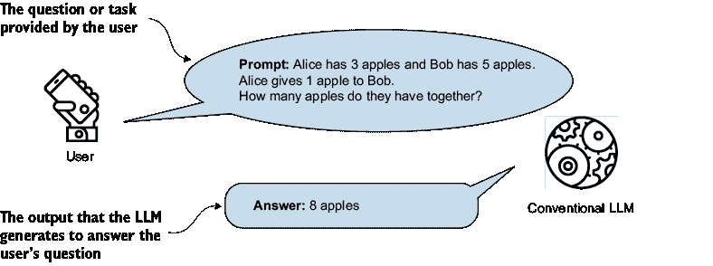
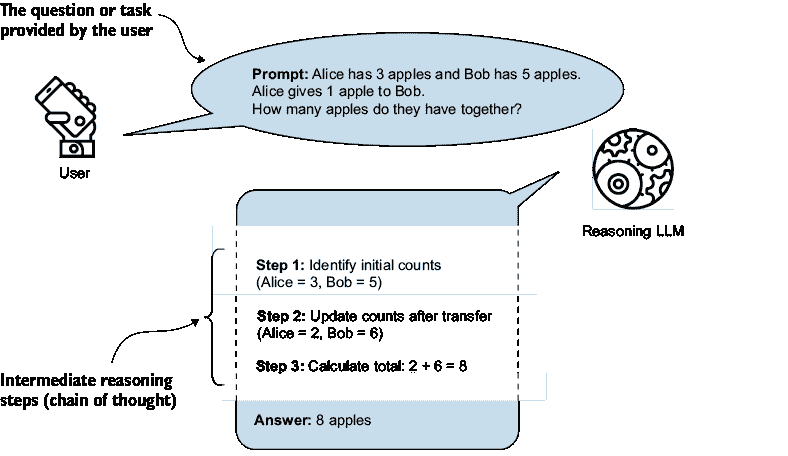
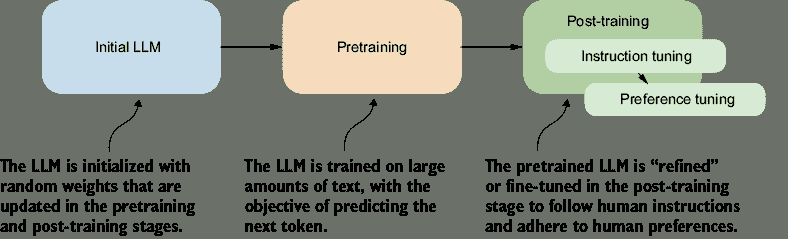
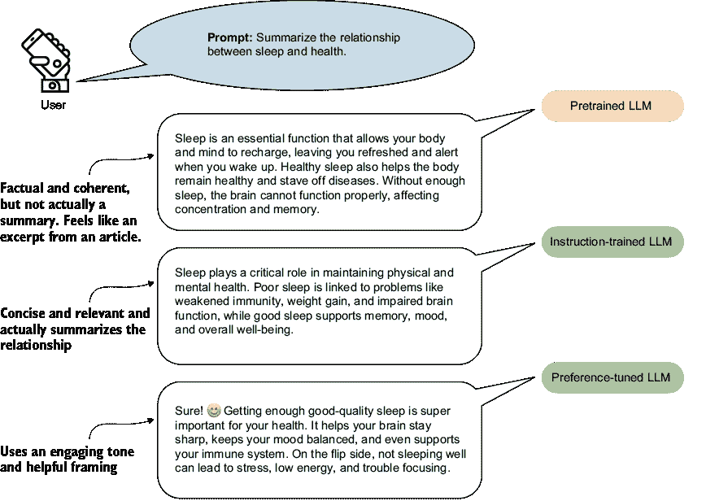
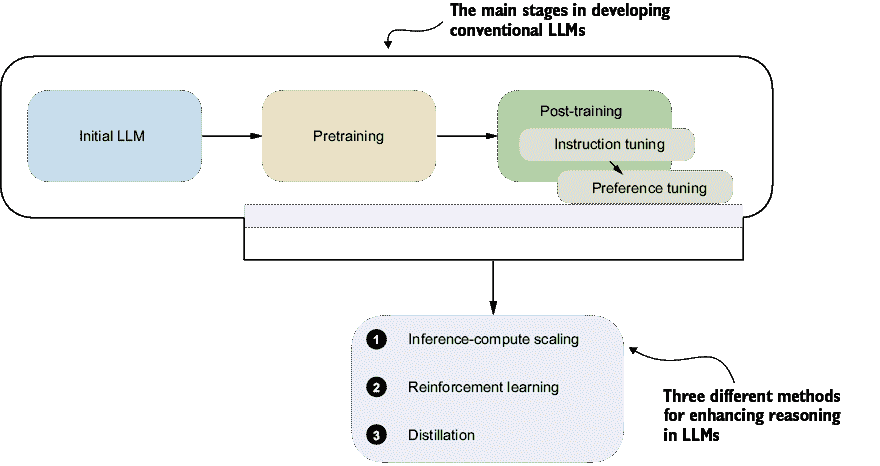
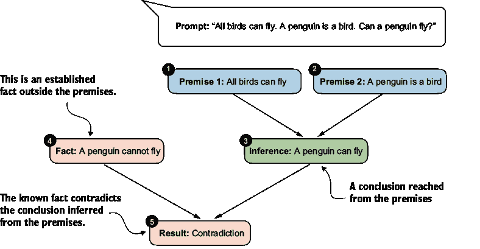
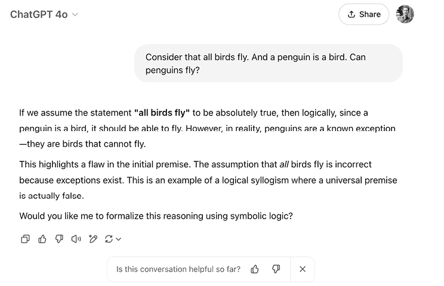
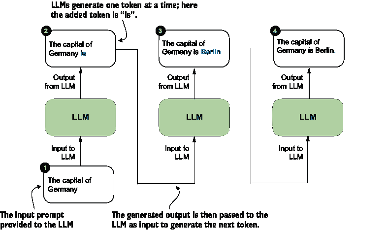
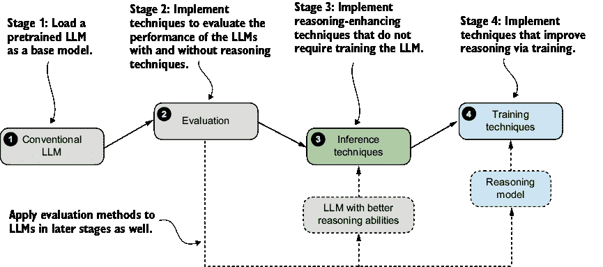
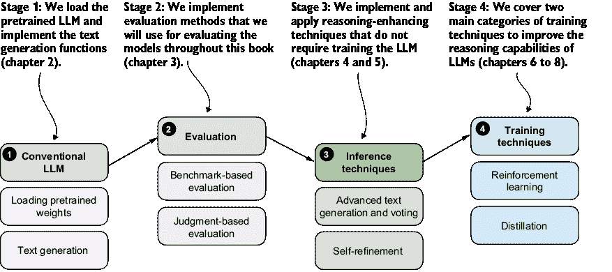

# 第 1 章 理解推理模型

## 本章涵盖

*   对于大语言模型来说，“推理”意味着什么

*   回顾 LLM 传统的预训练和后训练阶段

*   介绍提升 LLM 推理能力的关键方法

*   推理与模式匹配有何不同

*   为什么我们应该从零开始构建推理模型

...


Welcome to the next stage of large language models (LLMs): reasoning. LLMs have transformed how we process and generate text, but their success has been largely driven by statistical pattern recognition. New advances in reasoning methods now enable LLMs to tackle more complex tasks, such as solving logical puzzles and multistep math problems.

Moreover, reasoning is an essential technique for making AI agents practical, such as when an agent has to break a task into steps, use tools, and recover from mistakes. Reasoning LLMs are already used in agent applications such as OpenClaw.

In this book, you’ll learn the inner workings of LLM reasoning methods through a hands-on, code-first approach. We’ll start with a pretrained LLM and extend it step by step with reasoning capabilities. We’ll implement these reasoning components ourselves, from scratch, to see how these methods work in practice.

If you are curious about how LLMs themselves are built and trained, my earlier book, *Build a Large Language Model (From Scratch)*, also published by Manning (`mng.bz/orYv`), covers these foundations in detail, but it’s not required to follow along here.

Even if you just have a cursory knowledge of how LLMs are built, by the end of this book, you will understand how reasoning models work and be equipped to design, prototype, and evaluate the main methods for improving reasoning in LLMs.

When working with reasoning models, it’s crucial to know how to automatically check whether answers are correct on tasks such as math and how to turn a general-purpose model into a smaller reasoning model. We will use math examples throughout the book because they are easy to check automatically, but you do not need advanced math knowledge to follow along. Understanding reasoning methods is the central focus of this book.

With its focus on practical applications and explanations, this book is intended for LLM engineers, machine learning researchers, applied scientists, and software developers. Understanding how reasoning models are set up will help us judge when a standard LLM is sufficient and when extra reasoning machinery is worth the added complexity, cost, and latency. It will also help us design better evaluations, debug failures on multistep tasks, and adapt reasoning techniques to real products and research workflows.

## 1.1 Defining reasoning in the context of LLMs

In this book, I use the term reasoning in a practical engineering sense rather than a philosophical one. In the context of LLMs, reasoning refers to a model generating intermediate steps before producing its final answer.

These intermediate steps may appear as visible step-by-step explanations, or they may be enclosed in special tags such as `<think>...</think>` and be hidden from the user. In either case, the core idea remains the same. The model is encouraged or trained to use tokens for intermediate problem-solving steps rather than jumping directly to the conclusion.

Correspondingly, I use reasoning model to mean an LLM that has been improved, either through training or prompting techniques, to produce such intermediate steps, which often increases accuracy on complex tasks such as coding, logical puzzles, and math problems.

Before we get to the coding portions of this book, I will briefly discuss the main techniques that improve these reasoning behaviors and how they relate to pattern matching and logical reasoning. This will lay the groundwork for later discussions of how LLMs are currently built, how they handle reasoning tasks, and what they are and are not so good at.

### Chain-of-thought (CoT)

This style of generating intermediate steps is often referred to as chain of thought (CoT). Researchers and engineers often say that the model “thinks” through the problem step by step, meaning that it makes its intermediate reasoning process explicit and easier to follow. In this book, I use the terms reasoning and thinking in that common engineering sense. This does not imply that LLMs actually reason or think in the same way humans do.

Figure 1.1 illustrates how a conventional LLM generates the answer to a user’s question. A conventional LLM might not show how it came up with its answer, and while the answer might be correct, it doesn’t help the user understand the process behind it.



##### Figure 1.1 A simplified illustration of how a conventional, nonreasoning LLM might respond to a question with a short answer

Figure 1.2 illustrates a simple example of multistep (CoT) reasoning in an LLM. The LLM-produced intermediate reasoning steps look very much like a person articulating internal thoughts aloud. How closely these methods (and the resulting reasoning processes) mirror human reasoning remains an open research question, one this book does not attempt to answer.



##### Figure 1.2 A simplified illustration of how a reasoning LLM might tackle a multistep reasoning task using a chain of thought. Rather than just recalling a fact, the model combines several intermediate reasoning steps to arrive at the correct conclusion. The intermediate reasoning steps may or may not be shown to the user, depending on the implementation.

While figure 1.2 is a typical example of chain-of-thought reasoning, it’s important to emphasize that LLM reasoning differs from traditional, deterministic reasoning. For instance, a symbolic logic engine or theorem prover follows strict, rule-based steps that guarantee consistency and correctness. It works like following a recipe in which every step is fixed and must produce the same result each time. If you follow the steps exactly, you will always end up with the same dish.

In contrast to a symbolic logic engine, an LLM generates reasoning autoregressively, which means it predicts one token at a time based on statistical patterns in its training data. As a result, the LLM’s “reasoning steps” are not guaranteed to be logically sound, even if they look convincing.

This book focuses on explaining and implementing the fundamental techniques that improve LLM-based reasoning and make LLMs better at handling complex tasks. My hope is that by gaining hands-on experience with these methods, you will be better prepared to understand and improve the reasoning methods being developed and maybe even explore how they compare to human reasoning.

### LLM vs. human reasoning

Reasoning processes in LLMs may superficially resemble human thought, particularly in how intermediate steps are articulated. But it is important to recognize a key difference: humans can engage in deterministic reasoning by deliberately applying rules of logic or by reasoning over an internal model of the world. Deterministic, here, means that if we start with the same facts and follow the same steps, we will always reach the same conclusion. In contrast, current LLM reasoning is probabilistic, meaning that it generates one token at a time based on statistical patterns in training data, without guarantees of logical consistency.

Humans often reason by consciously manipulating concepts, intuitively understanding abstract relationships, or generalizing from a few examples. LLMs, by contrast, work by picking up patterns from huge amounts of text rather than relying on built-in reasoning rules or any kind of conscious thought.

In short, although the outputs of reasoning-enhanced LLMs can appear human-like, the underlying mechanisms differ substantially and remain an active area of exploration.

## 1.2 Understanding the standard LLM training pipeline


## 1.1 在 LLM 语境下定义推理

欢迎来到大语言模型（LLM）的下一个阶段：*推理*。LLM 已经改变了我们处理和生成文本的方式，但它们的成功在很大程度上是由统计模式识别驱动的。推理方法的新进展如今使 LLM 能够处理更复杂的任务，例如解决逻辑谜题和多步数学问题。

然而，*推理*一词在 AI 领域被广泛使用，有时甚至有些随意，因此我们需要明确它在本书中的含义。在 LLM 的语境下，推理指的是模型通过逻辑步骤、中间计算或显式的决策过程来得出结论的能力，而不仅仅是根据训练数据中的模式生成下一个最可能的词。

为了说明这种区别，我们来看一个普通 LLM 和一个推理 LLM 在回答同一个问题时的不同表现。

##### 思维链（CoT）

推理 LLM 最突出的技术之一是*思维链*（CoT），即模型在给出最终答案之前，生成一系列中间步骤。这些步骤可以帮助模型将复杂问题分解为更小、更易管理的部分。

##### 图 1.1 一个普通非推理 LLM 可能如何用简短答案回答问题的简化示意

例如，当被问到“一辆车以 60 公里/小时的速度行驶 2 小时，它行驶了多远？”时，普通 LLM 可能只会回答“120 公里”，而推理 LLM 可能会生成如下内容：“首先，确定速度：60 公里/小时。其次，确定时间：2 小时。然后，将速度乘以时间：60 × 2 = 120。因此，答案是 120 公里。”

##### 图 1.2 一个推理 LLM 可能如何使用思维链处理多步推理任务的简化示意。模型不是仅仅回忆一个事实，而是结合多个中间推理步骤来得出正确结论。根据实现方式的不同，中间推理步骤可能会或不会展示给用户。

##### LLM 与人类推理的对比

需要注意的是，LLM 的推理与人类推理并不相同。人类推理通常涉及意识、理解和语义把握，而 LLM 的推理则基于训练数据中学到的统计模式。尽管思维链可以产生类似推理的输出，但模型并不一定“理解”其背后的逻辑。这种区别对于评估 LLM 的能力和局限性至关重要。

## 1.2 理解标准 LLM 训练流程

让我们简要看看普通（非推理）LLM 通常是如何训练的，以便理解它们的局限性所在。这一背景知识也将有助于我们后续讨论模式匹配与逻辑推理之间的差异。


# 欢迎来到大语言模型（LLMs）的下一个阶段：*推理*

大语言模型（LLMs）已经改变了我们处理和生成文本的方式，但它们的成功在很大程度上是由统计模式识别驱动的。推理方法的新进展如今使 LLMs 能够处理更复杂的任务，例如解决逻辑谜题和多步数学问题。

此外，推理是让 AI 智能体变得实用的关键技术，例如当智能体需要将任务分解为多个步骤、使用工具并从错误中恢复时。推理 LLM 已被用于诸如 `OpenClaw` 之类的智能体应用中。

在本书中，你将通过一种动手实践、代码优先的方式来学习 LLM 推理方法的内部工作原理。我们将从一个预训练的 LLM 开始，逐步为其扩展推理能力。我们将自己从头实现这些推理组件，以了解这些方法在实际中的运作方式。

如果你对 LLM 本身是如何构建和训练的感到好奇，我之前的书*从零构建大语言模型（Build a Large Language Model (From Scratch)）*也由 Manning 出版（[`mng.bz/orYv`](http://mng.bz/orYv)），详细介绍了这些基础知识，但阅读本书并不需要先读它。

即使你只对 LLM 的构建方式有粗略的了解，读完本书后，你也会理解推理模型的工作原理，并具备设计、原型验证和评估改进 LLM 推理的主要方法的能力。

在处理推理模型时，了解如何在数学等任务上自动检查答案是否正确，以及如何将通用模型变成更小的推理模型，是至关重要的。我们将在全书中使用数学示例，因为它们易于自动检查，但你不必具备高等数学知识也能跟上。理解推理方法是本书的核心焦点。

本书侧重于实际应用和解释，面向 LLM 工程师、机器学习研究人员、应用科学家和软件开发人员。了解推理模型的构建方式，将帮助我们判断何时标准 LLM 就足够了，何时额外的推理机制值得增加复杂性、成本和延迟。它还将帮助我们设计更好的评估方案、调试多步骤任务中的失败，并将推理技术应用于实际产品和研究工作流。

## 1.1 推理的定义与核心思想

在本书中，我在务实的工程意义上使用*推理*一词，而非哲学意义上的。在 LLM 的语境中，推理指的是模型在生成最终答案之前先产生中间步骤。

这些中间步骤可能表现为可见的逐步解释，也可能被包裹在特殊的标签中，如 `<think>...</think>`，并对用户隐藏。无论哪种情况，核心思想都是一样的：鼓励或训练模型使用 token 来生成中间解题步骤，而不是直接跳到结论。

相应地，我使用*推理模型*来指代经过训练或提示技术改进的 LLM，使其能够产生这样的中间步骤，这通常能提高编码、逻辑谜题和数学问题等复杂任务的准确性。

在进入本书的编码部分之前，我将简要讨论改进这些推理行为的主要技术，以及它们与模式匹配和逻辑推理的关系。这将为后面讨论 LLM 目前是如何构建的、如何处理推理任务、擅长什么不擅长什么奠定基础。

### 思维链（Chain-of-thought, CoT）

这种生成中间步骤的方式通常被称为*思维链*（CoT）。研究人员和工程师常说，模型会逐步“思考”问题，这意味着它将中间推理过程显式化，更易于理解。在本书中，我在这种常见的工程意义上使用*推理*和*思考*这两个术语。这并不意味着 LLM 真的会像人类那样推理或思考。

图 1.1 展示了一个普通 LLM 如何生成用户问题的答案。普通 LLM 可能不会展示它如何得出答案，而且虽然答案可能是正确的，但这并不能帮助用户理解其背后的过程。

```

```

##### 图 1.1 一个普通的非推理 LLM 如何用简短答案回答一个问题的简化示意

图 1.2 展示了 LLM 中多步（CoT）推理的简单示例。LLM 产生的中间推理步骤看起来很像一个人在脑海中大声说出自己的想法。这些方法（以及由此产生的推理过程）在多大程度上反映了人类的推理，仍然是一个开放的研究问题，本书不试图回答这个问题。

```

```

##### 图 1.2 一个推理 LLM 如何使用思维链处理多步推理任务的简化示意图。该模型不是仅仅回忆一个事实，而是结合多个中间推理步骤来得出正确结论。中间推理步骤可能会也可能不会展示给用户，具体取决于实现。


欢迎来到大语言模型（LLMs）的下一个阶段：*推理*。LLMs 已经改变了我们处理和生成文本的方式，但它们的成功在很大程度上是由统计模式识别驱动的。推理方法的新进展如今使 LLMs 能够处理更复杂的任务，例如解决逻辑谜题和多步数学问题。

此外，推理是让 AI 智能体变得实用的关键技术，例如当智能体需要将任务分解为多个步骤、使用工具并从错误中恢复时。推理 LLM 已被用于诸如 OpenClaw 之类的智能体应用中。

在本书中，你将通过一种动手实践、代码优先的方式来学习 LLM 推理方法的内部工作原理。我们将从一个预训练的 LLM 开始，逐步为其扩展推理能力。我们将自己从头实现这些推理组件，以了解这些方法在实际中的运作方式。

如果你对 LLM 本身是如何构建和训练的感到好奇，我之前的书——《*从零构建大语言模型*》（Build a Large Language Model (From Scratch)）——也由 Manning 出版（[`mng.bz/orYv`](http://mng.bz/orYv)），详细介绍了这些基础知识，但阅读本书并不要求你先读它。

即使你只是粗略了解 LLM 的构建方式，读完本书后，你也会理解推理模型的工作原理，并具备设计、原型制作和评估改进 LLM 推理的主要方法的能力。

在处理推理模型时，了解如何在数学等任务上自动检查答案是否正确，以及如何将通用模型变成更小的推理模型，是至关重要的。我们将在全书中使用数学示例，因为它们易于自动检查，但你不必具备高等数学知识也能跟上。理解推理方法是本书的核心焦点。

本书侧重于实际应用和解释，面向 LLM 工程师、机器学习研究人员、应用科学家和软件开发人员。了解推理模型是如何构建的，将帮助我们判断何时标准 LLM 就足够了，何时额外的推理机制值得增加复杂性、成本和延迟。它还将帮助我们设计更好的评估方案、调试多步骤任务中的失败，并将推理技术应用到实际产品和研究工作流中。

## 1.1 在 LLM 语境中定义推理

在本书中，我在务实的工程意义上使用*推理*一词，而不是哲学意义上的。在 LLM 的语境中，推理指的是模型在生成最终答案之前先产生中间步骤。

这些中间步骤可能表现为可见的逐步解释，也可能被包裹在特殊标签中，如 `<think>...</think>`，并对用户隐藏。无论哪种情况，核心思想都是一样的：鼓励或训练模型使用 token 来生成中间解题步骤，而不是直接跳到结论。

相应地，我使用*推理模型*来指代经过训练或提示技术改进的 LLM，使其能够产生这样的中间步骤，这通常能提高编码、逻辑谜题和数学问题等复杂任务的准确性。

在进入本书的编码部分之前，我将简要讨论改进这些推理行为的主要技术，以及它们与模式匹配和逻辑推理的关系。这将为后面讨论 LLM 目前是如何构建的、如何处理推理任务、擅长什么和不擅长什么奠定基础。

### 思维链（CoT）

这种生成中间步骤的方式通常被称为*思维链*（CoT）。研究人员和工程师常说，模型会逐步“思考”问题，这意味着它将中间推理过程显式化，更易于理解。在本书中，我在这种常见的工程意义上使用*推理*和*思考*这两个术语。这并不意味着 LLM 真的会像人类那样推理或思考。

图 1.1 展示了一个普通 LLM 如何生成用户问题的答案。普通 LLM 可能不会展示它如何得出答案，虽然答案可能是正确的，但这并不能帮助用户理解其背后的过程。


#### 图 1.1 一个普通的非推理 LLM 如何用简短答案回答一个问题的简化示意

图 1.2 展示了 LLM 中多步（CoT）推理的简单示例。LLM 产生的中间推理步骤看起来很像一个人在脑海中大声说出自己的想法。这些方法（以及由此产生的推理过程）在多大程度上反映了人类的推理，仍然是一个开放的研究问题，本书不试图回答这个问题。


#### 图 1.2 一个推理 LLM 如何使用思维链处理多步推理任务的简化示意图。该模型不是仅仅回忆一个事实，而是结合多个中间推理步骤来得出正确结论。中间推理步骤可能会也可能不会展示给用户，具体取决于实现。

虽然图 1.2 是思维链推理的典型示例，但必须强调的是，LLM 推理不同于传统的确定性推理。例如，符号逻辑引擎或定理证明器遵循严格的、基于规则的步骤，从而保证一致性和正确性。它就像遵循食谱一样，每一步都是固定的，并且每次必须产生相同的结果。如果你严格按步骤操作，你总会得到同一道菜。

与符号逻辑引擎相比，LLM 是*自回归*地生成推理的，这意味着它基于训练数据中的统计模式一次预测一个 token。因此，LLM 的“推理步骤”并不能保证在逻辑上站得住脚，即使它们看起来很令人信服。

本书的重点是解释和实现改进基于 LLM 的推理、使 LLM 更善于处理复杂任务的基本技术。我希望，通过亲手实践这些方法，你能更好地理解和改进正在开发的推理方法，甚至探索它们与人类推理的比较。

### LLM 与人类推理的对比

LLM 中的推理过程可能表面上与人类思维相似，尤其是在中间步骤的表达方式上。但重要的是要认识到一个关键区别：人类可以通过有意应用逻辑规则或基于内部世界模型进行推理，从而进行确定性推理。这里的确定性是指，如果我们从相同的事实出发并遵循相同的步骤，我们总会得出相同的结论。相比之下，当前的 LLM 推理是概率性的，这意味着它一次生成一个 token，基于训练数据中的统计模式，而不保证逻辑一致性。

人类通常通过有意识地操作概念、直觉地理解抽象关系或从少量例子中归纳来进行推理。相比之下，LLM 通过从海量文本中拾取模式来工作，而不是依赖内置的推理规则或任何形式的意识思维。

简而言之，尽管增强推理的 LLM 的输出可能看起来像人类一样，但其底层机制大不相同，并且仍然是一个活跃的探索领域。

## 1.2 普通 LLM 是如何训练的

让我们简要看一下普通（非推理）LLM 通常是如何训练的，以便我们理解它们的局限性所在。这一背景也将有助于为接下来关于模式匹配与逻辑推理之间差异的讨论奠定框架。


欢迎来到大语言模型（LLMs）的下一个阶段：*推理*。LLMs 已经改变了我们处理和生成文本的方式，但它们的成功在很大程度上是由统计模式识别驱动的。推理方法的新进展如今使 LLMs 能够处理更复杂的任务，例如解决逻辑谜题和多步数学问题。

此外，推理是让 AI 智能体变得实用的关键技术，例如当智能体需要将任务分解为多个步骤、使用工具并从错误中恢复时。推理 LLM 已被用于诸如 OpenClaw 之类的智能体应用中。

在本书中，你将通过一种动手实践、代码优先的方式来学习 LLM 推理方法的内部工作原理。我们将从一个预训练的 LLM 开始，逐步为其扩展推理能力。我们将自己从头实现这些推理组件，以了解这些方法在实际中的运作方式。

如果你对 LLM 本身是如何构建和训练的感到好奇，我之前的书——《*从零构建大语言模型*》（Build a Large Language Model (From Scratch)）——也由 Manning 出版（[`mng.bz/orYv`](http://mng.bz/orYv)），详细介绍了这些基础知识，但阅读本书并不要求你先读它。

即使你只是粗略了解 LLM 的构建方式，读完本书后，你也会理解推理模型的工作原理，并具备设计、原型制作和评估改进 LLM 推理的主要方法的能力。

在处理推理模型时，了解如何在数学等任务上自动检查答案是否正确，以及如何将通用模型变成更小的推理模型，是至关重要的。我们将在全书中使用数学示例，因为它们易于自动检查，但你不必具备高等数学知识也能跟上。理解推理方法是本书的核心焦点。

本书侧重于实际应用和解释，面向 LLM 工程师、机器学习研究人员、应用科学家和软件开发人员。了解推理模型是如何构建的，将帮助我们判断何时标准 LLM 就足够了，何时额外的推理机制值得增加复杂性、成本和延迟。它还将帮助我们设计更好的评估方案、调试多步骤任务中的失败，并将推理技术应用到实际产品和研究工作流中。

## 1.1 在 LLM 语境中定义推理

在本书中，我在务实的工程意义上使用*推理*一词，而不是哲学意义上的。在 LLM 的语境中，推理指的是模型在生成最终答案之前先产生中间步骤。

这些中间步骤可能表现为可见的逐步解释，也可能被包裹在特殊标签中，如 `<think>...</think>`，并对用户隐藏。无论哪种情况，核心思想都是一样的：鼓励或训练模型使用 token 来生成中间解题步骤，而不是直接跳到结论。

相应地，我使用*推理模型*来指代经过训练或提示技术改进的 LLM，使其能够产生这样的中间步骤，这通常能提高编码、逻辑谜题和数学问题等复杂任务的准确性。

在进入本书的编码部分之前，我将简要讨论改进这些推理行为的主要技术，以及它们与模式匹配和逻辑推理的关系。这将为后面讨论 LLM 目前是如何构建的、如何处理推理任务、擅长什么和不擅长什么奠定基础。

### 思维链（CoT）

这种生成中间步骤的方式通常被称为*思维链*（CoT）。研究人员和工程师常说，模型会逐步“思考”问题，这意味着它将中间推理过程显式化，更易于理解。在本书中，我在这种常见的工程意义上使用*推理*和*思考*这两个术语。这并不意味着 LLM 真的会像人类那样推理或思考。

图 1.1 展示了一个普通 LLM 如何生成用户问题的答案。普通 LLM 可能不会展示它如何得出答案，虽然答案可能是正确的，但这并不能帮助用户理解其背后的过程。


#### 图 1.1 一个普通的非推理 LLM 如何用简短答案回答一个问题的简化示意

图 1.2 展示了 LLM 中多步（CoT）推理的简单示例。LLM 产生的中间推理步骤看起来很像一个人在脑海中大声说出自己的想法。这些方法（以及由此产生的推理过程）在多大程度上反映了人类的推理，仍然是一个开放的研究问题，本书不试图回答这个问题。


#### 图 1.2 一个推理 LLM 如何使用思维链处理多步推理任务的简化示意图。该模型不是仅仅回忆一个事实，而是结合多个中间推理步骤来得出正确结论。中间推理步骤可能会也可能不会展示给用户，具体取决于实现。

虽然图 1.2 是思维链推理的典型示例，但必须强调的是，LLM 推理不同于传统的确定性推理。例如，符号逻辑引擎或定理证明器遵循严格的、基于规则的步骤，从而保证一致性和正确性。它就像遵循食谱一样，每一步都是固定的，并且每次必须产生相同的结果。如果你严格按步骤操作，你总会得到同一道菜。

与符号逻辑引擎相比，LLM 是*自回归*地生成推理的，这意味着它基于训练数据中的统计模式一次预测一个 token。因此，LLM 的“推理步骤”并不能保证在逻辑上站得住脚，即使它们看起来很令人信服。

本书的重点是解释和实现改进基于 LLM 的推理、使 LLM 更善于处理复杂任务的基本技术。我希望，通过亲手实践这些方法，你能更好地理解和改进正在开发的推理方法，甚至探索它们与人类推理的比较。

### LLM 与人类推理的对比

LLM 中的推理过程可能表面上与人类思维相似，尤其是在中间步骤的表达方式上。但重要的是要认识到一个关键区别：人类可以通过有意应用逻辑规则或基于内部世界模型进行推理，从而进行确定性推理。这里的确定性是指，如果我们从相同的事实出发并遵循相同的步骤，我们总会得出相同的结论。相比之下，当前的 LLM 推理是概率性的，这意味着它一次生成一个 token，基于训练数据中的统计模式，而不保证逻辑一致性。

人类通常通过有意识地操作概念、直觉地理解抽象关系或从少量例子中归纳来进行推理。相比之下，LLM 通过从海量文本中拾取模式来工作，而不是依赖内置的推理规则或任何形式的意识思维。

简而言之，尽管增强推理的 LLM 的输出可能看起来像人类一样，但其底层机制大不相同，并且仍然是一个活跃的探索领域。

## 1.2 理解标准 LLM 训练流程

让我们简要看一下普通（非推理）LLM 通常是如何训练的，以便我们理解它们的局限性所在。这一背景也将有助于为接下来关于模式匹配与逻辑推理之间差异的讨论奠定框架。

在采用任何特定的推理方法之前，常规的 LLM 训练通常分为两个阶段：*预训练*和*后训练*，如图 1.3 所示。一些近期的论文还在这两个阶段之间区分出一个*中期训练*阶段，例如在代码、数学或长上下文数据上继续训练模型，但为了在本书中保持术语简洁，我会将该阶段归入预训练。



**图 1.3** 典型 LLM 训练流水线概览。整个过程始于一个以随机权重初始化的模型，随后在大规模文本数据上进行预训练，通过预测下一个词元来学习语言模式。后训练阶段则通过指令微调和偏好微调进一步优化模型，使 LLM 能够更好地遵循人类指令并与人类偏好对齐。

在典型 LLM 训练流程的预训练阶段，LLM 会在海量无标注文本上进行训练，这些数据通常有数 TB 之多，或包含数万亿个词元，来源包括书籍、网站、研究文章以及其他许多渠道。LLM 的预训练目标是学会预测这些文本中的下一个单词（即下一个*词元*）。

### 单词与词元

词元是语言模型处理的文本小单元。根据分词器对文本的切分方式，一个词元可以是完整的单词、单词的一部分，甚至可以是标点符号。

例如，句子“An LLM can be useful.”可能会被常见的分词器切分为“An”、“ L”、“LM”、“ can”、“ be”、“ useful”和“.”等词元。随后，这些词元会被转换为模型可以处理的数值 ID。

分词器并不是 LLM 本身的一部分，但仍然是 LLM 文本处理和生成流程中的关键组件。我们将在下一章了解分词的工作原理。

当 LLM 在海量数据集上完成预训练后，它们会变得非常强大，这些数据集通常包含数 TB 的文本（相当于数万亿个词元）。这种训练需要数千块 GPU 运行数月，成本可能高达数百万美元。这里的“强大”是指 LLM 开始生成与人类写作非常相似的文本。在某种程度上，经过预训练的 LLM 还会开始展现出所谓的*涌现特性*，这意味着它们可以执行未被明确训练过的任务，包括翻译和代码生成。

这些预训练模型充当后训练阶段的基础模型。后训练阶段使用两种关键技术：*监督微调*（文献中通常缩写为 *SFT*，也称为*指令微调*）和*偏好微调*，以教会 LLM 响应用户查询。

如图 1.4 所示，指令微调提升了 LLM 在个人助理任务上的能力，例如回答问题、总结摘要、翻译文本等。偏好微调阶段则进一步优化这些能力。顾名思义，偏好微调有助于使响应更符合用户偏好。一些读者可能熟悉“基于人类反馈的强化学习”（RLHF）这个术语，它是实现偏好微调的一种具体技术。



**图 1.4** 语言模型在不同训练阶段的示例响应。提示要求总结睡眠与健康之间的关系。预训练的 LLM 生成了一段相关但不够聚焦的回答，没有直接遵循指令。经过指令微调的 LLM 生成了简洁、准确且与提示一致的摘要。经过偏好微调的 LLM 则通过友好的语气和引人入胜的语言进一步改进了回答，使答案更贴近用户、更以用户为中心。

简而言之，我们可以将预训练视为“原始语言预测”（通过下一个词元预测），它赋予了 LLM 一些基础属性和生成连贯文本的能力。后训练阶段则通过指令微调提高 LLM 对任务的理解，并通过偏好微调优化 LLM，使其能以更符合偏好的风格生成答案。

值得注意的是，即使经过指令微调的模型也还不是“聊天机器人”。聊天界面增加了另一层机制，在交互式、多轮对话环境中引导模型响应。这通常涉及系统提示、对话历史管理和其他编排工作（附录 G 中实现了一个示例）。

**注意** 关于预训练和后训练阶段的详细内容，请参阅我由 Manning 出版的著作*从零开始构建大语言模型*（[`mng.bz/orYv`](http://mng.bz/orYv)）。你现在读的这本书不需要详细了解那些阶段。在这里，我们将加载一个已经完成昂贵的预训练和后训练阶段的模型，从而专注于推理模型特有的方法论。

## 1.3 使用训练和推理技术提升 LLM 的推理能力


在 LLM 的语境中，“推理”一词随着 OpenAI 于 2024 年 9 月 12 日在 ChatGPT 中发布 o1 而进入公众视野。在这篇发布公告中，OpenAI 表示：“我们开发了一系列新的 AI 模型，它们旨在做出响应之前花更多时间思考”（[`openai.com/index/introducing-openai-o1-preview/`](https://openai.com/index/introducing-openai-o1-preview/)）。此外，OpenAI 写道：“这些增强的推理能力在解决科学、编程、数学及类似领域的复杂问题时可能特别有用。”

几个月后，即 2025 年 1 月，DeepSeek 发布了 DeepSeek-R1 模型及技术报告，其中详细介绍了开发推理模型的训练方法（[`arxiv.org/abs/2501.12948`](https://arxiv.org/abs/2501.12948)）。这引起了巨大轰动，因为该公司不仅免费公开提供了一个与专有 o1 模型竞争甚至性能超越它的模型，还分享了训练此类模型的蓝图。在本书中，我们将从零开始实现类似方法，以此了解开发推理模型所用的方法论是如何运作的。

开发和改进 LLM 推理能力的不同方法大致可以分为三大类，如图 1.5 所示。这些方法通常应用于已经完成常规预训练和后训练阶段（包括指令微调和偏好微调）的 LLM。



**图 1.5** 常用于提升 LLM 推理能力的三种方法：推理计算扩展、强化学习和蒸馏。这些方法通常应用于常规训练阶段（初始模型训练、预训练，以及包含指令微调和偏好微调的后训练）之后，但推理技术也可以应用于预训练的基础模型。

我们将在全书中更详细地审视这些常见方法：

* *推理时计算扩展*（也常被称为*推理计算扩展*、*测试时扩展*等）包括在推理阶段（用户提示模型时）提升模型推理能力的方法，无需训练或修改底层模型权重。其核心思想是用增加的计算资源换取性能提升，通过思维链推理和各种采样过程等技术，即使是固定模型也能变得更加强大。这将是第 4 章和第 5 章的重点。

* *强化学习*（RL）指的是一类通过鼓励模型采取能带来高奖励信号的动作来提升其推理能力的训练方法。这些奖励可以是宽泛的，例如任务成功或启发式分数；也可以是严格定义且可验证的，例如数学问题或编程任务中的正确答案。

与推理时计算扩展不同，后者无需修改模型即可提升推理性能，而强化学习（RL）会在训练期间更新模型的权重。这使得模型能够根据从环境获得的反馈，通过试错来学习和改进推理策略。我们将在第 6 章和第 7 章更详细地探讨强化学习。

* *蒸馏*涉及将更大、能力更强的模型学到的复杂推理模式迁移到更小或更高效的模型中。在 LLM 的语境中，这通常意味着使用由更大、能力更强的模型生成的高质量标注指令数据集进行监督微调（SFT）。这种技术在 LLM 文献中通常称为*知识蒸馏*或简称为*蒸馏*。需要注意的是，这与深度学习中的传统知识蒸馏略有不同，后者中较小的（“学生”）模型通常同时学习较大的（“教师”）模型产生的输出和 logits。这个话题将在第 8 章进一步讨论。

### 用于推理和偏好调优的强化学习

在开发推理模型的背景下，有必要区分强化学习（RL）方法与带人类反馈的强化学习（RLHF），后者在开发常规 LLM 时用于偏好调优。两种设置使用相同的基础过程（RL），但主要区别在于奖励的获取和验证方式（RLHF 使用人类判断，而推理 RL 使用自动化验证器或环境）。

RLHF 将明确的人类评估或模型输出的排名作为奖励信号，直接引导模型产生符合人类偏好的行为。相比之下，推理模型语境中的 RL 通常依赖自动化或基于环境的奖励信号，这种信号可能更客观，但更不容易与人类偏好对齐。例如，在推理模型开发流程中，RL 可能会通过为正确性提供明确奖励来训练模型擅长数学证明。相比之下，RLHF 则会让人类评估者对各种回答进行排序，以鼓励输出与人类标准和主观偏好高度一致。

## 1.4 模式匹配与逻辑推理

在预训练期间，LLM 会接触到大量文本，并通过识别和重现数据中的统计关联来学习预测下一个词元。这一过程使它们能够生成流畅且连贯的文本，但根本上基于学习到的统计规律，而非显式规则或可保证的逻辑推理。

LLM 通过生成与训练期间所见模式在统计上一致的文本续写来响应提示。这包括许多看起来像逻辑推理的前提-结论模式。关键区别在于，模型并不显式地表示前提并应用形式规则，而是根据训练数据中的相似示例预测可能的续写。

考虑以下示例：

**** 德国的首都是……

**** 柏林。

一个 LLM 给出答案“柏林”，并不是在逻辑上推导出答案。相反，它是在回忆从训练数据中学到的强统计关联。这种行为反映了我们所说的*模式匹配*，即模型基于学到的相关性来完成文本，而不是应用结构化的推理步骤。

但那些超越模式识别、正确答案依赖于从给定事实得出结论的任务呢？这让我们想到另一种能力：逻辑推理。

逻辑推理涉及使用规则系统性地得出结论。与模式匹配不同，它依赖于中间推理步骤以及基于形式关系识别矛盾或推断含义的能力。

考虑以下提示示例：

**** 所有鸟都会飞。企鹅是鸟。企鹅会飞吗？

有两种方式来评估这个问题。

首先，在*封闭世界*（仅提示）设置中，给定提示中的两个前提（主张或假设），有效答案是“是的，企鹅会飞。”

其次，在*开放世界*（带背景知识）设置中，如果我们允许使用提示中未包含的知识（例如企鹅不会飞），这一外部事实就会与从前提得出的结论相冲突，如图 1.6 所示。一个推理系统应该注意到这种不一致，要么请求澄清，要么弱化第一个陈述（例如，“大多数鸟都会飞，但企鹅等例外。”）。



**图 1.6** 矛盾的前提会导致逻辑不一致。从“所有鸟都会飞”和“企鹅是鸟”，我们推断“企鹅会飞”。这个结论与“企鹅不会飞”这一既定事实相冲突，从而导致矛盾。

相比之下，统计（模式匹配）LLM 并*不*显式追踪矛盾，而是基于学到的文本分布进行预测。例如，如果“所有鸟都会飞”这类信息在训练数据中被强烈强化，模型可能会自信地回答：“是的，企鹅会飞。”

在下一节中，我们将看一个例子，了解 LLM 如何处理这个“所有鸟都会飞……”提示。

### 逻辑推理与基于规则的系统

为什么显式的基于规则的系统不再那么流行？基于规则的系统在 80 年代和 90 年代广泛用于医疗诊断、法律裁决和工程。它们仍然用于关键领域（医学、法律、航空航天），这些领域通常需要显式推理和透明的决策过程。它们很难实现，因为很大程度上依赖人工设计的启发式方法。（启发式方法是简单的决策规则，能快速给出足够好的答案，但不保证最优。）相比之下，包括 LLM 在内的深度神经网络并不实现手写规则；它们从数据中学习决策模式，并且在大规模训练时可以非常灵活。

## 1.5 在没有显式规则的情况下模拟推理

我们看到了矛盾的前提如何导致逻辑不一致。常规 LLM 并不显式追踪矛盾，而是基于学到的文本分布生成回答。

图 1.7 展示了一个未经过推理增强的 LLM（如 OpenAI ChatGPT 中的 GPT-4o）如何响应上一节讨论的“所有鸟都会飞……”提示。如你所见，GPT-4o 似乎给出了正确的回答，尽管它并不被认为是一个推理模型（不像 OpenAI 的其他产品，如 o1、o3、o4-mini，以及更新的 GPT-5，这些产品是明确使用推理方法论开发的）。



**图 1.7** 一个示例，说明语言模型（ChatGPT 中的 GPT-4o）如何看似对矛盾前提进行“推理”

那么，4o 模型是如何生成其回答的呢？这是否意味着 GPT-4o 在显式地进行逻辑推理？不，不一定。至少，GPT-4o 在熟悉的情境下模拟逻辑推理方面非常有效。

GPT-4o 并不执行显式的矛盾检查；相反，它根据概率加权模式生成答案。如果训练数据中包含大量纠正这种矛盾的实例（例如“企鹅不会飞”这样的文本），这种方法就能很好地工作，使模型学会“企鹅”与“不会飞”之间的统计关联。换句话说，模型隐式地识别出矛盾，是因为它在训练期间频繁遇到过这种精确的推理场景。这种效果在很大程度上依赖于模型在训练中大量接触类似推理模式后形成的统计关联。因此，即使一个常规 LLM 看似在执行逻辑演绎（如图 1.7 所示），它也并非在执行显式的、基于规则的逻辑，而是在利用其海量训练数据中的模式。

尽管如此，GPT-4o 在此处的成功很好地说明了隐式模式匹配在大规模训练下可以变得多么强大。这些基于模式的推理模型通常在以下两种情况下表现不佳：

* 当逻辑场景是新颖的（训练数据中未曾接触过）

* 当推理复杂度较高，涉及错综复杂的多步逻辑关系时

### 逻辑推理与当前可用的推理模型

尽管 GPT-4o 并未被官方标记为推理模型，但 OpenAI 提供了几个专门的推理模型，包括 o1、o3、o4-mini 和 GPT-5。此外，其他公司也一直在开发具有显式推理能力的 LLM。截至撰写本文时，流行的例子包括 Anthropic 的 Claude 4、xAI 的 Grok 4、Google 的 Gemini 2.5、DeepSeek 的 R1、阿里巴巴的 Qwen3 等等。这些模型所采用的技术正是本书的重点。我们将会看到，这一过程并不需要实现基于规则的推理流水线。相反，LLM 会通过改进的推理和训练方法来学习或提升其推理能力。

我们可以说，LLM 通过习得的模式来模拟逻辑推理。我们可以通过特定的推理方法进一步改进这一点，包括推理计算扩展和诸如强化学习之类的训练后策略，但 LLM 内部并不会显式地执行任何基于规则的逻辑。

此外，LLM 存在一个谱系。甚至在 OpenAI 的 o1 和 DeepSeek-R1 等专用推理模型出现之前，LLM 就已经能够模拟推理行为。这些模型表现出的行为与本章 1.1 节前面给出的推理定义一致，即在产生最终答案之前生成中间步骤。我们现在明确称为“推理模型”的，本质上是这种能力的一个更精细的版本。这些改进的推理能力是通过使用特定的推理计算扩展技术（在第 4 章和第 5 章讨论）和有针对性的训练后方法（例如第 6 章和第 7 章的强化学习）实现的，这些方法旨在改进和强化类似推理的行为。

## 1.6 为什么要从头构建推理模型？

继 2025 年 1 月 DeepSeek-R1 发布之后，提升 LLM 的推理能力已成为人工智能领域最热门的话题之一，而且理由充分。更强的推理技能使 LLM 能够解决更复杂的问题，让他们在用户关心的各种任务中变得更强大。

这一转变也反映在 OpenAI 首席执行官于 2025 年 2 月 12 日的一份声明中：

> 我们接下来将发布 GPT-4.5，也就是我们在内部称为 Orion 的模型，作为我们最后一个非思维链模型。在那之后，我们的一个首要目标是通过创建能够使用我们所有工具、知道何时需要长时间思考（或不需要）并且普遍适用于各种任务的系统，来统一 o 系列模型和 GPT 系列模型。

上述引文突显了领先的 LLM 提供商向推理模型的重大转变。这里，“思维链”指的是一种提示技术，它引导语言模型逐步推理以提升其推理能力；我们将在第 4 章和第 5 章更详细地介绍它。

同样值得注意的是，提到了“何时需要长时间思考或何时不需要”。这暗示了一个重要的设计考虑：推理并不总是必要或可取的。例如，推理模型专为复杂任务而设计，例如解谜、高级数学问题和具有挑战性的编码任务。它们通常在智能体系统中也很有用，尤其是在任务分解、规划和选择使用哪些工具方面。对于更简单的任务，如摘要总结、翻译或基于知识的问答，它们则并非必需。事实上，对所有任务都使用推理模型可能效率低下且成本高昂。例如，它们通常使用成本更高、输出更冗长，有时还会因为“过度思考”而更容易出错。在这里，简单的规则适用：为任务使用合适的工具（或合适类型的 LLM）。

推理模型通常比非推理模型更昂贵，原因有两个。首先，它们往往会产生更长的输出，因为它们包含了解释答案如何得出的中间步骤。如图 1.8 所示，LLM 一次生成一个 token，每个 token 都需要一次*完整的前向传播*。如果一个推理模型的答案长度是原来的两倍，那么生成过程大约需要两倍的前向传播次数，这会增加计算成本。



*图 1.8 LLM 中逐 token 的生成过程。在每一步中，LLM 都会获取当前已生成的完整序列，并预测下一个 token，该 token 可以表示一个词、子词或标点符号，具体取决于分词器。新生成的 token 会被追加到序列中，并作为下一步的输入。这种迭代解码过程既用于标准语言模型，也用于以推理为重点的模型。*

其次，许多推理工作流要求对单个任务多次运行模型，例如采样多个候选解决方案、调用工具或运行验证器。这些额外调用会使处理的 token 总数成倍增加，从而在图 1.8 所示的单次调用基础上进一步抬高成本。

这正是从头实现这些模型和方法之所以有帮助的原因。这是理解它们工作原理的最佳途径之一。如果我们理解了 LLM 和推理模型的工作原理，就能更好地理解这些权衡取舍。

## 1.7 从头构建推理模型的路线图

现在我们已经从鸟瞰视角讨论了 LLM 中的推理，接下来的章节将指导你从头编写和应用推理方法。从高层次来看，路线图很简单。我们将从一个常规 LLM 开始，学习如何评估其推理行为，然后探索两种主要的改进方法：推理技术和训练技术。图 1.9 展示了主要步骤。



*图 1.9 我们在本书中将构建内容的高层次路线图。我们将从一个常规 LLM 开始，添加评估方法以便衡量其进展，然后探索两大类推理改进：推理技术和训练技术。*

阶段 1 是图 1.9 中明确的一个步骤，因为在实践中，推理方法通常应用于已有的基础 LLM，而不是从头训练的 LLM。我们将从一个已经预训练好的常规 LLM 开始，并将其视为我们想要改进的基线。

阶段 2 实现所需的评估工具，以判断某个方法是否真正有效。这就是为什么阶段 3 和阶段 4 会循环回到评估：在通过推理时方法或额外训练改进推理行为后，我们回到阶段 2 来度量这种改变是否有帮助。

第 3 阶段在不改变模型权重的情况下，在推理时改善推理行为；第 4 阶段则通过额外训练改进模型本身，将预训练 LLM 转变为专用的推理模型。

图 1.10 提供了更多细节，并总结了各章涵盖的不同子步骤。



*图 1.10 章节级子步骤的详细路线图。加载基础模型后，我们将介绍基于基准的评估和基于判断的评估，然后是推理时方法，如高级文本生成、投票和自我优化，最后是基于强化学习和蒸馏的训练时方法。*

我十分期待接下来的旅程，希望你也一样。

## 小结

* 常规 LLM 训练分多个阶段进行：

    * 预训练，模型从海量文本中学习语言模式

    * 指令微调，改进模型对用户提示的响应

    * 偏好调整，使模型输出与人类偏好对齐

* 推理方法应用于常规 LLM 之上。

* LLM 中的推理指的是改进模型，使其在生成最终答案之前显式生成中间步骤（思维链），这通常能提高多步骤任务的准确性。

* LLM 中的推理不同于基于规则的推理，其运作方式也可能不同于人类推理。目前，普遍的共识是 LLM 中的推理依赖于统计模式匹配。

* LLM 中的模式匹配纯粹依赖于从数据中学到的统计关联，能够生成流畅的文本，但缺乏显式的逻辑推理。

* 改进 LLM 中的推理可以通过几种方式实现：

    * 推理时计算扩展无需重新训练即可改进推理（例如思维链提示）。

    * 强化学习涉及使用奖励信号显式训练模型。

    * 监督微调和蒸馏，利用更强推理模型的示例。

* 从头构建推理模型可以提供对 LLM 能力、局限性和计算权衡的实际见解。
