# 2 使用预训练 LLM 生成文本

## 本章涵盖

* 设置用于处理 LLM 的代码环境

* 使用分词器为 LLM 准备输入文本

* 使用预训练 LLM 生成文本的逐步过程

* 用于加速 LLM 文本生成的缓存和编译技术

在上一章中，我们讨论了*传统大语言模型*（LLM）与*推理模型*之间的区别。我们还介绍了几种可以提高 LLM 推理能力的技术。这些技术通常应用于传统（基础）LLM 之上。

在本章中，我们将通过加载预训练基础模型来为后续章节奠定基础，如图 2.1 所示。之前我们讨论过，推理方法通常是在常规后训练阶段之后添加的。但从基础模型入手，可以更容易地看出哪些能力来自推理方法本身。本章中的传统 LLM 是非推理 LLM，更具体地说，是一个预训练基础模型，而不是经过指令调优或偏好调优的助手。

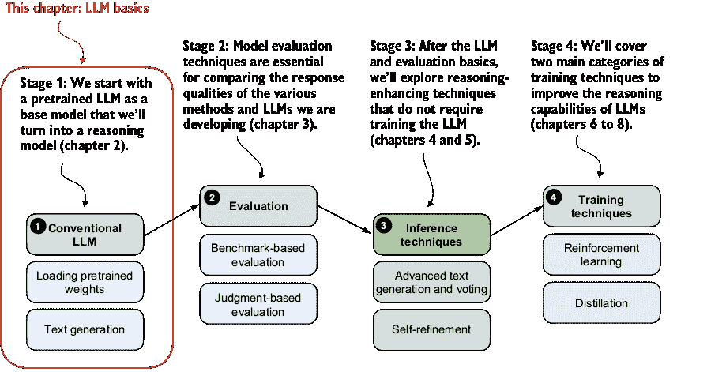

*图 2.1 开发推理模型的四个主要阶段。本章聚焦于第 1 阶段：加载传统 LLM 并实现文本生成功能。*

除了设置编码环境和加载预训练 LLM 之外，你还将学习如何使用*分词器*为模型准备文本输入。如图 2.1 所示，你还将实现一个文本生成函数，使 LLM 能够实际用于生成文本。这一功能将在后续章节中继续使用和改进。

## 2.1 用于文本生成的 LLM 简介

本章将使用的 LLM 是一个仅经过预训练的基础模型，但它已经能够生成连贯的文本，并且在某些情况下能够遵循基本指令。图 2.2 总结了 LLM 文本生成流程的组件，我们将在本章后面更详细地讨论并实现这些步骤。

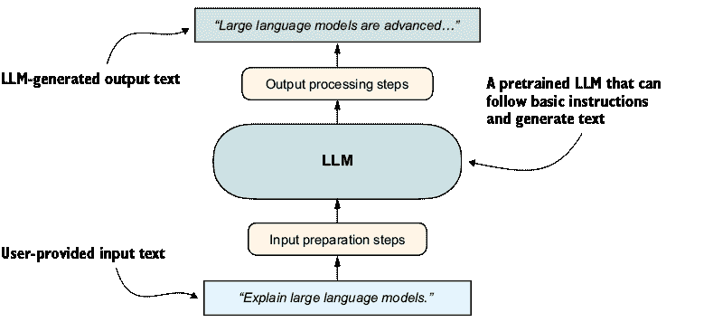

*图 2.2 给定用户查询（输入文本），LLM 生成响应（输出文本）的概览*

注意：按照惯例，涉及 LLM 等神经网络的图示是从下（输入）到上（输出）垂直绘制和阅读的。箭头表示信息在模型中向上流动。

如果你从未编写过 LLM 或以编程方式使用过 LLM，本章将教你文本生成过程是如何运作的。我们不会深入探讨 LLM 的内部机制，例如注意力机制和其他架构组件；这是我另一本书*从零构建大语言模型（From Scratch）*的主题。理解这些内部机制并非阅读本书所必需；如果你感到好奇，之后可以再学习。如果你已经读过我的另一本书，本章也会对你有帮助，因为它补充了关于加速推理和其他实用优化的新内容。

在开始实现图 2.2 中所示的组件（包括输入准备、加载 LLM 和生成文本）之前，我们首先需要设置编码环境。

## 2.2 设置编码环境


我们将介绍两种主要的 Python 编码环境设置方式，以便你能够跟着本书的示例操作：一种是简单的基于`pip`的设置，另一种是基于`uv`的工作流程。我建议你在决定哪种方案最适合自己之前，先通读本节。如果你已经配置好了 Python 环境（Python 3.10 或更高版本），最简单的依赖安装方式是在终端中使用 Python 的包安装器（`pip`）。如果你已从出版商网站下载了代码，请使用`requirements.txt`文件安装本书所需的 Python 库：

```
pip install -r requirements.txt
```

或者，要在不下载`requirements.txt`文件的情况下直接安装所需包，请使用以下命令：

```
pip install -r https://raw.githubusercontent.com/\
rasbt/reasoning-from-scratch/refs/heads/main/requirements.txt
```

### 本章使用的 Python 包

如果你希望只安装本章使用的包，可以从以下命令开始：

```
pip install torch>=2.10.0 tokenizers>=0.22.2 reasoning-from-scratch 
```

PyTorch 的安装可能因平台和硬件而异，尤其是当你需要 GPU 加速时。如果上述命令没有为你的系统安装正确的构建版本，我建议使用 PyTorch 官方网站上的安装选择器（[`pytorch.org/get-started/locally/`](https://pytorch.org/get-started/locally/)），然后单独安装其余包：

* `torch` 指的是 PyTorch，这是一个广泛使用的深度学习库，提供构建和训练神经网络的工具。

* `tokenizers` 是一个提供高效分词算法的库，用于为 LLM 准备输入数据。

* `reasoning-from-scratch` 是我为本书开发的自定义库。它包含各章节使用的所有代码示例，以及我们将用到的其他实用函数。

虽然 `pip` 是安装 Python 包的标准方式，但我个人更推荐使用广受好评的 `uv` Python 包与项目管理器来使用 Python。和许多人一样，我现在推荐 `uv`，因为它比 `pip` 快得多，并且依赖解析也更可靠。它还会自动创建隔离环境，并自带 Python 可执行文件（如果系统中已安装兼容版本的 Python，则会使用系统 Python），因此如果你还没有在系统上安装 Python，这会是一个很好的选择。图 2.3 概述了从安装 `uv` 到准备运行本章代码的四步流程。

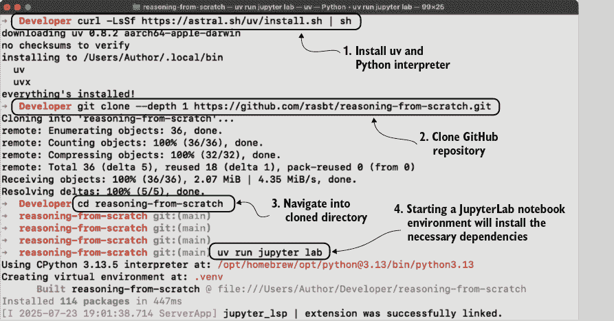

**图 2.3** 通过 macOS 终端安装并使用 `uv` Python 包与项目管理器

图 2.3 展示了在 macOS 终端中安装和使用 `uv` 的过程，但它同样支持 Linux 和 Windows：

1. 要安装 `uv`，请从官方网站运行适用于你操作系统的安装程序：[`docs.astral.sh/uv/getting-started/installation/`](https://docs.astral.sh/uv/getting-started/installation/)。

2. 接下来，克隆 GitHub 仓库：

    ```
    git clone --depth 1 https://github.com/rasbt/reasoning-from-scratch.git
    ```

    这里，`--depth 1` 选项告诉 `git` 执行浅克隆，这意味着它只下载最新版本的代码，而不会下载完整的版本历史。这样可以让下载更快并节省空间。

    如果你没有安装 `git`，你可以从出版商网站手动下载源代码仓库，或者在浏览器中打开此链接：[`github.com/rasbt/reasoning-from-scratch/archive/refs/heads/main.zip`](https://github.com/rasbt/reasoning-from-scratch/archive/refs/heads/main.zip)（下载后解压）。

3. 在终端中，导航到 `reasoning-from-scratch` 文件夹。

4. 在 `reasoning-from-scratch` 文件夹内，执行：

    ```
    uv run jupyter lab
    ```

    此命令会启动 JupyterLab，你可以打开一个空白的 Jupyter notebook 来输入和运行代码，也可以打开包含本章所有代码的第 2 章 notebook。（你不需要先创建或激活虚拟环境。）

    Python 脚本文件可以通过 `uv run script-name.py` 执行。此命令还会设置一个本地虚拟环境（通常位于隐藏的 `.venv/` 文件夹中），并自动从 `reasoning-from-scratch` 文件夹中的 `pyproject.toml` 文件安装所有依赖，因此无需通过 requirements 文件手动安装代码依赖。不过，如果你打算安装额外的包，可以使用以下命令：

    ```
    uv add packagename
    ```

如果需要的话，补充代码仓库中的 `ch02` 子文件夹内包含额外的安装说明和详细信息。

## 2.3 了解硬件需求与建议

你可能听说过训练 LLM 非常昂贵。对于领先的 LLM 公司来说，在添加任何推理技术之前，训练一个新基础模型 LLM 的计算成本低则 100 万至 1000 万美元，高则超过 5000 万美元，这并不罕见。

例如，作为 DeepSeek R1 推理系统基础检查点的 DeepSeek V3 模型，是在 2,048 块 NVIDIA H800 GPU 上训练了约 11 周，估计成本为 550 万美元。（DeepSeek V3 是少数几个完整公开计算细节的近期模型之一。）根据技术报告，最终训练运行使用了 1480 万 GPU 小时的计算量。能耗约为 620 兆瓦时，大约相当于一个普通美国家庭 55 年的用电量。

这些资源需求和高昂的价格会让开发 LLM 对我和大多数读者来说都不可行。相反，我们将使用一个相对较小（但功能强大）的预训练 LLM，并在此基础上实现推理技术。这个较小的 LLM 是一个缩小版模型，但除此之外，它遵循的架构与当代最先进的模型相同。我们将应用的推理方法与大型 LLM 使用的方法相同。区别在于，较小的 LLM 能让我们以更经济的方式探索这些方法。

打个比方，假设你很好奇汽车是如何工作的。如果你是新手，可能不会一开始就去造一辆昂贵的法拉利。相反，你会从一辆更基础的汽车开始，比如大众甲壳虫，它仍然能让你学到很多关于发动机和变速箱的知识。事实上，我甚至想说，在更简单的汽车上动手实践，能帮助你*更好地*理解发动机和变速箱的工作原理，因为它没有更昂贵汽车上那些复杂精细的改进。

虽然我们在本书中会使用相对较小的模型，但使用、开发和实践推理技术仍然需要大量计算。后面章节中的技术（例如第 5 至 8 章）将需要 GPU 才能更好地运行。你可以通过运行以下 PyTorch 代码来检查你的计算机是否具有受 PyTorch 支持的 GPU：

```
import torch

print(f"PyTorch version {torch.__version__}")

if torch.cuda.is_available():
    print(f"CUDA/ROCm GPU: {torch.cuda.get_device_name(0)}")

elif torch.xpu.is_available():
    print(f"Intel GPU: {torch.xpu.get_device_name(0)}")

elif torch.backends.mps.is_available():
    print("Apple Silicon GPU")

else:
    print("Only CPU")
```

根据你的机器不同，代码可能会返回以下结果：

```
PyTorch version 2.10.0
Only CPU
```

如果你的机器没有 GPU 来运行代码，请不要担心。第 2 至 5 章可以在 CPU 上以合理的时间运行。对于某些章节，代码会在可用时自动使用 NVIDIA GPU；否则，它将在 CPU 上运行（如果某个特定章节或小节推荐的话，也可以使用 Apple Silicon GPU）。我会在相关章节中提供更多信息。

**注意** 如果你需要 GPU 加速，并且不确定要安装哪个 PyTorch 版本，请使用官方 PyTorch 安装选择器（[`pytorch.org/get-started`](https://pytorch.org/get-started)）为你的系统选择正确的 CPU、CUDA 或 ROCm 版本。对于本书，任何最近受支持的 PyTorch CUDA 版本都可以。

和许多日常使用并开发 LLM 的 AI 研究员一样，我家中也没有具备训练 LLM 所需 GPU 硬件的机器，因此我使用云资源。如果你在寻找云服务商选项，我个人偏好 Lightning AI Studio（[`lightning.ai/`](https://lightning.ai/)），因为它易于使用且功能支持完善，如图 2.4 所示。Google Colab（[`colab.research.google.com/`](https://colab.research.google.com/)）也是一个不错的选择。

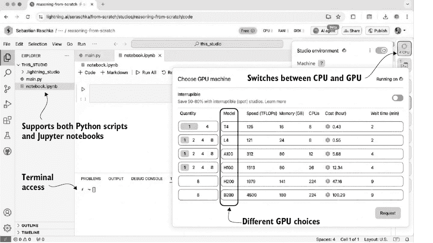

**图 2.4** 网页浏览器中 Lightning AI GPU 云平台概览。该界面支持 Python 脚本、Jupyter notebook 和终端访问，并允许用户根据计算需求在 CPU 和各种 GPU 类型之间切换。（图片颜色已反转，并转换为灰度以便印刷。）

截至撰写本文时，Lightning AI 还在用户注册和验证后提供免费计算额度，这些额度可用于图 2.4 中所示的不同 GPU 选项。（如前所述，本章不需要 GPU，但如果你想使用，L4 GPU 就绰绰有余了。）

**注意** 声明：我在 2023 年帮助构建并推出了 Lightning AI 平台，但我不再拥有该公司的任何经济利益。我并未受赞助而推荐它，我是自己付费使用。我使用它是因为我觉得它是最方便的选择。它支持多种类型的 GPU，可以轻松地在它们之间切换，也可以切回 CPU 以节省成本，并且无需重新设置环境即可暂停或恢复会话。

补充代码仓库在`ch02`子文件夹中包含额外的 GPU 平台推荐。

### 使用 PyTorch

在本节中，我们导入并使用了 PyTorch 库，这是目前使用最广泛的通用库。我们将在本书中一直使用它来运行和训练 LLM，包括我们将开发的推理方法。如果你是 PyTorch 新手，我建议先阅读我的“一小时学会 PyTorch：从张量到在多 GPU 上训练神经网络”教程，以充分利用本书。该教程可在我的网站上免费获取：[`sebastianraschka.com/teaching/pytorch-1h`](https://sebastianraschka.com/teaching/pytorch-1h)。

## 2.4 为 LLM 准备输入文本

现在让我们探索如何使用分词器（tokenizer）为 LLM 处理输入和输出文本。分词器至关重要，因为每个提示、推理过程和生成的答案最终都必须表示为 token ID，模型才能处理它们。图 2.5 更详细地展示了前面图 2.2 中所示的输入和输出准备步骤。

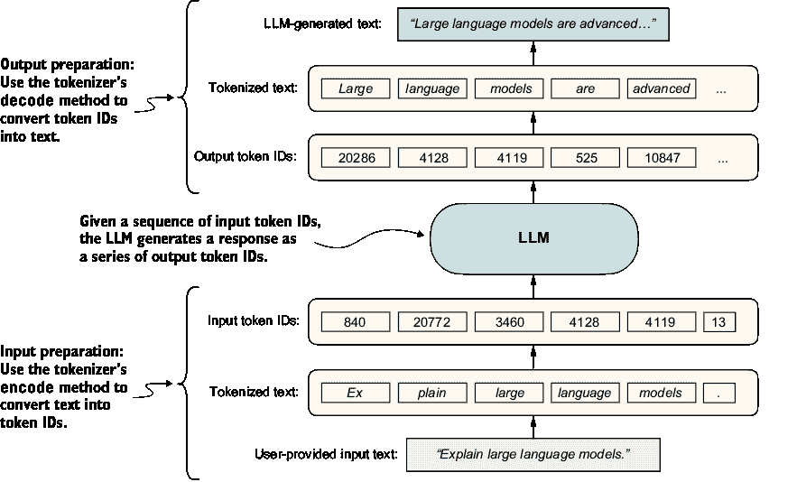

### 图 2.5 LLM 接收输入数据并生成输出的简化示意图。用户提供的文本使用分词器的`encode()`方法被分词为 ID，然后由 LLM 处理以生成输出 token ID。这些 ID 再使用分词器的`decode()`方法解码回人类可读的文本。

为了了解这在实践中如何运作，我们首先从本书的`reasoning-from-scratch` Python 包（已在 2.2 节安装）中加载一个分词器。要下载分词器文件（对应于 Qwen3 0.6B 基础 LLM），请运行此命令：

```
from reasoning_from_scratch.qwen3 import download_qwen3_small
download_qwen3_small(kind="base", tokenizer_only=True, out_dir="qwen3")
```

这将显示一个进度条：

```
tokenizer-base.json: 100% (6 MiB / 6 MiB)
```

该命令会下载`tokenizer-base.json`文件（大小约 6 MB）并将其保存在`qwen3`子目录中。

现在我们可以将分词器文件中的设置加载到`Qwen3Tokenizer`中：

```
from pathlib import Path
from reasoning_from_scratch.qwen3 import Qwen3Tokenizer

tokenizer_path = Path("qwen3") / "tokenizer-base.json"
tokenizer = Qwen3Tokenizer(tokenizer_file_path=tokenizer_path)
```

由于我们尚未加载 LLM（图 2.5 中的核心组件），我们将仅使用分词器进行一次更简单的试运行。具体来说，我们将进行一次分词往返：将文本编码为 token ID，然后将这些 ID 解码回文本，如图 2.6 所示。

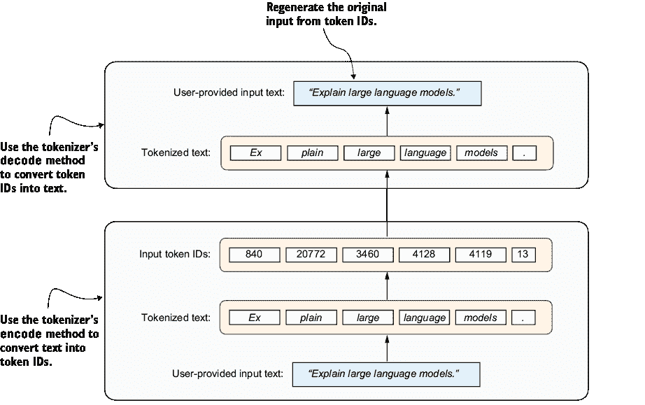

### 图 2.6 使用分词器进行往返分词的过程。用户提供的输入文本首先使用`encode()`方法转换为 token ID，然后使用`decode()`方法重建为原始文本。

以下代码片段实现了图 2.6 底部所示的编码过程：

```
prompt = "Explain large language models."
input_token_ids_list = tokenizer.encode(prompt)
```

以下代码实现了解码过程，将 token ID 转换回文本，如图 2.6 顶部所示：

```
text = tokenizer.decode(input_token_ids_list)
print(text)
```

根据以下打印结果，我们可以看出分词器从 token ID 中重建了原始输入提示：

```
'Explain large language models.'
```

在继续讨论 LLM 之前，让我们看一下由`encode()`方法生成的 token ID。以下代码打印每个 token ID 及其对应的解码字符串，以说明分词器的工作方式：

```
for i in input_token_ids_list:
    print(f"{i} --> {tokenizer.decode([i])}")
```

输出如下：

```
840 --> Ex
20772 --> plain
3460 -->  large
4128 -->  language
4119 -->  models
13 --> .
```

正如你在输出中看到的，原始文本被分割成了六个 token ID。每个 token 代表一个单词或子词，具体取决于分词器如何分割输入。

例如，“Explain”被拆分成两个独立的 token：“Ex”和“plain”。这是因为分词器算法使用了一种基于子词的方法，称为*字节对编码*（BPE）。BPE 可以通过混合使用完整单词和子词单元来表示常见和罕见词汇。空格通常也会包含在 token 中（例如，“ large”），这有助于 LLM 检测单词边界。

`Qwen3Tokenizer`拥有约 151,000 个 token 的词汇表，就撰写本文时而言，这相对较大（相比之下，早期的 GPT-2 约有 50,000 个 token，Llama 3 约有 128,000 个 token）。

语言模型中更大的词汇表会增加模型的规模，因为嵌入层和输出层必须存储更多的 token 表示。它还会增加生成下一个 token 概率的每 token 计算成本。更大的词汇表还允许更多单词被表示为单个 token，而不是被拆分成子词组件，这可以减少序列长度。例如，将“Explain”这样的单词拆分成“Ex”和“plain”会产生更多的输入 token。更多的 token 会导致更长的输入序列，从而增加处理时间和资源消耗。这里存在一个权衡：更大的词汇表虽然每 token 成本稍高，但更小的词汇表通常会产生更长的 token 序列。例如，序列中 token 数量翻倍大致会使运行模型的计算成本翻倍，因为模型需要处理并生成更多的 token。

遗憾的是，分词器及其实现的细节超出了本书的范围。如果你感兴趣，可以在附录 A 中找到更多资源，包括我的从零开始实现。

### 练习 2.1：编码未知单词

尝试使用分词器，看看它是否以及如何处理未知单词。为此，请发挥创意，编造一些不存在的单词。此外，如果你会说多种语言，可以尝试用英语以外的语言编码单词。

## 2.5 加载预训练模型

在上一节中，我们加载并熟悉了分词器，它为 LLM 准备输入数据并将 LLM 输出转换回人类可读的文本。在本节中，我们将加载 LLM 本身及其预训练权重，如图 2.7 所示。一旦这个基础模型就位，后续章节将直接在其基础上进行构建：评估它、以不同方式提示它，并最终将其训练成一个更强的推理模型。

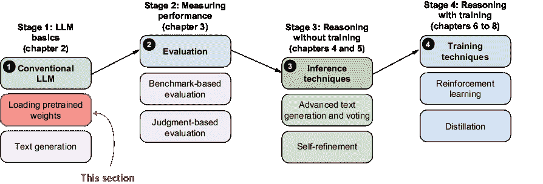

### 图 2.7 本书开发推理模型的四个关键阶段概览。本节聚焦于阶段 1 中加载预训练 LLM。

本书使用 Qwen3 0.6B 作为其预训练基础模型。名称中的“0.6B”表示该模型包含约 0.6 亿个权重参数。

为什么使用 Qwen3？在仔细评估了几个开放权重的基础模型后，我选择 Qwen3 0.6B，原因如下：

* 对于本书，我们需要一个体积小但能力强的开放权重模型（开放权重模型是指其训练权重可以公开下载的模型），并且能在消费级硬件上运行。


# Qwen3 基础模型与推理方法

Qwen3 既提供基础模型（我们推理模型开发的重点），也提供官方的推理变体，我们可以将其作为评估的参考。

> **注意：** “Qwen3”的规范拼写不包含空格，而例如“Llama 3”则包含空格。

本着“从零开始”构建的精神，本书使用了我在纯 PyTorch 中编写、且完全不依赖外部 LLM 库的 Qwen3 自定义重实现。该重实现的重点是代码的可读性和易调整性，以便你日后可能为自身实验对其进行修改。尽管是从零构建，该实现仍与原始预训练的 Qwen3 模型权重完全兼容。

本书并不深入探讨 Qwen3 的代码实现。仅该主题本身就足以独立成书，类似我的 *《构建大语言模型（从零开始）》* 一书。相反，本书着重于在基础模型（此处即 Qwen3）之上实现推理方法。如果你对 Qwen3 及模型代码的更详细信息感兴趣，可参阅附录 C。

**注意：** 此重实现的 Qwen3 LLM 完全在本地运行，与任何其他以 PyTorch 实现的神经网络一样。不涉及服务端组件或外部 API 调用。所有模型使用均在你自己的机器上完成，你的数据留在你的设备中。如果你关心隐私，我们使用的设置可以确保对 LLM 的输入和输出拥有完全控制。

在加载模型之前，我们可以指定将使用的设备，即 CPU 或 GPU。下面的代码会自动选择最可用的设备。

### 清单 2.1 自动获取设备

```python
def get_device(enable_tensor_cores=True):
    if torch.cuda.is_available():
        device = torch.device("cuda")
        print("Using NVIDIA CUDA GPU")

        if enable_tensor_cores:
            major, minor = map(int, torch.__version__.split(".")[:2])
            if (major, minor) >= (2, 9):
                torch.backends.cuda.matmul.fp32_precision = "tf32"
                torch.backends.cudnn.conv.fp32_precision = "tf32"
            else:
                torch.backends.cuda.matmul.allow_tf32 = True
                torch.backends.cudnn.allow_tf32 = True

    elif torch.backends.mps.is_available():
        device = torch.device("mps")
        print("Using Apple Silicon GPU (MPS)")

    elif torch.xpu.is_available():
        device = torch.device("xpu")
        print("Using Intel GPU")

    else:
        device = torch.device("cpu")
        print("Using CPU")

    return device
```

请注意，如果你拥有较新的 NVIDIA GPU（基于 Ampere 架构或更新），当 `enable_tensor_cores=True` 时，`get_device()` 函数会自动启用 Tensor Cores 以加快矩阵乘法。这可能会略微改变浮点舍入，但不会明显影响本书中的结果，而在新显卡上的速度优势是值得的。在非 NVIDIA 设备上，这些设置会被忽略。

使用清单 2.1 中的代码，我们可以按如下方式获取设备：

```python
device = get_device()
```

虽然 GPU 通常能带来显著的速度和性能提升，但为了兼容性和调试，在 CPU 上运行本章剩余代码也可能会有所帮助。你可以通过显式设置设备来临时覆盖自动选择：

```python
device = torch.device("cpu")
```

当你完成本章并验证代码在 CPU 上能正常运行后，可以移除或注释掉手动覆盖并重新运行代码。如果你的系统有 GPU，那么此后应能看到更好的性能。

**注意：** 本章剩余部分的代码在搭载 Apple M4 CPU 的 Mac Mini 上执行。本章末尾包含与 Apple Silicon M4 GPU 和 NVIDIA H100 GPU 的性能对比。

在加载模型并将其放到所选 `device` 上之前，我们首先需要下载 Qwen3 0.6B 的权重。需要这些文件才能正确初始化预训练模型。在上一节中，我们调用了带有 `tokenizer_only=True` 的 `download_qwen3_small()` 函数，仅下载了分词器文件。这里，我们使用相同的函数，但设置 `tokenizer_only=False`，以便也下载模型权重：

```python
download_qwen3_small(kind="base", tokenizer_only=False, out_dir="qwen3")
```

输出如下：

```
qwen3-0.6B-base.pth: 100% (1433 MiB / 1433 MiB)
✓ qwen3/tokenizer-base.json already up-to-date
```

（分词器旁边有复选标记，因为我们在上一节已下载了它。）

既然我们已经下载了模型权重，就可以实例化一个 `Qwen3Model` 类，并通过 PyTorch 的 `load_state_dict` 方法加载预训练权重：

```python
from reasoning_from_scratch.qwen3 import Qwen3Model, QWEN_CONFIG_06_B

model_path = Path("qwen3") / "qwen3-0.6B-base.pth"
model = Qwen3Model(QWEN_CONFIG_06_B)  #1
model.load_state_dict(torch.load(model_path))  #2
model.to(device)  #3
```

- `#1` 实例化一个 Qwen3 模型，使用随机权重作为占位符。
- `#2` 将预训练权重加载到模型中。
- `#3` 将模型转移到指定设备（例如 “cuda”）。

请注意，如果设备设置为 `"cpu"`，则 `model.to(device)` 操作会被跳过，因为模型默认已位于 CPU 内存中。

执行上述代码后，你应该看到以下输出。（如果你不是在 Jupyter 笔记本等交互式环境中运行代码，则需要运行 `print(model)` 才能看到此输出。）

```
Qwen3Model(
  (tok_emb): Embedding(151936, 1024)
  (trf_blocks): ModuleList(
    (0-27): 28 x TransformerBlock(
      (att): GroupedQueryAttention(
        (W_query): Linear(in_features=1024, out_features=2048, bias=False)
        (W_key): Linear(in_features=1024, out_features=1024, bias=False)
        (W_value): Linear(in_features=1024, out_features=1024, bias=False)
        (out_proj): Linear(in_features=2048, out_features=1024, bias=False)
        (q_norm): RMSNorm()
        (k_norm): RMSNorm()
      )
      (ff): FeedForward(
        (fc1): Linear(in_features=1024, out_features=3072, bias=False)
        (fc2): Linear(in_features=1024, out_features=3072, bias=False)
        (fc3): Linear(in_features=3072, out_features=1024, bias=False)
      )
      (norm1): RMSNorm()
      (norm2): RMSNorm()
    )
  )
  (final_norm): RMSNorm()
  (out_head): Linear(in_features=1024, out_features=153936, bias=False)
)
```

该输出是 Qwen3 0.6B 基础模型架构的概要，由 PyTorch 打印。它突出了模型的核心组件：嵌入层、28 个变压器块的堆叠，以及最终的线性投影头。每个变压器块包括一个分组查询注意力机制和一个多层前馈网络，并贯穿归一化层。

这些组件也在图 2.8 中进行了说明，适合熟悉 LLM 架构的读者，但本书并不要求深入理解该架构。由于我们不是修改基础模型本身，而是在其之上构建推理方法，因此你可以安全地暂时将架构视为黑盒。如果你感兴趣，可以在附录 C 中找到有关这些组件（例如 RMSNorm）的更多信息。

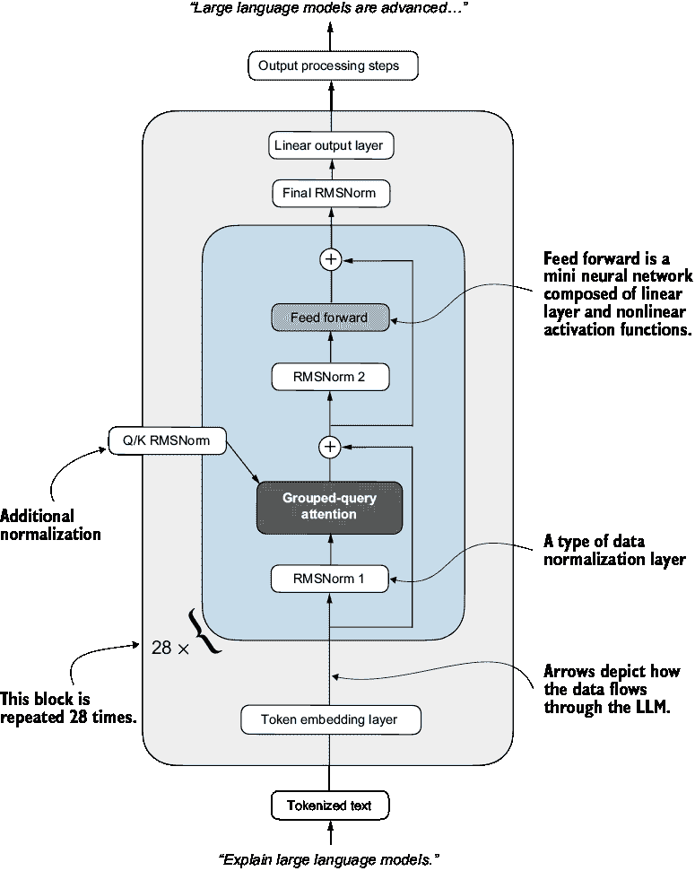

### 图 2.8 前面实例化的 Qwen3 0.6B 模型架构概览。输入文本被分词化并经过嵌入层，随后是 28 个重复的变压器块。每个块包含分组查询注意力、前馈层和 RMS 归一化。模型以最终归一化和线性输出层结束。箭头显示数据流经模型的方式。

现在我们已经加载了一个预训练模型，它应当能够生成连贯的文本。在下一节中，我们将编写一个文本生成函数，该函数将分词化数据输入模型，并以人类可读的形式返回输出。

## 2.6 理解顺序式 LLM 文本生成过程

既然我们已经加载了预训练的 LLM，我们的目标是编写一个函数，利用该 LLM 来生成文本。这个函数将为本书后续实现的推理改进方法奠定基础，如图 2.9 所示。

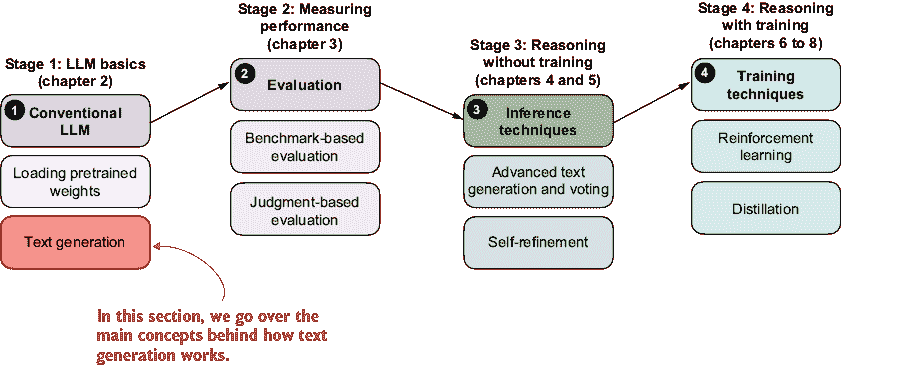

### 图 2.9 本书中开发推理模型的四个关键阶段概述。本节解释 LLM 中文本生成背后的主要概念，这将使我们能够实现一个使用预训练 LLM 的文本生成函数。

你可能已经知道，LLM 中的文本生成是一个顺序过程，LLM 一次生成一个词（或 token）。这通常也被称为*自回归*文本生成。图 2.10 展示了一个大致的流程，每一步生成一个输出 token（位于顶行），并同时将其作为输入提示的一部分反馈给模型。

### 聊天机器人界面

聊天界面只是将底层的下一个 token 预测过程（如图 2.10 所示）包装在一个对话循环中。聊天机器人模型仍然一次预测一个 token，但系统会将整个对话历史反馈给模型，这样每一步的新回复都会在轮次之间具有上下文感知和连贯性。本书专注于单轮对话，即当前答案独立于之前的答案。如果你有兴趣，可以在附录 G 中找到带有回答历史的聊天界面实现。

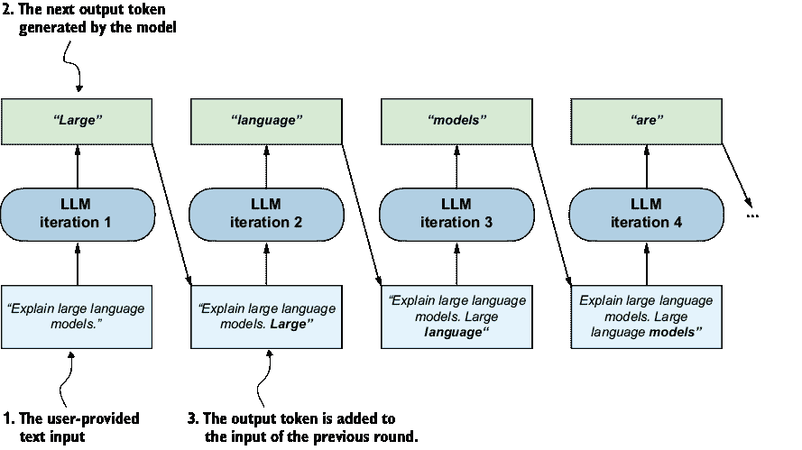

#### 图 2.10 LLM 中的顺序（自回归）文本生成。在每次迭代中，模型根据输入和先前生成的 token 生成下一个 token，这些 token 会累积地反馈给模型，以产生连贯的输出。

如果我们放大图 2.10 中的某一次迭代，可以看到 LLM 在一次前向传播中处理完整的输入序列，并为每个输入位置生成一个预测。这意味着如果我们有六个输入 token，模型会返回六个对应的预测，如图 2.11 所示。该图使逐位置的结构一目了然，但模型输出通常不仅仅是输入提示向后移动一个位置。相反，每个位置都会产生一个关于可能的下一个 token 的分布。对于文本生成，我们只使用最后一个位置的预测，因为它能告诉我们接下来该添加哪个新 token。

在实现一个文本生成函数（该函数在自回归文本生成过程的每次迭代中使用图 2.11 所示的概念）之前，让我们看一个代码示例来进一步说明图 2.11。我们将重用第 2.4 节中的“解释大型语言模型。”提示：

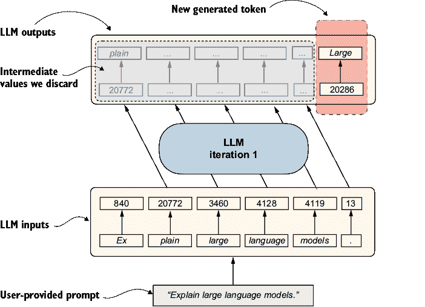

#### 图 2.11 LLM 处理完整的输入序列，并为每个输入位置生成一个下一个 token 预测。这些预测在概念上向前移动了一步，因为每个位置都预测其后的 token。该插图按位置对齐以帮助理解，但输出并不是字面上的输入提示向后移动一个位置。在生成过程中，我们只保留最后一个预测，并用它一次一个 token 地继续扩展输入提示。

```python
prompt = "Explain large language models."
input_token_ids_list = tokenizer.encode(prompt)
print(f"Number of input tokens: {len(input_token_ids_list)}")

input_tensor = torch.tensor(input_token_ids_list)  #1
input_tensor_fmt = input_tensor.unsqueeze(0)  #2
input_tensor_fmt = input_tensor_fmt.to(device)

with torch.inference_mode():
    output_tensor = model(input_tensor_fmt)  #3
output_tensor_fmt = output_tensor.squeeze(0)  #4
print(f"Formatted Output tensor shape: {output_tensor_fmt.shape}")
```

- `#1` 将 Python 列表转换为 PyTorch 张量。
- `#2` 增加一个额外的维度。
- `#3` 生成输出。
- `#4` 移除多余的维度。

上述代码产生以下输出：

```
Number of input tokens: 6
Formatted Output tensor shape: torch.Size([6, 151936])
```

如我们所见，我们将六个输入 token 输入模型，模型返回一个 6×151,936 维的矩阵。这个矩阵中的 6 对应六个输入 token。第二个维度 151,936 对应模型支持的词汇表大小。例如，六个 token 中的每一个都由一个包含 151,936 个值的向量表示。我们可以将这些向量中的值视为词汇表中每个可能单词的分数，其中最高分数对应的单词或子词（在包含 151,936 个条目的词汇表中）最有可能被选为生成的 token。

### 压缩和扩展张量

张量是 *n* 维的广义矩阵。许多 PyTorch 函数和模型组件期望特定维度的张量，因此能够添加或移除维度对于使数据与这些操作兼容非常重要。

PyTorch 中的 `.squeeze()` 和 `.unsqueeze()` 操作通过移除或添加大小为 1 的维度来改变张量的形状。这对于重塑张量以匹配模型的期望通常很有用。例如，模型可能期望输入张量具有两个维度（例如，行和列），以便处理批量输入（参见附录 E）。但如果输入只是一个行向量，我们可以使用 `.unsqueeze(0)` 添加一个额外的维度使其兼容：

```python
example = torch.tensor([1, 2, 3])
print(example)
print(example.unsqueeze(0))
```

这会返回以下结果：

```
tensor([1, 2, 3])
tensor([[1, 2, 3]])
```

在这里，`.unsqueeze(0)` 在位置 0 添加了一个新维度，将一维张量转换为形状为 `(1, 3)` 的二维张量。相反，`.squeeze(0)` 会从位置 0 移除大小为 1 的维度：

```python
example = torch.tensor([[1, 2, 3]])
print(example)
print(example.squeeze(0))
```

这会返回以下结果：

```
tensor([[1, 2, 3]])
tensor([1, 2, 3])
```

当你想要移除不需要的多余维度时，这非常有用。

为了获得下一个生成的单词，我们提取这个 6×151,936 维矩阵的最后一行，找到该行中最大值分数对应的 token ID，然后通过分词器将该 token ID 转换回文本，如图 2.12 所示。

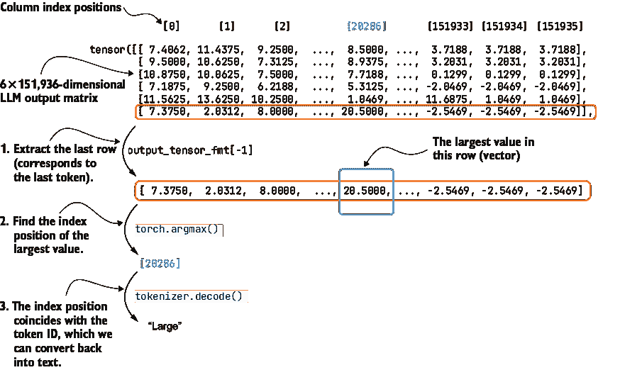

#### 图 2.12 在单次文本生成迭代中，LLM 输出的原始分数如何被转换为 token ID 及其对应的文本表示的详细说明。

让我们看看如何在代码中将 LLM 输出矩阵转换为生成的文本 token（如图 2.12 所示）。

请注意，对于文本生成，我们以推理模式而非训练模式运行模型，因此 PyTorch 不需要跟踪梯度。如图 2.11 所示，较早的位置对应的是针对提示中已有 token 的预测。只有最后一个位置预测了我们想要追加的下一个未见过的 token，我们可以通过 `[-1]` 索引获得：

```python
last_token = output_tensor_fmt[-1]
print(last_token)
```

在上一步中使用 `torch.inference_mode()` 可以避免存储在生成期间不需要的梯度信息。这减少了内存使用，并且通常会提高速度。

这会打印出与最后一个 token 对应的 151,936 个值：

```
tensor([ 7.3750,  2.0312,  8.0000,  ..., -2.5469, -2.5469, -2.5469],
       dtype=torch.bfloat16)
```

`dtype=torch.bfloat16` 后缀表示这些分数以 `bfloat16` 存储，这是一种降低精度的格式，常用于降低内存使用并提高 LLM 推理效率。根据你的硬件和设置，你可能会看到不同的 `dtype`。


然后，我们可以使用`argmax`函数获取该张量中最大分数值（值）所在的位置：

```
print(torch.argmax(last_token, dim=-1, keepdim=True))
```

结果是

```
tensor([20286])
```

这个返回的整数值是该向量中最大值的索引位置，同时也对应于所生成 token（`last_token`）的 token ID，我们可以通过`tokenizer`将其解码回文本：

```
print(tokenizer.decode([20286]))
```

这将打印生成的 token：

```
 Large
```

#### `max` 与 `argmax`

简要回顾一下`max`和`argmax`的工作原理及其区别会很有帮助，因为在后续实现文本生成函数时，我们将使用`torch.argmax()`来选择下一个 token。在本章中，使用`argmax`对应于贪婪解码，即我们总是选取得分最高的那一个下一个 token。我们将在本书后面讨论其他的替代方案。

`torch.max()`函数返回张量中的最大值，而`torch.argmax()`返回该值所在的索引。例如：

```
example = torch.tensor([-2, 1, 3, 1])
print(torch.max(example))
print(torch.argmax(example))
```

这会返回：

```
tensor(3)
tensor(2)
```

最大值是 3，它首次出现在索引 2 处。

我们还可以将`keepdim=True`与`torch.argmax()`结合使用，通过保留被缩减的维度来保持输出形状的一致性：

```
print(torch.argmax(example, keepdim=True))
```

这会返回：

```
tensor([2])
```

在这里，`keepdim=True`将结果保持为与输入具有相同维度数量的一维张量，这有助于保持`tokenizer`所需的形状，也便于后续在文本生成函数中进行拼接。

回顾一下，图 2.10 展示了 LLM 中迭代式（自回归）文本生成的过程。随后，图 2.11 放大了该过程中的一次迭代。图 2.12 则进一步放大了这一次迭代，展示了（LLM 输出的）得分矩阵如何被转换为 token ID（及其对应的文本表示）。

虽然我们已经了解了如何使用 LLM 生成单个 token，但在下一节中，我们将把这些概念付诸实践，实现一个按顺序应用该概念以生成连贯输出文本的函数。

## 2.7 编写一个极简的文本生成函数

上一节解释了 LLM 中基础顺序文本生成过程中的单次迭代。在本节中，我们将基于这一概念，实现一个使用预训练 LLM 根据用户提示生成连贯文本的文本生成函数，如本章概览中的图 2.13 所示。

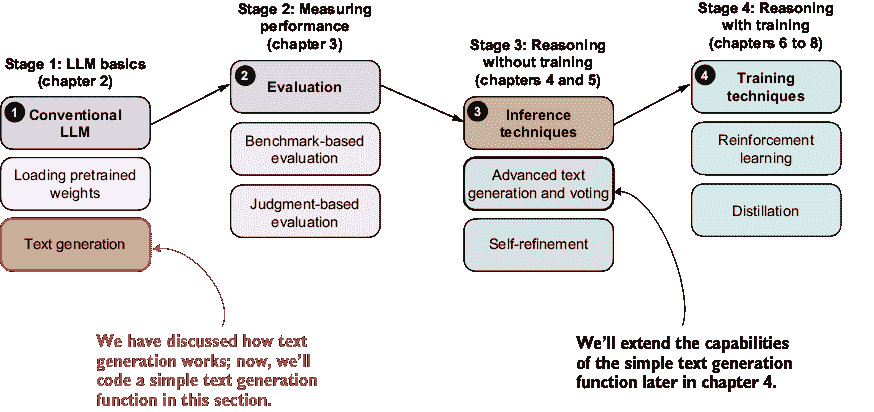

### 图 2.13 本书中开发推理模型的四个关键阶段概览。在本节中，我们为预训练 LLM 实现一个文本生成函数。

图 2.13 中提到的这个文本生成函数的工作原理是：首先将输入提示转换为模型可以处理的 token ID。然后模型预测下一个最有可能的 token，将其追加到序列中，并重新处理扩展后的序列以生成下一个 token。这一迭代过程一直持续到满足停止条件为止，随后生成的 token ID 会被解码回文本。

图 2.14 逐步展示了这一过程，同时给出了每个阶段生成的 token ID 及其对应的文本。（该图与上一节开头展示的图 2.10 类似，区别在于图 2.14 还在文本表示下方显示了生成的 token ID。）

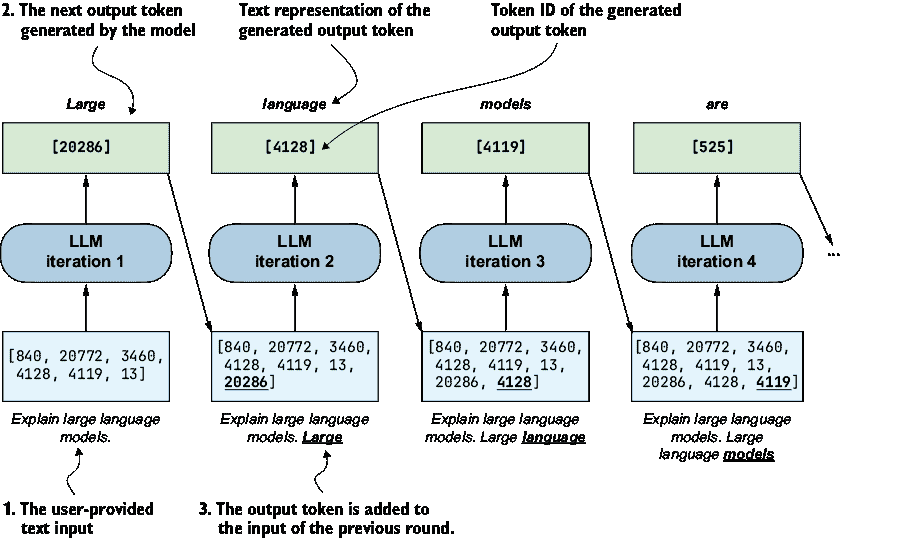

### 图 2.14 大型语言模型（LLM）中顺序（自回归）文本生成的示意图，明确展示了 token ID。在每次迭代中，模型基于原始输入和所有先前生成的 token 来生成下一个 token。预测出的 token 会以文本和 token ID 两种形式添加到序列中。

清单 2.2 中的`generate_text_basic_stream`函数使用上一节介绍的`argmax`函数实现了顺序文本生成过程（图 2.14）。

### 清单 2.2 一个基础的文本生成函数

```
@torch.inference_mode()                                        #1
def generate_text_basic_stream(
    model,
    token_ids,
    max_new_tokens, 
    eos_token_id=None
):

    model.eval()                                               #2

    for _ in range(max_new_tokens):
        out = model(token_ids)[:, -1]                          #3
        next_token = torch.argmax(out, dim=-1, keepdim=True)

        if (eos_token_id is not None                           #4
                and torch.all(next_token == eos_token_id)):
            break

        yield next_token                                       #5

        token_ids = torch.cat([token_ids, next_token], dim=1)  #6
```

- `#1` 禁用梯度跟踪以提高速度和内存效率。

- `#2` 将模型切换到评估模式以实现确定性行为（最佳实践）。

- `#3` 获取最后一个 token 的得分。

- `#4` 如果批次中的所有序列都已生成 EOS，则停止。

- `#5` 每生成一个 token 就立即产出。

- `#6` 将新预测出的 token 追加到序列中。

本质上，清单 2.2 中的`generate_text_basic_stream`函数通过`for`循环，在用户指定的迭代次数（`max_new_tokens`）内应用基于`argmax`的 token ID 提取。它返回生成的 token ID，类似于图 2.14 所示的内容，我们可以随后将其转换回文本。

让我们用该函数对简单的`"Explain large language models in a single sentence."`提示生成一个 100-token 的响应，以确保`Qwen3Model`和`generate_text_basic_stream`函数能够正常工作（我们将在后续章节中介绍推理任务的示例）。

请注意，以下代码运行较慢，可能需要 1–3 分钟才能完成，具体取决于你的计算机（我们将在后续章节中对其进行加速）：

```
prompt = "Explain large language models in a single sentence."
input_token_ids_tensor = torch.tensor(
    tokenizer.encode(prompt),
    device=device                       #1
    ).unsqueeze(0)

max_new_tokens = 100                    #2

for token in generate_text_basic_stream(
    model=model,
    token_ids=input_token_ids_tensor,
    max_new_tokens=max_new_tokens,
):
    token_id = token.squeeze(0).tolist()     #3
    print(
        tokenizer.decode(token_id),
        end="",
        flush=True  #4
    )
```

- `#1` 将输入 token ID 转移到模型所在的同一设备（CPU、GPU）上。

- `#2` 让模型最多生成 100 个新 token。

- `#3` 将输出的 token ID 从 PyTorch 张量转换为 Python 列表。

- `#4` 停用缓冲，以便实时打印 token

生成的输出文本如下：

```
 Large language models are artificial intelligence systems that can
understand, generate, and process human language, enabling them to
perform a wide range of tasks, from answering questions to writing
articles, and even creating creative content.<|endoftext|>Human language
is a complex and dynamic system that has evolved over millions of
years to enable effective communication and social interaction. It is
composed of a vast array of symbols, including letters, numbers, and
words, which are used to convey meaning and express thoughts and
ideas. The evolution of language has
```

请注意，以上输出是在 CPU 上生成的。根据设备的不同（例如 CPU 与 GPU），由于不同硬件上浮点运算行为的差异，确切的措辞可能会略有不同。

从输出可以看出，模型很好地遵循了指令，针对提示生成了一个清晰完整的句子。在特殊 token `<|endoftext|>` 之后，它继续生成了一些额外的、偏离主题的文本。该 token 在训练期间用于标记文档的结尾并分隔不同的样本。

**提示：** `" Large"` 中的前导空格（第一个输出词）是预期现象，因为许多分词器在编码紧跟先前文本的词时，会包含一个前导空格。在代码清单 2.2 中，标记按照输入文本逐个流式生成，因此这个前导空格会自然地出现在第一个生成的标记中。如果我们希望输出更干净，可以对第一个标记或最终拼接的字符串调用`.lstrip()`。

当使用模型进行推理（在训练后生成文本）时，我们通常希望它在生成特殊标记`<|endoftext|>`后立即停止。这个标记用 ID `151643` 表示，我们可以通过下面的代码确认：

```
print(tokenizer.encode("<|endoftext|>"))
```

为了方便，这个标记 ID 也通过`tokenizer.eos_token_id`属性保存。我们可以将这个 ID 传递给`generate_text_basic_stream`函数，以指示生成应在何时停止：

```
for token in generate_text_basic_stream(
    model=model,
    token_ids=input_token_ids_tensor,
    max_new_tokens=max_new_tokens,
    eos_token_id=tokenizer.eos_token_id  #1
):
    token_id = token.squeeze(0).tolist()
    print(
        tokenizer.decode(token_id),
        end="",
        flush=True
    )
```

#1 传入序列结束（eos）标记 ID。

输出如下：

```
 Large language models are artificial intelligence systems that can
understand, generate, and process human language, enabling them to
perform a wide range of tasks, from answering questions to writing
articles, and even creating creative content.
```

将此次响应与之前的响应相比，我们可以发现，一旦遇到序列结束标记，文本生成就停止了。

你可能已经注意到，生成响应相对较慢，可能需要几秒到几分钟不等，具体取决于硬件。在我们结束本节并学习如何大幅加速这个函数之前，先在下一个代码清单中实现一个简单的工具函数，用于测量文本生成过程的运行时间。

### 代码清单 2.3 标记生成速度与内存使用

```
import warnings

def generate_stats(output_token_ids, tokenizer, start_time,
                   end_time):
    total_time = end_time - start_time
    print(f"\n\nTime: {total_time:.2f} sec")
    print(f"{int(output_token_ids.numel() / total_time)} tokens/sec")

    for name, backend in (("CUDA", getattr(torch, "cuda", None)),
                          ("XPU", getattr(torch, "xpu", None))):
        if backend is not None and backend.is_available():

            device_type = output_token_ids.device.type#1
            if device_type != name.lower():
                warnings.warn(
                    f"{name} is available but tensors are on "
                    f"{device_type}. Memory stats may be 0."
                )

            if hasattr(backend, "synchronize"):#2
                backend.synchronize()

            max_mem_bytes = backend.max_memory_allocated()
            max_mem_gb = max_mem_bytes / (1024 ** 3)
            print(f"Max {name} memory allocated: {max_mem_gb:.2f} GB")

            backend.reset_peak_memory_stats()
```

#1 检查我们是否实际在使用这个后端。

#2 如果支持则进行同步（对异步后端很重要）。

代码清单 2.3 中的`generate_stats`函数将根据开始和结束时间戳计算总运行时间、以每秒标记数（tokens/sec）为单位的生成速度，以及所用 GPU 内存。请注意，目前 GPU 内存使用量仅针对支持 CUDA 的 GPU（以及部分通过 XPU 支持的新款 Intel GPU）计算，因为 PyTorch 没有针对 CPU 和 Apple Silicon GPU 的类似工具函数。

为了应用`generate_stats`函数，我们在运行`generate_text_basic_stream`函数前后，通过 Python 的`time`模块分别获取`start_time`和`end_time`时间戳：

```
import time

start_time = time.time()
generated_ids = []

for token in generate_text_basic_stream(
    model=model,
    token_ids=input_token_ids_tensor,
    max_new_tokens=max_new_tokens,
    eos_token_id=tokenizer.eos_token_id
):
    token_id = token.squeeze(0).tolist()
    print(
        tokenizer.decode(token_id),
        end="",
        flush=True
    )
    next_token_id = token.squeeze(0)
    generated_ids.append(next_token_id)  #1

end_time = time.time()
output_token_ids_tensor = torch.cat(generated_ids, dim=0)
generate_stats(output_token_ids_tensor, tokenizer, start_time, end_time)
```

#1 收集生成的标记。

在 Mac Mini M4 CPU 上，输出如下：


```
Time: 7.94 sec
5 tokens/sec
 Large language models are artificial intelligence systems that can
understand, generate, and process human language, enabling them to
perform a wide range of tasks, from answering questions to writing
articles, and even creating creative content.
```

每秒 5 个标记的生成速度相对较慢。在下一节中，我们将实现一种缓存技术，使生成过程提速 5–6 倍。

### 文本生成与推理术语

在阅读 LLM 文献或软件文档时，你经常会看到*推理*（inference）这个术语，而你可能会预期看到*文本生成*（text generation）。在神经网络语境下，推理的含义非常具体，即：将一个参数已经学习并固定下来的模型，执行一次前向传播，并产生一个预测（例如，生成下一个标记）。在这一阶段，没有任何估计或学习发生。在前向传播中，我们只是应用一个函数。

这与统计学中的推理不同，统计学的目标是从数据中学习未知信息。*统计推断*（statistical inference）涉及估计参数、量化不确定性，或检验关于总体或数据生成过程的假设。

请注意，虽然在大型语言模型场景中，模型计算的是下一个标记的分布，人们有时会说模型在“估计”或“推断”下一个标记，但这并不是统计学意义上的估计。在这个阶段，模型是一个固定函数，其参数已经学习完毕。

因此，当我们调用`generate_text_basic_stream`函数时，我们并不是在进行统计推断。我们进行的是神经网络推理，也就是将一个训练好的模型前向应用于生成下一个标记的分布，并从这个分布中选择下一个生成的标记。

## 2.8 通过 KV 缓存加速推理

既然我们已经有了一个基本的文本生成函数，就可以把注意力转向实际运行时会遇到的情况。你可能已经注意到，上一节中的文本生成有点慢。这种缓慢指向一个关键问题：推理时的性能。

在使用 LLM 进行推理时（在此上下文中指根据提示生成文本），运行性能（效率）很快变得重要，尤其是对于长序列而言。虽然本书中的代码强调清晰性而非速度，但现实系统通常使用工程技巧来使推理更高效。

这对后面的章节也很有用，因为评估和推理工作流通常需要生成大量标记或大量候选答案，所以这里的小幅加速会迅速累积。

在接下来的两节中，我们将介绍两种基本技术——KV 缓存和模型编译，如图 2.15 所示，用以加速文本生成。

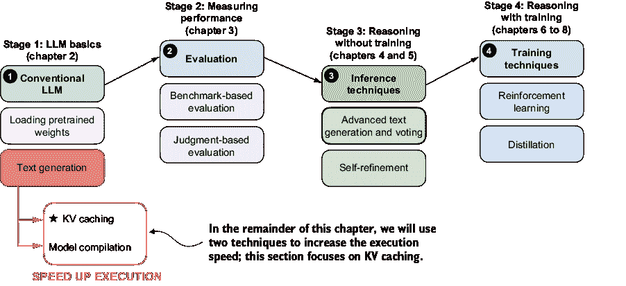

### 图 2.15 本书开发推理模型的四个关键阶段概览。本节基于预训练的 LLM 和之前编写的文本生成基础函数，应用 KV 缓存来加速执行。

如图 2.15 所述，一种提高文本生成速度的工程技巧是*KV 缓存*，其中*KV*指的是模型注意力机制中使用的键和值。如果你不熟悉这些术语，没关系。关键思想是，我们可以缓存某些中间值，并在文本生成的每一步重用它们，如图 2.16 所示，这有助于加速推理。

如图 2.16 所示，KV 缓存的关键思想是将每次迭代计算出的中间值存储在缓存中。以前，网络生成的每个新 token 都会与整个输入序列拼接，并反复馈送回模型（在图中用划掉的框表示）。这种方法效率低下，因为除了新生成的 token 外，所有 token 在后续迭代中都保持不变。通过使用 KV 缓存，我们避免了冗余计算，而是直接检索存储的中间表示。

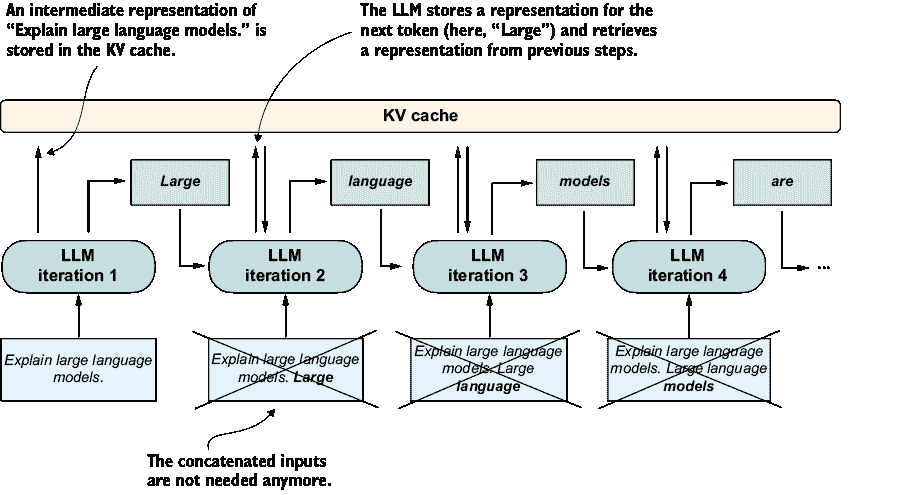

**图 2.16** 展示了 KV 缓存如何在自回归文本生成过程中提高效率。KV 缓存不是在每一步重新处理整个输入序列，而是存储中间表示，使 LLM 能够重用它们来生成下一个 token。这消除了在后续每次迭代中将生成的 token 与先前输入拼接的需要。

粗略地说，在没有 KV 缓存的情况下生成`n`个新 token 需要反复计算越来越长的序列，总计约`O(n²)`的解码工作量。这里，`O(n²)`意味着总工作量大致随输出长度的平方增长。使用 KV 缓存后，在初始处理之后，每一步仅处理新添加的 token，从而将工作量减少到约`O(n)`，这意味着总工作量大致与生成的 token 数量成正比。

如前所述，像 KV 缓存这样非推理聚焦的 LLM 细节（我们曾用它来提高 token 生成速度）超出了本书的范围，对于本书后续涉及的主题也不是必需的。不过，感兴趣的读者可以在我的免费文章中了解更多关于 KV 缓存机制的信息：*从零开始理解并编码 LLM 中的 KV 缓存*（[`magazine.sebastianraschka.com/p/coding-the-kv-cache-in-llms`](https://magazine.sebastianraschka.com/p/coding-the-kv-cache-in-llms)）。

下面是一个融合了 KV 缓存的`generate_text_basic_stream`函数的修改版本，它与清单 2.2 中的基本文本生成函数几乎相同，只是通过注释突出了与 KV 缓存相关的改动：

**清单 2.4** 一个带有 KV 缓存的基本文本生成函数

```
from reasoning_from_scratch.qwen3 import KVCache

@torch.inference_mode()
def generate_text_basic_stream_cache(
    model,
    token_ids,
    max_new_tokens,
    eos_token_id=None
):

    model.eval()
    cache = KVCache(n_layers=model.cfg["n_layers"])  #1
    model.reset_kv_cache()                            #1

    out = model(token_ids, cache=cache)[:, -1]       #2
    for _ in range(max_new_tokens):
        next_token = torch.argmax(out, dim=-1, keepdim=True)

        if (eos_token_id is not None
                and torch.all(next_token == eos_token_id)):
            break

        yield next_token
        out = model(next_token, cache=cache)[:, -1]  #3
```

- `#1` 初始化 KV 缓存。

- `#2` 在第一轮中，整个输入像之前一样提供给模型。

- `#3` 后续迭代仅将`next_token`作为输入馈送。

清单 2.4 中的`generate_text_basic_stream_cache`函数与清单 2.2 中的`generate_text_basic_stream`函数差别很小。主要区别是引入了`KVCache`对象。

在第一次迭代中，模型像之前一样接收完整的输入 token 序列，使用`model(token_ids, cache=cache)`。在幕后，KV 缓存存储为所有这些输入 token 计算的注意力键和值，因此它们无需在后续迭代中重新计算。

在随后的迭代中，我们不再需要传递整个序列。相反，我们只需使用`model(next_token, cache=cache)`向模型提供`next_token`。然后模型从先前存储的 KV 缓存中检索必要的上下文。

让我们对这个函数进行计时，看看它是否能带来性能上的提升：

```
start_time = time.time()
generated_ids = []

for token in generate_text_basic_stream_cache(
    model=model,
    token_ids=input_token_ids_tensor,
    max_new_tokens=max_new_tokens,
    eos_token_id=tokenizer.eos_token_id
):
    token_id = token.squeeze(0).tolist()
    print(
        tokenizer.decode(token_id),
        end="",
        flush=True
    )
    next_token_id = token.squeeze(0)
    generated_ids.append(next_token_id)

end_time = time.time()

output_token_ids_tensor = torch.cat(generated_ids, dim=0)
generate_stats(output_token_ids_tensor, tokenizer, start_time, end_time)
```

输出为：

```
Time: 1.40 sec
29 tokens/sec

 Large language models are artificial intelligence systems that can
understand, generate, and process human language, enabling them to
perform a wide range of tasks, from answering questions to writing
articles, and even creating creative content.
```

正如我们看到的，这种方法明显更快，每秒生成 29 个 token，而之前只有每秒 5 个 token（在 Mac Mini M4 CPU 上测量）。我们还看到，生成的文本与之前相同，这是一个重要的健全性检查，以确保 KV 缓存的实现和正确使用。

在下一节中，我们将学习另一种可用于进一步提高生成速度的技术，这在接下来的章节中评估模型时会派上用场。更快的生成速度使我们能够在更短的时间内运行更多评估，并更容易有效地比较不同模型或设置。

## 2.9 通过 PyTorch 模型编译加速推理

在上一节中，我们介绍了 KV 缓存作为一种提高运行时效率的技术，如图 2.17 中的概览所示。

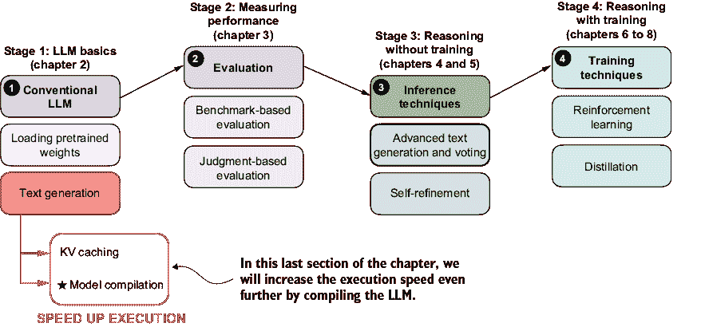

**图 2.17** 本书中开发推理模型的四个关键阶段概览。本节基于预训练 LLM 和我们之前编写的基本文本生成函数（包括 KV 缓存），并添加模型编译以进一步加快执行速度。

如图 2.17 所示，在本章的剩余部分，我们将应用另一种可以大幅加速模型推理的技术：使用`torch.compile`进行模型编译。简单来说，`torch.compile`分析模型的内部计算图，并尝试将操作组转换为更优化的内核，从而减少 Python 开销和其他执行低效。这可以提高文本生成期间的运行时性能，尤其是当我们在循环中重复调用相同的模型代码时。

这在以后运行更大规模评估和更复杂的推理工作流时会很重要，因为即使是适度的每步加速也能节省大量总运行时间。我们可以如下编译模型：

```
major, minor = map(int, torch.__version__.split(".")[:2])
if (major, minor) >= (2, 8):
    # This avoids retriggering model recompilations 
    # in PyTorch 2.8 and newer
    # if the model contains code like self.pos = self.pos + 1
    torch._dynamo.config.allow_unspec_int_on_nn_module = True

model_compiled = torch.compile(model)
```

如果你使用的是搭载 Apple Silicon 的 Mac，并遇到`InductorError`，请确保使用 PyTorch 2.9 或更高版本。

值得注意的是，由于初始编译和优化步骤，使用编译模型的第一次执行可能会比平时慢。为了更好地衡量性能提升，我们将多次重复文本生成过程。

首先，我们将使用生成函数的非缓存版本来测试这一点。清单 2.5 中的代码与我们之前使用的类似，只是我们连续运行了三次。代码执行可能需要几分钟才能完成，具体取决于系统。

### 清单 2.5 使用编译后的模型生成文本

```
for i in range(3):            #1

    start_time = time.time()

    generated_ids = []

    for token in generate_text_basic_stream(
        model=model_compiled,
        token_ids=input_token_ids_tensor,
        max_new_tokens=max_new_tokens,
        eos_token_id=tokenizer.eos_token_id

    ):
        token_id = token.squeeze(0).tolist()
        print(
            tokenizer.decode(token_id),
            end="",
            flush=True
        )

        next_token_id = token.squeeze(0)
        generated_ids.append(next_token_id)

    end_time = time.time()


    if i == 0:                #2
        print("\n\nWarm-up run")   #2
    else:
        print(f"\n\nTimed run {i}:")

    output_token_ids_tensor = torch.cat(generated_ids, dim=0)
    generate_stats(output_token_ids_tensor, tokenizer, start_time, end_time)

    print(f"\n{30*'-'}\n")
```

`#1` 我们将 token 生成运行三次。  

`#2` 第一次运行被标记为“预热运行”。

输出如下：

```
 Large language models are artificial intelligence systems that can
understand, generate, and process human language, enabling them to
perform a wide range of tasks, from answering questions to writing
articles, and even creating creative content.

Warm-up run

Time: 11.68 sec
3 tokens/sec

------------------------------

 Large language models are artificial intelligence systems that can
understand, generate, and process human language, enabling them to
perform a wide range of tasks, from answering questions to writing
articles, and even creating creative content.

Timed run 1:

Time: 6.78 sec
6 tokens/sec

------------------------------

 Large language models are artificial intelligence systems that can
understand, generate, and process human language, enabling them to
perform a wide range of tasks, from answering questions to writing
articles, and even creating creative content.

Timed run 2:

Time: 6.80 sec
6 tokens/sec

------------------------------
```

从结果中可以看出，编译后的模型在速度上略有提升，与此前每秒 5 个 token 相比，现在约为每秒 6 个 token。

接下来，让我们看看 KV 缓存版本的表现如何，使用与之前相同的代码，只是将`generate_text_basic_stream`换成了`generate_text_basic_stream_cache`。

### 清单 2.6 使用编译后的模型和 KV 缓存生成文本


### 代码示例：带 KV 缓存的文本生成

```
for i in range(3):
    start_time = time.time()
    generated_ids = []

    for token in generate_text_basic_stream_cache(
        model=model_compiled,
        token_ids=input_token_ids_tensor,
        max_new_tokens=max_new_tokens,
        eos_token_id=tokenizer.eos_token_id

    ):
        token_id = token.squeeze(0).tolist()
        print(
            tokenizer.decode(token_id),
            end="",
            flush=True
        )

        next_token_id = token.squeeze(0)
        generated_ids.append(next_token_id)

    end_time = time.time()

    if i == 0:
        print("\n\nWarm-up run")
    else:
        print(f"\n\nTimed run {i}:")

    output_token_ids_tensor = torch.cat(generated_ids, dim=0)
    generate_stats(
        output_token_ids_tensor, tokenizer, start_time, end_time
    )

    print(f"\n{30*'-'}\n")
```

输出如下：

```
 Large language models are artificial intelligence systems that can
understand, generate, and process human language, enabling them to
perform a wide range of tasks, from answering questions to writing
articles, and even creating creative content.

Warm-up run

Time: 8.07 sec
5 tokens/sec

------------------------------

 Large language models are artificial intelligence systems that can
understand, generate, and process human language, enabling them to
perform a wide range of tasks, from answering questions to writing
articles, and even creating creative content.

Timed run 1:

Time: 0.60 sec
68 tokens/sec

------------------------------

 Large language models are artificial intelligence systems that can
understand, generate, and process human language, enabling them to
perform a wide range of tasks, from answering questions to writing
articles, and even creating creative content.

Timed run 2:

Time: 0.60 sec
68 tokens/sec

------------------------------
```

从输出可以看出，模型生成速度从使用 KV 缓存的未编译模型的每秒 29 个 token，提升到同一模型编译后的每秒 68 个 token（在 Mac Mini M4 CPU 上），这实现了两倍以上的加速。

如果你没有看到任何改进，请尝试使用 `"max-autotune"` 模式而非默认设置来运行 `torch.compile`。例如，将

```
model = torch.compile(model)
```

替换为

```
model = torch.compile(model, mode="max-autotune")
```

### 练习 2.2：在非 CPU 设备上重新运行代码

如果你可以使用 GPU，请在 GPU 设备上重新运行本章中的代码，并将运行时间与 CPU 运行时间进行比较。

如果你好奇不同模型配置在 Apple Silicon GPU 和高端 NVIDIA GPU 上的表现对比，请参见表 2.1。

### 表 2.1 不同硬件上不同模型配置的 token 生成速度和 GPU 内存使用情况

| 模式 | 硬件 | Tokens/秒 | GPU 内存 |
| --- | --- | --- | --- |
| 常规 | Mac Mini M4 CPU | 5 | - |
| 常规编译 | Mac Mini M4 CPU | 6 | - |
| KV 缓存 | Mac Mini M4 CPU | 28 | - |
| KV 缓存编译 | Mac Mini M4 CPU | 68 | - |
| 常规 | Mac Mini M4 GPU | 27 | - |
| 常规编译 | Mac Mini M4 GPU | 43 | - |
| KV 缓存 | Mac Mini M4 GPU | 41 | - |
| KV 缓存编译 | Mac Mini M4 GPU | 71 | - |
| 常规 | NVIDIA H100 GPU | 51 | 1.55 GB |
| 常规编译 | NVIDIA H100 GPU | 164 | 1.81 GB |
| KV 缓存 | NVIDIA H100 GPU | 48 | 1.52 GB |
| KV 缓存编译 | NVIDIA H100 GPU | 141 | 1.81 GB |

如表 2.1 所示，NVIDIA GPU 提供了最佳性能，这在意料之中。在启用 KV 缓存和编译模型后，CPU 的表现依然出人意料地好。然而，有几个重要细节可以解释为什么在这种特定配置下 GPU 的收益并不更大。

首先，本章中的模型并未针对 GPU 进行优化。该实现旨在内存使用和计算速度之间取得良好平衡，因为对大多数读者来说，内存是主要的瓶颈。针对 GPU 优化的变体会预先分配完整的 `K` 和 `V` 张量，直至最大上下文长度（本例中为 40,000 个 token）。这种预分配避免了通过 `torch.cat` 进行重复拼接，但同时也增加了内存消耗。

在上下文尺寸较大时，例如为 `K` 和 `V` 都预分配 40,000 个条目，会增加显著的内存占用。另一种方法是在构建时让用户指定固定的上下文尺寸，但这会带来额外的配置开销。此处的 KV 缓存通过 `torch.cat` 按需增长，这种方式更简单且对内存更友好，不过在 GPU 上拼接非预分配的张量会稍慢一些。

我在附加材料中包含了一个针对 GPU 优化的版本，其中 KV 缓存变体比常规版本稍快，但会使用更多内存（参见 [`github.com/rasbt/reasoning-from-scratch/tree/main/ch02/03_optimized-LLM`](https://github.com/rasbt/reasoning-from-scratch/tree/main/ch02/03_optimized-LLM)）。

其次，用于基准测试的模型较小。较大的模型从 KV 缓存和 GPU 优化的内存布局中获益更多。批量推理也是如此，GPU 可以更好地饱和其计算单元。使用更大的模型或专注于 GPU 的实现，有利于 NVIDIA GPU 的性能差距将更加明显。

所有示例均使用单个提示（即批大小为 1）运行。对于对性能如何随多个输入扩展感兴趣的读者，附录 E 中讨论了批量推理。

## 小结

* 使用 LLM 生成文本涉及多个关键步骤：
    * 搭建编码环境以运行 LLM 代码并安装必要的依赖
    * 加载预训练的基础 LLM（如 Qwen3 0.6B），后续章节将为其扩展推理能力
    * 初始化并使用分词器，它将文本输入转换为 token ID，并将输出解码回人类可读的形式
* LLM 中的文本生成遵循顺序（自回归）过程，模型通过预测下一个最可能的 token 逐 token 生成
* 文本生成的速度和效率可以通过以下方式提高
    * KV 缓存，它存储中间状态以避免每一步重新计算先前遇到的输入 token
    * 使用`torch.compile`进行模型编译，以优化运行时性能
* 本章通过使用预训练的基础 LLM 实现一个功能完善、高效的文本生成流水线，为后续章节的推理能力奠定技术基础。
