# 3 评估推理模型

## 本章涵盖

* 从 LLM 响应中可靠地提取最终答案
* 使用符号数学求解器将 LLM 的输出与参考解进行比较，以验证答案的正确性
* 运行完整的评估流水线，加载预训练模型，生成输出，并根据数据集对其进行评分

评估使我们能够区分那些听起来令人信服但实际无法正确解决问题的 LLM。LLM 评估技术涵盖了广泛的方法，从衡量任务准确率到确保 LLM 遵守特定的安全标准。在本章中，“评估”意味着在许多示例上对模型进行定量测试，并根据参考答案对其输出进行评分。

更具体地说，我们将专注于实现一种基于*验证*的方法，通过使用类似计算器的实现，将 LLM 的答案与参考解进行比较，来检查 LLM 能否准确解决数学问题。

这个验证器特别有用，因为它不仅评估数学任务上的性能，还引入了*可验证奖励*的原则，这是我们将在第 6 章实现的推理模型强化学习方法的基础。

## 3.1 构建数学验证器

在实践中，评估训练好的 LLM 有四种常见方式：*多项选择*、*验证器*、*排行榜*和*LLM 评判*。这些方法广泛用于研究论文、技术报告、营销材料和模型卡（总结模型如何训练、评估以及预期用途的文档），其结果往往来自多个类别。

如图 3.1 所示，这些评估方法可分为两大类：*基于基准的评估*和*基于判断的评估*。前者通常更偏向定量，而后者更依赖于定性判断。这四种评估方法在不同情境下都有用，但验证器与推理模型尤为相关。

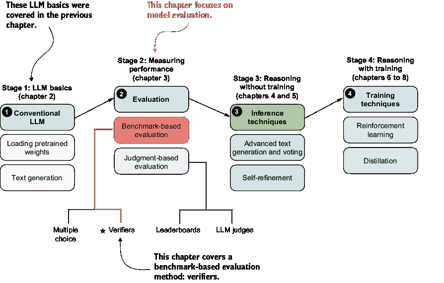

### 图 3.1 本书涵盖主题的模型。本章涵盖评估方法（第 2 阶段），特别关注实现验证器，我们将在第 6 章将其复用为可验证奖励的基础。

数学问题提供了一个自然的例子：取决于问题的复杂度，它们受益于逐步推理，同时评估也很直接，因为最终答案可以与正确答案核对。在这种情况下，验证器提供了一种简单可靠的方法来衡量模型的推理步骤是否导向正确的结果。

在本章中，我们将重点介绍验证器，作为一种基于基准的方法，用于衡量数学问题中答案的正确性。验证器将提取的答案与参考解进行比较，如图 3.2 所示，通常借助代码解释器或计算器程序等外部工具。

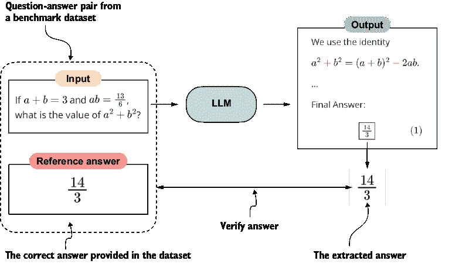

### 图 3.2 在自由形式问答中使用基于验证的方法评估 LLM。模型生成自由形式的答案（可能包含多个步骤）和最终的方框答案，将该答案提取出来并与数据集中的正确答案进行比较。

注意，附录 F 涵盖了其他评估方法，例如多项选择基准、基于偏好的排行榜和 LLM 作为评判者等方法。

虽然我们当下的重点是评估，但验证器将在本书后面重新出现。它们不仅作为衡量性能的一种方式，还作为强化学习方法中用于训练推理模型的反馈信号，我们将在第 6 章探讨这一点。

缺点是验证器方法只能应用于易于（最好是确定性地）验证的领域，例如数学和代码。此外，这种方法可能引入额外的复杂性和依赖，并可能将部分评估负担从模型本身转移到外部工具上。

由于数学问题求解可以通过编程方式生成无限多的变体，并且受益于逐步推理，这一任务已成为评估和开发推理模型的基石。在本章中，我们将按照图 3.3 所示的八个步骤，逐步构建一个数学验证器。

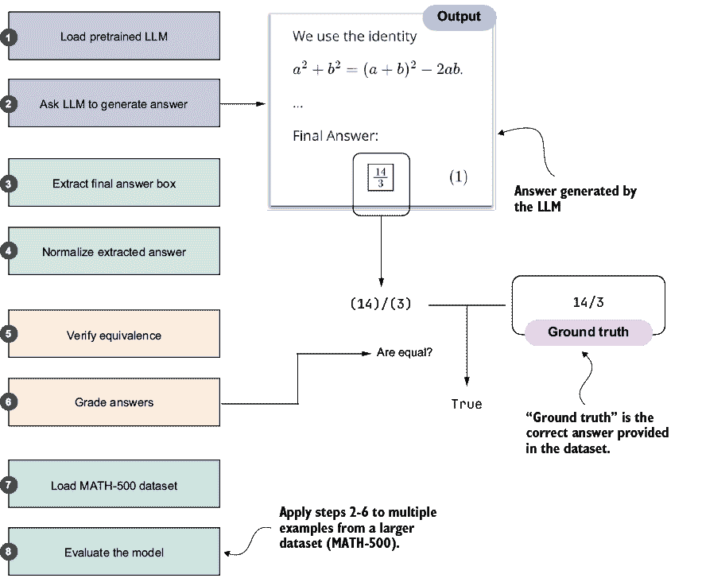

### 图 3.3 构建和应用数学验证器的分步工作流程。从预训练 LLM 开始，我们将生成答案、提取并规范化答案，然后将其与真实解进行比较。随后对验证后的答案进行评分，并在数据集（MATH-500）上重复该过程以评估整体模型性能。

下一节将介绍图 3.3 中的步骤 1 和步骤 2：加载预训练 LLM 并设置它以生成答案。

## 3.2 加载预训练模型以生成文本

在本节中，我们开始实现验证器，首先加载上一章介绍的预训练 LLM，并将其配置为生成答案。这将为图 3.3 中的后续步骤奠定基础，在这些步骤中我们将提取、规范化并验证这些答案。它还将为后续章节建立一个可复用的模型加载路径，在后续章节中我们将比较不同的推理方法，并需要一种一致的方式来衡量它们是否确实改进了模型。

我们将使用与第 2 章相同的预训练基础模型。为了方便并在后续章节中复用，我们将模型加载逻辑封装在一个`load_model_and_tokenizer`函数调用中，如下面的清单所示。

### 清单 3.1 加载预训练模型

```
from pathlib import Path
import torch

from reasoning_from_scratch.ch02 import (
    get_device
)
from reasoning_from_scratch.qwen3 import (
    download_qwen3_small,
    Qwen3Tokenizer,
    Qwen3Model,
    QWEN_CONFIG_06_B
)


def load_model_and_tokenizer(
    which_model, device, use_compile, local_dir="qwen3"
):
    if which_model == "base":

        download_qwen3_small(
            kind="base", tokenizer_only=False, out_dir=local_dir
        )

        tokenizer_path = Path(local_dir) / "tokenizer-base.json"
        model_path = Path(local_dir) / "qwen3-0.6B-base.pth"
        tokenizer = Qwen3Tokenizer(tokenizer_file_path=tokenizer_path)

    elif which_model == "reasoning":

        download_qwen3_small(
            kind="reasoning", tokenizer_only=False, out_dir=local_dir
        )

        tokenizer_path = Path(local_dir) / "tokenizer-reasoning.json"
        model_path = Path(local_dir) / "qwen3-0.6B-reasoning.pth"
        tokenizer = Qwen3Tokenizer(
            tokenizer_file_path=tokenizer_path,
            apply_chat_template=True,
            add_generation_prompt=True,
            add_thinking=True,
        )

    else:
        raise ValueError(f"Invalid choice: which_model={which_model}")

    model = Qwen3Model(QWEN_CONFIG_06_B)
    model.load_state_dict(torch.load(model_path))

    model.to(device)

    if use_compile:  #1
        torch._dynamo.config.allow_unspec_int_on_nn_module = True
        model = torch.compile(model)

    return model, tokenizer


WHICH_MODEL = "base"   #2
device = get_device()
# device = torch.device("cpu")  #3

model, tokenizer = load_model_and_tokenizer(
    which_model=WHICH_MODEL,
    device=device,
    use_compile=False
)
```

- `#1` 可选，设为 true 以启用模型编译。
- `#2` 默认使用基础模型，与第 2 章类似。
- `#3` 如果你的设备存在兼容性问题，请取消注释该行。

默认情况下，代码清单 3.1 加载的是基础模型，与第 2 章一样。

另一个可选变体是官方 Qwen3 推理模型，Qwen3 团队使用专门的推理方法在基础模型之上训练得到该模型。这不是我们将在本书后面构建的自定义推理模型，而是用在这里作为一个参考点。你可以通过在代码清单 3.1 中设置 `WHICH_MODEL = "reasoning"` 来加载它，以便之后将其评估结果与基础模型的评估结果进行比较。

现在我们已经加载了模型，可以使用第 2 章的文本生成函数来生成文本，如下面的代码清单所示。

### 代码清单 3.2 生成模型输出


```
from reasoning_from_scratch.ch02 import (
    generate_text_basic_stream_cache
)

prompt = (  #1
    r"If $a+b=3$ and $ab=\tfrac{13}{6}$, "
    r"what is the value of $a²+b²$?"
)

input_token_ids_tensor = torch.tensor(  #2
    tokenizer.encode(prompt),
    device=device
).unsqueeze(0)  #3

all_token_ids = []

for token in generate_text_basic_stream_cache(  #4
    model=model,
    token_ids=input_token_ids_tensor,
    max_new_tokens=2048,
    eos_token_id=tokenizer.eos_token_id
):
    token_id = token.squeeze(0)  #5
    decoded_id = tokenizer.decode(token_id.tolist())
    print(  #6
        decoded_id,   
        end="",
        flush=True
    )
    all_token_ids.append(token_id)

all_tokens = tokenizer.decode(all_token_ids)  #7
```

- `#1` 将数学问题定义为字符串提示。
- `#2` 将提示转换为模型可以处理的 token ID。
- `#3` 增加批量维度。
- `#4` 从模型逐次生成输出 token。
- `#5` 移除批量维度。
- `#6` 生成时立即打印 token。
- `#7` 将完整生成序列解码为文本。

在这段代码中，我们首先将一个简单的数学问题编码为模型可以处理的 token ID。然后模型以流式方式逐个生成 token。我们在 token 出现时立即打印，以便在生成过程中就能读取输出。同时，我们将生成的 token 收集到一个列表中，以便之后将它们解码为最终的答案字符串。这种同时流式化和收集 token 的模式非常方便，因为它让我们可以实时监控生成过程，同时仍能保存完整的答案文本（在`all_tokens`中）供后续处理。

代码清单 3.2 中代码生成的响应如下：

```
To find the value of \( a² + b² \) given that \( a + b = 3 \) 
and \( ab = \frac{13}{6} \), we can use the following algebraic identity:

\[
a² + b² = (a + b)² - 2ab
\]

**Step 1:** Substitute the given values into the equation.

\[
a² + b² = (3)² - 2 \left( \frac{13}{6} \right)
\]

[...]  #1

**Final Answer:**

\[
\boxed{\dfrac{14}{3}}
\]
```

- `#1` 为简洁起见有所删减

如您所见，尽管我们使用的是基础模型，但它提供了类似推理模型的解释。这可能是因为 Qwen3 团队在预训练期间包含了思维链数据，正如其技术报告所述。但即使该模型表现出一些类似推理模型的行为，添加额外的推理方法仍可进一步增强这些能力。（请注意，生成的响应可能因你在 CPU、CUDA 或 MPS 设备上执行代码而有所不同。）

如果你不熟悉数学中常用的 LaTeX 语法，前面的响应可能难以解读。在这种情况下，你可以使用 IPython 的`Latex`类来渲染它：

```
from IPython.display import Latex, display
display(Latex(all_tokens))
```

在代码笔记本中运行上述代码的结果如图 3.4 所示。

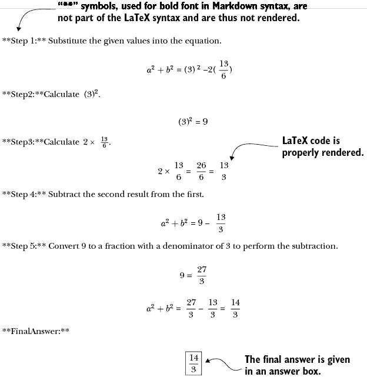

### 图 3.4 渲染后的响应，包含分步计算和最终的方框答案

图 3.4 所示的最终答案确实是该问题的正确答案。

## 3.3 实现一个包装器以便更轻松地生成文本

我们已经加载了预训练的 LLM 并设置了文本生成功能（如图 3.5 所示）。现在，为了方便后面的章节，我们将为文本生成函数创建一个包装器（见代码清单 3.3），这样我们只需传入模型、分词器、提示以及一些额外设置，而不必每次都重复分词和输入准备步骤。

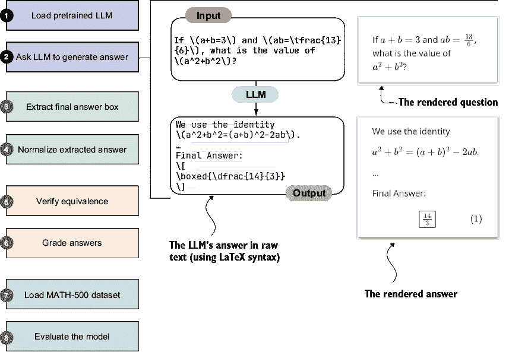

### 图 3.5 在本节中，我们将验证器工作流程的第 1 步和第 2 步包装成一个可复用的文本生成辅助函数。该包装器负责提示处理和流式生成，并返回模型的原始 LaTeX 输出，而无需每次都重复分词和输入准备。

### 代码清单 3.3 流式文本生成的包装器

```
def generate_text_stream_concat(
    model, tokenizer, prompt, device, max_new_tokens,
    verbose=False,
):
    input_ids = torch.tensor(                    #1
        tokenizer.encode(prompt), device=device  
        ).unsqueeze(0)                           

    generated_ids = []
    for token in generate_text_basic_stream_cache(  #2
        model=model,                                
        token_ids=input_ids,                        
        max_new_tokens=max_new_tokens,              
        eos_token_id=tokenizer.eos_token_id,        
    ):                                              
        next_token_id = token.squeeze(0)
        generated_ids.append(next_token_id.item())


        if verbose: #3
            print(
                tokenizer.decode(next_token_id.tolist()),
                end="",
                flush=True
            )

    return tokenizer.decode(generated_ids)  #4
```

- `#1` 将提示文本编码为 token ID 并放到设备上。
- `#2` 使用带缓存的生成方式逐次流式输出 token。
- `#3` 可选：在生成时打印 token。
- `#4` 将所有生成的 ID 解码为最终的文本字符串。

这个包装函数处理了文本生成的完整流程：它对输入提示进行分词，从模型流式生成新 token，然后将结果解码为最终的字符串。

如前所述，可选的`verbose`标志允许我们实时查看生成的 token。该函数的用法如下：

```
generated_text = generate_text_stream_concat(
    model, tokenizer, prompt, device,
    max_new_tokens=2048,
    verbose=True  #1
)
```

`#1` 使用`False`将禁止逐 token 的实时打印。

这会打印出你在第 3.2 节中看到的完全相同的结果：

```
[...]  #1

**Final Answer:**

\[
\boxed{\dfrac{14}{3}}
\]
```

`#1` 为简洁起见已缩短

## 3.4 提取最终答案框

现在我们已经加载并准备好模型，可以进入有趣的部分：评估模型。

值得重申的是，本书采用从头开始（from-scratch）的方法，自然包含一些详细的、有时甚至乏味的步骤。这是有意为之。我们希望自己构建评估流水线，以便更好地理解其工作原理，而不是仅仅调用预定义的包装函数和构建模块。

在上一节中，你看到模型在答案框（answer box）中返回了最终答案（在原始文本中写作`r"""\boxed{\dfrac{14}{3}}"""`）。我们并没有强制要求这种格式；模型很可能是因为框式答案（boxed answers）是数学基准和训练数据中的常见约定才这样输出的。这种行为不一定证明模型对我们稍后要运行的评估任务过拟合，但它反映了预训练模型经常在网上遇到许多问题格式，并学会复现这些风格约定。一般来说，可以合理地假设：模型训练时互联网上可获得的任何信息都属于训练数据的一部分。

虽然这里没有必要，但当我们在 MATH-500 数据集上评估模型时，我们会添加一个特定的提示，指示模型以这种框式形式返回答案。（MATH-500 是一个经过整理的 500 道问题集，广泛用作推理模型的基准数据集。）这一步很直接，每当我们需要将模型响应转换为可以大规模自动评分的形式时，它都会再次出现。这一常见约定使评估在模型之间更具一致性，并简化了数据提取。

我们现在将编写代码来执行框式答案内容的提取。本节实现图 3.6 中的步骤 3。（下一节将实现步骤 4 的标准化方法。）

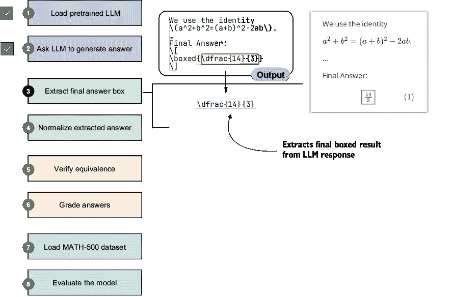

**图 3.6** 说明如何从大语言模型输出中提取框式结果

由于你的模型可能因硬件不同而产生与我略有差异的响应，以下代码使用硬编码的占位答案，而不是用模型生成响应（但我们会假装这个答案是由模型生成的）。在后面的章节中，我们将重新使用该模型，让它为 MATH-500 数据集中的任务生成答案：

```
model_answer = (
r"""... some explanation...
**Final Answer:**

\[                     #1
\boxed{\dfrac{14}{3}}   #1
\]                      #1
""")
```

`#1` 我们要提取的答案框

注意：我们使用的是原始字符串（`r"""..."""`而不是普通字符串`"""..."""`）。原始字符串使得处理反斜杠（`\`）字符更加容易，否则反斜杠会被视为转义序列，并要求每个反斜杠都写成两个。

接下来，让我们定义一个函数，从`model_answer`中提取答案框。

**清单 3.4** 提取答案框

```
def get_last_boxed(text):
    boxed_start_idx = text.rfind(r"\boxed")  #1
    if boxed_start_idx == -1:
        return None

    current_idx = boxed_start_idx + len(r"\boxed")  #2

    while current_idx < len(text) and text[current_idx].isspace():#3
        current_idx += 1


    if current_idx >= len(text) or text[current_idx] != "{":#4
        return None

    current_idx += 1
    brace_depth = 1
    content_start_idx = current_idx

    while current_idx < len(text) and brace_depth > 0:#5
        char = text[current_idx]
        if char == "{":
            brace_depth += 1
        elif char == "}":
            brace_depth -= 1
        current_idx += 1

    if brace_depth != 0:  #6
        return None

    return text[content_start_idx:current_idx-1]  #7
```

- `#1` 查找`\boxed`的最后一次出现位置。
- `#2` 获取`\boxed`之后的位置。
- `#3` 跳过`\boxed`后的任何空白字符。
- `#4` 期望一个左花括号`{`。
- `#5` 解析嵌套的花括号。
- `#6` 处理不平衡的花括号。
- `#7` 提取最外层花括号内的内容。

清单 3.4 中的`get_last_boxed`辅助实用函数从模型输出中提取最后一个`\boxed{...}`表达式的内容。更具体地说，它扫描最终的`\boxed`，跳过空白，检查花括号，并处理任何嵌套，从而捕获预期的答案字符串。

虽然这看起来有点繁琐，但有了这个解析器，当我们在像 MATH-500 这样的数据集上运行评估时，它会带来回报，因为提取正确的最终答案是衡量模型推理能力的第一步。

现在，让我们在该模型答案上测试这个函数：

```
extracted_answer = get_last_boxed(model_answer)
print(extracted_answer)
```

此函数调用的输出是`"\dfrac{14}{3}"`，这正是我们想要提取的框式答案。

### 渲染数学公式

我们可以通过前面介绍的`Latex`类渲染数学公式。或者，对于没有伴随答案文本的独立数学公式，我们可以使用更简单的`Math`类：

```
from IPython.display import Math
display(Math(r"\dfrac{14}{3}"))
```

这将分数渲染为

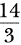

前面的`get_last_boxed`函数正确地提取了文本，但我们可以通过`extract_final_candidate`函数（如下面的清单所示）使答案提取更加稳健，该函数处理了最终答案框缺失或不完整的情况。

**清单 3.5** 提取最终答案候选

```
import re

RE_NUMBER = re.compile(  #1
    r"-?(?:\d+/\d+|\d+(?:\.\d+)?(?:[eE][+-]?\d+)?)"
)

def extract_final_candidate(text, fallback="number_then_full"):

    result = ""  #2

    if text:  #3
        boxed = get_last_boxed(text.strip())
        if boxed:
            result = boxed.strip().strip("$ ")

        elif fallback in ("number_then_full", "number_only"):#4
            m = RE_NUMBER.findall(text)
            if m:
                result = m[-1]  #5
            elif fallback == "number_then_full":

                result = text  #6
    return result
```

- `#1` 用于从文本中提取数值的正则表达式
- `#2` 如果什么都没有匹配到，则返回默认值
- `#3` 如果存在，优先选择最后一个框式表达式。
- `#4` 如果没有框式表达式，则尝试回退。
- `#5` 使用最后一个数字。
- `#6` 如果找不到数字，则返回完整文本。

如果找不到框式答案，`extract_final_candidate`函数会提供以下`fallback`设置：

- `"number_then_full"`（默认）：选择最后一个简单数字；否则选择整个文本。
- `"number_only"`：选择最后一个简单数字；否则返回空字符串`""`。
- `"none"`：仅提取框式内容；否则返回空字符串`""`。

对于回退设置，清单 3.5 中的代码通过 Python 的`re`库使用了*正则表达式*（简称 regex）。正则表达式是一种在文本中搜索模式的方法。在我们的例子中，该正则表达式模式被设计为识别数字，包括分数、小数和科学计数法。虽然正则表达式语法看起来令人生畏，但你无需担心它在这里如何工作。重要的是，这为我们提供了一个可靠的工具，在没有框式答案时从模型输出中提取最后一个数字候选。

让我们在模型答案上尝试一下：

```
print(extract_final_candidate(model_answer))
```

这会正确返回`"\dfrac{14}{3}"`。

现在，让我们尝试一些额外的示例。首先，这里有一个带框的候选答案：

```
print(extract_final_candidate(r"\boxed{ 14/3. }"))
```

这会正确返回`"14/3."`，去除多余空白但不去除标点。标点字符将由我们稍后实现的等价性检查正确处理。

接下来，让我们尝试一个不带框的候选，它应该会触发回退设置：

```
print(extract_final_candidate("abc < > 14/3 abc"))
```

得益于默认的回退设置，它会在答案中找到最后一个数字并正确返回`"14/3"`。


在本节中，我们定义了用来从 LLM 的响应文本中提取答案的实用函数。这让我们离验证该答案是否正确这一总体目标又近了一步。在下一节中，我们将在实现检查功能之前，将响应规范化为一种更通用、更规范的形式。

### 为什么不用 LLM 来提取答案？

我们可以使用 LLM 来提取带框的答案本身，但这会引入不必要的复杂性和潜在错误。提取是一项简单的机械任务，只要假定 LLM 以特定格式输出答案：我们只需要定位最后一个带框表达式；如果不存在，则回退到数字或原始文本。

正则表达式乍看可能很复杂，但我们现在拥有一个体积小、可复用的实用函数，它执行成本低，并且能以确定性和可复现的方式处理提取，而不会受到另一个模型输出的可变性的影响。

## 3.5 规范化提取的答案

之前，我们从模型的响应中提取了带框的答案 `"\dfrac{14}{3}"`。模型可能以多种方式打印同一个值，例如 `"\frac{14}{3}"`、`"14/3"`、`"$14/3$"` 或 `"(14)/(3)"`。为了实现并使用一个稳健的检查系统来确定答案是否正确，我们首先需要一种一致的结果比较方法。在本节中，我们将实现一个规范化（或标准化）过程（图 3.7 中的步骤 4），用于去除格式并标准化答案。

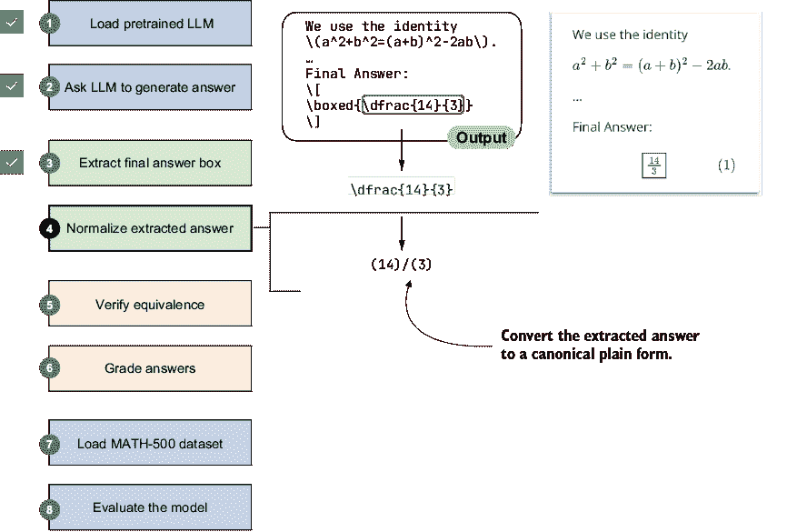

**图 3.7** 展示了如何从 LLM 输出中提取带框结果并将其转换为规范的纯文本形式。这个规范化后的答案将在后续与正确答案进行验证。

图 3.7 中所示的规范化步骤由下面的 `normalize_text` 函数实现。

**代码清单 3.6 规范化提取的答案**

```
LATEX_FIXES = [  #1
    (r"\\left\s*", ""),
    (r"\\right\s*", ""),
    (r"\\,|\\!|\\;|\\:", ""),
    (r"\\cdot", "*"),
    (r"\u00B7|\u00D7", "*"),
    (r"\\\^\\circ", ""),
    (r"\\dfrac", r"\\frac"),
    (r"\\tfrac", r"\\frac"),
    (r"°", ""),
]

RE_SPECIAL = re.compile(r"<\|[^>]+?\|>")  #2
SUPERSCRIPT_MAP = {
    "⁰": "0", "¹": "1", "²": "2", "³": "3", "⁴": "4",  #3
    "⁵": "5", "⁶": "6", "⁷": "7", "⁸": "8", "⁹": "9",     #3
    "⁺": "+", "⁻": "-", "⁽": "(", "⁾": ")",               #3
}

def normalize_text(text):
    if not text:
        return ""
    text = RE_SPECIAL.sub("", text).strip()


    match = re.match(r"^[A-Za-z]\s*[.:]\s*(.+)$", text)#4
    if match: #4
        text = match.group(1) #4
 #4
 #4
    text = re.sub(r"\^\s*\{\s*\\circ\s*\}", "", text)   #4
    text = re.sub(r"\^\s*\\circ", "", text)            #5
    text = text.replace("°", "")                        #5

    match = re.match(r"^\\text\{(?P<x>.+?)\}$", text)  #6
    if match:
        text = match.group("x")

    text = re.sub(r"\\\(|\\\)|\\\[|\\\]", "", text)  #7


    for pat, rep in LATEX_FIXES:  #8
        text = re.sub(pat, rep, text)


    def convert_superscripts(s, base=None):
        converted = "".join(
            SUPERSCRIPT_MAP[ch] if ch in SUPERSCRIPT_MAP else ch
            for ch in s
        )
        if base is None:
            return converted
        return f"{base}**{converted}"

    text = re.sub(
        r"([0-9A-Za-z\)\]\}])([⁰¹²³⁴⁵⁶⁷⁸⁹⁺⁻]+)",
        lambda m: convert_superscripts(m.group(2), base=m.group(1)),
        text,
    )
    text = convert_superscripts(text)


    text = text.replace("\\%", "%").replace("$", "").replace("%", "")#9
    text = re.sub(
        r"\\sqrt\s*\{([^}]*)\}",
        lambda match: f"sqrt({match.group(1)})",
        text,
    )
    text = re.sub(
        r"\\sqrt\s+([^\\\s{}]+)",
        lambda match: f"sqrt({match.group(1)})",
        text,
    )


    text = re.sub(#10
        r"\\frac\s*\{([^{}]+)\}\s*\{([^{}]+)\}",
        lambda match: f"({match.group(1)})/({match.group(2)})",
        text,
    )
    text = re.sub(
        r"\\frac\s+([^\s{}]+)\s+([^\s{}]+)",
        lambda match: f"({match.group(1)})/({match.group(2)})",
        text,
    )

    text = text.replace("^", "**")#11
    text = re.sub(
        r"(?<=\d)\s+(\d+/\d+)",
        lambda match: "+" + match.group(1),
        text,
    )

    text = re.sub(#12
        r"(?<=\d),(?=\d\d\d(\D|$))",
        "",
        text,
    )

    return text.replace("{", "").replace("}", "").strip().lower()
```

- `#1` 要替换的 LaTeX 格式（左：原始值，右：新值）
- `#2` 去除类似 `<|assistant|>` 的聊天特殊标记。
- `#3` 用于将 Unicode 上标转换为纯文本上标的字典映射
- `#4` 去除开头的多项选择标签（例如，`"c. 3"` → `3`）。
- `#5` 去除角度单位符号（度数标记）。
- `#6` 如果整个字符串被包裹在 `\\text{...}` 中，则将其展开。
- `#7` 去除行内/块级数学公式包装符：`\\( \\) \\[ \\]`。
- `#8` LaTeX 规范化
- `#9` 规范数字和根式表达式。
- `#10` 将 LaTeX 分数转换为除法形式。
- `#11` 处理指数和带分数。
- `#12` 去除数字中的千位分隔符。

这个 `normalize_text` 函数接收一个提取到的答案字符串，并将其重写为一种标准化格式，使我们可以可靠地与参考答案进行比较。它首先去除特殊标记和不必要的 LaTeX 杂乱内容，例如 `\left`、`\right` 或度数符号。然后展开 `\text{...}` 这类情况，去除行内数学标记，并将常见结构重写为计算器风格的形式。例如，它将 `\sqrt{a}` 转换为 `sqrt(a)`，将 `\frac{a}{b}` 转换为 `(a)/(b)`。最后，它还会规范化指数、带分数和千位分隔符，并清理花括号和大小写。简而言之，该函数将不同格式的 LaTeX 输出转换为一种干净、标准化的字符串表示。

让我们在模型答案上试用 `normalize_text` 函数：

```
print(normalize_text(extract_final_candidate(model_answer)))
```

与打印带有 LaTeX 格式（`r"\dfrac{14}{3}"`）的答案不同，它返回的是标准化、不含 LaTeX 的形式：

```
"(14)/(3)"
```

接下来，让我们尝试一个格式不同的答案：

```
print(normalize_text(r"\text{\[\frac{14}{3}\]}"))
```

这同样会按预期返回 `"(14)/(3)"`。

现在我们拥有了一种稳健的方法，可以从 LLM 的响应中提取答案文本。在下一节中，我们将实现一个函数，用于比较 LLM 答案与正确的参考答案。

## 3.6 验证数学等价性

到目前为止，我们已经实现了让 LLM 生成答案、提取相关部分并对其进行规范化的步骤。下一步，如图 3.8 所示，是通过将提取的答案与正确的参考答案（在技术语境中称为 *基准真值*）进行比较来验证该答案。我们将在第 6 章中再次使用这样的验证器来创建可验证的奖励信号，并在后续章节中使用它来检查我们的训练改动是否改进了模型。

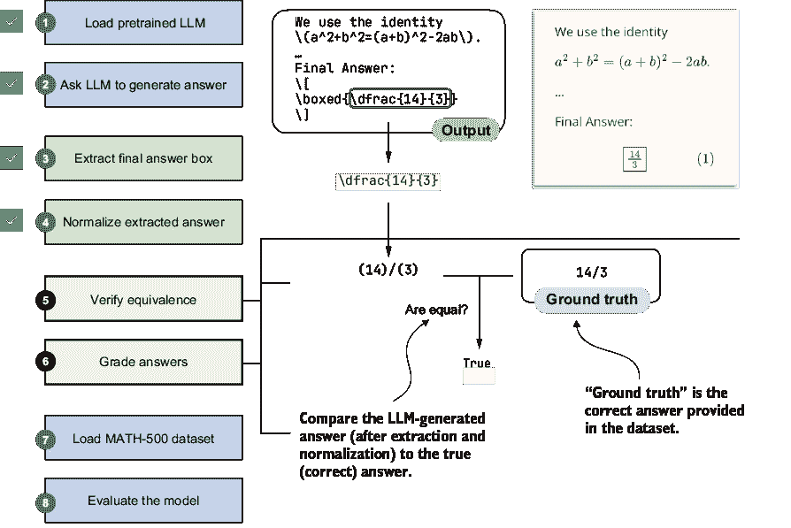

**图 3.8** 展示了如何将 LLM 生成的答案与正确的参考答案（基准真值）进行核对。LLM 最终的带框答案会被提取、规范化，然后与数据集中提供的正确答案进行比较。如果它们匹配，则将该响应判定为正确。

请注意，要实现图 3.8 所示的相等性检查，使用 Python 的 `==` 运算符进行直接比较是不够的，因为像 `"14/3"` 和 `"(14)/(3)"` 这样的表达式无法匹配，而等价但未归一化的分数，如 `"(28)/(6)"` 和 `"(14)/(3)"`，也会被视为不相等。

作为相等性检查的一部分，我们将增加一个中间步骤：用符号数学引擎解析提取并归一化后的答案。为此，我们将使用开源 SymPy 数学库（[`sympy.org`](https://sympy.org)），该库经过二十多年的开发和测试，已成为 Python 科学计算的重要组成部分。解析函数在代码清单 3.7 中实现。

**注意：** 如果你尚未安装第 2 章中的依赖项，可以通过 `uv pip install sympy`（或 `uv add sympy`）手动安装 SymPy。

### 代码清单 3.7 使用 SymPy 解析器进行数学相等性检查

```
from sympy.parsing import sympy_parser as spp
from sympy.core.sympify import SympifyError
from sympy.polys.polyerrors import PolynomialError
from tokenize import TokenError

def sympy_parser(expr):
    if expr is None or len(expr) > 2000: #1
        return None

    try:
        return spp.parse_expr(
            expr,
            transformations=(
                *spp.standard_transformations,  #2

                spp.implicit_multiplication_application,#3
            ),

            evaluate=True,  #4
        )
    except (SympifyError, SyntaxError, TypeError, AttributeError,
            IndexError, TokenError, ValueError, PolynomialError):
        return None
```

- `#1` 避免在处理冗长的垃圾响应时崩溃
- `#2` 标准转换，例如处理括号
- `#3` 允许省略乘号（例如，`2y` → `2*y`）。
- `#4` 在解析过程中进行求值，以便简单常量被化简（例如，`2+3` → `5`）。

该 `sympy_parser` 函数接收一个输入表达式（例如我们从 LLM 响应中提取的归一化答案），并将其转换为一个可以可靠地比较数学等价性的 SymPy 对象。为此，它应用 SymPy 的标准解析规则，支持隐式乘法（例如，`2y` 而不是 `2 * y`），并简化基本算术（因此 `2 + 3` 变为 `5`）。

**注意：** `sympy_parser` 处理了看似过多的错误情况，但这些都是我在 MATH-500 的 500 道题上评估模型时遇到过的错误。模型并不总是能生成格式完美的输出。

让我们实际运行一下 `sympy_parser`，并将其应用于一个归一化后的候选答案：

```
print(sympy_parser(normalize_text(
    extract_final_candidate(model_answer)
)))
```

这将返回分数 `14/3`。接下来，让我们尝试一个未归一化的分数：

```
print(sympy_parser("28/6"))
```

同样，这将返回 `14/3`。

借助 `sympy_parser`，我们现在可以实现相等性检查函数。

### 代码清单 3.8 使用 SymPy 的相等性检查函数

```
from sympy import simplify

def equality_check(expr_gtruth, expr_pred):
    if expr_gtruth == expr_pred:  #1
        return True

    gtruth, pred = sympy_parser(expr_gtruth), sympy_parser(expr_pred)#2

    if gtruth is not None and pred is not None:  #3
        try:
            return simplify(gtruth - pred) == 0  #4
        except (SympifyError, TypeError):
            pass

    return False
```

- `#1` 首先，检查两个表达式是否是完全相同的字符串。
- `#2` 将两个表达式解析为 SymPy 对象（如果解析失败则返回 `None`）。
- `#3` 如果两个表达式都解析成功，则尝试符号比较。
- `#4` 如果差值为 0，则它们是等价的。

上述代码清单中的 `equality_check` 函数用于判断模型的答案是否与标准答案（ground-truth）匹配。它首先查找完全相同的字符串匹配，这是最简单的情况。如果字符串不同，它会将两个表达式解析为 SymPy 对象（通过我们在代码清单 3.7 中实现的 `sympy_parser` 函数），并检查它们的差是否化简为零。这样，我们就能识别那些表面上看起来不同（例如 `14/3` 和 `28/6`）但在数学上相同的答案。

让我们在示例上试用一下代码清单 3.8 中的相等性检查器：

```
print(equality_check(
    normalize_text("13/4."),
    normalize_text(r"(13)/(4)")
))
```

正如预期，这会忽略格式差异并返回 `True`。接下来，让我们尝试一个更具挑战性的示例，看看符号数学解析器是否能识别出 `0.5` 和 `1/2` 是相同的：

```
print(equality_check(
    normalize_text("0.5"),
    normalize_text(r"(1)/(2)")
))
```

这同样会返回 `True`。现在，让我们尝试一个反例：

```
print(equality_check(
    normalize_text("14/3"),
    normalize_text("15/3")
))
```

这会返回 `False`，因为这两个表达式不同。

到目前为止，一切顺利。基于这些令人鼓舞的结果，我们可能会认为现在我们已经有了一个健壮的相等性检查器，可以用来在数学基准数据集上评估 LLM。为了确保它能经受住实际使用的考验，让我们再试一个示例：

```
print(equality_check(
    normalize_text("(14/3, 2/3)"),
    normalize_text("(14/3, 4/6)")
))
```

在这个例子中，我们比较的是两个元组。由于 `2/3` 和 `4/6` 在数学上是等价的，我们期望结果为 `True`。但实际该函数返回了 `False`，因为它目前只能处理简单表达式，无法处理元组。我们将在下一节中解决这个限制。

## 3.7 答案评分

现在，我们将基于上一节的数学相等性检查函数，实现一个健壮的评分函数，它也能处理类似元组的表达式，例如正确比较 `"(14/3, 2/3)"` 和 `"(14/3, 4/6)"`。


首先，我们将实现一个 Python 辅助函数，将这种类似元组的表达式拆分为单独的子部分。

### 代码清单 3.9 拆分类似元组表达式的辅助函数

```
def split_into_parts(text):
    result = [text]

    if text:  #1
        if (
            len(text) >= 2
            and text[0] in "([" and text[-1] in ")]"
            and "," in text[1:-1]
        ):
            items = [p.strip() for p in text[1:-1].split(",")]  #2
            if all(items):
                result = items
    else:  #3
        result = []

    return result
```

- `#1` 检查文本是否看起来像元组或列表，例如 `(a, b)` 或 `[a, b]`。
- `#2` 按括号内的逗号拆分，并去除空白。
- `#3` 如果文本为空，则返回空列表。

前面的 `split_into_parts` 函数帮助我们处理包含多个组成部分的答案。如果输入看起来像元组或列表，例如 `(a, b)` 或 `[a, b]`，它会按逗号拆分内容并返回各个部分。（如果字符串为空，它只会返回一个空列表。）本质上，这个函数将多部分答案分解为更小的部分，以便逐个检查。

在实现评分函数之前，让我们先在之前的类似元组表达式上试运行一下 `split_into_parts`：

```
split_into_parts(normalize_text(r"(14/3, 2/3)"))
```

如预期，这将返回 `['14/3', '2/3']`。

现在，我们可以实现 `grade_answer` 函数（代码清单 3.10），它会将类似元组的表达式（如果有）拆分为子部分，然后使用上一节的 `equality_check` 函数将生成的答案与参考答案（标准答案）进行比较。

### 代码清单 3.10 根据标准答案对预测答案进行评分的函数

```
def grade_answer(pred_text, gt_text):
    result = False   #1
    if pred_text is not None and gt_text is not None:  #2
        gt_parts = split_into_parts(
            normalize_text(gt_text)
        )
        pred_parts = split_into_parts(
            normalize_text(pred_text)
        )

        if (gt_parts and pred_parts                #3
           and len(gt_parts) == len(pred_parts)):   #3
            result = all(
                equality_check(gt, pred)
                for gt, pred in zip(gt_parts, pred_parts)
            )  #4

    return result  #5
```

- `#1` 检查失败时的默认结果
- `#2` 仅当两个输入均为非空字符串时才继续。
- `#3` 确保两侧的有效部分数量相同。
- `#4` 检查每个部分是否数学等价。
- `#5` 仅当所有检查均通过时才为 `True`

这个 `grade_answer` 函数的实现首先假定预测是错误的（`False`），并且仅当预测和正确答案均为非空时才继续执行。然后，它对两侧进行规范化，并将它们拆分为子部分（例如，将 `"(14/3, 2/3)"` 拆分为 `["14/3", "2/3"]`）。如果子部分的数量匹配，则使用 `equality_check` 逐一比较它们。只有在所有配对在数学上都匹配时，结果才会返回为正确（`True`）。

我们可以将 `grade_answer` 函数视为上一节中 `equality_check` 函数的进阶版本。它可以在应用 `equality_check` 函数之前拆分类似元组的表达式并规范化答案。

对于简单表达式，它的工作方式与 `equality_check` 类似，如果两个表达式在数学上等价，则返回 `True`：

```
grade_answer("14/3", r"\frac{14}{3}")
```

此外，对于两个在数学上等价的类元组表达式，它现在也会返回 `True`：

```
grade_answer(r"(14/3, 2/3)", "(14/3, 4/6)")
```

为了更全面地检查 `grade_answer` 函数，以下清单包含更多多样化的测试用例。

### 清单 3.11 用于测试评分器的测试用例和演示函数

```
tests = [  #1
        ("check_1", "3/4", r"\frac{3}{4}", True),
        ("check_2", "(3)/(4)", r"3/4", True),
        ("check_3", r"\frac{\sqrt{8}}{2}", "sqrt(2)", True),
        ("check_4", r"\( \frac{1}{2} + \frac{1}{6} \)", "2/3", True),
        ("check_5", "(1, 2)", r"(1,2)", True),
        ("check_6", "(2, 1)", "(1, 2)", False),
        ("check_7", "(1, 2, 3)", "(1, 2)", False),
        ("check_8", "0.5", "1/2", True),
        ("check_9", "0.3333333333", "1/3", False),
        ("check_10", "1,234/2", "617", True),
        ("check_11", r"\text{2/3}", "2/3", True),
        ("check_12", "50%", "1/2", False),
        ("check_13", r"2\cdot 3/4", "3/2", True),
        ("check_14", r"90^\circ", "90", True),
        ("check_15", r"\left(\frac{3}{4}\right)", "3/4", True),
        ("check_16", r"2²", "2**2", True),
    ]


def run_demos_table(tests):
    header = ("Test", "Expect", "Got", "Status")
    rows = []
    for name, pred, gtruth, expect in tests:
        got = grade_answer(pred, gtruth)  #2
        status = "PASS" if got == expect else "FAIL"
        rows.append((name, str(expect), str(got), status))

    data = [header] + rows

    col_widths = [  #3
        max(len(row[i]) for row in data)
        for i in range(len(header))
    ]

    for row in data:  #4
        line = " | ".join(
            row[i].ljust(col_widths[i])
            for i in range(len(header))
        )
        print(line)

    passed = sum(r[3] == "PASS" for r in rows)  #5
    print(f"\nPassed {passed}/{len(rows)}")      #5
```

- `#1` 定义测试用例：(名称、预测、正确答案、预期结果)
- `#2` 执行等价性检查
- `#3` 计算每列的最大宽度，使表格对齐美观
- `#4` 逐行打印表格
- `#5` 打印通过测试的摘要

清单 3.11 中的代码是一个简单的测试套件，使用一组选定的 `tests` 来检查 `grade_answer` 函数是否按预期工作。`tests` 列表包含的元组涵盖了分数、LaTeX 表示法、元组输入、小数、百分比和其他棘手的格式。接着，`run_demos_table` 函数通过调用 `grade_answer` 运行每个测试，收集结果，并将结果整理到一个格式化的表格中。

在清单 3.11 中调用 `run_demos_table(tests)` 函数会打印出以下表格：

```
Test     | Expect | Got   | Status
check_1  | True   | True  | PASS  
check_2  | True   | True  | PASS  
check_3  | True   | True  | PASS  
check_4  | True   | True  | PASS  
check_5  | True   | True  | PASS  
check_6  | False  | False | PASS  
check_7  | False  | False | PASS  
check_8  | True   | True  | PASS  
check_9  | False  | False | PASS  
check_10 | True   | True  | PASS  
check_11 | True   | True  | PASS  
check_12 | False  | False | PASS  
check_13 | True   | True  | PASS  
check_14 | True   | True  | PASS  
check_15 | True   | True  | PASS
check_16 | True   | True  | PASS  

Passed 16/16
```

从 `PASS` 结果可以看出，`grade_answer` 函数相对健壮，可以处理各种不同格式的表达式。

### 练习 3.1：添加更多测试用例

尝试想出更多测试用例，最好是有挑战性的用例，并将它们添加到 `run_demos_table()` 函数中。你能找到检查会错误失败的用例吗？

实现了 `grade_answer` 之后，我们现在就拥有了评估 LLM 的构建模块。在下一节中，我们将加载一个数学数据集来对其进行评估。

## 3.8 加载评估数据集

正如你在本章目前所看到的，实现一个健壮的验证流程可能会很繁琐。幸运的是，我们现在已经将所有环节准备就绪，从答案提取到评分，我们准备好在基准数据集上评估 LLM。如图 3.9 所示，我们将使用 MATH-500 数据集（[`huggingface.co/datasets/HuggingFaceH4/MATH-500`](https://huggingface.co/datasets/HuggingFaceH4/MATH-500)），这是推理模型广泛使用的基准数据集。它是从原始 MATH 数据集中抽样出的 500 个问题精心整理而成的集合。

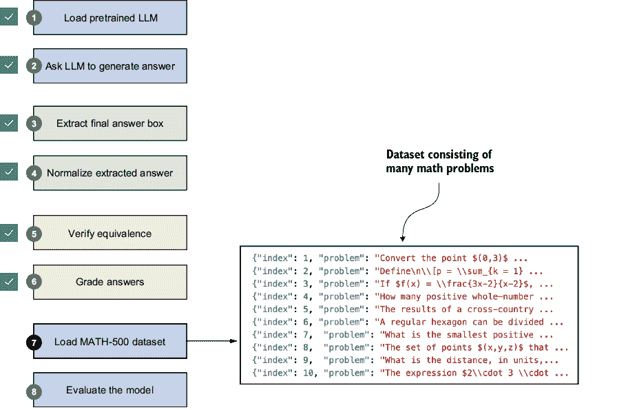

### 图 3.9 加载评估数据集。我们在前面的章节中完成了步骤 2-6（生成、提取、规范化、验证和评分答案）；剩余的两个步骤是加载完整数据集（步骤 7），并对所有问题应用相同的流程来评估模型（步骤 8）。

使用 MATH-500 是一个务实的选择，原因有三。首先，MATH-500 足够大，具有统计意义，但又足够小，使得全书中的重复评估易于管理，而每次运行完整的 MATH 数据集则会慢得多。其次，在后面的章节中，我们将使用从原始 MATH 数据集派生的不重叠训练子集，因此将 MATH-500 作为留出评估集可以提供一个干净的参考点。第三，MATH-500 是推理模型文献中常见的基准数据集，这使得本书的结果更容易与先前的工作进行比较。与 GSM8K 等更简单的数据集相比，我也更偏爱 MATH-500，因为它对现代推理模型更具挑战性，并且更符合我们在本章中构建的多步符号验证流程。

我们将使用以下代码加载 MATH-500 数据集。

### 清单 3.12 加载 MATH-500 数据集

```
import json
import requests

def load_math500_test(local_path="math500_test.json", save_copy=True):
    local_path = Path(local_path)
    url = (
        "https://raw.githubusercontent.com/rasbt/reasoning-from-scratch/"
        "main/ch03/01_main-chapter-code/math500_test.json"
    )

    if local_path.exists():
        with local_path.open("r", encoding="utf-8") as f:
            data = json.load(f)
    else:
        r = requests.get(url, timeout=30)
        r.raise_for_status()
        data = r.json()

        if save_copy:  # Saves a local copy
            with local_path.open("w", encoding="utf-8") as f:
                json.dump(data, f, indent=2)

    return data

math_data = load_math500_test()
print("Number of entries:", len(math_data))
```

这将打印以下结果：

```
Number of entries: 500
```

### 从 Hugging Face Model Hub 加载数据集

MATH-500 数据集划分最初在 PRM800K 仓库（[`github.com/openai/prm800k/tree/main?tab=readme-ov-file#math-splits`](https://github.com/openai/prm800k/tree/main?tab=readme-ov-file#math-splits)）中提出，也可以在 Hugging Face Hub（[`huggingface.co/datasets/HuggingFaceH4/MATH-500`](https://huggingface.co/datasets/HuggingFaceH4/MATH-500)）上获取。我们在本章中使用的代码会从代码仓库加载一份副本，因此即使外部来源发生变化，你也可以确保可复现性。

如果你更希望直接从 Hugging Face 下载数据集，可以使用以下可选代码。请注意，这需要 `datasets` 库，可以通过 `pip install datasets` 或 `uv add datasets` 安装：

```
from datasets import load_dataset
dset = load_dataset("HuggingFaceH4/MATH-500", split="test")
```

在下一节实现模型评估流程之前，让我们通过打印数据集的第一条记录来更仔细地了解其结构（我们将使用内置的 `pprint` 库以获得更美观的格式）：

```
from pprint import pprint
pprint(math_data[0])
```

这将产生以下输出：


数据集条目以 Python 字典的形式存储，包含按键字母顺序排序的键和值。以下是相关的键：

- `problem`：供大语言模型解答的数学问题或题目
- `answer`：我们用来与大语言模型答案进行对比的正确（真实）答案
- `solution`：对问题的逐步详细解答（本章未使用，但对训练或分析很有用）

现在我们已经有了预训练的大语言模型、评估函数和可用的基准数据集，接下来就可以评估模型了。

## 3.9 评估模型

在本节中，我们将把图 3.10 中步骤 2–6 的大语言模型文本生成和评估工具付诸实践，并将它们应用于上一节加载的 MATH-500 数据集（步骤 8）。这整个流程在后续章节中将非常重要，因为当我们比较提示方法和基于训练的改进时，这将是我们衡量进展的主要方式。

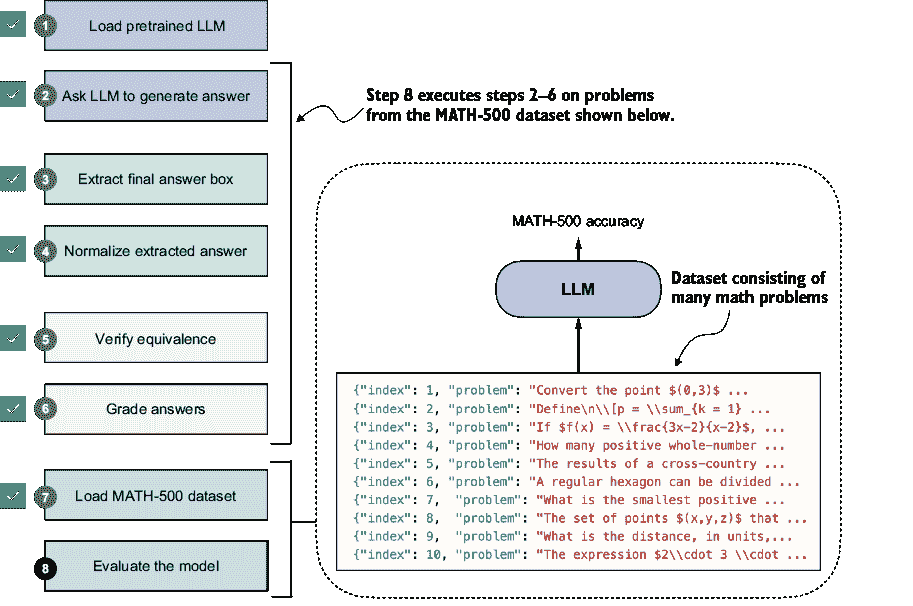

### 图 3.10 MATH-500 数据集的完整评估流程。加载数据集（步骤 7）后，所有问题都会系统地应用步骤 2–6，以得到最终的模型评估结果（步骤 8）。

你可能还记得，在第 3.4 节中，我们的答案检查流程期望模型以方框形式返回答案，这是评估推理模型在数学问题上的表现时常用的约定。为了增加模型遵循此格式的可能性，我们可以按如下方式格式化提示词。

### 清单 3.13 用于渲染数学评估提示模板的函数

```
def render_prompt(prompt):
    template = (
        "You are a helpful math assistant.\n"
        "Answer the question and write the final result on a new line as:\n"
        "\\boxed{ANSWER}\n\n"
        f"Question:\n{prompt}\n\nAnswer:"
    )
    return template
```

现在让我们将这个提示模板应用于第 3.2 节中介绍并在此再次展示的示例提示词：

```
prompt = (
    r"If $a+b=3$ and $ab=\tfrac{13}{6}$, "
    r"what is the value of $a²+b²$?"
)
prompt_fmt = render_prompt(prompt)
print(prompt_fmt)
```

格式化后的提示词如下：

```
You are a helpful math assistant.
Answer the question and write the final result on a new line as:
\boxed{ANSWER}

Question:
If $a+b=3$ and $ab=\tfrac{13}{6}$, what is the value of $a²+b²$?

Answer:
```

接下来，在构造模型评估函数之前，我们将把提示词传递给我们在清单 3.3 中定义的文本生成包装函数，以回顾文本生成过程：

```
generated_text = generate_text_stream_concat(
    model, tokenizer, prompt_fmt, device,
    max_new_tokens=2048,
    verbose=True
)
```

使用这个示例提示词，模型给出了一个相对简短的答案：`"\boxed{10}"`。（请注意，生成的响应可能因你在 CPU、CUDA 或 MPS 设备上运行代码而有所不同。）

虽然简短的回答可以通过减少 token 数量来加快生成速度，但该回答是不正确的。相比之下，在第 3.3 节中，在没有提示模板的情况下，模型生成了更长的回答，并得出了正确答案 14/3。

在得出任何结论之前，提示模板是否适合给定的模型和任务，需要在更大的示例集（例如 MATH-500 数据集）上加以确定。

### 提示模板选择

这里使用清单 3.13 中的提示模板，是为了演示如何实现一个可自动检查答案正确性的模型评估流程。所选模板鼓励短输出，这能让你在第一次阅读时高效地学完本章。之后，我建议你使用其他设置重新审视本章的示例，以优化这里作为参考模型的官方 Qwen3 推理模型变体的准确性。

事实证明，不使用提示模板会使基础模型的性能提升 50%，但会降低推理模型的准确率 40%。

此外，我们可以尝试其他提示模板。例如，常用于 MATH-500 基准测试的标准提示词是清单 3.13 的一个变体，它将“Question:”换成了“Problem:”。这一看似微小的改变将基础模型的准确率提高了约 20%，这可能是因为它更好地匹配了模型记忆中的训练数据（假设 MATH-500 测试集包含在训练语料库中）。虽然基础模型受益于此更改，但推理模型变体的准确率下降了 30%。

前面我提到，答案提取是一项简单、机械的任务，可以用确定性代码解决，而不是使用另一个 LLM 来提取答案。根据不同提示模板下准确率的变化，我们的提取方法似乎可能并不可靠。但情况未必如此。

此外，LLM 生成格式错误的答案也未必是问题所在。它可能只是答错了，而换用另一个 LLM 来提取答案并不能解决这个问题。较小的基础模型往往对提示措辞非常敏感。在下一章中，你会看到，一旦我们引入更多提示变体，这一点会更加明显。

在实现最终的模型评估函数之前，让我们先用下面的演示函数，在一个较小的示例上端到端地测试模型评估流水线。

### 清单 3.14 用于运行评估流水线的演示函数

```
def mini_eval_demo(model, tokenizer, device):
    ex = {  #1
        "problem": "Compute 1/2 + 1/6.",
        "answer": "2/3"
    }
    prompt = render_prompt(ex["problem"])     #2
    gen_text = generate_text_stream_concat(   #3
        model, tokenizer, prompt, device,      #3
        max_new_tokens=64,                     #3
    )                                          #3
    pred_answer = extract_final_candidate(gen_text)  #4
    is_correct = grade_answer(                       #5
        pred_answer, ex["answer"]                     #5
    )                                                 #5

    print(f"Device: {device}")
    print(f"Prediction: {pred_answer}")
    print(f"Ground truth: {ex['answer']}")
    print(f"Correct: {is_correct}")
```

代码注释：

- `#1` — 使用 `"problem"` 和 `"answer"` 字段测试示例。
- `#2` — 1. 应用提示模板
- `#3` — 2. 生成响应
- `#4` — 3. 提取并规范化答案
- `#5` — 4. 对答案评分

`mini_eval_demo` 函数整合了本章目前涵盖的所有方面：

1. 应用提示模板
2. 将格式化后的提示提供给 LLM 以生成回答
3. 提取并规范化答案
4. 对答案评分

`mini_eval_demo` 函数本质上是将评估组件连接成一个小的函数，我们可以在为 MATH-500 数据集构建最终评估流水线之前用它来测试代码。代码从一个玩具示例（`ex`）开始，将问题渲染进提示模板（`prompt`），并从模型流式获取响应（`generate_text_stream_concat`）。然后，它将模型输出解析为最终候选答案（`pred_answer`），并使用 `grade_answer` 与真实答案进行对比评分。最后，它打印结果供我们评估。

调用 `mini_eval_demo(model, tokenizer, device)` 函数会产生以下输出：

```
Device: mps
Prediction: 1/3
Ground truth: 2/3
Correct: False
```

可以看到，生成的答案（`"1/3"`）被正确提取，但它与正确答案（`"2/3"`）不匹配，因此检查返回 `False`。（请注意，你的结果可能会因在 CPU、CUDA 或 MPS 设备上运行代码而有所不同。）

既然我们已经在一个简单示例上测试了工作流程，接下来让我们在 MATH-500 数据集上实现它。

### 清单 3.15 针对 MATH-500 数据集的端到端模型评估流水线


# 代码示例与评估流程

```python
import time


def eta_progress_message(  #1
    processed,
    total,
    start_time,
    show_eta=False,
    label="Progress",
):
    progress = f"{label}: {processed}/{total}"
    pad_width = len(f"{label}: {total}/{total} | ETA: 00h 00m 00s")
    if not show_eta or processed <= 0:          
        return progress.ljust(pad_width)

    elapsed = time.time() - start_time
    if elapsed <= 0:
        return progress.ljust(pad_width)

    remaining = max(total - processed, 0)

    if processed:
        avg_time = elapsed / processed
        eta_seconds = avg_time * remaining
    else:
        eta_seconds = 0

    eta_seconds = max(int(round(eta_seconds)), 0)
    minutes, rem_seconds = divmod(eta_seconds, 60)
    hours, minutes = divmod(minutes, 60)
    if hours:
        eta = f"{hours}h {minutes:02d}m {rem_seconds:02d}s"
    elif minutes:
        eta = f"{minutes:02d}m {rem_seconds:02d}s"
    else:
        eta = f"{rem_seconds:02d}s"

    message = f"{progress} | ETA: {eta}"
    return message.ljust(pad_width)


def evaluate_math500_stream(
    model,
    tokenizer,
    device,
    math_data,
    out_path=None,
    max_new_tokens=512,
    verbose=False,
):

    if out_path is None:
        dev_name = str(device).replace(":", "-")      #2
        out_path = Path(f"math500-{dev_name}.jsonl")

    num_examples = len(math_data)
    num_correct = 0
    start_time = time.time()

    with open(out_path, "w", encoding="utf-8") as f:   #3
        for i, row in enumerate(math_data, start=1):
            prompt = render_prompt(row["problem"])     #4
            gen_text = generate_text_stream_concat(    #5
                model, tokenizer, prompt, device,
                max_new_tokens=max_new_tokens,
                verbose=verbose,
            )

            extracted = extract_final_candidate(       #6
                gen_text
            )
            is_correct = grade_answer(                 #7
                extracted, row["answer"]
            )
            num_correct += int(is_correct)

            record = {                                 #8
                "index": i,
                "problem": row["problem"],
                "gtruth_answer": row["answer"],
                "generated_text": gen_text,
                "extracted": extracted,
                "correct": bool(is_correct),
            }
            f.write(json.dumps(record, ensure_ascii=False) + "\n")

            progress_msg = eta_progress_message(
                processed=i,
                total=num_examples,
                start_time=start_time,
                show_eta=True,
                label="MATH-500",
            )
            print(progress_msg, end="\r", flush=True)

            if verbose:                                #9
                print(
                    f"\n\n{'='*50}\n{progress_msg}\n"
                    f"{'='*50}\nExtracted: {extracted}\n"
                    f"Expected:  {row['answer']}\n"
                    f"Correct so far: {num_correct}\n{'-'*50}"
                )

    seconds_elapsed = time.time() - start_time
    acc = num_correct / num_examples if num_examples else 0.0
    print(f"\nAccuracy: {acc*100:.1f}% ({num_correct}/{num_examples})")
    print(f"Total time: {seconds_elapsed/60:.1f} min")
    print(f"Logs written to: {out_path}")
    return num_correct, num_examples, acc
```

**代码注释：**

- `#1` — 辅助函数，用于打印进度，并可选择显示 ETA（预计剩余时间）
- `#2` — 使文件名与 Windows 兼容。
- `#3` — 保存结果以供检查。
- `#4` — 应用提示模板。
- `#5` — 生成响应。
- `#6` — 提取并规范化答案。
- `#7` — 对答案评分。
- `#8` — 保存记录以供检查
- `#9` — 在生成过程中打印响应。

清单 3.15 中的 `evaluate_math500_stream` 函数使用了与清单 3.14 中较小的演示函数相同的主要步骤：对于每个问题，它渲染提示，流式获取模型响应，提取候选答案，并与参考答案进行评分。

除了在包含多个条目的数据集上进行迭代之外，它还增加了一些额外的附加功能。例如，它将生成的响应保存到 JSON 文件中，采用类似 Python 字典的格式，以便记录和更仔细地检查。

现在让我们在子集上运行这个函数：MATH-500 的前 10 个示例。在搭载 M4 芯片的 Mac Mini 上，这大约需要 0.7 分钟。（评估推理模型变体大约需要 7 分钟，因为它生成的响应更长。）

```python
print("Model:", WHICH_MODEL)
print("Device:", device)
num_correct, num_examples, acc = evaluate_math500_stream(
    model, tokenizer, device, 
    math_data=math_data[:10],  #1
    max_new_tokens=2048,
    verbose=False              #2
)
```

- `#1` 仅对前 10 个示例进行评估。
- `#2` 设置为 `true` 可在生成时实时查看响应。

在前面的代码示例中，我们将 `max_new_tokens` 设置为一个较大的值 2,048，因为推理模型变体在设计上倾向于生成更长的响应，我们不希望过早地截断它。这会导致评估时间变长，并且可能看起来生成过程停滞了。你可以选择设置 `verbose=True` 来逐 token 实时查看正在生成的响应。

运行 `evaluate_math500_stream` 的结果如下：

```
Model: base
Device: mps
MATH-500: 10/10 | ETA: 00s
Accuracy: 30.0% (3/10)
Total time: 0.4 min
```

（和往常一样，结果可能因你在 CPU、CUDA 或 MPS 设备上执行代码而有所不同。）

如你所见，该模型的准确率相对较低，仅为 30%。我们可以在文本编辑器中打开 `math500_base-mps.jsonl` 文件，结合生成的响应一起分析结果。例如，所有情况下答案都被成功提取，但这些答案完全是错误的，这表明该模型（目前）还不具备很强的数学问题解决能力。这在意料之中，因为它只是一个基础模型。

## 以编程方式加载 `.jsonl` 文件

`.jsonl` 文件后缀是一种惯例，用于表示每行包含一条数据条目的 JSON 文件。你可以在喜欢的文本编辑器中查看它。或者，你可以使用以下代码在 Python 中加载评估期间生成的 `.jsonl` 文件：

```python
dev_name = str(device).replace(":", "-")
local_path = f"math500_{WHICH_MODEL}-{dev_name}.jsonl"
results = []
with open(local_path, "r") as f:
    for line in f:
        if line.strip():
            results.append(json.loads(line))
```

推理模型变体，你可以通过在清单 3.1 中设置 `WHICH_MODEL = "reasoning"` 来启用，其表现要好得多，在相同的 10 样本子集上实现了 90% 的准确率，在完整的 500 样本数据集上实现了 50.8% 的准确率，如表 3.1 所示。

**表 3.1.** 不同设备上的 MATH-500 任务准确率

| 模式 | 设备 | 准确率 | MATH-500 规模 |
| --- | --- | --- | --- |
| 基础 | CPU | 30% | 10 |
| 基础 | CUDA | 30% | 10 |
| 基础 | MPS | 30% | 10 |
| 推理 | CPU | 90% | 10 |
| 推理 | CUDA | 90% | 10 |
| 推理 | MPS | 80% | 10 |
| 基础 | CUDA | 15.3% | 500 |
| 推理 | CUDA | 50.8% | 500 |

如表 3.1 所示，推理变体凭借更长的响应，准确率大幅提升，但同时也显著增加了计算强度和答案生成时间（在配备 M4 芯片的 Mac Mini 上，10 样本子集从基础模型的 0.4 分钟增加到推理模型的 7 分钟；在 NVIDIA H100 GPU 上，500 样本数据集从 13.3 分钟增加到 185.4 分钟），这凸显了使用推理模型的一个权衡。请注意，这些数据是在 PyTorch 2.8 中获得的，可能因 PyTorch 版本不同而有所差异。

**提示：** 本书的代码仓库包含一个额外脚本，该脚本以批处理模式运行本章代码（[`github.com/rasbt/reasoning-from-scratch/blob/main/ch03/02_math500-verifier-scripts/evaluate_math500_batched.py`](https://github.com/rasbt/reasoning-from-scratch/blob/main/ch03/02_math500-verifier-scripts/evaluate_math500_batched.py)）。这意味着它每次前向传递处理多个示例，以加快评估速度，但需要更多内存。使用批大小为 128 来评估全部 500 个样本，可将基础模型在 H100 GPU 上的运行时间从 13.3 分钟减少到 3.3 分钟。类似地，推理模型的运行时间从 185.4 分钟减少到 14.6 分钟。请注意，这里以 H100 为例；该脚本也兼容其他 GPU。

## 练习 3.2：计算平均响应长度

尝试修改本章代码，让 `evaluate_math500_stream` 函数（清单 3.15）也报告平均响应长度。除了直接修改函数，你也可以从生成的 JSON 报告文件中计算响应长度。

## 练习 3.3：扩展或更改评估数据集

出于计算效率考虑，我们只选择了 10 个示例的子集。你也可以在更大或不同的数据集部分上运行代码，以了解 10 样本子集是否具有代表性。理想情况下，你还可以用自己的数据进行实验。（作为参考，在 H100 上对完整 MATH-500 数据集进行评估，基础模型大约需要 13.3 分钟，推理模型大约需要 185.4 分钟。）

## 练习 3.4：尝试不同的提示模板

模型可能对不同的提示模板很敏感。在清单 3.13 中尝试不同的提示模板，观察它们如何影响结果。此外，虽然 Qwen3 团队建议使用不带额外聊天模板的基础模型，但你可以在 tokenizer 中启用 `apply_chat_template=True` 设置（清单 3.1），并观察它是否提升了基础模型的性能。

至此，我们完成了基于验证的数学任务实现（图 3.11）。我选择数学，是因为它既易于实现，又在推理专项训练中被广泛使用，尤其是可验证奖励的强化学习，我们将在第 6 章中介绍。同样的概念也可以扩展到其他领域，例如代码；但我们没有在这里探讨，因为执行代码需要搭建一个安全的虚拟环境。

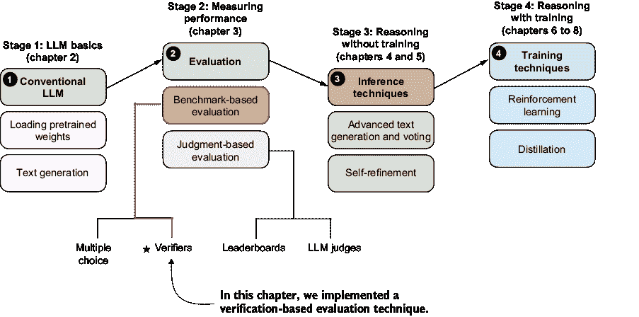

**图 3.11.** 本书所涵盖主题的模型图。本章实现了一个基于验证的评估流水线。在下一章中，我们将通过更先进的推理技术来提升 LLM 的推理能力。

在继续之前，值得注意，评估还有其他多种形式。在本章中，我们专注于数学问题的基于验证的准确率，因为它是一种流行的方法，而且我们将在第 6 章和第 7 章的强化学习流水线中复用这个验证器。为了让你有更全面的了解，附录 F 介绍了其他常见的评估策略，例如选择题基准、验证器、排行榜和 LLM 作为裁判的设置。如果你希望快速了解这些方法在实践中的工作原理，它还包含动手示例。

现在我们已经有了一个评估框架，下一章将重点介绍通过更先进的推理（文本生成）技术来提升推理能力。

## 总结

- LLM 主要有四种评估方法：选择题、验证器、排行榜和 LLM 裁判。
- 基于验证的评估方法允许自由形式的答案，并使用外部工具来检查正确性。
- 本章重点介绍基于验证的评估，通过构建一个数学验证器来提取、归一化，并使用 SymPy 检查答案。
  - 验证流水线涉及几个核心步骤，从加载 LLM 到在数据集上运行评估。
  - 作为验证流水线的一部分，答案提取使用字符串解析来定位 boxed 内容（对于缺失 box 的情况有回退机制）。
  - 另一个步骤实现归一化，通过去除 LaTeX 并转换数学符号来标准化各种答案格式。
- 最后，流水线使用数学等价性检查（通过 SymPy）来符号化地比较表达式。
- MATH-500 数据集提供了 500 个精选的数学问题用于评估。
- 提示模板对模型性能有显著影响。
- 推理模型比基础模型能实现更高的准确率，但需要更长的运行时间。
