# 4 通过推理时扩展改进推理

## 本章涵盖

- 提示 LLM 解释其推理过程以提高答案准确率
- 修改文本生成函数以产生多样化的响应
- 通过对多个响应进行采样来提高推理可靠性

推理性能和答案准确率无需重新训练或修改模型本身即可得到提升。如图 4.1 的概览所示，本章涵盖两种推理时扩展方法。这些方法在推理阶段（即模型生成文本时）运行。你将在本章后文看到，这两种方法都将前几章使用的基础模型准确率提升了一倍以上。

在讨论图 4.1 所示的推理方法之前，我们先来看看什么是推理时扩展。

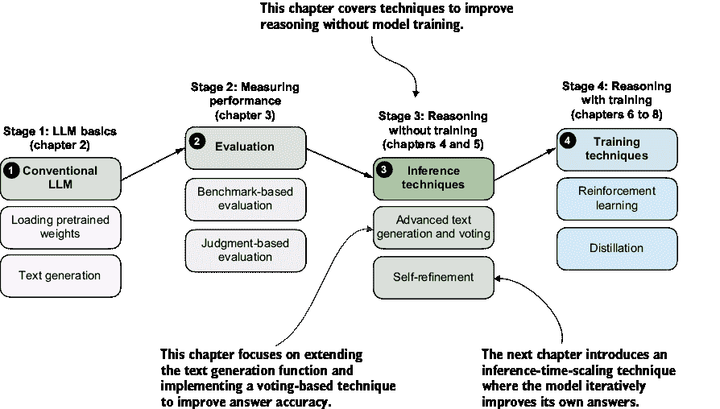

**图 4.1** 本书所涵盖主题的模型。本章聚焦于推理时扩展技术，这类技术无需额外训练即可改进推理（阶段 3）。具体而言，它扩展了文本生成函数，并实现了一种基于投票的方法来提高答案准确率。下一章将介绍另一种推理时扩展方法，即模型迭代式精炼自己的答案。

## 4.1 推理时扩展简介

改进推理主要有两种策略：

- 增加训练算力


# 增加推理算力

增加推理算力（也称为推理时扩展或测试时扩展）是提升模型推理能力的重要途径。

**注意：** 在机器学习和人工智能中，“算力”指训练或运行模型所需的计算资源。

这两种方法如图 4.2 所示，图中的曲线似乎表明，我们可以通过增加训练时算力*或*推理时算力来改进推理。实际上，LLM 通常被设计为通过结合大量训练时算力（后续章节的主题）*和*增加的推理时算力（本章的主题）来改进推理。

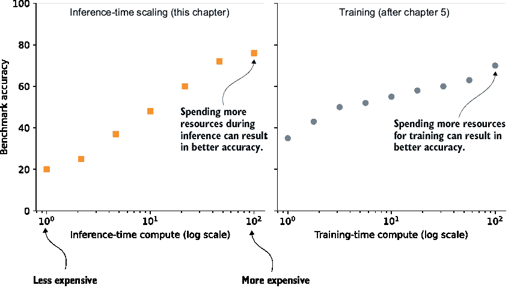

**图 4.2** 比较推理时扩展（本章讨论）与训练时扩展（第 6-8 章讨论）。这两种方法都通过使用更多算力来提高准确率，但推理时扩展是在运行过程中动态完成的，无需改变模型的权重参数。这些图的灵感来自 OpenAI 介绍其首个推理模型的文章（[`openai.com/index/learning-to-reason-with-llms/`](https://openai.com/index/learning-to-reason-with-llms/)）。

*推理时算力扩展*（也称为*推理时扩展*或*测试时算力扩展*）是指在模型完成训练后，在答案生成阶段增加计算量，以提高其响应质量。我们不改变模型的权重，而是让训练好的模型针对每个问题做更多工作，例如生成更多 token 并进行更长时间的“思考”、对多个答案进行采样，或逐步精炼其答案。

在本书中，我们将重点介绍三种实用且基础的推理时技术（如图 4.3 所示）：

* 方法 1：扩展*思维链*响应，提示模型解释其推理过程。这种简单的技术可以大幅提高准确率。
* 方法 2：通过*自一致性*进行并行采样，即让模型生成多个响应并选择最常出现的那个。
* 方法 3：迭代式*自我精炼*，即模型在多个步骤中审查并改进自己的推理和答案。

这些方法属于推理时扩展的范畴，因为它们促使模型生成更多 token，从而增加了推理阶段的计算需求。它们在提高准确率的同时也使得推理更加昂贵，这是推理时扩展技术的共同主题。本章我们将讨论前两种方法；第三种将在第 5 章中介绍。

第一种方法通过提示模型解释其推理过程来提高答案准确率，这是一种简单却非常有效的方法。

第二种方法针对同一输入采样多个响应，并选择最常出现的那个。我们将通过扩展上一章引入的文本生成函数并实现*自一致性*（一种基于投票的推理时扩展技术）来做到这一点。

总的来说，我在数千次实验中评估了十多种不同的推理时扩展技术。我之所以选择图 4.3 所示的这三种方法，是因为它们兼具三个理想特性：它们能提高此处所用模型的准确率，它们代表了推理时扩展的主要实用范式，而且它们足够简单，无需太多额外机制即可从零实现。它们还涵盖了两种主要模式：生成更长的响应和生成多个响应。

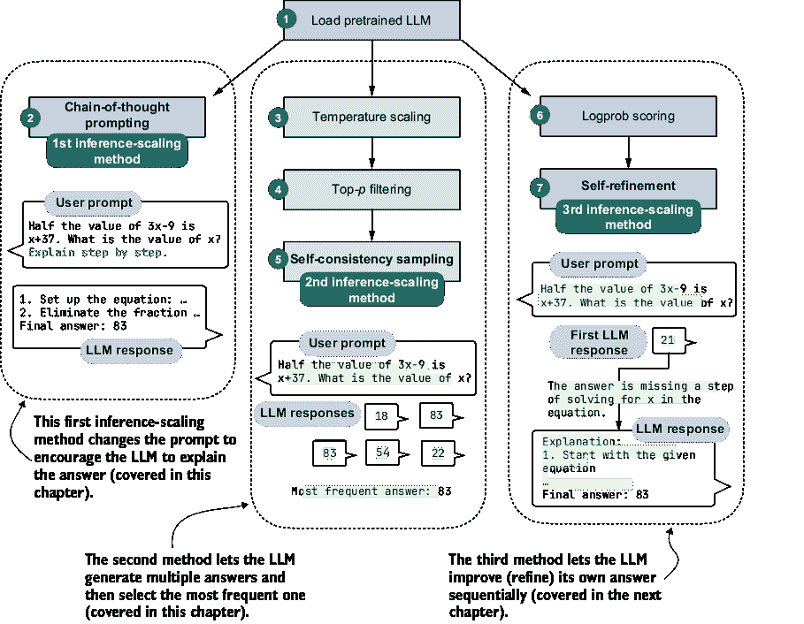

**图 4.3** 改进推理的三种推理时方法。第一种方法修改提示词以鼓励逐步推理，第二种方法对多个答案进行采样并选择最常出现的那个。这两种方法将在本章讨论。第三种方法（模型迭代式地精炼自己的响应）将在下一章介绍。

包含推理和解释的更长的响应（方法 1 和 3）正是我们对推理模型的典型预期。并行采样（方法 2）也广泛应用于生产系统，例如 Claude 4（详见 2025 年 5 月 Claude 4 的发布介绍：[`www.anthropic.com/news/claude-4`](https://www.anthropic.com/news/claude-4)）。

## 4.2 加载预训练模型

在开始实现推理时扩展方法之前，我们先加载预训练的基础模型和分词器。以下代码与上一章使用的代码类似。

**清单 4.1** 加载分词器和基础模型

```
import torch
from reasoning_from_scratch.ch02 import get_device
from reasoning_from_scratch.ch03 import (
     load_model_and_tokenizer
)

device = get_device()
device = torch.device("cpu")  #1

model, tokenizer = load_model_and_tokenizer(
    which_model="base",
    device=device,
    use_compile=False
)
```

`#1` 删除此行代码即可在 GPU 上运行（如果你的机器支持）。

由于本章代码运行成本很低，我建议首次在 `"cpu"` 设备上运行，以获得与本章所示相同的结果（在 GPU 上运行可能会导致结果略有不同）。

让我们在 MATH-500 数据集的一个提示上试试该模型，我们在上一章中使用过这个数据集：

```
from reasoning_from_scratch.ch03 import render_prompt

raw_prompt = (
    "Half the value of $3x-9$ is $x+37$. "
    "What is the value of $x$?"
)
prompt = render_prompt(raw_prompt)
print(prompt)
```

格式化后的提示如下：

```
You are a helpful math assistant.
Answer the question and write the final result on a new line as:
\boxed{ANSWER}

Question:
Half the value of $3x-9$ is $x+37$. What is the value of $x$?

Answer:
```

我们可以将上述提示作为上一章定义的 `generate_text_stream_concat` 函数的输入。

我们希望比较几种推理时扩展策略，因此我们将对文本生成包装器做一个小修改，以便在不改动周围的提示处理和输出代码的情况下，切换不同的生成函数和设置。这些修改在以下清单的代码注释中突出显示。

**清单 4.2** 修改后的 `generate_text_stream_concat` 函数

```
from reasoning_from_scratch.ch02 import generate_text_basic_stream_cache


def generate_text_stream_concat_flex(
    model, tokenizer, prompt, device, max_new_tokens,
    verbose=False, 
    generate_func=None,  #1
    **generate_kwargs     #1
):

    if generate_func is None:  #2
        generate_func = generate_text_basic_stream_cache

    input_ids = torch.tensor(
        tokenizer.encode(prompt), device=device
        ).unsqueeze(0)

    generated_ids = []
    for token in generate_func(
        model=model,
        token_ids=input_ids,
        max_new_tokens=max_new_tokens,
        eos_token_id=tokenizer.eos_token_id,
        **generate_kwargs,  #3
    ):
        next_token_id = token.squeeze(0)
        generated_ids.append(next_token_id.item())

        if verbose:
            print(
                tokenizer.decode(next_token_id.tolist()),
                end="",
                flush=True
            )
    return tokenizer.decode(generated_ids)
```

`#1` 我们添加参数来接收文本生成函数和额外参数。

`#2` 如果文本生成函数未定义，我们使用`generate_text_basic_stream_cache`，与第 3 章类似。

`#3` 如有需要，我们可以向文本生成函数传递额外的参数。

简而言之，前面的`generate_text_stream_concat_flex`函数与上一章的`generate_text_stream_concat`函数类似，区别在于现在我们可以将文本生成函数（如`generate_text_basic_stream_cache`）作为参数传入，而不是硬编码。实际的好处是，外层包装器可以统一负责提示编码、流式传输和解码，而内层的生成步骤可以用不同的解码策略替换。这样更容易公平地比较各种方法，因为只更改生成逻辑，而不改动整个流程。在后续章节中，我们将把`generate_text_basic_stream_cache`函数替换为更高级的函数。

`generate_text_basic_stream_cache`函数的使用方式也和之前类似，只是现在我们可以显式地传入该函数：

```
response = generate_text_stream_concat_flex(
    model, tokenizer, prompt, device,
    max_new_tokens=2048, verbose=True,
    generate_func=generate_text_basic_stream_cache
)
```

这是生成的输出：

```
\boxed{20}
```

请注意这个答案是错误的；正确的解是 83。在本章的其余部分以及下一章中，我们将实现推理时扩展方法，让模型生成正确答案。

## 4.3 使用思维链提示生成更好的回复

我们已经加载了预训练的基础模型，并设置了文本生成函数；现在我们将专注于通过所谓的*思维链*提示来改进模型输出。这种提示技巧经典、简单且有效。它修改输入提示，以鼓励 LLM 生成解释或思维链（也称为推理链），如图 4.4 所示。

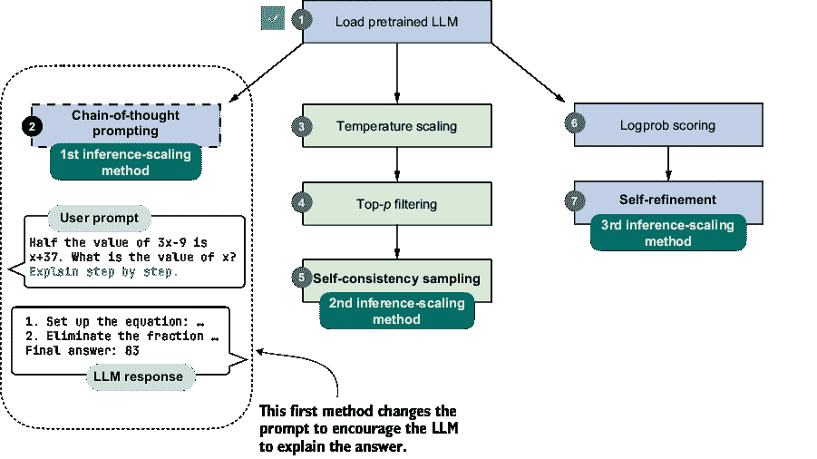

### 图 4.4 我们的第一个推理时方法，思维链提示，修改提示以鼓励模型在给出最终答案之前，逐步解释其推理过程。

尝试思维链提示最简单的方法是追加一条额外指令，要求模型一步步推理。措辞有多种方式。例如，关于该主题的原始论文使用了`"Let's think step by step."`（[`arxiv.org/abs/2205.11916`](https://arxiv.org/abs/2205.11916)），但不同的措辞可能因模型和任务而异。这里，我们使用`"Explain step by step."`，因为在本章的实验中我发现它效果不错，并且让示例保持简洁：

```
prompt_cot = prompt + " \n\nExplain step by step."

response_cot = generate_text_stream_concat_flex(
    model, tokenizer, prompt_cot, device,
    max_new_tokens=2048, verbose=True,
)
```

现在的响应如下：

```
 要解决这个问题，我们需要找到满足条件的 \( x \) 的值，
即 \( 3x - 9 \) 的值的一半等于 \( x + 37 \)。

# ...  #1

### 第 3 步：求解 \( x \)
两边同时减去 \( 2x \) 以隔离 \( x \)：
\[
3x - 2x - 9 = 74
\]
简化：
\[
x - 9 = 74
\]
两边同时加 9 以求解 \( x \)：
\[
x = 74 + 9
\]
\[
x = 83
\]

### 最终答案：
\[
\boxed{83}
\]
```

`#1` 为节省篇幅，响应已截断。

如你所见，模型现在写出冗长的逐步解释，并且在这种情况下得出了正确的答案。

这个简单的思维链提示很好地展示了推理时扩展的权衡。虽然模型现在能正确回答，但消耗的 token 比以前多得多。正如第 2 章讨论的，LLM 逐 token 生成文本，每个额外的 token 都需要一次额外的模型前向传播。因此，这些中间推理步骤不仅使答案更长，还会直接增加延迟、计算成本，并且通常还会增加 API 成本。

请注意，虽然在这种情况下模型生成了正确答案，但并非所有问题都能从思维链提示中受益。在一些简单问题上，它有时甚至会降低模型性能，因为模型可能会生成错误的解释而误导自己。这种现象被称为“过度思考”。

最后，并非每个模型都能从“Explain step by step”（或类似指令）中受益。在本例中，我们使用了一个简单的基础模型，它并不总是生成解释，因此思维链提示可以提供帮助。经过推理训练的模型，例如我们在上一章使用的 Qwen3 模型的“推理”变体，已经在回复中写出解释，因此不需要也不会从这种思维链提示中受益。

### 为什么思维链可以提高准确性

思维链提示要求模型写出通向最终答案的中间步骤。这在两个方面有实际帮助。

首先，逐步推理给模型更多自我纠正的机会。

其次，逐步推理与许多训练示例的编写方式相符。例如，大型数学和逻辑数据集通常包含详细解答，因此要求思维链能使模型与其已学过的模式保持一致。

与此同时，思维链推理并不能保证正确性。它仍然可能产生错误的推理，并且在非常简单的问题上，它甚至可能引入不必要的步骤，从而导致更多错误。换句话说，思维链可以在许多推理任务上提高准确率，但它并不普遍有益。

总体而言，思维链提示并没有为模型提供新的知识，而是改变了模型使用现有知识的方式。通常，这种转变能够带来更可靠的答案。对于数学、代码、逻辑以及其他多步骤问题尤其如此。

### 练习 4.1：在 MATH-500 上使用思维链提示

修改列表 3.15 中的 `evaluate_math500_stream` 函数，查看思维链提示是否提高了基础模型在 MATH-500 上的准确率。

## 4.4 通过温度缩放控制输出多样性

上一节通过思维链提示扩展模型的答案，简单体验了推理时扩展。思维链提示可以被视为一种顺序技术，因为它增加了下一个 token 预测步骤的数量。

在本章的其余部分中，我们将实现一种自一致性技术（也称为*自一致性采样*），它生成多个答案，如图 4.5 所示。该技术在 Google Research 论文“Self-Consistency Improves Chain of Thought Reasoning in Language Models”（[`arxiv.org/abs/2203.11171`](https://arxiv.org/abs/2203.11171)）中正式提出。

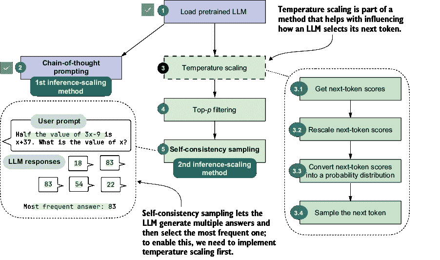

**图 4.5** 自洽性采样（self-consistency sampling）是我们第二种推理时方法，它会生成多个答案并选择最频繁的一个。该方法依赖于温度缩放（temperature scaling），而温度缩放会影响模型对下一个词元（token）的采样方式。

由于使用这种技术生成的多个答案相互独立，因此可以通过并行采样实现（如果你拥有必要的资源，例如多个 GPU），这样不会增加用户获取答案的时间。（思维链提示可以与这种技术结合使用，但稍后会详细讨论。）

在实现自洽性采样（图 4.5 中的步骤 5）之前，我们首先需要扩展文本生成函数，使其能够为同一提示生成不同的答案。为此，我们将实现两种允许模型采样不同响应的技术：*温度缩放*（步骤 3）和`top-p`过滤（步骤 4）。

温度缩放是本节的焦点；它将是本章后续部分控制输出多样性的关键控制手段之一，并且为接下来的`top-p`过滤方法奠定了基础。不过，我们首先来看一下在 LLM 中下一个词元是如何被采样的。这些底层的采样控制可能看起来过于技术化，但正是它们让我们能够为自洽性采样生成多样化的候选答案。

### 4.4.1 理解选择下一个词元的过程

让我们更仔细地审视目前已经实现的文本生成过程，看看下一个词元的选择过程在底层是如何运作的。这将帮助你理解温度缩放背后的动机。

假设我们有如下简单的提示：

```
ex_prompt = "The capital of Germany is"

response = generate_text_stream_concat_flex(
    model, tokenizer, ex_prompt, device,
    max_new_tokens=1, verbose=True
)
```

模型的响应是`" Berlin"`。这看起来相对简单，但正如图 4.6 所示，底层其实发生了多个步骤。

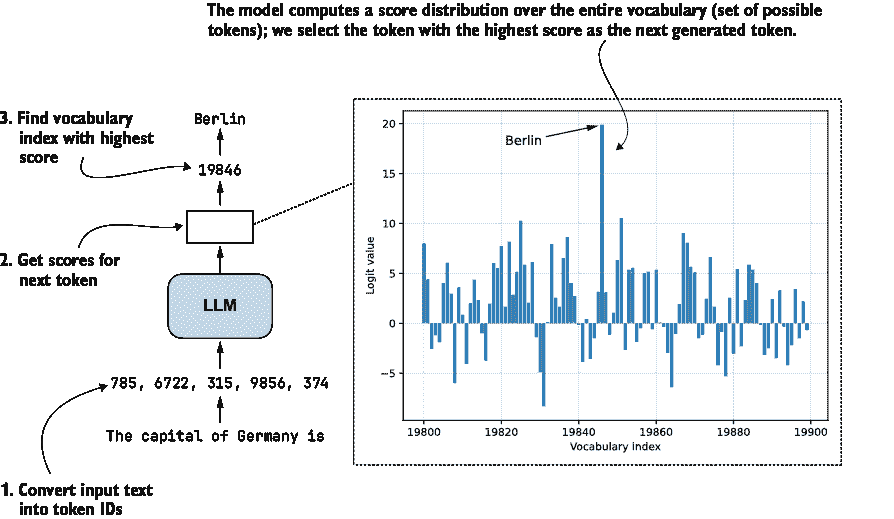

**图 4.6** LLM 如何生成下一个词元。与本书中的所有流程图一样，流程从下到上运行。模型将输入转换为词元 ID，为所有可能的下一词元计算分数，并选择分数最高的作为下一个输出。

在生成文本时，输入首先被转换为词元 ID（如第 2 章所讨论的）：

```
input_token_ids = torch.tensor(
    tokenizer.encode(ex_prompt), device=device
).unsqueeze(0)
print(input_token_ids)
```

在本例中，这些词元 ID 为：

```
tensor([[ 785, 6722,  315, 9856,  374]])
```

在图 4.6 的第二步中，我们获取想要生成的输出词元的分数。这些输出分数也称为*logits*。LLM 会为每个输入词元生成一个输出词元，但我们只关心最后一个词元，我们通过`[:, -1]`张量索引来选择它。这个最后的词元对应于我们想要生成的词元。


# 4.4 生成下一个词元

## 4.4.1 从 logits 到词元

在上一节中，我们计算了下一个词元的 logits。现在，让我们看看如何将这些 logits 转换为实际的词元。首先，我们使用 `torch.inference_mode()` 来禁用梯度计算，以提高推理速度：

```python
with torch.inference_mode():
    next_token_logits = model(input_token_ids)[:, -1]
print(next_token_logits.shape)
```

打印输出的形状为`[1, 151936]`，其中`151936`是该分词器和模型的词汇表大小。词汇表包含了分词器能够处理且 LLM 能够生成的所有唯一词元。

为了获得下一个生成的词元（本例中的`" Berlin"`），我们必须找到与最大分数相关联的词汇表条目（图 4.6 中的步骤 3）：

```python
max_token_id = torch.argmax(next_token_logits)
print(f"Token ID: {max_token_id}")
print(f"Decoded token: '{tokenizer.decode([max_token_id])}'")
```

输出如下：

```python
Token ID: 19846
Decoded token: ' Berlin'
```

我们现在已经介绍了生成下一个词元的三个主要步骤。在进入下一节之前，让我们更仔细地看一下传递给`torch.argmax`函数以获取词元 ID 的`next_token_logits`张量的分数分布。我们将用 Matplotlib 绘制它。

**清单 4.3** 绘制下一个词元的 logit 分数

```python
import matplotlib.pyplot as plt

def plot_scores_bar(
    next_token_logits, start=19_800, end=19_900,
    arrow=True, ylabel="Logit value"
):
    x = torch.arange(start, end)  #1
    logits_section = next_token_logits[0, start:end].float().cpu() #2

    plt.bar(x, logits_section)  #3
    plt.xlabel("Vocabulary index")
    plt.ylabel(ylabel)

    if arrow:  #4
        max_idx = torch.argmax(logits_section)
        plt.annotate(
            "Berlin",
            xy=(x[max_idx], logits_section[max_idx]),
            xytext=(x[max_idx] - 25, logits_section[max_idx] - 2),
            arrowprops={
                "facecolor": "black", "arrowstyle": "->", "lw": 1.5
            },
            fontsize=10,
        )

    plt.grid(alpha=0.3)
    plt.tight_layout()
    plt.show()

plot_scores_bar(next_token_logits)
```

1. `#1` 选择词汇表的子区间。
2. `#2` `.cpu()` 是 `to(torch.device("cpu"))` 的快捷方式。
3. `#3` 在选定范围内绘制 logits（分数）。
4. `#4` 绘制箭头以突出显示最大分数。

我们将绘图限制在词汇表索引 19,800 到 19,900 之间的 100 个词元，而不是绘制全部 151,936 个条目的分数，那样会使图表过于拥挤。我选择这个范围是因为它包含了最高分数的条目。得到的图如图 4.7 所示。

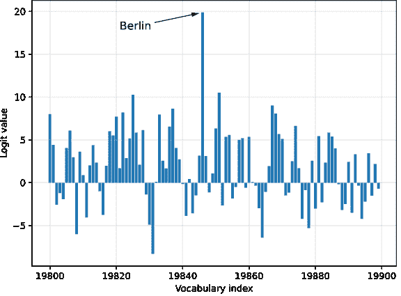

**图 4.7** 语言模型更大词汇表中 100 个词元切片的下一个词元 logits。每个条形代表该切片内一个可能词元的分数，其中"Berlin"的 logit 值最高，并被选为下一个词元。

图 4.7 中的图显示了词汇表索引 19,800–19,899 这 100 个 logit 值（分数）。这些值大约从–8 到 20，其中值 20 对应于词元`" Berlin"`的词汇表索引。

## 4.4.2 通过温度参数重新缩放词元分数（logits）

既然你已经知道模型如何选择下一个词元，我们就可以引入温度的概念。温度，或者更准确地说，温度参数，会重新缩放 logits，从而使相应的概率分布变得更尖锐或更平坦，进而影响下一个词元的选择方式。

如图 4.8 所示，本节重点在于使用温度参数对下一个词元的 logits 进行重新缩放，然后再将其用于采样。这里的重新缩放是指调整分数的大小，使采样步骤对分数差异的敏感度或高或低。

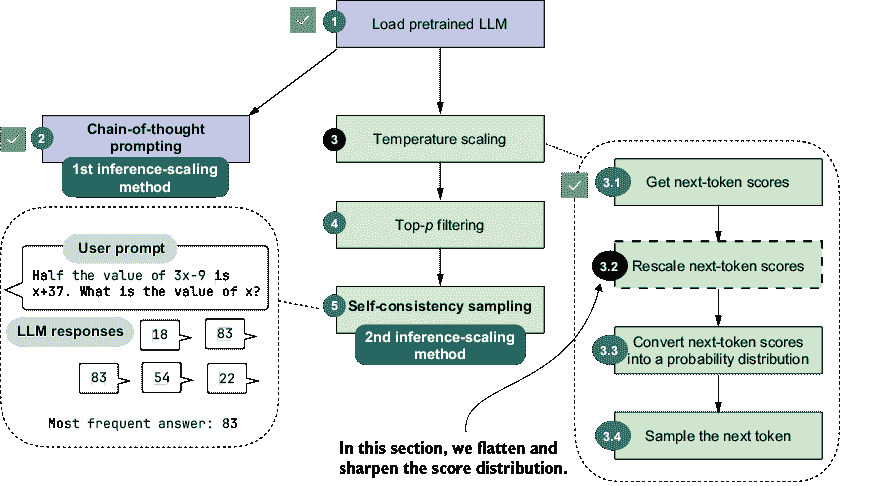

在本节中，我们将实现温度缩放的核心部分（步骤 3.2），它调整下一个词元的分数。这让我们可以控制模型在后续步骤中选择下一个词元的置信度。

实现温度重新缩放步骤（图 4.8 中的步骤 3.2）的代码相对简短。本质上，下面的代码在将 logit 值转换为概率（将在下一节讨论）之前对其进行了重新缩放。

**清单 4.4** 通过温度缩放重新缩放下一个词元的分数

```python
def scale_logits_by_temperature(logits, temperature):
    if temperature <= 0:
        raise ValueError("Temperature must be positive")
    return logits / temperature
```

在实践中，温度值应为正数，因此如果温度小于或等于零，我们会引发错误。稍后当我们把温度缩放添加到文本生成函数中时，我们还会加入更多温度缩放的安全措施。

对于所有其他值，logits 会除以温度。温度为 1.0 意味着没有变化，因为一个数除以 1 后保持不变。低于 1.0 的温度会使分布更尖锐，从而让模型在选择下一个 token 时更自信。高于 1.0 的温度会使 logit 分布更平坦，这可能使采样（图 4.8 中的步骤 3.4）更多样化。换句话说，较高的温度会缩小最高 token 与排名较低 token 之间的概率差距，从而增加采样选择非最大 token 的机会。

我们来看看 `scale_logits_by_temperature` 函数的实际效果。为了效果更明显，我们用相对极端的温度值 0.5 和 5.0 来尝试。

### 代码清单 4.5 绘制按温度重新缩放后的 logits

```python
def plot_logits_with_temperature(
    next_token_logits, start=19_800, end=19_900,
    temps=(0.5, 5.0),
):
    x = torch.arange(start, end)
    logits_orig = next_token_logits[0, start:end].float().cpu()

    logits_scaled = [   #1
        scale_logits_by_temperature(logits_orig, T) for T in temps  #2
    ]   #2

    plt.plot(x, logits_orig, label="Original logits", lw=2)  #2
    plt.plot(                                                
        x, logits_scaled[0],                                 
        label=f"T={temps[0]} (sharper)", ls="--", lw=1       #3
    )                                                        
    plt.plot(                                                
        x, logits_scaled[1],                                 
        label=f"T={temps[1]} (flatter)", ls=":", lw=3        
    )                                                        

    # Highlight max logit
    max_idx = torch.argmax(logits_orig)                     #4
    plt.annotate(                                            #4
        "Berlin",
        xy=(x[max_idx], logits_orig[max_idx]),
        xytext=(x[max_idx] - 25, logits_orig[max_idx] + 2),
        arrowprops={"facecolor": "black", "arrowstyle": "->", "lw": 1.5},
        fontsize=12,
    )

    plt.xlabel("Vocabulary index")
    plt.ylabel("Logit value")
    plt.legend()
    plt.grid(alpha=0.3)
    plt.tight_layout()
    plt.show()

plot_logits_with_temperature(
    next_token_logits,
    temps=(0.5, 5.0)                                        #5
)
```

- `#1` 应用温度缩放。
- `#2` 绘制所选范围内的 logits（分数）。
- `#3` 绘制所选范围内的 logits（分数）。
- `#4` 绘制箭头以突出显示最大分数。
- `#5` 使用温度 0.5 和 5 运行重新缩放和绘图。

如图 4.9 所示，较大的温度（5.0）会产生更平坦的分数分布，而较小的温度（0.5）会产生更尖锐的分布。

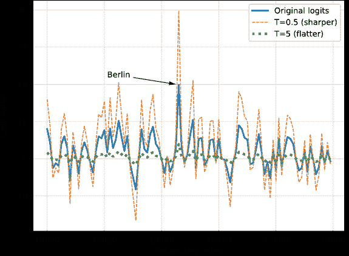

#### 图 4.9 温度缩放对 logits 的影响。较低的温度使分布更尖锐，而较高的温度使其更平坦。（请注意，此可视化为了可读性而以折线图显示；条形图能更准确地表示各个词汇分数。）

代码清单 4.5 中的绘图代码与代码清单 4.3 中的绘图代码非常相似。除了应用温度缩放之外，我们现在使用折线图（`plt.plot`）而不是条形图（`plt.bar`）。尽管从技术上讲，对于 `x` 轴上的离散词汇索引，条形图是更好的选择，但在这种情况下，折线图更容易可视化和比较重新缩放后的 logits。

重要的不是 logit 本身的绝对高度，而是 logits 之间的差异如何变化。如果像 `" Berlin"` 这样的 token 比其他候选 token 更突出，那么它之后被选中的可能性就更大。如果差异缩小，排名较低的 token 被选中的可能性就会增加。下一节将通过把 logits 转换为概率来说明这一点。

#### 为什么是温度？

术语 *温度* 来自物理学，物理学中温度控制系统中随机性或运动的多少。在 LLM 中，我们使用同样的思路来控制模型选择下一个 token 时的自信程度或创造性，你将在接下来的章节中看到这一点。

## 4.4.3 从概率分布中采样下一个 token

在上一节中，我们使用不同的温度值重新缩放了 logit 值。这让我们能够影响模型选择下一个 token 的方式。在进入下一节的下一 token 采样部分之前，我们将再添加一个中间步骤：将重新缩放后的 logits 转换为概率分数，如图 4.10 所示。

为了演示重新缩放后的 logits 如何转换为概率分数（图 4.10 中的步骤 3.3），我们将使用 5.0 的温度，这样更容易在图中可视化所得的概率。例如，`" Berlin"` token 的 logit 值非常高，否则它会主导刻度范围，使周围 token 的概率难以看到。

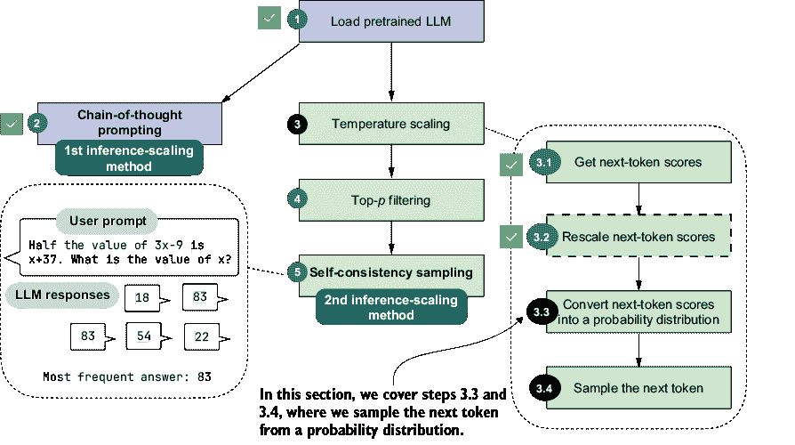

#### 图 4.10 生成 token 的采样过程概述。在这里，我们聚焦于步骤 3.3 和 3.4，其中下一个 token 的分数被转换为概率分布。随后将根据该分布对下一个 token 进行采样。

从重新缩放后的 logits 到概率分数的转换可以通过一次函数调用 `torch.softmax` 完成，如下面的代码清单所示。

#### 代码清单 4.6 从概率分布中采样下一个 token

```python
rescaled_logits = scale_logits_by_temperature(next_token_logits, 5.0)  #1

next_token_probas = torch.softmax(  #2
    rescaled_logits, dim=-1
)
```

- `#1` 步骤 3.2：重新缩放下一个 token 的分数。
- `#2` 步骤 3.3：将重新缩放后的 logits 转换为概率分数。

`torch.softmax` 函数将 logit 值归一化到 0 到 1 的范围内，使它们之和为 1。我们可以用以下代码确认这一点：

```python
print("Probability sum:", torch.sum(next_token_probas))
```

此外，让我们复用代码清单 4.3 中的 `plot_scores_bar` 函数来可视化转换后的分数：

```python
plot_scores_bar(
    next_token_probas, arrow=False, ylabel="Probability value"
)
```

结果图如图 4.11 所示，现在 `y` 轴上是概率值。我们可以看到，token ID 19,846（`" Berlin"`）在此选定的词汇范围内具有最高值。该概率为 0.0003，我们可以用以下代码确认：

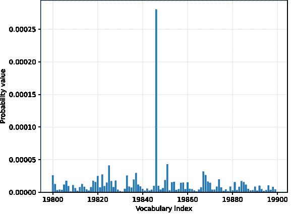

#### 图 4.11 通过对重新缩放后的 logits 应用 softmax 函数获得的 token 概率。具有最高概率的 token（对应于 `" Berlin"`，但为简化代码而省略了标签）被选为下一个输出。

```python
print("Token ID 19,846 probability:", next_token_probas[:, 19846])
```

请注意，虽然 0.0003 这个值相对较小，但在此图中选定的词汇范围之外没有更大的值。例如，使用以下代码，我们可以确认 0.0003 确实是最大值：

```python
print("Highest probability:", max(next_token_probas.squeeze(0)))
```

我们可以将这个分数理解为模型的置信度。这意味着模型在选择 `" Berlin"`（19,846）作为下一个 token 时，比其他任何 token 都更有信心。

这个值之所以如此小，是因为我们使用了较高的温度，这样更容易将这个值与其他 token 的值放在一起绘制。如果我们将温度从 5 改为 0.5，概率分数将从 0.0003 增加到 0.3398，而其他 token 的概率分数会更接近 0。

#### `softmax` 函数背后的原理

`softmax` 函数将原始分数（logits）的向量转换为概率分布，其中每个值都在 0 到 1 之间，且所有值之和为 1。这种转换使这些值更容易解释，也便于后续从中采样。

如果你熟悉数学符号，那么 softmax 函数背后的公式如下：

`softmax(zᵢ) = exp(zᵢ) / Σⱼ exp(zⱼ)`

这里，`z` 是一个实值输入向量

`z = [z₁, z₂, …, zₙ]`，

其中

- `n` 是向量中元素的数量。
- `i` 是当前元素的索引（1 ≤ `i` ≤ `n`）。
- `j` 是用于对所有元素求和的索引（1 ≤ `j` ≤ `n`）。

这会为每个元素 `zᵢ` 生成一个归一化概率，使得

`Σᵢ softmax(zᵢ) = 1`

在代码中，softmax 函数可以用三行实现：

```python
def softmax_with_temperature(logits, temperature):
    scaled_logits = logits / temperature
    return torch.softmax(scaled_logits, dim=0)
```

在实践中，我更倾向于使用 `torch.softmax` 函数，因为它有一些额外的数值稳定性改进，可以更可靠地处理非常小和非常大的数值。

将 logits 转换为这些概率分数的目的是，它们在一定程度上更具可解释性，并且我们现在可以使用 `torch.multinomial` 函数从中采样。例如，如果我们从这个概率分布中抽取一个样本，在温度设置为 5.0 时，我们有 0.03% 的概率得到 `" Berlin"`（而在温度为 0.5 时，有 33.98% 的概率得到 `" Berlin"`）。

采样过程（对应于图 4.10 中的步骤 3.4）可以按如下方式实现：

```python
torch.manual_seed(123)
print(
    "Sampled token:",
    torch.multinomial(next_token_probas.cpu(), num_samples=1)
)
```


这段代码返回词元 ID `65,094`，对应于单词 `" mistress"`。请注意，在我们的上下文 `"The capital of Germany is"` 中，这个词没有意义。在这种情况下，它是被随机选中的，因为高温设置倾向于采样除 `" Berlin"` 之外的词元。

`torch.multinomial` 函数会根据词汇索引的概率按比例进行采样。换句话说，概率较高的词汇索引更有可能被采样到。如果我们重复采样非常多次，在温度为 `5` 的情况下，我们采样到与词元 `" Berlin"` 对应的词汇索引的概率为 `0.03%`。

在查看更多示例之前，请注意我们指定了一个随机种子，以使本章中的代码可复现。`torch.multinomial()` 函数在 CUDA 和 MPS 设备上可能仍会产生不同的结果，甚至在抽取大量样本时可能崩溃（我在 PyTorch 2.9 的 CUDA 和 MPS 设备上都观察到了这个问题），这就是我们通过 `.cpu()` 在 CPU 上运行采样的原因。

现在让我们采样更多下一个词元候选，以获得更具代表性的样本。

### 清单 4.7：采样多个下一个词元候选

```python
def count_samples(probas, num_samples=1000, threshold=1, tokenizer=None):
    samples = torch.multinomial(  #1
        probas.cpu(), num_samples=num_samples, replacement=True
    )
    counts = torch.bincount(samples.squeeze(0), minlength=1)  #2

    for i, c in enumerate(counts):
        if c > threshold:   #3
            if tokenizer is None:
                print(f"Vocab index {i}: {c.item()}x")
            else:
                print(f"'{tokenizer.decode([i])}': {c.item()}x")
```

- `#1` 根据概率抽取样本。
- `#2` 统计每个索引被选中的次数。
- `#3` 打印频繁采样的词汇索引（条目）。

清单 4.7 中的这个 `count_samples` 函数从概率分布中采样词元索引，并统计每个词元被抽取的次数。它使用 `torch.multinomial` 根据每个索引的概率按比例随机选择 `num_samples` 个索引。`replacement=True` 设置允许我们多次抽取同一个词元。

然后，`torch.bincount` 统计每个索引出现的次数。它只打印出现次数超过指定阈值的词元，这样就不会用较少被抽取的词元使输出变得杂乱。

### 多项式采样

多项式采样是在给定词汇表上的概率分布（例如 softmax 概率分数）时，用于选择下一个词元的过程。在多项式采样中，我们不是始终选择最可能的词元（称为*贪心解码*），而是随机抽取一个词元，概率较高的词元更有可能被选中。这种随机性对于生成多样化的响应非常重要，我们稍后将把它用于自洽性采样。

为了进一步说明这一点，我们可以将概率分数视为一组加权选择。例如，概率为 `0.40` 的词元出现的可能性是概率为 `0.10` 的词元的四倍，但两者仍然是可能的结果。

假设模型分配了以下概率：

- `"Berlin"`：`0.70`
- `"Munich"`：`0.20`
- `"Hamburg"`：`0.10`

贪心解码总是返回 `"Berlin"`。而多项式采样则根据这些权重抽取一个词元。在非常大量的抽取中，`"Berlin"` 出现得最多（`70%` 的时间），`"Munich"` 有时出现（`20%` 的时间），而 `"Hamburg"` 只是偶尔出现（`10%` 的时间）。

这种多样性使我们能够在后续章节中为自洽性生成多个候选答案。

**注意：** 这个 `count_samples` 函数仅用于说明。在实际的文本生成中，我们每次只抽取一个词元。此函数从分布中抽取大量样本，以展示每个词元被选中的频率，从而更容易可视化和理解底层概率。

首先，让我们对通过应用温度 `5` 获得的概率分数运行 `count_samples` 函数：

```python
torch.manual_seed(123)
count_samples(next_token_probas, tokenizer=tokenizer)
```

输出如下：

```text
'}': 2x
' </': 2x
' represent': 2x
' Inf': 2x
'()*': 2x
' beside': 2x
' Kob': 2x
'⧄': 2x
```

如你所见，即使默认样本大小为 `1,000`，采样到的词元中也没有出现超过两次的。此外，在 `"The capital of Germany is"` 查询的上下文中，这些都是无意义的词元。产生这些无意义结果的原因是我们使用的温度值过高。

让我们尝试较低的温度值 `0.35`，它会锐化分数分布，使选择有意义的下一个词元的可能性更大：

```python
torch.manual_seed(123)
probas_lowT = torch.softmax(
    scale_logits_by_temperature(next_token_logits, 0.35), dim=-1
)
```

在这种情况下，我们看到以下输出：

```text
' __': 158x
' Berlin': 435x
' ____': 169x
' ______': 209x
' Munich': 3x
' Hamburg': 3x
' _____': 18x
```

对于我们的 `"The capital of Germany is"` 查询而言，这组下一个词元候选更加合理。在 `1,000` 个样本中，`" Berlin"` 词元被抽取了 `435` 次。你可以通过 `print(probas_lowT[0, 19_846])` 检查，在温度值 `0.35` 时，抽取该词元的概率约为 `42%`。为了更可能采样到 `" Berlin"`，我们可以进一步降低温度。

请注意，其他一些较罕见的候选也有意义。例如，`" Munich"` 和 `" Hamburg"` 都是德国的大城市，因此它们与查询并非完全无关。下划线响应（`" ____"`）很可能是因为模型见过带有占位符的测验形式文本；例如，`"The capital of Germany is ____"`。

你可能想知道，如果 `" Berlin"` 是正确答案，那么通过添加这种温度重新缩放和多项式采样，让模型偶尔给出错误答案有什么意义？对于不同类型的查询，在采样过程中引入随机性有助于模型探索替代响应，而不是总是选择单个最可能的词元。这种多样性对于创造性或开放式任务可能很有用，因为在这些任务中可能存在多种有效的补全。

具体来说，在推理任务中，我们可以通过自洽性（self-consistency，详见第 4.6 节）等技术来利用这种采样多样性，这些技术会生成多个候选答案并进行比较，以提高答案的准确性。

### 4.4.4 向文本生成函数添加温度缩放

在我们通过添加词元概率选择过滤器来对文本生成过程引入另一项改进之前，先向文本生成函数添加温度缩放修改，以便我们能够更轻松地用模型生成新的词元。

**清单 4.8 带温度缩放的文本生成**

```
from reasoning_from_scratch.qwen3 import KVCache

@torch.inference_mode()
def generate_text_temp_stream_cache(
    model,
    token_ids,
    max_new_tokens,
    eos_token_id=None,
    temperature=0.
):
    model.eval()
    cache = KVCache(n_layers=model.cfg["n_layers"])
    model.reset_kv_cache()

    out = model(token_ids, cache=cache)[:, -1]  #1
    for _ in range(max_new_tokens):

        ########################################
        # NEW:
        orig_device = token_ids.device

        if temperature is None or temperature == 0.0:
            next_token = torch.argmax(out, dim=-1, keepdim=True)

        else: 
            logits = scale_logits_by_temperature(out, temperature)  #2
            probas = torch.softmax(logits, dim=-1)  #3
            next_token = torch.multinomial(probas.cpu(), num_samples=1)  #4
            next_token = next_token.to(orig_device)

        #########################################
        if (eos_token_id is not None
                and torch.all(next_token == eos_token_id)):
            break

        yield next_token
        out = model(next_token, cache=cache)[:, -1]
```

- `#1` 步骤 3.1：获取 logits
- `#2` 步骤 3.2：对 logits 应用温度缩放
- `#3` 步骤 3.3：转换为概率
- `#4` 步骤 3.4：根据概率采样词元

清单 4.8 中的 `generate_text_temp_stream_cache` 与第 2 章的 `generate_text_stream_cache` 类似。新增之处在于它现在包含了温度重新缩放和采样（位于代码中 `# New` 注释标记下方）。

下面的代码展示了温度缩放和采样如何集成到词元生成循环本身中。这个函数可以传入清单 4.2 中引入的更灵活的 `generate_text_stream_concat_flex` 包装器，该包装器保持外层提示处理代码不变，同时允许我们替换不同的解码策略：

```
torch.manual_seed(123)
response = generate_text_stream_concat_flex(
    model, tokenizer, prompt, device,
    max_new_tokens=2048, verbose=True,
    generate_func=generate_text_temp_stream_cache,  #1
    temperature=1.1
)
```

- `#1` 使用新的基于温度缩放的文本生成函数。

输出是 `\boxed{$x = \frac{90}{7}$}`。正确答案是 `83`，因此模型仍然出错，但这只是为了演示我们可以通过温度缩放和采样来调整答案。

#### 选择温度设置

在实践中，温度的选择取决于目标。温度为 `0.0` 对应于贪心解码，即我们总是选择概率最高的词元。当我们希望输出多一些多样性又不至于太过不稳定时，`0.3–0.8` 这样的小非零值通常很有用。更高的温度会让模型进行更广泛的探索，这对创意生成或广泛搜索可能很有用，但在我们想要唯一最可能答案的任务上，往往会损害可靠性。

在下一节中，我们将改进采样过程。

## 4.5 使用 top-p 采样平衡多样性和连贯性

你已经看到温度缩放和采样（通过 `torch.multinomial`）如何增加 LLM 响应的多样性——无论好坏。具体来说，你看到这种方法最终可能会采样到与用户查询无关的词元。

现在，我们将通过添加 top-*p* 过滤器（图 4.12）来改进采样过程，这样就不会意外采样到置信度非常低的词元。本节描述的 top-*p* 采样过程也称为*核采样*。

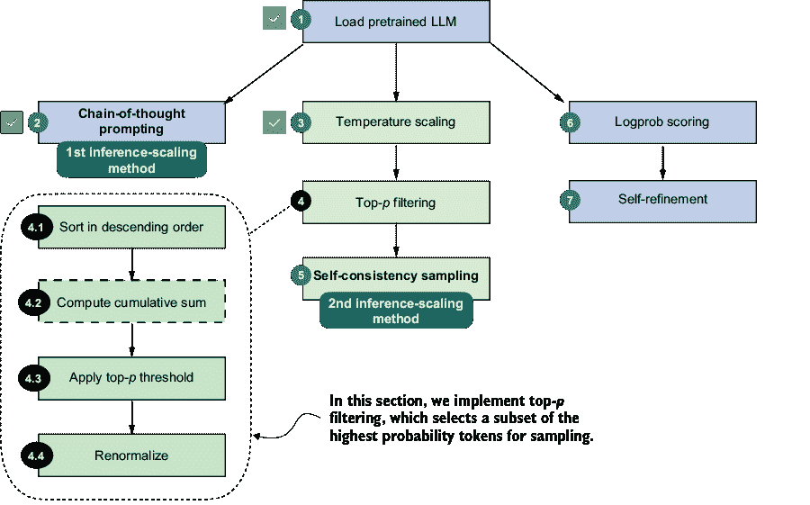

**图 4.12** top-*p* 过滤过程概览。该过滤器通过排序、应用累积截断、选择 top-*p* 子集并重新归一化结果，只保留概率最高的词元。

图 4.12 总结了构成 top-*p* 过滤器的四个步骤：对词元概率进行排序，计算它们的累积和，选择满足 top-*p* 截断条件的子集，并重新归一化剩余概率，使它们再次形成有效的分布。重新归一化步骤是必要的，因为一旦我们移除了所有低概率词元，剩余概率之和就不再为 `1`。为了正确采样，我们需要重新缩放剩余的值，使它们构成正确的概率分布。

现在我们将详细讲解图 4.12 中的步骤 4.1 到 4.4。

### 4.5.1 选择 top-p 词元子集

在实现 top-*p* 过滤器之前，我们先引入一个简单的玩具数据集，以便更容易说明温度缩放和采样过程。首先，我们假设模型和分词器的词汇表只有 `10` 个词条，而不是 `151,936` 个。

**清单 4.9 使用玩具数据进行温度缩放和采样**

```
toy_logits = torch.tensor(  #1
    [-0.7, -3.0, 0.1, -1.2, 2.0, -1.0, -0.5, -2.0, 0.3, 1.5]
)

toy_logits_scaled = scale_logits_by_temperature(toy_logits, 1.0)  #2
toy_probas = torch.softmax(toy_logits_scaled, dim=-1)   #3

plt.bar(  #4
    torch.arange(len(toy_probas)), toy_probas,
    alpha=0.5
)

plt.ylim([0, 1])
plt.xlabel("Vocabulary index")
plt.ylabel("Probability")
plt.show()
```

- `#1` 步骤 3.1：获取 logits（此处：使用 10 个词元的玩具 logits）
- `#2` 步骤 3.2：应用温度缩放（我们将使用 `1.0` 作为占位值）
- `#3` 步骤 3.3：转换为概率
- `#4` 在条形图中绘制概率

请注意，`toy_logits` 变量保存的是清单 4.8 中 `model(token_ids, cache=cache)[:, -1]` 调用的下一个词元 logit 分数的示例值，这里假设词汇表大小为 `10`。

图 4.13 中的条形图显示了重新缩放为概率后的下一个词元 logit 分数。

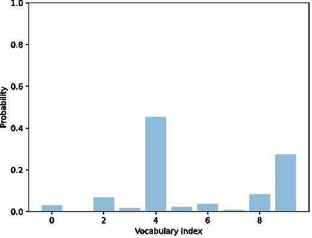

**图 4.13** top-p 过滤前的词元概率示例。该分布包含许多低概率词元，稍后将通过应用累积概率阈值将其截断。

到目前为止，这基本上是对前一节的回顾。现在我们将添加图 4.12 中所示的前两个 top-*p* 过滤步骤（步骤 4.1 和 4.2）。这涉及按降序对概率分数进行排序并计算累积和。

**清单 4.10 计算累积概率和**

```
sorted_probas, sorted_idx = torch.sort(toy_probas, descending=True)  #1
cumsum = torch.cumsum(sorted_probas, dim=-1)  #2

plt.bar(
    torch.arange(len(sorted_probas)), sorted_probas, 
        alpha=0.5
)
plt.step(
    torch.arange(len(cumsum)), cumsum, 
    where="mid", color="C1", label="Cumulative sum"
)

plt.ylim([0, 1])
plt.xlabel("Token rank (sorted by probability)")
plt.ylabel("Probability")
plt.show()
```

- `#1` 步骤 4.1：按概率降序排序
- `#2` 步骤 4.2：计算累积和

清单 4.10 中使用的 `torch.cumsum` 函数计算沿给定维度的元素累积和。在此示例中，它取排序后的词元概率并逐步累加，因此结果中的每个位置表示累计到该词元为止的总概率。

例如，第一个元素等于最高概率，第二个元素等于前两个概率之和，依此类推，直到最后一个值达到 `1`。查看代码清单 4.10 生成的累积阶梯图（如图 4.14 所示）最能说明这一点。

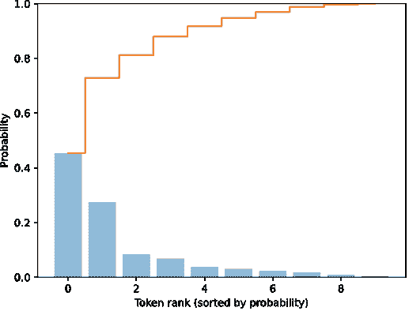

**图 4.14 排序后的词元概率及其累积和的可视化。** 这一步通过展示概率从高到低排列时的累积方式，为 top-p 过滤做准备，帮助确定截断阈值的设置位置。

现在我们已经得到了累积概率和，就可以实现 top-p 过滤的核心步骤。top-p 中的 `p` 代表概率（probability），top-p 可以译为“保留累积概率小于或等于 `p` 的最小词元集合”。下面的代码清单展示了 top-p 过滤的一种简单实现。

**代码清单 4.11 一个简单的 top-p 过滤规则**

```
top_p = 0.8
keep_mask = cumsum <= top_p
n_kept = torch.sum(keep_mask).item()
print("Cumulative sum:", cumsum)
print("Tokens kept:", n_kept)
```

在代码中，这通过 `keep_mask = cumsum <= top_p` 实现，它会标记所有累积概率质量尚未超过阈值 `p`（此处定义为 `top_p = 0.8`）的词元。然后计算保留的词元数量，并赋值给变量 `n_kept`。输出如下：


# 4.5.1 Top-p 过滤

观察返回的累积概率，第二个条目（`0.7290`）刚好低于 top-p 阈值 `0.8`，而第三个条目（`0.8119`）超过了该阈值，因此只保留前两个词元。

top-p 过滤的一种更常见变体会将超过阈值的那个词元也包含进来，如下一个代码清单所示。

**代码清单 4.12 一种常见的 top-p 过滤变体**

```
keep_mask = (cumsum - sorted_probas) < top_p
n_kept = keep_mask.sum().item()
print("Tokens kept:", n_kept)
```

这段代码返回的保留词元数量为 3。这符合 top-p 过滤的定义：保留最小的词元集合，使其累积概率质量至少为 `p`。

让我们用一张图来展示这种 top-p 过滤。

**代码清单 4.13 可视化 top-p 过滤**

```
plt.bar(
    torch.arange(len(sorted_probas)), sorted_probas, 
    alpha=0.5, label="Sorted probabilities"
)
plt.step(
    torch.arange(len(cumsum)), cumsum, where="mid",
    color="darkorange", label="Cumulative sum"
)

plt.axhline(#1
    top_p, color="red", linestyle="--",
    label=f"top_p = {top_p}"
)
plt.axvline(
    n_kept - 0.5, color="gray", linestyle=":",
    label=f"Top-p cutoff at {n_kept} tokens"
)

plt.xlabel("Token rank (sorted by probability)")
plt.ylabel("Probability")
plt.legend()
plt.grid(alpha=0.3)
plt.ylim(0, 1.05)
plt.show()
```

**#1** 突出显示截断位置。

执行代码清单 4.13 中的代码得到的图形如图 4.15 所示。该图显示了 `top_p = 0.8` 阈值（水平虚线），它决定了哪些词元会被保留。在本例中，前两个词元的累积和低于阈值，因此我们排除截断点（垂直点线）右侧的所有其他词元。

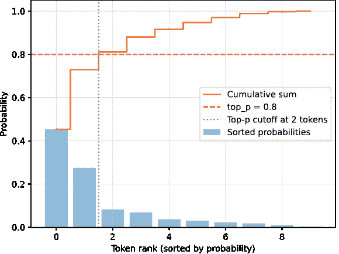

**图 4.15 top-p（核）过滤。** 词元按概率排序，保留累积概率超过阈值（`p = 0.8`）的最小词元子集用于采样。

要实现这个阈值截断，我们可以使用下面的代码：它首先将截断点（图 4.15 中的垂直虚线）右侧的所有值置零，然后恢复原始的排序顺序。

**代码清单 4.14 应用 top-p 过滤**

```
kept_sorted = torch.where(
    keep_mask, sorted_probas,
    torch.zeros_like(sorted_probas)
)
filtered = torch.zeros_like(toy_probas).scatter(0, sorted_idx, kept_sorted)
print(filtered)
```

得到的张量如下：

```
tensor([0.0000, 0.0000, 0.0000, 0.0000, 0.4538, 0.0000, 0.0000, 0.0000, 0.0829, 0.2752])
```

可以看到，除了索引位置 4、8 和 9 处的值之外，其他所有值都被置为零。这意味着如果现在我们使用 `multinomial` 函数，只会考虑这三个词元。

最后，我们重新归一化这些值，使它们的和再次变为 1：

```
denom = torch.sum(filtered).clamp_min(1e-12)
renormalized = filtered / denom
print(renormalized)
```

得到的归一化张量如下：

```
tensor([0.0000, 0.0000, 0.0000, 0.0000, 0.5589, 0.0000, 0.0000, 0.0000,
0.1021, 0.3390])
```

top-p 过滤的目标是移除概率较低的词元，使它们不会被后续采样，从而有助于减少在特定上下文中生成无意义的词元响应。

## 4.5.2 向文本生成函数添加 top-p 过滤

我们已经用一个玩具示例走完了 top-p 过滤的各个步骤。现在，让我们将 top-p 过滤的四个步骤（图 4.16 中的步骤 4.1–4.4）添加到现有的文本生成函数中，放在概率转换和采样之间。

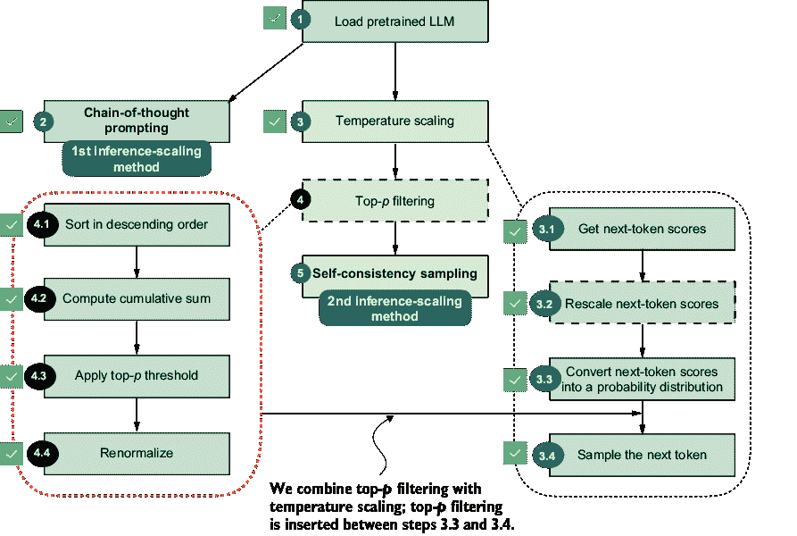

**将 top-p 过滤与温度缩放集成。** 在重新缩放下一个词元的分数之后，在第 3.3 步和第 3.4 步之间应用 top-p 过滤，以将采样限制在概率最高的词元上。

我们首先将上一节中的 top-p 过滤步骤组装成一个方便调用的函数。

**代码清单 4.15 top-p 过滤函数**

```
def top_p_filter(probas, top_p):
    if top_p is None or top_p >= 1.0:
        return probas

    sorted_probas, sorted_idx = torch.sort(probas, dim=1, descending=True) #1
    cumprobas = torch.cumsum(sorted_probas, dim=1)  #2

    prefix = cumprobas - sorted_probas  #3
    keep = prefix < top_p                #3
    keep[:, 0] = True          #4

    kept_sorted = torch.where(          #5
        keep, sorted_probas,             #5
        torch.zeros_like(sorted_probas)  #5
    )

    filtered = torch.zeros_like(probas).scatter(1, sorted_idx, kept_sorted)#6

    denom = torch.sum(filtered, dim=1, keepdim=True).clamp_min(1e-12)#7
    return filtered / denom
```

- **#1** 步骤 4.1：按概率降序排序

- **#2** 步骤 4.2：计算累积和

- **#3** 步骤 4.3.1：保留前缀累积概率（每个词元之前的累积概率）`< top_p` 的词元

- **#4** 对于 `top_p <= 0`，保证只保留最高概率的词元作为回退方案。

- **#5** 步骤 4.3.2：将截断点之后的值置零

- **#6** 步骤 4.3.3：映射回原始顺序

- **#7** 步骤 4.4：重新归一化使总和为 1

代码清单 4.15 中的 `top_p_filter` 函数首先对词元概率进行排序，并计算它们的累积和。然后保留前缀累积概率（每个词元之前的累积概率）低于 `top_p` 阈值的词元，其中也包含首个超过阈值的词元。它将其余值置零，将保留的值映射回原始顺序，并重新归一化剩余概率，使它们的总和再次为 1。

在将这个 `top_p_filter` 函数添加到我们的文本生成函数之前，先试一试它如何与之前的温度缩放方法配合工作。首先，我们获取 logits：

```
with torch.inference_mode():
    next_token_logits = model(input_token_ids)[:, -1]
print(next_token_logits.shape)
```

前面的代码打印出 `next_token_logits` 张量的维度 `[1, 151936]`。我们现在处理的是真实数据和完整词表，词表包含 151,936 个条目。

接下来，我们将 logits 重新缩放为概率分数，并按之前的方式使用温度 0.35 进行温度缩放：

```
torch.manual_seed(123)
probas_lowT = torch.softmax(
    scale_logits_by_temperature(next_token_logits, 0.35), dim=-1
)
count_samples(probas_lowT, threshold=1, tokenizer=tokenizer)
```

这段代码与之前在温度缩放示例中使用的代码类似，它会打印出以下采样输出：

```
' __': 158x
' Berlin': 435x
' ____': 169x
' ______': 209x
' Munich': 3x
' Hamburg': 3x
' _____': 18x
```

现在，让我们添加 top-*p* 过滤器，看看它如何改变结果：

```
torch.manual_seed(123)
probas_lowT = torch.softmax(
    scale_logits_by_temperature(next_token_logits, 0.35), dim=-1
)
probas_lowT_filtered = top_p_filter(probas_lowT, top_p=0.8)
count_samples(probas_lowT_filtered, threshold=1, tokenizer=tokenizer)
```

将 `top_p` 阈值设为 0.8（这是一个典型值）时，我们会排除那些累积概率构成剩余 20% 的最低概率 token。采样输出现在如下：

```
' Berlin': 534x 
' ____': 217x 
' ______': 249x 
```

如你所见，我们现在要么选择正确的城市（将 `"Munich"` 和 `"Hamburg"` 从采样选项中移除），要么打印下划线 token，模型可能用它把文本格式化为测验问题，其中 `'______'` 作为占位符。

现在回到我们的数学查询，将 top-*p* 过滤器添加到我们在代码清单 4.8 中编写的 `generate_text_temp_stream_cache` 函数中。更新后的函数现在名为 `generate_text_top_p_stream_cache`，如下所示。

### 代码清单 4.16 带 top-*p* 过滤的文本生成

```
@torch.inference_mode()
def generate_text_top_p_stream_cache(
    model,
    token_ids,
    max_new_tokens,
    eos_token_id=None,
    temperature=0.,
    top_p=None
):
    model.eval()
    cache = KVCache(n_layers=model.cfg["n_layers"])
    model.reset_kv_cache()

    out = model(token_ids, cache=cache)[:, -1]  #1
    for _ in range(max_new_tokens):

        orig_device = token_ids.device

        if temperature is None or temperature == 0.0:
            next_token = torch.argmax(out, dim=-1, keepdim=True)

        else:
            logits = scale_logits_by_temperature(out, temperature)  #2
            probas = torch.softmax(logits, dim=-1)  #3

            probas = top_p_filter(probas, top_p)  #4

            next_token = torch.multinomial(probas.cpu(), num_samples=1) #5
            next_token = next_token.to(orig_device)

        if (eos_token_id is not None
                and torch.all(next_token == eos_token_id)):
            break

        yield next_token
        out = model(next_token, cache=cache)[:, -1]
```

#1 步骤 3.1：获取 `logits`  

#2 步骤 3.2：对 `logits` 应用温度缩放  

#3 步骤 3.3：转换为概率  

#4 （新增）步骤 4：对概率应用 top-p 过滤  

#5 步骤 3.4：根据概率采样 token  

让我们像之前使用温度缩放版本的文本生成函数一样，将这个新的文本生成函数接入 `generate_text_stream_concat_flex`：

```
torch.manual_seed(123)
response = generate_text_stream_concat_flex(
    model, tokenizer, prompt, device,
    max_new_tokens=2048, verbose=True,
    generate_func=generate_text_top_p_stream_cache,
    temperature=0.5,
    top_p=0.8, 
)
```

输出是 `"\boxed{18}"`，这仍然是错误的。到目前为止，我们所做的一切只是为了让我们能采样不同的输出。在下一节中，我们将在实现自一致性推理时缩放技术时，使用 `generate_text_stream_concat_flex` 与我们增强后的文本生成函数（`generate_text_top_p_stream_cache`）来采样不同的输出。

### Top-*k* 过滤

Top-*k* 过滤是在采样过程中限制候选下一个 token 集的另一种方法。与保留所有累积概率低于阈值（如 top-*p*）的 token 不同，top-*k* 只保留基于模型 logits 的 *k* 个最可能的 token。

按概率对词表排序后，前 *k* 个之外的条目都会被移除。剩余的 *k* 个 token 会重新归一化，然后从中进行采样。

简而言之，top-*k* 保留固定数量的最可能 token，而 top-*p* 根据累积概率质量保留可变数量的 token。

Top-*k* 实现起来更简单，我在我的 *Build a Large Language Model (From Scratch)*（《从头构建大型语言模型》）一书中已经介绍过它。而 top-*p* 采样最近变得更受欢迎。

### 练习 4.2：在 MATH-500 上使用温度缩放和 top-*p* 过滤

修改代码清单 3.15 中的 `evaluate_math500_stream` 函数，看看添加温度缩放和 top-*p* 采样是否会改变基础模型的 MATH-500 准确率。你可以将温度缩放和 top-*p* 都设置为 0.9。

## 4.6 使用自一致性提高响应准确率

现在我们已经编写了温度缩放和 top-*p* 过滤的代码，可以着手实现本章的第二种推理时缩放技术：自一致性采样。

自一致性采样背后的思想来自 Google Research 的论文 *“Self-Consistency Improves Chain-of-Thought Reasoning in Language Models”* ([`arxiv.org/abs/2203.1117`](https://arxiv.org/abs/2203.1117))。尽管名字听起来很花哨，但自一致性采样本质上是一种多数投票：我们使用温度缩放和 top-*p* 过滤生成多个答案，然后选择出现频率最高的答案，如图 4.17 所示。

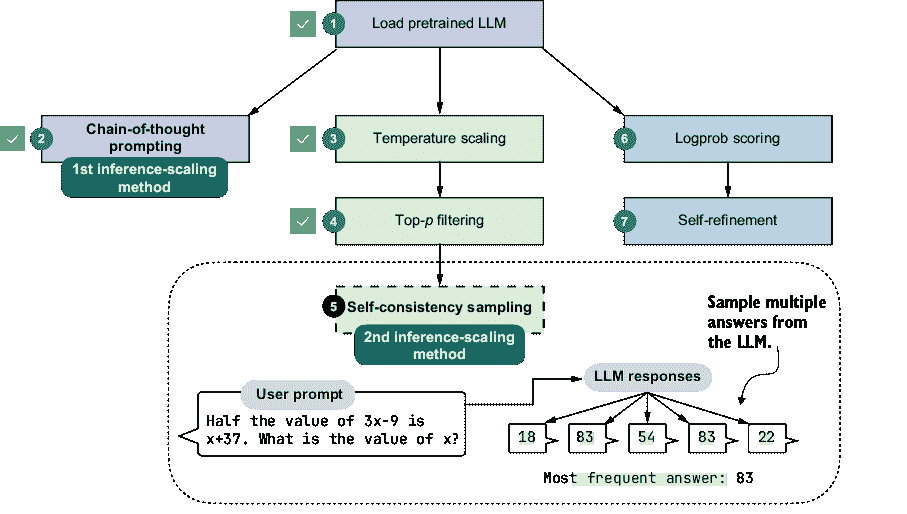

### 图 4.17 自一致性采样方法从大语言模型（LLM）生成多个响应，并选择出现频率最高的答案，通过多数投票提高答案准确率。

图 4.17 所示的自一致性采样技术是一种推理时缩放技术，因为我们不更新模型本身，而是投入更多计算资源来提高响应准确率。

为了构建基于投票的推理时流水线，我们将重用第 2 章的生成代码、第 3 章的答案提取逻辑，以及本章的采样控制。得益于 `generate_text_stream_concat_flex` 函数，自一致性代码的实现相对直接。主要过程可以概括为三个步骤，如图 4.18 所示。

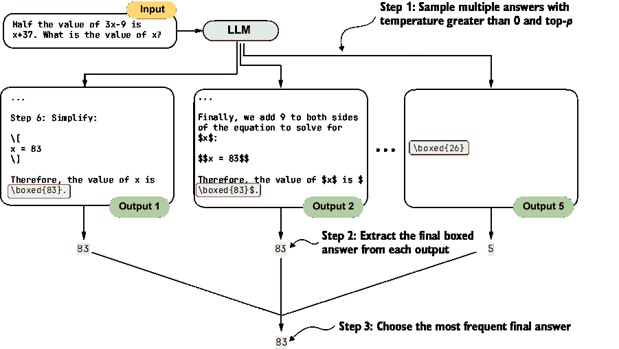

### 图 4.18 实现自一致性采样的三个主要步骤。首先，我们使用大于零的温度和 top-*p* 过滤为同一提示生成多个答案。其次，我们从每个生成的解答中提取最终的方框（boxed）答案。第三，我们选择提取到的最频繁答案作为最终预测。

要实现图 4.18 所示的三个步骤，我们只需重复调用 `generate_text_stream_concat_flex` 生成多个答案，并复用第 3 章的 `extract_final_candidate` 函数。唯一的新代码是基于答案频率实现多数投票。

### 代码清单 4.17 带 top-*p* 过滤的文本生成


```
from reasoning_from_scratch.ch03 import extract_final_candidate
from collections import Counter

def self_consistency_vote(
    model, tokenizer, prompt, device,
    num_samples=10, temperature=0.8, top_p=0.9, max_new_tokens=2048,
    show_progress=True, show_long_answer=False, seed=None,
):
    full_answers, short_answers = [], []

    for i in range(num_samples):  #1
        if seed is not None:
            torch.manual_seed(seed + i + 1)

        answer = generate_text_stream_concat_flex(
            model=model, tokenizer=tokenizer, prompt=prompt, device=device,
            max_new_tokens=max_new_tokens, verbose=show_long_answer,
            generate_func=generate_text_top_p_stream_cache,
            temperature=temperature, top_p=top_p,
        )

        short = extract_final_candidate(           #2
            answer, fallback="number_then_full"     #2
        )                                           #2
        full_answers.append(answer)
        short_answers.append(short)
        if show_progress:
            print(f"[Sample {i+1}/{num_samples}] → {short!r}")

    counts = Counter(short_answers)
    groups = {s: [] for s in counts}
    for idx, s in enumerate(short_answers):
        groups[s].append(idx)

    mc = counts.most_common()  #3
    if not mc:
        majority_winners, final_answer = [], None
    else:
        top_freq = mc[0][1]
        majority_winners = [s for s, f in mc if f == top_freq]
        final_answer = mc[0][0] if len(majority_winners) == 1 else None

    return {
        "full_answers": full_answers,
        "short_answers": short_answers,
        "counts": dict(counts),
        "groups": groups,
        "majority_winners": majority_winners,
        "final_answer": final_answer,
    }
```

#1 1) 采样多个答案

#2 2) 从每个答案中提取最终（简短）答案

#3 3) 选择出现频率最高的最终答案（自洽性投票）

简而言之，代码清单 4.17 中的自洽性方法做了以下事情：

1. 以大于 0 的温度和 top-*p* 采样多个答案

2. 从每个回答中提取最终的方框答案

3. 选择出现频率最高的最终答案

请注意，在我们的实现中，我们使用一个 `for` 循环顺序生成这些答案。在实践中，通常也会在不同设备上生成答案，以便并行化采样。

此外，在上述代码中，我们为每一轮分别设置随机种子：

```
        if seed is not None:
            torch.manual_seed(seed + i + 1)
```

从技术上讲，这不是必需的；设置一次随机种子就足以生成多样化的样本。如果我们想单独重新运行某些轮次，这种显式设置随机种子的做法会很有用。

我们来试试这个函数，看看结果如何：

```
results = self_consistency_vote(
    model,
    tokenizer,
    prompt,
    device=device,
    num_samples=5,
    temperature=0.8,
    top_p=0.9,
    max_new_tokens=2048,
    seed=123,
    show_progress=True,
)
```

打印出的结果如下：

```
[Sample 1/5] → '83'
[Sample 2/5] → '22'
[Sample 3/5] → '54'
[Sample 4/5] → '83'
[Sample 5/5] → '61'
```

由于 83 是出现频率最高的答案，最终答案就是 83（我们可以通过 `results["final_answer"]` 以编程方式访问这个数字）。如果你想查看解释和完整答案，可以访问其中一个返回 83 的正确解；例如，`print(results["full_answers"][0])` 会打印出以下内容：

```
To find the value of x, let's solve the equation step by step. 

1. **Given Equation:** 
   \[ 
   \frac{1}{2} \times (3x - 9) = x + 37 
   \] 

# ...

**Final Answer:** 
\[ 
\boxed{83} 
\] 
```

借助这种自洽性方法，我们终于能够生成正确的答案。（请注意，在 `"mps"` 或 `"cuda"` 设备上运行代码时，结果可能会有所不同。）

`self_consistency_vote` 函数目前没有处理平局情况，因此如果多个样本的出现频率相同，它会返回 `None` 作为最终答案。在下一章中，我们将实现一个评分方法，用于计算给定答案的置信度，并以此作为打破平局的手段。

### 练习 4.3：在 MATH-500 上使用自洽性采样

修改代码清单 3.15 中的 `evaluate_math500_stream` 函数，以评估自洽性采样是否提高了基础模型在 MATH-500 上的准确率。使用 3 个样本，并将温度和 top-*p* 都设置为 0.9。

在此练习中，请实现平局打破，使平局由样本列表中第一个出现的答案决定。例如，如果样本答案是 13、15、13、15、16，则应选择 13。

请注意，你不必为了实施这一平局打破规则而修改 `self_consistency_vote` 本身；你可以直接使用该函数返回的 `results` 字典。

### 练习 4.4：自洽性采样中的提前停止

为了提高计算效率，请实现一个自洽性的提前停止版本：一旦超过一半的答案一致，就停止采样。

### 选择温度和 top-*p* 设置

我们已经讨论过温度，但实际问题是：在自洽性采样中，我们应该引入多少随机性。我们的目标不是让模型尽可能随机，而是生成足够多样的答案，使多数投票能够发挥作用，同时仍让大多数样本保持合理。在实践中，温度约 0.5 到 0.9、top-*p*约 0.7 到 0.9 是合理的起点。

经验法则是：如果所有长答案看起来几乎相同，最好适度增大温度或 top-*p* 值，以鼓励更多多样性。如果长答案开始变得奇怪或没有意义，那么这些设置可能过于激进，应该降低，通常先降低温度。这里，“长”答案是指在提取最终方框结果之前的完整答案。你可以通过 `self_consistency_vote` 函数返回的 `results` 字典查看长答案，或者使用 `show_long_answer=True` 设置运行该函数。

你可能还记得，描述这一技术的论文标题是“Self-Consistency Improves Chain-of-Thought Reasoning in Language Models”（自洽性提升语言模型中的思维链推理）。这里的“思维链推理”方面是如何起作用的呢？这里的思维链推理，正是指我们在本章前面介绍的思维链提示：当时我们通过 `"\n\nExplain step by step."` 修改提示，让 LLM 生成更长的回答。

现在，我们把思维链提示与自洽性采样结合起来：

```
results = self_consistency_vote(
    model,
    tokenizer,
    prompt + "\n\nExplain step by step.",
    device=device,
    num_samples=5,
    temperature=0.8,
    top_p=0.9,
    max_new_tokens=2048,
    seed=123,
    show_progress=True,
)
```

在这种情况下，五个答案全部是 83（正确），可能是因为在使用思维链时，这个问题对 LLM 来说相对简单。更有意思的是看看模型在整个 MATH-500 数据集上的表现如何。各项实验的结果如表 4.1 所示。

### 表 4.1 不同方法在 MATH-500 任务上的准确率

| | 方法 | 模型 | 准确率 | 时间 |

|---|---|---|---|---|

| 1 | 基线（第 3 章），贪心解码 | 基础模型 | 15.2% | 10.1 分钟 |

| 2 | 基线（第 3 章），贪心解码 | 推理模型 | 48.2% | 182.1 分钟 |

| 3 | 思维链提示（CoT） | 基础模型 | 40.6% | 84.5 分钟 |

| 4 | 温度和 top-*p*（Top-*p*） | 基础模型 | 17.8% | 30.7 分钟 |

| 5 | Top-*p* + 自洽性（*n*=3） | 基础模型 | 29.6% | 97.6 分钟 |

| 6 | Top-*p* + 自洽性（*n*=5） | 基础模型 | 27.8% | 116.8 分钟 |

| 7 | Top-*p* + 自洽性（*n*=10） | 基础模型 | 31.6% | 300.4 分钟 |

| 8 | Top-*p* + CoT | 基础模型 | 33.4% | 129.2 分钟 |

| # | 方法 | 模型 | 准确率 | 运行时间 |

| --- | --- | --- | --- | --- |

| 9 | 自洽性 (`n=3`) + Top-`p` + 思维链 | 基础 | 42.2% | 211.6 分钟 |

| 10 | 自洽性 (`n=5`) + Top-`p` + 思维链 | 基础 | 48.0% | 452.9 分钟 |

| 11 | 自洽性 (`n=10`) + Top-`p` + 思维链 | 基础 | 52.0% | 862.6 分钟 |

| 12 | 自洽性 (`n=3`) + Top-`p` + 思维链 | 推理 | 55.2% | 544.4 分钟 |

为简洁起见，表 4.1 中标注“Top-`p`”的方法同时使用了温度缩放和 top-`p`采样。表中显示的准确率是使用一块`"cuda"` GPU（DGX Spark）在 MATH-500 测试集全部 500 个样本上计算得到的。

让我们逐一查看结果。缩写`n = 3`表示我们为自洽性采样使用了大小为 3 的样本量。第 1 行和第 2 行展示了使用第 3 章代码的基础模型和推理模型变体的结果；也就是说，我们使用了没有温度缩放和 top-`p`过滤的文本生成函数。这个文本生成函数简单地每一步选择得分最高的词元（贪心解码）。我们可以看到，推理模型变体的准确率大约是基础模型的三倍，但运行时间也显著更长，因为它生成了更多的词元。

在第 3 行中，我们看到了使用`"\n\nExplain step by step."`提示语修改的思维链提示方法的结果。如你所见，这将基础模型的准确率从大约 15%提升到了 40%。

第 4 行展示了在基础模型上添加温度缩放和 top-`p`采样后的结果。（表 4.1 中所有涉及温度缩放和 top-`p`采样的实验对两者都设置为 0.9。）与第 1 行的基础模型相比，准确率仅适度提升，从 15.2%提高到 17.8%。这是符合预期的，因为温度缩放和 top-`p`采样只是帮助我们控制采样多样性，本身并不是推理时扩展技术。我们还可以看到运行时间从 10.1 分钟增加到 30.7 分钟。这并非由于采样代码的开销，而是因为模型在某些情况下现在会生成更长的响应。

第 5–7 行展示了自洽性扩展的结果。将样本数量从 3 增加到 10，准确率进一步提升到 31.6%，但运行时间也显著增加。在这种情况下，使用 10 个样本相比 3 个样本几乎没有准确率优势。

第 8 行展示了温度缩放和 top-`p`采样与思维链提示相结合的结果。在这种情况下，采样使思维链的结果变差了（33.4%，而第 3 行为 40.6%）。将思维链提示与自洽性相结合，在样本量为 10 时将准确率提高到 52%，但运行时间也大幅增加，达到了惊人的 862.6 分钟。

在实际应用中，如果你有多块 GPU，自洽性采样中的不同样本可以并行计算，而不是按顺序计算。这仍然会使用相同的计算量，但可以分布在多块 GPU 上，从而更快地生成结果。

最后，在第 12 行中，我们可以看到推理模型变体也受益于自洽性采样，其准确率从第 2 行的 48.2%提高到 55.2%。同样，这也带来了运行时间的增加。

要点在于，表 4.1 中的结果凸显了推理时扩展的权衡：以更多的计算换取更高的准确率。

本章中自洽性采样方法的一个主要缺点是它依赖于一个最终的框选答案，以便我们提取出来进行多数投票。对于没有数字或简短最终答案的问题，这种方法更难应用。

在下一章中，如图 4.19 所示，我们将实现一种不同的、更通用的推理时扩展方法，称为*自我精炼*，在这种方法中，模型会迭代式地改进自己的答案。

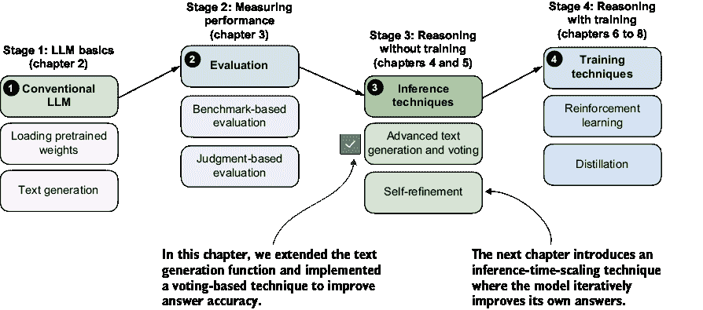

**图 4.19** 本章重点关注的推理时技术小结。在这里，文本生成函数通过一种基于投票的方法进行了扩展，以提高答案的准确率。下一章将介绍自我精炼，即模型迭代式地改进其响应。

## 小结

* 通过在推理时增加计算量（推理时扩展），无需重新训练模型即可提高推理能力和答案准确率。

* 一个灵活的文本生成包装器（`generate_text_stream_concat_flex`）允许在不改动周边代码的情况下插入不同的采样策略。

* 下一个词元由`logits`通过`softmax`产生。

* 温度缩放改变`logits`以控制生成文本的多样性。

* Top-`p`（核）采样会过滤掉低概率的词元，以减少生成无意义答案的可能性。

* 思维链提示（如`"Explain step by step."`）通过鼓励模型写出其中间推理过程，通常能产生更准确的答案，尽管这会增加生成词元的数量，进而增加运行时间成本。

* 自洽性采样会生成多个答案，从每个答案中提取最终的框选结果，并通过多数投票选择出现频率最高的答案来提高答案准确率。

* 在 MATH-500 数据集上的实验表明，与不采样的基线相比，将思维链提示与自洽性相结合可以显著提高准确率，但代价是运行时间大大增加。

* 推理时扩展的核心权衡是以更多的计算换取更高的准确率。
