# 5 通过自我精炼进行推理时扩展

## 本章涵盖内容

* 使用简单的基于规则的评分器为 LLM 答案评分

* 计算 LLM 对其答案的置信度

* 编写一个自我精炼循环，让 LLM 迭代式地改进其答案

上一章介绍了*推理时扩展*（简称*推理扩展*）的概念，它无需进一步训练即可提高模型响应的准确率。具体来说，上一章重点介绍了*自洽性*，即模型生成多个答案，最终答案取出现频率最高的那个。

如图 5.1 所概述，本章将超越用于推理扩展的自洽性，介绍另一种流行且实用的推理扩展技术——*自我精炼*。自我精炼不是生成并选择多个答案，而是专注于迭代式地改进单个答案，以纠正潜在的错误。

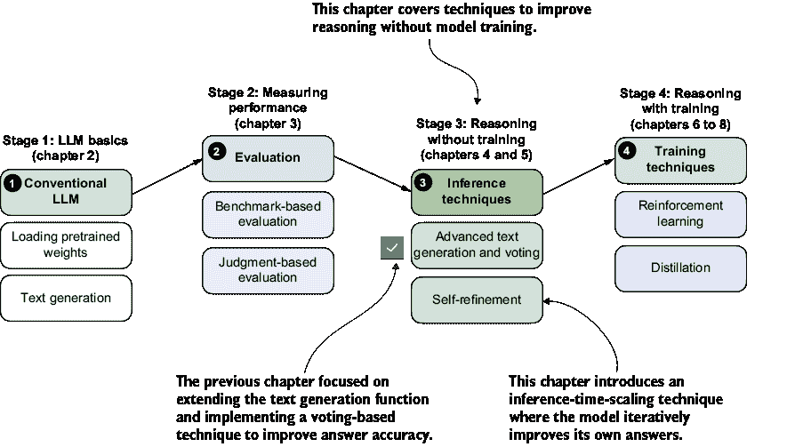

**图 5.1** 本书所涵盖主题的模型。本章延续第 3 阶段，重点介绍无需额外训练即可提高推理能力的推理时技术。本章引入了自我精炼，即模型迭代式地评析并改进自己的答案。

## 5.1 对模型响应进行评分与迭代改进

如你所见，推理扩展用额外的计算换取更高的准确率。到目前为止，我们已经介绍了两种推理扩展技术：*思维链提示*和*自洽性*。

思维链提示是图 5.2 所示的第一种方法，它会修改提示语，例如添加`"\n\nExplain step by step."`这样的短语，这可以促使基础模型写出更长的解释，从而反过来提高答案准确率。这种方法对不会自然地提供类似推理解释的基础模型特别有用。作为推理模型训练的模型通常不会从这类推理扩展中受益，因为它们已经会解释自己的答案。

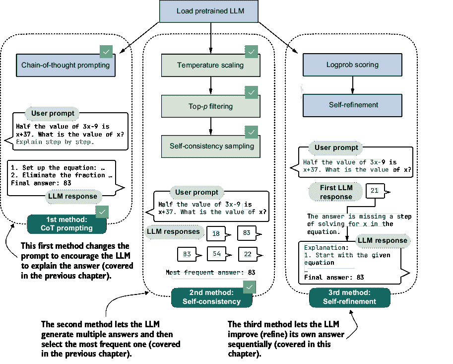

**图 5.2** 本书介绍的三种改进推理的推理时方法。前两种方法已在上一章中介绍。本章介绍第三种方法——自我精炼，即模型迭代式地改进自己的答案。

自洽性是图 5.2 中的第二种方法，它让模型并行生成多个答案。然后我们通过选择这些候选中出现频率最高的那个作为最终答案。


尽管自洽性（self-consistency）相当简单，但它往往能在答案准确率上带来巨大提升，因此它已成为 LLM 应用中一个常见的选择，尤其是在准确率优先级高于延迟的场景中。最近的例子包括 DeepSeekMath-V2 和 Google 的 Gemini 3 Deep Think 模式（相关参考见附录 A）。自洽性的一个缺点是，要选出最常见的答案，需要能够相互比较的短答案。

在本章中，我们将实现一种更通用的技术——自我精炼，即让 LLM 学会迭代改进自己的答案（见图 5.2 中的方法 3）。不过在此之前，我们首先要实现评分函数，以便对不同答案进行比较和排序，如图 5.3 所示。

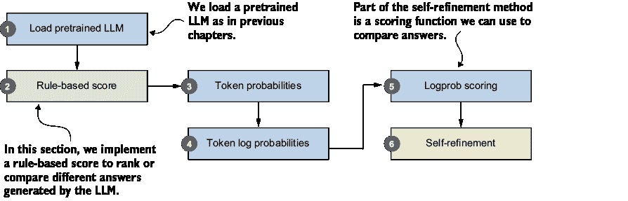

### 图 5.3 我们将构建一个简单的基于规则的评分，计算词元概率和对数概率，并将这些分数用于自我精炼方法中，让模型迭代改进自己的答案。

与前面章节一样，在加载预训练 LLM 之后（图 5.3 中的步骤 1），我们将实现一个简单的基于规则的评分函数，以说明评分的概念（步骤 2）。然后我们会介绍词元概率（步骤 3）和词元对数概率（步骤 4）的概念，这些概念是我们实现用于自我精炼循环（步骤 6）的对数概率评分（logprob scoring）方法（步骤 5）所必需的。

我们主要使用 `logprob` 评分函数（图 5.3 中的步骤 5）来跟踪自我精炼循环中的进展。这些评分函数也可以用于打破自洽性中的平局，或者不依赖多数投票而直接选出最佳响应。

图 5.3 中通向自我精炼的概览看起来相对简短明了，但词元概率和对数概率这两个主题有些复杂。这些主题在下一章中也很重要，届时我们将实现强化学习方法来训练 LLM。为此，我们将在这里花一些时间讨论对数概率评分的概念。

## 5.2 加载预训练模型

与上一章一样，我们首先加载本章将使用的模型和分词器。

### 清单 5.1 加载分词器和基础模型

```
import torch
from reasoning_from_scratch.ch02 import get_device
from reasoning_from_scratch.ch03 import (
     load_model_and_tokenizer
)

device = get_device()
device = torch.device("cpu")  #1

model, tokenizer = load_model_and_tokenizer(
    which_model="base",
    device=device,
    use_compile=False
)
```

#1 删除此行以在 GPU 上运行代码（如果您的机器支持）。

上述代码默认在 CPU 上运行，以确保结果与本章所示结果总体一致。在 CPU 上仍可能出现微小的数值差异，具体取决于操作系统和机器，但这些差异通常比不同加速器后端之间观察到的差异更小、更可预测。

第 5.4 节和第 5.5 节将使用涉及小数点后有多位数字的极小数值的计算，这些计算对设备选择和底层实现细节更为敏感。这在实践中不是问题，但这类不一致在第一次通读时可能会让人困惑。因此，我建议先从 CPU 设备开始，之后再考虑 MPS 或 CUDA 设备。

为了确保模型正确加载，让我们在一个 MATH-500 提示上，用上一章的温度缩放和 top-*p* 采样代码来使用它。

### 清单 5.2 使用温度缩放和 top-*p* 采样生成文本

```
from reasoning_from_scratch.ch03 import render_prompt
from reasoning_from_scratch.ch04 import (
    generate_text_stream_concat_flex,
    generate_text_top_p_stream_cache
)

raw_prompt = (
    "Half the value of $3x-9$ is $x+37$. "
    "What is the value of $x$?"
)
prompt = render_prompt(raw_prompt)
prompt_cot = prompt + "\n\nExplain step by step."

torch.manual_seed(0)
response_1 = generate_text_stream_concat_flex(
    model, tokenizer, prompt_cot, device,
    max_new_tokens=2048, verbose=True,
    generate_func=generate_text_top_p_stream_cache,
    temperature=0.9,
    top_p=0.9
)
```

模型生成了以下响应：

```
 The problem states that half the value of 3x−9 is equal to x+37. We need to find the value of \(x\). 

### Step 2: Translate the problem into an equation 
... #1

### Final Answer

\[
\boxed{83}
\]
```

#1 为节省篇幅，响应已截断。

由于我们使用的是温度缩放和 top-*p* 采样，更改随机种子会产生不同的响应：

```
torch.manual_seed(3)
response_2 = generate_text_stream_concat_flex(
    model, tokenizer, prompt_cot, device,
    max_new_tokens=2048, verbose=True,
    generate_func=generate_text_top_p_stream_cache,
    temperature=0.9,
    top_p=0.9, 
)
```

这一次，模型的响应如下：

```
 We start with the given equation:
\[
\frac{1}{2} \times (3x - 9) = x + 37 
\]
... #1
Final Answer:
\[
\boxed{83}
\]
```

#1 为节省篇幅，响应已截断。

在这两种情况下，模型都生成了正确的最终答案（`83`）。第二个响应要短得多，我们可以通过打印每个响应的字符数或词元数来确认这一点：

```
print("Response 1 characters:", len(response_1))
print("Response 1 tokens:", len(tokenizer.encode(response_1)))
print("\nResponse 2 characters:", len(response_2))
print("Response 2 tokens:", len(tokenizer.encode(response_2)))
```

结果如下：

```
Response 1 characters: 1419 
Response 1 tokens: 534 

Response 2 characters: 533 
Response 2 tokens: 231 
```

较短的响应不一定更好。如果两个响应都达到相同的正确答案，判断哪个更好并不简单。这通常取决于人类对清晰度、实用性以及中间步骤部分正确性的偏好。

对响应的中间步骤进行评分仍是一个活跃的研究领域（见附录 A），诸如过程奖励模型这类评估推理本身的方法，在实践中并不总能产生更好的输出。

如果两个响应的质量相当，有一件事是确定的：较短的响应成本更低，因为生成它们所需的词元更少，因此这类响应更受青睐。

## 5.3 使用基于规则的评分对 LLM 响应进行评分

在上一节中，LLM 生成了两个正确的响应。在本节中，我们将开发一个简单的基于规则的评分函数来比较它们，如图 5.4 所示。

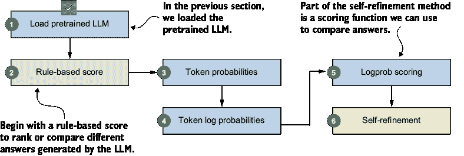

### 图 5.4 本节实现一个基于规则的评分器，用于对预训练 LLM 生成的不同答案进行排序。

基于规则的评分函数将为两个 LLM 响应分别分配一个分数（见图 5.5），这使我们能够对它们进行排序并选出更好的一个。这里的“更好”指的是格式和简洁性，而不是正确性。

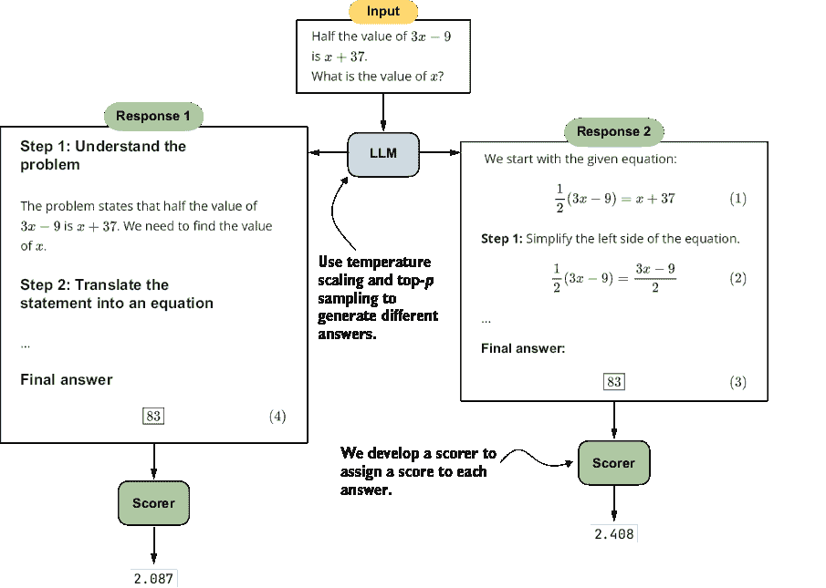

### 图 5.5 两个生成的响应得出相同的正确答案，但解释不同。评分器评估这些响应并为每个响应分配一个分数。

如图 5.5 所示，有几种方法可以实现用于评估响应的评分函数（评分器）。评分器可以是启发式的，即一种简单的基于规则的方法；也可以是另一个对答案进行评分的 LLM，通常被称为 LLM 作为裁判（见附录 F）；还可以依赖于内部的概率分数或似然，我们将在本章后面探讨这些方法。

在本节中，我们将从启发式方法开始，也就是基于规则的评分器，实现在清单 5.3 中。我们从这一版本开始，并不是因为它是最复杂的选择，而是因为它为我们提供了一个简单的基线，使后面基于概率的评分器更容易比较和思考。

### 清单 5.3 一个简单的基于规则的评分器

```
from reasoning_from_scratch.ch03 import extract_final_candidate
import math

def heuristic_score(
    answer,
    prompt=None,  #1
    brevity_bonus=500.0,
    boxed_bonus=2.0,
    extract_bonus=1.0,
    fulltext_bonus=0.0,
):
    score = 0.0

    cand = extract_final_candidate(answer, fallback="none")    #2
    if cand:
        score += boxed_bonus

    else:     #3
        cand = extract_final_candidate(answer, fallback="number_only")
        if cand:
            score += extract_bonus
        else:
            cand = extract_final_candidate(
                answer, fallback="number_then_full"
            )
            if cand:
                score += fulltext_bonus

    score += 1.5 * math.exp(-len(answer) / brevity_bonus)    #4
    return score
```

- `#1` 一个占位符，我们在本节中忽略它

- `#2` 奖励具有最终加框值的答案

- `#3` 如果答案没有加框值，则给予较弱的奖励

- `#4` 添加一个随文本长度衰减的简洁性奖励

该 `heuristic_score` 函数根据答案能够被提取的清晰程度以及答案的长度，为 LLM 答案分配一个数值分数。例如，如果答案包含 `\boxed{}` 响应（`boxed_bonus`），我们会给予奖励。否则，如果它至少包含一个数字（`extract_bonus`），我们会给予较小的奖励。`brevity_bonus` 根据答案的简短程度分配分数。

绝对数值不是很重要。更重要的是它们的相对量级。这里，`boxed_bonus=2.0` 被刻意设置为大于 `extract_bonus=1.0`，以便一个清晰加框的最终答案优先于我们只能提取数字的答案。简洁项最多贡献 1.5 额外点数，所以它主要帮助打破相似质量答案之间的平局，而不是支配提取奖励。我们还保持 `fulltext_bonus=0.0`，这样不会奖励任意的长篇答案，除非我们能从它们中提取出更清晰的最终候选。

注意 我们正在开发一个评分器，而不是使用第 3 章的验证器，因为我们假设不知道问题的真实答案。我们只在评估模型时，在现有测试集上使用验证器进行评估。

`prompt` 参数是一个占位符，在函数中没有实际用途，但当我们稍后在本章开发带有可替换评分器插件的自我精炼函数时，它会让生活更轻松（代码更简单）。

虽然 `brevity_bonus=500.0` 看起来可能很高，但它是通过 `1.5 * math.exp(-len(answer) / brevity_bonus)` 使用的指数衰减项。下面这幅图（结果显示在图 5.6 中）展示了 `brevity_bonus` 对分数的影响。

### 清单 5.4 绘制简洁度惩罚曲线

```
import matplotlib.pyplot as plt

def plot_brevity_curve(brevity_bonus, max_len=2048):
    lengths = torch.arange(1, max_len)
    scores = 1.5 * torch.exp(-lengths / brevity_bonus)

    plt.figure(figsize=(4, 3))
    plt.plot(lengths, scores)
    plt.xlabel("Text length (number of characters)")
    plt.ylabel("Score contribution")
    plt.tight_layout()
    plt.show()

plot_brevity_curve(500)
```

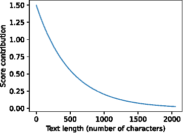

### 图 5.6 我们的评分器使用的基于规则的长度惩罚。较长的解释获得的分数贡献较小。

分数奖励对于较短的答案接近 1.5，而长度超过 1,000 个字符的答案获得的奖励为 0.2 或更少。几百个字符的回答对应一个简短的段落或一个简洁的解答过程，而 1,000 个或更多字符通常意味着一个相当长的、多句子的解释。这一项温和地偏向于紧凑的答案，但并不会强迫模型把所有内容压缩成一行回复。

为了简单起见，简洁性奖励使用字符数而不是 token 数来计算，这样就避免了将 `tokenizer` 传递给评分函数。使用 token 计数也是合理的，甚至可能更可取。

现在，我们可以将启发式评分器应用于第 5.2 节中的第一个（较长的）响应：

```
print(round(heuristic_score(response_1), 3))
```

得到的分数是 `2.088`。接下来，让我们试试第二个（较短的）响应：

```
print(round(heuristic_score(response_2), 3))
```

计算出的分数是 `2.517`，这意味着第二个（较短的）响应将是首选的答案。

你已经看到了评分方法的基本思想。在本章后面，我们将开发另一个评分器，并将在自我精炼方法中回到启发式评分器。

### 练习 5.1：在自我一致性中使用启发式评分器作为平局决胜者

扩展上一章（代码清单 4.17）中的自我一致性实现（`self_consistency_vote`），使其能够处理候选答案之间的平局。例如，当两个或多个答案获得相同的票数时，将本节中的启发式评分器（`heuristic_score`）应用于平局的候选答案，并选择分数最高的一个。提示：你不需要修改 `self_consistency_vote` 函数本身来应用平局决胜；相反，将平局决胜应用于 `self_consistency_vote` 返回的 `results` 字典。

### 练习 5.2：在 best-of-`N` 设置中使用启发式评分器

修改自我一致性实现，使得最终答案使用启发式评分器而不是多数投票来选择。为每个问题生成 `N` 个候选答案（其中 `N = 2` 或更高），用启发式评分器为每个候选评分，并选择分数最高的一个作为最终预测。（如果我们使用评分器而不是多数投票，在文献中这种方法被称为 best-of-`N`，而不是自我一致性。）

将此方法应用于 MATH-500 的一个小子集，并将结果与普通的 best-of-`N` 以及练习 5.1 中的自我一致性平局决胜进行比较。

注意，评分器包含了一些凭直觉选择的参数，这就是我们称之为启发式分数的原因。为了优化提取和简洁性奖励设置，我们可以将此评分器插入到练习 5.1 和 5.2 中的自我一致性或 best-of-`N` 方法中，并评估哪些设置在 MATH-500 等基准数据集上能产生更高的准确率。

作为一个实用的经验法则，如果评分器过于频繁地偏爱最终结果难以解析的答案，就增加与提取相关的奖励。如果评分器持续偏好那些冗长、漫谈且不能改善最终结果的答案，就增加简洁性压力。另一方面，如果评分器开始偏好过于简短但不完整的答案，就减少简洁性惩罚或增加对清晰可提取最终答案的奖励。权衡这些取舍通常比孤立地关注精确数值更有用。

## 5.4 理解 token 概率分数

现在让我们迈出构建基于模型自身置信度的评分器的第一步（图 5.7 中的步骤 5），其中置信度是模型分配的一个概率。在每个位置，模型会将概率质量分配到可能的下一个 token 上。如果所提出答案中的 token 持续获得高概率，则表明该答案与模型自身的内部偏好更一致。相反，如果模型对答案中的许多 token 分配了非常低的概率，那就表明模型本身并不强烈支持该答案。

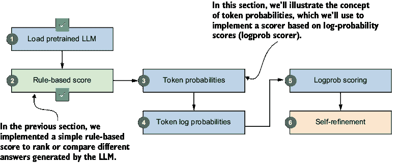

### 图 5.7 在本节中，我们将从一个简单的基于规则的评分器转向 token 级概率。这些概率将构成 logprob 评分方法的基础，我们稍后将在自我精炼方法中使用该方法。

在本节中，我们首先计算一个候选答案的 token 概率得分，并用它来估计模型认为该答案有多大的可能性（图 5.7 中的第 3 步）。这看起来可能有些绕路，但这些概率和对数概率的概念在下一章中会再次变得重要，届时它们会出现在训练目标中，而不仅仅作为推理时的评分信号。


# 从词元概率到对数概率

我们在本节中计算的 token 概率得分在文献中也被称为*下一个 token 概率*、*逐 token 概率*、*序列似然*，或者更宽泛地说，*token 级似然*。它们表示模型赋予每个可能的下一个 token 的概率，以词表上的归一化（softmax）分布形式呈现。

**注意：** `logprob` 一词是 AI 文献中*对数概率*的常见简写。

虽然这些概率的讨论听起来可能很复杂，但它依赖于我们在上一章中讲到的用于文本生成的相同机制。例如，在第 4 章中你看到，模型在每个阶段都会为词表中的每个 token 分配一个 logit 得分，并根据这些得分选择下一个 token。这一过程在第 4.4 节讨论过，图 5.8 再次展示了它。

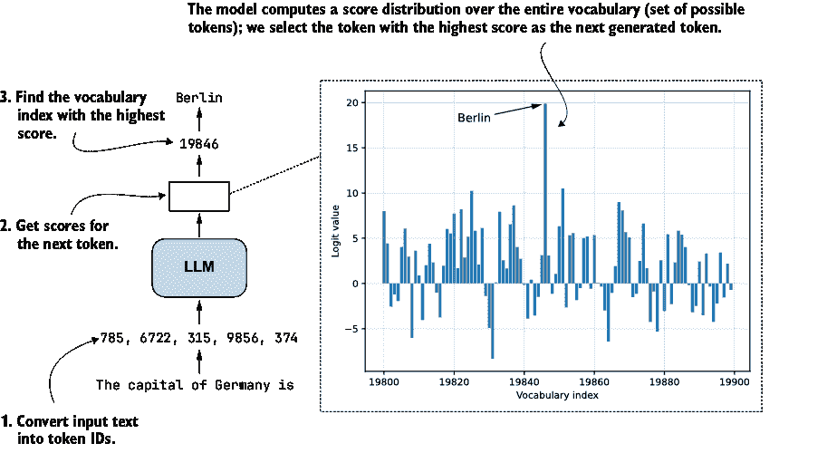

**图 5.8** LLM 如何选择下一个 token。模型将输入文本转换为 token ID，计算词表中每个 token 的得分，然后选择得分最高的 token。右侧的图显示了词表子集的 logit 值，其中 `"Berlin"` 这个 token 的得分最高。

在上一章中，我们查找了与最高得分对应的词表条目（词汇索引 `19846`，对应图 5.8 中的 token `"Berlin"`）来获得下一个生成的 token。这里，我们将以不同的目标重新审视这些 logits。我们不是要生成下一个 token，而是想利用这些得分来量化模型对特定答案的信心。换句话说，我们不会基于这些得分生成任何内容，只是检查它们。

例如，考虑两个我们要打分的候选答案：

* `"The capital of Germany is Berlin"`

* `"The capital of Germany is Bridge"`

我们的目标是量化模型对每个答案的信心。需要记住，模型信心并不自动意味着正确性。模型可能仅仅因为答案符合它学到的模式而为某个答案分配高概率，即使该答案在事实上是错误的。当这种情况发生时，我们仍然需要额外的方法来检测和纠正这些自信的错误答案，例如检索增强生成、外部工具（如网络搜索、计算器或代码执行），或者基于比较的方法（如自洽性）。

在图 5.8 中，输入文本 `"The capital of Germany is"` 被送入模型，然后选择得分最高的下一个 token（`"Berlin"`）。这里我们不选择 token，而是比较分配给两个候选下一个 token（`"Berlin"` 和 `"Bridge"`）的得分，如图 5.9 所示。（`"Bridge"` 被用作替代项，因为它出现在图 5.8 所示的词表范围内。）

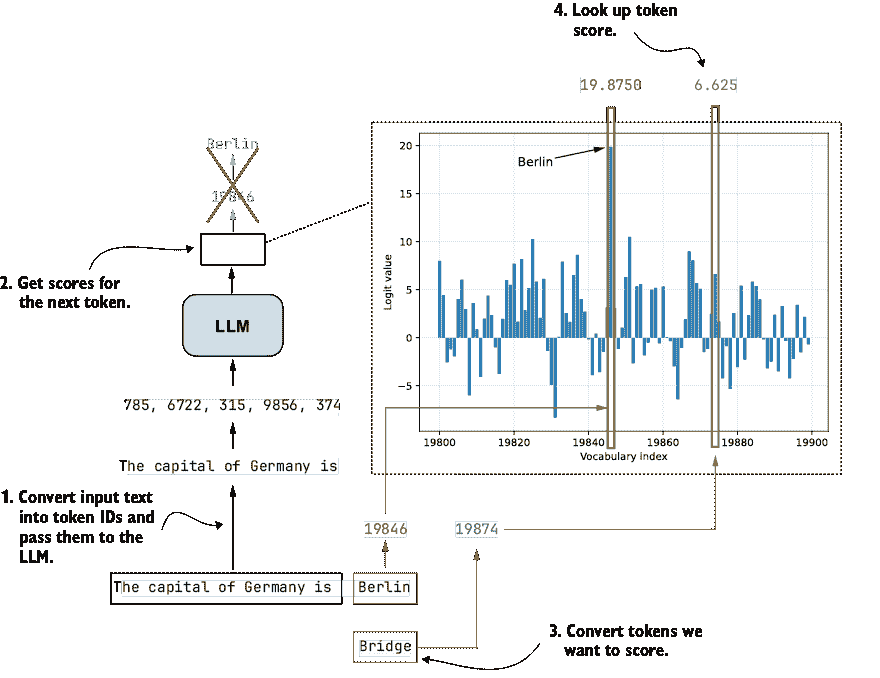

**图 5.9** 如何查找特定 token 的 logit 得分。将输入文本送入模型后，我们获得词表中每个 token 的 logit 值。然后，我们将要打分的候选 token 转换为 token ID，并从分布中读取它们对应的 logit 值。

我们不是直接使用图 5.9 中显示的原始 logits，而是将它们转换为概率。概率更容易解释，可以在不同输入之间进行比较，并且它们构成了本章后面要使用的 `logprob` 评分方法的基础。

如第 4 章所述，应用 `torch.softmax` 可以将 logits 转换为概率值。图 5.10 显示了由此得到的概率分布。图 5.10 中显示的 token 概率是使用 `torch.softmax` 计算的，与我们第 4.4.3 节中在多项式采样过程中所做的一样。这里的区别在于，我们不会从分布中进行采样，而只是查找分配给特定 token 的概率。

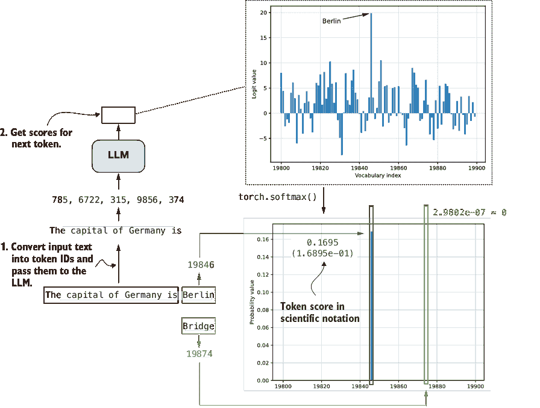

**图 5.10** 下一个 token 的评分。输入文本被转换为 token ID 并送入 LLM，LLM 输出下一个 token 的 logits。经过 softmax 后，这些 logits 变成概率，其中像 `"Berlin"` 这样的 token 获得高概率，而 `"Bridge"` 等不太可能的替代项获得接近零的值。

在图 5.10 中，只有 `"Berlin"` 的条形可见，其概率为 `0.1695`。图中范围内其他 token 的概率都接近零。这表明，在给定输入文本 `"The capital of Germany is"` 的情况下，模型对 `"Berlin"` 作为下一个 token 的信心高于 `"Bridge"`。

**注意：** 图 5.10 中的条形之和并不为 1，因为完整词表包含 151,000 个 token，而该图只显示了分布的一小部分（token 索引 19,800–19,900）。

在实践中，我们通常要比较完整的答案，而不是单个 token。这种从单个 token 到序列级评分的扩展如图 5.11 所示，我们计算每个 token 在给定其前面 token 的条件下的概率。这与图 5.10 的过程相同，只是我们要对序列中的每个 token 重复这一过程。

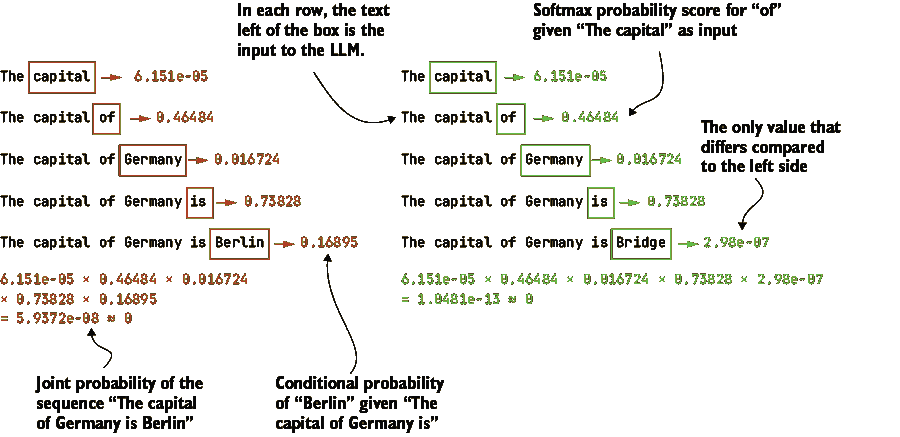

**图 5.11** 计算给定序列的 token 概率得分。对于每个位置，我们将前面的文本送入模型，并读取下一个 token 的 softmax 概率。将这些条件概率相乘，就得到整个序列的联合概率。

在普通文本生成过程中，模型会在生成时逐步这样做，选择下一个 token。这里我们以不同方式使用相同的机制：我们不对新 token 进行采样，而是取一个完整的候选答案，并在模型下逐个为其每个 token 打分。然后我们将这些概率相乘，得到完整序列的概率，也称为*联合概率*。

## token 序列的联合概率

对于习惯数学记法的人来说，token 序列的联合概率可以简洁地写成*条件概率*的乘积。对于序列 𝑥1、𝑥2、...、𝑥𝑇 和模型权重 `W`，表示为


展开后成为


这与我们在图 5.11 中计算的内容完全一致。在每个位置，我们将上下文送入模型，获得下一个 token 的概率，并在整个序列上将这些得分相乘。

理想情况下，模型分配给序列 `"The capital of Germany is Berlin"` 的概率应该远高于无意义的答案 `"The capital of Germany is Bridge"`。由于联合概率是通过许多小值相乘得到的，图 5.11 中两个序列的最终概率都接近于零。我们将在下一节解决这个问题。

这个例子中的两个答案几乎相同，只在最后一个 token 上有所区别（`"Berlin"` 与 `"Bridge"`）。同样的方法也可以应用于差异更大的序列，例如第 5.2 节中针对 MATH-500 提示（`"Half the value of $3x-9$ is $x+37$. What is the value of $x$?"`）生成的答案。

## 这种概率评分与贪心采样以及温度加 `top-p` 采样的区别

当我们计算 token 概率分数时，我们并不是在生成文本。完整序列已经存在，我们只是以固定上下文为输入，查询模型中每个下一个 token 的概率。这些概率不会影响后续输入。这是一个回溯性的评分过程，而不是生成步骤。

生成方法，比如我们在第 4 章编写的 `generate_text_stream_cache` 函数（贪心采样）和 `generate_text_top_p_stream_cache` 函数，其行为截然不同。贪心采样总是选择最可能的下一个 token，而温度采样和 `top-p` 采样则从重塑后的概率分布中抽取。这些过程在每一步都会修改分布，然后确定一个 token，作为下一个位置的输入。

这些采样策略中，没有哪种（包括贪心采样）能保证在模型下生成整体概率最高的序列。一个在某一步看起来次优的 token，可能会在未来的某一步引出概率高得多的后续 token。另一方面，一个局部最优的选择，可能会在之后把模型引向低概率序列。

即使我们确实找到了模型下全局概率最高的序列，那也并不能保证它就是正确答案或对用户最有用的答案。它只意味着，这是模型在其学习到的分布中最偏好的序列。

温度采样和 `top-p` 采样通过先展平或截断分布再抽样，引入了更多变异性，这可能使生成的文本进一步偏离全局最可能的序列。

通过对已有答案进行评分，我们避免了所有这些复杂性。我们不运行采样算法，模型也不会选择任何 token。我们只评估给定序列如果已经写好的话，其概率会有多大。

我们已经看过了概念性解释，现在来看看 token 概率计算的实际操作。

## 代码清单 5.5 计算下一个 token 的概率

```
@torch.inference_mode()
def calc_next_token_probas(model, tokenizer, prompt, device, show=True):

    token_ids = torch.tensor(tokenizer.encode(prompt), device=device)

    logits = model(token_ids.unsqueeze(0)).squeeze(0)     #1
    all_probas = torch.softmax(logits, dim=-1)             #1

    t_idx = torch.arange(0, token_ids.shape[0] - 1, device=device) #2

    next_ids = token_ids[1:] #3

    next_token_probas = all_probas[t_idx, next_ids] #4

    prod_next_token_probas = torch.prod(next_token_probas)  #5

    if show:
        print("Next-token probabilities:", next_token_probas)
        print("Joint probability:", prod_next_token_probas)

    else:
        return next_token_probas, prod_next_token_probas
```

- `#1` 获取 logits 和概率，与文本生成函数中的方式相同。
- `#2` 选择我们要评分的位置（这里：全部）。
- `#3` 既然我们已经有文本，我们就知道真正的下一个 token。
- `#4` 获取每个下一个 token 的概率。
- `#5` 序列的似然是各概率分数的乘积。

如你所见，`calc_next_token_probas` 函数用于计算下一个 token 的概率（如图 5.11 所示），它相对较短，乍看之下似乎很简单。但这个函数为了完成计算，实际上做了很多事情。图 5.12 用一个更简单的输入文本示例和一个只有五个词的小词汇表说明了这一点。

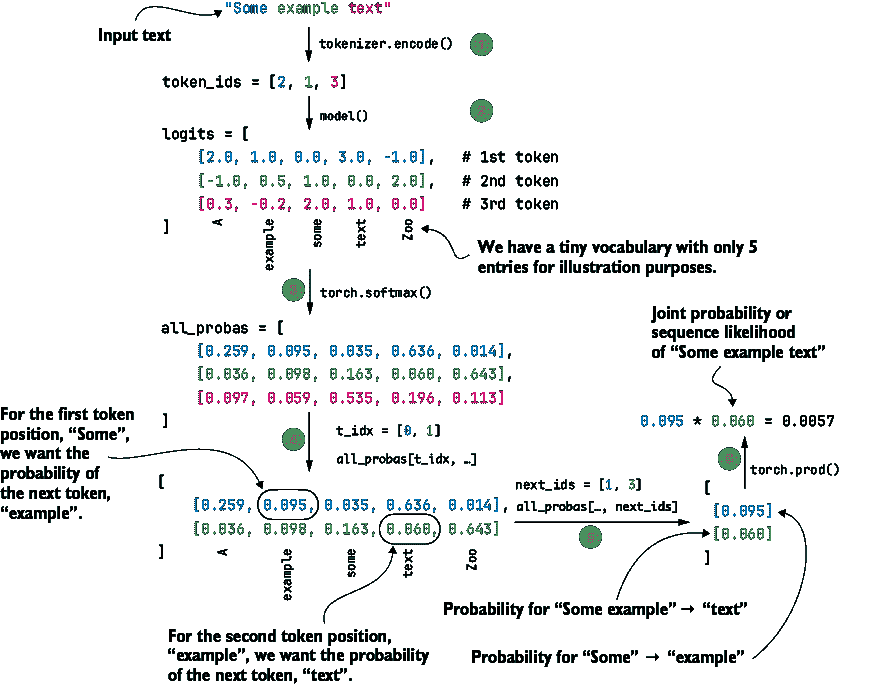

**图 5.12** 提取下一个 token 的概率。在将输入文本转换为 token ID 后，模型计算 `logits`，并通过 `softmax` 函数将其转换为概率。利用位置和真实下一个 token 的索引张量，我们就能得到模型为每个下一个 token 计算出的概率。

如图 5.12 所示，`calc_next_token_probas` 函数通过几个步骤计算下一个 token 的概率。首先，它以与之前介绍的文本生成函数相同的方式计算 `logits`（例如 2.7 节中 `generate_text_basic` 里的 `out = model(token_ids)` 这一行）。

得到的 `logits`（图 5.12 中的步骤 2）形状为 `[sequence_length, vocab_size]`，然后通过 `torch.softmax`（步骤 3）转换为归一化的概率分布，使得每个位置的概率之和为 1。

为了提取每个位置上分配给实际下一个 token 的概率，我们构建一个索引张量 `t_idx`，用于指定我们要评分的位置，以及另一个张量 `next_ids`，其中包含对应的目标 token。例如，如果输入文本是 `"The capital of Germany is Berlin"`，那么 `t_idx` 指向与 `"The capital of Germany is"` 对应的位置，而 `next_ids` 包含整体向后移动一个位置的 token：`"capital of Germany is Berlin"`。

这些目标 token 实际上就是将输入 token 向后移动一位，因为 LLM 的训练目标就是预测序列中的下一个 token。例如，给定输入 `"The capital of Germany is Berlin"`，模型在位置 2（即 `"capital"` 对应的 token）被要求预测位置 3（即 `"of"` 对应的 token）。使用 `all_probas[t_idx, next_ids]`（步骤 4 和 5）正好可以取出序列中每个位置对应的概率值。

最后，函数使用 `torch.prod` 将每个 token 概率相乘，计算出序列似然（步骤 6）。

我们来看看这个函数的实际运行：

```
torch.set_printoptions(precision=4, sci_mode=True)
calc_next_token_probas(
        model, tokenizer, device=device,
        prompt="The capital of Germany is Berlin"
    )
```

这是得到的输出：

```
Next-token probabilities: tensor([6.1512e-05, 4.6484e-01, 
1.6724e-02, 7.3828e-01, 1.6895e-01], dtype=torch.bfloat16) 
Joint probability: tensor(5.9372e-08, dtype=torch.bfloat16)
```

我们再试另一段文本：

```
calc_next_token_probas(
        model, tokenizer, device=device,
        prompt="The capital of Germany is Bridge"
    )
```

这会得到以下输出：

```
Next-token probabilities: tensor([6.1512e-05, 4.6484e-01, 1.6724e-02,
7.3828e-01, 2.9802e-07], dtype=torch.bfloat16) 
Joint probability: tensor(1.0481e-13, dtype=torch.bfloat16)
```

分析这些结果，第一个回答（以 `"Berlin"` 结尾）的联合概率（序列似然）为 `5.9372e-08`，大于第二个回答的联合概率 `1.0481e-13`。（用十进制表示，`5.9372e-08` 是 `0.000000059372`，`1.0481e-13` 是 `0.00000000000010481`。）

这些结果是合理的，因为 `"Berlin"` 回答获得的序列似然高于 `"Bridge"` 回答。两个值都非常小，因为将许多小于 1 的概率相乘，很快就会得到趋近于零的数值。这使得原始似然在实践中很难使用，尤其是在较长序列中，下溢（underflow）会成为问题。

**注意：** 这些分数反映的是模型内部的似然，而不是经过校准的正确性概率。换句话说，它们告诉我们的是模型在其自身分布下对某个回答相对于另一个回答的偏好程度，而不是该回答是否真实、正确或有用。分数高意味着该回答与模型学到的模式非常吻合，但并不保证它一定是对的。

## 概率与似然

你可能已经注意到，我们同时使用了“概率”和“似然”这两个术语。它们之间有区别吗？在统计学中，概率描述的是在观察任何数据之前事件发生的可能性大小，并且所有可能结果的概率之和必须为 1。相比之下，似然衡量的是特定模型对已观测数据的解释程度，它被视为模型权重或参数的函数，而不是数据的函数。简而言之，概率是给定模型后预测数据，似然则是给定数据后评估模型。（关于更详细的示例，请参阅我关于概率与似然的文章：《似然和概率之间有什么区别？》，链接位于 [`sebastianraschka.com/faq/docs/probability-vs-likelihood.html`](https://sebastianraschka.com/faq/docs/probability-vs-likelihood.html)。）

在大型语言模型（LLM）中，下一个词元概率在技术上属于概率，而不是似然，因为它来自一个归一化的分布，该分布对所有可能的下一个词元的概率求和为 1。换句话说，`next_token_probas` 中的值是概率，而不是似然。它们直接来自模型对每个位置的词汇表进行的 softmax 运算，这是一个归一化的概率分布。

以联合概率（`torch.prod(next_token_probas)`）形式计算的乘积，就是模型赋予该序列的概率。这个量通常被称为序列似然（尤其是当它被视为模型参数的函数时）。

# 5.5 从词元概率分数到对数概率

上一节中计算的词元概率可以用作评分函数，对不同回答进行排序。正如我们所见，概率分数可能非常小，尤其是在相乘得到联合概率或序列似然时。

在本节中，为了避免处理这类极小数值时经常出现的数值稳定性问题，我们将对这些概率应用*对数缩放*（也称为*log 缩放*），如图 5.13 中的概览所示。

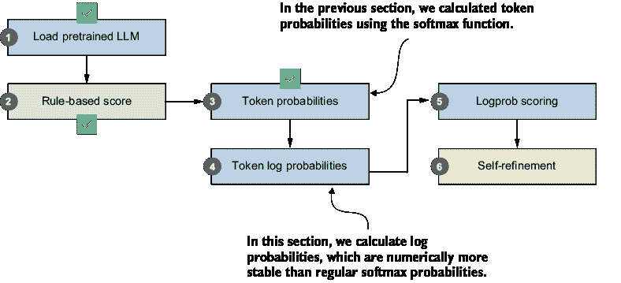

**图 5.13** 从词元概率到词元对数概率的概览，它为后续自我优化中使用的对数概率评分提供了数值上更稳定的基础。

**注意：** 本节重点是对上一节中的概率应用缩放变换。我们的总体目标仍然是计算词元概率，或者在本例中是对数概率（你很快就会看到）。

考虑一个简单示例：计算一组 logit 值的概率：


```python
torch.set_printoptions(precision=4, sci_mode=False)
logits = torch.linspace(-2, 2, steps=7)
probas = torch.softmax(logits, dim=-1)
print(probas)
```

概率值如下：

```python
tensor([0.0090, 0.0175, 0.0341, 0.0665, 0.1295, 0.2522, 0.4912])
```

我们可以通过`torch.log`函数将它们转换为对数概率分数：

```python
print(torch.log(probas))
```

以下是对数概率值：

```python
tensor([-4.7109, -4.0442, -3.3776, -2.7109, -2.0442, -1.3776, -0.7109])
```

这里，`torch.log`应用的是自然对数，其中`log(0.0090) = -4.7109`，反之亦然：`e^(-4.7109) = 0.0090`。

除了将`torch.log(torch.softmax(...))`串联使用外，PyTorch还提供了一个优化的`torch.log_softmax`函数，将这两种操作合二为一：

```python
log_probas = torch.log_softmax(logits, dim=-1)
print(log_probas)
```

和之前类似，这将返回以下结果：

```python
tensor([-4.7109, -4.0442, -3.3776, -2.7109, -2.0442, -1.3776, -0.7109])
```

请注意，对数缩放只会改变数值的幅度，而不会改变它们的顺序，因此具有更高似然的序列，其对数似然也总是更高。为了直观地验证这一点，让我们将`logits`、概率和对数概率并排绘制出来。

**清单 5.6** 绘制`logits`、`softmax`概率和`log-softmax`值

```python
plt.figure(figsize=(9, 4))

plt.subplot(1, 3, 1)#1
plt.bar(range(len(logits)), logits, color="C0", alpha=0.7) #1
plt.title("Logits") #1
plt.xlabel("Token index") #1
plt.ylabel("Value") #1
plt.grid(alpha=0.3) #1
 #1
plt.subplot(1, 3, 2)#2
plt.bar(range(len(probas)), probas, color="C1", alpha=0.7)
plt.title("torch.softmax(logits)")
plt.xlabel("Token index")
plt.ylabel("Probability")
plt.ylim(0, 1)#3
plt.grid(alpha=0.3)

plt.subplot(1, 3, 3)#4
plt.bar(range(len(log_probas)), log_probas, color="C2", alpha=0.7) #4
plt.title("torch.log_softmax(logits)") #4
plt.xlabel("Token index") #4
plt.ylabel("Log-probability") #4
plt.grid(alpha=0.3) #4
 #4
plt.tight_layout()
plt.savefig("logits_softmax_log_softmax.pdf")
plt.show()
```

- `#1` 绘制`logits`
- `#2` 绘制`softmax`概率
- `#3` 绘制`softmax`概率
- `#4` 绘制`log-softmax`值

生成的图如图 5.14 所示。如你所见，对数概率与`logits`和概率值具有相同的顺序。较大的`logit`对应较大的概率和负得较少的对数概率；较小的`logit`则产生较小的概率和负得更多的对数概率。

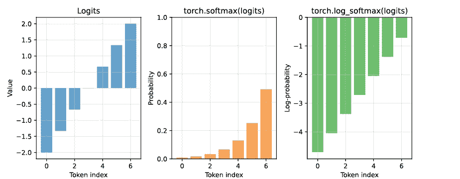

**图 5.14** 在简单示例中比较`logits`、`softmax`概率和对数概率。对数概率保持了概率的排序。

在实际应用中，概率越高越好，因为概率越高表明模型对某个词元赋予的置信度越高。对于对数概率，越接近 0 的值越好，因为 0 对应概率 1，而非常负的值对应极小的概率。这使得词元之间的比较变得容易：负得最少的对数概率对应最可能的词元，负得最多的对数概率对应最不可能的词元。

尽管图 5.14 展示了一个简单示例中`logits`、概率和对数概率之间的关系，但我们也可以将其应用于前面`"The capital of Germany is"`提示语中的概率值，如图 5.15 所示。

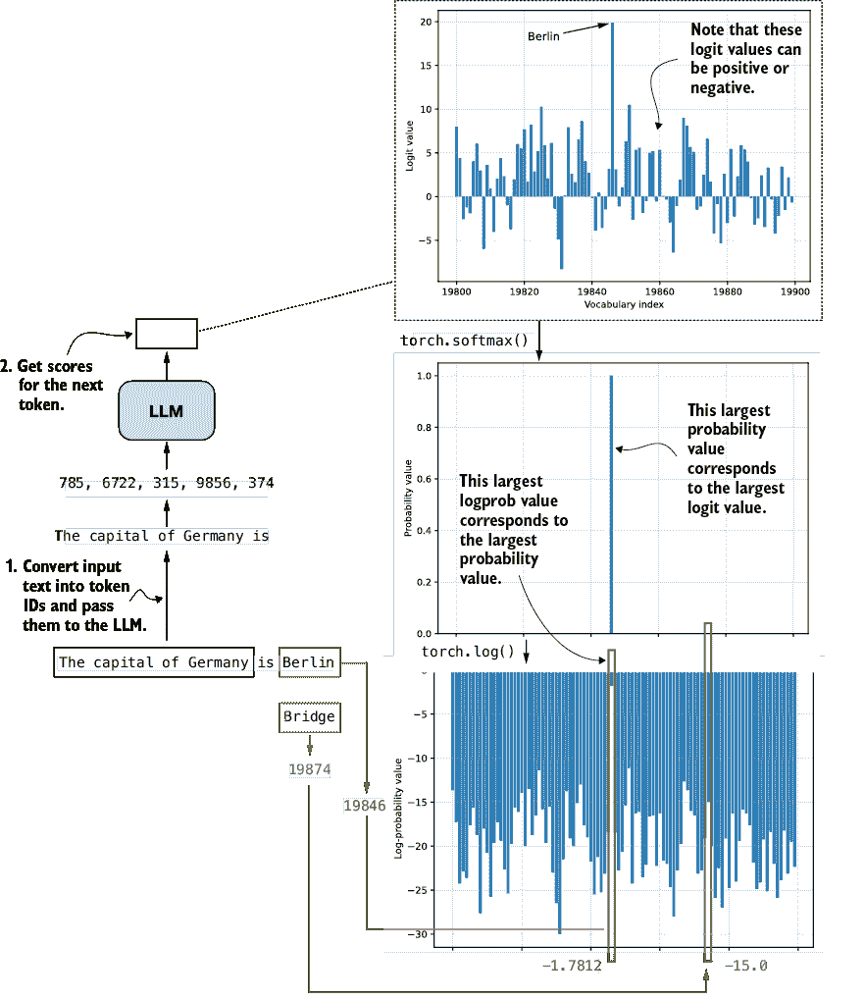

**图 5.15** `logits`如何转换为用于下一个词元评分的概率和对数概率。正确的下一个词元（`"Berlin"`）获得较高的`logit`，进而转化为较高的概率和负得较少的对数概率；而像`"Bridge"`这样的不太可能候选词元则映射到非常小的概率和较大的负对数概率。

我们使用概率而不是`logits`，是因为概率已经归一化，更容易解释为置信度值。此外，我们之前也提到，对数概率还有一个额外的好处：相比使用原始概率，它能进行数值上更稳定的计算。

数值稳定性源于这样一个事实：即使非常小的概率分数也能映射到合理数值范围内的对数概率。另一个原因是，将许多概率相乘会很快使结果趋近于 0，而取对数会将乘法变为加法，从而避免下溢，并且对长序列来说更加稳定。

图 5.16 展示了我们之前使用的两个示例文本的联合对数概率（即序列对数似然）是如何计算的。当我们计算常规的联合概率分数时，我们看到两个序列的值都接近于 0。现在，通过联合对数概率，我们可以看到，即使只改变最后一个词元（例如`"Berlin"`与`"Bridge"`），也会导致总对数概率出现明显差异（`-16.6250`对比`-29.8750`）。

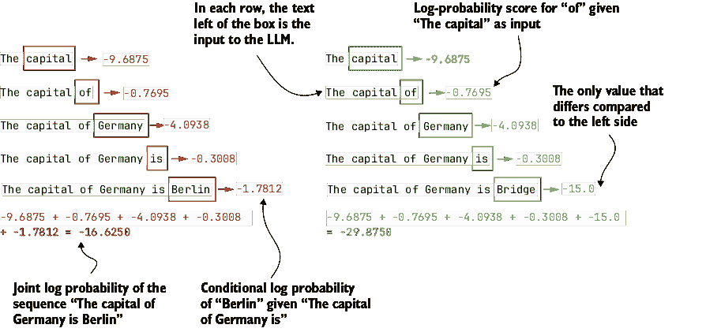

**图 5.16** 词元级对数概率如何累积形成序列对数概率。每一行显示给定前面文本时下一个词元的对数概率。将这些值相加即得到整个序列的联合对数概率。

### 使用对数概率

当我们计算一个序列的联合概率时，需要将许多介于 0 和 1 之间的数相乘：

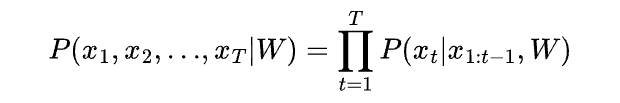

我们可以将展开形式写为：


这些乘积会迅速变得极小，这既不方便，也可能导致数值下溢。当数值变得太小时，计算机可能会将其四舍五入为零，从而丢失有用信息。为了避免这种情况，我们通常在对数空间中计算。对联合概率取对数，我们得到：

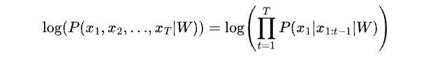

利用乘积的对数等于各项对数之和这一性质，上式可展开为：


换句话说，一个序列的对数概率就是其各个标记的对数概率之和。这在数值上更稳定，也更容易处理。此外，它与`torch.log_softmax`返回的值一致，后者直接提供对数概率。

因此，将对数概率求和是机器学习和 AI 中的标准做法。

实现标记对数概率函数很简单，因为只需对清单 5.6 中的代码做两处小改动：将`torch.softmax`改为`torch.log_softmax`，将`torch.prod`改为`torch.sum`。

警告 使用不匹配的组合（例如`torch.softmax`搭配`torch.sum`，或`torch.log_softmax`搭配`torch.prod`）在技术上可行，但在数学上是不正确的。

### 清单 5.7 计算下一个标记的对数概率

```python
@torch.inference_mode()
def calc_next_token_logprobas(model, tokenizer, prompt, device, show=True):

    token_ids = torch.tensor(tokenizer.encode(prompt), device=device)

    logits = model(token_ids.unsqueeze(0)).squeeze(0)
    all_logprobas = torch.log_softmax(logits, dim=-1)    #1

    t_idx = torch.arange(0, token_ids.shape[0] - 1, device=device)
    next_ids = token_ids[1:]
    next_token_logprobas = all_logprobas[t_idx, next_ids]

    sum_next_token_logprobas = torch.sum(next_token_logprobas)    #2

    if show:
        print("Next-token log-probabilities:", next_token_logprobas)
        print("Joint log-probability:", sum_next_token_logprobas)
    else:
        return next_token_logprobas, sum_next_token_logprobas
```

`#1` 我们现在使用`log_softmax`。

`#2` 我们将乘积替换为求和。

现在，让我们在之前的示例提示上测试更新后的函数：

```python
calc_next_token_logprobas(
        model, tokenizer, device=device,
        prompt="The capital of Germany is Berlin"
    )
```

结果如下：

```python
Next-token log-probabilities: tensor([-9.6875, -0.7695, -4.0938,
-0.3008, -1.7812], dtype=torch.bfloat16) 
Joint log-probability: tensor(-16.6250, dtype=torch.bfloat16)
```

现在让我们试试第二个序列：

```python
calc_next_token_logprobas(
        model, tokenizer, device=device,
        prompt="The capital of Germany is Bridge"
    )
```

这将返回：

```python
Next-token log-probabilities: tensor([ -9.6875,  -0.7695,  -4.0938,
-0.3008, -15.0000], dtype=torch.bfloat16) 
Joint log-probability: tensor(-29.8750, dtype=torch.bfloat16)
```

如您所见，`"Berlin"`和`"Bridge"`之间的差异现在更加明显（`-16.6250`和`-29.8750`），其中`"Berlin"`得分高得多（更好）。

## 5.6 使用对数概率评估模型置信度

前两节非常详细地介绍了标记概率和对数概率的概念。在本节中，我们将对对数值概率计算稍作修改，以开发一个基于对数概率的评分函数，类似于我们在本章开头开发的启发式评分器（见图 5.17）。

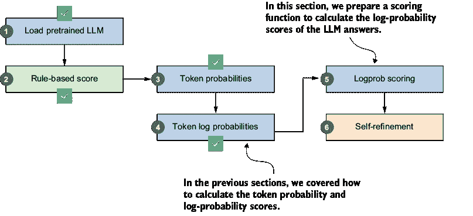

### 图 5.17 本节实现了一个基于标记对数概率的`logprob`评分器，我们将在本章后面的自我优化方法中使用它。

我们将开发的`logprob`评分方法与上一节介绍的流程非常相似。我们将进行两项主要修改。首先，我们将提示（`prompt`）排除在评分计算之外，仅计算答案标记的得分。其次，我们将对标记对数概率取平均值（而不是求和），以便更公平地比较不同长度的两个序列。这两项修改后的计算过程如图 5.18 所示。

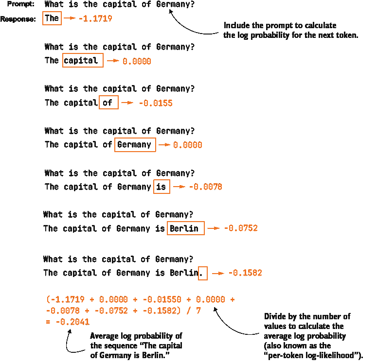

### 图 5.18 修改后的`logprob`评分流程。提示标记被排除在计算之外，只收集答案标记的对数概率。然后对这些值取平均，得到长度归一化的得分，从而允许我们公平地比较不同长度的答案。

为了说明起见，让我们使用清单 5.7 中的`calc_next_token_logprobas`函数来实现图 5.18 所示的两项修改。例如，假设我们有以下提示和答案：

```python
example_prompt = "What is the capital of Germany?"
example_answer = " The capital of Germany is Berlin."

next_token_logprobas, sum_next_token_logprobas = calc_next_token_logprobas(
        model, tokenizer, device=device,
        prompt=example_prompt+example_answer,
        show=False
    )

print("Next-token logprobas:", next_token_logprobas)
print("Joint log-probability:", sum_next_token_logprobas)
```

这将输出以下结果。（请注意，该张量也包含提示标记的得分，这就是为什么这些数字看起来与图 5.18 不同。继续阅读您会明白这一点。）

```python
Next-token logprobas: tensor([-0.4512, -0.3418, -8.3125, -0.3906,
-3.8125, -3.0469, -1.1719,  0.0000, -0.0155,  0.0000, 
-0.0078, -0.0752, -0.1582], dtype=torch.bfloat16) 
Joint log-probability: tensor(-17.7500, dtype=torch.bfloat16)
```

然后，我们可以用以下代码计算答案标记的数量，结果为`7`：

```python
print(len(tokenizer.encode(example_answer)))
```

接着，为了计算答案标记上的平均对数概率，如图 5.18 所示，我们需要对这七个答案标记取平均：

```python
last_7 = next_token_logprobas[-7:]
print(last_7)
print(torch.mean(last_7))
```

这会打印：

```python
tensor([-1.1719,  0.0000, -0.0155,  0.0000, -0.0078, -0.0752, -0.1582], 
       dtype=torch.bfloat16)
tensor(-0.2041, dtype=torch.bfloat16) 
```

我们可以看到，得到的平均值`-0.2041`与图 5.18 中显示的值相近。

我们可以将`calc_next_token_logprobas`代码与上述计算合并到一个新函数`avg_logprob_answer`中。

### 清单 5.8 答案标记的平均对数概率评分

```python
@torch.inference_mode()
def avg_logprob_answer(model, tokenizer, prompt, answer, device="cpu"):

    prompt_ids = tokenizer.encode(prompt)  #1
    answer_ids = tokenizer.encode(answer)   #2
    full_ids = torch.tensor(prompt_ids + answer_ids, device=device)

    logits = model(full_ids.unsqueeze(0)).squeeze(0)  #2
    logprobs = torch.log_softmax(logits, dim=-1)       #2

    start = len(prompt_ids) - 1  #3
    end = full_ids.shape[0] - 1   #3


    t_idx = torch.arange(start, end, device=device)#4
    next_tokens = full_ids[start + 1 : end + 1] #4
    next_token_logps = logprobs[t_idx, next_tokens] #4


    return torch.mean(next_token_logps)#5
```

`#1` 分别对提示和答案进行编码，以便稍后获取提示长度。

`#2` 与之前`calc_next_token_logprobas`中相同。

`#3` 与答案标记对应的位置索引范围。

`#4` 与之前相同，只是使用`start`和`end`。

`#5` 对答案标记得分取平均。

`avg_logprob_answer`函数与清单 5.7 中的`calc_next_token_logprobas`函数类似，不同之处在于我们只计算答案标记的对数概率，而不是整个序列（包括提示）的对数概率，并且我们对计算出的对数概率值取平均而不是求和。

让我们将这个新函数应用于本节前面的提示和答案：


```
score_1 = avg_logprob_answer(
    model, tokenizer,
    prompt="What is the capital of Germany?",
    answer=" The capital of Germany is Berlin.",
    device=device
)
print(score_1)
```

这会像之前一样返回 `-0.2041`，说明我们正确地实现了该函数。现在我们也可以把这个函数应用于无意义的 `"Bridge"` 答案：

```
score_2 = avg_logprob_answer(
    model, tokenizer,
    prompt="What is the capital of Germany?",
    answer=" The capital of Germany is Bridge.",
    device=device
)
print(score_2)
```

这里得到的分数是 `-3.8906`，如预期那样远低于 `"Berlin"` 的分数。

现在平均 logprob 评分函数已经就位，我们还可以计算本章开头定义的 MATH-500 提示（`prompt_cot`）以及我们保存为 `response_1` 和 `response_2` 的回答的分数。这个就留作练习给你完成。

本章我们花了大量时间讲解下一个词元概率（next-token probability）和对数概率（log-probability）评分的概念。这样做的原因之一是，我们可以在接下来的自我完善部分中把它们用作评分器。第二个原因是，在下一章实现带可验证奖励的强化学习训练时，对数概率的概念同样会发挥作用。

同时，重要的是不要认为 logprob 评分是万能解法。因为它衡量的是模型自身强烈偏好的内容，所以 logprob 评分仍然可能偏向于模型自信的错误答案，而不是正确但偏好程度较低的答案。在实践中，最好将 logprob 评分视为多种有用评分信号之一，而不是一种保证能打破平局的手段。

### 练习 5.3：在自一致性中使用 logprob 评分器作为平局裁决器

在练习 5.1 中，使用 logprob 评分器代替启发式评分器，并扩展上一章（代码清单 4.17）中的自一致性实现（`self_consistency_vote`），使其能够处理候选回答之间的平局。然后在 MATH-500 数据集的一个子集上运行这两种实现，看看哪种平局判定方法表现更好。

### 练习 5.4：在 best-of-`N` 设置中使用 logprob 评分器

扩展自一致性实现，使最终答案使用 logprob 评分器（`avg_logprob_answer`）来选择，而不是像练习 5.2 中那样使用启发式评分器或多数投票。然后在 MATH-500 数据集的一个子集上运行不同的实现，看看哪种平局判定方法表现更好。

**提示：** 你不需要修改 `self_consistency_vote` 函数本身即可应用平局判定。你可以对 `self_consistency_vote` 返回的 `results` 字典应用平局判定，该字典在代码清单 3.15 的 `evaluate_math500_stream` 函数内部使用。

## 5.7 通过迭代反馈进行自我完善

在介绍了多种对 LLM 回答进行评分的方法之后，现在让我们进入本章的核心推理扩展技术：*自我完善*（图 5.19）。我们将首先介绍自我完善，并手动走一遍这个过程。在下一节中，如图 5.19 所示，我们将自动化自我完善循环，并添加对本章前面开发的评分方法（启发式评分器和平均 logprob 评分器）的支持。

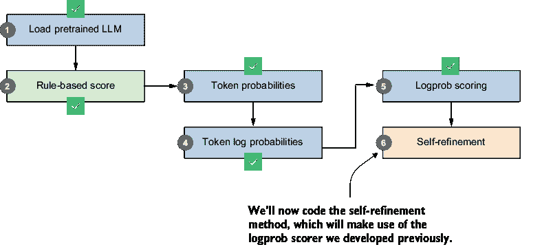

**图 5.19.** 工作流的最后一步，其中我们在自我完善方法中使用了前面开发的 logprob 评分器。

自我完善是一种让 LLM 分析并改进自己回答的技术。如图 5.20 所示，与常规 LLM 用法一样，LLM 首先对提示生成一个初始回答，然后评审该回答并对其进行改进。

图 5.20 中的自我完善过程乍一看可能很复杂，但本质上它只是将文本生成函数依次应用于不同的提示和输入。让我们通过一个代码示例逐步走一遍。

**注意：** 在这个示例中，我们不会使用思维链提示。不过在实践中，当你使用基础模型时，可以将自我完善与思维链提示结合起来。

我们将从基础提示和回答开始（图 5.20 中的步骤 1 和 2），这部分基于 5.2 节的代码。

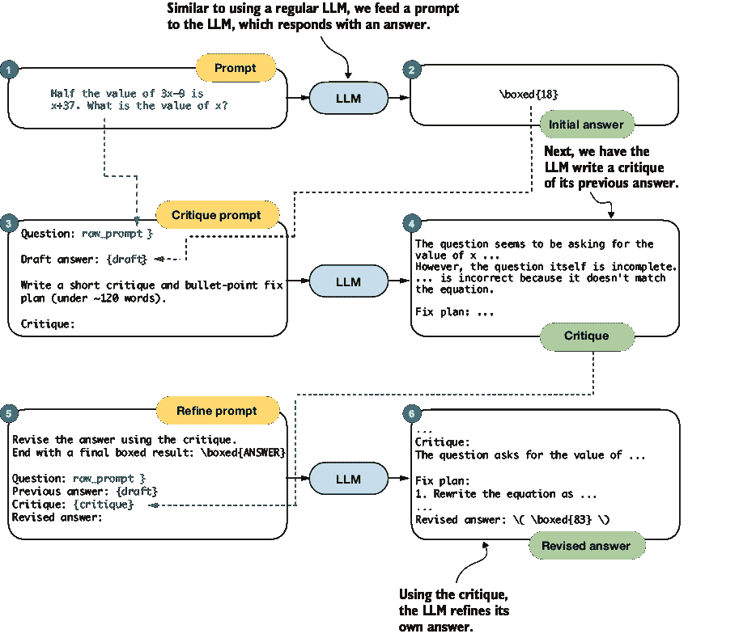

**图 5.20.** 自我完善过程。LLM 首先对提示生成一个初始回答，然后收到一个评审提示，要求它分析自己的回答并产出一段简短评审，以及一个改进回答的计划。在最后一步，模型会收到一个改进提示，其中包含原始问题、草稿回答和评审意见，并生成一个融入这些建议的修订版回答。

### 代码清单 5.9 基础提示与回答

```
raw_prompt = (
    "Half the value of $3x-9$ is $x+37$. "
    "What is the value of $x$?"
)
prompt = render_prompt(raw_prompt)

torch.manual_seed(123)
initial_response = generate_text_stream_concat_flex(
    model, tokenizer, prompt, device,
    max_new_tokens=2048, verbose=True,
    generate_func=generate_text_top_p_stream_cache,
    temperature=0.7,
    top_p=0.9, 
)
```

LLM 给出了 `\boxed{18}`，这是不正确的（正确答案是 83）。

接下来，我们让 LLM 评审这个回答。为此，我们编写一个评审提示，其中包含原始问题（`raw_prompt`）和回答（`draft`），如图 5.20 中的步骤 3 和 4 所示。

### 代码清单 5.10 评审提示与改进计划

```
def make_critique_prompt(raw_prompt, draft):
    return (
        "You are a meticulous reviewer. Identify logical errors, missing "
        "steps, or arithmetic mistakes. If the answer seems correct, "
        "say so briefly. Then propose a concise plan to fix issues.\n\n"
        f"Question:\n{raw_prompt}\n\n"
        f"Draft answer:\n{draft}\n\n"
        "Write a short critique and bullet-point fix plan "
        "(under ~120 words).\n"
        "Critique:"
    )


critique_prompt = make_critique_prompt(raw_prompt, initial_response)
torch.manual_seed(123)
critique = generate_text_stream_concat_flex(
    model, tokenizer, critique_prompt, device,
    max_new_tokens=2048, verbose=True,
    generate_func=generate_text_top_p_stream_cache,
    temperature=0.7,
    top_p=0.9, 
)
```

前面的评审提示让 LLM 写出了一段详细的评审，其中甚至包含了正确答案本身：

```
The question seems to have a logical error in its setup. The statement "Half the value of $3x-9$ is $x+37$" is incorrect because half of $3x-9$ should be $(3x-9)/2$, not $3x-9$. The equation should be $\frac{1}{2}(3x-9) = x + 37$.

Fix Plan:
1. Correct the equation to $\frac{1}{2}(3x-9) = x + 37$.
2. Multiply both sides by 2 to eliminate the fraction: $3x - 9 = 2(x + 37)$.
3. Distribute the 2 on the right side: $3x - 9 = 2x + 74$.
4. Subtract $2x$ from both sides: $x - 9 = 74$.
5. Add 9 to both sides: $x = 83$.
```

请注意，评审内容可能包含事实性错误。例如，它说 `"The question itself is incomplete"`，这并不属实，但它仍然继续给出了正确的修正计划。这一点很重要，因为在自我完善中，即使评审的部分内容有误，只要它能推动模型整体上产生更好的修订，它仍然是有用的。

最后，我们使用这个改进提示来修订原始回答（图 5.20 中的步骤 5 和 6）。

### 代码清单 5.11 回答改进

```
def make_refine_prompt(raw_prompt, draft, critique):
    return (
        "Revise the answer using the critique. Keep it concise and "
        "end with a final boxed result: \\boxed{ANSWER}\n\n"
        f"Question:\n{raw_prompt}\n\n"
        f"Previous answer:\n{draft}\n\n"
        f"Critique:\n{critique}\n\n"
        "Revised answer:"
    )

refine_prompt = make_refine_prompt(raw_prompt, initial_response, critique)
torch.manual_seed(123)
revised_answer = generate_text_stream_concat_flex(
    model, tokenizer, refine_prompt, device,
    max_new_tokens=2048, verbose=True,
    generate_func=generate_text_top_p_stream_cache,
    temperature=0.7,
    top_p=0.9, 
)
```

虽然基础模型并不是最好的指令遵循者，但优化提示能够引导 LLM 生成正确答案：

```
...
 \boxed{83} 
Final result: The value of $x$ is \boxed{83}.
```

这个例子演示了单次优化循环。在实践中，通常会多次重复这个循环。接下来，我们将编写一个函数来自动化这个过程。

## 5.8 实现自我优化循环

我们现在将上一节的手动自我优化步骤封装成一个便捷函数，简化自我优化的使用，并允许该过程重复固定的次数。

此外，该函数将支持接入我们在本章前面开发的评分方法（启发式评分和对数概率评分），为每个答案计算得分（图 5.21）。然后可以使用这个得分来决定是否应该接受优化后的答案。

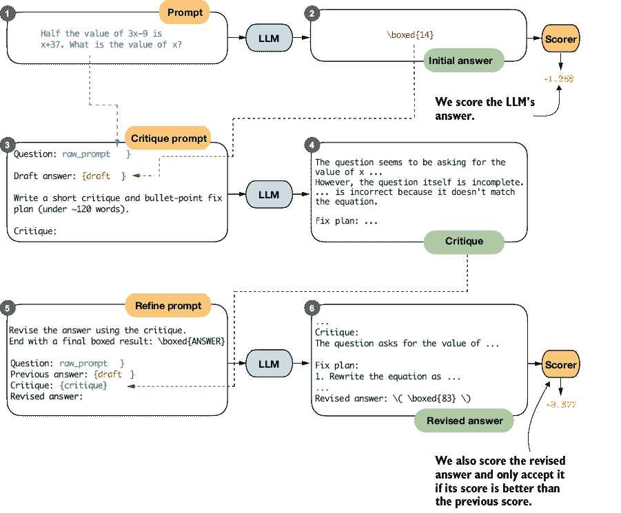

### 图 5.21 带可选评分的自我优化循环。模型生成初始答案，然后对其进行评审，并基于评审生成修正答案。两个答案都可以通过评分函数（如对数概率评分）进行评估，只有当修正答案的得分优于前一个答案时，才会被接受。

在图 5.21 中，修正后的答案获得了比初始答案（`-1.258`）更高的对数概率得分（`-0.377`），因此接受该修正是合理的。在实践中，自我优化也可能产生更差的答案，尤其是在多次迭代运行的情况下。因此，评分器提供了一种判断修正答案是否代表改进的方法。

注意：评分并不总是能改进结果。在自我优化中是否应该使用评分器，以及使用哪一种评分器，取决于 LLM。你可以通过在类似 MATH-500 的基准数据集上进行实验来确定这一点。

下面的代码清单展示了完整代码，它结合了上一节的步骤，并添加了 `iterations` 参数和评分函数（`score_fn`）选项。

### 清单 5.12 支持多次迭代和评分的自我优化


# 自我优化循环

以下代码定义了一个自我优化循环函数，用于迭代地改进模型生成的答案：

```
def self_refinement_loop(
    model,
    tokenizer,
    raw_prompt,
    device,
    iterations=2,
    max_response_tokens=2048,
    max_critique_tokens=256,
    score_fn=None,
    prompt_renderer=render_prompt,
    prompt_suffix="",
    verbose=False,
    temperature=0.7,
    top_p=0.9,
):
    steps = []

    prompt = prompt_renderer(raw_prompt) + prompt_suffix #1
    current_full = generate_text_stream_concat_flex(
        model=model,
        tokenizer=tokenizer,
        prompt=prompt,
        device=device,
        max_new_tokens=max_response_tokens,
        verbose=False,
        generate_func=generate_text_top_p_stream_cache,
        temperature=temperature,
        top_p=top_p,
    )

    current_extracted = extract_final_candidate(
        current_full, fallback="number_then_full"
    )
    if score_fn:
        current_score = score_fn(answer=current_full, prompt=prompt)
    else:
        current_score = 0.0

    for it in range(iterations):     #2
        draft_before_full = current_full
        draft_before_extracted = current_extracted
        score_before = current_score

        critique_prompt = make_critique_prompt(        #3
            raw_prompt, draft_before_full
        )
        critique_full = generate_text_stream_concat_flex(
            model=model,
            tokenizer=tokenizer,
            prompt=critique_prompt,
            device=device,
            max_new_tokens=max_critique_tokens,
            verbose=False,
            generate_func=generate_text_top_p_stream_cache,
            temperature=temperature,
            top_p=top_p,
        )

        refine_prompt = make_refine_prompt(         #4
            raw_prompt, draft_before_full, critique_full
        )
        revised_full = generate_text_stream_concat_flex(
            model=model,
            tokenizer=tokenizer,
            prompt=refine_prompt,
            device=device,
            max_new_tokens=max_response_tokens,
            verbose=False,
            generate_func=generate_text_top_p_stream_cache,
            temperature=temperature,
            top_p=top_p,
        )

        revised_extracted = extract_final_candidate(
            revised_full, fallback="number_then_full"
        )
        if score_fn:
            revised_score = score_fn(
                answer=revised_full, prompt=prompt
            )
        else:
            revised_score = 0.0

        step = {         #5
            "iteration": it + 1,
            "draft_full": draft_before_full,
            "draft_extracted": draft_before_extracted,
            "critique": critique_full,
            "revised_full": revised_full,
            "revised_extracted": revised_extracted,
            "score_before": score_before,
            "score_after": revised_score,
        }
        steps.append(step)

        if verbose:
            print(
                f"[Refinement {it+1}/{iterations}]"
                f"\nCurrent: {draft_before_extracted}"
                f"\nRevised: {revised_extracted}"
                f"\nScore before: {score_before:.3f}"
                f"\nScore after: {revised_score:.3f}"
                f"\n{'=' * 25}\n"
            )

        if revised_score >= current_score:         #6
            current_full = revised_full
            current_extracted = revised_extracted
            current_score = revised_score

    return {
        "final_full": current_full,
        "final_extracted": current_extracted,
        "steps": steps,
    }
```

1. 初始响应（草稿）
2. 运行一次或多次迭代。
3. 对响应进行评审。
4. 优化响应。
5. 记录结果。
6. 如果修正后的响应不比原来差，则接受它。

`self_refinement_loop` 函数会运行上一节中的自我优化过程一次或多次迭代（`for it in range(iterations)`）。在每次迭代结束时，它会将修正后的得分与当前得分进行比较（`revised_score >= current_score`），并且只有当修正答案的得分等于或更高时才保留它。

使用评分函数是可选的。当 `score_fn=None`（默认值）时，得分始终设置为 `0.0`。由于 `0.0 >= 0.0` 的求值结果为 `True`，因此在运行多次优化迭代时，最新的答案总是会被接受。

然后我们使用平均对数概率评分器 `avg_logprob_answer` 运行自我优化循环。该函数如清单 5.8 所示，接受几个参数（`model`、`tokenizer`、`prompt`、`answer` 和 `device`）。正如你在上一个清单中看到的，评分函数只用了两个参数调用：

```
# ...
        if score_fn:
            revised_score = score_fn(
                answer=revised_full, prompt=prompt
            )
# ...
```

为了使 `avg_logprob_answer` 兼容这个 `score_fn` 调用，我们可以使用 Python 内置 `functools` 模块中的 `partial` 函数来预指定其余参数。

### 清单 5.13 创建平均对数概率评分器

```
from functools import partial

avg_logprob_score = partial(
    avg_logprob_answer,
    model=model,
    tokenizer=tokenizer,
    device=device
)
```

现在我们可以使用 `avg_logprob_score` 函数进行自我优化循环：

```
torch.manual_seed(1)

results_logprob = self_refinement_loop(
    model=model,
    tokenizer=tokenizer,
    raw_prompt=raw_prompt,
    device=device,
    iterations=2,
    max_response_tokens=2048,
    max_critique_tokens=256,
    score_fn=avg_logprob_score,
    verbose=True,
    temperature=0.7,
    top_p=0.9,
)
```

输出如下：

```
[Refinement 1/2]
Current: 10 
Revised: 83
Score before: -0.855
Score after: -0.226 
=========================
[Refinement 2/2]
Current: 83
Revised: 83
Score before: -0.226 
Score after: -1.320
=========================
```

从前面的结果可以看出，模型在第一次迭代中纠正了最初的错误答案（从 `10` 改为 `83`），得分从 `-0.855` 提高到 `-0.226`。在第二次迭代中，得分变差了，但这没关系，因为我们已经得到了正确答案。

我们还可以通过 `results_logprob["final_extracted"]` 访问从得分最高的响应中提取的最终答案（通常来自其框中的内容，如果有的话），在本例中返回 `83`。如果你对完整答案感兴趣，可以使用 `results_logprob["final_full"]`。要查看批评意见和更长的答案，你可以打印 `results_logprob` 字典，其中包含所有迭代的详细结果。

### 练习 5.5：使用启发式分数进行自我优化

使用我们在清单 5.3 中定义的 `heuristic_score` 函数运行 `self_refinement_loop`。

前面的例子表明，自我优化可以帮助模型生成正确答案。为了更清楚地了解这种自我优化方法的实际效果，我在 MATH-500 上进行了测试，并将结果汇总在表 5.1 中。

### 表 5.1 不同自我优化方法在 MATH-500 任务上的准确率

| # | 方法 | 评分 | 迭代次数 | 模型 | 准确率 | 时间 |
|---|--------|---------|------------|-------|----------|------|
| 1 | 基线（第 3 章） | - | - | 基础 | 15.2% | 10.1 分钟 |
| 2 | 自我优化 | 无 | 1 | 基础 | 25.0% | 84.8 分钟 |
| 3 | 自我优化 | 无 | 2 | 基础 | 22.0% | 165.4 分钟 |
| 4 | 自我优化 | 启发式 | 1 | 基础 | 21.6% | 84.7 分钟 |
| 5 | 自我优化 | 启发式 | 2 | 基础 | 20.8% | 151.4 分钟 |
| 6 | 自我优化 | 平均对数概率 | 1 | 基础 | 21.4% | 85.3 分钟 |
| 7 | 自我优化 | 平均对数概率 | 2 | 基础 | 22.0% | 165.3 分钟 |
| 8 | 基线（第 3 章） | - | - | 推理 | 48.2% | 182.1 分钟 |
| 9 | 自我优化 | 无 | 1 | 推理 | 56.6% | 498.8 分钟 |
| 10 | 自我优化 | 启发式 | 1 | 推理 | 57.8% | 498.6 分钟 |
| 11 | 自我优化 | 平均对数概率 | 1 | 推理 | 48.4% | 499.7 分钟 |

表 5.1 中显示的准确率是使用 `"cuda"` GPU（DGX Spark）在 MATH-500 测试集的所有 500 个样本上计算得出的。

如表 5.1 所示，自我优化相比基础模型（第 1–7 行）确实提升了性能，但提升幅度非常有限；当自我优化中不使用评分时，准确率最高。这意味着启发式分数和平均对数概率分数有时会导致错误答案被优先采纳，而忽略了最初的正确答案。

请注意，在基础模型和自优化中均添加 `"Explain step by step."` 思维链时，模型未能超越基础模型（结果未显示）。

从推理模型的结果（第 8–11 行）可以看出，自我优化与启发式评分的组合将答案准确率提升了近 10%。（正如第 3 章所述，可以通过将清单 5.1 中 `load_model_and_tokenizer` 的 `which_model="base"` 改为 `which_model="reasoning"` 来使用推理模型。）

在两种情况下，平均对数概率评分的表现似乎都不如无评分或启发式评分。这可能是因为平均对数概率分数更多地与答案在模型下的自然程度或期望程度相关，而非答案是否真正正确。因此，它可能会偏好那些流畅、常见或语法干净的答案，即使它们在语义上是错误的。换句话说，对数概率标准可能无意中选出高置信度的错误答案，而启发式分数则更关注答案的格式和结构。

至此，我们似乎花了大量时间讨论平均对数概率评分的概念。对数概率评分是使用 LLM 时的一个基本概念，在接下来的章节中，当我们实现强化学习训练过程时，它将会派上用场。

将表 5.1 的结果与上一章（表 4.1）的结果进行比较，我们还观察到，在这个数学任务上，对于该模型，自我优化的效果不如自我一致性。自我一致性仍然被广泛使用，因为它虽然简单，但在实践中效果很好。

本章我们还未探讨的另一种方法是在 LLM 作为评判者的设置中使用外部模型进行自我优化，类似附录 F（第 F.5 节）中描述的方法。例如，我们可以使用第二个 LLM 来计算分数并撰写批评意见，而不是使用启发式分数或平均对数概率。

2025 年 11 月，DeepSeek 团队凭借 DeepSeekMath-V2 证明，使用第二个 LLM 进行自我优化可以取得非常好的效果，在多项数学竞赛中达到了金牌水平。具体来说，该团队提出了一种新方法：训练第二个 LLM 成为强大的批评模型，并进一步训练其基础模型，使其在自我优化环境中成为更好的数学问题求解器（相比之下，本章中我们在没有任何额外训练的情况下应用了自我优化）。

至此，我们关于无额外训练的推理扩展的讨论就此结束（见图 5.22）。在下一章中，我们将开始介绍更新模型权重以提高推理能力的训练技术。

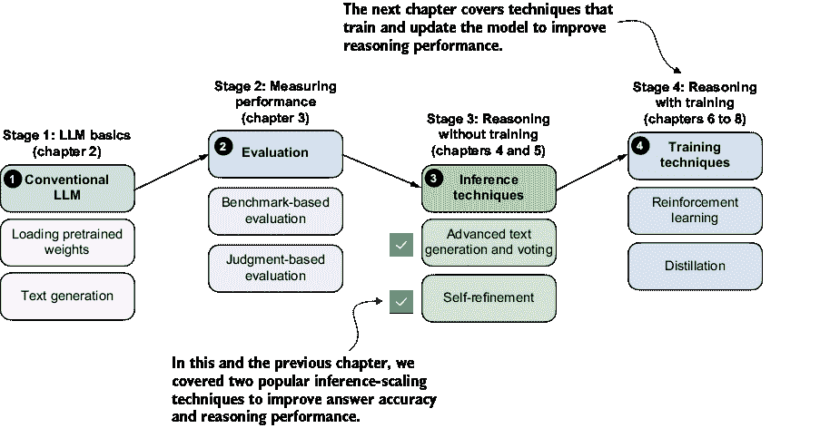

### 图 5.22 本书从基础 LLM 使用到推理时推理方法，最终到基于训练的技术的进展概览。本章结束了我们对无需额外训练的推理扩展方法的讨论。接下来的章节将介绍更新模型权重以进一步提高推理性能的方法。

## 总结

- 自我优化扩展了上一章中的推理时扩展思想，通过迭代地批评和改进单个答案，而不是像自我一致性那样依赖多个独立样本。
- 一个简单的基于规则的评分函数，通过优先考虑可提取的最终答案和更短、更经济的补全来对模型输出进行排序。
- 下一词元评分通过将 logits 转换为归一化概率，并将这些概率组合为序列级似然，从而量化模型置信度。
- 对数概率替代原始概率，以避免数值下溢，并将许多词元上的乘积转化为稳定的总和与平均值。
- 这些评分函数不仅可用于自我优化，还可用于打破自我一致性中的平局或实现最佳 *N* 选择策略等。
- 自我优化过程包括三个阶段：生成初始草稿、生成简短的批评和修复计划，以及生成修订后的答案。
- 可复用的优化函数可在多次迭代（优化轮次）中自动化自我优化流程，并且可以使用基于评分的接受机制，仅保留那些不会降低计算答案分数的修订，使用我们之前开发的评分函数之一。
