# 8 蒸馏推理模型以实现高效推理

## 本章涵盖

* 推理模型的硬蒸馏和软蒸馏
* 创建和准备教师模型生成的推理数据集
* 使用交叉熵损失训练和评估蒸馏后的学生模型

推理性能不仅可以通过推理时扩展和强化学习来提高，还可以通过*蒸馏*来提高。在蒸馏中，较小的学生模型在较大的教师模型生成的推理轨迹和答案上进行训练。如图 8.1 的概览所示，本章重点介绍这种训练时技术。

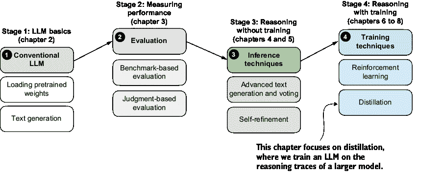

*图 8.1 本书涵盖主题的示意图。本章重点介绍蒸馏，即较小的学生模型在较大的教师模型生成的推理轨迹上进行训练。*

在讨论过程中的各个步骤之前，我们先总体介绍模型蒸馏。

## 8.1 面向推理任务的模型蒸馏简介

模型蒸馏涉及在较大的 LLM（教师）生成的输出上训练较小的 LLM（学生）。对于推理模型，这些输出通常不仅包括最终答案，还包括得出答案的中间推理轨迹。

蒸馏之所以重要，是因为最强的推理模型往往规模过大且成本过高，难以直接使用。例如，DeepSeek-R1 拥有 6710 亿个参数。这种规模的系统开发和部署成本高昂，远超大多数从业者在本地硬件上运行的能力。DeepSeek-R1 背后的团队通过蒸馏这个 6710 亿参数的教师模型，创建了更小的模型变体。我们将在本章中遵循相同的基本思路，但以适合本书的实用规模进行。

贯穿本书，我们有意使用小模型而不是从头训练一个非常大的 LLM，但本章的工作流程与大型模型相同。我们将使用一个更强的教师模型来生成推理轨迹，然后训练一个较小的学生模型来重现这些轨迹。在我们的设置中，这个蒸馏阶段所花的时间只相当于大型模型的一小部分。我们的蒸馏训练运行在 DGX Spark 上大约需要 3 小时，占用约 15 GB 内存；而在同样的硬件上，即使第 6 章中的几轮 GRPO 也需要大约 12 小时和 70 GB 内存。

蒸馏也可能比使用可验证奖励的强化学习（RLVR）训练小模型更有效。例如，DeepSeek-R1 论文报告称，其较小的蒸馏变体优于仅使用强化学习训练的同类模型。在该设置中，拥有 6710 亿参数的最大 DeepSeek-R1 模型充当教师，生成用于训练较小学生模型的监督信号。

蒸馏主要有两种类型：*硬*蒸馏和*软*蒸馏。在硬蒸馏中，学生模型在教师生成的文本上进行训练，因此教师的 token 被视为目标。在软蒸馏中，学生模型通过最小化*KL 散度*（衡量两个概率分布差异程度的指标）来匹配教师在整个词表上的概率分布。这两种方法如图 8.2 所示。

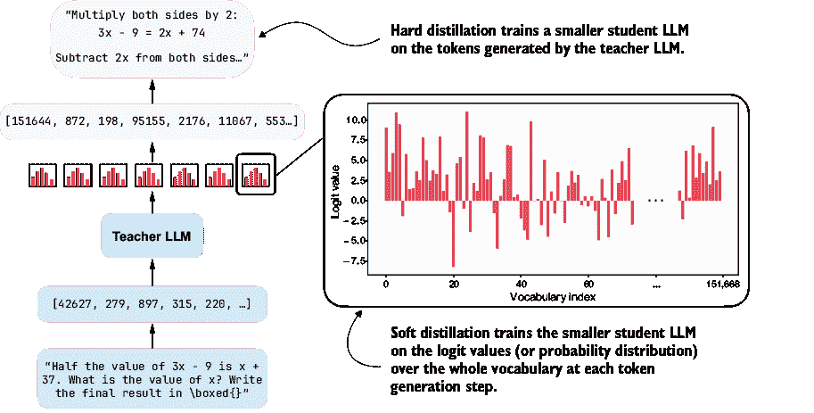

### 图 8.2 硬蒸馏使用教师生成的 token 训练学生模型；软蒸馏使用教师的完整输出分布训练学生模型。

如图 8.2 所示，一种选择是纯硬蒸馏。在这里，我们只使用教师生成的文本作为训练目标。如果你熟悉典型的 LLM 训练流程（我在上一本书*《构建大语言模型（从零开始）》*中有更详细的介绍），那么硬蒸馏就是在合成数据上进行监督微调。这也是较小的 DeepSeek-R1 蒸馏模型所使用的设置。大型教师模型生成推理轨迹和答案，学生模型通过微调来重现这些内容。根据 DeepSeek-R1 论文，对于小模型来说，这种蒸馏方法的准确率可能高于使用强化学习训练。硬蒸馏的主要实际优势在于，我们只需要访问教师生成的文本，而不需要其 logits。

第二种选择是纯软蒸馏。学生模型不是只匹配教师选定的 token，而是被训练去匹配教师对每个 token 在整个词表上的完整输出分布。这为学生模型提供了更丰富的信息，让其了解教师认为哪些备选 token 是合理的，但在训练时需要访问教师的 logits 或对数概率。

第三种选择是硬蒸馏和软蒸馏的结合。这是早期在计算机视觉中流行的经典知识蒸馏设置，例如 Geoffrey Hinton、Oriol Vinyals 和 Jeff Dean 的论文《蒸馏神经网络中的知识》。在这种情况下，我们使用教师实际输出的 token 进行训练，同时也鼓励学生模型匹配教师的完整分布。

在实践中，硬蒸馏在 LLM 中更为常见，部分原因是教师的完整 logits 通常无法获取。ChatGPT 或 Claude 等专有系统可能会提供生成的文本，但通常不会提供经典软蒸馏所需的完整词表分布。

**警告** 重复使用生成的文本进行蒸馏可能会受到提供商特定使用政策的限制，包括 OpenAI 和 Anthropic 的服务条款，因此在将此类输出用于训练之前，请仔细审阅这些政策。

即使可以获得 logits，软蒸馏也比硬蒸馏更繁琐。学生模型和教师模型通常需要相同的 tokenizer，以便它们的词表分布对齐，因此这种方法在同一模型家族内更容易实现。对于较长的推理轨迹，存储和使用完整的 token 分布也要昂贵得多。相比之下，存储纯文本输出既便宜又简单。

在本章中，我们将重点介绍 DeepSeek-R1 风格的硬蒸馏，因为对大多数读者来说，这是更实际的设置。本章将讨论的步骤总结在图 8.3 中。

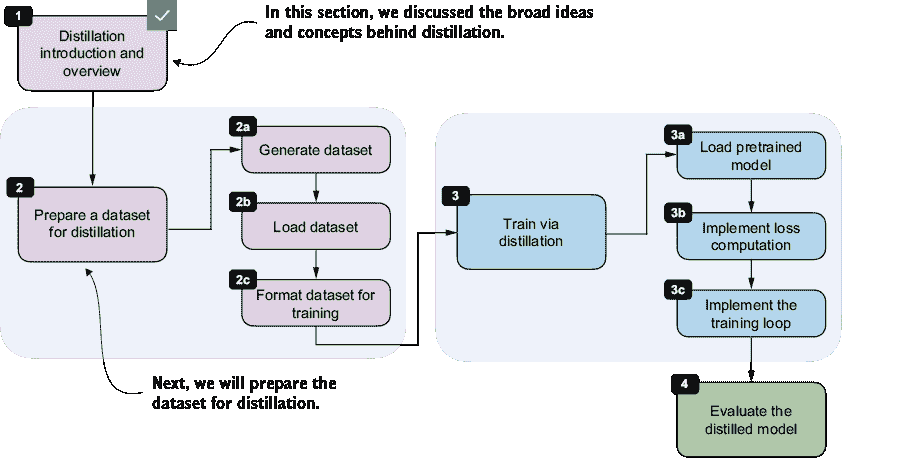

### 图 8.3 本章从四个主要步骤介绍蒸馏：（1）蒸馏介绍与概述；（2）数据集准备（步骤 2a-2c）；（3）通过蒸馏进行训练（步骤 3a-3c）；（4）评估。

有了这个概述，我们现在可以从蒸馏背后的高层概念转向实现它所需的实际步骤。在下一节中，我们将首先为蒸馏准备数据集，这将作为训练学生模型的基础。

## 8.2 为推理蒸馏生成数据集

硬蒸馏的第一个实际步骤是为训练学生模型创建数据集。对我们来说，学生模型将是我们在前面章节中使用过的 Qwen3 0.6B 基础模型。

为了构建数据集，我们将使用 MATH 划分中与 MATH-500 评估集不重叠的 12,000 个数学问题。这些正是我们在第 6 章和第 7 章中用于 RLVR 的 12,000 个问题。我们不再对多个学生回答进行采样并计算奖励，而是将这些问题输入现有的推理模型 DeepSeek-R1（教师模型），并收集其响应作为训练目标。该设置如图 8.4 所示。

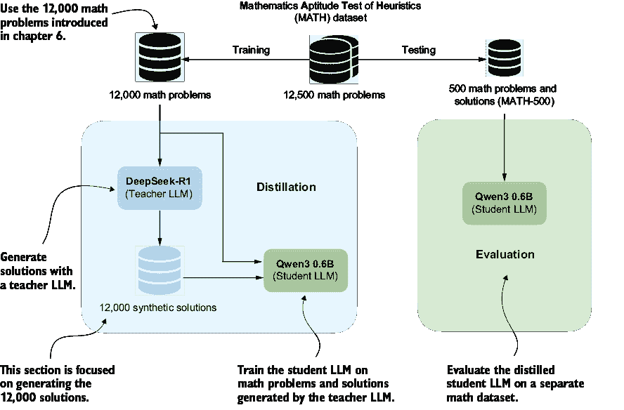

### 图 8.4 本章使用的蒸馏设置。我们将使用 12,000 个不重叠的 MATH 训练问题从 DeepSeek-R1 获取合成解答，然后将在独立的 MATH-500 测试集上评估蒸馏后的 Qwen3 学生模型。

在第 6 章和第 7 章的 RLVR 设置中，我们训练 Qwen3 基础模型生成正确的解答，然后使用验证器将模型的最终答案与参考答案进行比较。验证器产生奖励信号。

在蒸馏中，监督信号更加直接。我们不会使用奖励函数来比较学生模型的答案与参考答案，而是将学生生成的 token 与教师生成的 token 进行比较，如图 8.4 所示。教师的响应成为*目标序列*。与 RLVR 的对比在图 8.5 中有更详细的说明。

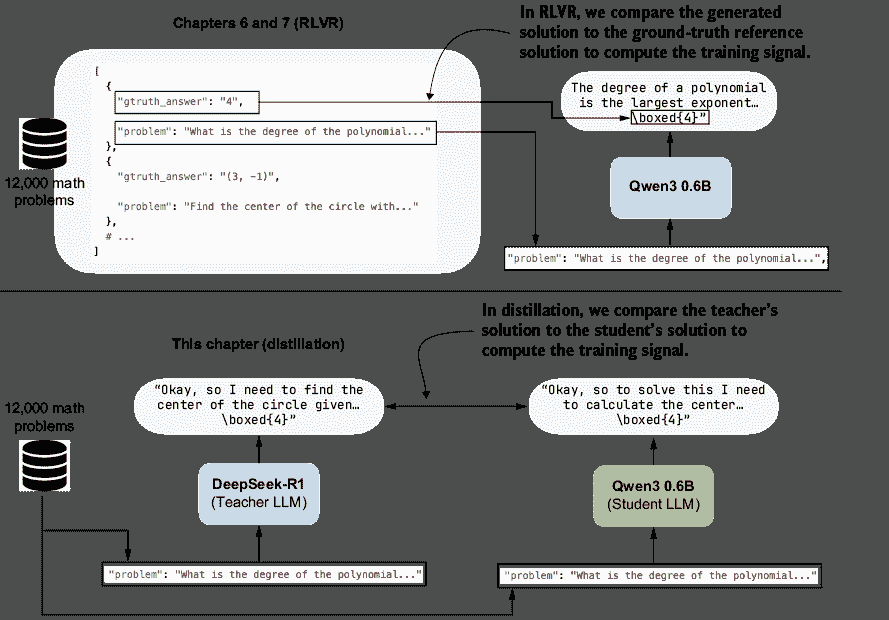

### 图 8.5 在 RLVR 中，生成的答案与真实参考答案进行比较（上方子图），而在蒸馏中，学生答案与教师生成的解答进行比较（下方子图）。

蒸馏的一个实际优势是，我们可以在训练学生模型之前生成教师数据集。

由于为全部 12,000 个数学问题生成教师答案可能非常耗时且耗费资源，我使用通过 OpenRouter 托管的 6710 亿参数 DeepSeek-R1 模型创建了数据集。整个数据生成的 API 使用费用约为 50 美元。我们将加载这个预生成的数据集，因此你无需自己生成即可继续学习。如果你对数据生成过程感兴趣，相关代码和使用说明可在补充材料中获取：[`mng.bz/vZvx`](https://mng.bz/vZvx)。

## 8.3 加载用于蒸馏的 MATH 训练数据集

现在，我们将加载上一节中由 DeepSeek-R1 生成的蒸馏 MATH 数据集。每个样本都包含一个数学问题，以及推理轨迹和最终答案，我们可以将其用作监督微调的目标。此步骤在图 8.6 中突出显示。

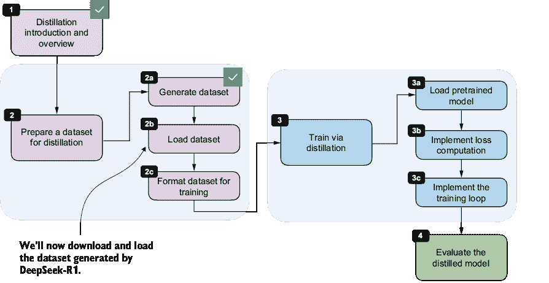

### 图 8.6 在本节中，我们将先从 JSON 文件加载 DeepSeek-R1 生成的数据集，然后再为训练做准备。

我没有将数据集放在 GitHub 上，而是通过 Hugging Face Hub 提供，因为 JSON 文件约为 107 MB，超出了 GitHub 100 MB 的文件大小限制：[`huggingface.co/datasets/rasbt/math\_distill`](https://huggingface.co/datasets/rasbt/math_distill)。下面的辅助函数会在本地尚未缓存所选分区时下载它，并将其作为 Python 对象返回。

### 清单 8.1 加载蒸馏后的 MATH 训练集划分

```python
import json
import requests
from pathlib import Path

def load_distill_data(
    local_path=None,
    partition="deepseek-r1-math-train",
    save_copy=True,
):
    if local_path is None:
        local_path = f"{partition}.json"
    local_path = Path(local_path)
    url = (
        "https://huggingface.co/datasets/rasbt/math_distill"
        "/resolve/main/data/"
        f"{partition}.json"
    )
    backup_url = (
        "https://f001.backblazeb2.com/file/reasoning-from-scratch/"
        f"MATH/{partition}.json"
    )
    if local_path.exists(): #1
        with local_path.open("r", encoding="utf-8") as f:
            data = json.load(f)
        size_kb = local_path.stat().st_size / 1e3
        print(f"{local_path}: {size_kb:.1f} KB (cached)")
        return data
    assert partition in (
        "deepseek-r1-math-train",
        "deepseek-r1-math500",
        "qwen3-235b-a22b-math-train",
        "qwen3-235b-a22b-math500",
    )
    try:  #2
        r = requests.get(url, timeout=30)
        r.raise_for_status()
    except requests.RequestException:
        print("Using backup URL.")
        r = requests.get(backup_url, timeout=30)
        r.raise_for_status()
    data = r.json()
    if save_copy:  #3
        with local_path.open("w", encoding="utf-8") as f:
            json.dump(data, f, indent=2)
        size_kb = local_path.stat().st_size / 1e3
        print(f"{local_path}: {size_kb:.1f} KB")
    return data
```

#1 如果数据集已下载，则复用缓存副本。
#2 先尝试从 Hugging Face 下载。
#3 保存本地副本，以便后续运行可跳过下载。

输出如下：

```text
deepseek-r1-math-train.json: 107538.0 KB
Dataset size: 12000
```

让我们检查其中一个训练示例，以了解数据集结构，并确切查看教师生成的数据包含哪些字段。为了便于说明，我们使用第五个训练示例：

```python
from pprint import pprint
pprint(math_train[4])
```

打印输出如下：

```text
{'gtruth_answer': '6',
 'message_content': 'Sam worked \\( x \\) days and did...'
 'message_thinking': "Okay, let's see. Sam was hired for 20 days...'
 'problem': 'Sam is hired for a 20-day period...'
}
```


每个数据集条目都包含数学问题本身（`problem`）、标准答案（`gtruth_answer`）、教师模型在 `message_thinking` 中的推理过程，以及 `message_content` 中的最终答案。对于蒸馏来说，最重要的两个字段是推理过程和最终答案，因为它们共同构成了学生模型需要学习复现的目标文本。

下面的清单中的 `format_distilled_answer` 函数将这两个字段合并为一个训练目标：将推理过程放在 `` 标签内，然后附加最终答案。

### 清单 8.2 格式化教师响应以用于蒸馏

```
def format_distilled_answer(entry):
    content = str(entry["message_content"]).strip()
    if not content:
        raise ValueError("Missing non-empty 'message_content' field.")
    return f"<think>{entry['message_thinking']}</think>\n\n{content}"

print(format_distilled_answer(math_train[4]))
```

这是打印输出：

```
Sam worked \( x \) days and did not work \( y \) days. We know:...
Sam did not work \(\boxed{6}\) days.
```

如前一章所述，第 7 章中引入了 `` 标记。

### 清单 8.3 加载 Qwen3 推理分词器

```
from reasoning_from_scratch.qwen3 import (
    download_qwen3_small,
    Qwen3Tokenizer,
)

def load_reasoning_tokenizer(local_dir="qwen3"):
    download_qwen3_small(
        kind="reasoning", tokenizer_only=True, out_dir=local_dir
    )
    tokenizer_path = Path(local_dir) / "tokenizer-reasoning.json"
    tokenizer = Qwen3Tokenizer(
        tokenizer_file_path=tokenizer_path,
        apply_chat_template=True,
        add_generation_prompt=True,
        add_thinking=True,
    )
    return tokenizer

tokenizer = load_reasoning_tokenizer()
```

我们设置 `apply_chat_template=True` 和 `add_generation_prompt=True`，以便分词器应用与 Qwen3 的聊天和推理模型相同的提示格式风格。以下示例展示了自动插入的额外包装标记。

```
prompt = "Sam is hired for a 20-day period..."
prompt_ids = tokenizer.encode(prompt)
decoded_prompt = tokenizer.decode(prompt_ids)
print(decoded_prompt)
```

格式化后的文本如下：

```
<|im_start|>user
Sam is hired for a 20-day period...<|im_end|>
<|im_start|>assistant
```

`<|im_start|>user` 标记用户提示的开始，`<|im_end|>` 标记提示的结束，`<|im_start|>assistant` 标记模型响应的开始。这种聊天风格的包装是可选的，但它是指令和聊天微调中的常见约定。

对于目标答案，我们将通过设置 `chat_wrapped=False` 来禁用此包装。否则，提示和答案都会引入各自的助手起始标记，这不是我们在将它们拼接成单个训练序列时想要的：

```
answer = (
    "<think>Okay, let me try to solve "
    "this problem...</think> \\boxed{4}"
)
answer_ids = tokenizer.encode(answer, chat_wrapped=False)
decoded_answer = tokenizer.decode(answer_ids)
print(decoded_answer)
```

如图所示，`chat_wrapped=False` 设置抑制了答案标记的聊天模板：

```
<think>Okay, let me try to solve this problem...</think> \boxed{4}
```

对于训练，我们需要完整的标记 ID 序列：包装的提示，后跟教师答案，再跟一个序列结束标记。这是模型在下一个标记预测期间将看到的序列：

```
token_ids = prompt_ids + answer_ids + [tokenizer.eos_token_id]
decoded_token_ids = tokenizer.decode(token_ids)
print(decoded_token_ids)
```

格式化后的字符串如下：

```
<|im_start|>user
Sam is hired for a 20-day period...<|im_end|>
<|im_start|>assistant
<think>Okay, let me try to solve this problem...</think>\boxed{4}<|im_end|>
```

值得强调的是，推理分词器之所以方便，主要是因为它已经包含了 `<think></think>` 标记。原则上，我们也可以使用基础分词器。同样，聊天模板也不是严格必需的。我们在这里保留它，因为它与 Qwen3 自己的推理模型使用的格式匹配，并有助于保持训练和评估设置的一致性。

如果你稍后使用前面章节的脚本评估模型，请记得使用 `--which_model "reasoning"` 设置，以便评估使用相同的分词器变体。

### 8.4.2 格式化并分词数据集

现在我们已经加载了分词器，可以对整个数据集应用格式化和分词步骤，如图 8.8 所示。

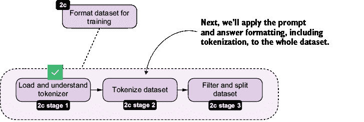

#### 图 8.8 分词完成后，我们现在可以对整个数据集应用格式化和分词步骤。

分词器就位后，我们现在可以通过 `build_examples` 函数在整个数据集上一致地应用格式化和分词步骤。单个训练样本的完整格式化和分词流程如图 8.9 所示。

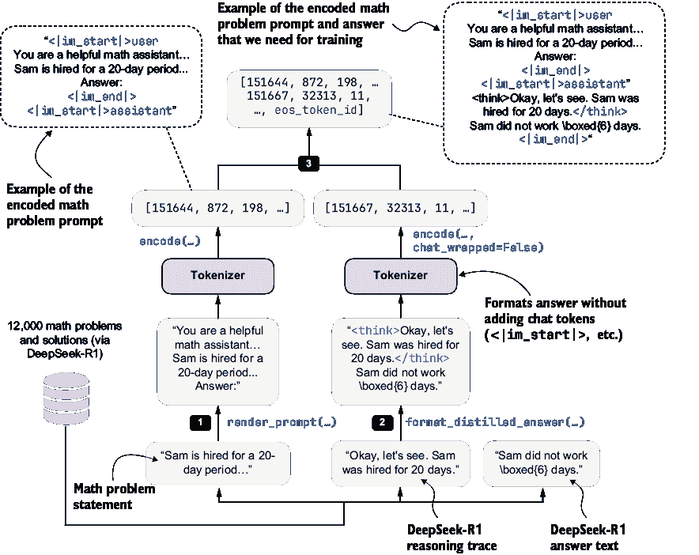

#### 图 8.9 单个训练样本的分词流程示例。数学问题被渲染为聊天提示格式，教师推理轨迹和最终答案通过 `format_distilled_answer` 组合，然后将两部分拼接成一个标记序列。

在这里，`build_examples` 函数执行三个步骤。首先，它渲染并分词提示。其次，它格式化并分词教师答案。第三，它拼接两个部分并记录提示长度，以便我们之后可以仅计算答案标记上的损失。以下清单展示了如何在代码中实现这一点。

#### 清单 8.4 构建并检查分词后的蒸馏示例

```
from reasoning_from_scratch.ch03 import render_prompt

def build_examples(data, tokenizer):
    examples = []
    skipped = 0
    for entry in data:
        try:
            prompt = render_prompt(entry["problem"])#1
            prompt_ids = tokenizer.encode(prompt) #1
            target_answer = format_distilled_answer(entry)#2
            answer_ids = tokenizer.encode( #2
                target_answer, chat_wrapped=False #2
            ) #2
            token_ids = (#3
                prompt_ids + answer_ids + [tokenizer.eos_token_id] #3
            ) #3
            if len(token_ids) < 2:
                skipped += 1
                continue
            examples.append({#4
                "token_ids": token_ids, #4
                "prompt_len": len(prompt_ids), #4
            }) #4
        except (KeyError, TypeError, ValueError):
            skipped += 1#5
 #5
    return examples, skipped #5
 #5
 #5
examples, skipped = build_examples(math_train, tokenizer) #5
 #5
print("Number of examples:", len(examples)) #5
print("Number of skipped examples:", skipped) #5
```

- `#1` 步骤 1：以聊天格式渲染问题
- `#2` 步骤 2：对教师推理轨迹和最终答案进行分词
- `#3` 步骤 3：组合提示和答案用于训练
- `#4` 存储提示长度，以便我们之后在损失中忽略提示标记。
- `#5` 跳过格式错误的示例。

运行清单 8.4 中的代码后得到的结果如下：

```
Number of examples: 12000
Number of skipped examples: 0
```

接下来，让我们解码其中一个训练示例以进一步检查：

```
print(tokenizer.decode(examples[4]["token_ids"]))
```

这是输出：

```
<|im_start|>user
You are a helpful math assistant.
Answer the question and write the final result on a new line as:
\boxed{ANSWER}
Question:
Sam is hired for a 20-day period...
Answer:<|im_end|>
<|im_start|>assistant
<think>Okay, let's see. Sam was hired for 20 days.... So answer is 6 days not worked.</think>
...Sam did not work \(\boxed{6}\) days.<|im_end|>
```


Looking at the preceding output, we can confirm that it meets all the formatting requirements. For instance, it uses the chat template correctly, and the answer’s reasoning trace is correctly enclosed in `<think></think>` tags. Finally, the answer ends with an end-of-sequence token, `<|im_end|>`.

### 8.4.3 Filtering and Splitting the Dataset

Once the examples are tokenized, we still need to filter long sequences and split the dataset into *training* and *validation* subsets. This step is highlighted in figure 8.10.

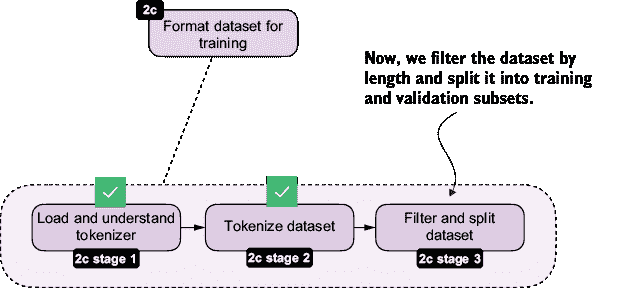

#### Figure 8.10 After tokenization, we filter out long sequences and split the remaining examples into training and validation subsets.

After tokenization, it’s useful to inspect the sequence lengths. This tells us how long the examples are on average, which samples are extreme outliers, and how aggressive our filtering needs to be. We can then remove examples above the chosen maximum length, shuffle the remaining data with a fixed random seed, and split off a small validation set.

Let’s begin by analyzing the sequence lengths.

#### Listing 8.5 Computing Lengths and Filtering Long Examples

```python
def compute_length(examples, answer_only=False):
    lengths = []
    for ex in examples:
        total = len(ex["token_ids"])
        length = total - ex["prompt_len"] if answer_only else total
        lengths.append(length)
    avg_len = round(sum(lengths) / len(lengths))
    shortest_len = min(lengths)
    longest_len = max(lengths)
    shortest_idx = lengths.index(shortest_len)
    longest_idx = lengths.index(longest_len)
    print(f"Average: {avg_len} tokens")
    print(f"Shortest: {shortest_len} tokens (index {shortest_idx})")
    print(f"Longest: {longest_len} tokens (index {longest_idx})")

compute_length(examples)
```

以下是相应的输出：

```text
Average: 2946 tokens
Shortest: 236 tokens (index 10846)
Longest: 42005 tokens (index 2529)
```

正如你所见，平均响应长度为 2,946 个词元，这对于推理模型来说很典型。不过也存在离群值。例如，最长的答案是 42,005 个词元，这有些过度了。索引位置（`index` 10846 和 `index` 2529）分别表示数据集中最短和最长示例的位置，如果我们想检查它们的话，就可以用到。

为了让这个蒸馏示例的计算成本保持合理，我们将使用清单 8.6 中的代码过滤数据集，只保留不超过 2,048 个词元的条目。在实践中，控制序列长度是让蒸馏在较小硬件上变得可行的主要步骤之一。

### 清单 8.6 过滤较长的示例

```python
def filter_examples_by_max_len(examples, max_len=2048):
    filtered_examples = [
        s for s in examples
        if len(s["token_ids"]) <= max_len
    ]
    print("Original:", len(examples))
    print("Filtered:", len(filtered_examples))
    print("Removed:", len(examples) - len(filtered_examples))
    return filtered_examples

filtered_examples = filter_examples_by_max_len(examples, max_len=2048)
```

清单 8.6 中的过滤代码移除了 5,305 个训练示例：

```text
Original: 12000
Filtered: 6695
Removed: 5305
```

让我们计算这个新子集上的数据集长度：

```python
compute_length(filtered_examples)
```

正如你所见，平均词元长度现在降到了 1,180 个词元，并且没有一个经过格式化的训练示例超过 2,048 个词元：

```text
Average: 1180 tokens
Shortest: 236 tokens (index 5971)
Longest: 2048 tokens (index 5587)
```

最后，我们将数据集划分为训练集和验证集，其中验证集用于在整个训练过程中进行快速评估。

### 清单 8.7 划分训练集和验证集

```python
import random

rng = random.Random(123)
rng.shuffle(filtered_examples)
train_examples = filtered_examples[25:]
val_examples = filtered_examples[:25]
print("Number of train examples:", len(train_examples))
print("Number of validation examples:", len(val_examples))
```

得到的训练和验证示例数量如下：

```text
Number of train examples: 6670
Number of validation examples: 25
```

我们特意将验证集保持得很小，以免不必要地拖慢训练循环。此外，训练完成后，我们将使用 MATH-500 集合中的 500 个样本评估模型性能。

### 练习 8.1：训练集和验证集的长度

对新的 `train_examples` 和 `val_examples` 分区应用 `compute_length` 函数，检查它们是否按样本长度保持均衡。

## 8.5 加载预训练模型

数据集准备完成后，我们就可以转向实际的蒸馏训练。我们将从加载预训练的 Qwen3 基础模型开始，如图 8.11 所示。

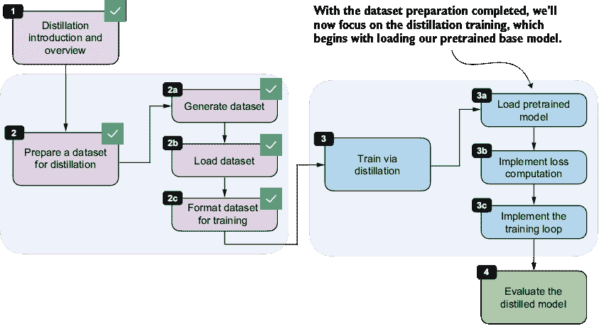

### 图 8.11 数据集准备完成后，我们通过加载预训练的 Qwen3 基础模型开始蒸馏训练。

我们将从预训练的 Qwen3 基础模型开始，而不是使用经过 RL 训练的模型，因为蒸馏本身正是我们这里要研究的训练阶段。这使我们的设置保持干净，也更容易将任何改进归因于蒸馏后的推理轨迹。同时，这也反映了一个常见的实际设置：使用教师生成的数据来适配通用基础模型。

### 清单 8.8 加载用于蒸馏的 Qwen3 基础模型

```python
import torch
from reasoning_from_scratch.ch02 import get_device
from reasoning_from_scratch.ch03 import (
    load_model_and_tokenizer,
)

device = get_device()
model, _ = load_model_and_tokenizer(
    which_model="base",
    device=device,
    use_compile=False,
)
```

我们可以忽略清单 8.8 中加载的基础 tokenizer，因为我们将使用在 8.4.1 节加载的、支持 `thinking response` 词元的 tokenizer。

## 8.6 计算训练损失和验证损失

接下来，我们将实现 *交叉熵损失*，它将在后续实现训练循环时作为蒸馏过程中的训练信号。我们还会在验证集上复用同样的计算，以监控训练过程中的进展。

如果你有深度学习背景，你可能已经从分类任务中了解了交叉熵。这里的思想相同，只不过我们想在每个位置预测的目标类别是教师生成序列中的下一个词元。

我们可以将交叉熵损失直接与第 5 章和第 6 章中的对数概率计算联系起来。正如那里所讨论的，对数概率衡量模型为正确的下一个词元分配了多少概率。对数概率越高，意味着模型对正确词元越有信心；对数概率越低，则相反。沿用前几章中“德国的首都是柏林”这个例子，图 8.12 对此进行了回顾。

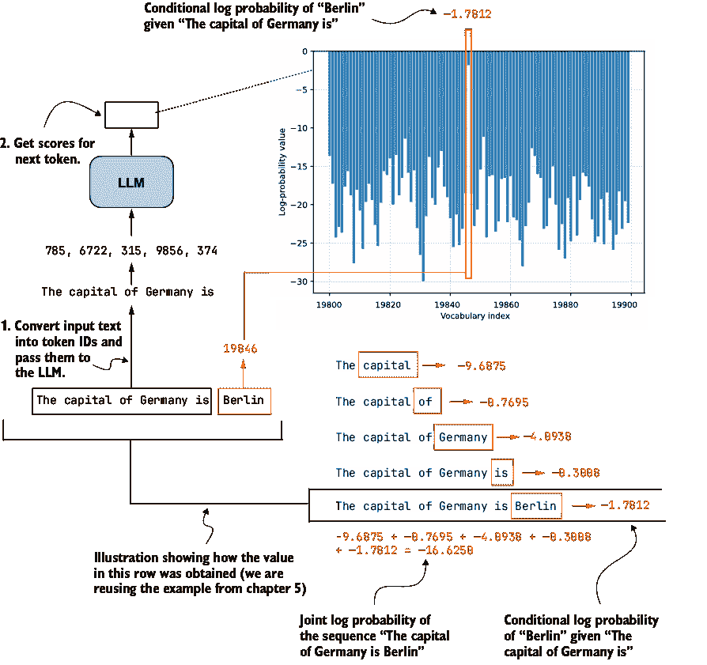

### 图 8.12 词元与序列对数概率示意图。将正确下一个词元的对数概率相加，得到序列对数概率，这是本章后续使用的交叉熵损失的基础。

交叉熵就是图 8.12 中词元对数概率的负平均值。例如，如果 –16.6250 是对数概率，那么负对数概率就是 16.6250，而负平均对数概率（即交叉熵）就是 16.6250/5 = 3.325。注意这里的 5 是因为序列中有 5 个目标预测的对数概率被平均：`"capital"`、`"of"`、`"Germany"`、`"is"` 和 `"Berlin"`。与对数概率类似，交叉熵值越接近 0 越好，因为这意味着模型对正确的目标词元越有信心。

第 6 章中的 `sequence_logprob` 函数执行了图 8.12 所示的计算，这使得它成为理解 *蒸馏损失* 工作原理的一个有用起点。在本例中，我们将使用索引位置为 `5730` 的训练示例，因为它是 `train_examples` 中最短的示例（我们可以通过 `compute_length(train_examples)` 确定），因此计算起来比其他示例稍快一些：

```python
token_ids = train_examples[5730]["token_ids"]
prompt_len = train_examples[5730]["prompt_len"]
```

这里我们不报告 `sequence_logprob` 返回的求和对数概率，而是对它们按答案词元数量取平均。求和的对数概率会随着序列长度增长，因此无法在答案较短或较长的示例之间直接比较。通过除以答案词元数量，我们可以得到每个词元的数值，这与交叉熵损失使用的形式一致。我们可以通过从总序列长度中减去 `prompt_len` 来计算答案词元的数量。

### 清单 8.9 计算平均负对数概率

```python
from reasoning_from_scratch.ch06 import sequence_logprob

tok = torch.tensor(token_ids, dtype=torch.long, device=device)
with torch.no_grad():
    seq_logprob = sequence_logprob(model, tok, prompt_len)
    num_answer_tokens = tok.numel() - prompt_len
    avg_logprob = -seq_logprob / num_answer_tokens
print(f"Average logprob: {avg_logprob:.2f}")
```

得到的负平均对数概率为 1.68。

现在我们可以用 PyTorch 的 `cross_entropy` 函数计算同样的量。虽然该函数通常用于分类，但在这里也是一个自然的选择。例如，模型 logits 提供了词表上的预测类别分布，而目标序列提供了每个位置正确的类别标签。

和之前计算平均对数概率时一样，我们只计算答案 token 上的损失，并忽略提示 token（提示是作为输入提供的上下文，我们不希望模型因复现它而受到惩罚）。如图 8.13 所示。

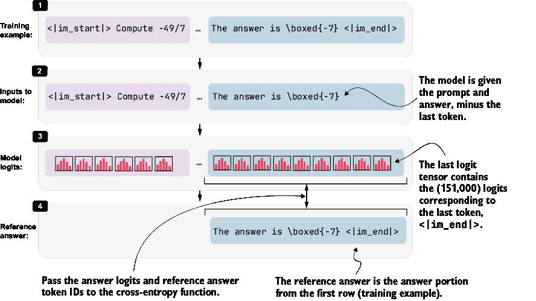

### 图 8.13 答案 token 上交叉熵损失的输入。模型接收向后平移一个 token 的提示和答案作为输入，并将答案 token 的 logits 与参考答案 token 进行比较。

在蒸馏过程中，我们希望学生模型在给定提示的条件下学习教师模型的推理轨迹和最终答案。因此，如图 8.13 所示，在计算交叉熵时，我们丢弃只对应于序列中提示部分的 logits 和目标。

### 清单 8.10 直接计算交叉熵损失

```python
input_ids = tok[:-1].unsqueeze(0)  #1
target_ids = tok[1:]  #1
logits = model(input_ids).squeeze(0)  #1
first_answer_logit_idx = max(prompt_len - 1, 0)  #2
answer_logits = logits[first_answer_logit_idx:]  #2
answer_targets = target_ids[first_answer_logit_idx:]  #2
with torch.no_grad():  #3
    ce_mean_direct = torch.nn.functional.cross_entropy(  #3
        answer_logits, answer_targets  #3
    )  #3
print(f"Cross-entropy: {ce_mean_direct:.2f}")  #3
```

- #1 将序列向后平移一个 token，使每个输入预测下一个 token 的目标。
- #2 丢弃提示位置，使损失只覆盖教师答案。
- #3 计算交叉熵损失。

得到的交叉熵损失为 1.68，与清单 8.9 中使用 `sequence_logprob` 函数的结果相近。换句话说，`cross_entropy` 以更优化的方式实现了相同的核心计算。因此在训练中，我们将使用内置的 `cross_entropy` 函数，而不是自定义的对数概率函数。

清单 8.11 中的 `compute_example_loss` 辅助函数将这一逻辑封装成一个便捷函数，用于计算单个样本的 *仅答案损失*。“仅答案损失”是指训练损失只在教师答案 token 上计算，而不是在提示 token 上计算。下面的清单将所有内容组合成一个函数，应用从目标准备到交叉熵计算的完整逻辑。

### 清单 8.11 定义单个蒸馏示例的损失

```python
def compute_example_loss(model, example, device):
    token_ids = example["token_ids"]
    prompt_len = example["prompt_len"]
    input_ids = torch.tensor(  #1
        token_ids[:-1], dtype=torch.long, device=device  #1
    ).unsqueeze(0)  #1
    target_ids = torch.tensor(  #1
        token_ids[1:], dtype=torch.long, device=device  #1
    )  #1

    logits = model(input_ids).squeeze(0)
    answer_start = max(prompt_len - 1, 0)  #2
    answer_logits = logits[answer_start:]  #2
    answer_targets = target_ids[answer_start:]  #2
    loss = torch.nn.functional.cross_entropy(  #3
        answer_logits, answer_targets  #3
    )  #3
    return loss  #3

with torch.no_grad():  #4
    loss = compute_example_loss(  #4
        model, train_examples[5730], device  #4
    )  #4

print(f"Loss: {loss:.2f}")
```


# 创建向后平移一个 token 的输入-目标对

# 忽略提示 token，使损失只在蒸馏后的答案上计算

# 计算交叉熵损失

# 用于验证辅助函数返回与之前相同的损失

得到的损失再次为 `1.68`，这表明清单 `8.11` 中的函数按预期工作。

## 批处理

可以将多个样本组合成批次并行处理。为了保持实现简洁并降低资源需求，我这里省略了批处理。附录 `E` 更详细地讨论了在损失计算和一般训练中的批处理与面向吞吐量的执行。

接下来，我们将定义一个小的包装器，用于迭代计算多个样本上的平均损失。这对于快速合理性检查和训练期间跟踪验证损失都很有用。

### 清单 8.12 评估多个样本上的损失

```python
@torch.no_grad()
def evaluate_examples(model, examples, device):
    was_training = model.training
    model.eval()  #1
    total_loss = 0.0  #1
    num_examples = 0  #1
    for example in examples:  #2
        loss = compute_example_loss(model, example, device)  #2
        total_loss += loss.item()  #2
        num_examples += 1  #2
    if was_training:  #3
        model.train()  #3
    return total_loss / num_examples  #4

train_loss = evaluate_examples(model, train_examples[:3], device)  #5
print(f"Train loss (3 examples): {train_loss:.2f}")  #5

val_loss = evaluate_examples(model, val_examples[:3], device)
print(f"Validation loss (3 examples): {val_loss:.2f}")
```

- `#1` 在对样本评分时临时切换到评估模式。
- `#2` 对所有样本的损失求和。
- `#3` 恢复训练模式，使该辅助函数在训练期间调用是安全的。
- `#4` 对所有样本的损失取平均。
- `#5` 在一小部分子集上估计当前训练损失。

输出如下：

```
Train loss (3 examples): 0.98
Validation loss (3 examples): 1.02
```

我们将在训练期间复用这个评估函数。理想情况下，这两个数值都应随时间下降，这表明学生模型在匹配教师生成的目标序列方面变得越来越好。

在实践中，*训练损失*是在用于优化的训练样本上计算的损失，通常噪声更大，因为它是在当前正在优化的样本上测量的，并且可能随样本顺序和最近参数更新而波动。

*验证损失*是在单独的保留验证集上测量的，而不是在当前用于优化的样本上测量的，并且计算时不会更新模型权重。因此，它通常能提供更干净的信号，说明学生是否在以超越训练集的方式改进。出于这个原因，验证损失通常是更值得关注的可靠指标。

## 8.7 实现蒸馏的训练循环

数据集准备完毕且损失计算就绪后，我们现在可以实现蒸馏的训练循环了。这一阶段在图 `8.14` 中突出显示。

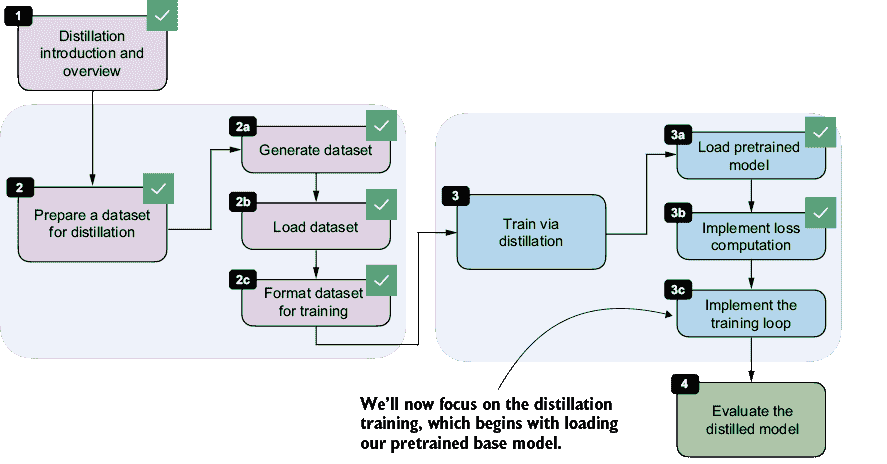

### 图 8.14 数据集准备和损失计算完成后，我们现在可以转向蒸馏的训练循环。

这里使用的训练循环与第 `6` 章中的非常相似。主要区别在于，这里我们会在多个 `epoch` 中多次重新访问同一训练集，并优化交叉熵蒸馏损失，而不是 `RLVR` 中使用的 `GRPO` 目标（`GRPO` 损失）。详细步骤如图 `8.15` 所示。

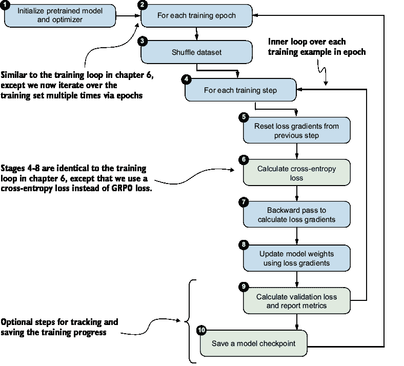

### 图 8.15 蒸馏训练循环。在每个 `epoch` 中，训练样本被打乱，学生模型为每个样本计算交叉熵损失，反向传播梯度，并更新模型权重。验证损失按一定间隔报告以跟踪进度。

下面的 `train_distillation` 函数实现了图 `8.15` 所示的循环。它在每个 `epoch` 开始时打乱训练示例，计算每个示例的损失，执行优化器步骤，可选地裁剪较大的梯度，并定期在验证集上评估。这些指标还会写入 `CSV` 文件，以便我们之后查看学习曲线。

### 清单 8.13 实现蒸馏训练循环

```python
import time

def train_distillation(
    model,
    train_examples,
    val_examples,
    device,
    epochs=2,
    lr=5e-6,
    grad_clip_norm=None,
    seed=123,
    log_every=50,
    checkpoint_dir="checkpoints",
    csv_log_path=None,
):
    optimizer = torch.optim.AdamW(model.parameters(), lr=lr)  #1
    model.train()
    total_steps = epochs * len(train_examples)
    global_step = 0
    rng = random.Random(seed)
    if csv_log_path is None:
        timestamp = time.strftime("%Y%m%d_%H%M%S")
        csv_log_path = f"train_distill_metrics_{timestamp}.csv"
    csv_log_path = Path(csv_log_path)
    for epoch in range(1, epochs + 1):  #2
        epoch_examples = list(train_examples)  #3
        rng.shuffle(epoch_examples)  #3
        for example in epoch_examples:  #4
            global_step += 1
            optimizer.zero_grad()  #5
            loss = compute_example_loss(model, example, device)  #6
            loss.backward()  #7
            if grad_clip_norm is not None:  #8
                torch.nn.utils.clip_grad_norm_(  #8
                    model.parameters(), grad_clip_norm  #8
                )  #8
            optimizer.step()  #9
            if log_every and global_step % log_every == 0:  #10
                val_loss = evaluate_examples(  #10
                    model=model,  #10
                    examples=val_examples,  #10
                    device=device,  #10
                )  #10
                model.train()  #10
                print(
                    f"[Epoch {epoch}/{epochs} "
                    f"Step {global_step}/{total_steps}] "
                    f"train_loss={loss.item():.4f} "
                    f"val_loss={val_loss:.4f}"
                )
                append_csv_metrics(
                    csv_log_path=csv_log_path,
                    epoch_idx=epoch,
                    total_steps=global_step,
                    train_loss=loss.item(),
                    val_loss=val_loss,
                )
        ckpt_path = save_checkpoint(  #11
            model=model,  #11
            checkpoint_dir=checkpoint_dir,  #11
            step=global_step,  #11
            suffix=f"epoch{epoch}",  #11
        )  #11
        print(f"Saved checkpoint to {ckpt_path}")  #11
    return model  #11

# 11
def save_checkpoint(model, checkpoint_dir, step, suffix=""):
    checkpoint_dir = Path(checkpoint_dir)
    checkpoint_dir.mkdir(parents=True, exist_ok=True)
    suffix = f"-{suffix}" if suffix else ""
    ckpt_path = (
        checkpoint_dir /
        f"qwen3-0.6B-distill-step{global_step:05d}{suffix}.pth"
    )
    torch.save(model.state_dict(), ckpt_path)
    return ckpt_path

def append_csv_metrics(
    csv_log_path,
    epoch_idx,
    total_steps,
    train_loss,
    val_loss,
):
    if not csv_log_path.exists():
        csv_log_path.write_text(
            "epoch,total_steps,train_loss,val_loss\n",
            encoding="utf-8",
        )
    with csv_log_path.open("a", encoding="utf-8") as f:
        f.write(
            f"{epoch_idx},{total_steps},{train_loss:.6f},"
            f"{val_loss:.6f}\n"
        )
```

- `#1` 第 1 步：初始化优化器（模型已加载）
- `#2` 第 2 步：遍历训练轮次（`epochs`）
- `#3` 第 3 步：在当前 `epoch` 开始时打乱训练示例
- `#4` 第 4 步：遍历当前 `epoch` 中的训练示例
- `#5` 阶段 5：重置损失梯度
- `#6` 第 6 步：计算当前示例的交叉熵损失
- `#7` 第 7 步：反向传播梯度
- `#8` 可选地裁剪较大的梯度以提高训练稳定性
- `#9` 第 8 步：更新模型权重
- `#10` 第 9 步：定期在验证集上评估当前模型
- `#11` 第 10 步：记录指标并保存该 `epoch` 的检查点

在最大序列长度为 `2,048` 的情况下，完整的训练运行大约需要 `15 GB` 的 GPU 内存。如果这对你的硬件来说太高了，你可以通过在 `notebook` 中提前过滤掉较长的序列来降低资源需求，例如，在清单 `8.6` 的 `filter_examples_by_max_len` 步骤中，将 `max_len` 从 `2048` 改为 `1024` 或 `512`。

让我们运行一次简短的训练。

### 清单 8.14 训练模型

```python
torch.manual_seed(0)  #1
train_distillation(
    model,
    train_examples=train_examples[:10],  #2
    val_examples=val_examples[:10],      #2
    device=device,
    epochs=2,
    lr=5e-6,
    grad_clip_norm=1.0,  #3
    seed=123,
    log_every=5,
    csv_log_path="train_distill_metrics.csv",
)
```

- `#1` 为 `PyTorch` 设置随机种子，使这个简短的演示可复现。
- `#2` 在一个极小子集上训练，使本 `notebook` 运行保持轻量。
- `#3` 与第 `6` 章相同

在查看结果之前，我们先简要讨论一下这些设置。我们有意让这次训练运行保持简短。例如，我们只使用前 `10` 个训练示例和 `10` 个验证示例，并且只训练 `2` 个 `epoch`。这纯粹是为了让 `notebook` 运行保持轻量并足够快速，以便进行实验。对于真正的蒸馏运行，我们当然会在更多示例上进行训练，理想情况下是使用整个训练集。

学习率（`lr=5e-6`）对于微调预训练模型而言处于合理范围，并且在此设置下效果良好，这一点将在稍后讨论的损失曲线中体现。

梯度裁剪设置（`grad_clip_norm=1.0`）与第 `6` 章中的相同，有助于防止当某个示例产生异常大的梯度时出现不稳定的更新。

`log_every=5` 设置意味着每 `5` 个训练步骤测量一次验证损失。由于此演示只使用了少量示例，这样可以频繁输出进度更新，使我们能够快速验证训练循环是否按预期运行。在更大的运行中，我们通常会增大这个间隔，以减少评估开销。

最后，`csv_log_path="train_distill_metrics.csv"` 参数将训练和验证损失存储在 `CSV` 文件中，以便我们之后查看和绘制它们。

这次运行的主要目标不是实现尽可能最佳的推理性能，而是确认蒸馏流程能够端到端地工作。一旦这一点得到确认，我们就可以进行更大规模的运行，并更详细地检查生成的学习曲线和检查点。

现在，让我们简要看一下运行输出：

```
[Epoch 1/2 Step 5/20] train_loss=0.9648 val_loss=0.9082
[Epoch 1/2 Step 10/20] train_loss=0.9844 val_loss=0.8871
Saved checkpoint to checkpoints/qwen3-0.6B-distill-step00010-epoch1.pth
[Epoch 2/2 Step 15/20] train_loss=0.8008 val_loss=0.8707
[Epoch 2/2 Step 20/20] train_loss=0.7148 val_loss=0.8586
Saved checkpoint to checkpoints/qwen3-0.6B-distill-step00020-epoch2.pth
```

尽管这只是一个很小的演示运行，输出已经显示出预期的整体行为。训练损失和验证损失都随时间下降，这表明学生模型在匹配教师生成的目标序列方面变得越来越好。验证损失在这里尤其有用，因为它是在未参与训练的示例上计算的，因此提供了更清晰的信号，表明改进并不仅限于训练样本本身。

我们还可以看到，每个 `epoch` 结束时都会保存检查点。这很有用，因为它允许我们之后恢复训练，或使用 `MATH-500` 测试集评估蒸馏模型的中间版本。

## 8.8 评估蒸馏模型

既然我们已经实现了训练循环，最后阶段就是评估蒸馏后的模型，如图 `8.16` 所示。

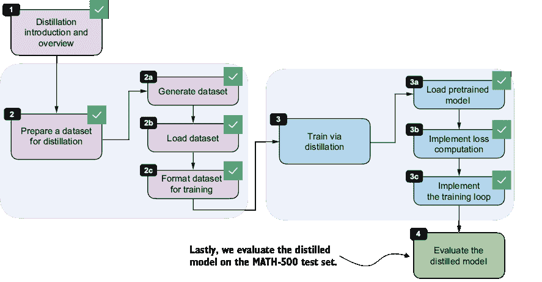

### 图 8.16 现在我们将在 `MATH-500` 测试集上评估蒸馏模型。

为了避免在 `notebook` 中运行完整的蒸馏过程，你可以从本章的补充材料中下载一个便捷脚本。正如上一章关于 `RLVR` 的内容一样，将核心思想保留在 `notebook` 中，而将耗时更长的训练任务移到独立脚本中通常更方便：

```python
from reasoning_from_scratch.ch07 import download_from_github
download_from_github(
    "ch08/04_train_with_distillation/distill.py"
)
```

用上述代码下载脚本后，你可以在代码终端中按如下方式运行（如果你不是 `uv` 用户，请将 `uv run` 替换为 `python`）：

```
uv run distill.py \
--data_path deepseek-r1-math-train.json \
--validation_size 25 \
--epochs 3 \
--lr 1e-5 \
--max_seq_len 2048 \
--use_think_tokens \
--grad_clip 1.0
```


使用这些设置，在 DGX Spark 上完整的训练运行大约需要 3 小时 5 分钟，并使用约 15.02 GB 的 GPU 内存。（与此前的 RLVR 运行相比，这个开销相对较小，因为大部分计算密集的工作已经移入一次性的教师数据生成步骤。）如果你不想自行运行训练，也可以下载生成的指标文件并直接查看：

```
download_from_github(
    "ch08/03_logs/deepseek-r1-2048_distill_metrics.csv"
)
```

下面的代码清单实现了一个工具函数，用于可视化 CSV 文件中存储的训练指标。

### 代码清单 8.15 从 CSV 日志绘制蒸馏损失

```
import csv
import matplotlib.pyplot as plt

def plot_distill_metrics(csv_path="train_distill_metrics.csv"):
    total_steps, train_losses, val_losses, epoch_bounds = [], [], [], {}
    with open(csv_path, newline="", encoding="utf-8") as f:#1
        for row in csv.DictReader(f):
            step = int(row["total_steps"])
            epoch = int(row["epoch"])
            total_steps.append(step)#2
            train_losses.append(float(row["train_loss"]))
            val_losses.append(float(row["val_loss"]))
            epoch_bounds.setdefault(epoch, [step, step])[1] = step

    fig, ax = plt.subplots(figsize=(7, 4))
    ax.plot(total_steps, train_losses, label="train_loss", alpha=0.3)
    ax.plot(total_steps, val_losses, label="val_loss")
    ax.set_xlabel("Total Steps")
    ax.set_ylabel("Loss")
    ax.legend()

    epoch_axis = ax.secondary_xaxis("bottom")#3
    epoch_axis.spines["bottom"].set_position(("outward", 45)) #3
    epochs = sorted(epoch_bounds) #3
    epoch_axis.set_xticks( #3
        [
            (epoch_bounds[epoch][0] + epoch_bounds[epoch][1]) / 2
            for epoch in epochs
        ]
    )
    epoch_axis.set_xticklabels(epochs)
    epoch_axis.set_xlabel("Epoch")

    plt.tight_layout()
    plt.show()

plot_distill_metrics("deepseek-r1-2048_distill_metrics.csv")
```

#1 加载并绘制记录的损失。
#2 加载并绘制记录的损失。
#3 添加第二个 x 轴，使轮次编号显示在步数轴下方。

生成的图如图 8.17 所示。

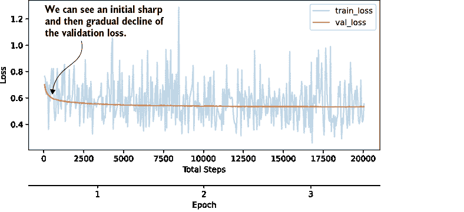

### 图 8.17 在 DeepSeek-R1 推理轨迹上进行的 3 轮蒸馏训练的训练损失与验证损失

图 8.17 中的训练损失曲线和验证损失曲线需要稍微不同的解读方式。训练损失是在当前步骤下针对每个训练样本计算的，而验证损失是在一个较小且固定的留出集上计算的。因此，验证曲线噪声更小，在这里是信息量更大的信号。我们也可以在一个样本子集上计算训练损失，类似于验证损失，但这会减慢训练速度。就估计训练进度而言，训练损失远不如验证损失重要。

正如我们所期望的，验证损失先急剧下降，然后开始趋于平缓，这表明模型正在从蒸馏数据中学习，但再增加训练所带来的收益逐渐减少。我们可以尝试更大的学习率或不同的调度策略来进行更激进的训练，但总体来看，这条曲线是健康的。

正如第 7 章那样，我们可以使用第 3 章中基于验证器的工具来评估保存的检查点。下面的命令从补充材料中下载评估脚本：

```
download_from_github(
    "ch03/02_math500-verifier-scripts/evaluate_math500.py"
)
```

在代码终端中使用推理分词器对 MATH-500 上的蒸馏检查点进行评估，命令如下：

```
uv run evaluate_math500.py \
--dataset_size 500 \
--which_model reasoning \
--max_new_tokens 4096 \
--checkpoint_path \
"run_11/checkpoints/distill/qwen3-0.6B-distill-step06682-epoch1.pth"
```


对于同一个 DeepSeek-R1 运行中后续的检查点，请将`...step06682-epoch1.pth`替换为`...step13364-epoch2.pth`、`...step20046-epoch3.pth`，依此类推。

本章使用的 DeepSeek-R1 运行的评估结果汇总在表 8.1 中。作为参考，我还加入了另一次运行：它基于 Qwen3 235B-A22B 教师模型的输出进行训练（一个参数量为 2350 亿的 Qwen3 模型）。

### 表 8.1 不同模型检查点在 MATH-500 任务上的准确率

|  | 方法 | 轮次 | 最终验证损失 | MATH-500 准确率 |
| --- | --- | --- | --- | --- |
| 1 | 基础版 Qwen3 0.6B（第 3 章） | - | - | 15.2% |
| 2 | 推理版 Qwen3 0.6B（第 3 章） | - | - | 48.2% |
| 3 | DeepSeek-R1 | 1 | 0.5436 | 30.6% |
| 4 | DeepSeek-R1 | 2 | 0.5349 | 32.4% |
| 5 | DeepSeek-R1 | 3 | 0.5343 | 33.6% |
| 6 | Qwen3 235B-A22B | 1 | 0.4043 | 45.0% |
| 7 | Qwen3 235B-A22B | 2 | 0.3963 | 43.8% |
| 8 | Qwen3 235B-A22B | 3 | 0.3948 | 44.2% |

基于表 8.1 中 DeepSeek-R1 运行的结果，MATH-500 准确率从第 1 轮后的 30.6%提升到第 3 轮后的 33.6%，而验证损失从 0.5436 下降到 0.5343。这与前面图 8.17 中的学习曲线一致：学生模型明显从教师生成的推理轨迹中学习，但在最初的提升之后，收益开始趋于平缓。

在这种设置下，Qwen3 235B-A22B 的运行表现明显更好。一个可能的原因是教师模型和学生模型来自同一模型家族，这意味着分词器、提示约定和整体回复风格更加接近。这会使得教师目标更容易被较小的 Qwen3 学生模型模仿。

考虑到 MATH-500 准确率为 45%（第 6 行），我们的蒸馏方案达到了与推理参考模型（48.2%，第 2 行）几乎相同的性能；推理参考模型本身也是一个蒸馏模型，但它是在一个由 Qwen3 235B-A22B 生成的更大规模数据集上训练的。这就是蒸馏的主要权衡。

一般来说，我们并不期望较小的学生模型能完全匹配教师模型。例如，Qwen3 235B-A22B 的 MATH-500 准确率为 92.4%，DeepSeek-R1 的 MATH-500 准确率为 91.2%。尽管如此，我们仍然可以在一个成本低得多的模型中恢复教师模型中相当一部分推理行为。如果使用更大的模型（例如，使用 40 亿或 300 亿参数的 Qwen3 版本，而不是 Qwen3 0.6B），我们的蒸馏模型准确率还可以更高，但这会增加训练时的计算成本。

让我们退一步，把我们实现的各个部分连接成一个完整的工作流程。图 8.18 总结了完整的蒸馏流水线，从最初的准备工作开始，接着是数据集生成与预处理，然后是蒸馏训练循环本身，最后是在 MATH-500 上对蒸馏模型的评估。

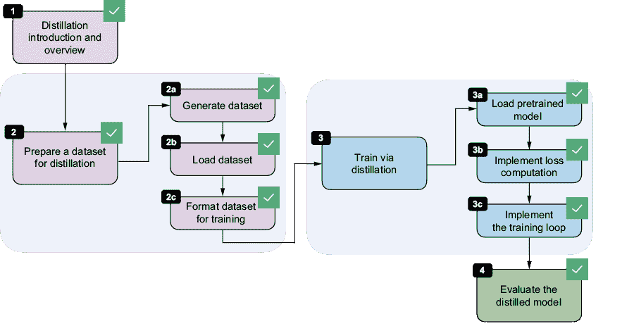

### 图 8.18 蒸馏模型的评估完成了本章的技术内容。

该工作流程完成了从更强的教师模型蒸馏出更小推理模型的核心技术方案。在实践中，每个阶段都有调整空间，例如改变教师数据的生成方式以及修改训练设置。

### 练习 8.2：不使用`进行蒸馏。检查验证损失；如果可能，在 MATH-500 上评估保存的检查点。然后将结果与表 8.1 中的结果进行比较。在此设置中，显式推理标签有多重要？

## 8.9 推理模型的未来方向

在结束本章之前，让我们讨论一下推理模型的下一步发展方向。

在可预见的未来，总体模式保持不变。例如，一般策略是开发更强的推理教师模型，收集高质量的推理轨迹，并将其蒸馏到更小的学生模型中。

一个明显的方向是继续完善由 DeepSeek-R1 论文推广的训练方法，其中包括针对旗舰模型的 RLVR（第 6 章和第 7 章），以及面向计算效率的较小模型的蒸馏。

第二个方向是推理时的优化。在实践中，推理模型不应总是生成同等长度的答案。有些任务适合简短直接的回应，而另一些任务则适合更详细、多步骤的推理。这为应用层更自动化和灵活的推理扩展创造了空间，由外围系统决定何时要求简短答案、何时分配更多推理预算、以及何时提前停止。例如，OpenAI 在 2025 年推出 GPT-5 时实现了这样一个系统，增加了“自动”模式来控制推理努力和推理轨迹生成长度。

第三个改进方向是 RLVR 的奖励生成。目前许多工作仍然严重依赖基于最终答案的奖励，尤其是在数学和代码领域。但*过程奖励*会检查中间推理步骤，而不仅仅是最终结果，这可能提供更丰富的训练信号，帮助模型学习更可靠的推理策略。例如，DeepSeek-Math-V2 论文（[`arxiv.org/abs/2511.22570`](https://arxiv.org/abs/2511.22570)）最近表明，在训练过程中评判整个答案可以有效提升推理性能。

第四个方向是推理模型在更大的智能体应用中作为引擎的作用日益增强，例如 OpenAI Codex、Claude Code 和 OpenClaw。在这些场景中，模型不仅要解决简单的数学或编码问题，还要进行规划、调用工具、从失败中恢复，并协调更长的工作流。这自然将奖励设计推向了超越数学和代码正确性的范畴。我们可能需要为成功使用工具、信息检索、策略合规等设置奖励。这进而带来*多奖励训练*，即同时优化多个目标，而不是依赖单一的正确性分数。

在此背景下，蒸馏可能仍然很重要，因为它提供了一种实用的方式，将更丰富的行为从更大、更昂贵的教师系统转移到更小、更易部署、可在本地运行且对用户更经济高效的模型中。

## 8.10 结论

至此，本书的主要技术内容已全部介绍完毕。接下来，我们将简要介绍一些后续尝试方向、如何跟上这一快速发展领域，以及在哪里可以找到更多资料。

### 8.10.1 下一步做什么

一个实用的下一步是开始结合本书中的方法，而不是将它们视为孤立的技术。例如，你可以从强大的教师模型蒸馏出一个小模型，使用 RLVR 继续训练，然后在部署时应用推理时扩展方法，如自一致性或自我精炼。运行这类比较通常是培养直觉的最快方式，以判断在特定设置中哪种方法最有帮助。

附录也是一个不错的继续学习之处。它们涵盖其他主题，如 LLM 架构细节、用于更高吞吐量的批处理执行，以及替代性评估方法。

最后，补充代码仓库（[`github.com/rasbt/reasoning-from-scratch`](https://github.com/rasbt/reasoning-from-scratch)）包含额外材料和独立脚本，它们比 notebook 更适合长时间运行和更大规模的实验。

### 8.10.2 在快速发展的领域保持更新

我希望本书能让你更清楚地了解现代推理模型在实践中是如何工作的。

推理模型的研究发展迅速，具体的算法、数据集和最佳实践会不断变化，但本书中的核心思想仍将保持相关性和实用性。这些核心思想包括仔细评估模型、区分推理时方法和训练时方法，以及理解训练损失和奖励信号是如何计算的。

当新方法出现时，将它们映射回这些基础概念会很有帮助。许多新技术最好被理解为我们在此实现的构建模块的变体或组合，即使周围的训练流程变得更加复杂。

在实践中，我推荐几种资源。首先，你可以浏览 arXiv 上的最新机器学习和 AI 论文（[`arxiv.org/list/cs.LG/recent`](https://arxiv.org/list/cs.LG/recent)），尽早发现新的训练和评估思路。但要注意，新论文的数量现在非常大，全面跟进几乎不可能，因此通常最好将 arXiv 视为扫描主题和有前景论文的途径，而不是试图阅读所有内容。

其次，阅读新发布模型的技术摘要和报告，因为它们通常包含有关提示约定、基准和局限性的最有用细节。这些通常由开发人员直接分享在 Hugging Face 模型中心、公告博客文章和社交媒体上。

第三，关注社交媒体平台 X 和 r/LocalLLaMA 等社区中的从业者讨论（[`www.reddit.com/r/LocalLLaMA/`](https://www.reddit.com/r/LocalLLaMA/)），因为实现细节、复现案例和失败案例往往在进入正式论文之前就已经出现在这些地方。

AI 助手或“深度研究”工具也可用于监控这些来源并总结新进展，但它们最适合作为过滤器，而非替代阅读原始论文和模型卡。

我还定期在我的博客（[`magazine.sebastianraschka.com`](https://magazine.sebastianraschka.com)）上撰写关于 AI 和 LLM 主题的文章。

## 小结

* 蒸馏是在较大的教师 LLM 生成的输出上训练较小的学生 LLM。

* 硬蒸馏通常比软蒸馏更实用，因为教师 logits 往往不可用，且教师文本输出存储和复用的成本要低得多。

* 我们使用 DeepSeek-R1 作为教师模型，Qwen3 0.6B 作为学生模型。

* 蒸馏数据集由 12,000 个与 MATH-500 不重叠的 MATH 训练问题构建而成。

* 每个训练样本将渲染后的提示词与教师推理轨迹和最终答案相结合，可选地通过`thinking... response`标签进行分隔。

* 为了提高效率，我们对数据集进行一次分词，按序列长度进行过滤，并在多个训练周期中复用处理后的样本。

* 训练目标是仅答案的交叉熵，这等价于正确下一个标记的负平均对数概率。

* 蒸馏训练循环是一种标准的监督学习循环，包括在每个 epoch 对训练示例进行打乱、计算损失、反向传播、更新模型权重，以及跟踪验证损失。

* 验证损失是训练过程中需要关注的主要信号。此外，定期在基准数据集上评估检查点是有用的，也是推荐的做法。
