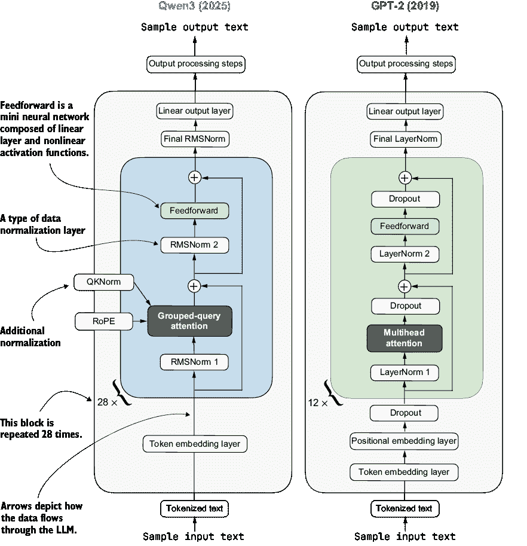
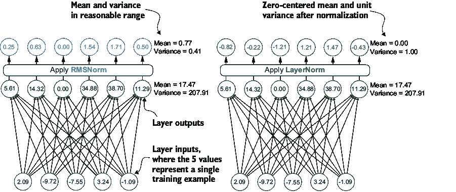
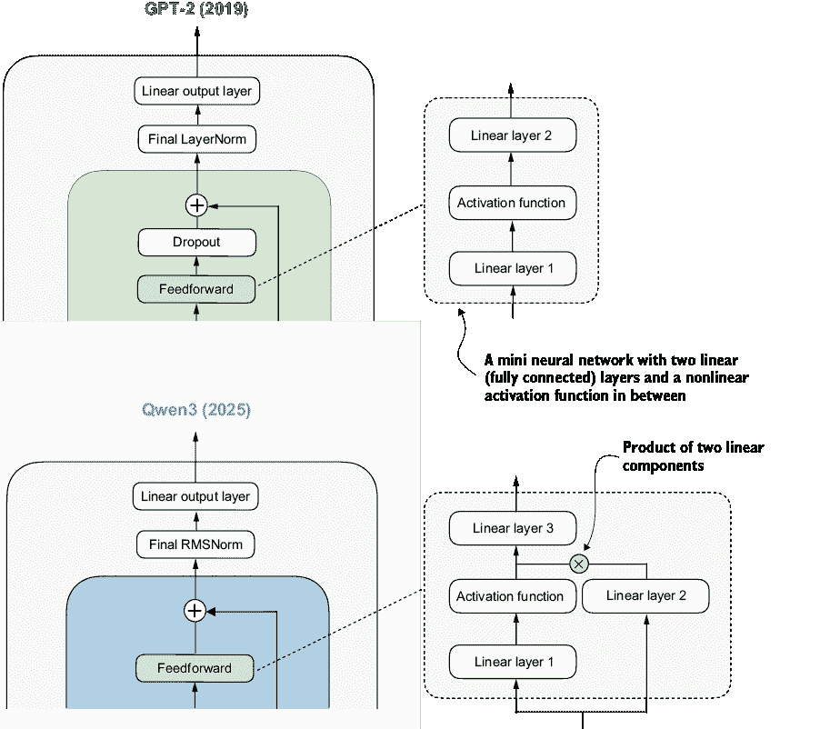
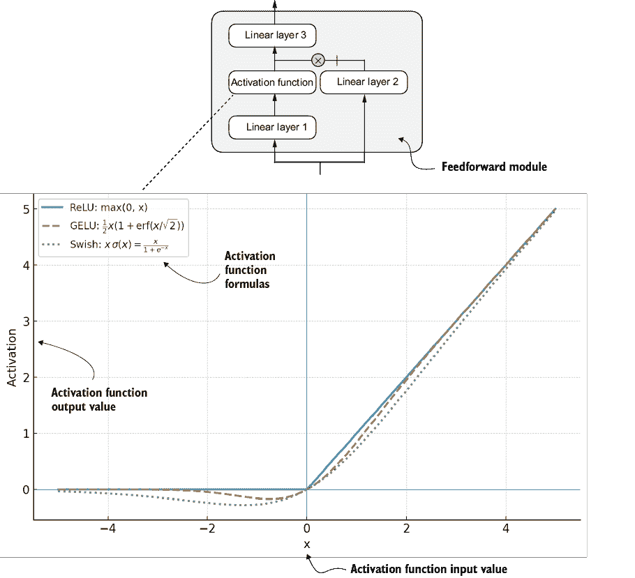
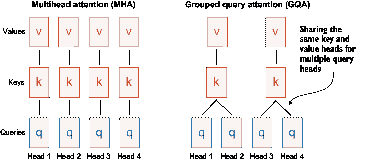
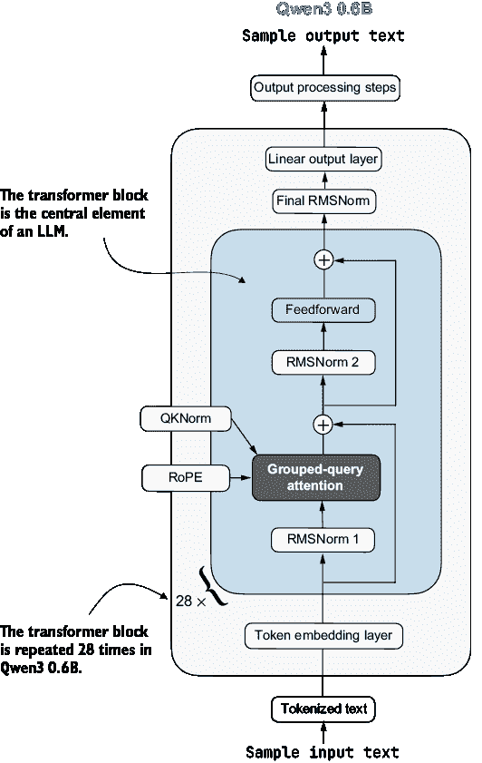
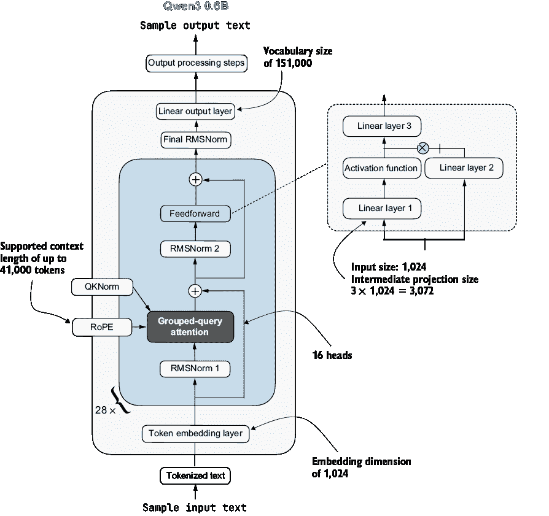

# 附录 C Qwen3 LLM 源代码

虽然这是一本*“从零开始”*的书，但书名中的这一部分指的是推理技术，而不是 LLM 本身。完全从头实现一个 LLM 则需要另一本书，比如我的*《从零开始构建大语言模型》*，该书也可从 Manning 获取（[`mng.bz/orYv`](http://mng.bz/orYv)）。

如果你对本书中使用的 Qwen3 实现感兴趣，本附录列出了我实现的 `Qwen3Model` 模型的源代码，我们从本书的 `reasoning_from_scratch` Python 包中导入该模型：

```
from reasoning_from_scratch.qwen3 import Qwen3Model, Qwen3Tokenizer
```


如图 C.1 所示，`Qwen3` 架构与 `GPT-2` 非常相似，后者在我的《从零开始构建大语言模型》一书中有详细讲解。虽然本书不要求读者熟悉 `GPT-2`，但本附录为熟悉 `GPT-2` 的读者提供了与 `GPT-2` 的对比。事实上，在编写 `Qwen3` 实现时，我把我另一本书中的 `GPT-2` 模型逐段移植到 `Qwen3` 架构中，使其遵循相似的风格约定，也更易于阅读。



**图 C.1：`Qwen3` 与 `GPT-2` 的架构对比。两种模型都通过嵌入层和堆叠的 Transformer 块处理文本，但在某些设计选择上有所不同。**

如图 C.1 所示，`Qwen3`（2025 年发布）和 `GPT-2`（2019 年发布）大体相似，因为它们都基于原始 Transformer 架构的解码器子模块。但自 2019 年以来，一些设计选择已经发生了变化。请注意，`Qwen3` 中的大多数设计选择并非 `Qwen3` 独有，在其他许多当代 LLM 中也很常见，正如我在“大型 LLM 架构对比”([`magazine.sebastianraschka.com/p/the-big-llm-architecture-comparison`](https://magazine.sebastianraschka.com/p/the-big-llm-architecture-comparison)) 一文中所讨论的那样。

如果你是 LLM 新手，想了解这些架构是如何实现的，我建议从 `GPT-2` 开始。它的设计实现起来更简单，因此在探索更多现代变体之前，它是一个更容易的切入点。

由于本书并不聚焦于架构实现，本附录的其余部分仅对 `Qwen3` 的代码进行简要概述。

## C.1 `RMSNorm`

与使用标准 `LayerNorm` 的 `GPT-2` 不同，较新的 `Qwen3` 架构使用了*均方根层归一化*（`RMSNorm`）。这一趋势在最近的模型架构中变得越来越普遍。

`RMSNorm` 与 `LayerNorm` 的核心功能相同：对层激活进行归一化，以稳定并改进训练。但如图 C.2 所示，它通过移除均值中心化步骤来简化计算。这意味着激活仍然会被归一化，但不会以 0 为中心。



**图 C.2：`LayerNorm`（用于 `GPT-2`）和 `RMSNorm`（用于 `Qwen3`）的对比。`LayerNorm`（右）对激活进行归一化，使其平均值（均值）恰好为零，离散程度（方差）恰好为一。`RMSNorm`（左）则根据激活的均方根进行缩放，不强制均值为零或方差为一，但仍将均值和方差保持在合理范围内，以实现稳定的训练。**

如图 C.2 所示，`LayerNorm` 和 `RMSNorm` 都会将层输出缩放到一个合理的范围。

`LayerNorm` 会减去均值并除以标准差，从而使层输出的均值为零且方差为一（方差为一，标准差为一），这为稳定训练带来了有利的梯度性质。

`RMSNorm` 将输入除以均方根。这样可以将激活缩放到一个可比的数量级，而不强制均值为零或方差为一。在图 C.2 所示的示例中，均值为 0.77，方差为 0.41。

`LayerNorm` 和 `RMSNorm` 都能稳定激活尺度并改善优化，但在大规模 LLM 中，`RMSNorm` 通常更受青睐，因为它的计算成本更低。与 `LayerNorm` 不同，`RMSNorm` 默认不使用偏置（偏移）项，从而减少了可训练参数的数量。此外，`RMSNorm` 将昂贵的均值和方差计算简化为一次均方根运算。这将跨特征归约的次数从两次减少到一次，从而降低了 GPU 上的通信开销，略微提升了训练效率。

下面的清单展示了 `RMSNorm` 在代码中的实现。

**清单 C.1：`RMSNorm`**

```python
import torch.nn as nn

class RMSNorm(nn.Module):

    def __init__(
        self,
        emb_dim,
        eps=1e-6,
        bias=False,
        qwen3_compatible=True,
    ):
        super().__init__()
        self.eps = eps
        self.qwen3_compatible = qwen3_compatible
        self.scale = nn.Parameter(torch.ones(emb_dim))
        self.shift = nn.Parameter(torch.zeros(emb_dim)) if bias else None

    def forward(self, x):
        input_dtype = x.dtype
        if self.qwen3_compatible:
            x = x.to(torch.float32)
        variance = x.pow(2).mean(dim=-1, keepdim=True)
        norm_x = x * torch.rsqrt(variance + self.eps)
        norm_x = norm_x * self.scale
        if self.shift is not None:
            norm_x = norm_x + self.shift
        return norm_x.to(input_dtype)
```

请注意，为简洁起见，本附录不会对每个 LLM 组件进行详细的代码讲解。相反，我们将在 C.6 节将所有组件集成到 `Qwen3Model` 类中，将预训练权重加载到其中，然后在 C.9 节使用该模型生成文本。

## C.2 前馈模块

*前馈模块*（一个小的多层感知器）被 2020 年论文《GLU 变体改进 Transformer》（[`arxiv.org/abs/2002.05202`](https://arxiv.org/abs/2002.05202)）中引入的*门控线性单元*（GLU）变体所取代。在这种设计中，标准的两个全连接层被替换成三个，如图 C.3 所示。



**图 C.3：在 `GPT-2`（上）中，前馈模块由两个全连接（线性）层组成，中间以一个非线性激活函数分隔。在 `Qwen3`（下）中，该模块是门控线性单元（GLU）变体，它增加了第三个线性层（线性层 3），并将该层的输出与线性层 1 的激活输出逐元素相乘。**

如图 C.3 所示的 `Qwen3` 前馈模块，可以通过下一个清单来实现。

**清单 C.2：`Qwen3` 的前馈模块**

```python
class FeedForward(nn.Module):

    def __init__(self, cfg):
        super().__init__()
        self.fc1 = nn.Linear(
            cfg["emb_dim"], cfg["hidden_dim"], dtype=cfg["dtype"],
            bias=False
        )
        self.fc2 = nn.Linear(
            cfg["emb_dim"], cfg["hidden_dim"], dtype=cfg["dtype"],
            bias=False
        )
        self.fc3 = nn.Linear(
            cfg["hidden_dim"], cfg["emb_dim"], dtype=cfg["dtype"],
            bias=False
        )

    def forward(self, x):
        x_fc1 = self.fc1(x)
        x_fc2 = self.fc2(x)
        x = nn.functional.silu(x_fc1) * x_fc2  #1
        return self.fc3(x)
```

\#1 这里的非线性激活函数是 SiLU 函数，稍后将讨论。

乍一看，`Qwen3` 使用的 GLU 前馈变体似乎应该优于 `GPT-2` 中的标准前馈变体，因为它增加了一个额外的线性层（三个而不是两个），因此似乎拥有更多参数。

但这种直觉是有误导性的。GLU 变体中的 `fc1` 和 `fc2` 层的宽度各为标准前馈模块中 `fc1` 层宽度的一半，因此 GLU 变体反而拥有更少的参数。

为了用具体示例说明这一点，假设图 C.3 中线性层 1 的输入维度为 1,024。这对应于清单 C.2 中的 `cfg["emb_dim"]`。`fc1` 的输出维度为 3,072（`cfg["hidden_dim"]`）。这些是 `Qwen3` 0.6B 变体中使用的实际数值。在这种情况下，清单 C.2 中 GLU 变体的参数数量如下：

- `fc1`: 1024 × 3,072 = 3,145,728
- `fc2`: 1024 × 3,072 = 3,145,728
- `fc3`: 1024 × 3,072 = 3,145,728
- 总计：3 × 3,145,728 = 9,437,184 个参数

如果我们假设这个 GLU 变体中的 `fc1` 宽度仅为标准前馈模块中 `fc1` 通常选择宽度的一半，那么标准前馈模块的参数数量将如下所示：

- `fc1`: 1024 × 2 × 3,072 = 6,291,456
- `fc2`: 1024 × 2 × 3,072 = 6,291,456
- 总计：2 × 6,291,456 = 12,582,912 个参数

虽然 GLU 变体通常比常规前馈模块参数更少，但它们的表现更好。这种改进来自门控机制引入的额外乘法交互，`activation(x_fc1) * x_fc2`，它增强了模型的表达能力。这与在适当训练下，更深、更窄的网络可以优于更浅、更宽的网络类似。

在进入下一节之前，还有一件事需要说明。请注意，图 C.3 所示的前馈模块包含一个标记为“激活函数”的元素，但我们在清单 C.2 中使用了 `nn.functional.silu` 激活作为具体示例。

从历史上看，激活函数一直是一个争论激烈的话题，直到十多年前深度学习社区基本统一采用*修正线性单元*（ReLU）。ReLU 简单且计算成本低，但在零点处有一个尖锐的折点。这促使研究人员探索更平滑的函数，例如*高斯误差线性单元*（GELU）和*Sigmoid 线性单元*（SiLU），如图 C.4 所示。



**图 C.4** 可在前馈模块（神经网络）中使用的不同激活函数。GELU 和 SiLU（Swish）为 ReLU 提供了平滑的替代方案，ReLU 在输入为零时有一个尖锐的折点。

GELU 涉及高斯累积分布函数（CDF）。计算该 CDF 较慢，因为它使用了分段逻辑和指数运算，这使得很难编写融合且优化的 GPU 内核；不过，`tanh` 近似可以使用成本更低的操作，运行速度更快，结果几乎相同。简而言之，虽然 GELU 能产生平滑的激活曲线，但总体而言，它的计算成本比更简单的函数更高。

较新的模型大多已用 SiLU（也称为 *Swish*）函数取代 GELU。SiLU 能将较大的负输入平滑地抑制到接近 ~0，并且对较大的正输入近似线性，如图 C.4 所示。

SiLU 具有相似的平滑性，但计算成本略低于 GELU，并且能提供相当的建模性能。在实践中，SiLU 现在被大多数架构所使用，而 GELU 仅在一些模型中继续使用，例如 Google 的 Gemma 开放权重 LLM。在清单 C.2 的前馈模块实现中，SiLU 函数通过 `nn.functional.silu` 调用。清单 C.2 中的前馈模块也常被称为 *SwiGLU*，该缩写源自 Swish 和 GLU 两个术语。

## C.3 旋转位置嵌入

在基于 Transformer 的大型语言模型中，由于注意力机制的存在，位置编码是必要的。默认情况下，注意力机制将输入词元视为没有顺序。在最初的 GPT 架构中，绝对位置嵌入通过为序列中的每个位置添加一个可学习的嵌入向量，并将其加到词元嵌入上，从而解决了这个问题。

*RoPE*（*旋转位置嵌入*的缩写）采用了一种不同的方法：它不是将位置信息作为单独的嵌入添加，而是通过一种依赖于每个词元位置的方式，在注意力机制中旋转查询向量和键向量来编码该信息（注意力机制将在下一节讨论）。RoPE 是一个优雅的想法，但它本身也是一个很大的主题。如果你感兴趣，可以在原始 RoPE 论文“RoFormer: Enhanced Transformer with Rotary Position Embedding”中找到更多信息，参见 [`arxiv.org/abs/2104.09864`](https://arxiv.org/abs/2104.09864)。（RoPE 于 2021 年首次提出，并在 2023 年随着原始 Llama 模型的发布而被广泛采用。此后，它已成为现代大型语言模型的主流配置，因此并非 `Qwen3` 所独有。）

RoPE 可以通过两种数学上等价的方式实现：交错形式将相邻维度配对进行旋转；两半形式则为了便于处理将维度拆分为余弦和正弦两半。下面的清单实现的是两半变体，这种变体可能更容易阅读。

**清单 C.3** RoPE 函数

```python
import torch

def compute_rope_params(head_dim, theta_base=10_000, context_length=4096,
                        dtype=torch.float32):
    assert head_dim % 2 == 0, "Embedding dimension must be even"
    inv_freq = 1.0 / (theta_base ** (
        torch.arange(0, head_dim, 2, dtype=dtype)[: (head_dim // 2)].float()
        / head_dim
    ))
    positions = torch.arange(context_length, dtype=dtype)
    angles = positions[:, None] * inv_freq[None, :]
    angles = torch.cat([angles, angles], dim=1)
    cos = torch.cos(angles)
    sin = torch.sin(angles)
    return cos, sin

def apply_rope(x, cos, sin, offset=0):
    batch_size, num_heads, seq_len, head_dim = x.shape    #1
    assert head_dim % 2 == 0, "Head dimension must be even"
    x1 = x[..., : head_dim // 2]  # First half    #2
    x2 = x[..., head_dim // 2:]  # Second half     #2
    cos = cos[offset:offset + seq_len, :].unsqueeze(0).unsqueeze(0)
    sin = sin[offset:offset + seq_len, :].unsqueeze(0).unsqueeze(0)
    # Shape after:  (1, 1, seq_len, head_dim)
    rotated = torch.cat((-x2, x1), dim=-1)
    x_rotated = (x * cos) + (rotated * sin)
    return x_rotated.to(dtype=x.dtype)    #3
```

1. 形状为 `(batch_size, num_heads, seq_len, head_dim)`。
2. 将 `x` 拆分为前半部分和后半部分。
3. 应用 `cos` 和 `sin` 旋转后，可以使用较低精度。

清单 C.3 中的 RoPE 代码将用于 C.4 节讨论的分组查询注意力机制。

### RoPE 实现变体

如果你熟悉原始 RoPE 论文（[`arxiv.org/abs/2104.09864`](https://arxiv.org/abs/2104.09864)），你可能会对我选择的特定实现感到疑惑。实现 RoPE 有两种常见风格，它们在数学上是等价的。这些实现的主要区别在于旋转矩阵配对维度的方式。我选择了拆分两半的风格，因为它更容易阅读和实现。

```
1) Split-halves style (this book, Hugging Face Transformers):

      [ x0   x1   x2   x3   x4   x5   x6   x7 ]

        │    │    │    │    │    │    │    │

        ▼    ▼    ▼    ▼    ▼    ▼    ▼    ▼

       cos  cos  cos  cos  sin  sin  sin  sin
```

这是旋转矩阵：

```
      [ cosθ   -sinθ    0      0   ... ]

      [ sinθ    cosθ    0      0   ... ]

      [  0       0    cosθ   -sinθ ... ]

      [  0       0    sinθ    cosθ ... ]
```

这里，嵌入维度被分成两半，每一半按块进行旋转。

原始论文（以及官方 Llama 代码仓库）中的交错（偶/奇）RoPE 风格如下所示：


## 旋转矩阵与交错排列

```
      [ x0   x1   x2   x3   x4   x5   x6   x7 ]

        │    │    │    │    │    │    │    │

        ▼    ▼    ▼    ▼    ▼    ▼    ▼    ▼

       cos  sin  cos  sin  cos  sin  cos  sin
```

这是旋转矩阵：

```
      [ cosθ  -sinθ    0      0   ... ]

      [ sinθ   cosθ    0      0   ... ]

      [  0      0    cosθ   -sinθ ... ]

      [  0      0    sinθ    cosθ ... ]
```

此处，嵌入维度按偶/奇余弦/正弦对交错排列。

两种布局编码相同的相对位置。唯一的区别在于维度的配对方式。

## C.4 分组查询注意力

*分组查询注意力*（*GQA*）已成为原始多头注意力（MHA）机制的标准替代方案，在计算和参数方面效率更高。与每个头都有自己的键和值集合的 MHA 不同，GQA 通过将多个头分组共享相同的键和值投影来减少内存使用，如图 C.5 所示。



**图 C.5** MHA 与 GQA 的对比。此处，组大小为 2，也就是说一个键-值对由 2 个查询共享。

GQA 的核心思想是让多个查询头共享键和值头，从而减少键和值头的数量。这既降低了模型的参数量，也减少了推理期间键和值张量的内存带宽占用，因为需要从 KV 缓存中存储和取回的键和值更少（详见第 C.7 节）。

虽然 GQA 主要是一种针对 MHA 的计算效率变通方案，但原始 GQA 论文《[GQA：从多头检查点训练广义多查询 Transformer 模型](https://arxiv.org/abs/2305.13245)》中给出的消融研究表明，它在 LLM 建模性能上与标准 MHA 相当。

接下来的代码清单实现了带有 KV 缓存支持的 GQA 机制。

**代码清单 C.4** 分组查询注意力

```
class GroupedQueryAttention(nn.Module):

    def __init__(self, d_in, num_heads, num_kv_groups, head_dim=None,

                 qk_norm=False, dtype=None):

        super().__init__()

        assert num_heads % num_kv_groups == 0

        self.num_heads = num_heads

        self.num_kv_groups = num_kv_groups

        self.group_size = num_heads // num_kv_groups

        if head_dim is None:

            assert d_in % num_heads == 0

            head_dim = d_in // num_heads

        self.head_dim = head_dim

        self.d_out = num_heads * head_dim

        self.W_query = nn.Linear(

            d_in, self.d_out, bias=False, dtype=dtype

        )

        self.W_key = nn.Linear(

            d_in, num_kv_groups * head_dim, bias=False,dtype=dtype

        )

        self.W_value = nn.Linear(

            d_in, num_kv_groups * head_dim, bias=False, dtype=dtype

        )

        self.out_proj = nn.Linear(self.d_out, d_in, bias=False, dtype=dtype)

        if qk_norm:

            self.q_norm = RMSNorm(head_dim, eps=1e-6)

            self.k_norm = RMSNorm(head_dim, eps=1e-6)

        else:

            self.q_norm = self.k_norm = None

    def forward(self, x, mask, cos, sin, start_pos=0, cache=None):

        b, num_tokens, _ = x.shape

        queries = self.W_query(x)            #1

        keys = self.W_key(x)                 #2

        values = self.W_value(x)              #2

        queries = queries.view(b, num_tokens, self.num_heads,

                               self.head_dim).transpose(1, 2)

        keys_new = keys.view(b, num_tokens, self.num_kv_groups,

                             self.head_dim).transpose(1, 2)

        values_new = values.view(b, num_tokens, self.num_kv_groups,

                                 self.head_dim).transpose(1, 2)

        if self.q_norm:

            queries = self.q_norm(queries)

        if self.k_norm:

            keys_new = self.k_norm(keys_new)

        queries = apply_rope(queries, cos, sin, offset=start_pos)

        keys_new = apply_rope(keys_new, cos, sin, offset=start_pos)

        if cache is not None:

            prev_k, prev_v = cache

            keys = torch.cat([prev_k, keys_new], dim=2)

            values = torch.cat([prev_v, values_new], dim=2)

        else:

            start_pos = 0                    #3

            keys, values = keys_new, values_new            

        next_cache = (keys, values)

        keys = keys.repeat_interleave(       #4

            self.group_size, dim=1            #4

        )                                     #4

        values = values.repeat_interleave(    #4

            self.group_size, dim=1            #4

        )                                     #4

 #4

        attn_scores = queries @ keys.transpose(2, 3)

        attn_scores = attn_scores.masked_fill(mask, -torch.inf)

        attn_weights = torch.softmax(

            attn_scores / self.head_dim**0.5, dim=-1

        )

        context = (attn_weights @ values).transpose(1, 2)

        context = context.reshape(b, num_tokens, self.d_out)

        return self.out_proj(context), next_cache
```

- #1 形状为 `(b, num_tokens, num_heads * head_dim)`。
- #2 形状为 `(b, num_tokens, num_kv_groups * head_dim)`。
- #3 重置 `RoPE`。
- #4 扩展 K 和 V，使其与头的数量匹配。

你可能已经注意到，代码清单 C.4 中的 GQA 机制还包含一个 `qk_norm` 参数，该参数并非标准 GQA 设计的一部分。当 `qk_norm=True` 时，模型在计算注意力分数之前会分别对查询和键向量应用 `RMSNorm`。这种变体通常被称为 `QKNorm`，因为它对查询（Q）和键（K）表示进行归一化。换句话说，`QKNorm` 使用第 C.1 节中介绍的相同 `RMSNorm` 操作，但将其应用于注意力机制内部，而不是作为 Transformer 块周围的常规归一化层。在 Qwen3 中，除了常规的 `RMSNorm` 层之外，还使用了这种查询/键归一化，以帮助稳定训练期间的注意力分数。

## C.5 Transformer 块

*Transformer 块*是 LLM 的核心组件，它将本附录目前介绍的所有独立元素组合在一起。如图 C.6 所示，它会被重复多次；在 Qwen3 的 0.6B 参数版本中，它出现了 28 次。



**图 C.6** Qwen3 中 Transformer 块的结构。每个块包含 `RMSNorm`、`RoPE`、带掩码的分组查询注意力和一个前馈模块；在 0.6B 参数模型中，它被重复 28 次。

代码清单 C.5 实现了图 C.6 所示的 Transformer 块。

**代码清单 C.5** Transformer 块

```
class TransformerBlock(nn.Module):

    def __init__(self, cfg):

        super().__init__()

        self.att = GroupedQueryAttention(

            d_in=cfg["emb_dim"],

            num_heads=cfg["n_heads"],

            head_dim=cfg["head_dim"],

            num_kv_groups=cfg["n_kv_groups"],

            qk_norm=cfg["qk_norm"],

            dtype=cfg["dtype"]

        )

        self.ff = FeedForward(cfg)

        self.norm1 = RMSNorm(cfg["emb_dim"], eps=1e-6)

        self.norm2 = RMSNorm(cfg["emb_dim"], eps=1e-6)

    def forward(self, x, mask, cos, sin, start_pos=0, cache=None):

        shortcut = x

        x = self.norm1(x)

        x, next_cache = self.att(

            x, mask, cos, sin, start_pos=start_pos,cache=cache

        )  #1

        x = x + shortcut

        shortcut = x

        x = self.norm2(x)

        x = self.ff(x)

        x = x + shortcut

        return x, next_cache
```

- #1 形状为 `(batch_size, num_tokens, emb_size)`。

正如你在代码清单中所见，Transformer 块只是将我们在前面各节中实现的各种元素连接起来。

## C.6 主模型代码

在本节中，我们将定义第 2 章中导入并使用过的 `Qwen3Model` 类。

为了实现 `Qwen3Model` 类，下面的代码清单遵循图 C.6 所示的架构，并以 Transformer 块作为 LLM 的核心。

**代码清单 C.6** 主 `Qwen3Model` 代码

## C.6 `Qwen3Model` 类

```
class Qwen3Model(nn.Module):

    def __init__(self, cfg):

        super().__init__()

        # Main model parameters

        self.tok_emb = nn.Embedding(cfg["vocab_size"], cfg["emb_dim"],

                                    dtype=cfg["dtype"])

        self.trf_blocks = nn.ModuleList(

            [TransformerBlock(cfg) for _ in range(cfg["n_layers"])]

        )

        self.final_norm = RMSNorm(cfg["emb_dim"])

        self.out_head = nn.Linear(

            cfg["emb_dim"], cfg["vocab_size"],

            bias=False, dtype=cfg["dtype"]

        )

        # Reusable utilities

        if cfg["head_dim"] is None:

            head_dim = cfg["emb_dim"] // cfg["n_heads"]

        else:

            head_dim = cfg["head_dim"]

        cos, sin = compute_rope_params(

            head_dim=head_dim,

            theta_base=cfg["rope_base"],

            context_length=cfg["context_length"]

        )

        self.register_buffer("cos", cos, persistent=False)

        self.register_buffer("sin", sin, persistent=False)

        self.cfg = cfg

        self.current_pos = 0  # Track current position in KV cache

    def forward(self, in_idx, cache=None):

        tok_embeds = self.tok_emb(in_idx)

        x = tok_embeds

        num_tokens = x.shape[1]

        if cache is not None:

            pos_start = self.current_pos

            pos_end = pos_start + num_tokens

            self.current_pos = pos_end

            mask = torch.triu(

                torch.ones(

                    pos_end, pos_end, device=x.device, dtype=torch.bool

                ),

                diagonal=1

            )[pos_start:pos_end, :pos_end]

        else:

            pos_start = 0  # Not strictly necessary but helps torch.compile

            mask = torch.triu(

                torch.ones(num_tokens, num_tokens, device=x.device,

                           dtype=torch.bool),

                diagonal=1
```


进入`/path/to/xxx`目录，找到`xxx.json`。

在表达式`cvar = avar + bvar`中，加法运算符（`+`）将`avar`与`bvar`相加，得到它们的和`cvar`。

在`List.of(arg0, arg1, arg2)`中，`List`接口的工厂方法`of()`接受一系列的元素，返回包含它们的只读列表。

之后我们这样调用`cmd`命令：`cmd arg0 arg1 arg2`。

```
if (condVar > someVal) {console.log("xxx")}
```

---

```
mask = mask[None, None, :, :]                 #1

for i, block in enumerate(self.trf_blocks):
    blk_cache = cache.get(i) if cache else None
    x, new_blk_cache = block(x, mask, self.cos, self.sin,
                             start_pos=pos_start,
                             cache=blk_cache)
    if cache is not None:
        cache.update(i, new_blk_cache)

x = self.final_norm(x)
logits = self.out_head(x.to(self.cfg["dtype"]))
return logits

def reset_kv_cache(self):
    self.current_pos = 0
```

`#1` 预填充：形状`(1, 1, T, T)`用于在批次和注意力头之间广播。缓存时：形状`(1, 1, T, K+T)`，其中`T` = 新词元，`K` = 已缓存的键。

我们已经具备了所有主要组成部分，因此清单 C.6 中的`Qwen3Model`类只是在 transformer 块周围额外添加了一些组件，即嵌入层和输出层，外加一层`RMSNorm`。由于引入了 KV 缓存选项，代码看起来可能仍然有些复杂。

如第 2 章所讨论的，KV 缓存可以加速文本生成过程，但它超出了本书的讨论范围。如果你感兴趣，可以在我的文章《从零开始理解并实现 LLM 中的 KV 缓存》中了解更多关于 KV 缓存的内容，文章链接为 [`magazine.sebastianraschka.com/p/coding-the-kv-cache-in-llms`](https://magazine.sebastianraschka.com/p/coding-the-kv-cache-in-llms)。

请注意，清单 C.6 中实现的`Qwen3Model`类支持多种模型规模（如附录 D 所讨论）。在第 2 章中，我们使用了 0.6B 参数模型，因为它是 Qwen3 模型家族中资源消耗最小的模型。该模型的配置如图 C.7 所示。



### 图 C.7 Qwen3 0.6B 模型的架构

该模型由一个词元嵌入层和随后的 28 个 transformer 块组成，每个块包含`RMSNorm`、`RoPE`、`QKNorm`、带 16 个注意力头的掩码分组查询注意力，以及一个中间维度为 3,072 的前馈模块。

要通过`Qwen3Model`类使用图 C.7 所示的 0.6B 模型，我们可以定义以下配置，并在实例化新的`Qwen3Model`时将其作为输入（`cfg=QWEN_CONFIG_06_B`）传入。

### 清单 C.7 Qwen3 0.6B 配置

```
QWEN_CONFIG_06_B = {
    "vocab_size": 151_936,     # Vocabulary size
    "context_length": 40_960,  # Length originally used during training
    "emb_dim": 1024,           # Embedding dimension
    "n_heads": 16,             # Number of attention heads
    "n_layers": 28,            # Number of layers
    "hidden_dim": 3072,        # Size of intermediate dim in FeedForward
    "head_dim": 128,           # Size of the heads in GQA
    "qk_norm": True,           # Whether to normalize queries & keys in GQA
    "n_kv_groups": 8,          # Key-Value groups for GQA
    "rope_base": 1_000_000.0,  # The base in RoPE's "theta"
    "dtype": torch.bfloat16,   # Lower-precision dtype to reduce memory
}
```

我们将在 C.9 节中使用清单 C.7 中的`QWEN_CONFIG_06_B`配置来实例化 Qwen3 0.6B 模型。

### 更精确的上下文长度信息

对于 Qwen3 0.6B，默认支持的最大上下文长度为 40,960 个词元。但该模型本身只使用了 32,768 个词元进行训练。40,960 个词元的分配方案中，保留了 32,768 个词元用于模型输出（生成的文本），并保留了 8,192 个词元用于典型的提示（用户的问题或指令）。为了便于理解，40,000 个词元大约相当于《哈利·波特》第一本书的一半篇幅。

由于这一长度足以满足大多数推理任务，开发者指出，除非平均上下文长度经常超过 32,000 个词元，否则不建议使用上下文扩展方法（如 Yarn），因为在较短的上下文中启用这些方法可能会轻微降低性能。

## C.7 KV 缓存

与 KV 缓存相关的大部分繁重工作主要在`Qwen3Model`（清单 C.6）和`GroupedQueryAttention`（清单 C.4）的代码中完成。清单 C.8 所示的`KVCache`类在文本生成过程中存储键值对，这就是我们在第 2 章中启用 KV 缓存时所体验到的加速效果。

### 清单 C.8 KV 缓存

```
class KVCache:
    def __init__(self, n_layers):
        self.cache = [None] * n_layers

    def get(self, layer_idx):
        return self.cache[layer_idx]

    def update(self, layer_idx, value):
        self.cache[layer_idx] = value

    def get_all(self):
        return self.cache

    def reset(self):
        for i in range(len(self.cache)):
            self.cache[i] = None
```

这个`KVCache`类用于我们在第 2 章中实现的`generate_text_basic_stream_cache`函数内部。

## C.8 分词器

*分词器*的代码有些复杂，因为它除了支持基础模型和所谓的 Qwen3 “思考”模型变体（一种推理模型）之外，还支持各种特殊词元。分词器的完整重新实现如下所示。

### 清单 C.9 分词器

```
import re
from tokenizers import Tokenizer

class Qwen3Tokenizer:
    _SPECIALS = [
        "<|endoftext|>",
        "<|im_start|>", "<|im_end|>",
        "<|object_ref_start|>", "<|object_ref_end|>",
        "<|box_start|>", "<|box_end|>",
        "<|quad_start|>", "<|quad_end|>",
        "<|vision_start|>", "<|vision_end|>",
        "<|vision_pad|>", "<|image_pad|>", "<|video_pad|>",
    ]

    _SPLIT_RE = re.compile(r"(<\|[^>]+?\|>)")

    def __init__(self,
                 tokenizer_file_path="tokenizer-base.json",
                 apply_chat_template=False,
                 add_generation_prompt=False,
                 add_thinking=False):
        self.apply_chat_template = apply_chat_template
        self.add_generation_prompt = add_generation_prompt
        self.add_thinking = add_thinking

        tok_path = Path(tokenizer_file_path)
        if not tok_path.is_file():
            raise FileNotFoundError(
                f"Tokenizer file '{tok_path}' not found. "
            )

        self._tok = Tokenizer.from_file(str(tok_path))
        self._special_to_id = {t: self._tok.token_to_id(t) 
                               for t in self._SPECIALS}

        self.pad_token = "<|endoftext|>"
        self.pad_token_id = self._special_to_id.get(self.pad_token)

        f = tok_path.name.lower()                      #1
        if "base" in f and "reasoning" not in f:        #1
            self.eos_token = "<|endoftext|>"            #1
        else:                                           #1
            self.eos_token = "<|im_end|>"               #1
        self.eos_token_id = self._special_to_id.get(self.eos_token)

    def encode(self, prompt, chat_wrapped=None):
        if chat_wrapped is None:
            chat_wrapped = self.apply_chat_template

        stripped = prompt.strip()
        if stripped in self._special_to_id and "\n" not in stripped:
            return [self._special_to_id[stripped]]

        if chat_wrapped:
            prompt = self._wrap_chat(prompt)

        ids = []
        for part in filter(None, self._SPLIT_RE.split(prompt)):
            if part in self._special_to_id:
                ids.append(self._special_to_id[part])
            else:
                ids.extend(self._tok.encode(part).ids)

        return ids

    def decode(self, token_ids):
        return self._tok.decode(token_ids, skip_special_tokens=False)

    def _wrap_chat(self, user_msg):
        s = f"<|im_start|>user\n{user_msg}<|im_end|>\n"
        if self.add_generation_prompt:
            s += "<|im_start|>assistant"
            if self.add_thinking:
                s += "\n"          #2
            else:
                s += "\n\n\n"
        return s
```

`#1` 匹配 HF 行为：对话模型：`<|im_end|>`，基础模型：`<|endoftext|>`。  
`#2` 不插入`<think>`标签，只插入一个换行。

我对`Qwen3Tokenizer`的重新实现（见清单 C.9）可能看起来有些复杂，因为它旨在复刻 Qwen3 团队在 Hugging Face Transformers 库中发布的官方分词器的行为。

乍一看，它似乎有一些特殊之处。例如，当`add_thinking=True`时，不会插入`"\n\n\n"`这样的 token（其中`\n`是换行符），但当`add_thinking=False`时，则会添加这些 token。这是有意为之，因为非基础版 Qwen3 0.6B 模型是一种混合模型，同时支持推理（“thinking”）和标准模式。

## C.9 使用模型

现在，让我们实例化并使用该模型，通过复用第 2 章的文本生成方法来确认代码可以正常工作。

首先，我们使用预训练模型权重实例化模型：

```
from pathlib import Path
import torch
from reasoning_from_scratch.ch02 import get_device
from reasoning_from_scratch.qwen3 import download_qwen3_small

# device = get_device()         #1
device = torch.device("cpu")

download_qwen3_small(kind="base", tokenizer_only=False, out_dir="qwen3")

tokenizer_file_path = Path("qwen3") / "tokenizer-base.json"
model_file = Path("qwen3") / "qwen3-0.6B-base.pth"

tokenizer = Qwen3Tokenizer(tokenizer_file_path=tokenizer_file_path)
model = Qwen3Model(QWEN_CONFIG_06_B)
model.load_state_dict(torch.load(model_file))
model.to(device)
```

`#1` 可选：取消注释以使用自动设备选择器。

以下输出打印出了实例化后的模型架构。它特别表明，模型对象是使用清单 C.7 中指定的相同设置创建的，例如层数、注意力头数、键值头数、嵌入大小和前馈维度：

```
✓ qwen3/qwen3-0.6B-base.pth already up-to-date
✓ qwen3/tokenizer-base.json already up-to-date

Qwen3Model(
  (tok_emb): Embedding(151936, 1024)
  (trf_blocks): ModuleList(
    (0-27): 28 x TransformerBlock(
      (att): GroupedQueryAttention(
        (W_query): Linear(in_features=1024, out_features=2048, bias=False)
        (W_key): Linear(in_features=1024, out_features=1024, bias=False)
        (W_value): Linear(in_features=1024, out_features=1024, bias=False)
        (out_proj): Linear(in_features=2048, out_features=1024, bias=False)
        (q_norm): RMSNorm()
        (k_norm): RMSNorm()
      )
      (ff): FeedForward(
        (fc1): Linear(in_features=1024, out_features=3072, bias=False)
```


`(fc2): Linear(in_features=1024, out_features=3072, bias=False)`

`(fc3): Linear(in_features=3072, out_features=1024, bias=False)`

`)`

`(norm1): RMSNorm()`

`(norm2): RMSNorm()`

`)`

`)`

`)`

`(final_norm): RMSNorm()`

`(out_head): Linear(in_features=1024, out_features=151936, bias=False)`

`)`

接下来，我们复用第 2 章的文本生成函数来生成文本：

```python
import time

from reasoning_from_scratch.ch02 import (
    generate_text_basic_stream_cache,
    generate_stats
)

prompt = "Explain large language models in a single sentence."

input_token_ids_tensor = torch.tensor(
    tokenizer.encode(prompt),
    device=device
).unsqueeze(0)

max_new_tokens = 200

start_time = time.time()

generated_ids = []

for token in generate_text_basic_stream_cache(
    model=model,
    token_ids=input_token_ids_tensor,
    max_new_tokens=max_new_tokens,
    eos_token_id=tokenizer.eos_token_id
):
    token_id = token.squeeze(0).tolist()
    print(
        tokenizer.decode(token_id),
        end="",
        flush=True
    )
    next_token_id = token.squeeze(0)
    generated_ids.append(next_token_id)  # Collect generated tokens

end_time = time.time()

output_token_ids_tensor = torch.cat(generated_ids, dim=0)

generate_stats(output_token_ids_tensor, tokenizer, start_time, end_time)
```

由于前面的代码使用了与第 2 章相同的提示词，生成的文本与第 2 章的文本完全一致：

```text
Time: 1.46 sec
28 tokens/sec
 Large language models are artificial intelligence systems that can
understand, generate, and process human language, enabling them to
perform a wide range of tasks, from answering questions to writing
articles, and even creating creative content.
```

虽然我们在各章讨论中使用 Qwen3 的 0.6B 参数版本以降低本书的资源需求，但你可以在附录 D 中找到关于使用更大模型的更多信息。
