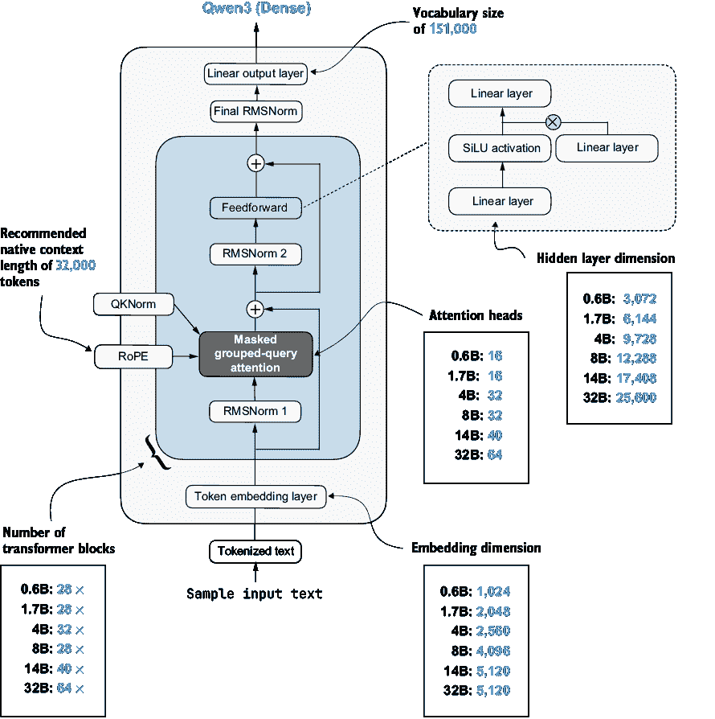

# 附录 D 使用更大的大语言模型

本书使用 6 亿参数（0.6B）的 Qwen3 基础模型，因为它是 Qwen3 系列中最小的模型，因此最容易在消费级硬件上运行。但附录 C 中的同一个`Qwen3Model`实现并不仅限于 0.6B 检查点。我们也可以使用从零构建的同一套 PyTorch 代码来加载更大的 Qwen3 检查点。

在实践中，这意味着一旦我们掌握了如何使用 0.6B 模型，迁移到更大的模型主要涉及三个改动：

- 选择匹配的配置字典
- 从 Hugging Face 下载更大的检查点
- 为基础版或推理版加载相应的分词器

本附录以 Qwen3 4B 模型为例来演示这一过程，因为它在性能上明显强于 0.6B 模型，同时又比更大的 8B、14B 和 32B 变体更易于处理。

## D.1 更大的密集 Qwen3 配置

本书的代码仓库在`reasoning_from_scratch.appendix_c`Python 库中提供了几个较大 Qwen3 模型的配置字典，如表 D.1 所示。你也可以直接查看源代码：[`github.com/rasbt/reasoning-from-scratch/blob/main/reasoning_from_scratch/appendix_c.py`](https://github.com/rasbt/reasoning-from-scratch/blob/main/reasoning_from_scratch/appendix_c.py)。

### 表 D.1 Qwen3 配置（大于 0.6B）

| 模型大小 | 配置 Python 字典 |
| --- | --- |
| 1.7B | `QWEN3_CONFIG_1_7B` |
| 4B | `QWEN3_CONFIG_4B` |
| 8B | `QWEN3_CONFIG_8B` |
| 14B | `QWEN3_CONFIG_14B` |
| 32B | `QWEN3_CONFIG_32B` |

表 D.1 中列出的模型是密集 Qwen3 变体，与本书使用并在附录 C 中讨论的 Qwen3 0.6B 模型类似。这里的“密集”指的是它们不是 Qwen3 的稀疏混合专家（MoE）变体。本书的代码不支持 MoE 模型，但你可以在这里找到从零实现的版本：[`github.com/rasbt/LLMs-from-scratch/tree/main/ch05/11_qwen3`](https://github.com/rasbt/LLMs-from-scratch/tree/main/ch05/11_qwen3)。

图 D.1 以更直观的方式总结了表 D.1 中模型之间的差异。可以看到，不同的 Qwen3 尺寸变体都使用与附录 C 中 0.6B 模型相同的整体架构模式。它们仍然使用词元嵌入、分组查询注意力、旋转位置嵌入、前馈层和 RMS 归一化。差异在于模型维度，例如嵌入大小、层数、注意力头数以及前馈隐藏维度。



### 图 D.1 不同 Qwen3 变体的对比（参数从 6 亿到 320 亿）

表 D.2 列出了将模型加载到 RAM（以及 GPU 显存）所需的内存估算。作为粗略的下限，以 bfloat16 精度（LLM 常见的默认精度）存储权重大约每个参数需要 2 字节。

### 表 D.2 Qwen3 模型大小

| 模型大小 | bfloat16 权重的大致内存 |
| --- | --- |
| 1.7B | 约 3.4 GB |
| 4B | 约 8 GB |
| 8B | 约 16 GB |
| 14B | 约 28 GB |
| 32B | 约 64 GB |

表 D.2 中的数字只是权重本身的近似下限。实际运行时的内存使用会更高，因为我们还需要为激活值、临时缓冲区、KV 缓存等分配内存。此外，模型加载会暂时增加内存使用，因为张量在被复制到`Qwen3Model`实例时可能同时存在于多个位置。更多细节参见我的 *从零构建大语言模型* 一书的补充材料：[`github.com/rasbt/LLMs-from-scratch/tree/main/ch05/08_memory_efficient_weight_loading`](https://github.com/rasbt/LLMs-from-scratch/tree/main/ch05/08_memory_efficient_weight_loading)。

## D.2 下载更大检查点概述

与本书中使用的 0.6B 检查点不同（我将其转换为 PyTorch 检查点以尽量减少外部代码依赖），较大的官方 Qwen3 模型通常以`safetensors`文件形式分发，有时会拆分成多个分片。

`reasoning-from-scratch`Python 库提供了一个辅助函数`download_from_huggingface_from_snapshots`来处理这个问题。这个函数（我们将在下一节中使用）会将 Hugging Face 快照下载到本地目录，然后加载单个`model.safetensors`文件，或通过`model.safetensors.index.json`文件引用的多个分片。

由于这个辅助函数依赖早期章节中未涉及的额外包，你可能需要先安装它们：

```bash
uv add huggingface_hub safetensors
```

或

```bash
pip install huggingface_hub safetensors
```

安装好这些包之后，加载更大的检查点与之前遵循相同的大致流程。你需要下载文件、实例化模型、加载权重、准备分词器，然后运行文本生成，具体将在下一节中看到。

## D.3 加载更大的基础模型

现在我们使用官方的 Qwen3 4B 基础模型来完整走一遍示例。第一步（如清单 D.1 所示）是从 Hugging Face Model hub 下载模型快照（[`huggingface.co/Qwen/Qwen3-4B-Base`](https://huggingface.co/Qwen/Qwen3-4B-Base)）。

### 清单 D.1 下载模型权重

```python
from pathlib import Path
from reasoning_from_scratch.ch02 import get_device
from reasoning_from_scratch.appendix_c import (
    download_from_huggingface_from_snapshots,
)

device = get_device()

local_dir = Path("qwen3-4b-base")

weights = download_from_huggingface_from_snapshots(
    repo_id="Qwen/Qwen3-4B-Base",
    local_dir=local_dir,
)
```

`local_dir`路径指定快照在磁盘上的存储位置。在本示例中，我们将 4B 基础模型保存在专门的`qwen3-4b-base`文件夹中，以便与本书中一直使用的较小的`qwen3`目录区分开。

接下来，我们使用清单 D.2 中的代码来实例化 4B 模型，并将 Hugging Face 权重加载到从零实现的`Qwen3Model`中。

### 清单 D.2 将权重加载到`Qwen3Model`

```python
from reasoning_from_scratch.qwen3 import (
    Qwen3Model,
    load_hf_weights_into_qwen,
)
from reasoning_from_scratch.appendix_c import QWEN3_CONFIG_4B

model = Qwen3Model(QWEN3_CONFIG_4B)

load_hf_weights_into_qwen(
    model,
    param_config={
        "n_layers": QWEN3_CONFIG_4B["n_layers"],
        "hidden_dim": QWEN3_CONFIG_4B["hidden_dim"],
    },
    params=weights,
)

model.to(device)
model.eval()
```

`QWEN3_CONFIG_4B`字典定义了 4B 模型的架构维度。`load_hf_weights_into_qwen`辅助函数随后将 Hugging Face 的参数名映射到我们自己的实现所使用的参数名。之后，`model.to(device)`将模型移动到所选设备，`model.eval()`将模型切换到推理模式。

模型加载完成后，我们准备分词器。

### 清单 D.3 加载基础分词器

```python
from reasoning_from_scratch.qwen3 import Qwen3Tokenizer
import shutil

tokenizer_src = local_dir / "tokenizer.json"
tokenizer_path = local_dir / "tokenizer-base.json"

if not tokenizer_path.exists():
    shutil.copyfile(tokenizer_src, tokenizer_path)

tokenizer = Qwen3Tokenizer(tokenizer_file_path=tokenizer_path)
```

Hugging Face 快照以通用名称`tokenizer.json`存储分词器。在清单 D.3 中，我们将其复制为`tokenizer-base.json`，以便与下一节将使用的推理分词器区分开。

现在我们可以像第 2 章中使用较小的 0.6B 模型那样，用该模型进行文本生成。

### 清单 D.4 生成文本

```python
import torch
from reasoning_from_scratch.ch02 import (
    generate_text_basic_stream_cache,
)

prompt = "Explain large language models in two sentences."

input_ids = torch.tensor(
    tokenizer.encode(prompt),
    device=device,
).unsqueeze(0)

for token in generate_text_basic_stream_cache(
    model=model,
    token_ids=input_ids,
    max_new_tokens=64,
    eos_token_id=tokenizer.eos_token_id,
):
    print(tokenizer.decode(token.squeeze(0).tolist()), end="", flush=True)
```

与第 2 章一样，我们对输入提示进行编码，通过`unsqueeze(0)`添加批次维度，然后逐个流式生成词元。

输出如下：

```text
Large language models are artificial intelligence systems that use deep learning 
techniques to understand and generate human-like text. They are trained on vast 
amounts of data and can perform a wide range of natural language processing tasks, 
such as translation, summarization, and question answering.
```

这是跨模型规模复用同一个`Qwen3Model`抽象的一个优良特性。一旦检查点和分词器设置正确，推理代码本质上保持不变。

## D.4 加载更大的推理变体

同样的思路也适用于更大的推理风格 Qwen3 模型。给定模型大小的架构保持不变。与上一节相比，只是检查点和分词器的设置发生了变化。

例如，要加载 4B 推理变体而不是 4B 基础变体，我们需要：

- 将仓库 ID 从`Qwen/Qwen3-4B-Base`切换到`Qwen/Qwen3-4B`
- 将`tokenizer.json`文件复制或重命名为`tokenizer-reasoning.json`
- 使用列表 D.5 中的代码初始化分词器

### 列表 D.5 加载推理分词器

```python
tokenizer = Qwen3Tokenizer(
    tokenizer_file_path=tokenizer_path,
    apply_chat_template=True,
    add_generation_prompt=True,
    add_thinking=True,
)
```


这三个分词器设置与推理模型使用的聊天风格提示格式相匹配，如第 2 章和第 8 章所讨论。换句话说，我们仍然使用相同的 4B 架构配置（`QWEN3_CONFIG_4B`），但将其与推理检查点和推理风格的分词器行为配对。

模型加载和使用的其余代码保持不变。我们仍然下载快照，实例化`Qwen3Model(QWEN3_CONFIG_4B)`，通过`load_hf_weights_into_qwen`加载权重，将模型移动到目标设备，并使用第 2 章中的相同流式函数生成文本。

## D.5 实用建议

本附录的要点是，附录 C 中相同的从头构建模型代码可以复用于更大的官方 Qwen3 检查点，只要你选择匹配的配置字典和分词器设置。这意味着转向更大的模型主要是加载不同的检查点和配置，而不是学习一个全新的概念。

如果你想在本文展示的 4B 示例之外进行实验，1.7B 和 8B 变体是自然的后续步骤。如果你的硬件跑 4B 资源消耗太大，1.7B 模型是从 0.6B 适度的升级。8B 模型则要大得多，如果你的硬件能够支持，它可能会产生更强的输出。
