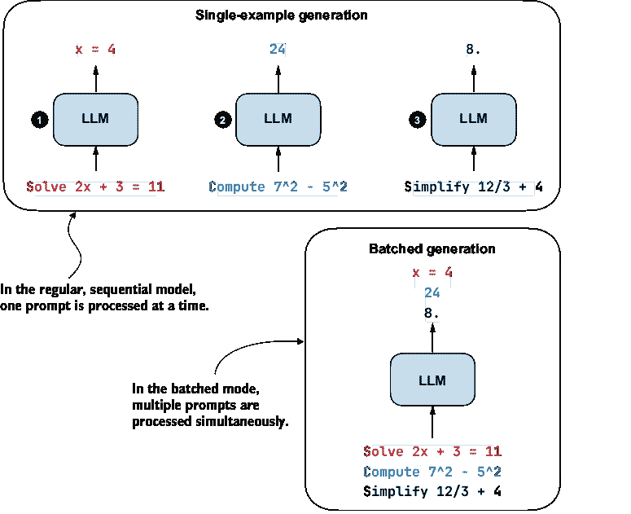
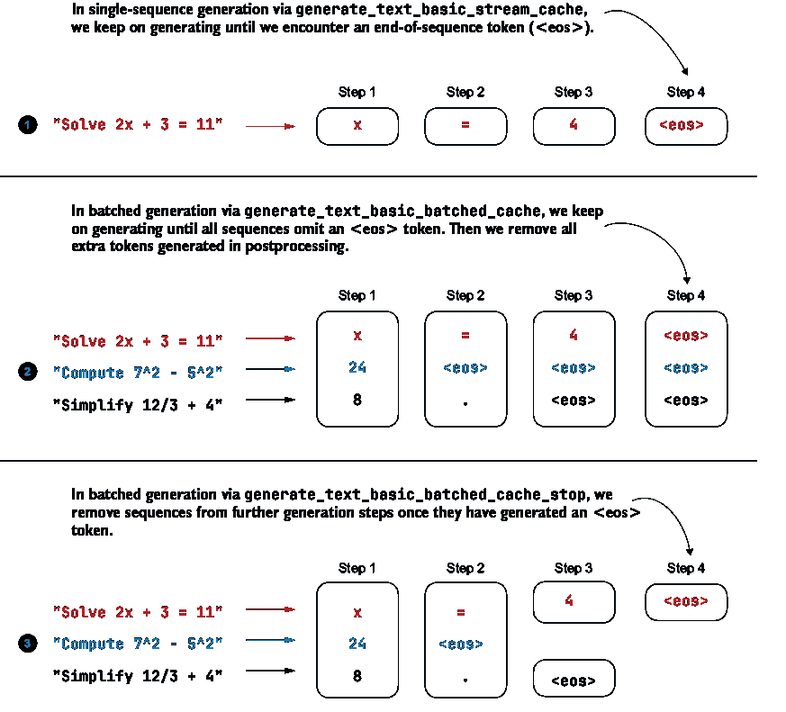
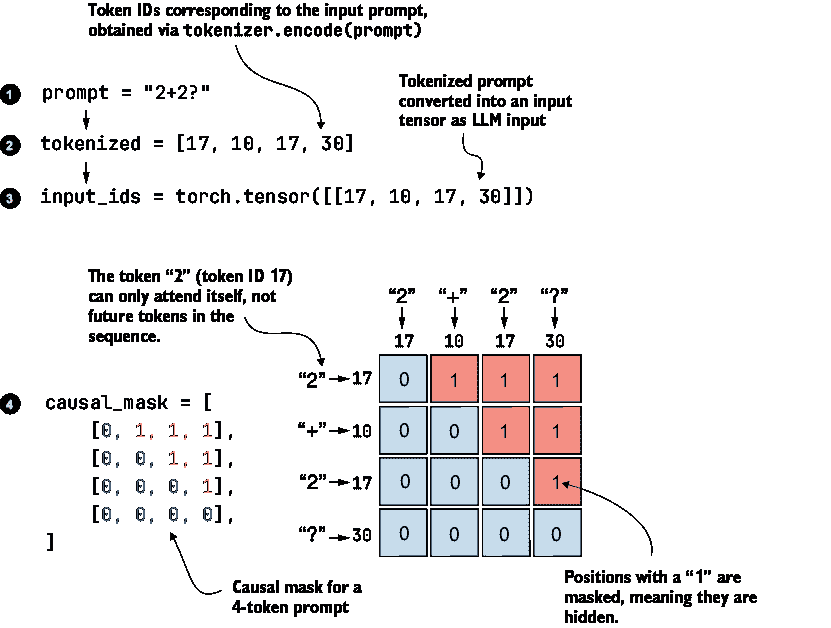
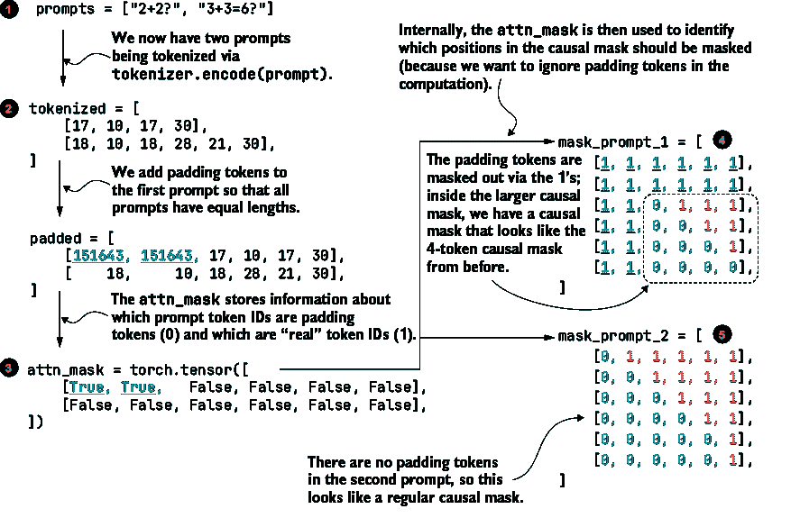

# 附录 E 批处理与面向吞吐量的执行

在本书各章实现的代码中，我们通常一次处理一个提示或示例。这使代码保持简洁、更易于理解，也有助于让资源需求更可控。本书中的代码运行成本已经很高，因此随处添加批处理支持往往会增加复杂性，而根据你可用的硬件，可能不会带来太多实际收益。

话虽如此，如果你能使用具有足够内存的相对现代 GPU，图 E.1 所示的批处理执行可能会非常有用。例如，如果我们想要评估许多问题、为每个提示采样多个响应，或同时训练多个示例，批处理可以帮助提高吞吐量并减少所需的总时间。



## 图 E.1 单示例生成与批处理生成的概览。在批处理生成中，多个提示被打包到一个批次中，并行处理，然后一起解码以提高吞吐量。

本附录解释了批处理背后的总体思路，并展示了如何在各章的补充材料中使用批处理实现。

## E.1 为什么批处理有帮助

当我们谈论计算性能时，区分以下几个总体目标是有帮助的：

*   延迟：我们多快能获得一个提示的答案
*   吞吐量：在固定时间内我们能处理多少提示

单示例生成通常最适合用于理解概念的实现、最小化延迟和调试。批处理可以看作是单示例生成的扩展，主要目标在于吞吐量。例如，如果我们想在 MATH-500 上评估数百个问题，生成多个自洽性样本，或者在更大的蒸馏数据集上训练，批处理可以在合适的硬件上大幅减少总运行时间。

但批处理并不是在任何设备上都会自动更快。在 CPU 或优化较差的 GPU 上，小模型可能只能获得很少甚至没有收益，因为批处理引入了额外的代码复杂性，包括填充和其他开销，这些可能会抵消批处理并行带来的收益。

批处理最好被理解为一种吞吐量优化，而不是一种普适的加速。

## E.2 运行批处理生成

批处理中的主要技术障碍是提示通常具有不同的长度。一个数学问题可能分词为 40 个 token，而另一个可能分词为 120 个 token，但 PyTorch 张量仍然必须是矩形的。因此，如果我们想一起运行多个提示，我们需要一种方法来填充较短的序列，并跟踪哪些位置是真实的 token，哪些只是填充 token。

填充 token 是添加到提示中以使其达到特定长度的占位 token。例如，为了将一个三 token 的提示`"3 + 3"`扩展为五 token 的提示，我们可以在右侧或左侧添加两个额外的填充 token：`"<pad><pad> 3 + 3"`。（在实践中，使用哪个 token 作为填充 token 并不重要；通常使用序列结束 token，如`<eos>`或`<|endoftext|>`。）

从概念上讲，填充和跟踪填充位置使批处理生成比单提示生成更复杂。在本书中，我们使用了来自`reasoning_from_scratch.qwen3`的`Qwen3Model`类，这是附录 C 中解释的普通单示例实现。

因此，对于批处理生成，本书的补充材料在`reasoning_from_scratch.qwen3_batched`中提供了一个单独的`Qwen3Model`类。它可以用作直接替换，并添加了批处理中填充感知执行所需的簿记。

让我们看一个单序列示例，它与本书前面使用的代码非常相似。在下面的列表中，我们将其应用于两个非常小的提示，但仍然是逐个运行它们。

### 列表 E.1 单示例生成

```
import torch

from reasoning_from_scratch.ch02 import (
    get_device,
    generate_text_basic_stream_cache,
)
from reasoning_from_scratch.ch03 import (
    load_model_and_tokenizer,
    render_prompt,
)

device = get_device()

model, tokenizer = load_model_and_tokenizer(
    which_model="base",
    device=device,
    use_compile=False,
)

for problem in ["2+2?", "3+3=6?"]:  #1
    prompt = render_prompt(problem)
    input_ids = torch.tensor(
        tokenizer.encode(prompt),
        dtype=torch.long,
        device=device,
    ).unsqueeze(0)

    for token in generate_text_basic_stream_cache(
        model=model,
        token_ids=input_ids,
        max_new_tokens=32,
        eos_token_id=tokenizer.eos_token_id,
    ):
        next_token_id = token.squeeze(0)
        print(tokenizer.decode(next_token_id.tolist()), end="", flush=True)
    print()  #2
```

-   `#1` 我们顺序处理的两个提示
-   `#2` 在每个答案后强制换行。

以下是输出结果：

```
 \boxed{4}
 \boxed{6}
```

列表 E.1 中的代码仍然是普通的单示例生成。我们渲染提示，对其进行分词，添加大小为 1 的批维度，然后在生成的 token 到达时流式输出。这在概念上很简单，这就是我们在书中使用这种风格的原因。

代码清单 E.2 展示了相应的批量版本。整体工作流程类似，但我们现在切换到 `reasoning_from_scratch.qwen3_batched`，预先对两个提示进行分词，将它们左侧填充到相同长度，然后一起生成。

### 代码清单 E.2 批量生成

```
from reasoning_from_scratch.qwen3_batched import (
    generate_text_basic_batched_cache,
    load_model_and_tokenizer,
)

model, tokenizer = load_model_and_tokenizer(
    which_model="base",
    device=device,
    use_compile=False,
)

problems = ["2+2?", "3+3=6?"]
prompts = [render_prompt(problem) for problem in problems]
tokenized = [tokenizer.encode(p) for p in prompts]

pad_id = tokenizer.pad_token_id
max_len = max(len(t) for t in tokenized)
left_padded = [  #1
    [pad_id] * (max_len - len(t)) + t
    for t in tokenized
]

input_ids = torch.tensor(left_padded, dtype=torch.long, device=device)

generated = generate_text_basic_batched_cache(
    model=model,
    token_ids=input_ids,
    max_new_tokens=32,
    eos_token_id=tokenizer.eos_token_id,
    pad_id=pad_id,  #2
)

for row in generated:
    eos_pos = (row == tokenizer.eos_token_id).nonzero(as_tuple=True)[0]
    if len(eos_pos) > 0:
        row = row[:eos_pos[0]]
    print(tokenizer.decode(row.tolist()))
```

#1 对较短的序列进行左填充，使批次中所有提示的长度相同。

#2 用于让生成过程区分真实 token 与填充 token。

结果与之前相同，但这次是并行生成的：

```
 \boxed{4}
 \boxed{6}
```

在这个例子中，我们使用了非流式批量辅助函数，因此需要等待整个批次完成后再解码并打印结果。这样既保持了示例的简洁性，也便于我们在深入内部掩码逻辑之前看清填充的作用。

文本生成函数还有一个更优化的变体 `generate_text_basic_batched_cache_stop`，它会将已完成的行从活动计算批次中移除，而不是一直保留到最长的那一行结束。相比之下，我们在代码清单 E.2 中使用的 `generate_text_basic_batched_cache` 会在每个解码步骤中将每一行都保留在活动批次中。

在 `generate_text_basic_batched_cache` 中，一旦某一行生成了 EOS，实现会强制该行继续生成 EOS，以保持批次形状对齐，即使从最终解码输出的角度来看该行已经结束。这两个函数之间的差异如图 E.2 所示。请注意，Qwen3 的基础模型使用 `<|endoftext|>` 作为 EOS token，但图 E.2 为了视觉简洁仅将其标注为 `<eos>`。



### 图 E.2 顺序生成（1）与常规批量生成（2）以及提前停止批量生成（3）的对比。常规批量辅助函数（2）会将已完成的行作为占位 EOS 行保留在批次中，而 `_stop` 变体（3）会在这些行一生成 EOS 就将其从活动计算批次中移除。

下一节将更详细地介绍填充在内部是如何处理的。

## E.3 填充与注意力掩码

在单示例模式下，如果我们对一个短提示（如 `"2+2?"`）进行分词，可以将其作为一个形状为 `(1, 4)` 的简单张量传递给模型：

```
input_ids = torch.tensor([[17, 10, 17, 30]])
```

在内部，模型会构建一个标准的*因果注意力掩码*，使每个位置只能关注自身和之前的 token。如果你对因果注意力掩码和自注意力还不熟悉，我题为《理解与编码大语言模型中的自注意力、多头注意力、因果注意力与交叉注意力》的文章提供了更多背景信息：[`magazine.sebastianraschka.com/p/understanding-and-coding-self-attention`](https://magazine.sebastianraschka.com/p/understanding-and-coding-self-attention)。

图 E.3 展示了 `"2+2?"` 提示的因果注意力掩码。在因果掩码中，值 `1` 表示“被屏蔽”，`0` 表示“允许”。在此图中，第一个 token 无法关注后面的位置，第二个 token 只能关注前两个位置，依此类推。这是标准的自回归掩码模式。



### 图 E.3 单示例生成中使用的因果掩码。Token 只能关注自身和更早的位置，这是标准的自回归设置。

批处理改变了这一情况，因为不同的提示通常具有不同的长度。假设我们将 `"2+2?"` 与稍长一点的提示 `"3+3=6?"` 一起处理。

由于 PyTorch 张量必须是矩形的，较短的行必须被填充以匹配较长的行，如图 E.4 所示，使用左侧填充。



### 图 E.4 批量生成中的左侧填充。较短的行会被填充到批次中的最大序列长度，且可感知填充的掩码确保这些填充位置不会影响注意力。

图 E.4 显示我们在内部额外保留了一个 `attn_mask`。该掩码用于跟踪填充位置，其中 `True` 表示已填充，`False` 表示未填充。我们使用这个额外的 `attn_mask` 来识别因果掩码中与填充 token ID 对应的 token。屏蔽填充的键并将填充的查询置零，是使批处理行为与单示例执行相似的重要步骤。

在本附录的其余部分，你将看到如何使用本书补充材料中的脚本，这些脚本为不同章节实现了可选的批量变体。

## E.4 第 3 章：批量 MATH-500 评估

本书的补充材料中包含一个用于第 3 章单示例评估方法的脚本，你可以使用我们在第 7 章介绍的下载函数直接下载并运行它。

### 代码清单 E.3 下载单示例评估脚本

```
from reasoning_from_scratch.ch07 import download_from_github

download_from_github(
    "ch03/02_math500-verifier-scripts/evaluate_math500.py"
)

download_from_github(
    "ch03/01_main-chapter-code/math500_test.json",
    out="math500_test.json",
)
```

通过代码清单 E.3 下载脚本和数据集后，我们可以从终端运行单示例评估，如下所示（如果你没有使用 `uv`，只需将 `uv run` 替换为 `python`）：

```
uv run evaluate_math500.py \
  --dataset_size 500 \
  --which_model "reasoning"
```

补充材料还包含一个批量版本，应用了我们之前讨论的批处理方法。下载过程几乎相同，只是我们将 `evaluate_math500.py` 替换为 `evaluate_math500_batched.py`。

### 代码清单 E.4 下载支持批处理的评估脚本

```
download_from_github(
    "ch03/02_math500-verifier-scripts/evaluate_math500_batched.py"
)
```

批量脚本的使用方式与非批量版本非常相似，只是我们现在提供了一个额外的 `--batch_size` 参数，用于指定模型应并行处理多少个提示和答案：

```
uv run evaluate_math500_batched.py \
  --dataset_size 500 \
  --which_model "reasoning" \
  --batch_size 64
```

理想的批大小完全取决于你的硬件处理能力，因此最好从一个较小的值开始，然后逐步向上调整，直到达到适合你环境的吞吐量和内存限制。

我们将在本附录末尾回到单示例与批量生成性能的对比。

## E.5 第 4 章：批量自洽采样

第 4 章的可选脚本 `self_consistency_math500_batched.py` 不会将不同的提示混合到一个填充张量中。相反，它会将同一个提示重复 `num_samples` 次，并并行采样多个续写，用于自洽投票，因为针对每个提示的不同采样数量进行并行化是一个我们可以利用的自然角度。

由于每一行都从相同的提示长度起始，这个脚本可以使用来自 `reasoning_from_scratch.qwen3` 的常规 `Qwen3Model`，而不是 `reasoning_from_scratch.qwen3_batched`。换句话说，这里的批处理维度用于同一个提示的多个采样轨迹，而不是将不同长度的无关提示填充在一起。

您可以按如下所示下载该脚本。

### 清单 E.5 下载支持批处理的自我一致性采样

```
download_from_github(
    "ch04/02_math500-inference-scaling-scripts/"
    "self_consistency_math500_batched.py"
)
```

要改为下载非批处理版本，只需从清单 E.5 的文件名中删除 `"_batched"` 部分。

我们可以如下运行批处理脚本，非批处理脚本的语法其余部分相同：

```
uv run self_consistency_math500_batched.py \
  --which_model base \
  --temperature 0.9 \
  --top_p 0.9 \
  --num_samples 3 \
  --dataset_size 500 \
  --prompt_suffix "\n\nExplain step by step."
```


## E.6 第 6 章：批处理的 GRPO 轨迹

第 5 章中的自我精化从根本上说是顺序执行的，因此并不能从简单的批处理中获益太多。原则上，你可以并行运行多个输入的自我精化循环，但实现起来并不简单，因此未被列入本书的补充材料。相反，下一个批处理示例出现在第 6 章的 RLVR 代码中。

在第 6 章中，我们再次对多个轨迹使用相同的提示，因此不需要填充。如 E.5 节所述，代码因此可以继续使用来自 `reasoning_from_scratch.qwen3` 的常规 `Qwen3Model` 类。相关脚本可按如下方式获取。

### 清单 E.6 下载支持批处理的 RLVR 脚本

```python
download_from_github(
    "ch06/02_rlvr_grpo_scripts_intro/"
    "rlvr_grpo_original_no_kl_batched.py"
)
```

与之前一样，要下载单生成脚本，只需从清单 E.6 的文件名中删除 `"_batched"`。

一个典型的批处理运行如下所示：

```bash
uv run rlvr_grpo_original_no_kl_batched.py \
  --num_rollouts 8 \
  --batch_size 4 \
  --max_new_tokens 512
```

在这里，`--batch_size` 控制在一个训练步骤中并行生成多少条轨迹。这提高了吞吐量，但也增加了内存压力，因此你可能需要减少 `--num_rollouts` 或 `--max_new_tokens`。

## E.7 第 8 章：批处理的蒸馏

第 8 章回归了第 3 章中考虑填充的风格，因为蒸馏示例具有不同的提示和答案长度。换句话说，我们再次将不同长度的无关示例批处理到单个矩形张量中，这意味着掩码和填充再次变得重要。你可以按如下方式下载批处理训练脚本并获取一个样本训练数据集。

### 清单 E.7 下载支持批处理的蒸馏脚本

```python
from reasoning_from_scratch.ch08 import load_distill_data

download_from_github(
    "ch08/04_train_with_distillation/distill_batched.py"
)

_ = load_distill_data(
    partition="deepseek-r1-math-train",
    local_path="deepseek-r1-math-train.json",
)
```

对于非批处理版本，请从清单 E.7 的文件名中移除 `"_batched"` 部分。批处理版本的一个代表性运行如下所示：

```bash
uv run distill_batched.py \
  --data_path deepseek-r1-math-train.json \
  --dataset_size 500 \
  --validation_size 10 \
  --epochs 2 \
  --use_think_tokens \
  --batch_size 32
```

在这里，`--batch_size` 让我们在每个优化步骤中处理多个蒸馏示例。但由于训练还需要存储中间激活值，资源需求可能远高于第 3 章的评估器，因此第 8 章引入了本附录前面讨论的考虑填充的批处理策略在训练中的对应版本。

## E.8 单序列生成与批处理生成

第 3 章和第 8 章的补充脚本将不同长度的示例一起批处理，因此它们需要考虑填充的注意力掩码和更细致的记录管理。第 4 章和第 6 章对同一提示或轨迹设置的重复副本进行批处理，因此它们可以继续使用常规模型实现，避免更复杂的填充逻辑。

无论如何，批处理生成都可以带来更高的吞吐量和更短的运行时间，但代价是增加内存使用。表 E.1 使用前几节所示的设置对单序列生成和批处理生成进行了比较。

### 表 E.1 内存使用和运行时间对比

| # | 脚本 | 批次大小 | 内存 | H100 总时间 | DGX Spark 总时间 |
| --- | --- | --- | --- | --- | --- |
| 1 | `evaluate_math500.py` | - | 1.8 GB | 90 min | 174 min |
| 2 | `evaluate_math500_batched.py` | 64 | 23.39 GB | 16 min | 108 min |
| 3 | `self_consistency_math500.py` | - | 1.79 GB | 252 min | 340 min |
| 4 | `self_consistency_math500_batched.py` | 3 | 2.45 GB | 129 min | 243 min |
| 5 | `rlvr_grpo_original_no_kl.py` | - | 43.35 GB | 68 min | 63 min |
| 6 | `rlvr_grpo_original_no_kl_batched.py` | 4 | 44.91 GB | 19 min | 23 min |
| 7 | `distill.py` | - | 8.29 GB | 10 min | 32 min |
| 8 | `distill_batched.py` | 4 | 8.34 GB | 9 min | 28 min |

如表 E.1 所示，批处理变体总是比单序列变体更快。在大多数情况下，差异非常明显。一个例外是蒸馏（第 7 行和第 8 行），批处理只带来了适度的优势。这可能是因为 GPU 在单批处理模式下已被充分利用，而批处理生成带来的额外掩码生成开销不值得，考虑到 Qwen3 60 亿参数模型的规模较小。
