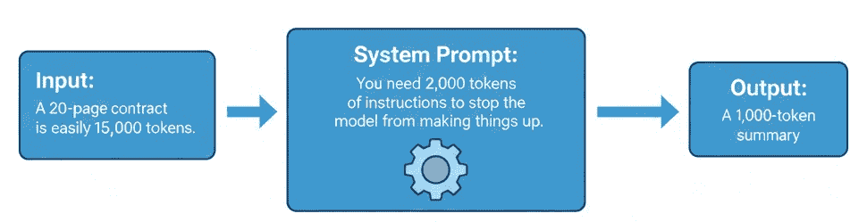
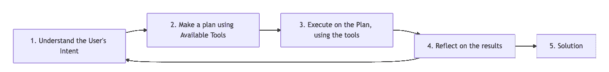

## 第 1 章：从通才到专才

蜜月期已结束。

和我一样，你可能已经使用大语言模型（LLM）作为后端构建了原型。当你以提示（prompt）形式表达的复杂查询返回完美而连贯的响应时，你会感受到最初的兴奋。“惊喜与愉悦”的设计是一个理想的目标，而 LLM 的响应达到了这一目标。有那么一刻，你觉得软件的未来是无限的，提示（prompting）是新的编程语言。你只需要巧妙的提示。

自从 ChatGPT 普及了 LLM 以来，我们一直处于*通才*的时代。我们惊叹于那些在整个人类互联网及更广泛数据上训练过的大型语言模型。它们无所不能，从创作俳句诗歌到优化 RUST 函数。它们是技术奇迹。

但如果你想交付一个*真正的*产品呢？在使用这些模型时，你常常会发现，尽管最初很兴奋，但由于各种原因，它们可能是错误的工作工具。虽然它的押韵能力令人印象深刻，但在查询你遗留的 SQL 数据库时，你确实希望它不要幻觉出不存在的表！

这就是正在出现的“API 之墙”。那是一道无形的屏障，将酷炫的黑客松演示与盈利业务分开，也将成功的初创公司与只博眼球的初创公司分开。突破这堵墙需要面对一些残酷的现实：可能压垮你的规模成本、不可预测的延迟，当然，还有当你提到将与第三方共享客户数据时，你的首席信息安全官（CISO）脸上的惊恐表情。

这本书归根结底是关于突破这堵墙。它是关于从*租用*智能转向*拥有*智能。它将让你用敏捷、超能力的专才取代庞大的通才：经过微调的 AI，它比任何万亿参数巨头都更了解你的业务。

你将拆解“提示工程”范式。在本章中，我们将看看那种杀死了许多 AI 初创公司的残酷“单位经济学”。我们将看到为什么一个在单个 GPU 上运行的小型开源模型能够——而且应该——在*你的*特定领域击败世界上最聪明的 AI。

### 租用智能的成本

每个项目都始于天真。你获得一个 API 密钥，然后开始编码。你精心构建了一个经过大量实验打磨的系统提示。它有效。你部署到测试版。

然后你看着成本。你的眼睛睁大了。你想象那会是什么样子。它们睁得更大！

#### 令牌税

在原型阶段，推理成本感觉可以忽略不计。每次请求几分之一美分基本上是免费的。但是当你从“聊天”转向自动化时，数学计算就对你不利了。

大多数提供商按令牌收费（大约 0.75 个单词）。对于高端推理模型，你可能需要为每 1,000 个输入令牌支付 0.01 到 0.03 美元。

让我们用一个场景来推演一下。设想一个“法律合同分析器”应用。你的用户上传文档，你的应用会提取合同中潜在问题或风险的摘要。

架构可能如图 1-1 所示。

**图 1-1.** 一个基于 LLM 的法律合同分析器的简单架构

你的输入是提示加上合同。一份典型的合同——包含大量法律术语——大约有 15,000 个令牌。你的系统提示是你精心设计的，包含大量指令以避免幻觉，并精确地按照系统其余部分所需的结构来组织输出——可能以 JSON 或其他结构化文件的形式。这会消耗令牌。当然，你的输出还会产生更多令牌。

因此，输入 17,000 个令牌，输出 1,000 个令牌。按照上述成本计算，每份文档可能花费 20 美分。如果你有 1,000 个用户，每人每天分析 5 份文档，那就是每天 1,000 美元，或每年 365,000 美元。

这只是运营该系统所需花费的资金。而在这一切结束时，你什么都*不拥有*。你是在*租用*智能。如果你向用户收取月费——比如说每月 20 美元，他们很快就会变成净亏损。你的利润率风险非常高。

#### 智能体倍增器

现在考虑智能体的影响。自 2024 年中期以来，它们一直是科技行业的宠儿，而且理由充分——它们是一种优秀的设计模式，通过超越仅仅获取问题答案的方式，最大限度地发挥 LLM 的作用。我通常喜欢认为智能体遵循图 1-2 所示的模式。

**图 1-2.** 智能体工作流

最终，这里的目标是遵循以下步骤：

1. *理解用户的意图*。例如，如果该智能体是为帮助选择餐厅而设计的，而用户说他们想吃*御好烧*，智能体就会足够聪明地意识到这是日本料理的一个分支。用户无需特别说明。

2. *制定计划* *使用可用工具*。如果智能体知道自己的工具是 Google 搜索、地图搜索和浏览网站，它就可以制定一个计划，在当前地点附近搜索日本餐厅。然后，它可以逐一浏览这些餐厅的网站，找到它们的菜单，再在菜单中搜索*御好烧*。

3. *使用工具执行计划*。然后，它按照计划行事，并恰当地使用 LLM——例如，生成调用地图搜索 API 的代码，或解析下载的 HTML 以找到想要的菜品。

4. *反思结果*。完成所有这些之后，它应该将结果与用户的需求进行匹配。它是否找到了供应这道菜的餐厅？还是只找到了一般的日本餐厅？诸如此类。如果找到了，那很好，它可以进入第 5 步——给出解决方案。否则，它就得回到第 1 步和第 2 步。

5. *解决方案*。向用户呈现解决方案，并可能流转给其他智能体，比如一个能够处理在目标餐厅预订的智能体！

这种带有专用思维链的工作流程，是智能体最简单的 DNA。但说到 token 用量，你可以看出，它消耗的 token 可能比前面章节中看到的简单 `prompt->result` 多得多。我们之前推测的每天 1000 美元，在使用这种智能体工作流时，很可能接近每天 5000 美元。

难怪各家公司都在数据中心投入数十亿美元！

### 另一个隐藏成本：指令税

这里还存在一种更隐蔽的低效。通用模型在你告诉它之前，对你的具体任务一无所知。要让它发挥作用，你必须在*每一次请求*中把规则、格式指南以及如何处理边缘情况粘贴到系统提示词里！

“你是理解各种菜品及其在哪能找到它们的专家。理解用户的请求，并将其映射到一种或多种热门菜系。如果没有直接匹配，就寻找其他可能供应这道菜的餐厅类型。按如下方式将结果输出为 JSON 结构 {...}”

你要为反复将这些使用说明及其所有 token 发送给服务器而付费。这极其浪费。

另外，上下文窗口污染也值得考虑。研究表明，当你把上下文窗口塞满指令时，模型的表现会下降（“迷失在中间”现象）。我见过太多这样的例子：必须输入严格指令（通常用全大写来表示强调），才能让模型注意提示词的某个部分。而这当然会消耗更多 token。

微调会把这些指令从上下文窗口（你需要为之付费）转移到模型权重（这是永久性的）中。模型不需要被告知该如何表现，因为它已经被内置了。

### 延迟杀手

成本是商业问题，延迟是用户体验问题。而如果你的用户体验不佳，他们就不会为这些成本买单！

想象一个拥有数千亿参数的巨型基础模型。这个模型上的推理物理规律是无法回避的。即使使用最先进的 GPU，在内存中移动数 TB 的权重也需要时间和功耗。一个重要的指标：首 token 时间（TTFT）可能从 500 毫秒到几秒不等。下一个指标——每秒 token 数（TPS）——则衡量第一个 token 之后 token 出现的频率。

在构建聊天机器人时请考虑这一点。如果生成第一个 token 需要 500 毫秒（TTFT），之后每秒 50 个 token（TPS），那么你的用户体验就没问题。你对更高 TTFT 和更低 TPS 的容忍度可能也还行——因为你已经习惯了，而人的体验才是关键。

在如此庞大的模型中移动 token，由于模型规模庞大，速度会较慢。更快、更好的机器以及专用硬件，顶多是对这个问题的修补。

而且，当然，如果那台机器与数百万其他客户共享，你就可能面临不同的 TTFT 和 TPS，因为你的查询只能和其他查询一起排队等候。

如果你的企业客户仪表盘很慢，那可不妙，因为你的系统正在和用 ChatGPT 写论文的高中生竞争！

因此，如果你考虑一个针对特定需求进行微调的本地部署模型，你会发现它通常更小——因此不需要专门的昂贵硬件来跨多台机器同步模型。延迟也更低——无需往返云端，也不必排在其它模型后面。你可以根据自己的需求扩展硬件投资。而且，你当然可以自己调整模型，针对特定工作负载进行优化。

我见过一些应用程序在托管模型上运行得迟钝而脆弱，但迁移到本地模型后就变得即时、灵敏。问题于是从“缓解因他人托管模型而导致的故障”转变为“通过微调本地模型来增加业务价值”。最终，这会为你的业务增值，而不是把运营费用流给第三方。

### 数据防火墙

如果成本和延迟还不足以让你重新思考，那么企业销售周期以及与它们合作时必要的合规要求，应该会让你重新思考！

真实故事：我曾参与过一笔潜在投资，对象是一家非常热门的初创公司，它正在推销用 AI 解决医院中的一个常见问题。它使用计算机视觉和视觉语言模型。我当然不能透露具体细节，但最终它将为医院节省大量时间和金钱，并帮助他们提高护理质量。但是，由于基于视觉，它需要在公共场所安装摄像头，包括医院病房。

鉴于对*灵活性*的要求——可能某天他们想发现某个特定问题，而另一天又想看到不同的东西——视觉语言模型（VLM）的想法很有吸引力。你可以为计算机视觉训练一个非基于 transformer 的模型，但那样它就变得静态了。它擅长发现 X 或 Y，但如果之后你想看到 Z，就需要一个全新的模型。而使用 VLM，只需一个提示词：“这张图片里有什么？”或者“告诉我你是否在这张图片中看到了违规行为 (X)”等等。

这家初创公司演示了他们将如何实现这一点。演示非常精彩。它做到了客户认为医院需要的一切。现场非常兴奋。然后，有人问起了架构。这个 VLM 是一个托管的巨型模型。

“等等，”CISO 问道。“你们要把图像发送给 <公司名称>？”

初创公司的 CEO 慢慢点了点头。“是的，”她回答。然后她举起一些文件，展示 <公司名称> 如何管理隐私、保证匿名性，以及其它一切确保其系统完整性的措施。

但这还不够。他们必须带着一种“兄弟，相信我”的态度，围绕一个非常大的第三方去医院，而第三方本身并不在场。

自然而然地，尽管充满乐观，这笔交易还是在那张桌子上夭折了。结果，医院并没有变得像它们本可以的那样安全。

而这是一件好事。

至少到目前为止是这样。现在有了一条替代的前进道路。我希望这家初创公司已经进入了本地 VLM 领域，这样他们就能两全其美。如果你们正是这家公司，并且正在读到这里，请与我联系！

#### 元数据泄露

上述故事是一个例子，说明在设计与第三方共享客户数据的产品时，属于客户的*数据*成为了关键障碍。

但风险不仅仅是数据或提示内容，还包括元数据。请注意，API 提供商即使不查看或泄露你的数据，仍然知道你是谁、你何时发送请求、请求有多大，以及你可能在做什么。

在高风险行业如金融投资中，关于你正在研究内容的泄露可能会让竞争对手提前得知。例如，在考虑并购（M & A）的企业中，如果泄露了 A 公司花大量时间研究 B 公司的基本面，人们可能会推断他们正在考虑收购 B 公司。第三方知道这一信息后，可能会购买 B 公司的股票，从而推高最终的收购价格。这很容易成为一种新型的“内幕交易”。

#### 合规问题

像 GDPR 这样的法规框架也会让这个问题更加棘手。如果用户要求删除其数据，你可以从自己的基础设施中移除——但如果你用这些数据去提示第三方模型呢？你如何保证数据已从他们的服务器上删除？

当你拥有模型时，你拥有完整的溯源能力。你可以精确展示用于微调的数据。你可以记录所有传入模型进行推理的数据日志，并在必要时删除。如果需要，你还可以用干净的数据集重新训练。

最终——你拥有控制权。

#### 模型漂移

我个人非常惊讶，有太多次与那些遭遇“昨天还能用，今天就不行了”问题的公司交谈。他们不明白原因。而解释很简单：API 提供商会不断更新他们的模型。因此，所有投入在提示工程上的努力——尤其是在上下文窗口中注入命令——可能会在一夜之间消失。唯一的解决方案——重新设计提示，并希望供应商不会对*你的*提示引入破坏性变更——实在谈不上鼓舞人心！

但是，当然，拥有自己微调的模型会创造出你能控制的静态产物。除非你希望它改变，否则它不会改变。而且如果你确实改变它，你仍然保留旧版本，因此你可以进行回归测试，并逐步更新使用它的应用！

#### 专家革命

长期以来，规模定律（Scaling Laws）一直是通往更美好未来的方向。更大——更多数据、更多层、更多 Transformer、更多参数——总是更好。创新的方向也遵循这一点。

一旦模型达到一定规模，自行托管就变得不可行，你必须依赖那些拥有数十亿美元数据中心的巨头来为你托管，并按 token 付费。

但这已不再严格成立。我们已经进入了一个分化转型期：LLM 已足够小可以自行托管，许可证允许这样做，开放预训练模型被自由分享。通过能够针对你的下游任务和特定数据进一步微调这些模型，你现在有了一个可行的替代方案。

2023 年初，LLaMA 的发布推动了这一进程。它证明了精心设计的模型，尽管体积小得多，却能产生远超其规模的影响。这也引发了研究领域的巨大创新，新的优化技术提升了模型质量，而不是仅仅靠增加规模来解决问题。

这正是本书的精神所在。通才模型依然充满活力，并能凭借其广博的知识做出惊人的工作。

但也许我们的生活中需要更多专家模型。我认为这正是像你这样的开发者非常光明的未来：构建专家模型。

#### 硬件不再是阻碍

我曾在一个会议上发言，地点在威尔士。在我之前的演讲者是一位使用 AI 检测脑部疾病的医学研究员。后来喝啤酒时，我问他最大的瓶颈是什么。我原以为他会说是数据。

“算力，”他说，“我们有十位研究员，但预算只够买一块 GPU。我排到周二下午。一周里剩下的时间，我只能做理论推演。”

那只是几年前的事。如今，我正在写作所用的笔记本电脑——一台标准 MacBook Pro——可以微调比他当时使用的强大数个数量级的模型。

*统一内存*（在 Apple Silicon 和更新的芯片中）的出现意味着我们不再需要大规模工业服务器群来构建 AI。我们可以将 70B 参数的模型加载到系统内存中。我们可以在本地构建和测试。AI 研发实验室现在可以装进一个背包。

#### 定制的光谱

模型定制有很多方式，可归为三大类：

- **使用提示**：在提示中，你可以通过共享示例来“教”模型如何做事。这可以包括更高级的内容，如软提示（soft-prompting）。

- **使用 RAG**：检索增强生成（Retrieval Augmented Generation）是一种嵌入“新”知识的方式，通过自动化系统向你的提示中添加相关内容，为模型提供额外上下文。

- **微调**：这是你将新模式烧录到模型“大脑”中的过程，使其无需额外提示就能执行这些模式。这是最难做到的，但从长远来看最有价值。

我不会在本书中介绍前两种方式，因为它们已被广泛讨论，而且它们最终不会改变模型——它们只是更聪明的提示方式。

相反，本书专注于困难的部分——微调模型——我们不只是谈理论。我们还要计算 VRAM 需求、抓取和清理杂乱的数据，以及调试拒绝收敛的训练循环。

API 之墙非常之高，但现在比以往任何时候都更有替代方案。我确实相信，未来的高价值技能属于那些能够跨越这堵墙、构建你完全拥有的 AI 的开发者。

在第 2 章中，你将通过了解一些更流行的模型及其构建方式来开启这段旅程。这将有望帮助你为任务选择最佳模型！
