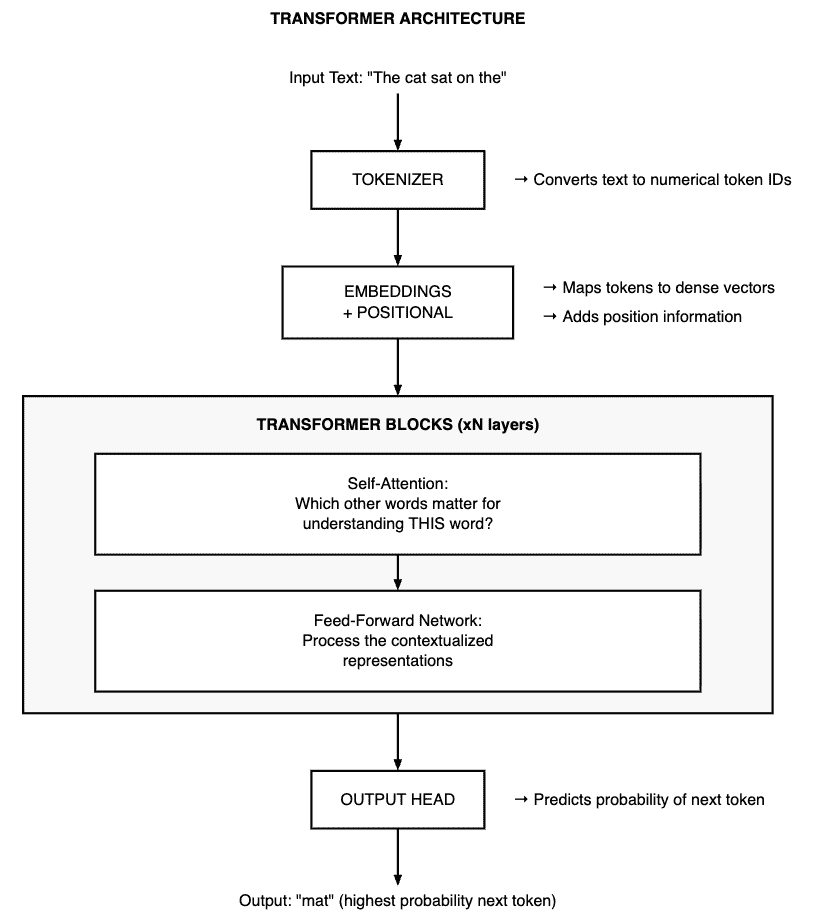
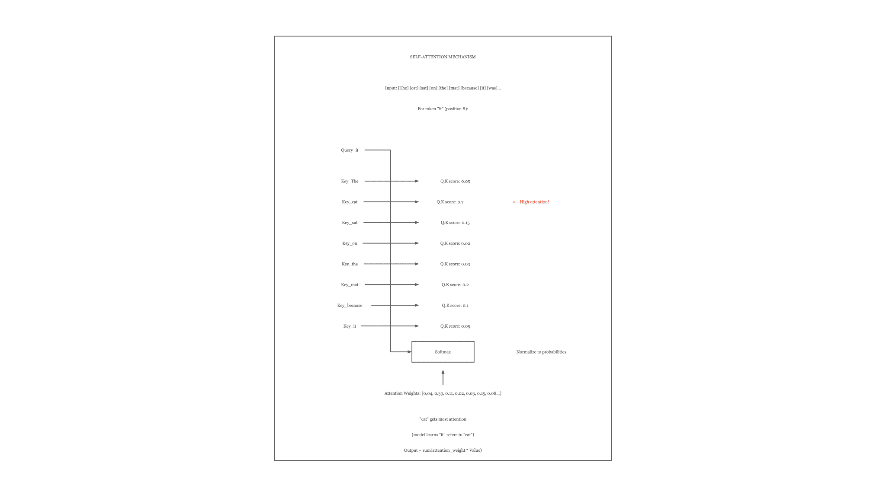
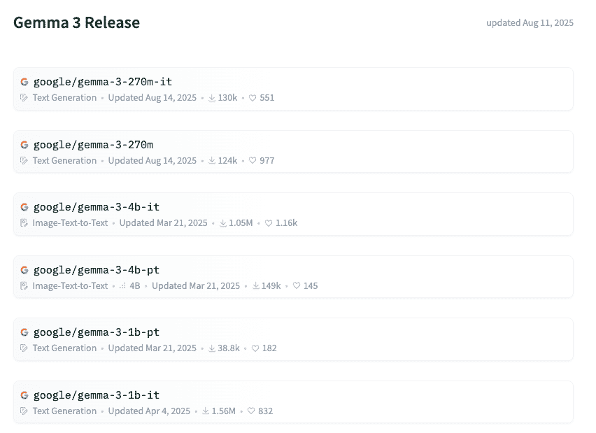
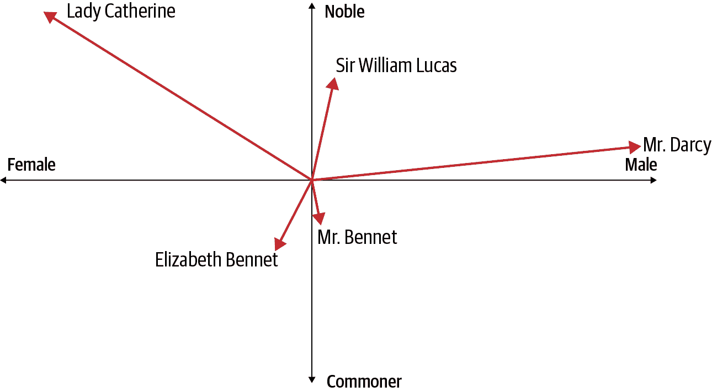

## 第 2 章 模型架构：AI 的 DNA

在第 1 章中，我们探讨了“一个巨型模型通吃一切”的时代正在演变，以及为什么微调更小、更专门的模型代表实用 AI 部署的强大未来。扩展技能成为模型定制者的机会就在你面前。但在你做到这一点之前，你需要理解你正在定制*什么*。打个比方——一个不懂发动机工作原理的机械师能换机油，但无法重建变速箱。同样，如果你是一名微调实践者，你需要掌握 Transformer 模型工作的基本原理。这样你就不会被局限于表面层次的调整，而能够做出那些区分平庸微调模型与卓越微调模型的深度战略决策。

因此，在本章中，我们将进行一次解剖课。目标是剖析当今驱动每一个主要语言模型的架构。你将考察区分领先开源模型家族的关键创新，并理解它们如何将原始文本转换为使“理解”成为可能的数学表示。这将是一个非常宏观的视角，因为关于 Transformer 内部工作原理可以写上好几整本书，所以我们只挑重点讲。

在本章结束时，你将拥有为特定微调项目选择基础模型所需的基础。

### 信息流：Transformer 如何工作

在深入细节之前，最好先建立一个关于基于 Transformer 的语言模型如何处理文本的高层思维模型。要详细探讨这个问题需要好几本书的篇幅，所以我只打算讲一些重点。

你可以在图 2-1 中看到这一点。



*图 2-1. Transformer 高层架构*

关键洞察在于，文本作为离散符号序列进入模型。通常这些符号是字符编码，如 ASCII 或 Unicode 中的“T”、“h”、“e”。这些字符编码根据标点分隔成单词。然后使用分词器（tokenizer）将单词转换为词元（token）。这些词元仅仅是单词或子词的数值表示。

这些词元本身并不包含内在的“意义”或“位置”信息。这就是第二个方框——嵌入（embeddings）——发挥作用的地方。嵌入是表示单词含义的向量。可以把嵌入想象成高维空间中的箭头，其指向的方向代表含义。相似的单词——比如“King”（国王）和“Prince”（王子）——会指向大致相同的方向。

在 Transformer 中，向量还会加上位置编码。这种位置编码表示单词在表达中的位置，其理论依据是单词位置会影响其语义。一个典型的例子是形容词的使用。例如，“那只大狗吃了肉”——我们可以看到形容词“big”（大）直接修饰狗，但它也可以间接地修饰“meat”（肉）——因为一只大狗更有可能吃很多肉！

所有这些都发生在词元流入 Transformer 模块*之前*，而正是在这里，孕育了引领当前 AI 技术爆发式发展的创新。

### 注意力机制

这是 Transformer 的核心。我喜欢用这个类比来思考：想象你正在阅读一份文档，手里拿着一支荧光笔。每读一段，你可能会标出某些单词或短语，因为它们能帮助你理解当前句子。也许这是一篇虚构作品，其中角色正在吃一种你从未听说过的食物。你回头一看，发现故事发生在某个特定地点，这可以帮助你理解，或者至少做出一个合理的猜测，关于这种食物是什么。

注意力机制以人工方式模拟了同样的过程。对于序列中的每个位置，它会计算应给予其他每个位置的“注意力”大小。


让我们考虑这样一句话：“The cat sat on the mat because it was tired.”（猫坐在垫子上，因为它累了。）

当处理“it”（它）这个词时，你需要确定“it”（它）指的是什么。作为人类，阅读这段话时，你知道它指的是猫。但你再想一想，它也可能指垫子。而且如果严格按语法规则而非语义来看，有人可能会说它确实指垫子！

注意力机制会计算“it”（它）的注意力分数，以确定它指的是什么。最终，基于大量训练数据，它很可能在“it”（它）和“cat”（猫）之间建立更强的联系，而不是“it”（它）和“mat”（垫子）之间。

这是通过一种优雅的数学运算实现的。它通过计算三个向量来完成：

* 查询（`Q`）：“我在寻找什么？”
* 键（`K`）：“我包含什么？”
* 值（`V`）：“我提供什么信息？”

它们的计算方式是将单词的嵌入向量（如本章前面所讨论的）与随时间学习而得的权重矩阵相乘。

你可以在图 2-2 中看到这一点。



*图 2-2. 理解注意力机制*

在这个例子中，我们探究输入词元，并重点关注“it”（它）对应的词元，它位于第 8 个位置。

然后，我们查看每个单词的键，并检查它们的值。每个键都有一个分数，我们将“it”（它）的`Q`与每个单词的`K`相乘。随后对结果进行`softmax`操作，得到概率，从而得到一组注意力权重。

这些权重就是应当应用于该词的注意力概率。因此，对于“it”（它）这个词，与之关联最紧密、概率最高的词是“cat”（猫）。为了计算输出和最终的注意力，我们将权重与值相乘。

这一机制的美妙之处在于它完全是*学习而来*的。你可能会想，图中那些值是从哪里来的？如果没有一组良好的`K`值作为起点，这一切都将毫无意义。请认识到模型训练所依赖的海量文本——并且从这些文本中，经过时间的推移、反复试错以及经典的“机器学习”范式，有用的模式得以被学习。

这些用于在文本嵌入向量上学习注意力的`Q`、`K`、`V`“块”通常被称为“头”。当使用多个头时，我们发现有些头最终会追踪语义关系，有些头则追踪语法关系，还有一些头会捕捉我们甚至无法命名的词语关系模式。

通常，当有多层头时，序列中靠前的头会学习更明显的连接，如句法或语法；而靠后的头会捕捉更复杂的语义关系。

## 多头注意力

单个注意力操作只能捕获词元之间的一种关系类型。语言充满多种同时存在的关系类型，而且不同语言可能拥有英语中不存在的关系类型。为了捕获这种丰富性，多头注意力的概念应运而生：它并行运行多个注意力操作，每个操作都有自己学习到的`Q`、`K`、`V`矩阵，这种做法非常有用。

你可以在图 2-3 中看到这一点。


*图 2-3. 多头注意力*

例如，像 Llama 3 8B 这样的模型，会在 32 层中每层使用 32 个注意力头。

每一层的头会在不同的抽象层次上运作——早期层倾向于学习句法模式，而后期层则深入到语义。

### 降低 MHA 中的维度

这些层会减少每个头的维度以节省计算成本。

*隐藏*维度是 4,096——这是每个词元在网络中流动时对应的向量大小。模型不会在全部 4,096 个维度上运行注意力操作，而是将其拆分为 32 个并行的头，每个头在 128 个维度上工作（`4096 / 32 = 128`）。

因此，每个头会计算自己的注意力分数，并产生 128 维的输出。然后这 32 个输出会被重新拼接在一起，并通过另一个学习得到的权重矩阵——通常称为“输出投影”。这有一个重要的目的：它允许模型跨头混合信息。如果没有它，各个头将完全独立（即头 1 拥有前 128 个维度，头 2 拥有接下来的 128 个维度，依此类推）。通过这个输出投影，模型学习如何将不同头的不同视角合并成下一层的统一表示。

这使总计算量大致与单个大型注意力操作相当，但给了模型更多的灵活性来学习多样化的模式。

**注意**

人们容易想象不同的注意力头会整齐地分工，像图 2-3 这类可视化也倾向于这样呈现，因为类似“头 1 负责语法，头 2 负责语义”这样的说法更容易让我们理解，但现实要混乱得多。对 Transformer 可解释性的研究表明，专业化更多发生在*层与层之间*，而不是*层内*。靠近输入的较浅层往往捕捉局部的句法模式：哪些词相邻、基本的语法关系、位置信息等。更深层则逐步构建更抽象的语义关系：句子表达什么含义、概念之间如何关联、对一个问题可能给出什么合适回答，等等！

在任意单层内部，多个头确实会学习不同的模式，但实际上它们并不能映射到人类可解释的类别上。多头注意力的力量正来自这种冗余性和多样性——模型在训练过程中自己发现对它的语料有用的东西，而不是通过人为设计的方向。

## 自注意力与交叉注意力

Transformer 架构中有两种主要的注意力类型值得你关注。

我们到目前为止讨论的都是*自注意力*，即一个序列对自身进行注意力计算。查询（`Q`）、键（`K`）、值（`V`）都来自同一个句子。在我们读小说的假设场景中，假设有一个段落同时提到了一个地点和一种食物，我们的注意力就*只*放在那个段落上。

*交叉注意力*则在此基础上扩展，它允许一个序列去关注另一个不同的序列。在假设的例子中，我们可能在前面章节已经知道这个角色是素食主义者，这会给我们一个线索，猜出那个未知食物可能是什么。用机器学习的术语来说——本质上是这里的`Q`值可以来自一个序列，而`K`和`V`来自另一个序列。

对于*大多数*注意力模型，包括所有你可能会微调的模型，自注意力是主导机制。交叉注意力出现在编码器-解码器架构中，也出现在多模态模型中，因为这类模型可能既需要关注图像特征，也需要关注文本。

## 前馈网络

当注意力机制完成它的工作，让每个 token 从其他 token 那里收集到上下文信息后，每个位置都会经过一个前馈网络（`FFN`）。这是一个简单但强大的两层神经网络，它独立地应用于每个位置。

你可以在图 2-4 中看到它。


*图 2-4. 前馈网络*

它的目的归根结底是存储模型的“知识”。可以把注意力机制想象成收集*上下文*——注意力应用之后，每个 token 的表示都会从它所关注的其它 token 那里获得信息而得到丰富。随后`FFN`会处理这个带有上下文的表示，提取有用特征，并将其转换成适合下一层的形式。

这种“先扩展后收缩”的结构是关键。第一层会把嵌入的维度从 4,096 扩展到 14,336 维。这个更大的空间允许网络表示更复杂的模式。它用那么多神经元来完成这一点，每个神经元可以被看作一个“模式检测器”。当输入匹配某个神经元已经学会识别的模式时，它就会被强烈激活。

在提升维度之后，会应用*非线性*激活函数，比如`SiLU`或`SwiGLU`。我强调非线性，是因为如果你考虑线性变换——它只是一个对向量进行缩放或旋转的矩阵乘法，但无法处理曲线或阈值。所以，如果你堆叠两个线性层——实际上等于先用`矩阵 A`乘，再用`B`乘，但这在数学上等价于直接用单个矩阵`BA`乘。不管你堆叠多少层，它们最终都会坍缩成一个——额外的深度不会带来任何收益。

但如果你使用非线性激活函数，神经元会变得更有选择性。想象其中一个神经元，它的第一层权重在输入看起来像“关于美食的问题”时计算出高值，而在其它情况下计算出低值或负值。激活函数如果是非线性的，就会是弯曲的——从而增强对美食问题的激活，而对其它一切保持接近零。没有非线性，神经元就会对所有内容都成比例地响应，而不会学会触发在特定相关模式上，同时忽略其它模式。

第二层线性层随后把表示投射回 4,096 维。第一层中的每个神经元在第二层都有一个对应的神经元。这通常被认为是与输入模式相关联的“知识”，也是模型在检测到该模式时应该输出的内容。这就是为什么研究者经常把`FFN`层描述为像键值*记忆*一样工作。第一层的权重是匹配输入值的键，第二层的权重是当某个键匹配时被检索到的值。

例如，当输入表示“来自长崎的食物”时，第一层的某个神经元可能会激活，而相应的输出神经元可能会推动表示向“御好烧”这些 token 靠近。这是一个过度简化的抽象——真实的映射远没有这样接近人类可理解的概念，但它确实抓住了文本语料中的事实知识是如何被编码的基本机制。

对于微调来说，这一点非常重要——`FFN`层捕获了模型深度知识中很大的一部分。在像`LoRA`（我们会在第 7 章探讨）这样的技术中，我们可以向这一层注入知识。最终，如果你能建立起这样的心智模型：注意力层专注于“看什么”，而`FFN`层负责“拿它做什么”，你就会在理解如何以及在哪里应用自定义适配方面有极大的先发优势。

## 层归一化与残差连接

在关于 Transformer 的讨论中，你可能还会看到另外两个至关重要但常被忽视的组件：*层归一化*和*残差连接*。它们使深度网络能够稳定训练：

*残差连接*（也叫跳过连接）把每个子层的输入加到它的输出上。这让梯度在训练期间更容易流动，也让模型能够在每一层学习做增量改进，而不是完全重写。它们还有助于防止梯度爆炸（变得太大因而失去意义）或梯度消失（趋近于零，从而丢失信息）。

*层归一化*则对特征维度上的激活进行归一化，使值在网络中传递时保持分布稳定。要注意的是，一个向量的绝对数值意义相对较小，而它的概率分布可能更重要。归一化意味着值通常分布在 0 和 1 之间，避免值聚成一团从而丢失信息。现代模型如 Llama 使用的是`RMSNorm`（均方根归一化），它的计算更简单。

## 仅解码器的主导地位

最初的 Transformer 论文描述了一种为机器翻译设计的*编码器-解码器*架构。编码器处理输入序列（源语言），解码器生成输出序列（目标语言），并通过交叉注意力来关注编码器的表示。


*图 2-5. 编码器-解码器 Transformer*

对于*语言翻译*来说，这一点至关重要，因为当把一种语言翻译成另一种语言时，需要查看句子中前后的词才能有效地进行翻译。

但对于*生成*任务来说，你不能关注“前面”的词，因为它们还不存在。如果你有一个像“The cat sat”这样的 token 序列，那么你只能向后看以进行关注。这个过程被称为“因果”（causal）注意力，在这种机制中，每个位置只会关注序列中之前的位置。这是通过对 token 施加掩码来实现的，以防止向前看，如图 2-6 所示。


**图 2-6. 解码器与因果注意力**

因此，不需要带有双向自注意力的编码器，只需要解码器即可。

仅解码器架构在 Llama 或 Mistral 等开源模型中变得非常流行。

它相对简单！它只有一个架构和一个训练目标（下一个 token 预测），因此更容易扩展。它还有统一的输入和输出。最终，同一个架构既可以“理解”提示，也可以“生成”响应。输入和输出之间没有人为的界限。

研究人员发现，仅解码器模型在扩展到足够规模时，会发展出显著的能力，包括上下文学习、思维链推理和指令遵循，而无需针对这些任务进行显式训练。

对于训练和微调，序列中的每个位置都提供一个训练信号（预测下一个 token），这使得训练数据的利用率非常高。

当你微调这些模型时，你很可能会使用这种仅解码器架构。训练过程会调整模型的权重，使得在给定你的特定提示和上下文时，它能够以符合你期望输出的方式预测下一个 token。

## 分组查询注意力（GQA）

要理解分组查询注意力（GQA），最好先看看 Llama 的早期历史。

开放、可调优的模型几乎就是这种模型的代名词。虽然“开源”这个术语通常被用来描述它们，但我一般不太认同这种说法，因为我们没有源代码，也没有数据。我们所拥有的只是在各种开源许可下发布的模型预训练权重（因此我们可以修改它），以及描述其架构的论文。

首个版本于 2023 年 2 月发布，采用了相对标准的 Transformer 实现。它的总体意义在于证明了更小但训练良好的模型也能参与竞争——至少在标准基准测试上与更大的模型相比时是如此。需要指出的是，许多基准测试是围绕更大模型设计的，因此随着更多小型模型的出现，基准测试的理念也需要演进。同样，虽然在基准测试上的性能可能相当，但上下文窗口大小是小模型与大模型之间最显著的区别。Llama 的上下文窗口只有 2048 个 token。

几个月后，版本 2 发布，将上下文窗口大小翻倍（增加到 4096 个 token），并引入了一项新创新——称为“分组查询注意力（GQA）”，这是对性能至关重要的优化。你还会看到，正是小型化带来的约束推动了创新，GQA 就是一个绝佳的例子。

在首次发布后一年多一点，Llama 3 再次将上下文窗口大小翻倍——小模型达到 8192 个 token，更大的模型系列则高达 128k 个 token。它还改进了词汇表，达到 128k 个 token，提升了 4 倍，并更新了 GQA 的实现。

那么，让我们来探讨 GQA 是什么，以及它为何如此重要。

分组查询注意力是现代 LLM 中最重要的优化之一，理解它有助于你在解决问题时更好地决定选择哪个模型。

在标准的多头注意力中，正如你本章前面所看到的，每个头都有自己的查询（Query）、键（Key）和值（Value）投影。在推理过程中，必须缓存所有之前 token 的键和值张量（即“KV 缓存”），以避免在每一步生成时重新计算它们。

对于长序列，这个缓存会成为显著的内存瓶颈。

你可以在图 2-7 中看到这一点。


**图 2-7. 多头注意力与 KV 缓存大小**

GQA 的思想是在这里通过分组查询头来取得平衡，每组共享 K 和 V 投影。你可以在图 2-8 中看到这一点。


**图 2-8. 分组查询注意力**

在这个简单的例子中，有 6 个头，不是每个 Q 都有自己专用的 KV，而是 Q1 和 Q2 共享一个 KV，Q3 和 Q4 共享一个，依此类推。这使 KV 缓存大小减少了 50%。

在 Llama 3 8B 中，32 个查询头被分成 8 组，每组 4 个，并且每组共享 8 个键值头。

与标准的多头注意力相比，这将 KV 缓存减少了 75%，大幅提升了推理速度并降低了内存需求——尤其是在长上下文场景下。

因此，在进行微调时，最好考虑使用 GQA 的模型，因为它们能在不牺牲太多质量的情况下提供更好的推理性能。

## 持续创新：Mistral 和 Mixtral

继续讲述由更小模型驱动的创新故事，以及那些在更大模型中往往被忽视的效率需求，让我们现在来探讨 Mistral 和 Mixtral。

Mistral 7B 于 2023 年 9 月推出，它证明了相对较小的模型——只有 7B——也能在基准测试上与更大的模型竞争。它凭借几项关键创新做到了这一点。

### 滑动窗口注意力

当我们关注之前的 token 时，token 序列越长，需要管理的规模就越呈爆炸式增长。因此，如果每个 token 都必须查看其他每个 token（包括它自己），我们最终会得到二次方数量的查找。对于 2 个 token，会有 2 次比较，每次比较 2 个 token，所以是 4 次查找。对于 10 个 token，则为 100 次。对于 1000 个 token，就是 100 万次查找！那么对于 128k 个 token 的上下文窗口，这个数字会变得多大呢？

Mistral 引入了滑动窗口，其中每个 token 只直接关注之前的 4096 个 token。你最初可能会认为，上下文窗口之外的信息会丢失，但请再仔细想一想。

如果上下文是 128k 个 token，而你只使用 4k 的滑动窗口，可能会感觉大多数 token 都被忽略了。

但在多层模型中，情况未必如此。让我们来探讨一下。


**图 2-9. 滑动窗口上下文的移动**

想象一下 10 个 token，使用 4 个 token 的上下文窗口。例如，对于 token 7 到 10，我们滑动窗口的输出将是第 2 层中的“最右侧”token。类似地，token 4 到 7 的窗口会在与 token 7 对应的位置产生输出。

你可以看到，5 到 8 会在位置 8 产生输出，6 到 9 会在位置 9 产生输出，尽管这些没有画在图 2-9 中。

然后，当你到达第 3 层时，位置 10 的 token 实际上接收到了从位置 4 一路传递过来的上下文，这是通过各层传递上下文的“金字塔”效应实现的。

感受野随深度线性增长，这使得 token 所需的处理量不再出现二次方爆炸。令人惊讶的是，该模型的表现与许多没有在注意力处理管理上做创新的更大模型相当！它们只是蛮力处理而已。

## 稀疏混合专家

尽管 Llama 4 可能是广受欢迎且广泛使用混合专家（Mixture of Experts）的知名模型，但 Mixtral 引入了一个变革性的版本——稀疏混合专家（Sparse Mixture of Experts）。这是一种根本不同的扩展方法。

在标准 Transformer 中，每个 token 都会经过模型的每一个参数，如 图 2-10 所示。


###### 图 2-10. 标准 Transformer 中的前馈网络

在混合专家模型中，前馈网络（`FFN`）层被多个“专家”`FFN`替代，由路由/门控网络决定每个 token 使用哪些专家。你可以在 图 2-11 中看到这一点。


###### 图 2-11. 稀疏混合专家


在这种情况下，输入会先经过注意力层，然后由路由器/门控选择使用哪个前馈网络。例如，如果 token 是“code”，那么最匹配的 2 个专家可能分别是一个专门处理编程的专家，和一个专门处理数学的专家。数据被路由到这些 FFN，并通过加权组合形成输出。

这就是 Mixtral 模型成为“稀疏”混合专家的原因。它不是让 token 经过*每一个*专家再对输出加权，而是只选择 2 个专家，然后对它们的输出加权。

以 Mixtral 8x7B 这样的模型为例，名称可能让人以为它是一个 7B 模型，但实际上并非如此——8x7 指的是 8 个专家，每个专家都接近 7B 参数！

对于每个 token，路由器会选择排名前 2 的专家，如图所示。

因此，对于这个模型，总参数为 46.7B——用于存储所有专家。但在任何一次推理中，只会用到 2 个专家，因此实际使用 12.9B 参数。这样，你既获得了更大模型的容量，又在推理时只付出较小模型的计算成本。

在微调方面，MoE 模型处理起来更棘手。你可能只想微调选定的专家，或者只微调路由模型。训练动态要复杂得多，而且即使推理很高效，你也需要更大的显存（VRAM）来容纳所有参数。对于许多微调项目，非 MoE 模型可能是更简单的选择！

## Gemma：谷歌的开放方法

多年来，谷歌凭借多种模型进入了开放权重领域，但截至撰写本文时，最新的模型名为*Gemma*。Gemma 基于驱动谷歌托管的大型 Gemini 模型的同一研究，提供多种尺寸。截至撰写本文时，最新版本 Gemma 3 的参数量从 270M 到 27B 不等。

Gemma 的一个关键特点是，许多 Gemma 变体从一开始就经过了*指令微调*。这意味着它们已经对齐到可以遵循指令的状态，开箱即可用于许多任务。当你在 huggingface 之类的模型库中查看 Gemma 模型列表（[Gemma 3 发布](https://huggingface.co/collections/google/gemma-3-release)）时，会看到所有模型，对于 Gemma 3 来说，情况如 图 2-12 所示。



###### 图 2-12. HuggingFace 上的 Gemma

你会看到一些模型带有前缀 `-it`，表示“指令微调”（Instruction Tuned），以及 `-pt`，表示“预训练”（Pre Trained）。后者没有进行额外的对齐以适用于聊天场景，而只是原始的 token 进、token 出。这对你来说非常有用，因为你可以在不需要绕开谷歌已有工作的前提下，创建自己的指令微调。

由于尺寸多种多样，Gemma 3 在管理 KV 缓存时采用了略有不同的架构。

*标准*尺寸系列（4B、12B 和 27B）都使用前面概述的分组查询注意力（Grouped Query Attention，GQA）。这就是为什么像这样的小模型能够支持 *128K 上下文窗口*，而不会让 KV 缓存的内存需求爆炸。

*较小*尺寸系列（1B 和 270M）针对设备端速度进行了优化。它们使用一种称为*多查询注意力*（Multi Query Attention，MQA）的新型注意力机制，这是一种非常激进的 GQA 版本，其中*所有*注意力头共享一个键/值头。这使得它非常快，但会失去一些细粒度。它确实能让模型足够小，从而在基础硬件上运行。

###### 注意

Gemma 3 在 GQA 上有一个独特的设计，即所谓的*注意力比率*。其目标是混合使用滑动窗口。正如我们之前讨论的，每 6 层中有 5 层使用 1024 个 token 的滑动窗口，而每 6 层中有 1 层会查看完整的 128k 上下文！

## 分词器与嵌入

在讨论架构时，还需要考虑不同的分词（tokenization）方法（将人类语言词汇转换为代表它们的数字）和嵌入（embedding）方法（为 token 赋予高维向量表示以试图捕捉上下文），以及高效使用这些方法的技术手段。

### 分词

当我们仔细审视分词，并将其定义为将文本拆分为模型可以处理的离散单元的过程时，我们会发现它比简单的按词拆分要复杂得多。

这种复杂性的原因可能包括：

*   罕见词需要极其庞大的词汇表。为“antidisestablishmentarianism”这样的词专门设置一个 token 是否值得？

*   非英语语言可能以不同方式处理单词间的空格

*   拼写错误、新词和代码会非常难以处理

*   一个词的变体（“run”、“running”、“runs”）会彼此完全独立，从而可能失去它们的语义相似性。

为了克服这一点，大多数现代 LLM 使用*子词*分词，其词汇表由常见词或其片段组成。这提供了一种平衡——“the”这样的常见词会成为单个 token，效率很高，而更罕见的词则会被拆分为多个 token，如“anti”、“dis”、“esta”、“blish”等。

分词器的选择很重要，因为不同的模型使用不同的分词器，而分词器是在不同数据上训练的！每个分词器都有自己的一套工作词汇，这会影响效率。Llama 2 等模型有 32,000 个 token，而 LLama 3 有超过 128,000 个 token。更大的词汇量意味着常见单词和短语更有可能成为单个 token——这会缩短序列长度，让你在上下文窗口中获得更多信息。但这也意味着更大的嵌入矩阵，因此需要权衡。

#### 理解语言与分词

如果你使用的是处理代码或特殊字符的模型，分词器会千差万别。许多分词器主要针对*英语*文本训练，并未针对代码优化。另一些分词器的训练数据中则包含编程语言——最值得注意的是，它们使用的分词器在词汇上对“代码友好”。

此外，在多语言覆盖方面，在英语文本上训练的分词器很可能会将非英语文本切分成许多更小的 token。

考虑中文短语“你好世界”，即“Hello World”的中文表达。如果使用在英语文本上训练的分词器，它将被编码为 4 个独立的 token，分别代表中文文本的 Unicode 字符 \[你\]\[好\]\[世\]\[界\]

一个能够理解中文字符及其如何组成词的多语言分词器会更高效，并能恰当地将“你好”和“世界”分解为 `[你好]` `[世界]` 这样的“词”。

如你所见，这将极大地影响效率和质量。更多的 token 意味着更长的序列，处理速度更慢且携带更少的上下文，性能也会受到负面影响。

> **警告**

>

> 在微调时，你最终需要考虑分词器。除非从头重新训练，否则无法更改模型的分词器。选择基础模型时，请检查其分词器能否高效处理你所在领域的文本。如果你针对特定编程语言或非英语语言进行微调，必须验证分词器不会产生过长的序列。

### 字节对编码（BPE）

执行分词最常见的算法是字节对编码，这是一种最初为数据压缩而开发的方法！

它的工作原理如下：

- 从单个字符的词汇表开始，每个字符由一个字节表示

- 统计训练语料中所有相邻字符对

- 将最频繁出现的字符对合并为一个新 token

- 重复此过程，直到词汇表达到所需大小

例如，假设一个语料库只有 3 个词：‘low’、‘lower’ 和 ‘lowest’。

我们会从单个字符的完整词汇表开始：`[l]`、`[o]`、`[w]`、`[e]`、`[r]`、`[s]`、`[t]`、`[]`，其中我用 `[*]` 表示空格。

然后，我们看一下每个词的分词结果：

```
[l], [o], [w], [*], [l], [o], [w], [e], [r], [*], [l], [o], [w], [e], [s], [t]
```

从中我们可以看到，`[l]` 后跟 `[o]` 是最频繁的配对，因此我们重新编码，用 `[lo]` 字符代替 `[l]` 和 `[o]`。

```
[lo], [w], [*], [lo], [w], [e], [r], [*], [lo], [w], [e], [s], [t]
```

现在我们可以看到，`[lo]` 后跟 `[w]` 是最常见的，因此我们重新编码为：

```
[low], [*], [low], [e], [r], [*], [low], [e], [s], [t]
```

……我们会继续这个过程，直到获得所需的 token 数量。

### 嵌入（Embeddings）

文本经过分词后，每个 token ID 都会被映射到一个嵌入向量。这是 token 在高维空间中的一种表示。让我们来探讨这意味着什么。以 Llama 3 8B 为例，其嵌入维度为 4,096。换句话说——表示一个 token 语义的向量是 4,096 维空间中的一个方向。

虽然这很难直观想象，但请记住，这里的目标是编码语义关系。经过训练后，含义相似的 token 往往具有相似的嵌入。相似的嵌入在向量空间中彼此靠近，它们的向量“指向”相似的方向。

理解这一点的一个好方法是只考虑二维情况。例如，假设我们考察简·奥斯汀小说 *《傲慢与偏见》* 中的人物，考虑性别和贵族身份两个维度。我们可以将前者绘制在 x 轴上，后者绘制在 y 轴上，向量的长度表示每个人物的财富（图 2-13）。



**图 2-13.** 《傲慢与偏见》中的人物向量

通过观察图表，你可以推断出关于每个人物的大量信息。其中三个人物是男性。达西先生非常富有，但他的贵族身份并不明确（他被称为“先生”，而不像不那么富有但显然更高贵的卢卡斯爵士）。另一位“先生”班纳特先生，显然不是贵族，而且经济拮据。他的女儿伊丽莎白·班纳特与他相似，但性别为女。我们例子中的另一位女性角色凯瑟琳夫人，是贵族且极其富有。达西先生和伊丽莎白之间的爱情引发了张力——*偏见*来自向量中高贵的一侧，指向不那么高贵的一侧。

正如这个例子所示，通过考虑多个维度，我们可以开始看到词语（这里是人名）中的真实含义。同样，我们说的不是具体定义，而是一种基于坐标轴以及一个词的向量与其他向量之间关系的*相对*含义。

#### 通过 RoPE 理解位置嵌入

Transformer 会并行处理所有 token，因此它们没有固有的顺序概念。为了注入位置信息，我们将位置嵌入添加到 token 嵌入中。

像 Llama 这样的现代模型使用旋转位置嵌入（RoPE），它通过一种涉及嵌入空间旋转的创新技术来编码位置。RoPE 的关键优势在于，它允许模型泛化到比训练时更长的序列，同时最大限度地减少质量下降。

考虑句子“猫吃了老鼠”。如果没有位置信息，模型会发现“猫吃了老鼠”和“老鼠吃了猫”这两个句子在*数学上*是相同的。

旋转位置嵌入（RoPE）通过将词嵌入不仅视为空间中的静态点，还视为可以被*旋转*的向量，从而解决了这个问题。

为了编码位置，RoPE 不是向嵌入中添加一个表示位置的固定值，而是通过旋转嵌入向量来实现。因此，对于序列中的每一步，其思想是将该词的向量旋转一个特定角度。如果我们把这个角度称为“theta”θ，那么第一个嵌入旋转 θ，第二个旋转 2θ，第三个旋转 3θ，依此类推。随着我们在序列中不断前进，嵌入向量会以可预测、可计算的方式远离原点“旋转”。

现在的想法是，除了嵌入中编码的词的语义（如我们在前一节所见），词的*位置*也可以被编码，这样当模型计算注意力分数时，它能将两者都考虑在内。因此，回顾一下：嵌入是向量，词之间的相对*含义*（就像我们在《傲慢与偏见》人物中看到的那样）可以编码在这些向量之间的关系中，我们可以在数学上使用点积来评估这一点。当词在语义上相似时，它们的点积很高，因为它们的向量相似。否则点积很低。模型利用这一点根据相关性来分配注意力。

但如果没有位置编码，模型可能会认为一本书开头的“猫”和书末尾出现的“猫”是完全相同的“猫”。它能看到猫的含义，却对猫出现的顺序视而不见。

使用 RoPE，你不会破坏这种语义：你只是通过一个角度旋转它来扭曲它。现在，句子中距离较近的词具有相似的旋转，因此*位置*的相似性也被编码到向量中。这是复杂的数学，却给出了一个简单的解决方案。

### 其他注意事项

除了架构之外，你还需要记住其他几个模型能力。我们将在本节中讨论它们。

## 指令遵循

有些模型更擅长遵循复杂的多步骤指令。这源于预训练期间的指令微调。这意味着模型的训练数据是显式地以问答对的形式构建的，以更接近真实世界的使用场景。这使得模型在用户通常提问、模型回答的对话中具有更好的泛化能力。标有“Instruct”或“Chat”的模型为此经过了专门训练。我们在看 Gemma 时已经看到这一点，指令微调后的模型会在名称末尾加上 `-it`，非常方便。请注意，如果你的任务需要精确遵循指令，从指令微调的基础模型开始通常比从基础模型开始更好。

## 推理深度

通常，推理只是模型在“自言自语”。它查看用户的查询，再看自己的答案，然后利用这些信息尝试得出更好的答案。更大的模型通常表现出更好的多步推理能力，但架构选择，尤其是在较小的模型中，也至关重要。像 Mixtral 这样的 MoE 模型可以将不同的推理步骤路由到不同的专家，从而可能改善复杂推理，并为你提供解决方案的全面概述。虽然这通常是一个“加分项”，但并非总是如此。例如，对于代码解决方案，仅通过代码专家一步执行，可能比通过其他专家多步执行效果更好！对于需要深度推理的任务（数学证明、复杂分析），你可能需要更大的模型，或者接受多次推理调用配合思维链提示，而不是依赖模型内部推理，你可以反复提示它（一次又一次）来强制它进行推理。这可能很难进行微调，所以请相应地管理你的期望！

## 上下文窗口与“中间迷失”问题

仅仅因为模型具有较大的上下文窗口，并不意味着它能有效利用长上下文。“中间迷失”是一种已知现象，即模型强烈关注上下文的开头和结尾，却遗漏了中间的信息。在通过滑动窗口驱动更长上下文的情况下，这可能尤其危险。尤其是在微调时，你应该测试基础模型从文档中不同位置回忆信息的能力，以确定它是否存在这个问题，然后再投入大量资源进行微调！

## 总结

如你所见，决定使用哪种模型取决于多种因素。就我个人而言，我喜欢按以下问题来考虑，但优先级不分先后。

1. 模型使用什么分词器？它能否准确而有意义地编码*我*的数据？

2. 上下文窗口有多大？实际大小是多少？其中有多少是因为 KV 缓存中的巧妙技巧而显得大的？上下文窗口是否满足我用户的预期需求？

3. 模型有多大？它能适配我可用的内存，以便在我想要的地方部署吗？能否进行量化？量化会产生什么影响？

4. 如果我进行重新训练，我的训练系统的内存限制是什么？它能满足参数数量、上下文窗口大小和我可用内存的要求吗？

另请注意以下发现：

1. 在注意力类型方面，使用 GQA 的模型通常提供较高的推理效率，但 MQA 以牺牲质量为代价提供了更高的效率。

2. 像 Llama 和 Mistral 这样的稠密模型通常更容易微调。MoE 模型提供更大的容量，但更难修改。

3. 分词器效率会对模型重新训练或微调所需的时间产生巨大影响。

4. 上下文窗口大小应能容纳你最长的训练示例和预期的推理输入。

5. 通常，基础模型能让你更好地控制最终行为，但如果你的场景是基于指令的（如聊天），那么使用模型的指令调优变体可能更好。

6. 硬件。请记住，*训练*消耗的资源远多于推理。确保你的模型不仅适合最终用户的推理需求，而且你还需要考虑训练需求和成本，这些可能非常可观！

可供你选择的模型数量一直在增长。但我认为这些问题为你提供了一个很好的起点！

理解这些架构基础将贯穿你的微调之旅。在下一章中，我们将把这些理论知识转化为实际的硬件和软件设置——微调者的工作坊，你将在那里开始构建你的专家模型。
