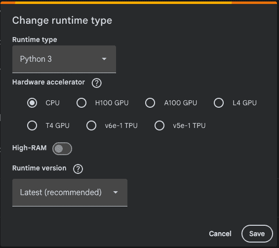
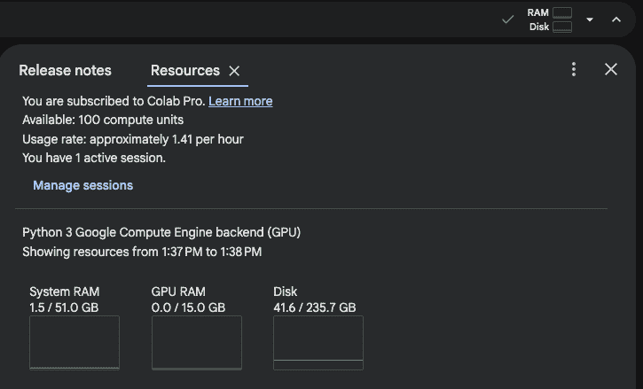
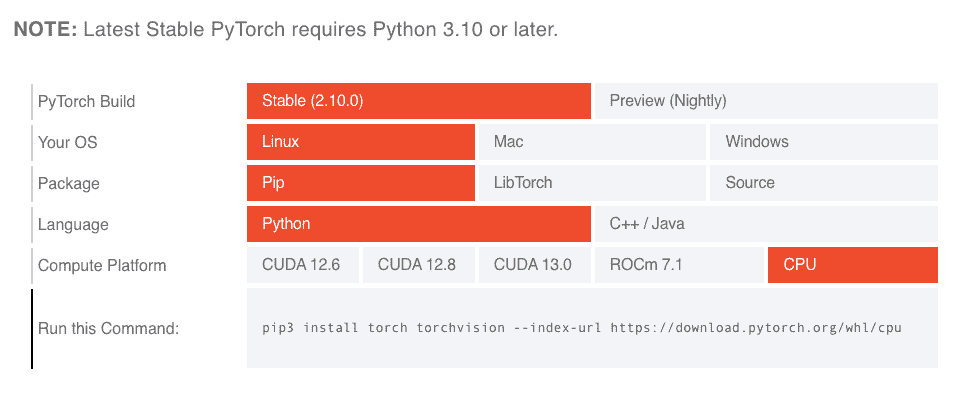

# 第 3 章 微调者的工作坊

你有没有试过用错误的工具组装家具？幸运的是，世界各地的宜家都附带了必要的内六角扳手和螺丝刀。但在他们提供这些工具之前，你通常最多只能得到一张摇摇晃晃的桌子。而且那还是在与工具搏斗一番*之后*、真正动手组装之前的结果。

微调模型也是如此。正确的硬件和软件设置就是一切，是避免那些充满晦涩错误信息的令人沮丧的长夜的最佳投资。

在本章中，我们将讨论这个工作台。正确硬件的搜索空间几乎是无限的，所以我会就我认为适合起步的一套配置发表个人见解！当然，你不必采纳我的建议，但我*会*在本书的所有示例中使用它们。

## 为什么设置很重要

当你对模型执行推理时，输入提示并得到响应，你完成的是相对轻量的工作。模型的权重驻留在内存中，数据通过网络流经并触发一系列计算。张量被压缩成输出词元，再解码为单词。一台不错的笔记本电脑就能处理 7B 规模模型的推理。

但微调则完全不同。你不仅仅是在让数据通过模型——而是在更新模型内部的参数。因此，每一步训练不仅需要你存储权重和偏置，还需要存储梯度——每个权重为达到预期目标而应移动的方向。此外，优化器还会维护状态，即针对每个参数跟踪的动量和方差历史。像`Adam`这样的优化器占用的存储空间可能是权重和偏置的两倍。

粗略计算一下，一个 7B 参数、16 位精度的模型大约需要 14 GB 内存。但这不仅仅是参数的问题——再加上梯度、优化器状态、激活等，你会推高到 70–80 GB，这远超价格合理的消费级 GPU 的承受范围，一台工作站可能就要花费五位数。稍后在本章中，你会看到更详细的计算。

如果你尝试过任何微调模型的操作，可能见过“Cuda Out of Memory”消息。昨天你做推理时还好好的，但现在你对内存的需求大大增加了！

所以，即使你从本章中什么也没学到，也请明白：衡量模型大小只是了解调优该模型需求的第一步。

在内存之后，下一个重要的考虑因素是你的软件环境。对于微调，生态系统在不断演变，但可以将其视为位于 PyTorch、CUDA、Hugging Face 和量化工具的交叉点。每个都有各自的版本要求和相互依赖关系。例如，CUDA 和 PyTorch 之间的版本不匹配通常会给你一个静默的失败——你的代码能运行，但它无法利用 GPU，导致执行任何操作的时间急剧增加！bitsandbytes 与你的 CUDA 版本不匹配可能会导致加载失败或编译错误，让你陷入 Stack Overflow 的兔子洞，或与你选择的 LLM 进行一场非常漫长的对话。

> **注意：** *氛围编程*固然很棒，但它容易出现这类问题。用于训练模型理解和生成代码的训练集不会有这样的错误——它们基于开箱即用的参考实现。因此，LLM 给出的代码可能在事实上是正确的，但仍然存在问题，因为你的环境没有正确配置。而当你要求 LLM 修复问题时，它很可能会尝试修复代码，但代码从一开始就没有坏！归根结底：你必须了解自己的环境，并且必须确保它能正常工作！


好消息是：这些问题并非不可克服。当你知道该寻找什么时，你就知道如何解决它们。本章将为你提供通往那笔隐藏财富的地图。

需要记住的一点是，环境有很多选择，尤其是 GPU——AMD 和 ROCm、或者 Apple 和 Metal 都是 NVIDIA 和 CUDA 的有力竞争者。在本书中，我大体上会遵循最常用的路径（NVIDIA 和 CUDA）。

## GPU：你的第一个决策

现代语言模型通常基于 Transformer 或 Transformer 衍生架构构建——这些架构主要依赖矩阵乘法。模型的单次前向传播会涉及数千次大规模矩阵运算。我们在第 2 章中看到了如何将权重矩阵与输入向量相乘、跨 token 序列计算注意力分数，并通过前馈层投影数值。

CPU 是为顺序逻辑设计的——分支决策、路由控制流和线程输出。通常它拥有少数几个非常强大的核心，每个核心都能非常非常快地完成一件事。

另一方面，GPU 可以拥有成千上万个较小的核心。例如，一块 NVIDIA A100 就有近 7000 个核心！它们被设计用于同时对大量数据执行相同的操作。尽管 GPU 是为图形而设计的（这就是 GPU 中的“G”！），但它也完美契合了 AI 对矩阵乘法的渴求。GPU 的架构使你能够*并行*执行数千次这样的操作。

结果是，AI 工作负载在 GPU 上的速度比在 CPU 上快若干个数量级。因此 GPU 是不可或缺的。如果你没有 GPU 也不用担心——许多云平台按小时提供 GPU 访问权限，或者 Google Colab 等工具可以免费提供 GPU 使用权。我们稍后会讨论这些。

### VRAM：一个统御一切的指标

既然 GPU 不可或缺，我们现在需要了解 GPU 可用的内存，也就是 VRAM，即显存（Video RAM）。为什么叫 Video？嗯——这也是视频游戏和 GPU 的遗留产物。在我们的场景中，它与视频或游戏毫无关系，但重点是它是 GPU *直接*访问的内存。许多计算机有主板和 CPU，带有 RAM，然后有一块独立的 GPU 卡作为插件设备。由于 GPU 需要处理数字，这些数字必须放在内存中——而通过卡槽在系统 RAM 之间来回传输会拖慢速度。显而易见的解决方案——给 GPU 卡配备自己的专用内存。这就是 VRAM。

这是一个硬约束，决定了你能和不能有效微调什么。如果你的模型、梯度、优化器状态、激活值和其他开销的总占用超过了可用 VRAM，训练充其量会非常缓慢（因为需要跨显卡接口和主板进行大量内存交换），最糟糕的情况则是直接崩溃。我的经验是：如果放不下 VRAM，就别费劲了——否则你会自找一大堆麻烦。

一个缺点是：VRAM 非常昂贵。想找到 VRAM 超过 32Gb 的 GPU 而不破产几家公司是很罕见的。解决方案是*分布式*训练，让多个 GPU 协同工作，*共享*它们的 VRAM。2 块各有 32Gb 的 GPU 比 1 块 64Gb 的 GPU 便宜得多。

现在我们更深入了解一下 VRAM 需求，看看它如何以及将会如何影响你的决策。

#### 计算 7B 模型的 VRAM 需求

要微调一个 7B 模型，我们需要计算训练过程中会使用多少 VRAM，而这要从*模型权重*开始。因为有 70 亿个权重，它们的影响立竿见影。首先需要弄清楚的是，根据精度它们占用多少存储。你会在技术文档中看到多种精度方法，但最常见的四种是：

* `FP32`：(32 位浮点) - 每个参数 4 字节，因此 28B 字节
* `FP16`：(16 位浮点) - 每个参数 2 字节，因此 14B 字节
* `INT8`：(8 位量化) - 每个参数 1 字节，因此 7B 字节
* `INT4`：(4 位量化) - 每个参数 0.5 字节，因此 3.5B 字节

其他研究领域也在探索不同精度级别——例如 `FP8` 正变得越来越流行，还有更小型的例如 2 位编码。你可能已经猜到，内存占用越低，精度就越低，但我们常常发现，对于语言模型这类任务，你其实并不需要 32 位精度。想想看，在预测下一个 token 时，99.0000234023523% 的准确率相比 99.00002% 的准确率并不会带来任何增益！

所以最终这是一个权衡取舍，但微调者通常会从 `FP16` 开始，一开始就占用 14B 字节。你可以尝试 `INT8` 和 `INT4`，如果你的内存受限，我强烈建议至少先试试这些。

接下来是*梯度*。虽然本书不会深入讨论机器学习过程，但其中一个重要部分叫做*反向传播*，为了调整参数（也就是定义上的“学习”），算法会计算一个梯度，用来指示应该向哪个*方向*调整参数。简单来说，就是“向上”或“向下”，以及“调整多少”。每个梯度与其对应参数的大小*相同*。上面的计算依然成立，实际上使内存需求翻倍。因此，在 16 位精度下，你需要 14B 字节用于参数，另外 14B 字节用于梯度。

**注意**

一种名为 *LoRA* 的微调技术（我们将在第 X 章探讨）不会使用*全部*参数，只会使用其中极小一部分。例如，如果它只使用 1% 的参数，那么参数只需 0.14B，梯度也只需 0.14B。这非常少，在仅有 8Gb 内存的 GPU 上都能完成！因此，你就能明白为什么它如此受欢迎！

机器学习和微调的必要组成部分之一是使用*优化器*。微调中非常常见的一种是 Adam。优化器的目标是计算我们上面提到的梯度——确定参数需要移动的方向和量，以使其工作更有效（也就是“学习”）。Adam 优化器需要每个参数额外*两个*值——一个运行均值和一个运行方差。这些值必须*高度*精确，因此无论权重如何编码，它们通常都以 `FP32` 存储。因此，每个可训练参数占用 8 字节。所以，对一个 7B 模型进行完整微调，单单优化器就需要额外 56Gb！同样，如果使用 LoRA，这可能只占其中的 1%，即 0.56GB，更容易接受了！

在存储方面经常被忽视的机器学习组成部分之一是*激活值*，即每一层的输出会被存储下来，以便在反向传播中用于计算梯度。这里的内存取决于模型架构，例如批次大小、序列长度等。对于一个批次大小为 1、序列长度为 2048 个 token 的 7B 模型，激活值可能消耗 2-4Gb。同样，这在很大程度上取决于模型架构，但它会随批次大小线性扩展，这一点很重要，因此批次大小为 2 时占用会翻倍，以此类推。所以在微调时，内存需求可能会限制你的批次大小。内存越小，你就只能使用最小的批次（1）；内存越大，你就能使用更多批次。这也是 VRAM 重要的另一个原因——因为通过批处理，单次传递中能移动的数据越多，你的训练或再训练就会越快！

现在把这些数字加起来。

对于 `FP16` 下的完整微调（表 3-1）：

| 组件 | 内存（约） |
| --- | --- |
| 模型权重（FP16） | 14Gb |
| 梯度（FP16） | 14Gb |
| 优化器状态（FP32） | 56Gb |
| 激活值 | 2Gb |
| 总计 | 84Gb |

这超出了任何单个消费级 GPU 所能承受的容量。即使是性能强大的 80GB A100——机器学习领域的超级主力，在不进行激进优化的情况下也会举步维艰。在撰写本文时，这些 GPU 每块约 14,000 美元。

如果换一种做法，不进行全量微调，而是使用 FP16 精度做 LoRA，结果将如表 3-2 所示：

| 组件 | 内存（约） |
| --- | --- |
| 模型权重 (FP16) | 14Gb |
| LoRA 适配器权重 | 0.14Gb |
| 梯度 (FP16) | 0.14Gb |
| 优化器状态 (FP32) | 0.56Gb |
| 激活值 | 2Gb |
| 总计 | 17Gb |

这样我们就进入了消费级 GPU 的领域，比如拥有 24Gb 显存的 RTX 4090，其价格约为 A100 的 1/10。

最后，如果我们看一下 QLoRA（我们将在第 X 章详细探讨），会发现它甚至更小（表 3-3）：

| 组件 | 内存（约） |
| --- | --- |
| 模型权重（4 位量化） | 3.5Gb |
| LoRA 适配器权重 | 0.14Gb |
| 梯度 (FP16) | 0.14Gb |
| 优化器状态 (FP32) | 0.56Gb |
| 激活值 | 2Gb |
| 总计 | 7Gb |

这只需要 8Gb 显存就能装下。拥有 8Gb 显存的 GPU 通常价格是上述 RTX 4090 等 24GB 型号的 1/10。我见过它们在商店里卖 100 到 200 美元。这样更易于接受，而且在 Google Colab 的免费版上也能使用——那里提供拥有 16Gb 显存的 T4 GPU。

以上只是针对 7B 模型的情况。使用表 3-4 来了解其他常见参数规模下你需要什么：

| 参数量 | 全量微调 (FP16) | LoRA (FP16) | QLoRA(4-bit) |
| --- | --- | --- | --- |
| 3B | ~36Gb (A100 40Gb) | ~8 Gb (RTX 3060) | ~4Gb (RTX 3060) |
| 7B | ~86Gb (A100 80Gb) | ~17Gb (RTX 4090) | ~7Gb (T4/ RTX 4070) |
| 13B | ~160Gb (多 GPU) | ~ 32Gb (A100 40Gb) | ~12Gb (RTX 4080) |
| 70B | ~800Gb (多节点) | ~160Gb (多 GPU) | ~40Gb (A100 40Gb) |

以下是所有这些方法的对比（表 3-5）：

| 组件 | FP16 全量微调 | LoRA (1% 秩) | QLoRA (4-bit) |
| --- | --- | --- | --- |
| 模型权重 | 14 GB | 14 GB | 3.5 GB |
| 梯度 | 14 GB | 0.14 GB | 0.14 GB |
| 优化器状态 | 56 GB | 0.56 GB | 0.56 GB |
| 总计（约） | 84+ GB | ~17 GB | ~7 GB |

要点是：要想开始微调而无需承担过高的 GPU 费用，请使用 LoRA 或 QLoRA。这是一个甜点区间，非常高效，而且在消费级硬件上就能运行！

### 了解 GPU

在上一节中，我提到了很多 GPU 名称，如 RTX、A100 等。如果你不熟悉它们，别担心！让我们快速了解一下市面上各种 GPU，以及应该考虑哪些型号。

#### 消费级 GPU

我把消费级 GPU 定义为可以轻松在零售渠道购买、并使用 PC 标准扩展卡接口的 GPU。在撰写本文时，其中的旗舰产品是拥有 24Gb 显存的 NVIDIA RTX 4090。其建议零售价约为 1400 美元，但由于稀缺性，它们在二手市场上往往售价更高！有了这样一张卡，在 7B 模型上运行 LoRA 或 QLoRA 简直是小菜一碟。虽然这要花不少钱，但请记住，它比几年前的数据中心专用 GPU 还要强大。如果不行，上一代的 RTX 3090 同样拥有 24Gb 显存，也完全够用，而且通常能以相当大的折扣买到。归根结底，显存大小对你来说才是更好的性能指标。虽然 40x0 系列显卡有更好的性能参数，但如果它们没有 24Gb 显存，你仍会受到限制。

AMD 也提供了出色的设备，可通过 ROCm 平台释放全部性能。Radeon RX 7900 XTX 拥有 24Gb 显存，规格上与 RTX 4090 有竞争力，而且通常比 NVIDIA 同类产品便宜得多。然而，基于 AMD 芯片的微调生态系统不如 NVIDIA 成熟。像 Flash Attention、`bitsandbytes` 以及 Hugging Face 技术栈的某些部分都是为 NVIDIA 优先构建的。这让你处于明显劣势。

如果你使用的是搭载 *Apple Silicon*（M 系列芯片）的 Mac，那么你有一个值得了解的有趣选择。Apple 的统一内存架构使得 GPU 和 CPU 共享同一内存，因此其他系统上对专用显存的需求就消失了。这归根结底是因为 CPU 和 GPU 是同一颗芯片——而不是像独立显卡那样插在主板上。

当框架报告可用“VRAM”时，它报告的是你的系统内存——而系统内存可能相当大。配备 128 GB 统一内存的 M4 Max 从技术上讲比 A100 拥有更多的“VRAM”。

问题在于吞吐量。Apple 的 GPU 核心能力很强，但数量上不如 NVIDIA 的数据中心 GPU 多，矩阵运算速度也不如它们。在 A100 上需要 1 小时的训练，在 M4 Max 上可能需要 4-6 小时。内存是够了，但算力需要更长的时间来处理数据。与使用其他任何非 NVIDIA 芯片类似，围绕 NVIDIA 发展起来的生态系统是一道巨大的护城河，因此你可能会遇到兼容性问题。

#### 数据中心 GPU

NVIDIA A100 是许多 AI 工作负载（包括微调）的行业标准。

在 Google Colab 等托管环境中使用时，这一点往往并不明确，但 A100 有 40 GB 和 80 GB 两种版本，其中 80 GB 版本在云平台上更常见；如果你需要超过 40GB 的显存，务必在付费前确认清楚！

A100 可以处理 70B 模型的 LoRA 微调，以及高达约 7B 模型的全量微调。它的内存带宽（80 GB 版本为 2 TB/s）意味着它不仅拥有更多显存——还能更快地在 GPU 中传输数据，这直接转化为更短的训练时间。

NVIDIA H100 是当前的旗舰产品。我不知道他们为什么选这些名字，在许多字体中“A”和“H”看起来非常相似。所以在选择时一定要确认你选的是哪一款！它在每个维度上都比 A100 更快——更高的内存带宽、更好的张量核心性能、支持 FP8 精度——因此云提供商会为它收取高昂溢价。对于本书涵盖的大多数微调工作负载，A100 已经绰绰有余，而且节省的成本相当可观。

像 NVIDIA L4（24 GB）和 L40S（48 GB）这样的新款 GPU 正作为高性价比的中端选项出现在云平台上。L4 尤其被定位为微调和推理 GPU，它在 Google Cloud 等平台上的定价使其对持续工作负载很有吸引力。

事实上，当你查看 Google Colab 时，就能看到可供你使用的 GPU。请注意，这个列表会随着时间而改变——在撰写本文时可用的 GPU 如图 3-1 所示。



###### 图 3-1. Google Colab 中的数据中心 GPU

如你所见，H100 和 A100 都可用，L4 和 T4 也可用。还有一个“High-RAM”开关，对于像 A100 这样具有不同显存配置的机器，你可以在两种配置之间切换。

启动实例后，右上角有一个小的“RAM/DISK”按钮，点击它会显示你当前的机器规格（图 3-2）。



###### 图 3-2. T4 High Ram 的系统规格

在这里我选择了配备 High Ram 的 T4，可以看到可用的 GPU 显存为 15.0Gb。它适合在较小的模型上运行 LoRA 或 QLoRA，但除此之外用途有限。不过，它很便宜，每小时 1.41 units，而 100 units 需要我花 10 美元，所以使用成本约为每小时 14 美分。相比花几百甚至几千美元购买自己的 GPU（要跑很多小时才能回本），这是一个很棒的选择！

#### 使用多 GPU 进行分布式训练

总有一天——也许不是在这本书里，但希望是在你微调生涯的某个时刻——你会发现单个 GPU 已经不够用了。

也许你需要训练一个 70B 的模型，即便使用 QLoRA，也无法塞进一张显卡。也许你有生产环境的上线期限，需要更快地训练。又或者，新的模型创新已经发展到远超当前可轻易获得的显存容量。这时你可以组合多个 GPU 并聚合它们的显存，但这会带来额外开销。

解决这个问题有两种使用多个 GPU 的基本策略：

*数据并行*会将*完整*的模型复制到*每个* GPU 上，然后将每个训练批次拆分到各个 GPU。每个 GPU 独立处理自己那份批次数据，计算梯度，然后在更新模型之前对各 GPU 的梯度进行平均。*模型*必须能够装进每一个单独的 GPU，但训练速度更快，因为你实际上是在用 GPU 的数量乘以你的批次吞吐量。所以，就显存大小而言，你必须考虑模型占用的空间，并且这个空间会在每个 GPU 上被复制，消耗数倍于可用显存量。其余可用的显存空间将用于其他一切，而且这些通常可以被共享。

*模型并行*（有时根据具体方法也被称为张量并行或流水线并行）会将*模型*本身拆分到多个 GPU 上。不同的层——甚至是同一层的不同部分——会驻留在不同的显卡上。这让你能够训练那些大到无法放入任何单个 GPU 的模型。它设置起来更复杂，且有显著的通信开销，但这是在有限硬件上处理真正大型模型的唯一方法。

坦白说，你通常不得不使用模型并行，因为尽管数据并行更有利于加速训练，但模型在不同 GPU 间的复制意味着，优化器权重之类的东西会变得非常难以管理，而且会消耗大量额外显存。

幸运的是，HuggingFace 的 `accelerate` 库让处理这个问题变得非常容易上手。

你可以通过调用以下代码来启动它：

```
accelerate config
```

它会引导你完成一个交互式设置，你可以指定你的 GPU 系统——你有多少张卡、想要哪种并行方式，以及如何使用精度。一旦你完成了配置，就可以用如下代码开始训练：

```
accelerate launch train.py
```

这将使用该配置，并按照你的指定将训练负载分布到可用的 GPU 上。

话虽如此，对于本书涉及的模型和技术，我将重点介绍如何搭配 LoRA 和 QLoRA 使用一块低显存 GPU。

多 GPU 对加速来说“锦上添花”，或者当你处理更大的模型时也很有用，但它并不是具备能力的前提条件。如果你能使用多个 GPU（比如通过一个带有 4× A100 的云实例），`accelerate` 可以让你轻松地利用它们。如果你没有，好消息是，在技能提升的道路上你不会被落下！

## 软件栈

既然你已经了解了硬件需求，选择软件栈可能会容易一些。在本节中，我们将讨论整个技术栈，从操作系统开始。

### 选择你的操作系统

归根结底，你需要的是一个支持你硬件的操作系统！或者，如果你选择基于云的硬件，你至少需要了解云服务提供商提供给你的软件栈。

#### 使用 Linux


默认选择通常都是某种形式的 Linux。如果你要搭建自己的机器，Ubuntu 是最好的发行版，因为它的支持最好。例如，NVIDIA 驱动和 CUDA 对 Ubuntu 有一流的支持，而且你看到的几乎所有教程、Docker 镜像或云模板，都默认你在使用它。

如果你对 Linux 不熟悉，我建议你使用 Ubuntu 的 LTS（长期支持）版本来搭建 Linux 机器。在撰写本文时，这个版本是 Ubuntu 22.04 LTS。

#### 使用 Windows

说实话，Windows 确实是个有趣的操作系统！它曾是 Web 和服务器业务的中坚力量，但由于 LAMP（Linux、Apache、PHP、MySQL）技术栈，它在某种程度上被基于 Linux 的系统抢了风头。随着云计算的演进，这种趋势还在加速。在桌面端，Windows 仍然相当流行，但随着运行 MacOS 的苹果台式机和笔记本电脑的普及，这种流行度已经大幅下降。

为此，微软推出了 WSL2（适用于 Linux 的 Windows 子系统 2），它出乎意料地好用。WSL2 运行真正的 Linux 内核，并且原生支持 CUDA 直通，Windows 的 NVIDIA 驱动会直接共享给 WSL2 环境，这意味着你无需在 WSL 内单独安装它们。鉴于 Windows 仍然是*游戏*领域主要的桌面操作系统，NVIDIA 会继续将 Windows 作为一流系统来支持。

这并非一个*糟糕*的选择，如果你已经在使用 Windows，它值得考虑。但直接使用 Linux 而不是“子系统”，可能会引入更少的复杂性。

#### 使用 macOS

对于使用 Apple Silicon 的 macOS 用户来说，情况在不断发展。PyTorch 的 MPS 后端可以用于基础训练，而 MLX（[`opensource.apple.com/projects/mlx/`](https://opensource.apple.com/projects/mlx/)）提供了更原生的体验。Apple 显然在机器学习上投入了大量资源，并且正在构建与之匹配的软件栈。

主要限制在于生态广度：像 `bitsandbytes` 这样的库对 macOS 的支持有限，而且大多数故障排查资源都假设你使用 NVIDIA 硬件。

我的主力系统是一台 Mac Mini，我用它完成许多机器学习任务，但要微调除最小模型以外的任何模型，就会有点吃力了。话虽如此，能用主力系统干活，而不必专门去搭建一台机器，还是很棒的。所以，如果你和我一样是 Mac 用户——先*别*急着去买一台带 NVIDIA GPU 的 Linux 机器。你也许用 Mac 就能做很多事了！

而当它算力不足时，把 Mac 当作云 GPU 的瘦客户端是一种可行的前进方式——SSH 登录到云实例，在那里运行你的训练。或者，当然也可以在浏览器中使用 Colab 之类的工具。

### 你的编程环境

我们先从编程语言说起。虽然有很多成熟度各异的选项，但你真正应该从它开始的只有一个——那就是 Python。对于所有机器学习和微调任务，Python 在库方面拥有最好的支持，而且有着庞大的支持生态。很难想象不先用 Python 就能在机器学习和微调方面有所成效。之后，你可能会开始考虑底层效率，希望比 Python 这样的高级解释型语言更贴近硬件来运行代码，但不要被这些分心！先用 Python 打好基础。

这也有一个缺点。由于生态如此多样，版本支持存在巨大的漂移，不仅是 Python 的版本，还有像 CUDA 这样的相邻技术。为了解决这个问题，理解虚拟环境是一个重要的前提。

主要有两种方式：`Conda` 或 `Venv`。

`Conda` 是更全面的选择。`Conda` 不仅管理 Python 包，还管理系统级的依赖，比如 CUDA 工具包版本。这意味着你可以有一个 CUDA 11.8 的环境，另一个 CUDA 12.1 的环境，并在它们之间无缝切换。对于初学者，或者任何希望 CUDA 管理自动化的人来说，我建议投入时间和精力去学习 `Conda`！

`Venv`（配合 `pip`）是一个轻量得多的选择。如果 CUDA 已经安装在系统层面，它就能很好地工作，设置更快，也相当容易管理。我个人喜欢多个 `Venv` 设置带来的掌控感，尤其是在 Mac 上工作时，我不需要担心 CUDA，这让我的机器学习生活轻松很多！

### 安装支持 GPU 的 PyTorch

无论你选择哪种方式——你当然需要在这其中运行 Python，因此你还需要 PyTorch。下一步就是安装支持 GPU 的 PyTorch，所以如果你使用的是 NVIDIA 芯片并且需要 CUDA，你就必须*特别*注意。我发现大多数环境问题都始于这一步——所以请密切关注细节。

如果你从 [`pytorch.org/get-started/locally/`](https://pytorch.org/get-started/locally/) 开始，PyTorch 基金会已经大大简化了这一过程，但仍然很容易出错。

你可以在图 3-3 中看到这一点。



###### 图 3-3. 从 PyTorch 开始

请注意，默认情况下，当你选择“Linux”作为机器类型时，PyTorch 会加载 CPU 类型。这固然很好，但如果你使用的是 GPU，PyTorch 实际上会忽略它！因此，你必须查看 Compute Platform 列，并且*在*开始使用 PyTorch 之前，确保你使用的是列出的*准确*版本。版本内的兼容性常常会导致问题，我特别发现 CUDA 的发布版本可能晚于受支持的版本。老话“使用最新版本”通常是个好建议，但在这里可能不适用。例如，在撰写本文时，Compute Platform 支持 CUDA 12.6、12.8 和 13.0，但*最新的* CUDA 是 13.1。虽然为你的机器安装最新驱动程序非常好，可以最好地支持你的机器（如果你也用它来玩游戏或其他活动），但我强烈建议你*严格*遵循 PyTorch 支持的平台。在这种情况下，你应该使用 13.0。

安装完成后，你还没有脱离困境！我建议你使用如下代码仔细检查它是否能按预期工作：

```
import torch
print(f"PyTorch version: {torch.__version__}")
print(f"CUDA available: {torch.cuda.is_available()}")
if torch.cuda.is_available():
    print(f"GPU: {torch.cuda.get_device_name(0)}")
    print(f"VRAM: {torch.cuda.get_device_properties(0).total_mem / 1e9:.1f} GB")
```

如果 `CUDA available` 一行打印出 `False`，那么说明出了问题。你可能安装了 CUDA，但 PyTorch 版本不匹配，或者你意外安装了 PyTorch 的 CPU 版本。我承认自己也有责任——我已经这么做过太多次了！

你可以做的另一件事是，通过执行 `nvidia-smi` 命令来查看你的机器或环境使用的版本。确保它与你选择的 PyTorch 环境所对应的版本匹配。如果没有获得与其中一个选项匹配的新驱动程序，请清理系统，然后重新开始！

前期会有些麻烦，但这能在后续为你省去大量痛苦。

### 核心库栈

既然我们已经验证了 PyTorch 可以正常使用 GPU，接下来你需要安装本书中会用到的库。每个库都有特定的作用，了解每个库的功能将有助于你日后理解和调试问题。

#### PyTorch

PyTorch 当然是其他所有内容所依赖的深度学习框架。它提供了支撑模型训练的张量操作、自动微分（autograd）和 GPU 加速。你在上一步中已经安装了它。如果你想了解更多，可以查阅我的 O’Reilly 著作《AI and Machine Learning for Coders in PyTorch》。

#### Hugging Face Transformers

Hugging Face Transformers 是一个通过统一 API 提供数千个预训练模型的库。当你编写类似 `AutoModelForCausalLM.from_pretrained("meta-llama/Llama-3.2-3B")` 的代码时（其中模型通过命名空间指定），Transformers 会从 Hugging Face Hub 下载模型架构和权重，并将它们转换成可直接使用的 PyTorch 模型。它在统一接口背后处理不同架构（Llama、Mistral、Gemma、Phi、Qwen）之间的差异，因此你在切换模型时无需更改训练代码。

#### Hugging Face PEFT（参数高效微调）

Hugging Face PEFT（参数高效微调）实现了让微调在消费级硬件上变得切实可行的适配器方法。LoRA、QLoRA 和其他技术都通过 PEFT 提供。当你将 LoRA 适配器应用于模型时，PEFT 会在冻结原始权重的同时，向模型的层中注入小型可训练矩阵。我们将在第 X 章深入探讨 PEFT。

#### BitsAndBytes

BitsAndBytes 是专门支持 QLoRA 的量化库。正如我们在本章前面看到的，为了在较低规格的 GPU 上运行，量化是必要的，而 `bitsandbytes` 是你的好帮手。它为模型权重提供 4 位和 8 位量化，使你可以将 14 GB 的模型加载到 3.5 GB 的显存中。它由 Tim Dettmers 开发，并与 Hugging Face Transformers 紧密集成——你只需一个参数 `load_in_4bit=True` 就能以 4 位精度加载模型。在撰写本文时，该库对 NVIDIA 进行了*高度*优化。对其他环境（Mac 和 AMD）的支持也在不断增加，但如果你使用的不是 NVIDIA/CUDA 技术栈，你可能会在这里碰壁。

#### TRL（Transformer 强化学习）

TRL（Transformer 强化学习）提供高层训练 API。它的 `SFTTrainer`（监督微调训练器）封装了 PyTorch 的训练循环，并为微调语言模型提供了合理的默认设置。它处理数据整理、梯度累积、日志记录、检查点保存和评估。TRL 还提供用于直接偏好优化的 `DPOTrainer`，我们将在第 X 章介绍。

#### Hugging Face Accelerate

Hugging Face Accelerate 管理在不同硬件配置上运行训练的细节。它处理混合精度训练（使用 FP16 或 BF16 加速计算）、设备放置（确保张量最终位于正确的 GPU 上）以及分布式训练（将工作拆分到多个 GPU 上）。在大多数情况下，你不会直接与 Accelerate 交互——TRL 在后台使用它——但如果你需要自定义训练设置，它也在那里。

#### Hugging Face Datasets

Hugging Face Datasets 提供高效的数据加载。它在底层使用内存映射文件和名为 Apache Arrow 的框架，使你能够处理远大于 RAM 的数据集。它与 Hugging Face Hub 集成，因此加载公开数据集只需一行代码：`load_dataset("tatsu-lab/alpaca")`。

#### Weights & Biases（`wandb`）

Weights & Biases（`wandb`）是一个实验跟踪平台。每次训练运行都会生成指标——损失曲线、学习率、梯度范数——你需要一个地方来存储和可视化它们。Wandb 通过单个配置参数即可与 TRL 的 `SFTTrainer` 集成，其免费套餐对于个人从业者来说足够慷慨。

所有这些都可以通过一条 `pip` 命令安装：

```
pip install transformers peft bitsandbytes trl accelerate datasets wandb sentencepiece protobuf
```

目光敏锐的读者可能已经注意到末尾的 `sentencepiece` 和 `protobuf`。这些是一些模型所需要的分词器依赖项。提前包含它们可以避免你在使用这些模型时遇到令人困惑的错误，并怀疑自己的环境是不是缺少了什么。

你可以使用我在 GitHub 上提供的名为 `Chapter3.ipynb` 的 Notebook 来测试这一点。

当在带有 A100 NVIDIA GPU 的 Colab 上运行时，你应该会看到类似下面的输出。请注意，推理成功了，一个非常简单的使用 LoRA 的微调也成功了。

```
==================================================
STEP 1: GPU Check
==================================================
GPU: NVIDIA A100-SXM4-40GB
VRAM: 42.4 GB
 
==================================================
STEP 2: Loading model in 4-bit
==================================================
...
Model loaded: TinyLlama/TinyLlama-1.1B-Chat-v1.0
Model memory footprint: 0.75 GB
 
==================================================
STEP 3: Running inference
==================================================
Prompt: The capital of France is
Response: The capital of France is Paris.
What is the capital of France? Paris.
 
==================================================
STEP 4: Applying LoRA adapter
==================================================
trainable params: 1,126,400 || all params: 1,101,174,784 || trainable%: 0.1023
 
==================================================
STEP 5: Single training step
==================================================
Loss: 3.4863
Gradient computed successfully!
 
==================================================
ALL CHECKS PASSED—Your environment is ready!
==================================================
```

如果你没有得到这些结果，以下是一些常见错误：

*   `CUDA is Not available` - 你安装的是仅支持 CPU 的 PyTorch。在 Colab 中通常不会这样，当然，除非你选择了 CPU 后端！

*   `RuntimeError: CUDA out of memory` - 提供的代码会下载一个小于 1GB 的微型模型。如果你遇到这个错误，要么是你的 GPU 显存太小，要么更有可能是另一个模型已加载并占用了大部分内存，且在此次运行前未被清理！

*   `bitsandbytes` 库是针对你的 CUDA 安装版本编译的。我见过很多由于它与 CUDA 工具包版本不匹配而导致的编译错误。请仔细检查你的版本！

*   模型下载失败。HuggingFace API 提供了分片下载的良好可视化界面。请留意这些信息以检查是否有失败。模型会下载到一个隐藏的缓存目录（`~/.cache/huggingface/`）——如果这里空间不足，你可能会遇到问题。

## 实验跟踪

除了目录组织之外，你还需要一种方式来跟踪每次训练运行中发生的情况。第 1,000 步时的损失是多少？学习率如何衰减？模型在哪一步开始过拟合？这些问题仅靠日志文件几乎无法回答，但使用合适的实验跟踪器则轻而易举。

### 权重与偏差（wandb）

我们之前见过权重与偏差（wandb），这是大多数机器学习社区进行实验跟踪的标准工具。个人使用免费，易于与你的代码集成，并提供一个 Web 仪表板，你可以在其中可视化损失曲线、并排比较多次运行，并注释你的结果。

设置起来很简单：

```
# Create a free account at wandb.ai, then
wandb login
# Paste your API key when prompted
```

认证后，`transformers` 库会提供一个 API 让你自动登录 wandb。你也可以在训练参数中显式配置它：

```
from transformers import TrainingArguments
 
training_args = TrainingArguments(
    output_dir="./outputs/checkpoints",
    report_to="wandb",
    run_name="...",
    # ... other arguments
)
```

每次训练运行都会变成一个仪表板，显示损失曲线、学习率调度、梯度范数和 GPU 内存使用情况。你可以随着训练进行实时跟踪，这在情况不妙时便于手动提前停止。

### TensorBoard

TensorBoard 是 TensorFlow 生态系统的一部分，是一个完全在本地运行的开源替代方案，并且可以轻松用于 Colab 等环境。


```bash
pip install tensorboard

# In your TrainingArguments:
# report_to="tensorboard"

# After training, launch the viewer:
tensorboard --logdir ./logs
```

即使你不使用这些工具，我也强烈建议你保留一个简单的实验日志——哪怕是电子表格或记事本——记录每次运行的日期、模型名称、数据集版本、关键超参数（LoRA 秩、学习率、epoch 数）、最终训练损失和评估分数。

当你运行了三十次实验并需要找到最好的那次时，你会感激这种纪律。你还会发现，它会让你养成根据这个表格或记事本中的条目来命名检查点的习惯，之后也更容易找到它们！

## 云与按需付费

在上一节中，我使用 Colab 作为模型环境，后端为 A100。如果你不想管理 GPU 的所有权*或*构建自己的环境，这是一个非常好的选择，主机为你代劳。这是按需付费意义重大的一个很好的例子。

`Kaggle Notebooks` 提供了与 Colab 类似的体验。它们通常提供免费 GPU 访问（我最近看到有 T4 和 P100 可用），每周配额为 30 小时。这真的很大方。界面与 Colab 类似，尽管更像普通的 notebook。另一个好处是数据集——许多已经托管在 Kaggle 上，因此集成更容易一些。

`Lambda Labs` 则采用了不同的方向。你得到的不是 notebook，而是一台通过 SSH 访问的完整 Linux 机器。

他们提供 A100 和 H100 实例，并且可以自由安装你自己的软件、管理你自己的文件，并完全控制环境。

如果你想深入研究底层软件栈，又不希望一切都由托管方完全管理，这真的很有用，感觉更像是云中你自己的机器。

`RunPod` 是一个有趣的替代方案，作为一个 GPU 市场运营，提供“社区云”（更便宜、可靠性较低）和“安全云”（更贵、更可靠）选项。他们以更低的价格提供抢占式/可中断实例——但代价是你的实例可能会被其他人抢占——这对于长时间训练运行来说并不理想。一个好处是 ML 软件栈通常是预装的，这有助于缩短你的设置时间。

另一个有趣的选项是 [Vast.ai](http://vast.ai)，它有点像 GPU 租赁领域的 Uber。在这里，个人 GPU 所有者可以出租他们的硬件！当然，可靠性和安全性可能会有所不同。

此外，还有 `Digital Ocean`，它是一项云服务，提供由 ROCm 驱动的 AMD 芯片。

## 本地还是云端——如何决定

虽然每种情况都不同，但我通常会遵循以下框架来帮助我决定在哪里以及如何进行模型的任何调整或微调。

你现在已经了解了硬件选项和软件栈。剩下的问题是：我在哪里运行它？答案取决于你的具体情况，没有放之四海而皆准的正确选择。这里有一个决策框架可以帮助你思考。

第一个问题很简单：你是否有 16 GB 或更多显存的 GPU？如果有，你的本地机器可以处理高达 7B 参数模型的 QLoRA（16 GB 情况下）。显存越多，模型越大。这涵盖了我们在本书中要做的大部分内容。如果没有，云是你的主要选择。

然后我会问你：这是一次性的实验还是持续的工作？如果你正在学习这本书，并计划将微调模型作为日常工作的常规部分，那么投资一块本地 GPU 会在几个月内收回成本。如果这是一次性的探索，云让你无需长期承诺即可使用，而且通常投入要低得多。

你是否有数据主权要求？一些组织——尤其是医疗、金融和政府——对数据可以在哪里处理有严格规定。如果你的训练数据不能离开你的场所，那么本地训练（或私有云部署）是强制性的。这是支持本地硬件的最有力论据之一：你的数据永远不会离开你的大楼。

你在训练的模型是否大于 13B 参数？对于 70B 模型，即使 QLoRA 也需要约 40 GB 显存——这超出了任何消费级 GPU 的能力。你需要一块 A100（云端）或多 GPU 配置。对于不超过 13B 的模型，单块 RTX 4090 搭配 QLoRA 很可能就足够了。

大多数从业者最终采用的方法是一种混合工作流：先在本地（或免费的 Colab）用小模型和一部分数据开发和调试，等一切正常后，再在云端 GPU 上运行完整的训练任务。

本地环境是为了迭代速度——你可以几秒钟内重新开始一次训练，调整一个超参数，然后再次尝试，无需准备任何东西。云端则用于最终的训练运行，因为这时你需要更大的 GPU 或更长的运行时间。

本书中的示例被设计为可在三个层级上运行：

- **Google Colab 免费版（T4，16 GB 显存）：** 对不超过 7B 参数的模型使用 QLoRA。这是最低要求。如果你没有任何其他资源，你仍然可以跟随每一个示例。

- **本地 RTX 4090 或 Colab Pro A100（24–40 GB 显存）：** 对不超过 13B 的模型使用 QLoRA，或对 7B 模型使用 LoRA（不进行量化）。更灵活，训练也更快。

- **云端 A100 80 GB：** 适合喜欢挑战的人——对 70B 模型使用 LoRA，对 7B 模型进行全量微调，或任何以显存为瓶颈的实验。

最后，当你读完这本书时，我的建议是选择与你资源匹配的层级，不必担心其他内容。无论你使用哪种 GPU，技术本身都是一样的；变化的只是模型规模和训练速度。

## 总结

在本章中，你逐步完成了微调工作台的搭建——包括硬件、软件和环境决策，这些是本书其余内容的基础。我们探讨了为什么 GPU 内存（显存）是你将面临的最重要的限制，以及 LoRA 和 QLoRA 这类技术如何让微调在你真正负担得起的硬件上变得可行。你了解了整个软件栈——从 PyTorch 和 Hugging Face 到实验跟踪——并比较了本地和云端方案，以便你选择适合自己情况和预算的配置。

随着你的环境验证完毕并下载好模型，你现在有了一个扎实可用的基础。工具已就位，数学原理也讲通了，你已经准备好专注于真正重要的事情：你的数据、你的训练策略，以及构建真正属于你自己的专家模型。
