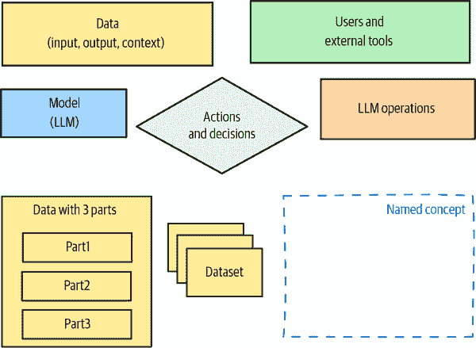

## 前言

如果你是一位构建生成式 AI（GenAI）应用的 AI 工程师，你可能已经体会到了制作令人印象深刻的原型与在生产环境中可靠部署之间那道令人沮丧的鸿沟。基础模型让构建引人入胜的演示变得轻而易举，但生产系统需要解决根本性的挑战：损害准确性的幻觉、破坏下游流程的不一致输出、限制企业适用性的知识缺口，以及使系统不适合关键应用的可靠性问题。

本书通过提供 32 个久经考验的设计模式来弥合这一鸿沟，这些模式解决了你在构建生产级 GenAI 应用时会遇到的反复出现的问题。这些模式并非理论构想——它们将经过验证的解决方案系统化，这些方案通常源自前沿研究，并由成功大规模部署 GenAI 系统的实践者不断打磨。

监督式机器学习（ML）涉及在一个大型示例输入和输出的训练数据集上训练特定问题的模型——但 GenAI 应用很少包含训练阶段。相反，它们通常使用通用基础模型。本书聚焦于构建在基础模型之上的 AI 应用的设计模式，例如 OpenAI 的 GPT、Anthropic 的 Claude、Google 的 Gemini 或 Meta 的 Llama。

在本书中，我们涵盖了整个 AI 工程工作流程。在第 1 章的引言之后，第 2 章提供了控制内容风格和格式的实用模式（包括 Logits 掩码[模式 1]和语法[模式 2]）。第 3 章和第 4 章涵盖通过复杂的检索增强生成（RAG）实现来集成外部知识，从基本 RAG（模式 6）到深度搜索（模式 12）。第 5 章专注于通过思维链（模式 13）、思维树（模式 14）和适配器调优（模式 15）等模式增强模型推理能力。第 6 章强调使用 LLM 作为评审（模式 17）、反思（模式 18）和提示优化（模式 20）等模式来构建可靠系统。第 7 章关于创建智能体系统，包括工具调用（模式 21）和多智能体协作（模式 23）。第 8 章涵盖优化部署（包括小语言模型[模式 24]和推理分布测试[模式 27]），而第 9 章讨论实施安全护栏，包括自我检查（模式 31）和全面护栏（模式 32）。

## 本书读者对象

本书面向正在构建由 GenAI 基础模型驱动的应用的软件工程师、数据科学家和企业架构师。它汇集了经过验证的解决方案，你可以用来解决构建 GenAI 应用和智能体时常见的挑战。阅读本书，了解该领域的专家如何应对幻觉、非确定性答案、知识截止日期以及为你的行业或企业定制模型等挑战。软件工程中的老问题在这个领域有了新的解决方案。例如，满足延迟和约束成本的方法包括蒸馏、推测解码、提示缓存和模板生成。

理解本书中的不同模式需要不同程度的背景知识。例如，思维链（模式 13）只需基本编程知识，工具调用（模式 21）需要理解 API 设计，依赖注入（模式 19）需要一些开发大规模软件的经验。然而，内容优化（模式 5）需要熟悉统计学和 ML，小语言模型（模式 24）需要理解硬件优化。我们预计初级软件工程师或三年级计算机科学学生可以阅读并理解本书的 75%。其余部分需要专业知识或经验。

AI 工程与软件工程、数据工程和 ML 有很大重叠——但在本书中，我们将焦点限制在核心 AI 工程上。我们建议你将本书视为相关领域模式文献的伴侣。具体来说，书籍[*机器学习设计模式*](https://www.oreilly.com/library/view/machine-learning-design/9781098115777/)（O’Reilly）也由瓦利亚帕·拉克什马南合著，涵盖了在为特定问题训练定制机器学习模型时会遇到的反复出现问题的成熟解决方案。

你也很可能会根据用例同时使用定制 ML 模型和通用基础模型。在某些情况下，你可能会从基础模型开始，但后来发现边缘情况需要你为问题定制（或*微调*）模型。本书与*机器学习设计模式*互为补充，将帮助你同时使用这两种模型，因此我们建议你两本都读。

## 本书使用的约定

本书采用以下排版约定：

- *斜体*：表示新术语、URL、电子邮件地址、文件名和文件扩展名。

- `等宽字体`：用于程序清单，以及在段落中引用程序元素，如变量或函数名、数据库、数据类型、环境变量、语句和关键字。

- **`粗体等宽字体`**：表示用户应逐字输入的命令或其他文本。

- *`斜体等宽字体`*：表示应替换为用户提供的值或由上下文确定的值的文本。

> **提示：** 此元素表示提示或建议。

> **注意：** 此元素表示一般注释。

> **警告：** 此元素表示警告或注意事项。

在图中，各种方框使用一组颜色约定，如图 P-1 所示。

**图 P-1.** 本书图表中使用的表示方案

## 使用代码示例

PROD：请联系作者，了解他们是否会将代码示例上传到 oreilly.com 或他们自己的网站（例如 GitHub）。如果没有代码下载，请删除整个部分。如果有，当您通过邮件将链接发送给 digidist 时，请告知他们您在 `title_title` 中填写的内容（应尽可能接近书名，例如 `learning_python_2e`）。此信息将决定 digidist 加载文件的位置。

补充材料（代码示例、练习等）可从 [`github.com/lakshmanok/generative-ai-design-patterns`](https://github.com/lakshmanok/generative-ai-design-patterns) 下载。

如果您在使用代码示例时遇到技术问题，请发送电子邮件至 support@oreilly.com。

本书旨在帮助您完成工作。一般而言，如果本书附带了示例代码，您可以在程序和文档中使用这些代码。除非您复制了代码的很大一部分，否则无需联系我们获得许可。例如，编写一个使用本书中多个代码块的程序无需许可。出售或分发 O’Reilly 书籍中的示例则需要许可。引用本书和示例代码来回答问题无需许可。将本书中的大量示例代码整合到您产品的文档中则需要许可。

我们感谢但不强制要求署名。署名通常包括书名、作者、出版商和 ISBN。例如：“*《生成式 AI 设计模式》*，作者 Valliappa Lakshmanan 和 Hannes Hapke（O’Reilly）。版权所有 2026 Valliappa Lakshmanan 和 Hannes Hapke，979-8-341-62266-1。”

如果您认为您对代码示例的使用超出了合理使用或上述许可范围，请随时通过 permissions@oreilly.com 联系我们。

## O’Reilly 在线学习

> **注意：** 40 多年来，[O’Reilly Media](https://oreilly.com) 一直提供技术和商业培训、知识和见解，以帮助公司取得成功。

我们独特的专家和创新者网络通过书籍、文章和我们的在线学习平台分享他们的知识和专业技能。O’Reilly 的在线学习平台可让您按需访问现场培训课程、深入学习路径、交互式编码环境，以及来自 O’Reilly 和 200 多家其他出版商的庞大文本和视频库。有关更多信息，请访问 [`oreilly.com`](https://oreilly.com)。

## 如何联系我们

请将有关本书的意见和问题发送至出版商：

- O’Reilly Media, Inc.
- 141 Stony Circle, Suite 195
- Santa Rosa, CA 95401
- 800-889-8969（美国或加拿大）
- 707-827-7019（国际或本地）
- 707-829-0104（传真）
- support@oreilly.com
- [`oreilly.com/about/contact.html`](https://oreilly.com/about/contact.html)

我们有本书的网页，上面列出了勘误表和任何其他信息。您可以通过 [`oreil.ly/genAI-design-patterns`](https://oreil.ly/genAI-design-patterns) 访问此页面。

别忘了更新上面的链接。

有关我们书籍和课程的最新信息，请访问 [`oreilly.com`](https://oreilly.com)。

在 LinkedIn 上找到我们：[`linkedin.com/company/oreilly-media`](https://linkedin.com/company/oreilly-media)。

在 YouTube 上观看我们：[`youtube.com/oreillymedia`](https://youtube.com/oreillymedia)。

## 致谢

Lak 感谢他的家人，因为他（再次）埋头写作而深居简出，也感谢那些让他有机会以实际方式在各地应用激动人心的新技术的合作者和同事们。他还非常感激 Hannes 在撰写本书过程中给予的合作。

Hannes 感谢 Lak 在整个写作过程中富有洞察力的指导。Lak 用简单语言解释复杂主题的能力确实非常出色，Hannes 非常感激能参与这次写作之旅，并从中受益匪浅。如果没有 Hannes 的伴侣 Whitney 在创作过程中的每一天给予坚定支持、无尽耐心和爱，这本书就不可能完成。Hannes 衷心感谢 Whitney 的惊人支持，同时也要向他的家人，尤其是他的父母表达诚挚的感谢，他们鼓励他去追逐世界各地的梦想。

我们俩都感谢 O’Reilly 团队（Nicole Butterfield、Corbin Collins、Catherine Dullea、Christopher Faucher、Sarah Grey 和 Doug McNair，按字母顺序排列）将专业性与灵活性完美结合。我们有幸邀请了技术审阅者（David Cardozo、Mark Edmondson、Jason Fournier、Andrew Stein 和 Glen Yu），他们几乎对全书提供了有益、可操作且迅速的反馈。此外，Madhumita Baskaran、Ying-Jung Chen、Martin Gorner、Skander Hannachi、Ryan Hoium 和 Danny Leybzon 帮助审阅了特定章节。
