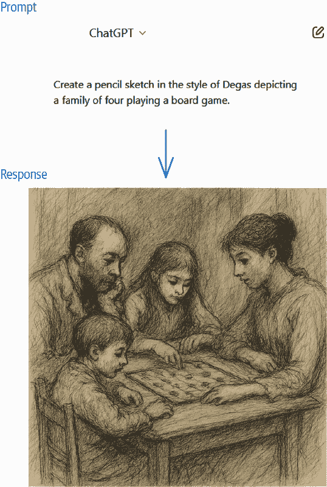
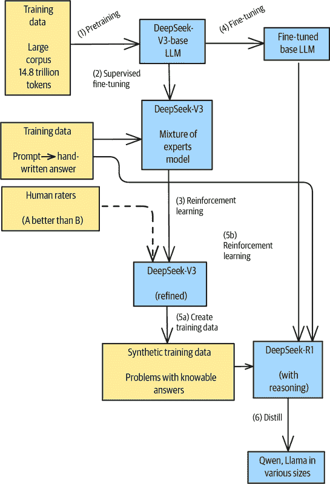
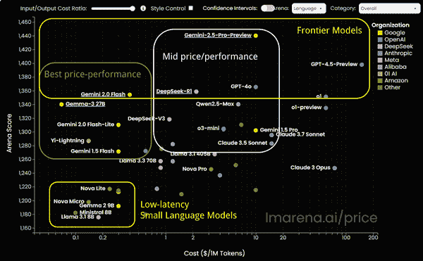
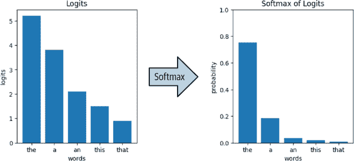
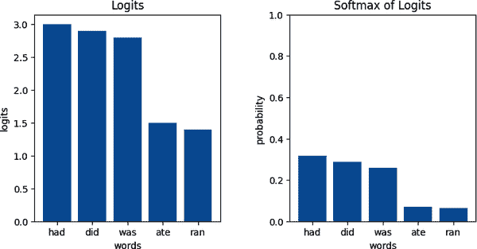
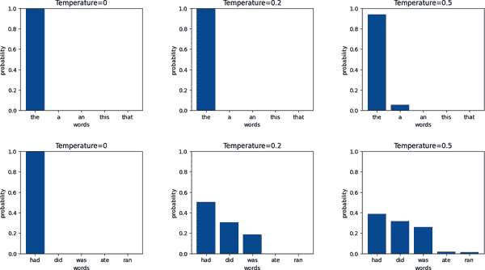
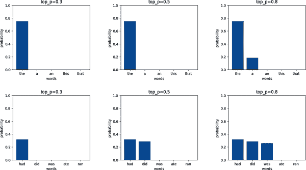

# 第 1 章 引言

GenAI 功能强大且易于使用，即使非技术用户也能在 GenAI 之上轻松构建出极具吸引力的应用原型。然而，将这些 GenAI 原型投入生产却十分困难，因为 GenAI 模型并不可靠——它们可能会产生幻觉，对同一输入返回不同答案，并且由于训练方式的原因可能具有令人意外的局限性。本书中的设计模式总结了在 GenAI 模型之上构建生产应用时可能遇到的这些及其他常见问题的最佳实践和解决方案。

## GenAI 设计模式

在软件工程中，*设计模式*是针对软件设计和开发过程中常见问题的成熟解决方案。它们代表了标准化的最佳实践，是软件开发人员通过长期集体经验演变而来的。设计模式之所以重要，是因为它们建立了一种开发人员可以高效沟通的共同词汇，并能帮助提高软件质量、可维护性和可扩展性。

设计模式的概念深受建筑师克里斯托弗·亚历山大（Christopher Alexander）工作的影响，他在其著作《模式语言》（牛津大学出版社，1977 年）中引入了建筑中的模式。设计模式在软件工程中占据重要地位，始于埃里希·伽玛（Erich Gamma）、理查德·赫尔姆（Richard Helm）、拉尔夫·约翰逊（Ralph Johnson）和约翰·弗利西德斯（John Vlissides）合著的《设计模式：可复用面向对象软件的元素》（Addison-Wesley 出版），该书常被称为“四人帮之书”。此后，设计模式在其他软件工程领域也被系统整理，例如[Java 企业应用](https://www.oreilly.com/library/view/modern-java-ee/9781492042266)和[机器学习](https://www.oreilly.com/library/view/machine-learning-design/9781098115777)。

如今，在构建 AI 产品时，开发者越来越多地转向在大型、与应用无关的数据集上训练的*基础*GenAI 模型（如 GPT-4、Gemini、Claude、Llama、DeepSeek、Qwen 和 Mistral），而不是构建需要在应用特定数据上从头训练的自定义机器学习模型。在本书中，我们将遵循 Chip Huyen 的[*AI 工程*](https://learning.oreilly.com/library/view/ai-engineering/9781098166298/)（O'Reilly），将这种在基础模型之上构建的方法称为*AI 工程*，并将这种方法的实践者称为*AI 工程师*。

AI 工程具有广泛的应用，包括自然语言处理（NLP）、文本生成、代码解释、图像理解和视频合成，以支持内容生成、AI 助手、工作流自动化和机器人等用例。

作为 AI 工程师，你可以通过向基础模型发送适当的文本输入（即*提示*）来要求模型直接生成应用程序所需的内容。然而，你会面临一些常见问题——生成的内容可能不符合你想要的风格，可能缺少模型不了解的企业知识，或者可能缺乏某些能力。在本书中，我们整理了在 GenAI 基础模型之上构建应用程序时出现的此类问题的多种经过验证的解决方案。

在本书中，你还会找到对 32 种模式的详细解释，这些模式将研究进展和专家经验提炼成你可以轻松纳入项目的建议。每一章都提供一组模式，作为 AI 工程中常见特定问题的潜在解决方案。例如，第 3 章讨论的是解决基础模型无法生成包含机密企业数据的内容的问题，因为这些模型由无法访问这些数据的模型提供商训练。该章呈现的模式都针对此问题。每个呈现模式的章节都包括问题描述、经过验证的解决方案、模式端到端的工作示例，以及关于替代方案和其他实现考虑的讨论。

AI 工程师经常遇到对基础模型来说过于复杂而无法一次性完成的任务，因此一种常见策略是将复杂任务分解为可以由基础模型完成的更小组件。这种借助基础模型提供能力的小型软件组件被称为*智能体*。当智能体使用 GenAI 模型规划一系列操作、确定每个操作可以调用的后端工具、决定如何从错误中恢复以及/或者评估任务是否完成时，它们变得日益自主。通过编排智能体构建的应用程序被称为*智能体式应用*。本书通过展示如何处理在基础模型上构建应用程序时不可避免的挑战，其模式将帮助你构建更好的智能体和智能体应用。

## 基于基础模型构建

在本节中，我们将简要介绍 AI 工程的基础知识，这样就不必在后续章节的模式部分重复这些入门材料。如果想更深入地了解构建 GenAI 应用，我们推荐以下书籍：Omar Sanseviero 等人的[*基于 Transformer 和扩散模型的生成式 AI 实战*](https://www.oreilly.com/library/view/hands-on-generative-ai/9781098149239)（O'Reilly），涵盖底层技术；Chris Fregly 等人的[*AWS 上的生成式 AI*](https://www.oreilly.com/library/view/generative-ai-on/9781098159214)（O'Reilly），涵盖超大规模云服务商的产品；以及 Leonid Kuligin 等人的*使用 LangChain 在 Google Cloud 上构建生成式 AI*（Packt），涵盖开源 GenAI 框架。

### 提示与上下文

在构建 AI 应用时，你通常通过 API 调用托管的基础模型。这个 API 可能是基础模型供应商提供的，也可能是一个允许你在不同提供商之间轻松切换的框架。

你通过向基础模型发送*提示*并接收*响应*来调用它。毫无疑问，你已经熟悉通过基础模型的 Web 用户界面来执行此操作。例如，在[ChatGPT](http://chatgpt.com)上，你可以在文本框中输入如下提示：

> 以德加的风格创作一幅铅笔素描，描绘一家四口在玩棋盘游戏

最简单的提示通常包含对模型的*指令*，要求其执行某些内容生成任务。在这种情况下，模型遵循指令并返回包含所请求类型图像的响应（参见图 1-1）。^(1) 提示和响应都可以是*多模态*的——它们可以是文本，也可以是图像、视频或音频。



###### 图 1-1：向基础模型发送提示以获取响应

更复杂的提示可能不仅包含指令，还包含*上下文*。这可能是模型在生成时应使用的信息，也可能涉及要求模型扮演特定角色。例如，我们可以告诉 Claude（在[Claude.ai](https://claude.ai)上）在生成内容时具备某种个性并使用某些信息：

> 你是一位非常熟悉德国大学城图书市场的营销专家。
>
> *《水之约》*是一部讲述喀拉拉邦一个正统圣多马基督教家庭三代人故事的小说。
>
> 请为哥廷根一家书店的读者写一段推荐语，介绍这本书并联系当地特色。

Claude Sonnet 的响应考虑了角色、上下文和指令：

> **《水之约》——通往喀拉拉的一场文学之旅**
>
> 坐落于哥廷根历史悠久的城墙之间，学术传统与文学好奇在此交汇。我们为您呈现亚伯拉罕·维格西斯的史诗杰作《水之约》。这部宏大的家族传奇跨越三代，讲述印度喀拉拉邦一个东正教圣多马基督徒家庭的故事——该地区复杂的宗教遗产，或许会引起我们大学著名的神学研究项目学生的共鸣。故事在喀拉拉葱郁的回水区中数十载展开，熟悉哥廷根与水的渊源——从神圣的鹅女喷泉到蜿蜒的莱纳河——的读者们会发现地理如何塑造命运这一主题中惊人的相似之处。维格西斯编织了一个关于家族秘密、医学谜团和代际纽带的叙事，它超越了文化界限，为我们这个由国际学者和终身学习者组成的社群带来了对水的深刻探索——无论是喀拉拉的季风雨，还是下萨克森的绵绵细雨——水既是隐喻也是契约，跨越时空将我们相连。

### 使用模型提供商的 API

设计用于调用基础模型的 API 有多种语言版本——Python、Go、Java 和 TypeScript 都普遍使用。为简洁起见，本书将重点放在 Python API 上。

要通过 Python 中的 Anthropic API 调用 Claude Sonnet 3，你可以使用 Anthropic Python 包，如下所示（完整代码在 [GitHub](https://oreil.ly/NauRN) 上）：

```python
# 示例代码：使用 Anthropic Python 包调用 Claude Sonnet 3
# 完整代码请参见 GitHub 链接
```


```
import anthropic
client = anthropic.Anthropic(
    # defaults to os.environ.get("ANTHROPIC_API_KEY")
    api_key="YOUR_ANTHROPIC_API_KEY",
)
 
completion = client.messages.create(
    model="claude-3-7-sonnet-latest",
    system="You are an expert Python programmer.",
    messages=[
        {
            "role": "user",
            "content": [
               {
                  "type": "text",
                  "text": """
Write code to find the median value of a list of integers.
"""
               }
            ]
        }
    ]
)
 
print(completion.content[0].text)
```

在此 API 调用中，提示被分成了两部分——*系统提示*和*用户提示*。系统提示由开发者设定，指导模型的整体行为；而用户提示更具动态性，为你要模型执行的特定任务提供具体指令。在此，AI 助手的角色已在系统提示中设定，而用户提示和上下文则作为消息发送。

### 使用与 LLM 无关的框架

要使用 PydanticAI 框架执行相同任务，你可以使用如下代码（假设所需的 API 密钥已设置在环境变量中）：

```
from pydantic_ai import Agent
agent = Agent('anthropic:claude-3-7-sonnet-latest',
              system_prompt="You are an expert Python programmer.")
 
result = agent.run_sync(
           "Write code to find the median value of a list of integers.")
print(result.data)
```

这里的优势在于，你可以通过将模型字符串切换为 `openai:gpt-4o-mini`、`google-vertex:gemini-2.0-flash`、`groq:llama3-70b-8192` 等，轻松地在不同基础模型提供商之间切换（有关支持的模型完整列表，参见 [Pydantic 的文档](https://oreil.ly/Kg6jE)）。

在 Pydantic API 中，调用 Claude 模型的类称为 `Agent`。我们将在下一节讨论什么是智能体，但在此之前，让我们先结束关于调用基础模型的方式的讨论。

### 在本地运行你的模型

要在本地硬件上运行如 Llama 3 这样的模型，你可以使用 [Ollama](https://ollama.com) 客户端下载并运行你想使用的模型：

```
ollama run llama3.2
```

Ollama 通过 OpenAI API 暴露开放权重模型，因此你可以使用以下方式：

```
from pydantic_ai.models.openai import OpenAIModel
from pydantic_ai.providers.openai import OpenAIProvider
 
model = OpenAIModel(
    model_name='llama3.2', 
    provider=OpenAIProvider(base_url='http://localhost:11434/v1')
)
```

### 基础模型是如何创建的

与传统机器学习应用不同，你的 AI 应用很少包含训练阶段。相反，你将在已经过预训练、能够执行各种各样任务的通用基础模型之上构建应用。在大多数情况下，你可以忽略基础模型的内部细节——我们在本书中加入这一节，只是为了让你理解相关的词汇。

在 2025 年春季写作本文时，DeepSeek 是训练方案相关信息最丰富的基础模型。我们将利用这些信息来讨论创建基础模型所涉及的关键步骤（参见 图 1-2）。虽然 OpenAI、Google、Anthropic 和 Meta 在创建 GPT、Gemini、Claude 和 Llama 时未必遵循了完全相同的流程，但它们的方法可能大体相似。

DeepSeek 基础 LLM 在一个多样且高质量、包含 14.8 万亿个词元的语料库上进行了预训练（见 图 1-2 的步骤 1）。（作为对比，莎士比亚的全部作品大约有 120 万个词元——因此 DeepSeek 的训练数据集相当于 1200 万个莎士比亚作品！）与早期基于词进行训练的 LLM 不同，现代 LLM 基于*词元*进行训练，词元是较短的字符序列。这使得 LLM 能够学习语言词汇表之外的事物，例如专有名称。不仅仅是规模有帮助——DeepSeek 团队将模型的高质量[归因](https://oreil.ly/5hjPn)于精心的数据策划，包括严格的去重流程。



**图 1-2. 训练 DeepSeek-R1 模型所涉及的阶段**

*预训练*阶段（图 1-2 中的步骤 1）涉及在这个庞大的词元数据集上进行训练，以发展模型的通用语言理解能力。此阶段的关键目标是训练模型根据训练输入中前序词元构成的上下文来预测下一个词元。这就是为什么你会经常听到人们称 LLM 为*下一词元预测器*——但下一词元预测只是训练过程的第一阶段。

预训练之后，模型要经历*监督微调*（SFT，图 1-2 中的步骤 2），以提高其遵循指令和生成高质量响应的能力。这一阶段使用经过精心策划的人类编写示例数据集。例如，Cohere [表示](https://oreil.ly/qQhZu)它使用持照医师、金融分析师和会计师来改进其模型。可以推测，这些从业者会根据给定的提示写出理想答案。由此产生的 DeepSeek-V3 是一个*专家混合*（MoE）模型：通过这种优化，模型可以拥有大量参数，而仅对每个词元激活其中一小部分。DeepSeek-V3 总共有 6710 亿个参数，但每个词元[仅激活 37B](https://arxiv.org/abs/2412.19437)。这使得模型可以为不同类型的指令使用不同的路径。

*强化学习*阶段（图 1-2 中的步骤 3）是根据人类偏好进一步改进模型的阶段。这一步骤涉及*基于人类反馈的强化学习*（RLHF），即向人类评分者展示一对模型生成的输出，并询问他们更喜欢哪一个。这种*偏好微调*有助于使模型的输出与人类的期望和价值观保持一致。这个阶段有时也被称为*偏好优化*。

在利用少量人工编写的示例和人类偏好创建 DeepSeek-V3 之后，完整的 DeepSeek-R1 模型是通过以下[多阶段流程](https://oreil.ly/djxoR)开发出来的：

1. *冷启动*涉及使用数千个冷启动数据点对基础模型（DeepSeek-V3-Base）进行微调，以奠定基础。

2. *纯强化学习*（RL）涉及应用[纯强化学习方法](https://oreil.ly/9G-r8)来提升推理能力。

3. [*拒绝采样*](https://oreil.ly/b7-jt)涉及从上一次成功 RL 运行过程中生成的数据分布里挑选最佳示例。

4. SFT 涉及将合成数据与来自 DeepSeek-V3-Base 的监督数据合并，领域涵盖写作、事实问答（QA）和自认知等。

5. *最终 RL* 是跨越多种提示和场景的最后一次强化学习过程。

第 2 步（纯 RL）是一个重大突破，因为团队直接将强化学习应用于基础模型（DeepSeek-V3-Base），*没有*依赖监督微调作为预备步骤。这种方法让模型能够探索*思维链*（chain-of-thought, CoT）推理来解决复杂问题，最终促成了 [DeepSeek-R1-Zero](https://oreil.ly/lCLIZ) 的开发。事实证明，LLM 的推理能力可以纯粹通过 RL 来激励，而无需像研究人员长期以来认为的那样需要 SFT。由于人工编写的示例成本高昂，与需要 SFT 的情况相比，使用纯 RL 可以在更多样化的问题集上进行更长时间的训练。

为了让 DeepSeek-R1 的能力更容易获得，团队[创建了蒸馏版本](https://oreil.ly/9G-r8)，这些版本可以在更普通的硬件上运行，同时保留原始模型的大部分推理能力。其中包括基于 Qwen 和 Llama 架构、不同规模（1.5B、7B、8B、14B 等）的模型。

### 基础模型格局

GenAI 基础模型生态系统已经发生了显著演变，出现了满足不同需求的各类模型。

由于学术基准已经饱和且可能被操纵，目前最受认可的 GenAI 模型评价方式是在盲测中进行两两比较。[LMArena](https://lmarena.ai) 开展了大规模比较，图 1-3 显示了 2025 年 4 月的排行榜。



###### 图 1-3：2025 年 4 月 6 日的 LMArena 排行榜（作者添加了注释框）

排行榜的 y 轴显示模型评分，x 轴显示成本。你可以据此确定最符合预算的模型，以及对于给定评分应该预期支付的最低价格。请注意，y 轴上的 Elo 评分呈对数关系，^(2) x 轴上的成本也是如此。

在我们截取排行榜当天，总体评分最高（见 y 轴）的模型是 Gemini 2.5 Pro Preview、GPT-4.5 (Preview)、GPT-4o 和 DeepSeek-R1，Gemini 2.0 Flash 和 OpenAI o1 也几乎同样高。随着新模型的发布和更多评分的收集，排名每天都在变化，但排行榜长期以来一直非常稳定，Google、OpenAI 和 Anthropic 的旗舰模型几乎总是位居榜首。这些模型统称为*前沿模型*。

GPT 5 和 Gemini 2.5 Pro 等前沿模型代表了语言模型能力的最高水平，在推理、知识和多模态任务中提供最高性能。然而，它们资源密集、成本高昂，而且由于体积庞大和专有性质，无法在本地运行。你会将它们用于需要复杂推理且不追求速度的企业级应用。前沿模型的最新发展包括多模态能力、增强推理和扩展内容窗口（某些模型支持高达两百万个 token）。

前沿模型的蒸馏版本在性能与效率之间取得平衡，以更低的成本和更快的响应时间提供合理的能力。主要示例包括 Gemini Flash、Claude Sonnet 和 GPT-4o-mini。这些模型在内容生成和摘要等常见任务上往往表现良好。它们还提供快速响应时间，并且对于大规模应用来说性价比很高。一旦你注意到图 1-3 中的 x 轴是对数刻度，Gemini Pro 与 Gemini Flash 之间的成本差异就变得非常明显——Flash 的成本要低 20 倍。

*开放权重*模型的参数可公开获取，从而实现透明性、社区改进和定制化。示例包括 Llama、Mistral、DeepSeek、Qwen 和 Falcon。这些模型提供了强大的性能，但总体上落后于前沿模型，它们可以在专有数据上进行微调，但托管需要更多专业知识。不过，已有托管 API 服务（如 [Together.ai](http://Together.ai)）以及超大规模云平台上完全托管的 API 端点可以解决这个问题。

本地可托管模型旨在消费级或企业级硬件上运行，无需连接云端。示例包括 Llama 8B 和 Gemma 2B，其硬件优化版本可通过 [NVIDIA NIM](https://developer.nvidia.com/nim) 获取。这样可以实现完全隐私，数据不会离开本地设备，也没有持续的 API 成本。不过，与云端模型相比，这些模型的能力显著降低。对于与互联网断开的“气隙”系统对前沿模型的需求，已促使一些专有模型供应商也提供此类服务——例如，[Gemini 可以在 Google Distributed Cloud 中本地运行](https://oreil.ly/HFIut)，[OpenAI 可以在 Azure 的本地产品上运行](https://oreil.ly/-XSfk)。

## 智能体 AI

Pydantic API 中调用 Claude 模型的类被称为 `Agent`：

```
from pydantic_ai import Agent
agent = Agent('anthropic:claude-3-7-sonnet-latest',
      ...
```

什么是智能体？在计算机科学中，*智能体*一词长期以来一直用于描述代表用户或其他程序行动的软件实体。当你调用基础模型时，你会指定一个角色、提供一些上下文，并要求它执行某个指令。那么从计算机科学的意义上说，LLM 就是在充当你的智能体。

例如，下面是一个创建智能体来管理商店库存水平的示例（[完整代码在 GitHub 上](https://oreil.ly/d2kyK)）：

```
agent = Agent(
  f"anthropic:{MODEL_ID}",
  system_prompt="You are an inventory manager who orders just in time.",
  ...
)
```

### 自主性

在 AI 中，智能体还应具有一定程度的自主性。在这里，LLM 充当智能体的大脑，因此除了*目标*（即“准时制”下单）之外，你无需告诉它如何精确管理库存水平。

假设你有一个库存物品列表，以及它们的销售情况和交货所需时间的数据：

```
@dataclass
class InventoryItem:
    name: str
    quantity_on_hand: int
    weekly_quantity_sold_past_n_weeks: [int]
    weeks_to_deliver: int
 
items = [
    InventoryItem("itemA", 300, [50, 70, 80, 100], 2),
    InventoryItem("itemB", 100, [70, 80, 90, 70], 2),
    InventoryItem("itemC", 200, [80, 70, 90, 80], 1)
]
```

将物品列表提供给智能体，它会自行判断需要补货哪些物品：

```
result = agent.run_sync(f"""
Identify which of these items need to be reordered this week.
 
**Items**
{items}
""")
```

结果将部分包含以下内容：

> `itemB`

> `quantity_to_order=300` `reason_to_reorder`='当前库存（100）不足以覆盖交货期内的预期需求。根据近期每周销量（70-90 件），我们需要**订购足够的数量以覆盖 2 周的交货期**，并保持安全库存。'

将其与传统的编程方式进行比较，在传统编程中，你需要编写代码来显式地管理库存。这种*自主性*——即无需持续的人类指导，也无需被显式编程即可独立运行的能力——是传统软件与 AI 智能体之间的关键区别。

### 智能体的特征

除了自主性，智能体通常还应具备以下特征：

**目标导向**：智能体朝着特定目标工作，而不是简单地响应输入提示。库存管理智能体的目标——即时管理库存——是在其系统提示中设定的。

**规划与推理**：注意库存管理智能体能够规划步骤来确定需要重新订购多少件商品。它识别了近期每周销售的范围，将最大销量按交货时间窗向前推算，确定了需要多少件商品，然后计算了需要重新订购的数量。这些步骤都无需显式编程。

**感知与行动**：智能体能够收集所需数据（“感知”）并对其环境采取行动。你通常可以通过工具调用（模式 21）使它们能够调用外部函数（如搜索网络、调用计算器、写入数据库）来赋予它们这种能力，我们将在第 7 章中讨论。借助工具调用，你无需向库存管理智能体显式提供商品列表。相反，智能体可以从后端数据库检索现有数量和每周销量。此外，它不只是告诉你需要重新订购商品 B，而是可以调用 API（甚至可能是供应商站点上的 API）来下订单。

**适应性与学习**：你怎么知道订购 300 件是正确的？人类库存管理员会代入未来两周每周销量的假设，并验证商店不会断货——智能体也可以做同样的事情。在第 6 章和第 9 章（分别）中，你将看到诸如反思（模式 18）和自我检查（模式 31）等模式，它们允许智能体评估其输出并进行自我纠正。

在撰写本文时，智能体行为对于基于基础模型构建的应用程序来说仍然是一个理想目标——非确定性、幻觉以及各种其他故障模式对构建完全自主的 AI 应用程序构成了挑战。以非确定性为例——每次你可能会得到不同的需要重新订购的商品列表和数量。（试试看！）规划在简单情况下有效，但在困难情况下则不然。在第 5 章中，你将看到诸如思维链（模式 13）等模式，它们能提高智能体进行规划和推理的能力。本书中的许多设计模式都是为了让你的 AI 应用程序更具智能体特性，或者至少是突破你所能构建的边界。

## 细粒度控制

基础模型让你能够对生成过程进行细粒度控制，允许你控制采样和束搜索（两者都将在本章后面讨论）。LLM 的生成设置提供了强大的工具，用于控制确定性高质量输出与创造性多样性响应之间的平衡。理解设置的数学基础，从对数几率到采样策略，可以帮助你以比本书后面章节所述设计模式更简单的方式控制模型行为。

### 对数几率

语言模型有数百个层，但最后一层预测下一个词以继续文本生成。它们不只是预测一个 token，而是提供一组候选 token 以及每个 token 成为下一个 token 的概率。


# 对数几率

*对数几率*是语言模型最后一层在转换成概率之前输出的原始未归一化结果。对数几率表示模型对其词汇表中每个 token 成为序列中下一个 token 可能性的评估。为了说明，假设正在生成的序列有五种可能的延续，每种可能延续的对数几率如图 1-4 左侧所示。



###### 图 1-4. 对数几率的 softmax 函数给出了各种延续的概率

如果模型使用*贪心采样*，即只选择最可能的词，那么它会直接选择*the*，因为该词的对数几率最高。然而，这种策略会导致高度重复和无聊的文本，因此模型使用一种采样策略，其中所有可能的延续词都有一定的非零概率被选中。从对数几率到概率的转换通过`softmax`函数完成：

```
P(token_i) = e^(logit[i]) / Σ[j] e^(logit[j])
```

这里，`P(token_i)` 是选择 `token_i` 的概率。`softmax`函数会强化峰值并抑制尾部——例如，比较图 1-4 中应用`softmax`函数前后 *the* 和 *a* 的条形长度。

如果潜在延续的分布峰值不那么明显，如图 1-5 所示，那么`softmax`的影响就不那么显著。



###### 图 1-5. 如果分布没有峰值，对数几率的`softmax`的影响不那么显著

我们将在第 2 章中探讨使用对数几率来控制风格。

## 温度

*温度*（*T*）是一个超参数，通过在对数几率传入`softmax`函数之前对其进行缩放来控制 token 选择的随机性。加入温度后的修正`softmax`公式如下：

```
P(token_i) = e^(logit[i]/T) / Σ[j] e^(logit[j]/T)
```

使用不同*T*值缩放相同图表的效果如图 1-6 所示。

如你所见，将温度设置为零会开启贪心采样。随着温度升高，不太可能的“尾部”词被选中的可能性也会增加。当分布一开始峰值就不明显时，温度的影响就不那么显著。



###### 图 1-6. 按温度缩放对数几率的效果

以下是使用 PydanticAI 时如何改变温度：

```
agent = Agent('anthropic:claude-3-7-sonnet-latest', 
              model_settings={
                 "temperature": 0.5
              },
              system_prompt="Complete the sentence.")
```

以下是直接使用 Anthropic API 时如何操作：

```
completion = client.messages.create(
    model="claude-3-7-sonnet-latest",
    system="Complete the sentence.",
    temperature=0.5,
    messages=[
        ...
    ]
)
```

以下示例展示了在三种不同温度设置下，短语 *贸易战导致* 的多种续写结果：

> 0.0：贸易战导致全球供应链严重中断，推高了消费者价格，并使多个行业的企业面临经济不确定性。

> 0.5：贸易战导致全球供应链严重中断，推高了消费者价格，并使多个行业的企业面临经济不确定性。许多制造商被迫重新考虑其生产策略，而农民则因报复性关税限制了进入国际市场的机会而面临出口机会减少。长期影响包括加速推动供应链多元化、减少对受影响地区的依赖，以及重新引发关于保护主义贸易政策有效性的辩论。

> 0.8：贸易战导致全球供应链严重中断，迫使许多公司重新考虑其制造战略和采购政策。它导致进口商品关税上升、消费者价格提高以及受影响行业的经济不确定性。一些企业因承担额外成本或失去国外市场份额而报告利润下降。长期紧张局势还加剧了金融市场的波动，并使相关国家之间的外交关系复杂化。

如你所见，提高温度往往会导致更具创造性的输出。

在第 3 章和第 6 章中，你将看到诸如 RAG 和 LLM-as-Judge 之类的情形，在这些情形中可能需要使用低温度甚至零温度。

## Top-K 采样

*Top-K 采样*将词元选择限制为词汇表中概率最高的 `k` 个词元，有效地截断了概率分布的长尾。这可以帮助你避免在高温下产生离谱的续写。

以下是设置不同 top-K 值续写短语 *宇宙飞船* 的效果：

> 1：宇宙飞船在浩瀚的太空中疾驰，强大的发动机在黑暗中发出蓝色的光芒，载着船员驶向遥远的星辰和未知的冒险。

> 10：宇宙飞船在广袤空旷的太空中无声滑行，强大的发动机推动它驶向此前无人涉足的遥远星系。

> 100：宇宙飞船在繁星点点的太空中翱翔，闪闪发光的船体反射着异星太阳的遥远光芒，载着船员驶向已知太空边缘之外的未知世界。

如你所见，当 top-K 值较低时，生成的文本会紧密遵循现有科幻小说中常见的短语。

## 核采样（Nucleus Sampling）

*核采样*动态选择累积概率超过阈值 `p` 的最小词元集合。因此，它也被称为 *top-P 采样*。这会创建一个代表大部分概率质量的词元“核”。图 1-7 展示了将不同的 top-P 值应用于示例分布的效果。



###### 图 1-7：top-P 采样的效果

核采样会适应模型在每一步的置信度。当模型非常自信时，会考虑较少的词元（如同低 top-K 值）；当模型不确定时，会考虑更多的词元（如同高 top-K 值）。因此，它通常比固定的 top-K 采样生成更自然的文本。

## 束搜索（Beam Search）

模型并不是逐个选择续写的词元。相反，它们采用 *束搜索*，这是一种确定性搜索算法，通过并行探索多种可能的续写来寻找最可能的词元序列。通过这种方式，模型可以考虑整个序列的概率，而不仅仅是下一个词元。

有些模型为你提供了控制束搜索的调节选项。

*重复惩罚*会降低已在生成文本中出现过的词元再次出现的概率，从而有助于防止重复循环。这些惩罚包括：

- **频率惩罚**：当一个单词或短语在生成文本中出现的次数越多，该惩罚就越大。

- **存在惩罚**：只要一个单词或短语被重复，该惩罚就会生效，从而鼓励模型在生成文本中使用多样化的词元。

*长度惩罚*根据序列的长度调整其评分。这些惩罚包括：

- **最小长度惩罚**：强制模型至少生成一定数量的词元。

- **最大长度惩罚**：将生成限制在指定长度以内。

- **长度归一化惩罚**：将序列得分除以一个关于其长度的函数，以防止偏向较短的序列。

*束搜索宽度*是生成期间所考虑的并行序列的数量。你将在第 2 章和第 6 章的模式中看到束搜索的使用。

在撰写本文时，OpenAI 和 Gemini 支持重复惩罚，但 Anthropic 不支持。Hugging Face 的 Transformers 库支持长度惩罚和束搜索宽度，但所有托管的模型都不支持。

# 上下文学习

在“传统”机器学习中，模型主要针对分类或回归等单一问题进行训练，模型需要大量训练来调整其权重或参数以适应新任务。但你只需更改提示词，就可以让 LLM 完成各种各样的任务，而无需更改权重。

基础模型仅根据提示词中给出的示例或指令来适应新任务的能力被称为 *上下文学习*。它源于在包含各种任务格式和指令的多样化数据集上的训练。当提示词中给出任务示例时，模型会识别出底层模式，并将其应用于新的实例。这个过程不会修改模型的权重，而是利用模型现有的知识来执行新任务。

## 零样本学习

*零样本学习*是指在不提供任何示例的情况下，指示模型执行任务。这种技术依赖于模型的预训练知识及其理解自然语言指令的能力。

例如，你可以要求 Gemini-Flash 执行以下操作：

> 分析克劳德·莫奈的《*印象·日出*》中对光线的运用，并解释它如何体现印象派技法。

它会给出类似这样的回复（不过你的结果可能会有所不同，因为模型的输出是非确定性的）：

> 在《*印象·日出*》中，莫奈运用光线捕捉稍纵即逝的瞬间，优先表现光线的瞬时效果而非精确的细节。朦胧的氛围和水面上充满活力的倒影展示了印象派对感知和光线主观体验的关注，而不是对场景的现实描绘。这种强调捕捉光线的即时“印象”成为印象派运动的标志性特征。

## 少样本学习

*少样本学习*通过在提示词中包含少量示例来扩展这种方法。这些示例作为示范，帮助模型理解任务的结构和预期的输出格式，然后模型将该结构应用于新的实例。由于示例被放置在提示词的上下文中，这也被称为 *上下文学习*。

少样本学习是*上下文工程*的一种简单而有效的形式，它名副其实——通过向提示词的上下文中添加精心设计的数据和指令，以达到期望的性能。你会在本书中看到很多基于少样本学习的模式，尤其是在第 5 章中。

例如，假设你想构建一个应用，让用户用文字描述他们看到的画作，并由应用识别出这幅画。你可以为[克劳德·莫奈的*《日出·印象》*](https://oreil.ly/Hv3yu)提供一个示例问答，让它知道识别结果应包含哪些内容：

```
agent = Agent(MODEL_ID,
              system_prompt="""You are an expert on art history. I will describe
a painting. You should identify it.
""")
 
result = agent.run_sync("""
Example:
```

Description: shows two small rowboats in the foreground and a red Sun.

Answer:

   Painting: Impression, Sunrise

   Artist: Claude Monet

   Year: 1872

   Significance: Gave the Impressionist movement its name; captured the fleeting 

effects of light and atmosphere, with loose brushstrokes.

```
 
Description: The painting shows a group of people eating at a table under an 
outside tent. The men are wearing boating hats.
 
""")
```

结果正确识别出了一幅与描述相符的[雷诺阿画作](https://oreil.ly/4d-5S)：

> 答案：

>

> 绘画作品：《船上的午宴》

>

> 艺术家：皮埃尔-奥古斯特·雷诺阿

>

> 年份：1881

>

> 意义：捕捉了雷诺阿的朋友们在法国沙图富尔奈斯餐厅的一场欢乐社交聚会，描绘了“美好年代”巴黎生活中无忧无虑的氛围；这幅画以鲜艳的色彩、生动的构图以及对光与影的刻画而闻名。

上下文学习不需要你构建领域特定模型、收集大量训练数据并执行训练任务，而是让 LLM 能够“即时”执行新任务。这些示例会“引导”LLM 模仿它们所展示的输入-输出模式。

当零样本学习（即不提供任何示例）无法解决你的问题时，你可以尝试在提示词中添加示例，并给模型提供完成任务的实用指令。与使用传统机器学习相比，使用带少量示例的上下文学习更简单，因为你无需整理大规模数据集来微调模型。你通常可以通过少样本学习获得不错的结果。

借助上下文学习，你可以快速构建解决方案原型。它也有助于生产场景：更新提示词中的示例比整理、重新训练和重新部署机器学习模型快得多。

然而，上下文学习有一些局限性：

* 只有当基础模型已经具备必要的知识和能力时，它才有效。

* 添加大量示例会消耗模型上下文窗口的宝贵 token，并拖慢推理速度。

* LLM 有时难以基于少量示例泛化更复杂的问题。

在这些情况下，后训练可能会提供更好的方法。

# 后训练

*后训练*方法涉及修改预训练模型的模型权重，使其适应新的任务或领域。与作为起点的基础模型相比，后训练模型必须从不同的端点进行部署和使用。

## 后训练方法

回顾图 1-2，训练基础模型涉及多个阶段。第一阶段是训练基础 LLM 预测下一个词；第二阶段是使用 SFT 训练基础 LLM 执行任务；第三阶段是 RLHF。你可以使用其中任何一种或所有方式对模型进行后训练。

以下是一些你可能遇到与后训练相关的术语。这些并不是完全不同的方法，它们之间存在一些重叠：

* **持续预训练（CPT）**：如果你有一个包含基础模型未训练过的词汇（如行业术语）和关联关系的数据集，你可以继续训练基础模型。这需要访问基础模型的完整权重和架构。需要特别注意的是，训练基础模型极其昂贵且耗时，而且你还必须在这个新模型上执行剩余的训练阶段。2023 年 3 月，[彭博社将这种方法](https://oreil.ly/1AeUi)应用于金融文档；仅仅几个月后，它发现基础模型[轻松超越了](https://arxiv.org/abs/2305.05862)领域特定模型。此后，很少有组织选择这种方法。

* **监督微调（SFT）**：你可以使用 SFT，以监督方式在由（提示词、响应）对组成的数据集上进一步训练语言模型。如果你使用的提示词包含具体指令（如“改进这份管理计划”等）和多样化的数据，就能提高模型遵循这些特定自然语言指令的能力。如果你在各种各样的指令上训练模型，就能增强它在不同任务上的零样本能力。你也可以使用这种*指令微调*来增强泛化能力，或让模型表现出更有用、更诚实的行为。模型是否会表现出这种行为，取决于数据集的大小和多样性——如果你只对单个任务（指令）进行 SFT，模型很可能会忘记之前学到的任务，并且无法泛化到新任务。另一方面，如果你的指令训练数据集包含多个任务，那么即使只经过一轮 SFT，模型也可能泛化到新任务。

* **参数高效微调（PeFT）**：由于基础模型非常庞大，进一步训练它们会非常不便。因此，*参数高效微调*（PeFT）方法应运而生，使大型模型的训练过程更加实用。*低秩自适应*（LoRA）通过低秩分解，用更小的矩阵来表示权重更新。LoRA 不是微调所有模型参数，而是冻结原始预训练权重，并添加可训练的“适配器”小矩阵，这些矩阵被分解为低秩表示。LoRA 大幅减少了可训练参数数量（最多可减少至原来的万分之一），并降低了 GPU 内存需求（最多可降至原来的三分之一）。它不会增加推理延迟，而且性能通常与全量微调相当。*量化感知低秩自适应*（QLoRA）是 LoRA 的扩展，它量化模型的所有权重。它的训练过程内存效率更高，但速度更慢。另一方面，量化微调后的模型占用空间更小，因此比 LoRA 更快。

* **偏好调优**：你可以让模型针对同一个提示词生成两个输出，并反馈哪个输出更好，从而对模型进行后训练。当这些偏好由人类提供，并通过强化学习进行后训练时，就是 RLHF。后训练通常使用直接偏好优化（DPO）进行，因为它更高效。DeepSeek 引入了分组相对策略优化（GRPO），即生成多个响应，每个响应都会获得一个按该组平均奖励归一化的分数。

你能进行的后训练类型与数据集的结构密切相关。如果数据集纯粹由文本补全组成，那么你可以用它来进行无监督训练，例如通过 CPT 教模型新词汇或全新的关联。如果数据集由对输入的理想响应（输入-输出对）组成，那么你可以用它进行 SFT 或指令微调。如果数据集包含每个输入的两个响应，并注明哪个更优，那么你可以用它进行偏好微调。你可以以参数高效的方式或在量化模型上进行这些任何形式的训练。

在本书中，你将会遇到几种后训练模式，包括内容优化（第 2 章中的模式 5）、适配器微调（第 5 章中的模式 15）和提示优化（第 6 章中的模式 20）。在撰写本文时（2025 年 6 月），开源权重模型是唯一支持上述所有后训练形式的模型。如果你使用的是托管模型，请查阅模型提供商的最新文档，以确定是否需要后训练的模式可行（或者改用提供所需能力的模型）。

## 微调前沿模型

像 OpenAI 和 Anthropic 这样的公司，以及 AWS 和 Google Cloud 等超大规模云服务商，已经简化了使用 SFT 进行前沿模型后训练的过程。你可以上传一个由输入-输出对组成的训练数据集并启动微调过程，结果将得到一个适配器微调模型的端点，它就像基础模型一样可以使用。

我们将以 OpenAI 的 GPT 系列模型为例进行说明，但在 Amazon Bedrock 上微调 Anthropic Claude 或在 Vertex AI 上微调 Google 的 Gemini 也大同小异。一旦你生成了训练对（你至少需要一百个训练对，但几千个更好），你需要将它们存储为 JSON 行格式的文件。然后你可以按如下方式加载训练数据集：

```
training_file = client.files.create(
    file=open("training_data.jsonl", "rb"),
    purpose="fine-tune"
)
```

数据加载完成后，你可以像这样启动一个微调任务：

```
job = client.fine_tuning.jobs.create(
    training_file=training_file.id,
    model="gpt-3.5-turbo"  # Base model to fine-tune
)
```

微调将花费几分钟到几小时，具体取决于训练数据集和模型的大小。训练完成后，你可以像这样查询微调后 LLM 的模型标识符：


# 微调模型

`job_status = client.fine_tuning.jobs.retrieve(job.id)`
`if job_status.status == 'succeeded':`
    `print(f"Model ID: {job_status.fine_tuned_model}")`

结果将是一个如下形式的模型 ID：

`ft:<BASE MODEL>-0125:<ORG_NAME>::<JOB ID>`

在推理 API 中使用该模型 ID 即可调用微调后的模型。它与基础模型具有相同的 API：

```
completion = client.chat.completions.create(
    model=job_status.fine_tuned_model,  # Use the fine-tuned model
    messages=messages
)
print(completion.choices[0].message.content)
```

## 微调开源权重模型

[Unsloth.ai](http://Unsloth.ai) 提供了微调和训练开源权重 LLM（如 Gemma 和 Llama）的能力。你可以在本地硬件上运行 Unsloth，或使用其托管微调服务。

要微调 Llama 3 的 4 位量化版本，首先加载模型及其*分词器*（该类会将输入文本序列拆分为模型期望的 token 类型）：

```
from unsloth import FastLanguageModel
max_seq_length = 2048
model, tokenizer = FastLanguageModel.from_pretrained(
    model_name="unsloth/Meta-Llama-3.1-8B-bnb-4bit",
    max_seq_length=max_seq_length,
    load_in_4bit=True,
    dtype=None,
)
```

然后，将一组适配器权重附加到基础 Llama 模型上：

```
model = FastLanguageModel.get_peft_model(
    model,
    r=16,
    target_modules=["q_proj", "k_proj", "v_proj", "up_proj", "down_proj", 
                    "o_proj", "gate_proj"], 
    use_gradient_checkpointing="unsloth"
)
```

在上述代码中，你指定了 LoRA 层的*秩*（或*矩阵大小*）以及要应用它们的具体模型层。上述代码还将 LoRA 应用于注意力机制（`Q`、`K` 和 `V` 矩阵）以及各种投影层。

假设你的输入和输出对采用 [Unsloth 支持的格式之一](https://oreil.ly/bYfnX)，你可以使用以下代码加载数据集：

```
dataset = load_dataset("...", split="train")
dataset = dataset.map(apply_template, batched=True)
```

然后，在配备足够强大 GPU 的机器上，你可以使用以下代码启动训练过程：

```
trainer=SFTTrainer(
    model=model,
    tokenizer=tokenizer,
    train_dataset=dataset,
    dataset_text_field="text",
)
trainer.train()
```

模型训练完成后，你可以保存并将其推送到 Hugging Face。在那里，你可以先将基础模型及其适配器层合并为单个模型，然后再推送：

```
model.save_pretrained_merged("model", tokenizer, save_method="merged_16bit")
model.push_to_hub_merged("...", tokenizer, save_method="merged_16bit")
```

然后，你可以像使用基础模型一样使用该模型。

## 注意事项

微调模型赋予你独特的定制能力，可以根据你的特定领域用例调整 LLM，但微调后的模型会带来额外的复杂性——所以请确保微调的收益值得这些额外的麻烦：

**数据需求**：不同于提供少量上下文示例，你必须使用更多数量的样本（超过一百个）来定制 LLM 可处理的任务范围。这要求你在尝试微调 LLM 之前预先收集样本。如果你现在没有时间或资源这样做，可以考虑从上下文学习开始，收集数据，然后再微调你的模型以提升其性能并提供更一致、可靠的输出。

**灾难性遗忘**：微调 LLM 可能导致*灾难性遗忘*，即模型过度强调微调期间提供的示例，而丧失其先前获得的知识。这抹杀了 LLM 的主要优势：它们全面的世界知识。你可以通过在小型数据集上仅微调几个 epoch，并在微调过程中选择合适的学习率来缓解此问题。通常，你应该以预训练阶段结束时的学习率（通常约为`1e-5`）开始微调学习率。

**额外的复杂性**：在将微调模型发布到生产环境之前，你需要评估其性能，并确保它没有学到任何适得其反的构造，比如带有偏见的语言。此外，每当基础模型发布新版本时，你都必须再次微调模型并重新进行训练。最后，你需要追踪用于训练微调模型的训练和验证数据的来源。这些是需要认真执行的额外任务，而使用上下文学习则简单得多，因为它只需要你添加少量示例。

**额外成本**：像 OpenAI 这样的提供商对微调模型推理的每 token 费率高于对其标准模型的请求。它们收取更高的价格，因为微调模型的提示可以更短，并能产生相同或更高质量的输出。由于提供商按输入和输出 token 计算价格，它们提高 token 定价以收回托管微调模型的开销成本。

另一方面，当你微调开源模型时，模型推理成本会降低——但你在执行微调过程时必须支付 GPU 成本。根据基础大语言模型的不同，每个模型版本的成本可能从几美元起步，但很快就会飙升至数百美元。

## 本书其余部分的组织结构

本书其余部分涵盖 32 个设计模式，分为八章。你将学习如何控制模型输出、增强知识检索、提升推理能力、提高可靠性、启用行动、优化性能以及实施安全防护。每个模式的部分都包含清晰的问题陈述、解决方案、实际使用场景和代码示例。我们希望本书能帮助你学会构建健壮而有效的生成式 AI 应用。

在第 2 章中，我们展示了如何控制 AI 生成内容的风格和格式——这是确保品牌一致性、准确性和合规性的关键技能。你将学习如何实现`Logits Masking`（模式 1），通过采样阶段拦截生成过程，确保文本符合特定风格规则。关于`Grammar`（模式 2）的部分将教你使用形式化语法规范将输出约束为特定格式或数据模式。借助`Style Transfer`（模式 3），你将发现如何通过少样本学习或微调来转换内容以模仿特定语气。关于`Reverse Neutralization`（模式 4）的部分将展示如何通过首先生成中性内容然后进行转换，来生成特定风格的内容。最后，`Content Optimization`（模式 5）将为你提供通过系统比较和偏好调优来确定最优内容风格的方法——这在营销、广告和教育材料中尤其有价值，因为这些领域中有效的风格因素并不那么显而易见。

在第 3 章和第 4 章中，你将学习一些模式，这些模式可以帮助你构建利用外部知识来源的 AI 系统，以解决知识截断、机密数据访问和幻觉等根本性限制。你将首先学习`Basic RAG`（模式 6），并学会将 AI 回复基于知识库中的相关信息。关于`Semantic Indexing`（模式 7）的部分将教你使用嵌入来捕获跨不同媒体类型的语义，从而超越简单的关键词匹配。借助`Indexing at Scale`（模式 8），你将掌握通过元数据、过滤和重排来管理过时或矛盾信息的技巧。`Index-Aware Retrieval`（模式 9）将为你提供假设性答案、查询扩展和`GraphRAG`等高级方法，以提高检索质量。`Node Postprocessing`（模式 10）将向你展示如何通过重排和上下文压缩来处理不相关内容和模糊实体。你将学习构建`Trustworthy Generation`（模式 11）系统，即使在不可避免的错误中也能保持用户信任，最后，关于`Deep Search`（模式 12）的部分将教你针对复杂信息检索的迭代过程，这些过程可以克服上下文窗口限制并实现多跳推理。

在第 5 章中，我们讨论了增强语言模型推理和专业化能力的强大技术。你将学习`Chain of Thought (CoT)`（模式 13），它使模型能够将复杂问题分解为中间的推理步骤，从而显著提升其在数学问题和逻辑演绎方面的表现。关于`Tree of Thoughts (ToT)`（模式 14）的部分将教你为需要探索多条解决方案路径的问题实现树搜索方法——这非常适合基于反馈的策略，能显著提升复杂任务的可靠性。借助`Dependency Injection`（模式 19），你将掌握独立开发和测试 LLM 链中每个组件的技术，从而使你的系统更易于维护且更健壮。最后，关于`Prompt Optimization`（模式 20）的部分将向你展示如何通过在示例数据集上进行优化来系统地设置和更新提示词，这能在依赖发生变化时减少维护开销，并确保长期一致的性能。

在第 7 章中，我们讨论了如何将你的 AI 系统从被动的信息提供者转变为能够在现实世界中采取有意义行动的主动智能体。你将掌握`Tool Calling`（模式 21），学习如何将 LLM 与软件 API 连接起来，使其能够以适当的参数调用函数，并将结果整合到回复中。这实现了实时数据访问、企业系统连接和复杂计算。关于`Code Execution`（模式 22）的部分将教你利用 LLM 生成可由外部系统执行的代码——这对于创建可视化、标注图像或更新数据库非常理想。借助`Multiagent Collaboration`（模式 23），你将学习设计由专业化单用途智能体组成的系统，这些智能体的组织方式模仿人类组织结构，从而实现复杂推理、多步骤问题解决、协作内容创作以及能够在不需人工干预的情况下处理长时间交互的自我改进系统。

在第 8 章中，你将学习在成本、延迟和计算资源的现实约束下部署生成式 AI 所需的基本模式。关于`Small Language Model (SLM)`（模式 24）的部分将演示如何利用更小、更高效的模型，这些模型可以在边缘设备或有限资源上运行，同时仍能为特定任务提供可接受的性能。借助`Prompt Caching`（模式 25），你将发现减少冗余计算和 API 调用、从而显著降低频繁请求内容成本的技术。`Inference Optimization`（模式 26）将为你提供通过投机解码、连续批处理和提示压缩等技术最大化吞吐量并最小化延迟的方法。关于`Degradation Testing`（模式 27）的部分将向你展示如何在不同部署场景中系统评估模型性能，从而确保长期一致的品质。最后，`Long-Term Memory`（模式 28）部分将演示如何维护用户历史记录并动态应用个性化。

第 9 章 将为你提供关键模式，确保你的生成式 AI 应用安全、合乎道德地运行，并在适当的边界内发挥作用。模板生成（模式 29）一节将教你如何预生成和审查模板，这些模板在推理时仅需确定性的字符串替换——这对于人工审查无法规模化的大批量个性化通信而言是理想选择。通过组装重格式化（模式 30），你将学会将内容创作拆分为低风险步骤：首先安全地组装数据，然后美观地格式化数据，以降低内容不准确或产生幻觉的风险。自检（模式 31）一节将向你展示如何利用 token 概率，经济高效地检测基于事实的回答中潜在的幻觉。最后，护栏（模式 32）将为你提供全面的方法，用预处理和后处理层包装 LLM 调用，以强制执行安全、隐私、内容审核和对齐约束——当你的应用可能面临恶意对手时，这一点至关重要。

最后，第 10 章展示了如何将前九章中的模式组合成一个可用于生产的智能体应用。

^(1) 仔细观察这幅草图。你看到什么问题了吗？所有角色的手指数量都正确吗？女孩的脸是对称的吗？棋盘游戏是否对应某种可识别的事物？在撰写本文时，图像模型在处理对称性、计数和准确记忆方面仍然存在困难。

^(2) Elo 等级分相差 400 分，相当于排名较高的棋手击败排名较低的棋手的赔率为 10:1。
