# 第 3 章 添加知识：Bass

基础模型是封闭的系统，受其训练数据的限制。在许多情况下，你需要为基础模型提供额外信息。例如，这些信息可能基于基础模型训练时尚未发生的最新事件，或者这些信息可能是私密的、机密的，或以其他方式对基础模型训练者不可用的。

用额外的知识重新训练一个 LLM，甚至对基础模型进行继续预训练（CPT）以向其添加知识，都是不切实际的。仅一次训练运行的成本就非常可观，而且信息变化如此之快，以至于 CPT 必须非常频繁地进行。这些成本加起来可能高达数千万美元，^(1)，因此你通常会希望按原样使用基础模型，并在运行时向其添加知识。

在运行时向基础模型提供额外信息的关键模式，是在 2020 年由 Facebook AI Research（现属 Meta）的研究人员发表的里程碑式论文[“面向知识密集型 NLP 任务的检索增强生成”](https://oreil.ly/zgAj8)中提出的。*检索增强生成*（RAG）将基础模型从受限于其训练数据的封闭系统，转变为能够按需利用外部知识的开放系统。


###### 图 3-1. 第 3 章和第 4 章中的模式相互构建

RAG 最好被视为一个由三个步骤（索引、检索和生成）组成的可组合系统，你需要部署这些步骤，但其组件相当可定制。因此，与本书其他章节不同，我们建议你按顺序阅读本章中的所有模式，而不是挑选最适合你问题的模式来阅读（参见图 3-1）。

本章中的模式相互构建，增加了你可用于处理日益复杂需求的能力。方框代表模式，箭头表示你可能希望沿着复杂度阶梯向上走到下一个模式的原因。例如，如果你需要处理不相关内容、歧义等问题，你可能会从模式 9 转向模式 10。

话虽如此，你并不需要用到我们在这里提出的每一个想法来构建你的系统。你需要哪些想法，将取决于你的系统用途。（它是面向专家的内部工具，还是数百万客户会使用的产品？）这也将取决于本章中某个想法所解决的问题，是否与你 RAG 系统将要遇到的问题类型和文档相关。

## 模式 6：基础 RAG

在基础 RAG 模式中，系统由三个核心步骤组成：索引、检索和生成。我们并不真的期望你会按原样使用本节介绍的基础 RAG 模式，但这种相当简单的实现的局限性，恰好为本章其他模式提供了存在理由。理解更高级技术的原因和权衡很重要，这样你才不会让实现过于复杂。

### 问题

基础文本生成模型已经在大量数字化可用文档的语料库上进行了训练，例如[Common Crawl](https://commoncrawl.org)（它捕获了互联网上数十亿网页的文本）、数字图书馆和书籍语料库（如[Books2](https://oreil.ly/Kw2j8)和[Project Gutenberg](https://www.gutenberg.org)）、[维基百科](https://www.wikipedia.org)、学术资料库（如[arxiv.org](http://arxiv.org)）、代码仓库（如[GitHub](https://github.com)）、社交媒体论坛（如[Reddit](https://www.reddit.com)和[X](https://x.com)（前身为 Twitter））、报纸档案、金融文件（如[EDGAR](https://www.sec.gov/edgar/search)）以及政府出版物（如[欧洲议会会议记录](https://oreil.ly/Xs_6G)）。这构建了基础模型的*世界知识*。

在许多企业用例中，这种世界知识是不够的，原因如下：

- **静态知识截止**：基础模型无法访问其训练数据收集日期之后的信息。这种局限性可能导致过时或不准确的回答，尤其是当你处理快速变化的话题或时事时。

- **模型容量限制**：基础模型尽管规模庞大，但其参数中能存储的信息量是有限的。你可以将基础模型视为对其训练数据集的“有损压缩”。


# 基础模型与 RAG 的局限性及解决方案

## 基础模型的局限性

- **无法访问私有数据**：基础模型使用模型提供方可用的数字数据进行训练。这些数据集不包含机密数据，例如公司内部报告、仅向订阅者开放的行业特定报告，以及个性化数据（如客户最近几笔订单）。

当你要求 LLM 生成超出其训练数据范围的话题的回答时，它仍然会在可能的 token 续写中进行选择。这是 LLM 善于写作且具备创造力的一个重要原因。例如，即使鲁米从未听说过时区，我们也可以要求 LLM 做这件事：

> 以鲁米的风格，写一首关于身处不同时区的爱人的诗。

然而，当 LLM 被用于回答事实性问题时，它们倾向于超出训练数据这一特点又增加了两个缺点：

- **幻觉**：人工智能中的*幻觉*是指模型生成听起来合理但实际上不正确或缺乏现实依据的输出。这种情况通常发生在模型被要求处理超出其训练数据范围的信息时。

- **无法提供引用**：基础模型逐 token 生成文本。文本不与任何特定来源相关联，因此模型无法为其基于预训练而生成的句子引用来源。

这些问题在许多企业用例中构成了挑战。

## 解决方案

解决方案是*锚定*（ground）LLM 生成的响应，这意味着你在 LLM 生成响应时，让它基于一组可信的知识来源进行回答。

能够在运行时（而不是在模型训练时）为基础模型提供额外知识，通过以下方式解决了这些问题：

- **静态知识截止**：RAG 可以用来自更新的外部来源的相关信息来增强基础模型的知识，从而使模型能够生成既见多识广又最新的响应。

- **模型容量限制**：RAG 将模型连接到外部知识库，有效扩展了模型的知识容量，使其超出了自身参数中存储的内容。RAG 将基础模型变成了一个“聪明的研究员”，可以在外部来源中查找信息，以补充其自身知识并提供更全面、更准确的响应。

- **无法访问私有数据**：即使所需知识包含机密、行业特定或个性化数据，RAG 也允许使用该模型。这些数据只需要在运行时对基础模型的客户端可用即可。

- **幻觉**：通过检索并整合来自这些来源的相关信息，RAG 力求确保模型的响应基于事实数据，从而减少（但并非消除）幻觉的可能性。

- **无法提供引用**：RAG 通过将生成内容链接到检索信息所依据的特定文档或来源，实现了归因。

让我们看看锚定为何有效，然后看看 RAG 系统的组件，这些组件将使你能够锚定 LLM 的回答。

### 锚定

LLM 在生成回答时，会优先使用提示词中存在的信息。因此，你可以通过向提示词中添加知识库中的相关文本来锚定 LLM 的回答。

### 启动效应

假设你让 LLM 做下面这件事：

> 推荐三个值得一游的欧洲小城市。只需提供城市名称，以及一句推荐理由。

每次你问 LLM，回答都可能大不相同——每次询问，都有可能得到不同的回答。另一方面，假设你在上下文中添加了一些信息：

> 法国最好的美食在里昂。
>
> 推荐三个值得一游的欧洲小城市。只需提供城市名称，以及一句推荐理由。

我们尝试后发现，所有回答都是美食城市。^(2) 这就是*启动效应*。由于基础模型是通过逐词元补全文本来生成内容的，它们自然会非常关注在提示词上下文中找到的信息。因此，即使我们没有明确要求推荐以美食闻名的城市，仅仅因为上下文中出现了第一句话，我们就得到了美食城市。LLM 生成的词元更有可能与它在上下文中遇到的文本相关。

你可以利用这一现象来为 LLM 添加知识，或者覆盖它已有的知识。例如，你可以添加一条关于近期事件的信息，然后立即询问相关的内容：

> 海鹰队本周末交易了两名进攻核心球员：外接手 DK·梅特卡夫去往钢人队，四分卫吉诺·史密斯加盟突袭者队。
>
> 吉诺·史密斯现在为哪支球队效力？

即使 LLM 是在大量文档语料上训练的，这些语料很可能将吉诺·史密斯描述为效力于海鹰队，但这一段上下文会覆盖所有这些词元，使回答更有可能说他为突袭者队效力。^(3)

你还可以利用这个思路，在提问之前添加机密、专有或个人相关信息。例如，下面的示例在提示词中添加了一位客户的订单，以确保回答以这些信息为基础：

> 以下是这位客户最近的订单列表：
>
> 订单#5678 – Apple iPhone 15 Pro（256GB，钛蓝色），附带钢化玻璃屏幕保护膜和 MagSafe 保护壳。
>
> 订单#7832 – Sony WH-1000XM5 降噪耳机（黑色），附带旅行收纳盒和 USB-C 充电线。
>
> 订单#9210 – ASUS ROG Strix 游戏笔记本电脑（Intel i9、RTX 4080、32GB RAM、1TB SSD），附带 RGB 机械键盘和游戏鼠标。
>
> 在下面这封邮件中，客户提到的是哪个订单 ID？
>
> ……
>
> 你们寄来的电脑少了充电器。能寄一个替换的吗？
>
> ……
>
> 如果邮件内容与上述任何订单都不匹配，就回答“都不是”。

#### 提示

在上面提示词的最后一行，我们确保“告诉”模型在找不到匹配项时该怎么做。你需要确保结构（假设我们使用语法[模式 2]）允许“都不是”作为模型的回答之一。

### 相关性

在 RAG 中，锚定是通过将知识库中*相关*的文本块（即与查询相关的文本块）添加到提示词中来起作用的。因为只有知道了查询，你才能识别出相关文本块，所以这个操作发生在运行时，而不是在训练 LLM 时。这是*运行时计算*的一个例子。

例如，在下面的提示词中，有三个与查询相关的文本块被放在了问题之前：

> 使用以下可信信息来回答给定的查询。
>
> **文本：**用手（不要用扳手）从头部拆下导向管。检查隔膜是否完好。如果隔膜破裂，用一个完好的安全头更换它。
>
> **文本：**如果隔膜破裂，用一个完好的安全头更换它。（第 69 段 b、c）重新组装左燃油箱中的堵头、头部和导向管。
>
> **文本：**（3）拧下隔膜帽，拉出垫圈、支架和阀-隔膜组件。为防止阀针调节丢失（图 54），不要通过转动针头来扰动轭块的位置。
>
> 问：如果隔膜破裂，我该怎么办？
>
> 答：

RAG 系统需要从知识库中识别相关文本块。它通过构建一个文本块数据存储，并以某种方式组织这些文本块，使得搜索与查询相关的文本块变得高效且快速。这个构建高效数据存储的预备步骤称为*索引*，而运行时在数据存储中搜索相关文本块的步骤称为*检索*。

### 流程

一个基本的 RAG 系统由两条流程组成，如图 3-2 所示。你需要预先运行一条索引流程，将知识源转换为已索引的文本块，并将它们存储在文档存储中。然后，文档存储以某种方式组织已索引的文本块，使得按索引搜索文本块非常快。索引流程通常以批处理模式运行，但也可能由新知识源条目的到来而触发。

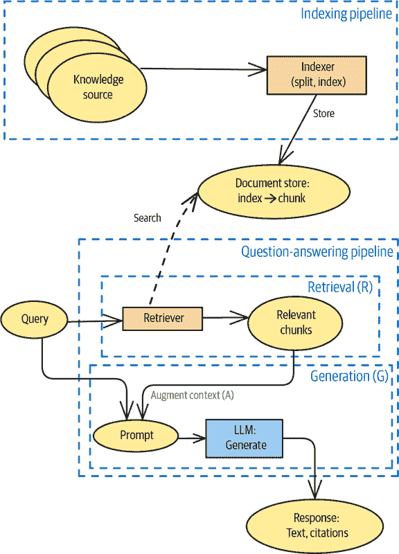

**图 3-2.** 由两条流程组成的 RAG 系统：一条用于索引，另一条用于问答

每当收到查询时，就会调用问答流程。这包括两个步骤（见图 3-2）：检索和生成。在检索步骤中，检索器在文档存储中找到与查询最相关的文本块。在生成步骤中，这些相关文本块会被添加到提示词的上下文中，并与用户查询一起用于生成回答。这样，生成的回答就锚定在来自可信知识源的相关信息上。响应包括生成的文本，以及用于生成回答的相关文本块。

让我们来看看这些步骤是如何运作的。我们要重申：生产环境中的 RAG 会比这里描述的复杂得多。

#### 索引

索引流程的工作是对源文档进行索引，以便能够高效地搜索它们。因为你需要搜索返回文档中较小的文本块，所以不能将整个文档作为一个整体来索引——而是需要把文档切分成大小合适的文本块，并对这些文本块进行索引。这些文本块会存储在持久化存储中，以便检索器进行搜索。

我们将使用[LlamaIndex 框架](https://www.llamaindex.ai)来说明这种模式。在 LlamaIndex 中，你可以使用下面的代码将读入的文本转换为[`Document`对象](https://oreil.ly/lPpOF)（[完整代码在 GitHub 上](https://oreil.ly/26wzq)）：

```
# Remove extra whitespace
content = text[start_pos:end_pos].strip()
content = re.sub(r'\n{3,}', '\n\n', content)

# convert into a Document
document = Document(
                text=content,
                metadata={
                    "source": url,
                    "filename": filename,
                    "date_loaded": time.strftime("%Y-%m-%d %H:%M:%S")
                }
            )
```

这段代码暗示了两个我们稍后会进一步展开的想法（见加粗的行）。首先，我们希望文本块信息密度高，因为在生成时我们能添加到输入提示中的 token 数量有限，而我们希望添加的文本块能带来尽可能多的知识。一个简单的事实是，主要由空白字符组成的文本块没有信息量，因此我们要从知识源中移除不必要的空白字符。其次，我们为文档附加元数据，以便可以引用来自该文档的文本块。本章后面的“模式 8：大规模索引”会介绍如何做到这一点，但我们在这里要提醒你：需要记录元数据。

一旦有了文档，就可以使用任何 splitter 类将其切分为文本块。最简单的做法是尝试获得所需字符数的文本块，同时尽可能让文本块由完整句子组成：

```
node_parser = SentenceSplitter(chunk_size=200, chunk_overlap=20)
nodes = node_parser.get_nodes_from_documents([document])
```

LlamaIndex 将文本块称为*节点*，因为正如我们稍后会看到的，我们可能希望将文本块组织成知识图谱。关于上述代码，另一点需要注意的是，我们通过在文本块之间添加重叠来减少重要信息被分割到两个文本块中的问题。

要存储文本块，可以使用文档存储：

```
docstore = SimpleDocumentStore()
docstore.add_documents(nodes)
```

`SimpleDocumentStore` 将节点存储在内存中，但也支持 MongoDB、Postgres 和 Redis 等其他文档存储。你可以使用这些数据库对应的构造函数，但创建后的 `docstore` 用法与 `SimpleDocumentStore` 完全一致。例如，要将节点持久化到 Firestore（一种常用于移动应用的数据库），你可以使用以下代码创建文档存储：

```
docstore = FirestoreDocumentStore.from_database(
    project="project-id",
    database="(default)",
)
```

然后使用以下代码添加节点：

```
docstore.add_documents(nodes)
```

索引这一步将从知识源检索到的文档切分为文本块，并使这些文本块可被搜索。

#### 检索

检索流水线的工作是高效地在文档存储中搜索与给定查询相关的文本块。

例如，假设你有一个文档存储，其中包含取自 [*亚历山大远征记*](https://oreil.ly/uz8ui) 的文本块。该书讲述了亚历山大大帝征服波斯帝国的历史。你想搜索与问题相关的文本块，于是让模型这样做：

> 描述亚历山大与第欧根尼之间的关系

你会检索到哪些文本块？

直觉上的答案是，你会查找包含查询中词项的文本块。包含查询中更多单词的文本块更可能与查询相关。这被称为*词频*（TF）。同时，像 *describe* 或 *the* 这样的词不太重要，因此词的相对稀有性也很重要。作为一种快速解决办法，我们可以删除像 *the* 这样极其常见的词。这些词被称为*停用词*，其列表很容易获得。

更精巧地定义词项*稀有度*的方法是：包含该词项的文本块所占比例的倒数。（实际中，使用该比例的对数。）这被称为*逆文档频率（IDF）*。为什么叫文档频率而不是文本块频率？这是因为搜索引擎查找的是与查询匹配的文档，所以在搜索引擎学术文献中，RAG 中的文本块相当于文档。把这两个概念放在一起，寻找包含查询中更多稀有词项的文本块这一思路就产生了一种度量方法，称为 [TF-IDF](https://oreil.ly/UbeHA)，其公式如下：

$$

tf_{idf}(chunk,term) = \frac{count(term,chunk)/\sum_{term}count(term,chunk)}{\log\left( count(chunk)/count\left( chunk \middle| term \in chunk \right) \right)}

$$

这里，`count(term, chunk)` 是词项在文本块中出现的次数，`count(chunk)` 是文本块的数量。词项的 *TF-IDF* 越高，文本块与该词项相关的查询的相关性就越高。将查询中所有词项的 *TF-IDF* 加起来，就得到该文本块的总相关性。

假设你将亚历山大传记切分为 200 个字符的文本块。你会发现，词项 *relationship* 的 TF-IDF “权重”为 0.26，*Alexander* 的权重为 61.04，*Diogenes* 的权重为 1.01。这意味着我们会得到大量包含 *Alexander* 的文本块，无论它们是否包含 *Diogenes*。*Alexander* 的 TF-IDF 压倒了 *Diogenes*，因为在一本关于亚历山大的书中，*Alexander* 的词频远高于 *Diogenes*：*Alexander* 出现了 1,311 次，而 *Diogenes* 只出现了 6 次。因此，分子压倒了分母。一种解决方案是通过将词频定义为 `count / (count + k)` 来饱和分子，其中 `k` 是正数。你可以很容易地验证，该公式随 count 增加而增大，但绝不会超过 1。

一种名为 [BM25](https://oreil.ly/jt3Za) 的算法对 TF-IDF 进行了修改，在分子中实现词项饱和，在分母中应用基于信息论和概率相关性的不同校正。结果证明，这种度量在搜索问题中识别相关文本方面[非常成功](https://oreil.ly/CF4mp)。要在 LlamaIndex 中构建 BM25 检索器，需要传入文档存储，以便它能计算其中存储的文本块中所有词项的 IDF：

```
retriever = BM25Retriever.from_defaults(
    docstore=index.get_docstore(),
    similarity_top_k=5)
```

最后一个参数表示你希望检索器每次返回最相关的 5 个文本块。

你可以使用以下代码，通过此检索器获取与查询相关的文本块（或 LlamaIndex 所称的*节点*）：

```
retrieved_nodes = retriever.retrieve(query)
for node in retrieved_nodes:
     print(node)
```

对关于亚历山大与第欧根尼之间关系的查询执行上述操作，会得到如下节点：

```
Node ID: ee1ef41e-3e31-4e07-9949-5e585a50651c
Similarity: 4.2463765144348145
Text: But Diogenes said that he wanted nothing else, except that he and his 
attendants would stand out of the sunlight. Alexander is said to have expressed
his admiration of Diogenes’s conduct.
```

这些检索到的节点的文本，正是你将在生成阶段添加到提示上下文中的内容。接下来看看如何操作。

#### 生成

检索到一组相关节点后，你可以用它们来填充将发送给 LLM 的消息，如下所示：

```
# instruction
messages = [
    ChatMessage(
        role="system", 
        content="Use the following text to answer the given question."
    )
]
# context
messages += [
    ChatMessage(role="system", content=node.text) for node in retrieved_nodes
]
# query
messages += [
    ChatMessage(role="user", content=query)
]
```

注意，第一条消息是指令，中间的消息构成上下文，最后一条消息是要回答的查询。然后，将这些消息发送给 LLM：

```
llm = Anthropic(
    model="claude-3-7-sonnet-latest",
    api_key=os.environ['ANTHROPIC_API_KEY'],
    temperature=0.2
)
response = llm.chat(messages)
```

我们运行后，得到的答案如下：

根据这段文字，亚历山大与第欧根尼有过一次简短但引人注目的互动。当亚历山大见到第欧根尼时，第欧根尼只是请求亚历山大及其随从“别挡住阳光”，而不是索取任何恩惠或礼物。据说亚历山大对第欧根尼的举止表示钦佩，对这位哲学家简朴而独立的本性心怀敬意。

这段文字还引用了亚历山大的一句话：“如果我不是亚历山大，我愿成为第欧根尼。”这表明亚历山大敬重第欧根尼的人生态度，甚至或许羡慕他摆脱世俗羁绊的自由。文中指出，这次互动表明“亚历山大并非完全缺乏更好的情感”，尽管他仍然是“其永不知足野心的奴隶”。


如你所见，答案相当明确地植根于这段历史文本。除了将检索到的节点用作上下文之外，你还应在响应中将它们一并返回，以便用于形成引用列表。`LlamaIndex`节点会携带其来源文档的元数据，以及该分块在文档中的位置。

### 示例

我们将上述各部分整合到一个端到端系统中，该系统索引了 Project Gutenberg 中的文本文件，并基于这些文本生成问题答案。完整代码在[GitHub](https://oreil.ly/CUIVp)上。另请注意，在我们的示例中，我们假设你已经将所有文档转换为文本，并从文档中提取了图像和表格。

像这样的基础 RAG（基于关键词搜索的那类）最适合事实性材料。因此，我们将一份[设备手册](https://oreil.ly/P6TPU)加载到 RAG 系统中，并询问了这样一个问题：

> 如果隔膜破裂了，我该怎么办？

答案是：

> 如果隔膜破裂，您应更换一个完好的安全头。此外，如果您发现隔膜处出现撕裂、分离或泄漏，则应更换整个阀-隔膜组件。

>

> 在处理隔膜部件时，请记住用手（不要用扳手）拧开隔膜盖，并注意不要通过转动针体来扰动轭块的位置，因为这会影响阀针的调节。

>

> **来源**：

>

> 节点 ID：`6afc9709-b53b-4fc9-8f7e-b1bbf198f9b0`

>

> 文本：检查隔膜是否完好。如果隔膜破裂，请用完好的安全头更换。

>

> 得分：4.869

>

> 节点 ID：`b84ca5bf-c79d-4040-8766-7c528e693559`

>

> 文本：（3）拧下隔膜盖，取出垫圈、支撑件和阀-隔膜组件。为防止阀针调节失效（图 54），请勿通过转动针体扰动轭块的位置。

>

> 得分：3.282

很明显，RAG 系统选取了文本中非常相关的部分，并利用它生成了一个不错的答案。

### 注意事项

RAG 非常适合为 LLM 增添事实性知识。它的工作方式是找到与当前查询最相关的知识，并将其纳入提示的上下文之中。

#### 备选方案

没有任何控制风格的技巧（参见第 2 章）能够增加知识。很明显，诸如对数掩码（模式 1）之类的模式之所以行不通，是因为你需要 LLM 先能够生成这些标记，然后才能对它们进行掩码处理。如果 LLM 只见过 2025 年之前的文本，那么与教宗利奥十四世相关的标记出现的可能性极低，甚至根本不会被列为候选。这同样适用于少样本学习和微调。仅仅向 LLM 展示几个过去更换过球队的 NFL 球员示例，并不足以让它生成关于吉诺·史密斯更换球队并加盟突袭者队的文本。同样，LLM 必须生成能够通过指令微调来调整的权重，而对于 LLM 从未遇到过的标记组合，这根本不可能实现。你需要那个具体的数据点，而你唯一知道它的时刻是在推理期间。

#### 局限性

我们在本章讨论的基础 RAG 存在以下局限性，本章中的其他模式将对此加以解决：

**需要精确匹配**：

TF-IDF 和 BM25 通过精确匹配关键词来寻找相关性。假设我们不问*破裂*的隔膜，而是问一个*损坏*的隔膜：

> 如果隔膜损坏了，我该怎么办？

返回的答案完全不同：

> 如果隔膜损坏了，您需要更换阀-隔膜组件。

之前的答案要求我们更换安全头，而当前的答案告诉我们更换阀-隔膜组件。这非常糟糕。理想情况下，无论机械师使用哪个词，我们都希望相关的分块是相同的。相关分块的识别应基于理解问题并判断该分块是否包含查询意图的答案。仅仅查看特定关键词是否匹配会导致不良结果。

**分块大小的限制**：

由于生成是基于添加到上下文中的文本，分块中后续文本的数量会影响答案的全面性。例如，当你将设备手册按 100 个字符进行分块时，通常无法容纳后续步骤。输入的标记数量越长，成本越高，响应越慢。因此，你能使用的分块大小是有限制的。

本章及下一章中将介绍的几种模式——语义索引（模式 7）、规模化索引（模式 8）、索引感知检索（第 4 章中的模式 11）、节点后处理（第 4 章中的模式 10）、可信生成（第 4 章中的模式 11）和深度搜索（第 4 章中的模式 12）——都能提升基础 RAG 系统的能力。然而，首先你应该仔细评估：应用这些模式而增加的复杂性是否真的能带来可量化的收益。此外，这些模式应被视为基础 RAG 的附加组件。例如，在许多情况下，一个仅使用基于嵌入的检索器（而没有 BM25 这类基于关键词的检索器）的 RAG 系统是不够的。在查询中缺少关键词精确匹配时，你的 RAG 系统在搜索特定产品、物料代码等内容时将难以识别出应检索的正确文本。

### 参考文献

2020 年，Lewis 等人在经典论文[《面向知识密集型 NLP 任务的检索增强生成》](https://arxiv.org/abs/2005.11401)中引入了 RAG。2024 年，Gao 等人[评述了不同的 RAG 变体](https://arxiv.org/abs/2312.10997)，并提出了一个用于 RAG 系统的评估框架。2025 年，Fareed Khan 在[一个共同的评估框架下比较了 18 种 RAG 变体](https://oreil.ly/jeix1)。

[AWS](https://oreil.ly/Spr-4) 总结了其在帮助客户构建真实世界 RAG 过程中吸取的经验教训。[Mercado Libre](https://oreil.ly/kf_ZP) 分享了构建 RAG 系统的真实经验与洞见。

## 模式 7：语义索引

基于关键词的索引（如基础 RAG 模式那样）无法捕捉分块的含义，并且当知识由自然语言文本、图像、视频或表格组成时，它存在显著局限性。然而，语义索引使用分块的含义作为索引机制，有助于缓解这些局限性。

### 问题

当文档变得更复杂、包含图像或表格等不同媒体类型、或跨越多个领域时，传统的关键词索引和查找方法就会失效。

假设你有一份文档，并尝试用以下查询来找到它：

> AI 系统如何处理医学术语歧义？

假设知识库中的正确答案开头是这样的：

> 人工智能模型在准确处理医疗信息方面存在困难。在解析患者病历时，这些系统经常误解类似 CHF 的缩写，它既可以指充血性心力衰竭，也可以指慢性心力衰竭——这两种情况需要不同的治疗方法。……

如果使用基于关键词索引的基本 RAG 方法，你很可能无法检索到包含上述片段的文本块。这是因为查询中提到了“AI”，而该文本块提到的是“Artificial Intelligence”，并且通篇没有提到“术语歧义”。

基于关键词的索引方法在处理以下文本、写作、交流和文档中的要素和方面时，难以将查询与文本块进行匹配：

- **同义词和代词**：传统关键词索引无法处理歧义和行业术语（例如 *AI* 一词）。如果某个文本块提到“总统”，而查询中包含总统的姓名，则两者将无法匹配。

- **整体含义**：关键词索引会遗漏文本块的整体含义，例如答案实际上是在讲技术歧义，即使它没有使用这些词语。

- **跨语言能力**：如果文档是英文，而查询是西班牙文，那么要么没有匹配结果，要么匹配结果可能不相关。

- **多模态文档**：传统索引方法无法对文本以外的媒介（如图像或视频）进行索引。

- **版式上下文**：传统索引方法忽略了信息排版方式中固有的含义，例如表格，或图注与正上方图片相关的这一事实。

在这种情况下，如果我们能基于含义（而不仅仅是关键词）将文本块与查询进行匹配，那会更好。

此外，使用精确匹配可能会导致大量误报。以答案中的缩写 *CHF* 为例：它可能表示“充血性心力衰竭”、“临界热通量”，甚至“瑞士法郎”。这一切都取决于上下文和整体含义。

### 解决方案

上述问题可以通过语义索引来解决。借助语义嵌入，你可以使用一个 ML 模型将文本“编码”为固定的向量表示，从而捕捉文本、图像和其他媒体类型的含义（参见图 3-3）。文本块由该向量嵌入建立索引，这种文档存储被称为*向量存储*。在本解决方案中，我们将从文本嵌入开始，然后扩展到其他媒体类型。

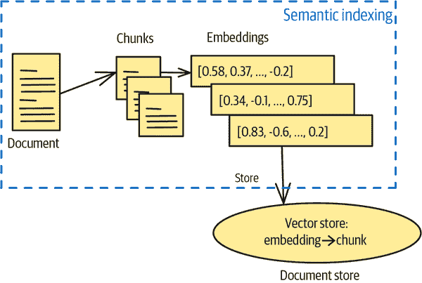

**图 3-3.** 语义索引：此处的文档存储（称为向量存储）按嵌入索引存储文本块

#### 嵌入

*嵌入*是文本、图像或其他输入类型的数学表示。它们通过将单词、短语或文档映射到高维空间中的向量来捕捉语义含义。LLM 已经非常擅长创建具有语义代表性的嵌入，因为这一能力构成了 LLM 生成的基础。

与简单的关键词匹配不同，嵌入会将语义相似的内容在向量空间中放置得很近，即使它们使用不同的词汇。为了展示这种显著差异，我们来看下面的例子：

```
chunks = [
    "I really enjoyed the film we watched last night",
    "The movie was excellent",
    "I didn't like the documentary",
    "The cinematic experience was remarkable"
]
 
# Keyword-based approach
vectorizer = CountVectorizer()
keyword_vectors = vectorizer.fit_transform(chunks)
keyword_matrix = keyword_vectors.toarray()
 
keyword_sim_matrix = plot_similarity_matrix(
    chunks,
    keyword_matrix,
    title="Keyword-based Similarity Matrix"
)
```

如果你运行这个示例，你会得到以下相似度结果。使用关键词方法时，没有任何“文档”实际上是接近的（高度相似的文档得分接近 1）。图 3-4 展示了相似度矩阵的可视化结果。

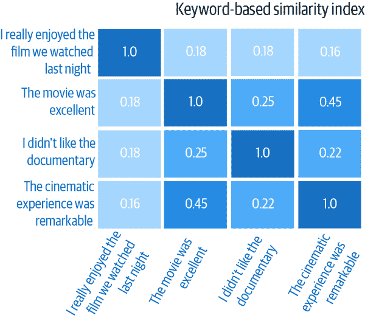

**图 3-4.** 基于关键词之间相似度的矩阵

如果你现在运行同样的相似度查询，但改用嵌入，你会发现所有得分都更高（参见图 3-5）。这是因为所有文档都在讨论电影，而且有一个文档与查询非常相似。在关键词方法中，得分较低是因为 *movie* ≠ *film*、*excellent* ≠ *great*，但嵌入能够捕捉这些词之间的相似性：

```
model = SentenceTransformer('all-MiniLM-L6-v2')
embedding_vectors = model.encode(chunks)
 
# Query
query = "The film was great"
query_embedding = model.encode([query])[0]
 
embedding_sim_matrix = plot_similarity_matrix(
    chunks,
    embedding_vectors,
    title="Embedding-based Similarity Matrix"
)
```

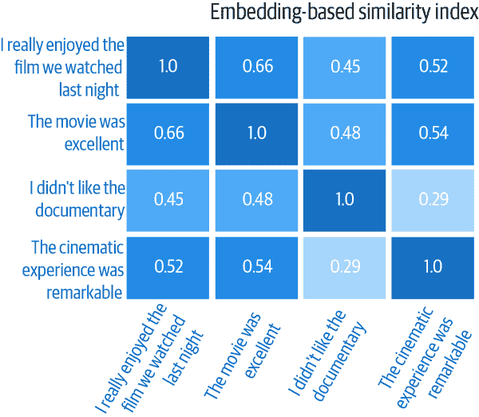

**图 3-5.** 基于嵌入之间相似度的矩阵

**注意**

虽然增加嵌入维度可以捕获更多语义信息，但这种方法面临显著的计算限制。随着维度增加，嵌入之间的相似度搜索复杂度会按 N（维度）× M（嵌入数量）的比例增长，在最坏情况下可能达到 N² 的时间复杂度。这种[*维数灾难*](https://oreil.ly/roy8-)会在生产应用中造成严重的性能瓶颈。

因此，最佳的嵌入设计通过以下方式在表示能力与计算效率之间取得平衡：

* 使用足以充分捕捉语义关系的最小维度

* 在可能的情况下采用降维技术

* 在可能的情况下尝试使用最近邻近似

目标是创建既能为实际应用提供足够的语义表示，又能维持合理计算需求的嵌入。

现在，你可能会想嵌入的极限是什么。能不能把整本书都嵌入进来？

尽管最新的 LLM 提供了巨大的上下文窗口，但将整个文档编码为单个嵌入向量通常并不可取。你会丢失文本不同部分的细微差别，丢失关键信息，并使 RAG 系统难以检索相关信息。此外，大规模使用大上下文窗口的成本非常高。更好的做法是将文档切分成信息密集且自洽的文本块。

#### 语义分块

*语义分块*是根据语义内容而非任意长度将文本划分为有意义的片段。最朴素的分块方式是基于字数或字符数，但这可能会拆散紧密相关的部分并丢失上下文。而语义分块则能保留上下文和含义。

有几种将文本划分为片段的方法（另请参见图 3-6）：

- **基于长度且带重叠**：这是最直接的方法。你可以将文档切分为固定长度的文本块，并使片段之间有所重叠。这有助于在文本块边界之间保留上下文，但仍可能拆分上下文块。

- **基于句子的分块**：

这种方法将文本分块为完整的句子组，直到达到大小阈值。它保留了文本块的基本语义，但在捕捉主题转换方面存在困难。

**基于段落的分块：** 这种方法使用自然段落作为分块边界。它适用于结构化文档。

**基于文档结构的分块：** 各种文档格式（如 Markdown 或 Markup）提供了一种结构，你可以利用该结构将文档分块为多个子部分。例如，你可以将 Markdown 文件按二级标题分块。

**基于语义转换的分块：** 你可以使用主题建模技术（如潜在狄利克雷分配和非负矩阵分解）或更小子文档部分的嵌入来识别语义转换。当检测到转换时，将文档拆分为新的块。这种方法保证了块的语义连贯性。

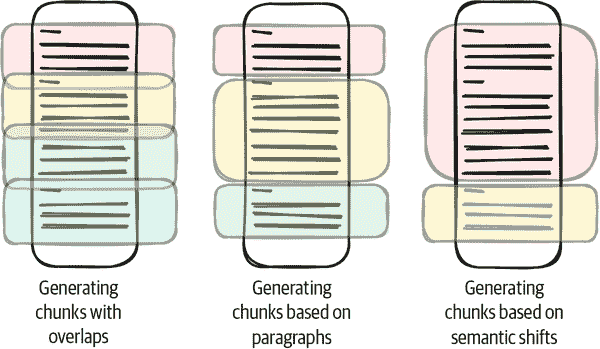

**图 3-6. 不同的文档分块选项**

**提示：** 有多个 Python 库提供了不同文本分块方法的详细实现。虽然不推荐用于生产环境用例，但 [LangChain 的 `TextSplitting`](https://oreil.ly/iGEHW) 方法是引导分块功能的一个很好的起点。

#### 处理图像和视频

到目前为止，我们只讨论了文本文档，所以你可能想知道如何处理包含相关图像的文档，或如何将视频添加到文档索引中。

为了处理图像，你可以使用*光学字符识别*（OCR）方法（参见图 3-7）。现代 OCR 工具可以从文档中提取图像，并将图像保存到与提取文本相邻的媒体文件夹中。某些类型的文档提供图像的替代文本和元数据，你可以直接使用它们，而不必使用图像本身。对于其他类型的文档，你有两种选择来捕获相关图像的内容。

第一种选择是使用像 Llama-3.2-9B 这样的 LLM 来描述图像。然后你可以用文本描述替换图像，之后按照前面讨论的方式对文本进行分块并索引各个块。

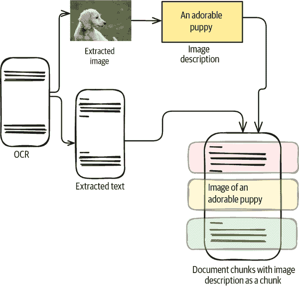

**图 3-7. 图像的处理（照片由 Elise Farrow 拍摄于 Unsplash）**

第二种选择是直接将图像传递给 LLM 以生成嵌入。多模态模型允许为文本和图像创建嵌入，从而使它们的向量空间在语义上重叠。

你可以用类似的方式处理视频。如果要将视频添加到索引中，可以将视频转录为文本。如前所述，你可以像处理任何其他文本一样处理、分块和嵌入该文本。此外，你可以通过按固定时间间隔或场景变化采样关键帧，将视频分解为单帧图像。然后，你可以像处理普通图像一样嵌入生成的图像。

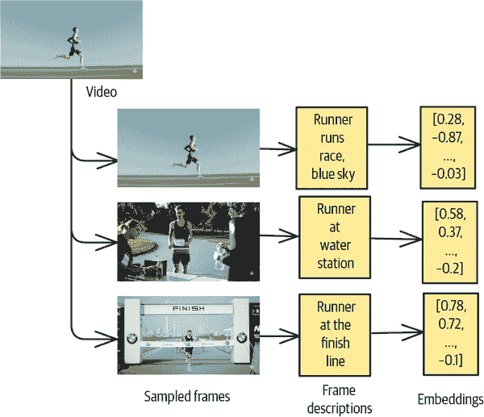

**图 3-8. 视频的处理**

#### 处理表格

表格是组织文档中关键信息的重要结构。它们可能包含研究结果或参与者名单等关键数据，这些数据足以保证以表格形式进行结构化呈现。

在实现 RAG 系统时，必须特别注意表格处理。表格需要特定的索引方法以保留其结构关系，并确保同时捕获内容和内容的有意义的组织。在 RAG 管道中正确处理表格，能够增强检索系统在生成过程中查找和利用这种结构化信息的能力。

对于表格的索引，你有多种选择。首先，你应该处理所有缺失值，并确保表格格式一致。

关于分块策略，你有四种选择：

- **基于表格的分块：** 如果表格较小，你可以嵌入整个表格。这是最简单的分块方法，但无法为查询提供细粒度的结果。

- **基于滑动窗口的表格分块：** 与处理文本时一样，你可以在表格上滑动并索引各块。跟踪表头，并将表头附加到每个块上以提供更多上下文。这种方法适用于大型表格。

- **基于行的分块：** 你可以按行对大型表格进行分块，并嵌入每一行。这种方法适用于语义上不相关的行，例如随机银行交易表。

- **基于列的分块：** 多种类型的表格（例如随时间变化的测量数据）受益于将信息“保持在一起”。如果表格较大，你可以嵌入各个列。

在对表格周围的整体文本进行分块之前，尽量将表格的元数据保留在文本块中。这可以是表格名称，也可以是列标题的详细描述（可能提到具体单位）或整个表格的描述。

#### 处理行业术语

在传统的 RAG 系统中，如果你的用户搜索术语*心脏病发作*，RAG 系统将无法检索到使用非常专业的医学术语来表示*心脏病发作*的文档，例如*急性心肌梗死*或*心肌梗死*。

同样，律师可能会使用基于 RAG 的应用程序来搜索术语*证据开示*。类似“联邦法院中证据开示的时间线是怎样的？”的查询也应该包含引用*披露*或*宣誓证词*的文档。你可以通过查询中的*同义词扩展*来实现这一点，如下所示：

> 联邦法院中证据开示的时间线是怎样的？ -> 联邦法院中 `discovery|disclosure|deposition` 的时间线是怎样的？

*同义词扩展*通过添加相关术语来丰富查询，从而使你的系统能够匹配内容，即使同一概念使用了不同的术语。但你也可以扩展原始文档中的术语。这样做更全面，但会增加索引大小。

在传统的 NLP 中，不同角色或不同地区使用不同的词来表示同一术语，这需要构建一个*词汇表—*一个包含词语语义和语法属性的结构化词汇表*—*来捕获这些变体。嵌入技术使得正式词汇表不再必要，但词汇表对同义词扩展仍然有帮助。因此，你可以通过以下方式处理行业词汇：

- 你可以为你的领域创建一个专门的术语词汇表，以帮助你将术语映射到常见同义词。实现很简单，但需要持续的人工维护。

- 你可以使用共现分析等统计技术来引导构建一个转换词典。通过这些方法，你可以确定相似术语并将它们分组到翻译词典中。

- 你可以使用 LLM 来为你扩展术语，但要警惕潜在的幻觉。


与同义词一样，你可以扩展查询和/或扩展原始文档。

**警告：** 你必须跟踪翻译词典中的方向性，因为某些同义词只在一个方向上有效。例如，考虑*交易所交易基金*（ETF）和*指数基金*。ETF 是一种指数基金，但指数基金不一定是 ETF。如果你在同义词词典中维护显式的关系，就可以解决这个问题。

## 上下文检索

传统 RAG 系统在将文档切分成过小的文本块时会丢失上下文信息。然而，如果文本块过大，生成的嵌入又可能缺少具体细节。*上下文检索*（Contextual Retrieval）通过在每个文本片段被嵌入或索引之前，为其添加针对该文本块的解释性上下文，来解决文本块过小时上下文丢失的问题。

假设你已经对一份财务报告进行了分块，并得到了以下文本块：

> 这家公司的亏损同比减少了 10%

借助上下文检索，你可以通过整体章节或文档的上下文摘要，来保留这个相当随意的文本块的上下文。因此，经过上下文增强并带有同义词扩展的文本块可能如下所示：

> 该文本块是沃尔玛的财务报告，发布于 2025 年第四季度。上一季度的收益增长了 2%。这家公司的亏损同比减少了 10%。

要创建这样的上下文增强文本块，你需要先对文档进行摘要，再将该摘要前置到文档文本块之前。为了高效完成此操作，你可以遵循 [Anthropic 的建议](https://oreil.ly/l7TnX)，使用一个 LLM 并向其发送以下提示：

> <document>
>
> {{WHOLE\_DOCUMENT}}
>
> </document>
>
> 这是我们希望在整个文档中定位的文本块
>
> <chunk>
>
> {{CHUNK\_CONTENT}}
>
> </chunk>
>
> 请给出一个简明扼要的上下文，将该文本块定位到整个文档中，以改善对该文本块的搜索检索效果。只输出该简要上下文，不要输出其他内容。

Anthropic 已证明，使用这种提示结构和 Claude LLM 进行上下文检索，在不同内容领域中将错误检索率持续降低了 67%。由于文档内容（位于 `document` 标签之间）是提示的第一部分，因此可以被缓存，这使得处理过程便宜且高效（见第 8 章中的模式 25“提示缓存”）。一旦你将文档上下文前置到各个文档文本块中，就可以将经过上下文增强的文本块嵌入到语义向量和 BM25 向量中，从而获得最准确的 RAG 响应。

## 分层分块（替代分块技术）

传统 RAG 系统通常只检索较短的文档文本块，这限制了它们对整体上下文的全面理解。对于研究论文和整本书这类长文档来说，这会带来麻烦。

为了解决这个问题，你可以增大文本块并让它们相互重叠。这会扩大上下文窗口，以获得更好的理解，但在生成嵌入时可能会丢失一些细微差别。

*分层分块*是语义分块的一种扩展，能更有效地解决这个问题。在处理阶段，你从底部开始构建一个反向树结构：先将文档划分为更小的片段并嵌入这些片段；然后，你可以将这些片段聚类成组，并为这些聚类创建摘要；接着，再对这些摘要进行嵌入、聚类和总结，依此类推，直到只剩一个节点，即树根（见图 3-9 的右上角）。一种更先进的分层分块与检索方法称为*递归抽象处理与树组织检索*（RAPTOR）。

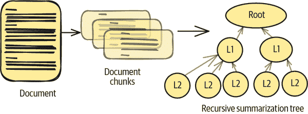

**图 3-9：** RAPTOR 的文档处理阶段

在推理阶段（见图 3-10），你沿树向下遍历，直到找到最终的文本块。首先，你找到第一级节点中最近的嵌入；然后，你与所选第一级节点对应的所有第二级节点进行匹配，依此类推。每个文本块和摘要节点都需要有自己的嵌入，因此这一过程是递归的，而不是单步嵌入过程。

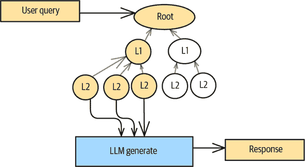

**图 3-10：** RAPTOR 的推理阶段

[该过程](https://arxiv.org/abs/2401.18059)可以提供不同粒度的文档信息。你会先得到高层摘要，然后是中层摘要，最后是非常具体的文本块。所有检索到的文本块都为生成步骤提供了全面的上下文。

分层分块是 GraphRAG 的一种简化版本，在第 4 章模式 9 的“组件 4：GraphRAG”一节中进行了讨论。

## 示例

在本示例中，我们将演示如何为表建立索引，以便查询特定的表格数据。为简单起见，我们只关注表格数据的索引和查询。

假设我们有结构化格式的表格数据——如果你从关系型数据库或电子表格中提取表数据，情况就是如此。如果你没有结构化格式的数据，则需要事先转换。

假设我们正在为一个小型产品目录建立索引。每个条目都有名称、描述以及许多数值字段和布尔字段：

```
[{
    'product_id': 2,
    'name': 'Wireless Noise-Canceling Headphones',
    'description': headphones with active noise cancellation',
    'category': 'Electronics',
    'price': 349.99,
    'in_store': True
    ...
}, 
...]
```

首先，我们需要对产品字段进行预处理，并且按列类型执行预处理。例如，一行中的所有文本字段都会被拼接并嵌入成一个向量：

```
def encode_text_embeddings(model, text_data):
    # Combine text fields into a single string for each row
    embeddings = []
    for _, row in text_data.iterrows():
        text = f"""Product: {row['name']}. Description: {row['description']}.
Category: {row['category']}
"""
       embeddings.append(model.encode(text))
    return embeddings
```

处理数值数据（如销售价格或股票价值）时，你需要采用与文本数据不同的准备方式。你应该将所有数值缩放到 0 到 1 之间，这一过程称为*归一化*。

为什么归一化很重要？稍后，你会将这些归一化后的数值与文本嵌入（文本的数值表示）相结合。通过确保所有数值都在相同的 0 到 1 范围内，RAG 系统在搜索相似内容时就能同时恰当地考虑文本和数值信息。

下面的示例展示了如何实现归一化函数。另外，这里有一个针对生产系统的重要提示：你必须保存初始设置时使用的缩放参数（`scaler`）。这样，你就能对之后进入的新数据应用完全相同的缩放变换，从而确保整个 RAG 系统的一致性：

```
def encode_numeric_data(numeric_data):
    # Normalize numeric values
    scaler = StandardScaler()
    normalized_numeric = scaler.fit_transform(numeric_data)
    return normalized_numeric
```

将所有字段转换为嵌入数据后，你可以遍历表格数据并拼接各个数值表示。连接不同数据表示的方法有很多种，但在本示例中，你只需拼接向量即可：

```
def create_hybrid_embeddings(text_embeddings, numeric_data, boolean_data):
    # Combine the embeddings
    hybrid_embeddings = []
 
    for i in range(len(text_embeddings)):
        # Concatenate approach
        combined = np.concatenate([
            text_embeddings[i],
            numeric_data[i],
            boolean_data[i]
        ])
 
        hybrid_embeddings.append(combined)
 
    return np.array(hybrid_embeddings)
```

现在，您可以将这些向量 upsert（插入或更新）到文档存储中，以便稍后进行查询。在这里，您将使用 ChromaDB 来存储和查询这些嵌入向量：

```
collection = client.get_or_create_collection(
    name="product-catalog",
    metadata={"hnsw:space": "cosine"}
)
 
...
collection.add(
    ids=ids,
    embeddings=create_hybrid_embeddings(...),
)
```

如果您想对已嵌入的表格数据执行查询，则需要为您的搜索数据创建一个嵌入。文本嵌入是从用户查询生成的，例如：“适合游戏和工作的顶级笔记本电脑”。由于在推理步骤中您不知道所需产品的数字特征，因此可以使用所有产品的中位数向量。（这种简化的方法见第 4 章中的“模式 9：索引感知检索”。）嵌入所有元素后，您需要像在索引阶段那样拼接嵌入向量。

```
text_embedding = model.encode([query])[0]
median_numeric = calculate_median_values(df)
boolean_embedding = np.array([1]) # Assuming you're looking for in-stock products
 
# Create hybrid embedding for the query
query_embedding = np.concatenate([
    text_embedding,
    median_numeric,
    boolean_embedding
])
 
results = collection.query(
    query_embeddings=[query_embedding.tolist()],
    n_results=1
)
```

如果您搜索“适合游戏和工作的顶级笔记本电脑”，那么演示索引中的第一个搜索结果将是“Gaming Laptop Pro”。

> 查询 1：适合游戏和工作的顶级笔记本电脑
>
> 产品：Gaming Laptop Pro
>
> 类别：电子产品
>
> 价格：$2,499.99
>
> 评分：4.8（156 条评论）
>
> 库存：有货
>
> 距离：0.8110852241516113

## 注意事项

语义索引涉及使用通用嵌入模型预计算嵌入向量，并将其存储在向量存储中。然后，在生成过程中，将嵌入向量与提示最相似的文本块添加到提示上下文中。

### 替代方案

除了使用通用嵌入模型，您还可以使用领域特定模型。如果您的整个知识库只包含一个 PDF 文件（例如），您可以将整个文档直接塞入提示中。

#### 领域特定的嵌入模型

使用专门针对您所在行业文献进行预训练的嵌入模型（例如[医学](https://oreil.ly/cz9o3)、[法律](https://oreil.ly/nrx4S)或[金融领域](https://oreil.ly/Qtb3U)）可以显著提高检索精度并降低延迟。这些专门的模型能够捕捉通用模型可能遗漏的领域特定术语、关系和细微差别。例如，医学嵌入模型能理解“MI”指的是“心肌梗死”，并正确地将相关的心脏术语聚类。因此，您可以为领域特定的嵌入模型优化较小的嵌入维度。这最终会改善您的生产延迟，因为更小维度的向量上的相似性计算会更快。

#### 分块与长上下文窗口

在撰写本文时，长度高达 200,000 个令牌（约 500 页）的文档也能很好地适应大多数 LLM 的上下文窗口，不需要任何 RAG 应用。因此，对于较小的语料库，您可以避免处理 RAG 系统的复杂性。请参阅本章后面的“RAG 与大上下文窗口”边栏讨论。

虽然长上下文窗口模型可以处理整个文档，但具有适当重叠的策略性分块通常能为特定信息需求提供更好的检索性能。有效的分块策略能够平衡粒度与上下文连贯性，从而确保相关概念保持在一起，同时能够精确检索特定信息。

### 局限性

虽然语义索引非常强大，但您应该注意其局限性：

- **固定维度表示约束**：大多数嵌入模型将文本映射为固定维度的向量（通常为 768–4,096 维），并在这一过程中产生固有的信息瓶颈。这意味着复杂、精微的文本块必须与简单的文本块被压缩到同一向量空间中，因此不可避免地会损失一定的信息深度。随着文档复杂度的增加，这种压缩变得更加成问题，尤其是对于高度技术性或内容复杂的文档。

- **分块挑战**：出于索引目的将文档分成更小的片段，可能破坏其语义连贯性，并使其丢失章节间重要的交叉引用连接。例如，如果某个概念在文档的一个章节中引入，又在另一章节中详细阐述，分块可能会将这些相关部分分开，导致难以检索到完整上下文。此外，确定最佳分块大小与其说是科学，不如说是一门艺术，而且往往需要针对特定领域进行调优。

- **向量数据库可扩展性问题**：随着向量集合增长到数百万或数十亿个嵌入向量，您需要使用近似最近邻（ANN）搜索技术（如[ScaNN](https://oreil.ly/9JTu9)和[Faiss](https://oreil.ly/8KlOh)）来维持合理的查询时间。这样做是以牺牲检索准确性换取速度，而且这些近似方法还会在召回率、精确率和计算效率之间引入权衡，使得规模化优化变得越来越困难。

- **时间理解问题**：标准语义索引通常不考虑基于时间的关系或文档新鲜度，而这在某些应用中可能至关重要。如果忽略了时间维度，快速变化的信息（如新闻、市场状况和不断演进的研究）可能会被错误表示。此外，嵌入模型通常缺乏区分过时信息与当前信息的内在机制。

- **缺乏推理能力**：虽然向量可以捕捉语义相似性，但如果没有额外的增强，它们无法实现跨文档或跨事实的逻辑推理。嵌入技术擅长查找相关内容，但在需要推断、演绎或因果理解的任务上却存在困难。需要逻辑上将多条信息连接起来的问题往往会暴露这些局限性。

- **文本和图像共享向量空间导致的问题**：在多模态模型中，嵌入后的图像和文本往往无法在共享向量空间中正确对齐。视觉内容与文本内容之间的语义关系可能不一致，从而导致下游出现假阳性检索结果。如果向量空间不能在模态之间正确区分这些概念，那么查询“苹果电脑”可能会检索出水果图片，而不是技术产品。

- **表格数据的表示问题**：当你将归一化的数值数据与文本嵌入拼接时，文本嵌入可能会盖过数值信息。想象一下，你有一个 512 维的文本嵌入，并且想添加两个数值列。在这种情况下，维度会从 512 维增加到 514 维，而新增的两个数值维度将被大得多的文本嵌入严重遮蔽。因此，你需要精心设计嵌入结构，以确保数值数据在相似度计算中保持其影响力。

尽管存在上述限制，语义索引（Semantic Indexing）仍然是当今大多数生产环境中 RAG 应用的核心。

## 参考文献

嵌入的概念及其[为何如此强大](https://oreil.ly/LuF7i)由 Bengio 等人（2000）提出。Chris Olah（2014）对嵌入给出了精彩的[可视化解释](https://oreil.ly/dI3C5)，而 Pinecone 的 Schwaber-Cohen 和 Patel（2025）描述了[分块在 LLM 应用中的作用](https://oreil.ly/OWpHG)。

[Docugami](https://oreil.ly/d4Mu3)在知识图谱 RAG 应用中采用分层分块策略。

## 模式 8：大规模索引

大规模索引（Indexing at Scale）是一组必要的策略，用于处理大规模生产系统中的索引操作。在生产环境中运行 RAG 系统需要处理你在玩具问题和概念验证（PoC）中可能无需涉及的细节——包括数据新鲜度和矛盾信息等细节。

### 问题

在生产环境中运行 RAG 系统会随着时间推移带来若干关键挑战，如果缺乏适当的维护策略，一个最初运行良好的系统也可能逐渐性能退化。我们将在本节中讨论这些挑战。

#### 消除歧义

随着知识库规模的增大，词语产生不同含义的可能性也随之增加。例如，在日常英语中，*流体（fluid）*几乎总是指液体。但在物理学中，液体和气体都是流体。要判断一篇关于流体的文档是否适用于关于氧气的问题，你需要知道这篇文章是为物理科学家撰写的科学文章，还是为普通读者撰写的大众文章。

#### 数据新鲜度

一旦你将初始文档部署到文档存储中，随着新信息的出现，它们不可避免地会变得过时。如果没有系统化的内容更新方法，你的 RAG 系统将不断提供越来越过时的回答。

想象你正在使用一个 RAG 系统为用户提供医疗问题建议。卫生当局可能会发布新的警告。医学委员会可能会更新剂量建议。新的病毒株可能会流行起来。例如，2020 年初，美国疾病控制中心（CDC）建议所有 COVID 患者隔离 10 天。随后在 2021 年 12 月，它更新了指南，将隔离期缩短为 5 天，但仅适用于有症状的患者。最后，在 2024 年 2 月，CDC 再次[更新了其指南](https://oreil.ly/35DSM)，完全取消了隔离期，只表示 COVID 患者只要感觉不适就应该待在家里。

在 CDC 的例子中，每次对建议的更新都会在先前指南的基础上增加条件。事情并不像只保留最新建议那么简单——如果你简单地删除早期指南，最新更新就会失去其上下文。

因此，需要谨慎处理数据新鲜度问题。

#### 矛盾信息

基于相似度的标准检索往往缺乏重要的上下文理解，这可能导致不相关或不恰当的结果。

想象另一个医疗用例：关于高血压相关血压指南的不同医学书籍被纳入你的 RAG 系统。

2017 年之前，*高血压（hypertension）*通常被定义为血压读数达到或超过 140/90 毫米汞柱。对于老年人（65 岁及以上），[根据先前的指南](https://oreil.ly/givgS)，150/80 毫米汞柱这一更高的阈值也被认为是可以接受的。


随后，在 2017 年 11 月，美国心脏协会（AHA）和美国心脏病学会（ACC）[大幅改变了高血压的定义](https://oreil.ly/ZiXAq)，从之前的 140/90 毫米汞柱阈值降至 130/80 毫米汞柱。这一变化一夜之间将数百万美国人重新归类为高血压患者。

随后，该信息再次被修订。2022 年，美国家庭医师学会（AAFP）发布了与较低的 ACC/AHA 目标相矛盾的指南，指出“使用 140/90 毫米汞柱的血压目标在降低心血管和全因死亡率方面与更低目标效果相同”，同时引起的不良反应更少。

正如你在图 3-11 中所见，不断向 RAG 系统添加信息将导致误导性和相互矛盾的 RAG 回答，即使是针对完全相同的初始用户查询的两次不同请求也是如此。

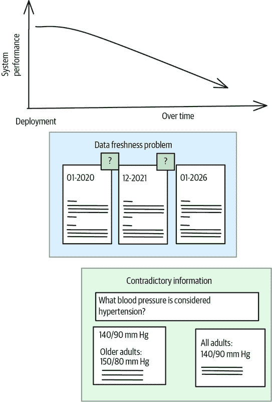

###### 图 3-11：索引规模增大导致 RAG 系统性能下降

#### 模型生命周期

在使用专有模型时，尤其是嵌入模型，你所面临的风险是：当模型提供商弃用其嵌入模型时，你可能需要对整个知识库重新建立索引。

### 解决方案

恰当地使用元数据可以帮助你处理消除歧义的需求，确保结果反映最新信息，并妥善应对相互矛盾的信息。

#### 元数据

使用文档的*元数据（metadata）*——即提供文档相关信息的数�据（如作者、领域和名称）——可以提供额外的上下文，这对提升检索性能非常有益。例如，如果你知道用户对金融信息感兴趣，你可以将文档存储过滤为仅包含金融文档（如美国证券交易委员会\[SEC\]的报告和 CNBC 新闻文章）。通过应用这样的元数据过滤器，你可以有效移除任何与体育相关的内容，这样对“MVP 相关信息”的查询或搜索就不会返回任何体育相关内容。类似地，如果主题类别包含物理学，你就会知道如何解释`fluid`一词。

可以包含在文档存储中的元数据有以下不同类型：

* 文档级元数据

  * 来源信息（URL、文档 ID 和数据库来源）

  * 创建/修改时间戳

  * 作者信息

  * 主题类别或标签

  * 阅读难度或复杂度评分

  * 文档长度

* 分块级元数据

  * 在源文档中的位置（章节、节和段落）

  * 提到的实体（人物、组织和地点）

  * 语义角色（定义、示例或结论）

  * 语言或区域设置信息

* 领域和企业特定元数据

  * 技术文档：API 版本和编程语言

  * 研究论文：方法论、样本量和关键发现

  * 产品信息：库存单位（SKU）、定价和可用性

  * 法律文档：司法管辖区、判例和法规

  * 直接市场准入（DMA）要求方面的知识

* 身份验证、授权和保密元数据

  * 哪些角色被允许访问这些数据？

  * 他们被允许如何进行身份验证？

  * 在这些数据用于 RAG 之前，需要谁提供同意？

  * 对于某些访问级别，是否应对数据进行加密、匿名化或脱敏处理？

当你设计 RAG 系统时，如果（将元数据与嵌入向量存储在一起）会造成重大性能影响，请考虑将元数据与嵌入向量分开存储。某些向量数据库允许你基于二值条件进行过滤（例如，根据某个标签是否存在），而其他向量数据库则允许基于连续值进行过滤（例如，将索引限制为 2025 年 1 月 1 日之后添加的所有文档）。然而，后一种方案会带来性能上的缺点，因为向量数据库通常并未针对这类查询进行优化。

### 检测矛盾内容

查询知识库可能会检索到相互矛盾的文档块，但你可以利用可用的元数据来解决矛盾信息。

以下是几种利用元数据发现矛盾的方法：

* 通过为文档块添加时间戳，或进行*时间标记*，你可以识别信息何时创建或最后更新。如果两个文档块具有不同的时间戳，但包含关于同一主题的冲突信息，这可能表明存在潜在矛盾，而这种矛盾可以通过随时间的变化来解释。

* 使用追踪每个文档块来源的元数据，系统可以识别矛盾是否源于来源不同且可能具有不同可靠性或权威性的信息。

* 按主题领域对文档块进行分类有助于对相关信息进行分组，从而更容易发现特定领域内的矛盾。

* 追踪同一信息的不同版本，系统可以理解事实是如何演变的，并识别过时的信息。

以下是一个如何通过元数据发现矛盾的示例。考虑用户查询“针对状况 X 的推荐治疗方案是什么？”时检索到的以下两个文档块。

这是文档块 1：

```
Content: "For patients with condition X, treatment with medication A is
recommended as first-line therapy."
Metadata:
* Source: National Health Guidelines
* Publication date: March 2023
* Domain: Treatment protocols
* Citation: Journal of Medical Practice, Vol 45
```

这是文档块 2：

```
Content: "Medication A is no longer recommended for condition X due to newly
discovered side effects. Medication B should be used instead."
Metadata:
* Source: Medical Research Institute
* Publication date: January 2025
* Domain: Treatment protocols
* Citation: Recent Clinical Findings, Vol 12
```

这两个文档块在语义上都相关，但它们代表了矛盾的信息。通过元数据，你可以优先选择最新的文档块（来自 2025 年而非 2023 年），或者选择元数据表明发布于更有声望的期刊的文档块。

这种感知元数据的方法通过提供信息为何不同的上下文来帮助解决矛盾，从而使你的 RAG 系统能够做出更好的决策并提供更准确的回答。

### 检测过时内容

保持文档存储中的数据最新是一场持续不断的斗争，因此拥有元数据极为有用。如图 3-12 所示，你可以将元数据用于三个目的：

**检索过滤**：你可以通过限制检索仅考虑在某个日期之后发布的文档块，来限制过时内容。这种方法将确保结果是当前的。

**文档存储清理**：你可以使用元数据从文档存储中移除早于一定天数的文档块。从文档存储中删除旧内容比检索过滤更可取，因为较小的索引可以实现更快的检索。

**结果重排序**：你可以在检索步骤之后使用元数据对文档块重新排序。此时，你可以提升较新的文档块或来自更可信来源的文档块的权重。这种方法优先考虑更相关的内容。

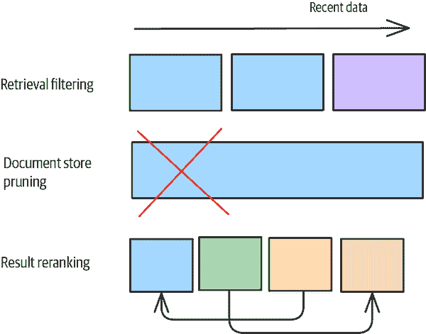

###### 图 3-12. 处理过时内容的不同选项

### 管理模型生命周期

当你使用来自开源或闭源提供商的嵌入模型时，请注意模型的生命周期。像 OpenAI 和 Google 这样的模型提供商倾向于随着时间的推移弃用模型 API。即使弃用期很长（通常为 12 个月或更久），模型 API 的消失也会对你的 RAG 系统产生巨大的工程影响。如果你必须更换嵌入 API，你将需要重新索引文档存储中的所有文档块，因为不同模型版本之间的嵌入不兼容。这可能会导致计算资源的大量消耗。

假设你正在为美国专利申请构建一个 RAG 系统。[美国每天大约批准 1,000 项专利](https://oreil.ly/go6R3)——仅单年而言，这就意味着大约 35 万项专利、数百万页和图表，以及在一个国家单年就有数百万个文档块。所以，你可以看到文档存储会快速增长。

重新索引所有历史文档需要时间，而且成本可能很高。因此，你应该选择支持生命周期较长的模型 API，或者为此任务选择开放权重模型。你可以将此类嵌入模型托管在本地或超大规模云平台上。要找到合适的嵌入模型，我们建议你参考[大规模文本嵌入基准（MTEB）上的嵌入模型排名](https://oreil.ly/zMbC9)，并根据你的需求选择最合适的模型——例如，是否需要多语言嵌入，或者检索或重排序是否是你的 RAG 应用面临的瓶颈。在撰写本文时，Gemini embeddings 综合表现最佳，但阿里巴巴的开放 Qwen2 模型在排行榜上位列第三，综合得分仅低 10%。OpenAI 的最佳模型 `text-embedding-3-large` 则远远落后，排在第 13 位。因此，使用开放权重模型而不是专有模型，可以让你完全控制模型生命周期，而性能上几乎不会或完全不会有所妥协。

然而，这并不意味着你*永远*不应该切换。以下是几个你*应该*考虑切换嵌入模型的场景：

* 当发布了效率明显更高的嵌入模型时（例如，较新的模型能以原始维度的 25% 保留相同的信息内容）

* 当你的应用需要新的世界观时，因为较新的模型具有更近的截止日期，因此了解近期事件或新术语

在选择嵌入模型时做出的决定至关重要，因为它将显著影响你的 RAG 应用长期的可维护性。因此，在选择模型之前，你应该仔细考虑所有选项。

### 示例

基于元数据对你的 RAG 索引进行预过滤可以大幅提高回答准确性。元数据过滤允许你执行诸如按特定文档领域、创建日期和文档来源进行过滤等操作。

假设你有围绕文档块的结构化数据。你需要为每个文档块标注原始文档的元数据（例如，其创建日期和来源），如下所示：

```
documents = [
  {'id': 1,
   'text': '...',
   'source': 'New York Times',
   'created_at': '2025-01-01'
  },
...
]
```

除了嵌入向量之外，你还需要创建一个字典列表，其中包含与已嵌入的文档块相关的元数据。然后，你可以将嵌入向量和元数据一起创建集合。每个向量数据库的实现略有不同，但总体概念始终相同：

```
metadata = []
for j in range(len(documents)):
    meta = {'source': documents['source'][j],
            'created_at': documents['created_at'][j]}
    metadata.append(meta)

collection.add(
  ids=ids,
  embeddings=vectors,
  metadatas=metadata
)
```

为了在推理步骤中对索引进行预过滤，你需要在将其作为`WHERE`子句传递给向量数据库之前构建一些二元过滤器。这里，我们通过 ChromaDB 演示语法和实现：

```
where_conditions = []
for key, value in filters.items():
    where_conditions.append({key: value})

if len(where_conditions) > 1:
    where = {"$and": where_conditions}
elif len(where_conditions) == 1:
    where = where_conditions[0]

results = collection.query(
  query_embeddings=[query_embedding.tolist()],
  where=where
)
```

如果我们将元数据过滤应用于前面产品目录的示例，就可以看到查询结果的不同。首先，让我们运行一个不带任何过滤器的查询：

```
results = process_query(model, client, "Top Gaming Laptop", filters={})
print_results(results, df)
```

然后，我们得到如下结果：

> 产品：游戏笔记本电脑 Pro

>

> 创建时间：2025-01-01

>

> 距离：0.30149245262145996

>

> \--------------------------------------------------

>

> 产品：游戏笔记本电脑 Pro

>

> 创建时间：2024-01-01

>

> 距离：0.30149245262145996

>

> \--------------------------------------------------

>

> 产品：无线降噪耳机

>

> 创建时间：2025-01-01

>

> 距离：0.8581079244613647

如果我们现在想过滤结果，只显示 2025 年添加的产品，我们可以添加过滤器`"created_at": "2025-01-01"`：

```
results = process_query(model, client, 
  "Top Gaming Laptop", 
  filters={"created_at": "2025-01-01"})
    print_results(results, df)
```

返回的结果不会包含 2024 年添加的产品，如无过滤器示例中所示：

> 产品：游戏笔记本电脑 Pro

>

> 创建时间：2025-01-01

>

> 距离：0.30149245262145996

>

> \--------------------------------------------------

>

> 产品：无线降噪耳机

>

> 创建时间：2025-01-01

>

> 距离：0.8581079244613647

### 考虑因素

大规模运行索引会增加 RAG 项目的工程复杂性。我们想指出一些替代方案，并描述使用元数据的一些限制：

**元数据质量问题**：元数据过滤的有效性完全取决于元数据本身的质量和一致性。如果元数据不完整、不准确或应用不一致，那么过滤就会变得不可靠。

**二元限制**：一些向量数据库只允许二元过滤器（例如，标签存在或不存在），与连续值过滤相比，这极大地限制了过滤操作的细微程度。

**时间相关性问题**：简单地使用日期来确定内容相关性可能会产生误导。2020 年的分析可能仍然高度相关，而最新的技术文档可能已经过时。

**领域适应性问题**：使用元数据过滤器是特定于领域的。例如，在面向学术论文的 RAG 系统中，你可能希望按学术机构过滤，而这类过滤器对于客户服务应用来说则无关紧要。

如果这些限制对你而言是决定性的障碍，你可以考虑以下替代方案：

**创建领域特定索引**：对于非常大的索引，按元数据过滤在查询和预处理过程中（例如在近似最近邻时）可能会很慢。不要将所有内容添加到一个索引中，可以考虑按领域拆分索引，并将查询路由到相应的索引。

**实现增量索引**：与其完全重新索引所有文档，不如考虑进行增量更新，只创建新文档或修改索引中的现有文档。与完全重新索引相比，这减少了计算开销。

**维护具有语义关系的文档，无论文档年龄如何**：与其简单移除过时的内容，你可以维护那些彼此之间具有清晰语义关系的文档，这能让系统理解内容随时间的演变。这样做会增加你的文档存储量，并使删除过程更加复杂，但可以提高你的响应质量。

通过根据你的具体用例需求仔细评估这些替代方案，你可以创建一个更高效且可维护的 RAG 系统，从而在性能和可扩展性之间取得平衡。

### 参考文献

[Chen, Zhang 和 Choi (2022)](https://oreil.ly/xelgX) 探讨了如何校准模型以诊断检索到的分块何时发生冲突。[Wang 等人 (2025)](https://arxiv.org/abs/2504.13079) 创建了一个数据集，旨在促进对歧义、错误信息和噪音情况的研究。

## 总结

由于下一章中的模式相对于我们在本章中讨论的模式在精细度和复杂度上继续增加，我们将等到第 4 章结束时再总结这两组模式。

^(1) 模型训练成本显然会随时间变化，这是因为硬件能力、模型大小和能力都在提升。Galileo.ai [估计](https://oreil.ly/6aRqS) 训练 2025 年一批前沿基础模型（Gemini 2.0 和 GPT-4）的成本为数千万美元。这些模型的训练后成本因模型大小、额外数据量、GPU 能力和计算成本而异。根据[一篇 2023 年的论文](https://arxiv.org/abs/2311.03687)，如果你有 100 万个新页面，并且训练一个 13B 参数模型，成本将在数万美元。因此，如果你需要每天训练，你将看到大约 1000 万美元的费用。

^(2) 试试看！你是否能得到“美食城市”取决于你使用的模型在多大程度上被训练去使用上下文中的所有相关信息。

^(3) 上下文中的信息仅用于这次交互。如果你使用的是像 ChatGPT 这样的网络界面，这些信息可能会在会话期间被保留。核心模型会在其周期性重新训练期间更新，因此在几个月后，它会学习到这些新信息。如果使用提示中提供的用户数据进行训练，模型将容易受到对抗性攻击。当模型提供商表示他们可能会使用你的提示来改进模型时，他们更有可能关注使用模式和提示的主题。
