# 第 4 章 添加知识：切分

本章中的模式建立在我们在第 3 章中讨论的 RAG 基础之上（参见图 3-1）。我们建议你在阅读本章之前先阅读第 3 章，以了解所有 RAG 用例背后的基本概念。一旦你理解了这些可能性，就可以根据你的用例特征选择如何实现 RAG 管道中的组件。我们将在本章中介绍这一点。

## 模式 9：索引感知检索

你可以通过了解分块包含哪些文本以及它们是如何被索引的，来改进基础 RAG（模式 6）和语义索引（模式 7）。你采用该模式中的哪些具体组件将取决于你所拥有内容的类型。

### 问题

RAG 基于以下假设：（1）你可以在知识库中搜索与问题相似的文本块；（2）你可以使用检索到的文本块来支撑答案。然而，第一个假设在多种情况下不成立：当问题未出现在知识库中时，当知识库使用的技术语言与用户的查询用语不同时，当答案是隐藏在一个文本块内部的细粒度细节时，以及当答案需要对多个文本块进行整体性解读时。

#### 问题未出现在知识库中

除非你索引的是常见问题解答、支持工单或讨论论坛，否则问题本身不会出现在知识库中。例如，你可能会问这样的问题：

> 从马德里坐火车两小时以内能到的历史景点有哪些？


你的知识库中可能没有与这个问题完全匹配的内容。相反，你的知识库可能包含这样一个文本块：^(1)

> 托莱多主要位于伊比利亚中部塔霍河的右（北）岸，坐落在河流的一个弯曲处。因其历史上基督教、穆斯林和犹太教的文化影响，它被称为“三种文化之城”。

而另一个文本块可能会提到：

> 通往马德里的高速铁路线开始建设，并于 2005 年 11 月 15 日投入运营。

无论是基本 RAG 方法还是语义索引变体，都无法检索到这些文本块，因为这些文本块与问题既没有关键词重叠，也没有语义上的关联。

## 知识库使用的技术语言与用户查询不同

另一个问题是，用户不一定知道或使用文本块中使用的术语。例如，用户可能问的是“穆斯林宫殿”，而文本块可能将阿尔罕布拉宫称为“纳斯里德堡垒”。这些并不是同义词，因此语义匹配也无济于事。

## 答案是隐藏在文本块中的细粒度细节

在语义索引中，整个文本块由一个单独的嵌入向量表示。搜索文本块内部的细粒度细节可能行不通，因为该细节并未出现在整个文本块的表示中。

例如，在一段关于纳斯里德宫殿建筑的长段落中间，可能会有关于`钟乳石状装饰`或穹顶天花板雕塑的细节。该细节可能不在文本块的嵌入向量中，因此可能无法被发现。

在某种程度上，你可以通过索引更小的文本块来解决这个问题。然而，使用小块会更为严重地引发下一个问题。

## 答案需要整体性解读

假设你提出了一个需要逻辑解读的问题。模型需要检索与逻辑步骤匹配的文本块，而生成器必须以合乎逻辑的方式将这些问题块拼凑起来。例如，假设你问：

> 是什么导致了阿尔罕布拉宫的倒塌？

你怎么知道自己需要检索与 Nueva Planta 法令相关的文本块？正是这些法令促成了中央集权的西班牙国家建立，从而使纳斯里德统治者被逐出西班牙。

这些都是先有鸡还是先有蛋的问题。你如何在不预先知道答案的情况下匹配答案？你如何识别纳斯里德王朝是穆斯林王朝？你如何在不知道哪些细节会对用户查询重要的情况下索引这些细节？你如何在不知道回答问题所需逻辑的情况下，将文本块与逻辑步骤匹配？

## 解决方案

*索引感知检索*是一组思路——假设性答案、查询扩展、混合搜索和 GraphRAG（参见图 4-1）——你可以将其添加到语义索引方法之上，以帮助解决前面列出的先有鸡还是先有蛋的问题。你应该逐一考虑这些思路，并确定它们是否适用于你所索引的内容类型以及你的 RAG 系统正在回答的问题类型。

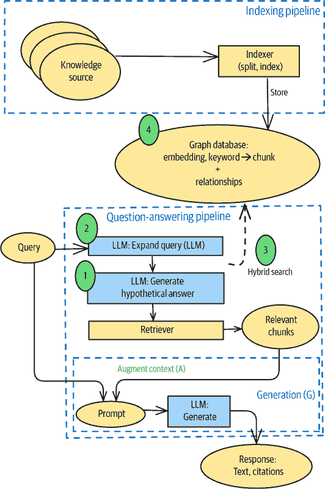

**图 4-1. 索引感知检索**

### 组件 1：假设性答案

在直接对查询本身进行语义搜索效果不佳的情况下，尝试搜索能够回答该查询的句子。假设你取出关于历史景点的问题，并在不借助知识库的情况下让一个基础 LLM 生成一个答案。答案可能会是这样的：

> 塞哥维亚是一座以保存完好的罗马渡槽和阿尔卡萨城堡而闻名的城市。其老城区是联合国教科文组织世界遗产。从马德里到塞哥维亚的火车车程通常不到一小时。

当然，问题在于这个答案并未基于你的知识库——而你希望在城市中找到知识库中的内容（大概是因为你为这些地方提供导游服务）。

为了解决这个问题，与其尝试在知识库中查找与问题匹配的内容，不如尝试查找与基础 LLM 生成的*假设性答案*匹配的内容！这种方法很可能会返回讨论拥有保存完好的老城核心的城市或从马德里出发的火车车程的文本块。由于该领域的学术文献将文本块称为*文档*，因此这种方法被称为*假设性文档嵌入*（HyDE）。

要执行 HyDE，请使用基础模型生成一个假设性答案：

```
def create_hypothetical_answer(question):
    messages = [
        ChatMessage(role="system", 
                    content="""Answer the following question in 2-3 sentences.
If you don't know the answer, make an educated guess.
"""
                   ),
        ChatMessage(role="user", content=question)
    ]
    answer = str(llm.chat(messages))
    return answer
```

然后将此答案传递给生成步骤：

```
def hyde_rag(question):
    answer = create_hypothetical_answer(question)
    return semantic_rag(answer)
```

### 组件 2：查询扩展

与其将查询原封不动地传递给语义 RAG，你可以对查询进行扩展，以添加上下文并将其中使用的术语转换为文本块中使用的术语。使用这种转换后的查询可能有助于更好地匹配文本块。

要执行查询转换（例如扩展），你可以使用基础模型。具体的上下文和转换集将取决于你的使用场景。以下是一个示例：

```
def add_context_to_query(question):
    messages = [
        ChatMessage(role="system", 
                    content="""
The following question is about topics discussed in a second-century book about
Alexander the Great. Clarify the question posed in the following ways:
* Expand to include second-century names. For example, a question about Iranians 
should include answers about Parthians, Persians, Medes, Bactrians, etc.
* Provide context on terms. For example, explain that Ammonites came from Jordan 
or that Philip was the father of Alexander.
Provide only the clarified question without any preamble or instructions.
                    """.strip()
                   ),
        ChatMessage(role="user", content=question)
    ]
    expanded_question = str(llm.chat(messages))
    return expanded_question
```

然后，你的 RAG 系统将在尝试匹配索引文本块之前对给定查询进行扩展：

```
def qryexp_rag(question):
    expanded_question = add_context_to_query(question)
    print("Expanded question: ", expanded_question)
    return semantic_rag(expanded_question)
```

你当然可以将查询扩展与 HyDE 结合使用。

### 组件 3：混合搜索

语义索引（Semantic Indexing）可帮助你根据块的整体含义将查询与块进行匹配。然而，随着块变大，捕获的含义中会丢失更细粒度的细节。解决此问题的一种方法是同时根据关键词和含义（嵌入）对块进行索引。然后，块得分就变成了使用 BM25 和向量搜索方法计算的相似度得分的加权平均值。

在 LlamaIndex 中，实现这一做法的方式是提供向量搜索组件的权重，即`alpha`：

```
query_engine = index.as_query_engine(
    vector_store_query_mode="hybrid", similarity_top_k=2, alpha=0.25
)
```

`alpha`为 0.0 时纯使用 BM25，而`alpha`为 1.0 时纯使用向量搜索。LlamaIndex 中的混合搜索依赖于所讨论的向量存储，以基于 BM25 和嵌入对块进行索引。在撰写本文时，Postgres、Pinecone 和 Weaviate 是支持此功能的向量存储之一。

如果你的向量存储不支持混合搜索，你可以通过两个检索器并合并它们的结果来模拟实现。我们将在“模式 10：节点后处理”中的“重新排序”一节讨论这种方法。

### 组件 4：GraphRAG

GraphRAG 背后的想法是，在发现了包含问题部分答案的块后，你可以检索相关块。当每个块都很小时，这可以帮助你完善上下文。你还可以使用较小的块大小来索引文档，然后将嵌入存储为树形结构，使得父节点的嵌入捕获其下所有节点的整体含义。如果某些节点在不同上下文中都有意义，你甚至可以在 RAG 中重复它们。你还可以同时根据关键词和嵌入对节点进行索引，以允许针对不同类型的查询进行不同类型的检索。此外，你还可以通过为所有紧密相关的实体组预生成并存储摘要，将[*面向查询的摘要*](https://arxiv.org/abs/2404.16130)纳入 GraphRAG。

在 GraphRAG 中，文档存储是一个图数据库。GraphRAG 系统会将文档索引为节点树，使用图来检索相关节点，并利用检索到的节点之间的关系来生成响应（参见图 4-2）。

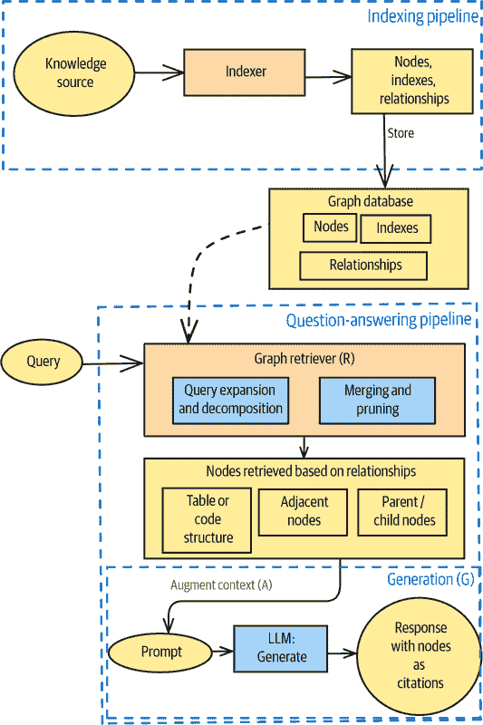

**图 4-2。Graph RAG 系统使用图数据库作为其存储机制，索引向图添加节点，检索利用图关系（图片来自[Peng 等人，2024](https://arxiv.org/abs/2408.08921)）**

通常，你会在像 Neo4j 这样的图数据库中构建知识图谱，以特定领域、结构化的方式表示你的知识，其中节点捕获适合你领域的关系。如果你没有这样的知识图谱，你可以让 LLM 尽力提取实体并使用（例如）LangChain 将它们关联起来：

```
llm_transformer = LLMGraphTransformer(llm=llm)
graph_documents = llm_transformer.convert_to_graph_documents(text)
```

然后你可以将提取的图存储到`GraphStore`中：

```
graph_store = Neo4jGraphStore(...)
graph_store.write_graph(graph_documents)
```

从`GraphStore`检索块的工作方式与使用 BM25 或语义检索器类似：

```
graph_rag_retriever = KnowledgeGraphRAGRetriever(...)
query_engine = RetrieverQueryEngine.from_args(graph_rag_retriever)
```

GraphRAG 系统可以利用显式的实体和关系表示来检索相关块，并使用它们生成响应。通过这种方式，GraphRAG 系统超越了基于向量数据库的系统，后者将检索到的块视为相互独立。

## 示例

我们将使用一本[关于亚历山大大帝的二世纪历史书](https://oreil.ly/b2z7m)来说明语义索引的局限性以及索引感知检索的好处。完整代码在[GitHub](https://oreil.ly/zljGj)上。

### 语义索引的局限性

语义索引在很大程度上效果不错。例如，你可能会问：

> 亚历山大如何对待他所征服地区的人民？

这会返回一个以书中具体细节为依据的响应：

> 亚历山大在首次进攻中攻占了海帕纳，但允许希腊人在休战协议下离开城堡。……当底比斯人战败后，他们的领土被瓜分，妇女和儿童被卖为奴隶，但祭司、女祭司、受菲利普或亚历山大款待之人以及马其顿的公共代理人除外。

即使在基础模型通过预训练已经掌握相关知识的情况下，RAG 响应仍然局限于书中的知识范围。例如，假设你问：

> 亚历山大在哪里去世？

它会返回：

> 所提供的文本不包含亚历山大去世地点的信息。

它之所以这样做，是因为这本书讲述的是亚历山大一生中的军事战役。这种行为在企业用例中非常重要，因为你拥有专有知识，并且希望 RAG 以这些知识为依据（而不是让它基于基础模型预训练所依赖的公共互联网来源生成内容）。

然而，能否检索到细粒度细节在很大程度上取决于块大小。假设你问这个问题：

> 描述亚历山大与第欧根尼之间的关系。

当块大小为 100 时，它能检索到相关信息，但当块大小为 1,024（即 LlamaIndex 中的默认大小）时，它无法做到。你可能还记得，我们在第 3 章的“模式 6：基本 RAG”中使用了同样的示例，并且每次都得到了响应。那是因为我们使用了关键词匹配，而*第欧根尼*足够罕见，关键词匹配能够可靠地找到它。

跨多个块整体拼合信息相当困难。让我们问这个问题：

> 亚历山大对抗大流士三世的策略是什么？

这产生了以下回答：

> 有人建议亚历山大立即向大流士和波斯人进军。他率军向大流士推进，但一场暴风雨耽搁了他。在听说大流士在他后方后，亚历山大派了一艘船到伊苏斯去确认这一报告。

这里的问题在于，这个回答是关于单场战斗的战术，而不是总体战略。

语义 RAG 的另一个局限性出现在问题使用 21 世纪术语时：

> 波斯国王如何与希腊人作战？

这会返回以下回答：

> 波斯人用长矛击打希腊人的面部，然后被骑兵击退。

这个回答极为有限，因为检索到的块相当稀疏。在亚历山大时代，是*帕提亚人*与*马其顿人*作战，因此使用*波斯人*或*希腊人*这些词的块并不多。

### HyDE

如果你改用 HyDE 方法，你首先会要求 LLM 生成一个假设性答案。生成的假设性答案如下：

> 亚历山大对抗大流士三世的策略集中于迫使进行决定性战役，以削弱波斯军队并夺取关键领土。他的目标是诱使大流士进行公开战斗，利用自己卓越的战术和马其顿方阵取得压倒性胜利，而不是依赖长期围城或消耗战。

HyDE 的下一步是寻找与这个假设性答案匹配的块。这会找到全书中的相关块，并使用检索到的块作为生成内容，提供整体性的响应，同时仍然以书中的细节为依据：

> 亚历山大的军队布阵如下：伙伴骑兵位于右翼，其后是皇家中队和其他中队。马其顿步兵方阵部署在骑兵附近，由精选的持盾卫队担任先锋。大流士的军队则在左翼布置了巴克特里亚骑兵、达恩人和阿拉霍西亚人；他们附近是波斯人、苏西亚人和卡杜西亚人；右翼则是来自科勒叙利亚和美索不达米亚的人。米底人、帕提亚人、萨西亚人、塔普里亚人、希尔卡尼亚人、阿尔巴尼亚人和萨塞西尼亚人也被部署在右翼。中央是大流士所在之处，有他的亲族、波斯卫兵、印度人、卡里亚人和马尔迪亚弓箭手。乌克西亚人、巴比伦人、红海沿岸居民和西塔塞尼亚人也在中央。左翼部署了斯基泰骑兵、巴克特里亚人和装备镰刀战车的部队，右翼则是携带镰刀战车的亚美尼亚和卡帕多西亚骑兵。希腊雇佣兵驻扎在大流士附近，正对着马其顿方阵。

同样，HyDE 方法即使在使用 1,024 的分块大小时，也能找出关于第欧根尼的相关片段。其假设答案如下：

> 据说，以野心和权力著称的亚历山大大帝曾遇到住在巨大陶罐里的犬儒派哲学家第欧根尼。第欧根尼对物质欲望的淡泊令亚历山大印象深刻，据说亚历山大问他是否能满足他任何愿望，第欧根尼回答说：“别挡住我的阳光。”这则轶事凸显了世俗权力与哲学超脱之间的对比。

模型捕获了足够的上下文细节，从而检索到相关分块。基于 HyDE 的 RAG 只能生成有根据的信息，因此例如不会出现哲学家住在陶罐里的内容：

> 亚历山大在科林斯地峡遇见了锡诺普的第欧根尼，问他是否需要什么。第欧根尼回答说，他什么都不需要，只希望亚历山大和他的随从不要挡住阳光。据说亚历山大对第欧根尼的举止表示了钦佩。

正如这个例子所示，当你的答案涉及逻辑，并且需要检索与逻辑结构相匹配的分块时，HyDE 很有帮助。当你想要检索细节时它也很有帮助，但前提是这些细节属于基础模型能够生成合理答案的领域（例如广为人知的历史）。

### 查询扩展

让我们从以下查询开始：

> 波斯国王是如何与希腊人作战的？

如果你基于用作知识基础的书籍的上下文来扩展该查询，你会得到：

> 根据阿里安在公元二世纪所著*亚历山大远征记*的记载，阿契美尼德王朝的波斯国王大流士三世，是如何与在腓力二世之子亚历山大大帝领导下的马其顿人及其他希腊人进行军事冲突的？请考虑波斯人所采用的战略、战术和武器，包括他们的米底、巴克特里亚、粟特或其他伊朗臣民所做的任何贡献，以及他们可能与斯基泰人或印度人等群体结成的任何联盟。

现在，检索到了更多相关分块。以这些为上下文，问题的答案要有意义得多：

> 大流士及其军队，包括波斯人、印度人、阿尔巴尼亚人和卡里亚人，在阿贝拉与亚历山大的军队交战。波斯人沿着与亚历山大平行的方向行军，试图包抄他。斯基泰骑兵与亚历山大阵线的前锋发生冲突。大流士担心战车在崎岖地面上无用，命令其左翼绕到亚历山大右翼后方。希腊雇佣兵被数量更多、装备更好的斯基泰骑兵和巴克特里亚人击溃。亚历山大随后命令阿里斯托攻击斯基泰人，蛮族后退。巴克特里亚人重新开战，引发了一场全面骑兵交战，造成大量马其顿人伤亡。波斯人向亚历山大的方阵放出镰刀战车，但阿格里亚人和标枪兵进行了反击。一些战车穿过阵型，但驭手后来被制服。

当你的用户使用非技术性语言，而你的知识库相当技术化时，查询扩展尤其有用。你还可以使用查询扩展来添加有意义的上下文，并消除用户查询的歧义。

## 注意事项

假设答案和查询扩展都是基于基础模型已有的知识生成的。我们示例中的基础模型已经见过关于第欧根尼的训练数据，因此它能够用相关事件扩展查询，使 RAG 系统能够匹配到相关分块。然而，当 RAG 系统在基础模型尚未充分接触过的领域运行时，假设答案或查询扩展可能会包含幻觉、过时或不相关的内容。这反过来可能导致与过时或不相关内容的匹配，这意味着 RAG 的一个关键优势——答案以文本为依据——可能会丧失。


当查询属于模型未曾接触过的领域时，就会出现幻觉数据。当基础模型有一个训练数据截止时间，超出该时间便不具有知识时，就会出现过时数据。以不相关数据为例，假设用户问：“亚历山大最著名的是什么模式？”基础模型针对此问题生成的假设答案很可能会涉及建筑设计模式，例如克里斯托弗·亚历山大（Christopher Alexander）的[“一个等待的地方”](https://oreil.ly/J1K5b)，而不是战斗阵型，例如亚历山大大帝军队使用的[方阵](https://oreil.ly/7IF9Z)。

此外，查询扩展可能无法忠实于用户提问的细微差别。也许询问波斯国王的用户并不关心国王与斯基泰人和印度人的联盟。然而，由于查询被扩展为包含这些内容，最终答案就可能包含远离波斯发生的战斗。这种意图变化在某些情况下可能导致错误的行动。

图 RAG 也可能在识别相关分块的方式上引入错误。考虑不周的解决方案可能会带来相互冲突的信息，或文档的早期版本。

### 参考文献

HyDE 由 [Gao et al. (2022)](https://arxiv.org/abs/2212.10496) 提出，用于改善检索：当待检索内容与问题不匹配，但与其假设答案匹配时，即便答案有误，也能提升检索效果。查询扩展在信息检索领域有着悠久的历史；[Azad and Deepak (2017)](https://arxiv.org/abs/1708.00247) 中提供了不同技术的综述，不过 [Song and Zheng (2024)](https://arxiv.org/abs/2412.17558v1) 指出，LLM 的出现重新激发了人们对查询优化这一更广泛主题的兴趣，该主题包括查询扩展、分解、消歧和抽象。图 RAG 系统的综述可在 [Peng et al. (2024)](https://arxiv.org/abs/2408.08921) 中找到。

[deepset 团队](https://oreil.ly/PxCOh)采用基于图的 RAG 作为迭代过程，并在金融数据上进行了演示。

## 模式 10：节点后处理

“节点后处理”模式在检索和生成之间插入一个步骤，以提高相关性、减少歧义，并处理内容更新和个性化等需求。

### 问题

RAG 系统检索与查询相似的分块，并将这些分块添加到生成的上下文中，以使 LLM 的响应有据可依。这种方法可能会出现几个问题。

#### 相似性不等于相关性

当你将一个分块与你试图回答的问题进行匹配时，你找到的是相似的分块——但这并不意味着这些分块是相关的。假设你要匹配以下问题：

> 描述大峡谷的地质特征。

检索到的分块可能以某种方式涉及大峡谷的地质，但可能与回答问题无关。例如，当我们在一个地质学教科书上构建 RAG 时，我们得到的分块仅包含目录——因为它包含了地质学术语。

#### 不相关内容

即使分块确实包含相关答案，整个分块也不会与问题完全相关。包含大峡谷地质问题答案的分块，可能还包含诸如峡谷位置以及峡谷两壁之间河谷的描述等信息。

如果你添加了许多分块，生成式 LLM 可能无法跟踪它需要从不同分块中综合的相关信息。

#### 歧义实体

你可能会得到一些引用[科罗拉多河大峡谷](https://www.nps.gov/grca)的分块，以及其他关于[黄石大峡谷](https://oreil.ly/mF3xb)的分块。我们无法消除所有这类可能的成对歧义。在许多情况下，除非你得到引用两个不同实体的检索节点，否则你不会知道自己存在歧义问题（例如，如果你并不知道有两个大峡谷）。

#### 冲突或过时内容

知识库通常会随着时间推移而更新。当你搜索支持工单或法律文章时，很可能会得到一些与过时内容对应的分块。虽然你可以构建一个依赖保持知识库原始状态的 RAG 系统，但同样有可能你的用户正在使用不同版本的软件，或者受不同地方法律的约束，因此你可能会在检索到的分块中遇到冲突的信息。

#### 通用答案

RAG 系统对每个人的工作方式都一样，因此无论谁提问，它对同一个问题都会给出相同的答案。那么，如何利用与提问者相关的信息来个性化它生成的答案呢？

对检索到的节点进行后处理有助于解决所有这些问题。

### 解决方案

节点后处理允许你采用多种检索机制，合并分块，并对它们进行重排序或过滤（参见图 4-3）。它在检索和生成之间插入操作，使许多有用的功能成为可能。其中的许多操作（图中以蓝色显示）可以通过 LLM 调用完成。如果检索到的分块对应的是不同时期编写的知识库文章，你可以选择最新的文章。如果检索到的分块指向两个不同的概念，你可以提出后续问题来消除查询的歧义。你可以分解查询，检索与查询不同部分相对应的分块，然后合并它们。你还可以通过添加与用户上下文相对应的分块来个性化响应。

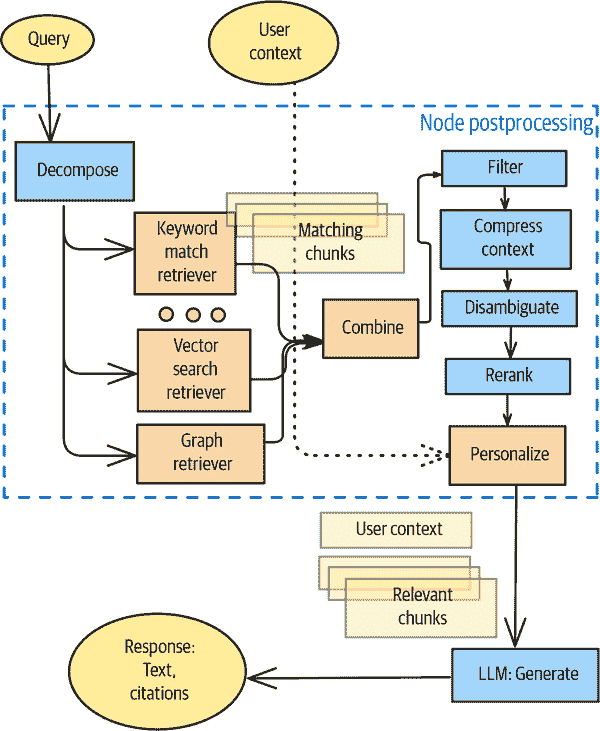

###### 图 4-3. 节点后处理

#### 重排序

节点后处理背后的关键思想是*重排序*。检索步骤会返回一组节点，但这些节点没有特定的顺序，或者它们是按与查询的相似度排序的。相反，你可以使用 LLM 根据分块中信息的有用程度对它们进行重新排序。给定一个查询和一个分块，重排序模型会输出一个分数，指示该分块与回答查询的相关程度。提示词可以简单到如下所示：

> 你将收到一个查询和一些文本。请分配一个介于 0 和 1 之间的相关性分数，其中 1 表示文本包含问题的答案。
>
> **查询**：
>
> `{query}`
>
> **完整文本**：
>
> `{node.text}`

这是模式 17（LLM 作为裁判）的一个示例，我们将在第 6 章中讨论。

重排序器比嵌入模型准确得多，因为嵌入模型必须将分块中的所有信息压缩到单个嵌入向量中。另一方面，重排序器可以详细查看分块并确定答案是否存在。

重排序对 RAG 系统非常有益，以至于有一些模型（例如 [BGE](https://oreil.ly/JbX0q)）经过微调后能出色地完成这项任务。你不需要在本地运行 BGE——也有托管版本可用。例如，要使用 [BGE 的托管版本](https://oreil.ly/DG5-d) 进行重排序，你可以使用 Pinecone API 访问已部署的 BGE 端点：

```
reranked_nodes = pc.inference.rerank(
    model="bge-reranker-v2-m3",
    query=query,
    documents=nodes,
    top_n=3,
    return_documents=True,
)
```

你需要将每个检索到的节点传递给重排序器，以便它计算相关性分数。因此，重排序会大大增加你需要执行的 LLM 调用次数，同时也会增加延迟和成本。

#### 混合搜索

如果你不打算按原样使用检索器返回的节点，而是计划对它们进行重排序，那么你不必只使用一个检索器。同时使用 BM25 检索器和语义检索器的主要障碍在于，你无法轻松地将具有 BM25 分数的分块与具有余弦相似度的分块进行比较。

我们在模式 9（索引感知检索）中建议的解决方案是计算每个分块的两种分数，然后计算两个分数的加权和。但如果你反正都要对分块进行重排序，还有更好的方法。

你可以使用不同类型的检索器，并将所有结果合并到一个列表中。然后，你可以将这个来自不同检索器的分块列表传递给重排序器。最后，你可以根据相关性分数选取前 K 个分块。这个想法被称为*混合搜索*，因为它最初用于将基于关键字的索引与语义索引相结合。

#### 查询扩展与分解

如果你要将查询发送到多个检索器，则无需向所有检索器发送*相同*的查询。你可以扩展查询以适应检索器的需求。例如，对于 BM25 检索器，你可以包含查询中所用关键字的所有同义词。

你还可以将查询分解为多个子部分，并检索与每个子部分匹配的内容。

你甚至可以运行一次查询获得结果，然后进行二次搜索以扩展检索到的答案。

#### 过滤过时信息

你可以检查检索到的节点并寻找潜在的冲突。下面是一个简单的示例，过滤对应不同年份知识库文章的节点，以确保你只使用最新的信息：

```
latest_year = max([chunk.publication_year for chunk in chunks])
chunks = [chunk for chunk in chunks 
                 if chunk.publication_year == latest_year]
```

只要分块中存在元数据，你就可以采用相同的思路，只使用可用的最新版本。

你可以使用 LLM 来识别两个分块是否包含冲突信息，但这需要成对处理节点，而 LLM 调用次数的组合爆炸（`N * (N-1)`）可能会使其在实际应用中成本过高。

#### 上下文压缩

检索到的分块可能包含大量无关信息。如果你打算用 LLM 单独处理每个分块以计算其相关性分数，你可以利用这个机会将文本压缩到仅包含与回答查询相关的部分：

```
from pydantic_ai import Agent
@dataclass
class Chunk:
    full_text: str
    relevant_text: str
    relevance_score: float
 
def process_node(query, node):
    system_prompt = """
    You will be given a query and some text.
    1. Remove information from the text that is not relevant to answering the 
question.
    2. Assign a relevance score between 0 and 1, where 1 means that the text 
answers the question 
    """
    agent = Agent(model, result_type=Chunk, system_prompt=system_prompt)
    chunk = agent.run_sync(f"""**Query**: {query}\n 
**Full Text**: {node.text}
    """).data
    return chunk
```

现在，你可以在生成阶段将块中的相关文本仅添加到提示的上下文中。

请注意，前面的代码将执行上下文压缩的 LLM 调用折叠到用于计算重排序相关性分数的 LLM 调用中。这限制了节点后处理所需的 LLM 调用次数。

#### 消歧

有时，查询会使用模糊术语，如 *大峡谷*。你可以通过查看检索到的节点，并询问 LLM 这些节点是否都指向同一实体来确定这一点：

```
@dataclass
class DisambiguationResult:
    is_ambiguous: bool
    ambiguous_term: str
    possibility_1: str
    possibility_2: str
 
def disambiguate(query, node1, node2):
    system_prompt = """
You will be given a query and two retrieved passages on which to base the answer
to the query. Respond by saying whether the two passages are referring to two 
different entities with the same term. For example, the query might be about 
"Red River," and one passage might be about the Red River in Minnesota whereas 
the other might be about the Red River on the Oklahoma/Texas border. If there is 
no ambiguity between the two passages, return False for is_ambiguous.
    """
    agent = Agent(model, 
                  result_type=DisambiguationResult,
                  system_prompt=system_prompt)
    return agent.run_sync(f"""**Query**: {query}\n **Passage 1**: {node1.text}\n
**Passage 2**: {node2.text}
    """).data
```

与冲突信息不同，无需处理 *所有* 可能的块对——只需确保第一个块中提到的实体与后续块中提到的实体相同即可。因此，所需调用次数仅为 N – 1：

```
for node in response['source_nodes'][1:]:
    result = disambiguate(query, response['source_nodes'][0], node)
    if result.is_ambiguous:
       # ask follow-up question
```

与上下文压缩一样，你也可以将消歧 LLM 调用折叠到相关性计算 LLM 调用中。

#### 个性化与对话历史

在检索与生成之间插入一步，让你能够向上下文添加超出检索内容之外的信息。例如，你可以查看检索到的节点，并从用户的上下文环境中提取相关信息。

这可能简单到根据查询相关性插入用户历史交易中的数据。例如，旅行聊天机器人可以纳入你的个人出行日期，以确保其对目的地的介绍与你计划前往的季节相关。

在聊天机器人中，通常会将前几轮对话的摘要作为任何 RAG 操作上下文的一部分。这种*对话状态*允许生成过程基于之前的对话（包括用户过去的纠正和偏好）进行接地。例如，要求 Pydantic AI 在上一轮生成的笑话基础上进行扩展，你可以这样做：

```
joke = agent.run_sync('Tell me a joke.')
print(joke.data)
#> some joke.
 
joke2 = agent.run_sync('Make the joke longer and add a punchline.', 
                         message_history=joke.new_messages())
print(joke2.data)
```

添加的内容也可以是动态的，并基于检索到的信息。例如，你可能会注意到检索到的节点是关于豪华手表的（即使查询本身不是），并添加用户搜索历史中的任何相关结果。

### 示例

我们将再次使用基于两本旧地质学教材构建的语义 RAG 来说明节点后处理的技术和好处。此示例的代码请参见 [GitHub](https://oreil.ly/BttTn)。

#### 语义 RAG 的局限性

对以下查询检索 `top_k=2` 个节点：

> 描述大峡谷的地质。

这将返回如下最顶层的节点，包含目录：

> 节点 ID：7b635fb9-7b61-4508-ad6a-370f5cd42822
>
> 文本：W. M. DAVIS 哈佛大学，马萨诸塞州剑桥，7 月，
>
> 1905 目录 导言.--地质学的范围与目的
>
> 地质学 第一部分 外部地质作用 I. 天气的
>
> 作用

因此，本质上，结果仅由第二个节点生成。不幸的是，第二个节点与查询相似（因为大峡谷在其中显著出现），但并非真正与回答该问题相关。该块中的关键句子以以下内容开头：

> 亚利桑那州北部和犹他州南部、科罗拉多河大峡谷以北的高原……

该块恰好是关于大峡谷所在的高原，因此生成的问题答案如下：

> 大峡谷位于亚利桑那州北部和犹他州南部的高原以北……从宽阔的平台上升起一系列巨大的阶梯，通常高度超过一千英尺，宽度达二十英里或更多。

根据这一回答，大峡谷有一系列阶梯，每个阶梯宽超过 20 英里（[“score”](https://oreil.ly/k_ntx) 即 20）。然而，大峡谷的平均宽度只有 10 英里。事实上，这个回答根本不是在说大峡谷——而是在说整个亚利桑那州北部和犹他州南部！

假设你改为拉取 `top_k=4` 个节点。不出所料，你会得到与上面相同的两个节点，另外还会得到两个相似度分数略低的节点。即使使用全部四个节点，你*仍然*会得到关于大峡谷所在高原的错误答案：

> 大峡谷位于亚利桑那州北部和犹他州南部的高原以北。这些高原由厚度超过一万英尺、向北平缓倾斜的层状岩石组成。在峡谷被切割的宽阔平台上，升起一系列巨大的阶梯，通常超过一千英尺高，宽度达二十英里或更多。

仅仅使用更多节点是不够的，那么应用节点后处理会发生什么？

#### 节点后处理的影响

如果你对检索到的节点进行后处理，将块文本压缩为相关部分，并按照相关性对块进行排序，那么前两个节点将包含直接相关的答案。最相关块的相关文本以以下内容开头：

> 流水冲刷了岩壁，风化作用无处不在，侵蚀并使它们后退。较硬的水平岩层以长长的垂直悬崖线突出，通常高达数百英尺，其脚下堆积的岩屑坡掩盖了较弱地层的露头。

第二个块则是最初最相关的块：

> 亚利桑那州北部和犹他州南部、科罗拉多河大峡谷以北的高原，由厚度超过一万英尺的层状岩石组成，向北倾斜非常平缓。

生成的回答现在非常切题，因为它综合了这两个节点：

> 科罗拉多河的大峡谷位于亚利桑那州北部和犹他州南部的高原之上。峡谷壁由流水和风化作用塑造而成，较硬的水平岩层形成垂直的悬崖，而岩屑坡则掩盖了较弱的岩层。由于上部悬崖的侵蚀和后退，峡谷两侧以巨大的阶梯状向下延伸至河流。峡谷以北的高原由厚度超过一万英尺的层状岩石组成，向北平缓倾斜。后退的陡崖和沟壑壁被风化和风蚀雕刻成建筑般的形态。

这个答案是正确的。大峡谷是由河流和风蚀作用形成的。

上面检索到的四个节点都是关于科罗拉多河大峡谷的。但现在，假设你提出以下问题：

> 说出纽卡斯尔含煤地层的特征。


第一个检索到的块是关于宾夕法尼亚州纽卡斯尔的，而第二个块是关于英格兰纽卡斯尔的。歧义检测器可以发现这一点。在生产系统中，你可以利用这种检测向用户提出后续问题，询问他们指的是哪个纽卡斯尔。

### 注意事项

重排序器速度较慢且会增加运行时成本。使用嵌入技术时，你可以将计算前置，并将嵌入存储在向量数据库中。另一方面，重排序要求你在运行时检查块的相关性。由于节点预处理的核心是重排序，这种模式会带来相当大的延迟和成本。在某种程度上，你可以通过使用像`BGE`这样的微调小型模型来缓解这个问题，但带有重排序的 RAG 会比没有重排序的 RAG 更慢。

在节点后处理中执行的任务越多，将所有操作合并到一次 LLM 调用中就越有意义。为了确保执行所有操作，请使用结构化输出（参见第 2 章中的模式 2：语法）。如果这样做，你将无法使用像`BGE`这样的微调模型——你需要一个能够执行所有任务的基础模型。

### 参考文献

Guo 等人（2019）[调查了用于信息检索的神经排序模型](https://arxiv.org/abs/1903.06902)。Ma 等人（2023）展示了如何[微调`LLaMA`模型](https://arxiv.org/abs/2310.08319)，既作为密集检索器（`RepLLaMA`）又作为逐点重排序器（`RankLLaMA`），用于段落检索和文档检索。Sourav Verma（2024）研究了[上下文压缩技术](https://arxiv.org/abs/2409.13385)及其优势。Chen 等人（2021）指出了歧义的普遍性是 RAG 中错误的来源，并提出了一种基准来评估[实体消歧方法](https://arxiv.org/abs/2106.06830)。

[Bench.io](http://bench.io)扩展查询以更好地将生成结果置于上下文中。

## 模式 11：可信生成

可信生成是一组旨在提高 RAG 系统用户对生成答案信任度的技术。

### 问题

RAG 系统面临许多可能削弱用户对生产应用及其生成答案信任的问题。尽管 RAG 系统从文档库中检索信息，但它们仍存在多种潜在风险，包括以下方面：

- **检索失败**：系统可能检索到不相关的文档，或遗漏全面回答问题所需的关键信息。这可能导致生成的答案不是最优的。

- **上下文可靠性问题**：即使检索到的文档都是相关的，其中一些可能包含过时、有偏见或不正确的信息。这可能导致生成的答案过时、有偏见或不正确。

- **推理错误**：RAG 系统可能对检索到的信息进行错误推理或误解。这可能会产生误导性的答案。

- **幻觉风险**：RAG 系统仍然可能捏造信息或错误地混合检索到的文档，尤其是在处理复杂主题时。

目前，还没有办法完全避免这些问题。然而，有一些最佳实践可以帮助你评估生成答案（甚至答案的某些部分）的可信度，并将这些信息传递给 RAG 答案的使用者。在生成的答案将被用于驱动行动的情况下，以让用户决定是否执行此类行动的方式来呈现这种可信度非常重要。例如，考虑一个医疗应用的 RAG 系统，医生或患者可能会问以下问题：

> 1 型糖尿病患者的最佳治疗选择有哪些？

尽一切努力确保答案正确，并向用户说明任何治疗方案是否可能过时或来自未经同行评审的来源，这一点非常重要。

### 解决方案

你可以通过以下方式建立信任：确保只回答知识库足以支撑的问题、提供引用、引入人工参与、验证可能错误的信息，以及通过适当的 UI 设计。

#### 域外检测

建立信任的最佳方式之一是让系统在知道自己不应回应某个请求时进行沟通，因为知识库中不包含该主题的信息。例如，一些患者可能会向医疗 RAG 应用询问去医院的方向。在这种情况下，RAG 系统应该拒绝回应，甚至将请求路由到 Google Maps。

检测域外用户查询的策略包括以下内容（另见图 4-4）：

- **用户查询与嵌入文档块之间的嵌入距离**：在 RAG 流程中，你会对查询进行嵌入，然后可以确定它与知识库中所有块的相似度。对于域外请求，你会看到相似度得分急剧下降，而最佳阈值因领域而异。持续跟踪查询相似度将帮助你调整阈值，从而更熟练地进行域外检测。

- **零样本分类以对查询进行分类**：使用预训练语言模型（也许是小语言模型）来进行零样本分类，效果很好。为你期望的查询定义类别。例如，在医疗 RAG 示例中，你可以将类别设置为`["Medical", "Not Medical"]`。如果零样本分类模型以高概率返回"Not Medical"，你可以将其判定为域外检测。如果查询的上下文发生变化，可以向查询问题中添加示例，将零样本问题转化为少样本问题。如果你让模型检测多个类别，例如`["Finance", "Health", "Technology", "Other"]`，你可以要求至少 30%的置信度作为回答问题的阈值。

- **要求领域特定的关键词或术语**：最严格的方法之一是要求问题（和/或答案）使用特定的关键词或术语。在医疗 RAG 系统的情况下，你可以要求至少包含一个或多个医学术语。

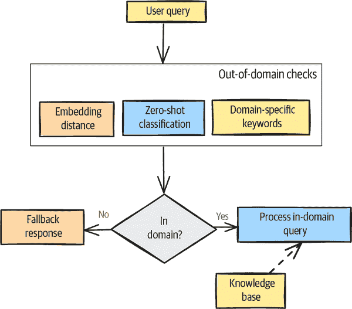

###### 图 4-4. 域外检测工作流程

由于上述每种方法都有其优点和缺点，你可以选择混合方法（例如三个信号的加权和）来检测域外查询。

如果你检测到超领域（out-of-domain）查询，则应当跳过检索和生成部分，向用户显示一条消息，说明你的 RAG 系统无法回答该查询；或者，你应该将查询路由到其他资源（例如，对于方向相关查询，可路由到 Google Maps）。

#### 引用

在 RAG 响应中提供引用是建立信任的最有效方式之一。当用户看到引用时，他们会理解系统是以诚信构建的，并且引用可以立即验证信息的准确性。引用使响应更可信，并让用户能够轻松地自行检查来源。

在 RAG 响应中有三种提供引用的方式：来源级跟踪、基于分类的引用和词元级归属。

##### 来源级跟踪

如果你有*来源跟踪*工作流，你可以基于检索谱系生成引用。在第 3 章的“大规模索引”模式（Pattern 8）中，我们讨论了如何将元数据与文档块一起存储在文档存储中。当你检索文档块以生成响应时，你会将相应的元数据传递给一个感知引用的提示词来生成响应。然后，你可以对引用进行后处理，例如将它们格式化为正确的引用样式（见图 4-5）。

你可以在本书的 [GitHub 仓库](https://oreil.ly/p0DjR) 中找到这种方法的示例实现。本节后面的“示例”小节还会更详细地讨论这种方法。

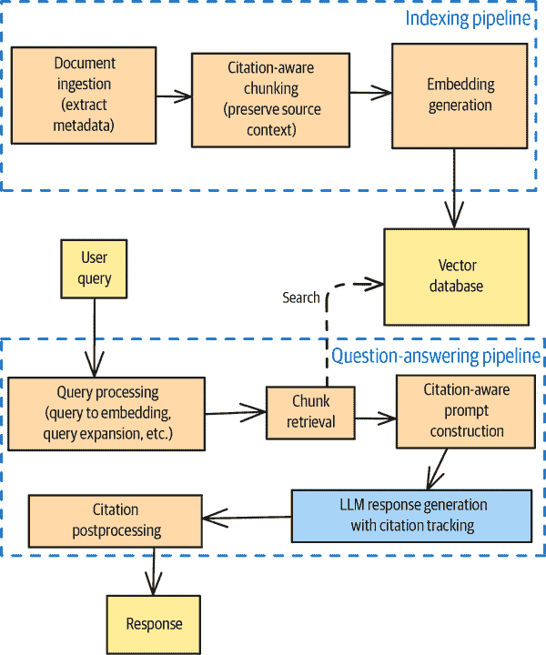

###### 图 4-5：使用引用生成 RAG 响应的工作流

##### 基于分类的引用

如果你希望对引用有更多控制，使用分类方法是一个不错的选择。*分类器*可以区分不需要任何引用的常识知识和需要引用的事实性陈述。后者因领域而异：学术论文比一般领域内容需要更多引用。图 4-6 展示了一个响应示例，区分了“常识”知识和需要引用的陈述，如“他被广泛认为是西方音乐史上最伟大的作曲家之一”。

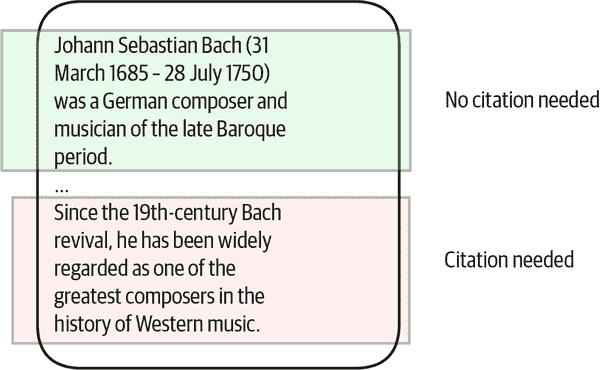

###### 图 4-6：使用分类器检测引用要求

使用基于分类的方法会增加系统的复杂性，因为你需要提供或微调一个引用分类器。但是，引用会更加精确。来源跟踪方法更简单，但往往会过度引用。

##### 词元级归属

当 RAG 系统生成响应时，生成过程可能会模糊原始块的边界，或者多个块可能共同贡献给一个陈述。一些 LLM 倾向于以改变与源块直接联系的方式改写块，而改写可能使直接文本匹配变得困难。

你可以通过使用*基于词元的归属*来解决这些更复杂的引用场景。在这种方法中，你像以前一样对文本进行分块并用元数据标记它们。区别在于，在生成过程中，元数据通过 LLM 的注意力机制进行跟踪，这使你可以将每个生成的词元归属于一个或多个来源（见图 4-7）。然后，你可以设置一个阈值，高于该阈值时，LLM 会在最终生成的响应中报告引用。

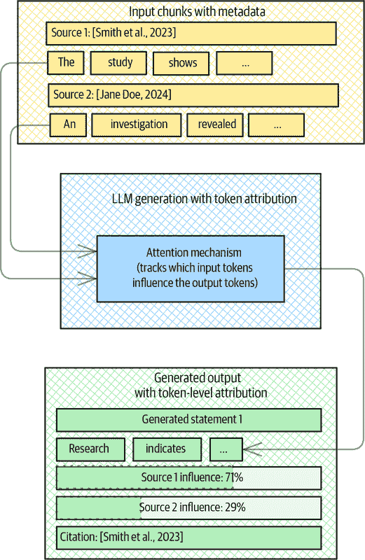

###### 图 4-7：用于引用的词元级归属跟踪

词元级方法解决了 LLM 的改写问题，同时不会丢失归属；它还支持最终响应的多来源归属。在撰写本文时，词元级归属是一个活跃的研究领域。目前还没有出现可用于生产的开源实现。

#### 护栏

你可以通过在 RAG 管道的各个环节应用护栏（见图 4-8)来降低 LLM“失控”的可能性。

在从文档存储中检索块之前，你可以执行以下操作：

* 通过超领域检测过滤有害或不合适的查询。

* 对 RAG 系统的用户输入进行清洗，以防止任何形式的通过提示词的注入攻击。

* 过滤文档存储中的块，仅保留来源高度可信的块。

一旦你检索到相关的文档块，你可以执行以下操作来应用护栏：

* 强制执行对块元数据（如来源和其他归属）的跟踪。

* 根据来源和来源相关性对文档块进行优先级排序，并过滤掉低于最低阈值的块。

* 使用反思式 RAG 对照可信来源进行事实核查。

* 在将检索到的块传递到响应重新生成之前，检查其是否符合隐私合规要求。

在生成之前，你可以执行以下操作以应用更多护栏：

* 检查块的数据新鲜度，例如，排除超过六个月旧的块。

* 强制要求来自多个来源的块，以促进来源多样性。

* 检查块中是否含有有害内容。

丢弃任何未通过检查的块——*不要*将它们传递给响应生成阶段。

一旦你的 RAG 生成响应，在向用户返回任何响应之前，你可以应用以下最终护栏：

* 强制使用引用和来源归属。

* 对照可信来源进行事实核查。

* 检查数据隐私。

* 检查响应是否意外生成有害内容。

如果任何护栏未通过，请重写用户查询，然后触发新的生成，甚至重新检索块。

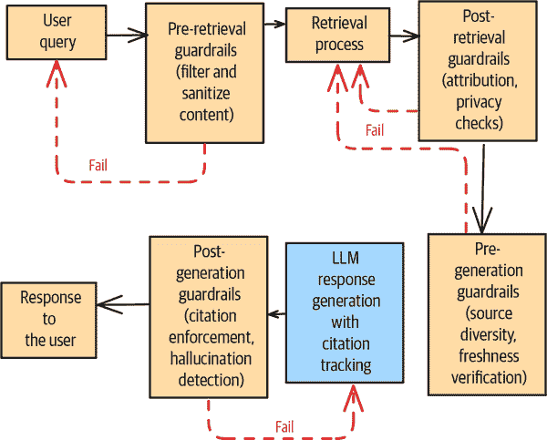

###### 图 4-8：护栏工作流

#### 提示

许多机器学习库为 LLM 提供护栏工具，例如：

* [Guardrails AI](https://www.guardrailsai.com/docs)：这是一个开源 Python 包，用于检测 PII（个人身份信息）、超领域查询、越狱尝试和亵渎内容。

* [DeepEval](https://oreil.ly/MMx5_)：这是一个评估框架，提供特定的 RAG 评估指标，包括引用准确性、检索精确率、幻觉检测，以及红队功能，如偏见、错误信息和有害性检测。

* [Ragas](https://oreil.ly/CMuQd)：这是一个指标框架，允许你评估 RAG 管道的各项因素，如[答案正确性](https://oreil.ly/bYNJu)和[上下文实体召回率](https://oreil.ly/PymbD)。

使用这些库或框架还可以提高 RAG 系统的可观测性。

#### 可观测性

另一种提高用户对 RAG 响应信任度的方法是，持续生成围绕 LLM 生成和 RAG 响应的可观测性指标。可观测性工具允许你跟踪 LLM 的输入和输出，此类工具会自动生成如下指标：

* 上下文相关性

* 响应相关性

* 忠实度

* 上下文召回率和精确率

虽然你可以自己实现可观测性工具，但我们建议使用现有的库之一。开源解决方案包括 [Arize Phoenix](https://phoenix.arize.com)、[Comet Opik](https://oreil.ly/ADTeX)、[Langfuse](https://langfuse.com) 和 [Langtrace](https://www.langtrace.ai)。

我们观察到，在 RAG 系统中为查询-响应对实施严格的可观测性，能够持续带来用户信任和系统采用率的可衡量提升。当利益相关者能够透明地评估输入与输出之间的相关性时，他们对系统可靠性和准确性的信心便会增强。这种基于经验的 RAG 系统评估方法不仅增强了信任，还为持续的系统优化和性能验证提供了有价值的数据点。

#### 人工反馈

你可以将人工反馈以在线和离线两种方式纳入 RAG 流水线（参见 图 4-9）。如果你希望有人在环中，你可以在文档块检索后添加一个人工审核步骤，由审核员对文档块投赞成或反对票，以在你将其用于生成回复之前更新这些文档块的相关性。你也可以将所有生成的回复，或那些低于某个置信度阈值的回复，发送到审核队列，由领域专家审核后再返回给请求用户。

进行离线审核的人员只需使用流经其中的所有信息的一小部分，即可为你的 RAG 流水线提供可操作的审核意见。首先，他们应审核检索到的文档块的排序。人工排序可以成为针对你的用例的领域特定嵌入模型的基础。如果你希望重写用户查询以提高检索性能，你还可以使用审核排序来微调任何 LLM。领域专家还可以审核所有生成的回复中的一部分，以检查其正确性和相关性；然后，你可以使用更新后的回复来针对你的特定领域用例微调 LLM。

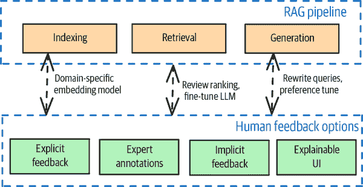

**图 4-9：人工反馈选项可以影响 RAG 流水线的所有阶段**

人工审核员可以提供以下几种反馈：

- 通过对选定的文档块或生成的回复进行评分（比如点赞或点踩）提供显式反馈

- 通过参与度指标提供隐式反馈，比如用户在产品中使用所提供的回复的频率

- 由主题专家对回复进行验证和注释

目标应始终是让反馈回路与 RAG 系统的每个组件相连，并改进相应的流程。

#### 纠正性检索增强生成（CRAG）

传统 RAG 系统通过提供与用户初始查询相关的文档块来“引导” LLM 生成回复。整合文档库中的外部知识有助于减少幻觉，但其有效性在很大程度上依赖于所检索文档块的相关性。如果检索步骤产生了不相关的文档块或错误信息，这可能会成为问题。

*纠正性检索增强生成*（CRAG）的关键目标是在 LLM 尝试生成回复之前检测并纠正幻觉。它在流程中添加了一个评估器，在将文档传递给回复生成步骤之前，评估给定查询所检索到的文档块的质量。评估器返回一个置信度分数，该分数会触发不同的知识检索操作。如果评估器认为某个文档不相关或存在歧义，CRAG 可以执行两种策略中的一种或两种。首先，它可以通过搜索网络或企业文档库（例如 SharePoint 或 Google Drive）来增强内容。这可能很有帮助，因为知识库往往是静态的，而在线内容的更新往往更快。其次，通过“先分解再重组”的策略，CRAG 可以从检索到的文档中过滤掉明显不相关的内容，从而帮助 LLM 聚焦于关键信息（参见 图 4-10）。

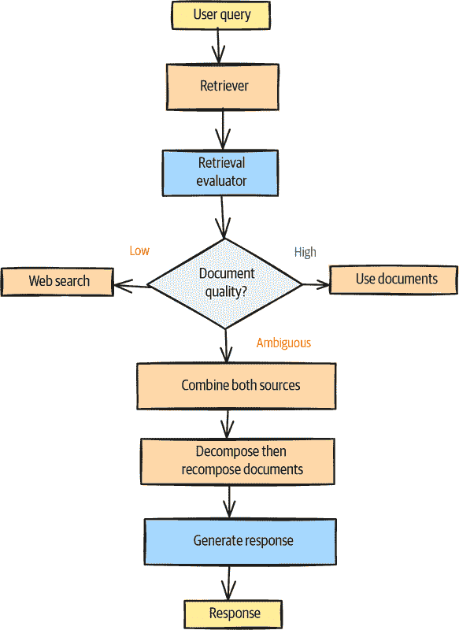

**图 4-10：CRAG 工作流程**

CRAG 可以在将内容传递给回复生成之前，完全用搜索结果替换不相关的内容，同时将歧义内容与搜索结果相结合。

CRAG 工作流程旨在与传统 RAG 流水线协同工作，以解决其一个主要弱点。可以在 [LangChain 的文档](https://oreil.ly/coXWl) 中找到示例实现。

#### Self-RAG

CRAG 工作流试图在生成回复*之前*审查并纠正检索到的文档块，以防止潜在的幻觉。相比之下，*self-RAG*（即 *RAG 中的反思*，参见 图 4-11）会从生成的输出或检索结果出发，以批判性的方式审视整个流程。其目标是优化检索和生成过程。Self-RAG 包含三个要素：

- **自我评估：** 系统对检索到的文档的相关性和质量进行批判性评估。

- **自适应检索：** 系统可以决定是检索更多信息还是继续生成。

- **受控生成：** 系统可以在依赖检索到的信息和依赖其底层 LLM 的参数知识之间进行调节。

你可以通过使用提示词来实现所有这些（参见 第 6 章 中的模式 17：LLM 作为评判者）。

虽然实现 self-RAG 会给 RAG 工作流带来循环和更多复杂性，但它也带来了许多好处。Self-RAG 可以基于上下文更好地融合检索到的知识和参数知识，而不是使用固定的组合方式。它减少了幻觉，提高了其决策的可解释性，并提高了检索的整体质量。

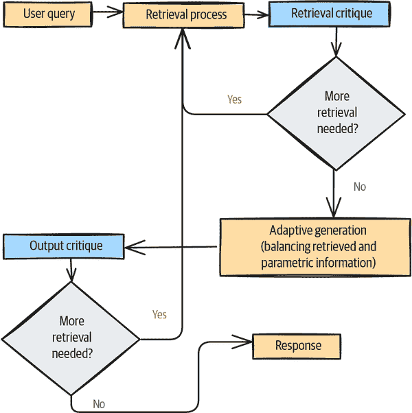

**图 4-11：Self-RAG 在将生成的回复返回给用户之前先对回复进行自我批判**

#### 用户界面设计

当用户能够看到引用了哪些文档、信息有多新以及 LLM 对其回复的置信度水平时，他们会更加信任系统。通过实现引用链接、来源预览和置信度指示器等视觉指示器（参见 图 4-12），你可以让用户独立验证信息。此外，通过行内引用提供清晰的出处，并提供一键访问原始来源的功能，既尊重了用户的智慧，也建立了系统的可信度。这些透明机制将 RAG 系统从一个神秘的黑匣子转变为一个可靠的研究助手，其工作可以被验证和信任。

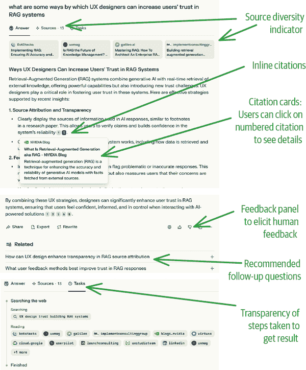

**图 4-12：Perplexity AI 的搜索界面通过某些方式增强对其生成答案的信任**

通过精心设计的交互模式，用户可以适当地控制 RAG 流程，从而进一步增强用户信任。允许用户调整搜索参数、按日期或来源权威性筛选结果，并根据初始回复优化查询，这能营造一种协作体验，而非单向的信息传递。采用*渐进式披露*技术——先显示简化结果，再提供深入探索的选项——有助于在保持深度的同时避免让用户感到不知所措。

*反馈机制*——例如点赞/点踩按钮、纠错功能，以及基于用户输入而可见的系统改进——能够表明系统重视准确性和用户体验（UX）。当用户看到自己的反馈被纳入改进后的回复中时，他们会对系统持续改进和可靠性的承诺建立起信心。

### 示例


在之前“方案”一节讨论的所有想法中，最能建立用户对你 RAG 系统生成答案之信任的做法，是为这些答案添加引用。在这里，我们将展示如何使用分类器来检测回复中需要引用的部分，然后提供相关引用。如果你在文档库中找不到某个需要引用的事实对应的来源，你应该提醒用户该陈述不可信，例如用红色突出显示相关句子。

## 技巧

在本例中，你将把引用整合到 RAG 回复中。如 图 4-13 所示，你将修改 RAG 的回复生成步骤。初始回复生成后，你会检查其中是否有值得引用的声明。然后，对于每个需要引用的文本块，你将在文档库中交叉查找参考文献。

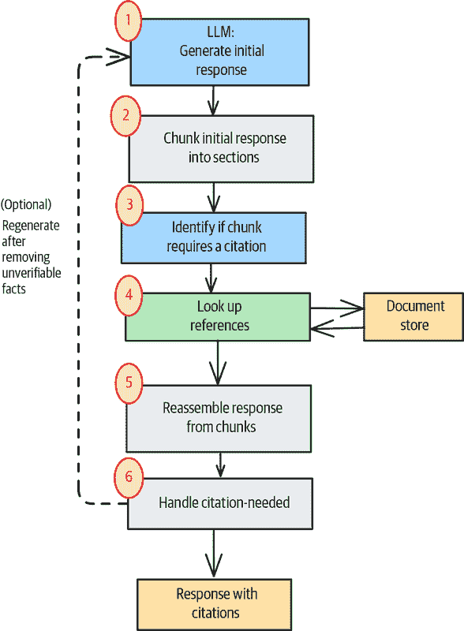

**图 4-13.** 为 RAG 回复添加引用的实现工作流程

该流程如下（步骤编号与 图 4-13 对应）。

### 步骤 1：生成初始回复

首先，照常生成初始的 RAG 回复。这里的回复是未经审核的用户回复：

```
question = "What are the Brandenburg Concertos?"
response = rag_chain.invoke(question)
```

### 步骤 2：将回复拆分为较小的部分

本例将文本拆分为句子级别。你可以根据希望对引用精细度的不同要求，实现不同的策略。

### 步骤 3：检查某部分是否需要引用

一旦分类器将某个部分标记为需要引用，就在文档库中交叉核对该部分：

```
sentences = raw_response.split(".")
...
for sentence in sentences:
    review = needs_citation(sentence)
    chunks = check_sources(sentence) if review else []
```

你可以使用小型语言模型（如微调后的 BERT）或零样本调用 LLM 来检查某部分是否需要引用。这里我们使用 LLM：

```
def needs_citation(content: str) -> bool:
    """Check if the content requires citations using OpenAI."""
    llm = ChatOpenAI(model_name=LLM_MODEL)
    prompt = PromptTemplate.from_template("""
    Check if the content requires citations. The return should be true or false 
in this JSON format: {{"requires_citations": true}}
 
    Content: {content}
    """)
    response = llm.invoke(prompt.format(content=content))
    return json.loads(response.content)["requires_citations"]
```

### 步骤 4：查找来源

一旦识别出需要引用的回复部分，你就可以在文档库中查找引用来源：

```
def check_sources(sentence: str) -> List[Any]:
    """Find similar documents in the document store"""
    vectorstore = load_vector_store()
 
    similar_chunks = vectorstore.similarity_search(sentence, k=5)
    return similar_chunks
```

这会生成以下结果：

```
Chunk 1:
Content: The Brandenburg Concertos (BWV 1046–1051) by Johann Sebastian Bach are 
a collection of six instrumen...
Metadata: {'source': 'raw_texts/bach_brandenburg-concertos.txt'}
…
Chunk 5:
Content: Even more exceptional, for a Lutheran composer such as Bach, is that the 
composition is a Missa tota...
Metadata: {'source': 'raw_texts/bach_mass-in-b-minor-bach.txt'}
```

### 步骤 5：将引用整合到回复中

这里，我们循环遍历并拼接回复部分，同时将引用添加到回复中：

```
# Write content with citations
response_with_citations = ""
for review_sentence in review_sentences:
    response_with_citations += review_sentence["sentence"]
    if review_sentence["review"] and len(review_sentence["chunks"]) == 0:
        response_with_citations += " [Citation needed] "
    elif review_sentence["review"] and len(review_sentence["chunks"]) > 0:
        # Get unique file references
        file_references = set([x.metadata["source"]
                               for x in review_sentence["chunks"]])
 
        # Create citation with numbers
        citation = format_citation(file_references, file_to_citation)
        response_with_citations += citation
    response_with_citations += " "
```

### 步骤 6：添加必要的警告或更正

假设在遍历回复部分时，分类器要求引用，但你在文档库中未能找到相关引用。这时你就需要以某种方式提醒用户。这里我们只是显示“`[Citation needed]`”——但你可以将整个陈述标红、从回复中删除该陈述，甚至强制重新生成整个回复。

以下是一个针对原始问题生成的示例回复：

> 什么是《勃兰登堡协奏曲》？

各种声明均指向文档库：

> 《勃兰登堡协奏曲》（BWV 1046–1051）是约翰·塞巴斯蒂安·巴赫的一套六首器乐作品，于 1721 年献给勃兰登堡-施韦特的侯爵克里斯蒂安·路德维希。\[1\] 这些协奏曲被广泛认为是巴洛克时期最伟大的管弦乐作品之一。\[1\] 这些协奏曲采用了各种不同的独奏乐器组合，并为不同的器乐合奏而作。近期研究表明，协奏曲的部分素材可能基于巴赫此前为其他目的创作的音乐。\[1, 2\] 协奏曲所使用的乐器包括小提琴、中提琴、大提琴、双簧管、圆号、巴松管、大键琴、长笛和小号等多种乐器。

>

> 参考文献：

>

> \[1\] `raw_texts/bach_brandenburg-concertos.txt`

>

> \[2\] `raw_texts/bach_mass-in-b-minor-bach.txt`

示例引用 \[1\] 包含这样一句话：

> 人们广泛认为这些作品是巴洛克时期最伟大的管弦乐作品之一。

这可以看作是一个很好的引用。在生产环境中，回复应引用适当的来源（来自文本块的元数据），而不是示例文本文件。为简洁起见，我们不在此展示引用格式化函数。你可以在 [我们的 GitHub 仓库](https://oreil.ly/gKk9d) 找到[完整示例](https://oreil.ly/gKk9d)。

#### 注意

我们的 GitHub 仓库还包含一个[基于提示的引用示例](https://oreil.ly/ULjWa)。该实现更简单，但存在缺点：主要问题是，它不会针对文档库重新检查生成的声明，也无法对引用格式进行精细控制。

## 考虑事项

更复杂的实现（如 self-RAG）会增加流水线复杂性，并引入更多故障点。它们还需要更多工程开销和计算资源。你在 RAG 系统中加入的每一个额外工具都会增加响应时间，最终影响用户体验——因此你应该仔细评估其中的权衡，并考虑更简单的替代方案是否可行。

### 限制

RAG 在很大程度上依赖相似度分数来比较查询和选定的文档块。它还使用阈值来决定文档块是否相关，而这些阈值极具领域特定性，需要随着时间推移进行仔细调整和更新，这增加了项目的复杂性。此外，边缘情况可能会挑战阈值实现，而且往往需要比最初预期更多的工程投入。

同样重要的是要在保障措施与信息损失之间取得平衡。想象一个非常严格的 RAG 系统，它会过滤掉检索到的大部分文档块。这种严格的护栏可能会移除有价值的信息，使 LLM 生成不完整的答案，并对用户体验产生负面影响。

最后，验证步骤很像“人在回路”的做法，其扩展能力有限。到了某个阶段，即使是人工验证也无法再持续下去。不断增长的知识库随着相互矛盾的信息不断加入，也可能随时间产生更多误报。验证需要持续监控 RAG 系统并调整其阈值。

### 替代方案

self-RAG 的一个替代方案是集成多个知识来源。通过多个来源（而不是单一的一次性方法）检索信息的 RAG 流水线，往往能返回更好的整体响应。这可以意味着将 LLM 中的参数化信息与通过检索过程获得的非参数化信息相结合，也可以意味着使用知识图谱来进一步提升响应质量。

另一种替代方案侧重于可解释性，而不是自动修复幻觉或引入严格护栏。例如，你可以公开带有置信度分数的底层检索文档块，也可以向用户提供系统的推理步骤。你还可以提供交互式界面，让用户能够在生成的响应旁边看到引用的来源。

## 参考资料

为了帮助你实现稳健的域外检测机制以及一般性护栏，我们建议你阅读 [Guardrails AI](https://www.guardrailsai.com/docs) 提供的综合文档，特别是其在嵌入距离计算和零样本分类方法上的处理方式。OpenAI Cookbook 上的[“如何实现 LLM 护栏”](https://oreil.ly/kFI10)（Jarvis, 2023）提供了实用的实现示例，而 ML6 上的[“LLM 护栏全景：干预级别与技术”](https://oreil.ly/mHM6g)（Lunden, 2024）则使用余弦相似度和最近邻方法，对语义相似度方法进行了详尽的技术概述。

如果你对引用的 token 级归因方面的持续研究工作感兴趣，我们推荐论文[“基于模型内部的、面向可信检索增强生成的答案归因”](https://arxiv.org/abs/2406.13663)（Qi 等人，2024）和[“窥视语言模型的思维：上下文问答中的一种归因方法”](https://arxiv.org/abs/2405.17980v1)（Phukan 等人，2024）。论文[“引用：构建负责任且可问责的大型语言模型的关键”](https://arxiv.org/html/2307.02185v3)（Huang 等人，2024）对生成前与生成后的引用创建进行了精彩讨论。

CRAG 的基础性工作详见[“校正检索增强生成”](https://arxiv.org/abs/2401.15884)（Yan 等人，2024）。对于实际实现，我们推荐 [LangGraph 上的校正 RAG 教程](https://oreil.ly/avZkk) 和 [DataCamp 上使用 LangGraph 实现 CRAG 的指南](https://oreil.ly/WuzFm)。

Self-RAG 的核心研究见[“Self-RAG：通过自我反思学习检索、生成与批判”](https://arxiv.org/abs/2310.11511)（Asai 等人，2023）。[官方 Self-RAG GitHub 仓库](https://oreil.ly/i4zJY)提供了完整的实现代码，而 LangChain 上的 [Self-Reflective RAG with LangGraph 页面](https://oreil.ly/i4Ji4)则展示了实用的部署策略。

Google [NotebookLM](https://notebooklm.google) 为用于生成答案的源材料提供行内引用。

## 模式 12：深度搜索

深度搜索模式采用搜索、阅读和推理的迭代过程，为复杂查询提供全面的答案。

### 问题

由于上下文窗口限制、查询歧义、信息验证、浅层推理和多跳查询挑战，RAG 系统在复杂信息检索任务中的效果较差。

#### 上下文窗口限制

简单 RAG 系统受到基础模型固定上下文窗口的约束。当它们处理需要大量背景信息的复杂查询时，单次检索操作中可包含的 token 数量有限，常常导致上下文不完整。

> 比较气候变化减缓策略在发展中国家和发达国家之间的经济影响，同时考虑短期成本和长期收益。

回答这种查询时，简单 RAG 系统很难在单个上下文窗口内纳入关于多个国家、各种减缓策略、经济模型以及时间因素的足够上下文。

#### 查询歧义

简单 RAG 系统缺乏根据初步发现来消除歧义或细化查询的机制。在“模式 10：节点后处理”中，我们讨论了如何通过查看检索结果来识别歧义，但我们当时建议的唯一操作是进行后续查询。但如果其中一种含义比另一种含义的可能性大得多呢？

例如，请看下面这个查询：

> 列出纽卡斯尔含煤地层的特征。

回答这样一个有歧义的查询时，简单 RAG 系统可能会注意到检索到的节点涉及两个不同的纽卡斯尔。另一方面，推理能力更强的 RAG 系统则能推断出，同时涉及煤和纽卡斯尔的查询更有可能指的是英格兰的那座城市。

#### 信息陈旧与验证

简单 RAG 系统依赖预索引信息，这些信息可能会过时。它们缺少验证检索信息的新鲜度或准确性的机制。

#### 推理深度限制

简单 RAG 系统的推理较浅，仅限于检索文档中明确存在的信息。它们难以应对需要多步推理或推理链的查询。例如，请看这个查询：

> 在边缘设备上使用具有线性注意力机制的 Transformer 模型进行实时视频处理会带来哪些影响？

回答这样的查询时，简单 RAG 系统可能会检索到关于 Transformer、注意力机制和边缘计算的独立文档，却无法将这些概念联系起来。

#### 多跳查询挑战

简单 RAG 系统由于只包含单阶段的检索和生成，因此难以处理多跳查询——这类查询需要从一个来源检索信息，以便为后续的信息需求制定有效查询。

在回答下面这样的查询时，简单 RAG 系统会失败：

> 要实现麻省理工学院最新量子机器学习论文中描述的算法，哪些编程语言最合适？

这是因为该查询要求系统首先识别相关论文，然后理解所描述的算法，最后根据算法特征确定合适的编程语言。

### 解决方案

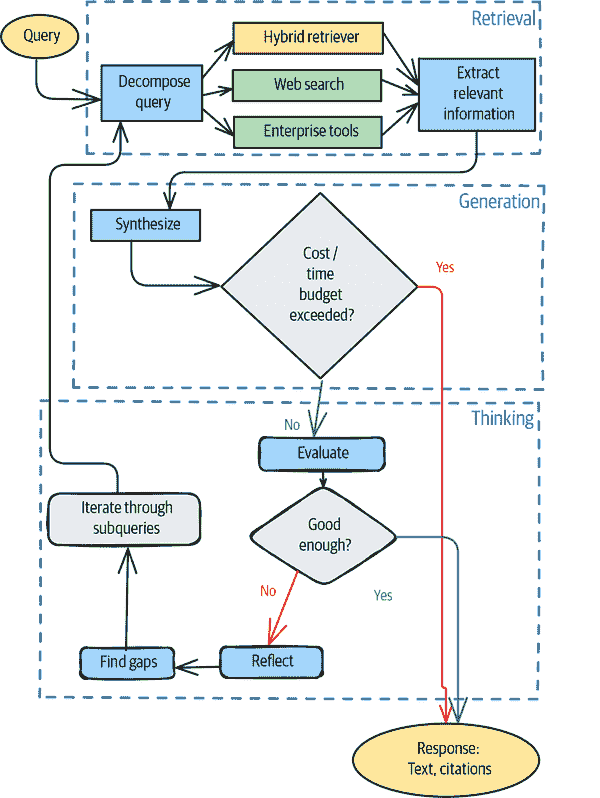

**图 4-14.** 深度搜索增加了迭代、外部工具，并将状态保存在上下文中。

- **推理深度限制**：迭代过程中的检索与综合结果会被追加到状态中。整个上下文将用于综合出最终回答，以进行评估。

### 深度搜索与深度研究

一些专家和公司对深度搜索与深度研究进行了区分。两者都采用一种迭代方法，识别缺口，并根据下一个最佳搜索方向更新查询。最后，它们还可以将收集到的信息综合成一个连贯、全面的回答。

例如，你用来识别缺口并返回新查询的步骤可以非常简单，如下所示：

```
def get_next_queries(original_query, sub_queries, synthesis):
    prompt = f"""Determine whether there is a logical or information gap in the 
answer based on the original query, previous sub queries, and the response. If 
the current response answers the question without any logical or information 
gaps, return an empty list. If there is a gap, provide a list of up to 3 search 
queries to fill in the gap.
 
    **Original Query**:
    {original_query}
    
    **Previous Sub Queries**:
    {sub_queries}
 
    **Current answer:**
    {synthesis}
    """
    agent = Agent(llm, result_type=str[])
    new_queries = agent.run_sync(prompt).data
    return new_queries
```

#### 迭代优化

如前面所示，识别缺口使你有能力在整个执行流程中采用*迭代优化*。也就是说，你可以从非常简单的问题开始，然后利用答案来确定流程中的下一步。例如，你可以从分解一个像下面这样的复杂查询开始：

> 比较发展中国家和发达国家气候变化减缓策略的经济影响，同时考虑短期成本和长期收益。

但更好的方式是从回答一个更简单的问题开始：

> 气候变化减缓策略的经济影响是什么？

然后，在每次迭代中，你可以逐步填补对更简单问题回答中的缺口。

#### 评估指标

评估步骤和反思步骤（与评估指标相关）对于构建一个良好的深度搜索系统极为重要。你获得的回答质量往往直接取决于你评估迭代的效果，以及能否为下一次迭代向模型提供反馈。


与其自行设计指标来评估内容，我们建议你使用像 [Ragas](https://docs.ragas.io) 这样被广泛使用的开源框架。此类框架已经针对流行的基础模型和各类文档进行了充分测试。

Ragas 提供了许多可供使用的[开箱即用指标](https://oreil.ly/SMw8i)。通常，你可以创建评估指标的加权平均值，并选择能反映每个指标对问题重要程度的权重。这使你能获得既定制化又稳健的评估得分。

至少，请确保你的综合评估分数涵盖报告的以下方面：

*   相关性
*   全面性
*   准确性和事实正确性
*   连贯性、逻辑流程和条理性
*   引用质量
*   效率

如果你使用特定的外部工具（例如 SQL 数据库），请确保包含针对该用途定制的指标。

你还应该创建一个由问题和参考答案组成的数据集，并确保你为这些参考答案（以及少量生成的回复）给出的评估分数能通过基本合理性检验（sniff test）。你还可以使用诸如 [Patronus AI](https://www.patronus.ai) 提供的模型，这些模型经过专门训练，可充当评估器。

## 信息整合

评估之后，Deep Search 系统第二重要的方面是，它如何将来自多个来源和多次迭代的信息综合成连贯的理解，以解决冲突和不一致之处。

正如我们在模式 10“节点后处理”（Node Postprocessing）中讨论的那样，综合步骤需要执行跨文档实体解析，以识别不同来源何时用相同名称指代同一实体。除了识别歧义实体之外，它还需要检测来源之间的矛盾并加以解决。

一种方法是识别因视角不同而产生矛盾的情况，然后根据视角对来源进行聚类。尤其是在通过网络搜索收集数据时，按可信度对来源进行排序非常重要，这样你才能恰当地权衡相互冲突的信息。最后，综合步骤可能还需要引入时间推理，以协调来自不同时期的信息。

### 示例

为了演示 Deep Search，我们将构建一个简化版本，它执行迭代的检索、生成、思考和编排。编排步骤控制所有其他步骤，如图 16-1 所示。（我们在 GitHub 中附上了 notebook 的链接，方便你动手体验。）

#### 检索

首先，我们从 Wikipedia 获取一个页面，并使用 LLM 来识别最相关的页面以及提取相关文本：

```
@dataclass
class Page:
  title: str
  url: str
  relevant_text: str
  score: floot # Retrieved from reranker.

class WikipediaSearchTool:

  def search(self, query: str) -> list[Page]:
    """Search for pages relevant to query."""
  def extract_relevant_text(self, page: Page, query: str) -> str:
    ...
```

检索的第一步是找到最相关的页面。我们使用搜索工具从 Wikipedia 检索页面，然后用 LLM 对它们重新排序，以找出最相关的页面：

```
async def retrieve_pages(query: str) -> list[Page]:
  prompt = f"""Use the search tool to find pages on Wikipedia relevant to: {query}
  Return the top 3 most relevant pages."""
  agent = Agent(
    instructions="You are a helpful research assistant.",
    tools=[WikipediaSearchTool()],
    model="gpt-4o",
  )
  response = await agent.run_sync(prompt)
  return response.data
```

针对利比里亚页面的结果为以下标题：

> 第一次利比里亚内战
> 利比里亚历史
> 美裔利比里亚人

检索的第三步是提取相关文本。同样，这可以通过调用 LLM 来完成（实际代码参见 [GitHub 中的 notebook](https://oreil.ly/siINx)）。例如，第一个页面中的相关文本开头如下：

> 第一次利比里亚内战的原因是复杂且多方面的。\n\n**历史因素：**\n\n* **社会经济差距：** 美裔利比里亚精英是美国自由黑人奴隶的后代，他们在历史上主导了该国的政治和经济生活，将原住民边缘化。这造成了深深的怨恨和不平等。\n* **政治排斥：** 真辉格党（True Whig Party）掌权超过一个世纪，实际上形成了一个一党制国家，压制异议并限制了非美裔利比里亚人的政治参与。\n*

这看起来确实相当相关。

#### 生成

生成的第一步是根据从来源中提取的相关文本来综合出一个答案。这同样可以通过 LLM 提示词来完成：

> 根据给定的信息回答以下查询。
>
> 查询：
>
> `{query}`
>
> 相关信息：
>
> `{page.relevant_text for page in pages}`

关于利比里亚内战问题的综合答案开头如下：

> 第一次利比里亚内战的原因是复杂且多方面的，源于历史因素、直接诱因和区域不稳定。关键原因包括：
>
> \* \*\*社会经济差距：\*\* 美裔利比里亚精英在历史上主导了利比里亚的政治和经济生活，将原住民边缘化，并造成了深深的怨恨。

#### 思考

思考步骤是评估答案、发现差距并确定后续问题的地方。同样，你只需向 LLM 发出提示即可完成这些操作（详细信息参见 [GitHub 中的 notebook](https://oreil.ly/siINx)）。

在利比里亚内战的案例中，你可以识别出以下后续问题：

> 1\. 社会经济差距在资源获取、教育和不同族裔群体的机会方面具体如何体现？
>
> 2\. 区域不稳定，特别是塞拉利昂和科特迪瓦的冲突，在武器扩散和招募战斗人员方面以哪些具体方式助长了利比里亚内战？
>
> 3\. 你能详细说明塞缪尔·多伊政权实施的、助长叛乱的具体侵犯人权行为和政治压迫行为吗？

这些问题中的每一个都可以发送到检索步骤，并用于生成答案。

请注意，这种识别潜在后续问题的技巧在聊天机器人设计中很常见。在这个过程中，视觉界面通常将后续问题显示为*标签按钮*（chips，即可点击的按钮），用户可以用这些按钮更深入地挖掘所提供的答案。

#### 编排

将所有部分整合在一起，系统使用每个查询及其答案来创建报告的一个章节：

```
@dataclass
class Section:
  query: str
  answer: str
  sections: list['Section']

def create_section(query: str) -> Section:
  pages = search_wikipedia(query)
  ranked_pages = rank_pages(query, pages)[:3] # top 3
  for page in ranked_pages:
    add_relevant_text(query, page)
  answer = synthesize_answer(query, ranked_pages)
  section = Section(query=query, answer=answer, sections=list())
  return section
```

该章节包含子章节，你可以通过发现差距并提出后续问题来为章节添加子章节：

```
def add_subsections(parent: Section):
  # second and subsequent iterations with a thinking stage
  follow_ups = identify_gaps_and_followups(parent.query, parent.answer)
  for follow_up in follow_ups:
    section = create_section(follow_up)
    parent.sections.append(section)
```

你可以编排这两个步骤来完整地创建报告：

```
def deep_search(query: str, depth: int, report=None) -> Section:
  if report is None:
    report = create_section(query)
  add_subsections(report)
  if depth > 1:
    for section in report.sections:
      deep_search(section.query, depth-1, section)
  return report
```

你可以按如下方式调用这个 Deep Search 实现：

```
report = deep_search(
   query="What were some of the famous victories of Napoleon Bonaparte?",
   depth=1)
```

生成的报告部分内容如下：

> # 拿破仑·波拿巴有哪些著名的胜利？
>
> 根据所提供的信息，拿破仑·波拿巴的一些著名胜利包括：
>
> - 土伦围城战（1793 年）
> - 葡月 13 日事件（1795 年）
> - …
> - 奥斯特里茨战役（1805 年）
>
> ..
>
> ## 奥斯特里茨战役的意义是什么？为什么它被认为是拿破仑最伟大的胜利之一？
>
> 奥斯特里茨战役意义重大，因为它有效地摧毁了针对法兰西帝国的第三次反法同盟。它被认为是拿破仑最伟大的胜利之一，因为…
>
> ## 拿破仑在这些战役中使用了哪些关键战略或战术来确保胜利？
>
> 根据所提供的信息，拿破仑确保胜利的关键战略和战术包括：
>
> - **压倒敌军：** 结合速度、欺骗和集中火力。
> - **快速行军：** 实现出其不意并迂回包抄对手。
> - …
>
> ## 就拿破仑的权力和欧洲政治格局而言，这些胜利带来了哪些后果？
>
> 拿破仑的胜利使他极大地巩固了权力，得以在 1802 年成为终身第一执政，并于 1804 年成为皇帝。在政治上，…

报告的第一部分是对所提出问题的回答。战役列表包含了奥斯特里茨战役。各个小节则是依据这一回答而建议的后续问题的答案，其中第一个问题就是关于这场特定战役的意义。因此，很容易看出迭代搜索并不断充实生成状态的益处。

### 注意事项

插入的关键缺点是，你可以使用第 2 章中的模式 5（内容优化），以用户偏好的风格创建响应。

### 参考资料

2024 年初，斯坦福大学的研究人员开发了一种深度研究模型（[STORM](https://arxiv.org/abs/2402.14207)），能够从零开始撰写维基百科文章。2025 年初，[DeepSeek-R1](https://arxiv.org/abs/2501.12948) 展示了通过将知识库中的相关信息添加到提示上下文中而由 LLM 生成的内容。 | 你可以使用 RAG 系统来实现以下功能：<br><br><ul><li>通过基于公司知识库提供准确、上下文感知的响应，增强客户服务聊天机器人。</li><li>构建智能的内部搜索引擎，从内部文档、数据库和特定职能报告中综合回答员工的问题。</li><li>帮助分析师快速访问并综合大量研究报告和宣传材料中的信息。</li><li>高效检索相关的判例法和法规，确保律师获得处理案件所需的及时准确的信息。</li><li>将有关竞争对手的公开信息（如新闻文章、财务报告和产品公告）综合成竞争情报报告。</li><li>通过基于研究问题检索相关信息并生成不同研究结果的比较，加快文献综述和发现。</li><li>根据最新信息创建和更新有关感兴趣主题与问题的个性化摘要。</li></ul><br>随着技术的发展，RAG 的应用也在不断扩展。 |

| **语义索引（模式 7）** | 当文档变得更加复杂、包含图像或表格等不同类型的媒体，或跨越多个领域时，传统的关键字索引/查找方法会失效。 | 使用嵌入来捕捉文本、图像和其他媒体类型的含义。通过比较文本块与查询的嵌入来查找相关文本块。 | |

| **规模化索引（模式 8）** | 你必须处理知识库中过时或相互矛盾的信息。 | 使用元数据、查询过滤和结果重排序。 | |

| **索引感知检索（模式 9）** | 将问题与文本块进行比较是有问题的，因为问题本身不会出现在知识库中，可能会使用同义词或术语，或者可能需要整体性的解释。 | 使用假设性答案、查询扩展、混合搜索和 GraphRAG。 | |

| **节点后处理（模式 10）** | 你必须处理不相关的内容、模糊的实体和泛泛的答案。 | 重排序提供了引入许多其他巧妙想法的能力：混合搜索、查询扩展、过滤、上下文压缩、消歧和个性化。 | |

| **可信生成（模式 11）** | 既然无法完全避免错误，你必须想办法保持用户的信任。 | 域外检测、引用、护栏、人工反馈、纠正性 RAG 和 UX 设计都能有所帮助。 | |

| **深度搜索（模式 12）** | 由于上下文窗口限制、查询歧义、信息验证、浅层推理和多跳查询等挑战，RAG 系统在处理复杂信息检索任务时效果不佳。 | 使用搜索、阅读和推理的迭代过程，为复杂查询提供全面的答案。 | |

^(1) 这些句子摘自[关于西班牙托莱多的维基百科文章](https://oreil.ly/_Wr4K)。
