# 第 5 章 扩展模型能力

LLM 擅长在海量数据中识别模式。它们通过统计预测下一个 token 来生成连贯且与上下文相关的响应。然而，这并不一定意味着它们能真正理解底层概念。如果你的任务没有被基础模型的训练过程充分覆盖，那么该模型可能无法执行这一任务。本章讨论四种模式，你可以用它们教会基础模型执行其未经训练的任务。

## LLM 推理的局限性

基础模型能够有效地操作符号和文字，但这可能是因为它们是从训练数据中遇到的操作进行泛化，而不是因为它们像人类一样理解语义及其之间的逻辑关系。虽然你可以使用基础模型执行许多任务，那是因为这些任务与基础模型被训练的任务相似。

很难描述基础模型做不好的任务——这是因为这些任务往往是晦涩的或行业特有的，更广泛的受众（比如本书的读者）不会理解。没有被 LLM 训练数据充分覆盖的任务包括：为共同基金的投资委员会撰写备忘录，或裁决内部调查，因为这类备忘录属于内部记录，这类调查也高度公司特有，并非公开知识。根据定义，任何在广泛可获取的来源中描述的任务都会被 LLM 捕获。鉴于此，我们将使用数学和推理问题来支持“LLM 推理能力存在局限”这一观点。但请注意，本章中的模式*不是*数学或推理问题的解决方案——它们是诸如撰写投资委员会备忘录和裁决内部调查等问题的解决方案。

### 已知能力

许多常见的数学和推理问题在 LLM 的训练数据集中覆盖充分。例如，让你最喜欢的基础模型做下面这件事：

> 列出 100 到 110 之间的质数。

你应该得到正确结果：101、103、107 和 109。当我们尝试时，Gemini Flash 给出了如下回复（[代码在 GitHub 上](https://oreil.ly/wNZnC)）：

> 100 到 110 之间的质数是：
>
> 101
>
> 103
>
> 107
>
> 109

Gemini 的精确训练数据不太可能回答过这个确切的问题；相反，Gemini 能够将它在训练中遇到的质数检查方法泛化到我们指定的范围。

类似地，我们可以问 GPT-4o-mini 这个问题：

> 84 平方米的公寓是多少平方英尺？

结果看起来很像是推理：

> 要将平方米转换为平方英尺，可以使用换算系数：1 平方米约等于 10.7639 平方英尺。
>
> 因此，将 84 平方米转换为平方英尺：
>
> \\\[
>
> 84 \\, \\text{sq meters} \\times 10.7639 \\, \\text{sq feet/sq meter} \\approx 903.20 \\, \\text{sq feet}
>
> \\\]
>
> 所以，84 平方米的公寓大约为 903.20 平方英尺。

同样，虽然 ChatGPT 在训练中不太可能遇到这个具体的文字题（关于公寓面积）或数字（84），但它能够从遇到过的类似问题中泛化，并采用正确的方法。

然而，乘法的实际结果是 904.1676，所以这个乘法结果是幻觉。要解决这个问题，你需要让模型能够使用计算器工具（参见第 7 章中的模式 21“工具调用”）。

### 未知能力

前两个例子并不能证明 LLM 能够推理，至少不能证明它们能像人类解决这两个问题那样推理。让我们看一个简单的推理问题，在 2025 年 4 月时 LLM 训练还没有充分覆盖它。这涉及[吃墩纸牌游戏](https://oreil.ly/TH-Nw)（如桥牌、惠斯特、黑桃和红心）中的花色打法。

我们问了 ChatGPT 这样一个问题：

> 在桥牌中，“八飞九不飞”这句格言是什么意思？

它的初步回答是正确的，部分内容如下：

> 实际建议：
>
> “八飞”→ 飞牌抓 Q（因为存在 3-2 分布且 Q 位置有利的足够空间）。
>
> “九不飞”→ 不要飞牌，选择硬打（因为持有 9 张牌时，如果 Q 是双张，更可能在两轮中被打下来）。

所以，它“知道”两手合计 9 张牌且缺 Q 时，正确打法是不要飞牌。但接着，我们问了 ChatGPT 这个问题：

> 在桥牌中，持有 AKJxx 对四张小牌，你该如何打这副花色才能不失墩？

它错误地告诉我们最佳路线是飞牌：

> 最佳打法（标准飞牌和安全打法）：
>
> 从持有四张小牌的一方（明手）打一张小牌走向 AKJxx。
>
> 如果 RHO（右手敌方）跟小牌，就插入 J。


所以，仅仅因为模型能够复述一条标准建议，并不意味着它能够应用那条建议。这并不限于 ChatGPT——Gemini 和 Anthropic 也知道这条格言，但没有应用它。^(1)

毫无疑问，在你的行业和业务中，你需要执行困难或晦涩的分析任务（例如撰写投资委员会备忘录、进行内部调查、决定如何选择供应商等），这些任务同样没有被基础模型的训练数据集充分覆盖。本章讨论四种模式，你可以用它们来教基础模型执行它们未受过训练的任务。

## 模式 13：思维链

思维链模式使用*思维链*（CoT）推理，这是一种提示技术，通过鼓励 LLM 在得出最终答案之前将复杂问题分解为中间的推理步骤，来增强其问题解决能力。

### 问题

当涉及数学计算、逻辑推理或序列推理问题时，基础模型在训练数据覆盖方面存在一些关键局限。这在涉及多步推理的问题中，或当模型直接为需要斟酌的问题提供答案时尤为明显。

#### 训练数据覆盖

正如引言中的吃墩例子所示，基础模型并不总能泛化到训练数据集中未知或覆盖不足的任务。虽然小学数学和物理问题是模型训练数据集的一部分，但行业特有的计算可能不在其中。

例如，在 2025 年 4 月，当我们问 Claude Sonnet 3.7 一个小学物理问题时，我们得到了一个推理良好的回答：

> 一个 2 千克的物体沿无摩擦斜面下滑，斜面与水平面成 30°角。物体的加速度是多少？

然而，尽管零样本提示（参见第 1 章）在这种情况下有效，但模型无法回答一个在石油和天然气行业常见的问题：

> 如果我有一根直径 25 厘米的管道和一根 100 米长的软管，在 7 巴压差下输送 Texas Sweet 原油，流量是多少？

对于后一个问题，模型给出了以下回答：

> 在给定信息下，我无法对这个问题给出有意义的答案。虽然你指定了管道直径（25 厘米）、软管长度（100 米）和压差（7 巴），但缺少几个关键信息：
>
> 1\. “Texas Sweet”原油的黏度（随温度变化）
>
> 2\. 管道材料的粗糙度
>
> 3\. 管道中任何会造成压力损失的其他接头或弯头
>
> 4\. 管道是水平放置还是有高度变化
>
> 此外，要计算流量，我需要使用流体力学方程，如达西-韦斯巴赫方程或哈根-泊肃叶定律（用于层流），而这些方程需要上述参数。
>
> 如果你需要准确的流量计算，我需要这些关于流体性质和管道配置的额外参数。

模型知道所讨论的方程，它关于管道可能弯曲或倾斜的反对意见只是在胡搅蛮缠。如果你把模型拟人化，你可能会说它很懒！

#### 多步推理

当问题需要多步推理时，模型的零样本能力常常会失效，因为模型倾向于直接跳到答案，而没有经过适当分析的中间步骤。当它们这样做时，常常会捏造信息或给出错误的答案。

例如，我们向 Gemini 提出了这个问题：

> 如果你的最终目的地是美国，或者你有特殊需求，你可以托运 50 公斤。否则，你只能托运 40 公斤。对于以下行程：SIN-DFW-YYZ，随身行李额度是多少？

我们得到了一个错误的答案：

> 由于至少有一个航段的最终目的地是美国，因此你可以托运 **50 公斤**。

这是对 *最终* 一词相当不寻常的解读，而且它是[错误](https://oreil.ly/MFip6)的。仅仅因为词语以貌似合理的方式串在一起，并不意味着推理是正确的。

#### 黑盒答案

模型响应很少能让人们洞察模型是如何得出结论的，这使得识别错误或偏见变得困难。对用户来说，模型就像一个黑盒。他们往往不信任没有附上模型推理过程的响应。事后问模型“为什么”并不能让模型提供其实际使用的推理——事实上，它的解释很可能是幻觉。

例如，我们向 GPT-4o-mini 提出了这个问题（没有让它访问网络工具）：

> 如果我驾驶 300 公里从海得拉巴向西行驶，最终会到达哪里？

我们得到了一个相当错误的答案：

> 如果你从印度海得拉巴向西行驶 300 公里，你很可能会到达马哈拉施特拉邦地区，可能会到达艾哈迈德纳加尔等城市，甚至浦那的郊区，具体取决于你的确切路线。

正确的答案是索拉普尔，它位于海得拉巴正西 300 公里处，并且就在一条主要的西行高速公路上，而艾哈迈德纳加尔则在更靠西 200 公里、且远靠北的位置（参见图 5-1）。

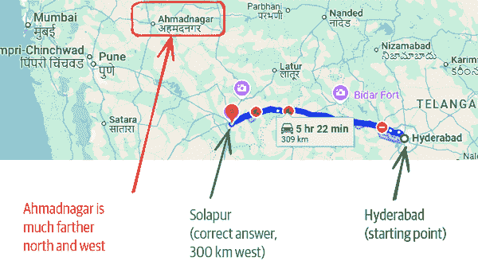

###### 图 5-1. 索拉普尔位于海得拉巴正西 300 公里处（谷歌地图截图）

目前尚不清楚模型为何将距离弄错得如此离谱。响应并没有表明它得出答案所用的过程。

### 解决方案

思维链涉及修改提示策略——不是要求直接给出答案，而是让提示明确要求或展示逐步推理的过程。共有三种变体：零样本思维链、少样本思维链和自动思维链。我们逐一来看。

#### 变体 1：零样本思维链

在零样本思维链中，你只需在提示中添加短语 `think step-by-step` 即可请求逐步推理（参见图 5-2）。例如，你可能会这样说：

> 一个质量为 2 kg 的物体正沿着与水平方向成 30° 角的无摩擦斜面下滑。该物体的加速度是多少？请逐步思考。

![说明零样本思维链（CoT）过程的示意图，展示基础模型如何从带有逐步步骤的提示生成答案，来自 OpenAI 的 GPT 3.5 Turbo，包括逐步推理：> 第 1 步：画出物体的受力分析图。>> 物体所受的力包括竖直向下的重力（`mg`）和垂直于斜面的法向力（`N`）。由于斜面没有摩擦，物体不受摩擦力。>> 第 2 步：将重力分解为平行于斜面和垂直于斜面的分量。>> 重力可以分解为两个分量：一个平行于斜面（`mg*sin(30°)`），另一个垂直于斜面（`mg*cos(30°)`）。这些步骤来自模型的预训练，并且仅限于它在预训练中遇到的内容。当模型“偷懒”时——要么没有使用它已有的信息，要么直接跳到答案——可以试试这种方法。

#### 变体 2：少样本思维链

当模型的预训练能力不包含所需的特定逻辑时，你可以尝试少样本思维链。这种方法是在让模型解决新问题之前，先为模型提供类似问题的逐步推理示例。在少样本思维链中，你通过示例展示期望的推理模式（参见图 5-3）。

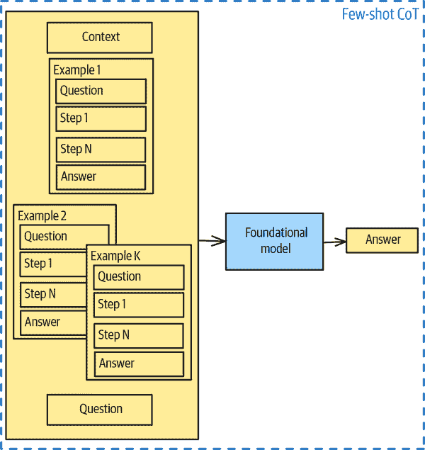

###### 图 5-3. 少样本思维链涉及提供推理示例

#### 少样本思维链与 RAG 的对比

模式 6（基础 RAG，来自第 3 章）和少样本思维链都涉及向提示的上下文中添加信息。这两者都是*上下文工程*的示例。区别在于，在 RAG 中，你添加的是知识（数据），而在思维链中，你展示的是逻辑。在 RAG 中，你希望答案精确地基于所添加的知识，而在思维链中，你希望模型从你提供的示例中进行泛化。

可以这样理解：RAG 给模型几条鱼，而少样本思维链则教模型如何钓鱼。

例如，你可能会使用以下提示：

> 使用以下示例作为模板，解决下面的物理问题。
>
> 示例：
>
> 问：一个球从 200 m 的高度落下。它需要多长时间才能到达地面？
>
> 答：
>
> 第 1 步：确定方程
>
> 描述位移、初速度、加速度和时间之间关系的方程是：`Δy = v₀t + (1/2)at²`
>
> 第 2 步：确定已知值
>
> `Δy` = 最终高度 - 初始高度 = `0 m` - `200 m` = `-200 m`
>
> `v₀` = 初速度 = `0`
>
> `a` = 重力加速度（`g`）≈ `9.8 m/s²`
>
> 第 3 步：将已知值代入方程
>
> `-200 m = (0 m/s) * t + (1/2) * (-9.8 m/s²) * t²`
>
> 第 4 步：求解
>
> `-200 m = 0 + (-4.9 m/s²) * t²`
>
> `t² = (-200 m) / (-4.9 m/s²)`
>
> `t² ≈ 40.816 s²`
>
> `t = √(40.816 s²)`
>
> `t ≈ 6.39 s`
>
> 第 5 步：报告答案
>
> 一个从 200 m 高度落下的球需要 6.39 s 才能到达地面。
>
> 问：一个质量为 2 kg 的物体正沿着与水平方向成 30° 角的无摩擦斜面下滑。该物体的加速度是多少？

现在，响应完全按照模板示例分为五步，如下所示：

> 答：
>
> 第 1 步：确定方程
>
> 描述加速度、重力及斜面倾角之间关系的方程是：`a = g * sin(θ)`
>
> 第 2 步：确定已知值
>
> `m` = 质量 = `2 kg`
>
> `θ` = 斜面的倾角 = `30°`
>
> `g` = 重力加速度 = `9.8 m/s²`
>
> 第 3 步：将已知值代入方程
>
> `a = (9.8 m/s²) * sin(30°)`
>
> 第 4 步：求解
>
> `a = (9.8 m/s²) * 0.5`
>
> `a = 4.9 m/s²`
>
> 第 5 步：报告答案
>
> 一个质量为 2 kg 的物体在与水平方向成 30° 角的无摩擦斜面上下滑，其加速度为 4.9 m/s²。

#### 变体 3：自动思维链

在自动思维链变体中，你将各种问题的示范性示例添加到一个称为*示例库*的数据库中。大多数人使用*文档数据库*（其中的示例按问题文本中的关键词建立索引）或*向量数据库*（其中的示例按问题的嵌入向量建立索引）作为示例库。

演示示例可以由人工编写，但按照以下步骤创建它们成本更低、可扩展性更强（另请参阅图 5-4）：

1. 抽取一个包含多种多样问题的题库，其中每个问题都有唯一的正确答案。
2. 使用零样本思维链（Zero-shot CoT）为这些问题生成答案，可以使用多个基础模型，也可以使用同一模型的不同设置，从而获得多个答案。
3. 对答案应用一组一致性和正确性检查。要接受一个答案，你需要它得出正确的结果，并且能够可靠地复现得出该结果的逻辑步骤。
4. 将通过这些检查的问答对添加到示例库中。

面对一个新问题时，你会找到与数据库中与之最接近的五个问题对应的演示示例，然后将它们添加到上下文中，与少样本思维链（Few-shot CoT）类似。

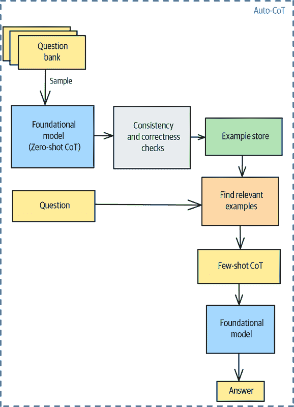

#### 图 5-4：Auto-CoT 是一种动态选择示例的少样本思维链

让我们扩展上一节侧边栏中的类比。与少样本思维链类似，但与 RAG 不同，Auto-CoT 中的示例是关于“如何钓鱼”的。Auto-CoT 相比少样本思维链的改进在于，示例库中包含了以不同方式捕鱼的演示示例——鱼叉捕鱼、设陷阱捕鱼、垂钓、拖网捕鱼、抛饵等——你可以根据自己的场景选择合适的示例。

### 示例

让我们看几个思维链（CoT）实际应用的示例。

#### 零样本思维链（Zero-shot CoT）

通过指示模型在给出答案前“逐步思考”，零样本思维链（Zero-shot CoT）往往能解锁其预训练能力。回想一下，当我们提出石油天然气问题时，模型表现得“懒惰”。如果加上零样本思维链的提示语，会发生什么？

> 如果我有一根直径为 25 cm 的管道和一根 100 m 长的软管，
>
> 在 7 bar 压差下，Texas Sweet 的流速是多少？
>
> 请一步一步地思考。

Claude 给出的删节版答案如下。（[完整答案](https://oreil.ly/XIAM7)见 GitHub）：

> ...
>
> ## 步骤 1：确定德克萨斯甜原油的性质
>
> 德克萨斯甜原油通常具有以下性质：
>
> - 密度（ρ）：约 850 kg/m³
>
> - 动力黏度（μ）：约 0.005–0.010 Pa·s（我将使用 0.008 Pa·s）
>
> ...
>
> ## 步骤 3：代入数值并计算
>
> Q = (π × (0.25 m)⁴ × 700,000 Pa) / (128 × 0.008 Pa·s × 100 m)
>
> ...
>
> 在给定参数下，德克萨斯甜原油的流速约为 84 m³/s（或 5,040 m³/min），这看起来非常高，表明实际中流动将是湍流，并可能在真实管道系统中受到其他因素的限制。

我们不必指定确切的步骤——模型知道需要查找该类型原油的黏度，并将相应数值代入方程来计算流速。只需让模型逐步思考，就足以触发正确的行为。

#### 少样本思维链（Few-shot CoT）

回想一下，当我们提出行李问题时，模型给出了错误结果。这是因为它错误地把中转停留识别为“最终目的地”。不过，你可以通过使用少样本思维链（Few-shot CoT）来纠正错误或幻觉逻辑。例如，在提出实际问题之前，你可以用几个示例演示如何解决行李问题：

> 如果您的最终目的地是美国，或者您有特殊需求，则允许托运 50 kg 行李。
>
> 否则，您只允许托运 40 kg。
>
> 示例 1：
>
> 问：行程为 CDG-ATL-SEA 的行李限额是多少？
>
> 答：最终目的地 SEA 在美国。因此，行李限额为 50kg。
>
> 示例 2：
>
> 问：行程为 CDG-LHR-NBO 的行李限额是多少？
>
> 答：最终目的地 NBO 在肯尼亚。因此，行李限额为 40kg。
>
> 问：以下行程的行李限额是多少：SIN-DFW-YYZ？

现在，答案是正确的：

> 答：最终目的地 YYZ 在加拿大。因此，行李限额为 40kg。

这个答案遵循了所演示答案的模板。因为它不仅限于解锁预训练能力，少样本思维链在复杂问题上比零样本思维链更有效。

少样本思维链在解决本章引言部分描述的赢墩问题方面也很有效。只需提供几个对手牌张最可能分布的示例，就足以让模型给出可接受的响应：

> 你是一名桥牌教师。指导学生如何打给定的花色组合。
>
> 示例 1：
>
> 问：持有 AKJx，对面是 xxxx。
>
> 答：你方两手共有 8 张牌，对方有 5 张，其中包括 Q。
>
> 最可能的分布是 3-2。只有当 Q 的位置有利时，你才能不失一墩地拿到这门花色。
>
> 飞 J。
>
> 示例 2：
>
> 问：持有 AKJx，对面是 5 张小牌。
>
> 答：你方两手共有 9 张牌，对方有 4 张，其中包括 Q。
>
> 最可能的分布是 2-2。因此，打 Q 被击落。
>
> 问：持有 AKJxx，对面是四张小牌。

### 注意事项

使用 CoT 是一种强有力的方式，可以向模型展示如何以标准方法解决特定领域的问题。如果你正在考虑使用它，你应该了解它的局限性以及存在的替代方案。

#### 局限性

CoT 在所需逻辑不是顺序性的情况下，或者当模型因数据缺口而失败时，并没有帮助。

##### 数据缺口

考虑一个从海得拉巴驱车 300 公里的问法问题。假设我们让模型逐步思考（就像零样本思维链那样）：

> 如果我驱车从海得拉巴向西行驶 300 公里，最终会到达哪里？
>
> 请一步一步地思考。

响应表明模型正在遵循正确的逻辑：

> 如果你驱车从海得拉巴向西行驶 300 公里，预计最终会到达马哈拉施特拉邦内或附近的几个知名地区。以下是逐步分解：
>
> 1. **起点**：你从海得拉巴出发，它位于印度南部的特伦甘纳邦。
>
> 2. **方向**：向西行驶意味着你将前往马哈拉施特拉邦，它位于特伦甘纳邦的正西。
>
> 3. **预计距离**：300 公里的路程会穿越多种地形，可能让你到达马哈拉施特拉邦的几个城镇或城市附近。
>
> 4. **可能的目的地**：
>
> - **奥兰加巴德**：一座重要的城市，以其历史遗址闻名，包括阿旃陀石窟和埃洛拉石窟。它距海得拉巴约 300 公里。
>
> - **南德**：另一座大致在这个距离内的城市，以其谒师所（Gurudwara）和在锡克教中的历史意义而闻名。
>
> 5. **路线选择**：根据具体路线（例如经 NH65），你也可能经过一些小城镇，如扎希拉巴德或比达尔。
>
> 总之，从海得拉巴向西行驶 300 公里后，你很可能最终到达奥兰加巴德或南德，也可能到达马哈拉施特拉邦的其他较小城镇或城市。

逻辑是正确的，但目的地是幻觉生成的。南德位于海得拉巴的*西北*，而不是正西。

修复数据缺口的方法是补充知识。在这种情况下，如果模型是多模态的，加入一张地图就能很好地解决问题：

```
def answer_based_on_map(model_id, prompt: str) -> str:
    from pydantic_ai import Agent, ImageUrl
    agent = Agent(model_id)
    result = agent.run_sync([prompt, 
                           ImageUrl(url="...India_roadway_map.svg.png")
                            ])
    return (result.data)
 
answer_based_on_map("claude-3-7-sonnet-latest","""
If I drive 300km west of Hyderabad, where will I end up?
Think about it step-by-step.
""")
```

现在结果（索拉普尔）是正确的，因为正确的数据已被填入正确的逻辑中：

> 查看印度国家公路网地图，我将确定如果你从海得拉巴向西行驶 300 公里，最终会到达哪里。
>
> 第一步：在地图上找到海得拉巴。
>
> 我可以看到海得拉巴位于印度南部，特伦甘纳邦。
>
> 第二步：确定海得拉巴以西 300 公里是什么地方。
>
> 从海得拉巴向西行驶约 300 公里，将带你前往马哈拉施特拉邦的西部。根据地图比例尺和公路网，这将使你到达以下地点附近：
>
> - 你可能会接近马哈拉施特拉邦的索拉普尔和孟买之间的地区。
> - 你可能位于马哈拉施特拉邦东部，可能靠近楠代德或拉图尔等城市。
> - 你有可能正在接近马哈拉施特拉邦西部地区。
>
> 第三步：结论
>


如果你从海得拉巴向西行驶 300 公里，你很可能最终到达马哈拉施特拉邦西部，可能在索拉普尔附近，或索拉普尔与马哈拉施特拉邦-卡纳塔克邦边界地区之间的某处。确切位置取决于具体路线，因为公路并不总是完全东西走向。

### 非顺序逻辑

如果逻辑涉及循环，CoT 往往不起作用。在桥牌问题中，纯粹根据对手最可能的牌张分布来做决策是一种捷径。专家会根据对手在最初几墩中的出牌来更新相关的概率，例如他们是否在某门花色上缺门。如果某条不寻常的打法是拿到所需墩数的唯一可能，专家也会选择这条打法。

在 CoT 中展示专家逻辑是行不通的，因为专家的打牌路线涉及针对多种场景的优化，因此模型很难简单地模仿：

> 你是一位桥牌专家。请指导我如何打给定的花色组合。
>
> 示例 1：
>
> 问：持有 AKJx，对家是 xxx，要求不失一墩。
>
> 答：你们两手共有 7 张牌，对方有 6 张，包括 Q。
>
> 要一墩不失，你必须希望对方的牌是 3-3 分布，并且 Q 的位置有利。
>
> 所以，飞 J，然后从大牌开始打。
>
> 示例 2：
>
> 问：持有 AKJx，对家是 5 张小牌，要求不失一墩。
>
> 答：你们两手共有 9 张牌，对方有 4 张，包括 Q。
>
> 如果对方两人都跟出，最可能的分布是 2-2。因此，采取让 Q 跌出的打法。
>
> 示例 3：
>
> 问：持有 AQxx，对家是 Txxx，要求只失一墩。
>
> 答：你们两手共有 8 张牌，对方有 5 张，包括 K、J 和 10。
>
> 要只失一墩，你必须希望某个对方持有 Kx、单张 K 或单张 J。
>
> 所以，出小牌到 A，以捕捉可能的单张。如果出现一张大牌，就出小牌穿过剩下的大牌。
>
> 如果没有大牌跌落，两手都出小牌，以捕捉可能的双张 K。
>
> 问：持有 AKJxx，对家是 4 张小牌，要求不失一墩。

最终的回答（[参见 GitHub 仓库](https://oreil.ly/XIAM7)）是不正确的。当演示示例包含非顺序逻辑时，模型无法习得期望的行为。

#### 替代方案

如果你在考虑 CoT，请考虑是否可以使用更有能力的模型或智能体式方法。

##### 模型中的测试时计算

如果做 CoT 就像在提示词中添加“一步步思考”那么简单，为什么模型提供商不自动将该短语添加到用户提示中呢？事实上，他们确实这么做了：现代基础模型 API 会对问题进行分类，并决定是否使用零样本 CoT。如 Auto-CoT 那样的生成演示属于这些模型预训练方案的一部分——在某些情况下，它们也可能使用少样本 CoT 中的演示示例库。

因此，你会发现零样本 CoT 对小型本地模型比对前沿模型更有帮助。你会发现少样本 CoT 仅在你所用模型的预训练领域之外才有帮助。

模型提供商也已开始在 Gemini 2.5 和 Anthropic 3.7 等模型中引入*测试时计算*或*思考模式*。这涉及到给模型时间来制定计划，然后执行计划的每一步。这样一来，模型就只是生成文本。但如果你改为要求模型制定计划，然后*执行*计划的每一步呢？这要求模型具备行动能力，而不仅仅是生成文本——因此将需要模式 21：工具调用（在第 7 章中讨论）。

如果你希望计划根据外部系统返回的结果动态变化呢？将工具调用与交错推理步骤相结合，被称为*推理与行动*（ReAct），这在第 7 章中讨论。

即使在不需要行动的情况下，生成多个计划并对其进行评估可能更具吸引力，因为你可以应用非顺序逻辑，并且更加透明（因为日志会显示每一次 LLM 调用）和更具韧性（因为可以将错误处理构建到编排不同调用的智能体框架中）。这种模式被称为*思维树*（ToT），我们接下来会介绍。将*所有*这些想法结合起来，需要模式 23：多智能体协作（来自第 7 章）。

### 参考文献

CoT 提示（CoT prompting）是由[Wei 等人](https://arxiv.org/abs/2201.11903)在 2022 年一篇极具影响力的论文中提出的。他们表明，你可以使用一些逐步示例，让 LLM 生成一系列中间步骤，从而更准确地解决算术、常识和符号推理问题。几个月后，[Kojima 等人](https://arxiv.org/abs/2205.11916)展示了零样本 CoT，表明这些推理步骤有时只需直接询问即可引出。又过了几个月（仍然在 2022 年！），[Zhang 等人](https://arxiv.org/abs/2210.03493)引入了 Auto-CoT，其中包含两个关键思想，使 CoT 无需手动编写答案即可完成：多样化地采样问题，以及使用零样本 CoT 生成推理链来填充示例库。

2025 年，[Invisible](https://oreil.ly/RC263)在一个面向 Allen & Overy（A&O）法律应用的项目中向 LLM 传授了 CoT。[K2view](https://oreil.ly/M9CuO)在其 GenAI Data Fusion 平台中实现了 CoT 推理，将复杂的客户服务查询分解为可管理的步骤，供具备实时数据集成的企业聊天机器人使用。

## 模式 14：思维树（ToT）

ToT 模式通过生成多条推理路径、对它们进行排序、探索最有希望的路径，并在必要时回溯并尝试新的不同路径来处理复杂任务（见图 5-5）。回想一下，CoT 只能处理那些可以分解为一组可顺序处理的线性步骤的任务。相比之下，ToT 需要多次 LLM 调用，以非线性方式评估多条解决方案路径——例如，它可以丢弃已探索的路径并“重新开始”其推理过程。ToT 可以应用于比 CoT 更广泛的任务，尤其是那些需要推理和规划的任务。

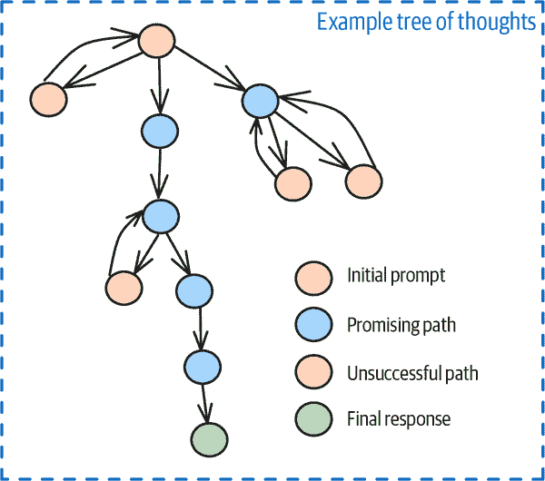

###### 图 5-5：思维树示意图：LLM 搜索多条路径，并在某条路径不成功时回溯

### 问题

许多需要战略的任务都基于最佳路径。](assets/gaid_0506.png)

###### 图 5-6：ToT 实现工作流

ToT 由以下四个组件组成（另见图 5-6）：

- 思维生成：在每一步，LLM 生成多个思维。
- 路径评估：LLM 根据每条路径的前景进行评分。
- 束搜索：ToT 只保留最有可能的 top-K 条路径。
- 摘要生成：当所有解决方案路径都已用尽时，LLM 根据最有希望的推理路径生成最终简洁响应。

这里的束搜索不同于 LLM 在生成期间用来决定要输出的 token 序列的束搜索（例如，第 2 章中的模式 1：Logits Masking 改变了什么）。这里涉及的树搜索和束搜索在更高层次上运行，由推理步骤组成。

#### 思维生成

ToT 模式中的每一步迭代都从使用 LLM 生成多个思维开始。模型被提示生成不同的下一步，并以 JSON 格式的列表返回“思维”。

每次调用`generate_thoughts`时，你都要向 LLM 呈现当前迭代状态：当前 ToT 生成状态下你的 top-K 解决方案。

以下示例展示了我们示例生成中的思维生成提示：

```
def generate_thoughts(self, state: str, step: int) -> List[str]:
    """ Generate multiple possible next thoughts. """
    self.call_count += 1
 
    prompt = f"""{state}
    You are solving a problem step-by-step using the Tree of Thoughts method.
Think about the problem state above and generate {self.num_thoughts_per_step} 
distinct and diverse next steps. This is step {step} of up to {self.max_steps} 
steps. Generate {self.num_thoughts_per_step} different possible next thoughts to 
make progress on this problem.
    Make each thought meaningfully different to explore diverse approaches. """
    ...
    thoughts = json.loads(content)
    return thoughts
```

对于文章写作问题，以下是为第 1 步生成的思维：

> 为第 1 步生成了 3 个思维：
>
> 1\. 我需要写一篇四段文章，每段以所提供的句子之一结尾。我可以围绕做决定这一主题来组织文章，因为许多引语都与选择有关。
>
> 2\. 我可以创作一个创意叙事，以某种方式将这些截然不同的引语串联起来——也许是一次外星人遭遇，引发对生活和人际关系的哲学思考。
>
> 3\. 我应该首先确定每句引语的主题（存在主义质疑、外星接触、婚姻/社会期望和克服恐惧），然后撰写一篇连贯的文章，自然地引出每个结论。

第一条思路指出，这些引语中“许多”都与选择相关；第二条是一条关于“外星人遭遇”的富有启发性的叙述；第三条则是一种策略性方法。三者似乎都可行，那么哪一条最佳，应该优先探索？

#### 路径评估

接下来的步骤需要遍历所有生成的思路，并在当前状态的上下文中对它们进行评估。这里，我们要让 LLM 判断提议的推理路径，并给出 0 到 100 之间的分数，对所有思路应用`evaluate_state`。以下代码将 0–100 的分数除以 100，得到 0–1 范围内的分数：

```
def evaluate_state(self, state: str, problem: str) -> float:
    """ Evaluate the promise of a reasoning path using Claude. """
    self.call_count += 1
 
    prompt = f"""
         Problem: {problem}
         Reasoning path: {state}
 
         On a scale from 0 to 100, evaluate how promising this reasoning path is 
for solving the problem.
         Consider:
         1. Correctness - Is the reasoning logically sound?
         2. Progress - How much progress has been made toward the solution?
         3. Insight - Does the reasoning show understanding of the key aspects?
         4. Potential - How likely is this path to lead to a complete solution?
 
         Respond with a single integer score between 0 and 100. Higher scores 
indicate more promising paths.
         Only provide the number, nothing else."""
     ...
     content = response.content[0].text.strip()
     score = int(content) / 100.0  # Convert to 0-1 scale
     return score
```

在评估这三条思路时，我们得到如下结果：

> 第 1 步后排名前 3 的状态：
>
> 1\. 得分：0.75 | 第 1 步：我应该首先确定每条引文的主题（例如……
>
> 2\. 得分：0.60 | 第 1 步：我可以创造一个创意叙事，以某种方式将……
>
> 3\. 得分：0.60 | 第 1 步：我需要写一篇四段式文章，其中每一段……

这告诉 LLM，最有前景的方法是先确定每条引文的主题。

#### 树搜索

在工作流的这个阶段，你已经有了关于当前树状态的多个思路，每个思路都已评估并评分。这些分数将帮助你确定最佳的下一个路径，或者判断是否已经找到了完美路径，从而可以提前终止搜索。

下面的代码片段使用了之前介绍的`generate_thoughts`和`evaluate_state`函数。我们用负分数存储候选，以便通过选择最低值来挑选最佳路径：

```
candidates = []
...
thoughts = self.generate_thoughts(current_state, step)
for thought in thoughts:
    new_state = f"{current_state}\nStep {step}: {thought}"
    new_path = reasoning_path + [f"Step {step}: {thought}"]
    new_score = self.evaluate_state(new_state, problem)
    candidates.append((-new_score, new_state, new_path, step))
```

在给路径候选评分后，我们使用`heapq.nsmallest`挑选`k`个最有前景的路径，这样可以高效地执行束搜索。（这一概念并非束搜索专属。我们也可以使用其他方法，例如广度优先搜索或深度优先搜索。）

```
beam = []
for candidate in heapq.nsmallest(self.beam_width, candidates):
    score, state, path, s = candidate
    beam.append((-score, state, path, s))
```

如果我们遇到一个评估分数很高的解决方案，就可以提前终止树搜索，或者在`n`步之后选择最佳提案。最终状态下可用的最佳提案会传回给 LLM，用于生成最终回答：

```
if new_score > 0.9:
    best_final_states.append((new_score, new_state, new_path))
...
if best_final_states:
    best_score, best_state, best_path = max(
                best_final_states, key=lambda x: x[0])
else:
    best_score, best_state, best_path, _ = max(
                beam, key=lambda x: x[0])
summary = self.generate_solution_summary(problem, best_state)
```

基于这种方法，模型为文章问题选择了以下推理路径：

> 第 1 步：我可以创造一个创意叙事，以某种方式将这些截然不同的引文联系起来——也许是一个关于外星人遭遇的故事，从而引发对生命和人际关系的哲学反思。
>
> 第 2 步：我可以创作一篇关于人类探索的文章，第 1 段写我们存在目的的哲学问题，第 2 段写遭遇外星生命，第 3 段写人际关系与情感联结，第 4 段写克服恐惧以取得进步。
>
> 第 3 步：我也可以把它写成一篇关于文学本身的文章，每一段讨论不同的文学作品如何塑造了人类思想：莎士比亚的存在之问、科幻小说对未知的探索、奥斯汀对社会关系的评论，以及罗斯福关于勇气的鼓舞人心的话语。
>
> 第 4 步：我将写一篇通过文学探讨人性的文章，把莎士比亚的存在之问、科幻小说对未知的探索、奥斯汀的社会评论和罗斯福关于勇气的智慧串联起来。

#### 摘要生成

最终回答的生成很简单：我们将初始问题陈述和最终推理状态提供给 LLM，然后要求它针对初始问题陈述给出简洁的应答：

```
def generate_solution(self, problem: str, final_state: str) -> str:
    """ Generate a concise summary of the solution."""
    self.call_count += 1
 
    prompt = f"""
         Problem: {problem}
         Complete reasoning path: {final_state}
 
         Please provide a concise summary of the solution to this problem based 
on the reasoning path above.
        Focus on the key insights and the answer to the original problem."""
 
   ...
   return response.content[0].text.strip()
```

对于文章问题，以下是它生成的前两段内容：

> # 文学的持久力量
>
> 纵观人类历史，文学一直是一面镜子，映照出我们对存在和目的的最深层追问。从古代神话到现代小说，我们一直用故事来探索人类生活中根本的不确定性。像莎士比亚这样的作家以无与伦比的雄辩捕捉了我们的存在困境，迫使我们直面我们存在的本质。生存还是毁灭，这是一个问题。
>
> 科幻文学长期以来一直是人类探索未知遭遇的想象游乐场。从赫伯特·乔治·威尔斯到厄休拉·勒古恩，作者们创造了人类与外星智慧相遇的世界，迫使我们重新思考自己在宇宙中的位置。这些叙事常常充当现实世界文化遭遇的寓言，挑战我们对沟通与理解的既有假设。带我去见你们的领袖。

这样是不是好多了？一点规划和评估就能带来很大的改变！


这里只展示了一个简化的实现。请查看我们[GitHub 仓库](https://oreil.ly/Dajm0)中的完整 ToT 实现及文章问题的结果。

### 示例

ToT 在处理策略性问题时表现出色。在我们的下一个示例中，让我们考虑一个现实中的供应链问题，它存在多种可能的解决方案。我们将看到 LLM 在通往最终解决方案的过程中探索不同途径的好处。

我们先从一个初始问题陈述开始：

> 我需要用“思维树”来优化我们的供应链：
>
> 当前情况：
>
> - 3 个潜在制造地点（墨西哥、越南、波兰）
> - 4 个配送中心（亚特兰大、芝加哥、达拉斯、西雅图）
> - 2 种主要运输方式（空运、海运）
> - 历史需求波动幅度为±20%
> - 亚洲航运路线近期出现中断

然后，我们添加更多的场景和评估请求：

> 对于每种可能的配置：
>
> 1. 生成 3 种不同的供应链配置。
> 2. 对于每种配置，在以下 3 种场景下探索性能：
>    a. 正常运营
>    b. 重大运输中断
>    c. 需求增加 30%
> 3. 评估每条路径的：
>    - 总成本
>    - 交付时间可靠性
>    - 中断脆弱性
> 4. 比较每条路径的风险调整后绩效。
> 5. 确定哪种配置在成本、速度和韧性之间提供了最佳平衡。

对于树的每个节点，我们要求 LLM 从初始问题陈述开始生成三个想法。我们得到以下结果：

> 为步骤 1 生成了 3 个想法：
>
> 1. 我将首先定义每个制造地点（劳动力成本、与市场的距离、生产能力）和配送中心（覆盖区域、运营成本）的关键属性，以建立比较的基线。
> 2. 与其查看所有可能的组合，我将首先根据运输路线和成本确定最有前景的制造-配送配对，然后围绕这些最优连接构建三种不同的配置。
> 3. 让我先绘制所有地点之间的运输网络图，计算空运和海运选项的基线成本和运输时间，以便识别潜在的瓶颈和脆弱点。

然后我们对初始想法进行评分（另请参阅 图 5-7）。

> 步骤 1 后的前 3 个状态：
>
> 1. 分数：0.65 | 步骤 1：让我先绘制运输网络...
> 2. 分数：0.35 | 步骤 1：我将首先定义每个制造地点的关键属性...
> 3. 分数：0.35 | 步骤 1：与其查看所有可能的组合，我将...

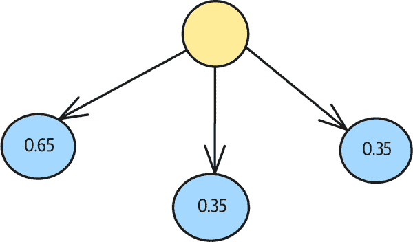

###### 图 5-7：一步之后的树结构

第一步之后，我们考虑所有节点，并让模型为第一步中的每个节点生成三个新想法。以下是生成的三组想法之一：

> 为步骤 2 生成了 3 个想法：
>
> 1. 让我开发三种不同的供应链配置，每种配置都针对特定优先级优化了不同的制造/配送组合：配置 A 专注于成本最小化（墨西哥 + 较慢的运输），配置 B 专注于速度（均衡的地点 + 空运），配置 C 专注于韧性（在所有地点分布式制造）。（分数：0.75）
> 2. 我应该创建一个定量评分矩阵，根据三种场景（正常、中断、需求激增）评估每种配置。这将包括具体指标，如每单位总落地成本、平均交付时间、准时交付率以及从中断中恢复的时间。（分数：0.65）
> 3. 在设计完整配置之前，我应该分析每个制造地点和配送中心的独特特征——包括劳动力成本、与市场的距离、政治稳定性和基础设施质量——以了解它们在不同场景下的各自优势和劣势。（分数：0.75）

第二个节点生成的想法如下：

> 1. 我将评估每个制造地点（墨西哥、越南、波兰）与每个配送中心和运输方式配对的成本和绩效指标，以建立正常运营的基线，重点关注落地成本计算、运输时间和历史可靠性。（分数：0.65）
> 2. 与其分析所有可能的组合，我将首先通过映射潜在的中断场景（港口关闭、边境延误、罢工）及其对每条路线的级联影响，来确定当前供应链网络中的关键约束和脆弱点。（分数：0.65）
> 3. 我将创建一个模拟模型，根据总落地成本（40%）、提前期可靠性（30%）和中断脆弱性（30%）对每种配置进行加权评分，然后针对三种场景对每种配置进行压力测试，以生成定量绩效数据。（分数：0.65）

为简洁起见，我们在此跳过第三组。

现在，我们对所有可用想法进行评分，并保留前三个状态：

> 步骤 2 后的前 3 个状态：
>
> 1. 分数：0.75 | 步骤 2：在设计完整配置之前，我应该分析...
> 2. 分数：0.75 | 步骤 2：让我开发三种不同的供应链配置...
> 3. 分数：0.65 | 步骤 2：我将创建一个加权评分的模拟模型...

我们将继续沿树向下遍历（参见 图 5-8），直到达到最大树深度或遇到一个极好的解决方案（得分高于 0.95）。此时，我们可以停止树搜索并提前终止过程。为简洁起见，我们不会在此打印所有步骤，但您可以在我们的 [GitHub 仓库](https://oreil.ly/KHIFh) 中亲自尝试该示例。

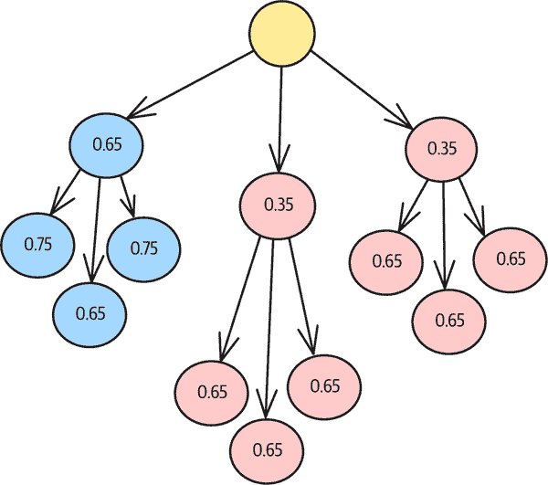

###### 图 5-8：树搜索的下一步

我们已达到四层的最大树深度，得分最有前景的路径包含以下想法：

> 推理路径：
>
> 步骤 1：让我先绘制所有地点之间的运输网络图，计算空运和海运选项的基线成本和运输时间，以便识别潜在的瓶颈和脆弱点。
>
> 步骤 2：让我开发三种不同的供应链配置，每种配置都针对特定优先级优化了不同的制造/配送组合：配置 A 专注于成本最小化（墨西哥 + 较慢的运输），配置 B 专注于速度（均衡的地点 + 空运），配置 C 专注于韧性（在所有地点分布式制造）。
>
> 步骤 3：让我在三种不同场景（正常运营、重大运输中断和需求增加 30%）下分析三种配置（A、B 和 C），以评估它们在总成本、交付时间可靠性和中断脆弱性方面的表现。我将创建一个全面的绩效矩阵，以直观展示每种配置如何处理每种场景。
>
> 步骤 4：让我通过改变每种场景（正常运营、运输中断、需求增加）的概率来进行详细的敏感性分析，并观察这会如何影响最优配置。这将揭示哪种配置在不同未来事件概率分布下最为稳健。

我们现在可以采用推理路径，并提示 LLM 生成对初始供应链问题的最终回答。以下是生成的答案：

> 解决方案摘要：
>
> # 供应链优化摘要
>
> 基于思维树分析，最优供应链配置是配置 C，它通过墨西哥、波兰和越南的分布式制造以及混合运输方式来专注于韧性。
>
> ## 关键见解：
>
> - 配置 A（以成本为重点，在墨西哥制造）在正常条件下表现良好，但在中断期间受到严重影响。
> - 配置 B（以速度为重点，采用空运）提供了可靠性，但成本显著更高。
> - 配置 C（以韧性为重点，采用分布式制造）在所有场景下都提供了成本、速度和韧性的最佳平衡。
>
> 配置 C 中的分布式制造方法创建了内置冗余，能够快速适应航运中断和需求波动。虽然在正常条件下比配置 A 稍贵，但配置 C 在中断期间维持运营并在需求增加时进行扩展的能力，提供了最佳的风险调整后绩效。
>
> 该解决方案通过减少对任何单一制造地点的依赖，解决了近期亚洲航运路线的中断问题，同时根据紧急程度和条件策略性地使用空运和海运，保持成本效益。

为了得出此响应、评估所有节点并生成分数，我们不得不进行 41 次模型 API 调用。整个过程耗时 93 秒，对于实际应用来说是一段相当长的时间。你可以通过并行执行部分生成来加快速度，但需要在树的每一层都拥有所有候选节点，这限制了你能够进行的优化量。

### 考虑因素

对于直接使用标准提示或 CoT 就足够的简单任务，ToT 几乎没有什么益处。我们建议先使用 CoT，只有当解决方案看起来不够充分时才转向 ToT。

#### 复杂性

ToT 的开销来自以下因素：

- **组合爆炸**：为束宽、搜索深度和每次迭代的思考数量等参数找到合适的平衡，会增加整体解决方案的复杂性。有些问题提供多条可能的路径，对于这些问题，搜索空间可能呈指数级增长。根据搜索宽度和深度，探索可能变得不切实际。

- **高延迟和高成本**：探索多条路径（生成思考并对它们评分）需要多次 LLM 请求，而每次 LLM 请求都会增加整体响应延迟。根据树的宽度和深度，这可能达到分钟级别，可能超过实际 LLM 应用的延迟。同时，每次 LLM 请求都需要 LLM API 调用，最终会产生费用。当需要数百个 LLM 才能找到最优解时，ToT 可能非常昂贵。

- **复杂性**：实现 ToT 需要涉及从思维生成、评分、束搜索到摘要生成的各个方面。在各项任务之间，你需要跟踪状态、已探索的路径和步骤数。你可以用多种方式实现树搜索——例如束搜索、广度优先搜索和深度优先搜索——但每种实现本身都应是一个小项目。复杂性的增加也带来了更多出现实现缺陷的空间。

#### 备选方案

即使 CoT 不起作用，你也许可以通过使用推理模型、从少到多提示（least-to-most prompting）、反思或等待注入（wait-injection）来避免使用 ToT。这些方法的复杂度都低于 ToT。

##### 推理模型

ToT 的实现带有重大的复杂性：思维生成、树搜索，以及深度、宽度和良好解决方案阈值等不同参数的调优。你需要多次调用 LLM，并且每一步都需要进行编排。但自从 ToT 最初提出以来，LLM 已经进化，现在它们拥有更好的推理能力。因此，与其应对所有这些复杂性，一个不错的替代方案是使用强大的推理模型，比如 OpenAI 的 o3、Anthropic 的 Opus、Gemini 2.5 Pro 或 DeepSeek-R1。

现代 LLM 已经发展出的能力，往往比初始响应更具反思性。

### 参考文献

ToT 概念在[Yao 等人（2023）](https://arxiv.org/abs/2305.10601)的论文《思维树：使用大语言模型进行审慎问题求解》中得到了非常详细的描述。等待注入由[Muennighoff 等人（2025）](https://arxiv.org/abs/2501.19393)提出，作者还提供了一个[开源示例](https://oreil.ly/w_X-m)。

## 模式 15：适配器调优

适配器调优模式通过在一个小型示例数据集上高效训练少量附加神经网络层，对基础模型进行微调，以执行专门任务。

### 问题

像 GPT-4、Gemini 和 Claude 这样的预训练基础模型非常强大，能够完成各种各样的任务。解锁它们能力的标准方式是通过提示。提示之所以有效，是因为这些模型经过训练来遵循指令，接触过数百万个示例，并且是非常出色的写作者。但如果模型的响应并不完全是你想要的，该怎么办？

例如，我们让 Gemini 做这件事：

> 提出 3 种改善冰淇淋风味的方法。

我们得到了这样的回答：

> 1. 使用优质、新鲜的原料。
> 2. 通过添加盐或烘烤元素等来增强风味层次。
> 3. 充分冷却基底并快速冷冻，以获得最佳质地和风味。

这些回答不错，但它们只是原则。假设你不喜欢这些回答，而更希望得到一组更具体的想法，例如：

> 1. 在基底中注入薄荷或柑橘皮屑等新鲜配料。
> 2. 加入烤坚果或压碎饼干等混合配料。
> 3. 食用前在顶部撒上片状盐，以增强风味。

此外，假设你有几百个演示示例，并希望你的 GenAI 应用生成与它们相似的响应。你会如何实现这一点？

考虑到你只有几百个演示输入-输出对，脑海中立刻浮现的两个选项都不具有吸引力：

**提示工程（零样本提示）：**

你可以尝试修改零样本提示并添加大量详细说明。然而，手动编写详细提示无法很好地扩展到许多任务。复杂的提示会增加成本，而且由于提示措辞的微小变化可能导致巨大的性能差异，测试变得困难。此外，没有系统的方法来调整提示，使响应更接近演示的响应。

### 少样本学习

你可以在提示上下文中提供几个预期行为的示例。然而，如果所选示例未能覆盖目标任务的全部分布，或缺乏易于提取的模式，这种方法就效果不佳。示例还必须随每次推理请求一起发送，这会占用上下文窗口空间，并增加成本和延迟。少样本学习无法扩展到少量示例之外。

适配器调优提供了一种基于训练数据集对基础模型进行高效后训练的方法，该数据集由数百到数千个示例输入-输出对组成。与提示工程相比，适配器调优更有原则性；与少样本学习相比，它能扩展到更多、更复杂的示例；并且比全量微调更简便、更不易出错。（有关后训练的深入介绍，请参见第 1 章。）

### 解决方案

适配器调优是一种高效微调基础模型以执行专门任务的方法。这是因为其特殊架构在训练时参数高效、部署方便，并且在推理时速度快。

#### 架构

在适配器调优中，你只需要训练几个附加的神经网络层（参见图 5-9 中的绿色方框，标记为“适配器”）。

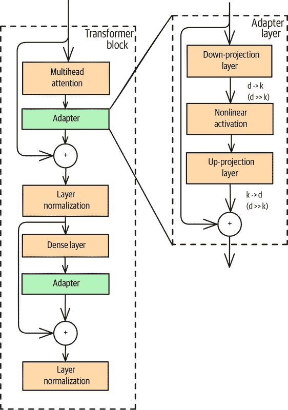

###### 图 5-9. 适配器调优示意图，展示了来自[Houlsby 等人（2019 年）](https://oreil.ly/IPsjJ)的顺序适配器。

你将适配器层插入到变换器块中，变换器块构成了基础模型的构建模块。适配器的插入位置各不相同。你只需要几百到几千个示例来训练这些适配器层。每个示例由一个输入提示和该提示的期望输出组成。

适配器模式有三个关键方面：

* 适配器调优教导预训练基础模型执行专门任务。它不用于学习行业术语或新事实。适配器调优常见的专门任务包括分类、摘要、抽取式问答，以及创建响应符合公司品牌的聊天机器人。

* 基础模型的权重被冻结，适配器层对其中少数层提供小幅度更新（参见图 5-9）。因此，适配器调优非常高效——通常可以在单个 GPU 上不到一小时内完成（当然，这取决于模型的大小和 GPU 的能力）。

* 训练数据集可以比深度学习中的典型情况更小，因为你不需要重新训练整个模型（这需要数百万个训练数据令牌），也无需继续预训练完整的模型权重（这会带来较高的灾难性遗忘风险）。在此，你只需要训练适配器权重。

每个适配器层（参见图 5-9）由以下部分组成：

* 一个降低维度的密集层。例如，它可能接收一个 768 维向量作为输入，并输出一个 64 维向量，其中每个值都是 768 个输入的加权平均值。

* 一个非线性激活函数（通常是修正线性单元[ReLU]）。

* 另一个重新创建原始维度的密集层。在我们的示例中，该密集层将计算 64 个输入的 768 个不同加权平均值。

在我们的示例中，适配器层总共有 768 × 64 × 2 个参数。由于需要训练的参数数量远小于基础模型中数十亿的权重（或参数），适配器调优是一种*参数高效微调*（PeFT）的形式。

由于适配器层中的非线性部分维度低于变换器块（在我们的示例中为 64），适配器调优在口语中也称为*低秩适配*（LoRA）——尽管它并不严格是研究人员认为的 LoRA 架构。

适配器架构在训练方面具有参数效率。基础模型按原样使用，只需要调整适配器层权重（在图 5-10 中以绿色显示）。由于适配器层中的权重不多，训练不需要太多数据——实际上，少至 100 个示例就可能足够。训练也相当快，大部分时间消耗来自于基础模型仍然需要进行推理这一事实。

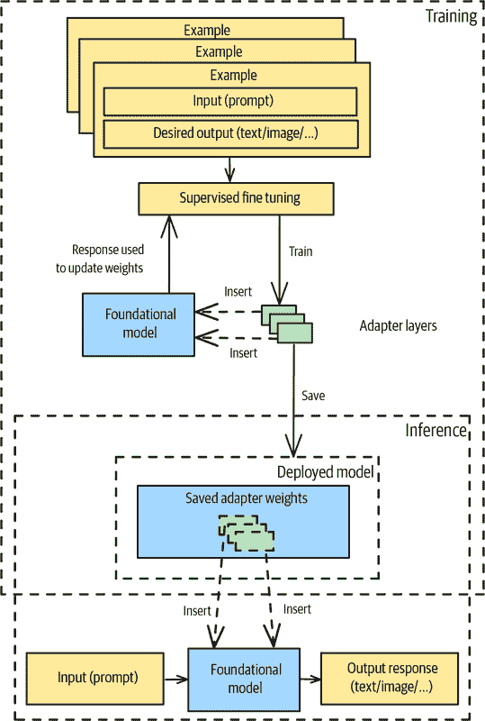

###### 图 5-10. 适配器调优中的训练、部署和推理

一旦根据训练数据集更新了适配器层权重，部署时就只需要保存这些权重。基础模型未被修改。在推理期间，可以重新创建适配器层到基础模型中的插入，从而最大限度地减少额外存储需求。

还可以进一步优化：可以不训练基础模型，而是训练基础模型的量化版本。你可能会看到这种技术被称为*量化感知低秩适配*（QLoRA），这正是我们在“示例”一节中演示的内容。

### 训练

在撰写本文时（2025 年 4 月），最受欢迎的开源微调框架是 Hugging Face 的[Transformer 强化学习](https://oreil.ly/1Mzio)（TRL）包。要微调基础模型，你需要访问其层，以便在它们之间插入适配器层。闭源权重模型通过提供完全托管的微调服务来绕开这一点。然而，适配器调优通常在开放权重模型上进行，原因有二。第一，你可以针对专门任务微调较小的模型——不需要像 GPT-4 或 Gemini 这样的巨型模型。第二，这允许你在与互联网断开的本地硬件上运行模型。

第一步是加载你想要微调的基础模型。许多开放权重模型（包括 Llama、Mistral、Phi、Gemma 和 DeepSeek）的量化 4 位版本可从[Unsloth](https://oreil.ly/pSSOQ)获取。我们在第 1 章中展示了使用 Unsloth 框架微调 Llama 的示例。这里，我们将说明如何从 Hugging Face 加载模型的浮点版本及其分词器，然后将其量化为 4 位。（请参阅本书[GitHub 仓库](https://oreil.ly/E97Ot)中的完整代码。）：

```
model_kwargs["quantization_config"] = BitsAndBytesConfig(
    load_in_4bit=True,
    bnb_4bit_use_double_quant=True,
    bnb_4bit_quant_type="nf4",
    bnb_4bit_compute_dtype=model_kwargs["torch_dtype"],
    bnb_4bit_quant_storage=model_kwargs["torch_dtype"],
)
model = AutoModelForImageTextToText.from_pretrained(model_id, **model_kwargs)
processor = AutoProcessor.from_pretrained("google/gemma-3-4b-it")
```

接下来，设置适配器层。将秩（`r`）设为 16 意味着输入会被缩减到 16 维。`r` 越大，你需要调整的权重就越多，因此请根据数据集的大小来设置这个值：


# 适配器调优

`peft_config = LoraConfig(lora_alpha=16, lora_dropout=0.05, r=16, bias="none", target_modules="all-linear", task_type="CAUSAL_LM", modules_to_save=["lm_head", "embed_tokens"])`

`alpha` 是一个缩放值。适配器层的输出会按 $\\frac{alpha}{r}$ 进行缩放，因此将 `alpha` 设为与 `r` 相同，基本上就是说我们会按原样使用适配器权重。除了适配器权重本身之外，上述代码还会保存注意力头和输入嵌入权重。

接下来，设置监督训练：

```
sft_config = SFTConfig(
    output_dir="gemma-radiology",# directory to save and repository id
    num_train_epochs=1, # number of training epochs
    learning_rate=2e-4, # learning rate, based on QLoRA paper
    ... # many other parameters. See the code on GitHub
)
```

关键参数包括：保存训练后模型权重的路径、遍历训练数据集的次数，以及学习率。学习率的值越小，微调后的模型偏离原始基础模型的机会就越少。训练轮数越多，微调后的模型就越贴合训练数据集——但代价可能是遗忘此前学到的知识。

如果所讨论的模型在推理时预期接收消息，请确保训练数据由消息组成。给定一个输入提示和输出文本，你可以将单个输入-输出对格式化为一组消息：

```
[
{'role': 'system',
  'content': [{'type': 'text',
  'text': 'You are a food influencer.'}]},
{'role': 'user',
  'content': [{'type': 'text',
  'text': 'Suggest 3 ways to improve the flavor of ice cream.'},
{'role': 'assistant',
 'content': [{'type': 'text',
  'text': '1. Infuse the base with fresh ingredients like mint or citrus zest.
\n2. Add mix-ins such as roasted nuts or crushed cookies.\n3. Add flaky salt on
top before serving to intensify the flavor.'},
]
```

输入提示被分配到一条来自用户的消息，而输出响应被分配到一条来自助手的消息。然后这些消息被传递给模型，模型将其响应与期望的助手输出进行比较，从而在训练过程中更新梯度：

```
trainer = SFTTrainer(
    model=model,
    args=sft_config,
    train_dataset=messages,
    peft_config=peft_config,
    processing_class=processor,
    data_collator=collate_fn, # in case you need to preprocess the messages
)
 
# Start training
trainer.train()
```

`collate` 函数允许你在将消息发送给训练器之前对其进行预处理。我们将在“示例”一节中使用它，将图像 URL 替换为图像对应的实际字节。

然后，你可以保存训练后的模型：

```
trainer.save_model()
```

## 推理

插入了适配器的基础模型及其分词器可以按如下方式读取：

```
SFT_OUTDIR="gemma-radiology" # output dir set in SFTConfig above
model = AutoModelForImageTextToText.from_pretrained(
  SFT_OUTDIR,  
  device_map="auto",
  torch_dtype=torch.bfloat16,
  attn_implementation="eager",
)
processor = AutoProcessor.from_pretrained(SFT_OUTDIR)
```

你可以像使用基础模型一样使用这个模型：

```
text = processor.apply_chat_template(messages)
inputs = processor(text=[text],return_tensors="pt").to(model.device)
generated_ids = model.generate(**inputs, temperature=0.8)
output_text = processor.batch_decode(generated_ids)
```

## 示例

微调并不局限于文本模型——你也可以将其应用于其他图像、音频和视频模型。为了强调这一点，我们将在一个多模态模型上完整演示适配器调优，教该模型以图像为输入并生成文本输出。

### 解剖学描述

我们想做的是教这个模型为一组放射影像添加标题说明。为了更有趣，我们希望标题说明能解释图像中描绘的解剖结构，并简要陈述存在的问题，但不要提供完整的诊断或解释。例如，对于图 5-11 所示的图像，我们希望标题说明如下：

> 轴位视图下的计算机断层扫描，显示左侧上颌窦闭塞

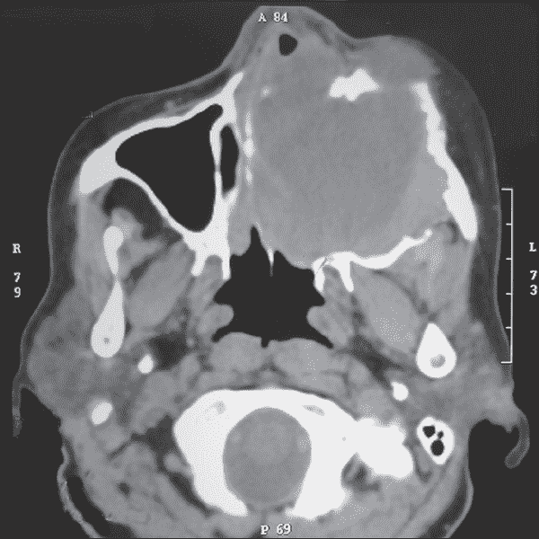

###### 图 5-11. 我们想要添加标题说明的示例放射影像

我们将这张图像发送给一个基础模型（我们尝试了 Gemini），并要求它执行以下操作：

> 为这张图片编写一个能说明其内容的标题，适用于研究出版物。

我们得到了这样的返回：

> 副鼻窦的轴位计算机断层扫描（CT）图像显示，一个大的、膨胀性、均匀、低衰减的肿块占据了整个左侧上颌窦，符合黏液囊肿的表现。注意窦壁骨质因膨胀性病变的压力效应而变薄和弯曲。

识别结果是正确的，但太长了，并且对诊断做了冗长的解释。你可以尝试通过提示工程来解决（例如写上“1–2 句话内完成”“不要解释诊断”等），但我们假设你是在为生产系统做这个功能，而在成本、位置和可维护性方面的考量使提示工程无法成为一个可行方案（参见侧栏）。

### 数据集准备

假设你有一个训练数据集，其中包含你想要的[放射影像及相应类型的标题说明](https://oreil.ly/Z_f0p)。你可以使用适配器调优来教会一个小型开源模型如何正确地为放射影像添加标题说明。

现代生成式 AI 模型以消息作为输入。这使得输入可以是多轮对话和多模态的。在我们的场景中，每个训练样本将由三条消息组成：

1.  一条系统消息，告诉模型扮演专家研究者的角色。

2.  一条包含两部分的用户提示：

    1.  一部分指示模型为图像编写标题说明。

    2.  一部分将图像发送给模型进行标注。

3.  包含所需标题说明的助手响应。

将这些组合起来，下面是一个训练示例（编号对应我们刚描述的消息）：

```
{'messages': [
  {'role': 'system',   
   'content': [{'type': 'text',
     'text': 'You are an expert researcher in radiology.'}]}, # 1
  {'role': 'user',
   'content': [
     {'type': 'text',
     'text': 'Write a caption for this image explaining what it depicts,
suitable for use in a research publication.'},  # 2a
      {'type': 'image',
     'image': 'images/PMC2837471_IJD2009-150251.001.jpg'}]}, #2b
  {'role': 'assistant',
   'content': [{'type': 'text',
     'text': 'Bacterial contamination occurred after completion of root canal 
treatment in the tooth, which remained with a temporary filling for 15 
months.'}]} # 3
]}
```

训练数据以 CSV 文件的形式提供，因此我们需要读取 CSV 文件，对其进行处理，将消息转换为前面描述的格式，并将消息保存为 JSON 文件。我们用来完成此操作的代码[在 GitHub 仓库中](https://oreil.ly/nTOvD)。

### 适配器调优

由于我们的任务是多模态的，我们需要在一个多模态基础模型上进行适配器调优。我们选择了一个 40 亿参数的 Gemma 模型，并开始对其进行调优。

唯一的小问题是，前面的消息只包含每张图像的*位置*，而不是图像本身。因此，我们修改了训练代码，在对文本进行分词的同时，读取每个训练批次对应的图像：

```
for element in content:
    if isinstance(element, dict) and "image" in element:
         # Get the image and convert to RGB
         image = element["image"]
         image_inputs.append(Image.open(image).convert("RGB"))
```

我们在 500 个图像-文本对上微调了模型，批大小为 4。训练损失起初为 14.8，随后开始下降，在第 95 个批次左右达到 4.0 的水平，并在最后 30 个批次中保持在该水平。这表明 500 张图像对我们的问题已经足够。如果损失仍在持续下降，我们本会尝试使用更多图像。

我们只训练了一个 epoch，因此过拟合并不是我们需要担心的问题，但如果你在多个 epoch 上反复迭代训练数据，则应该在验证集上进行评估，以发现过拟合。

### 推理

在配备 GPU 的机器上（我们使用了具有 32 GB 内存的 L4 GPU），你可以通过以下代码读取保存的适配器模型和分词器：

```
SFT_OUTDIR="gemma-radiology" # output dir in 3_adapter_tuning.ipynb

# Load Model with PEFT adapter (not the merged model)
model = AutoModelForImageTextToText.from_pretrained(
  SFT_OUTDIR,
  device_map="auto",
  torch_dtype=torch.bfloat16,
  attn_implementation="eager",
)
processor = AutoProcessor.from_pretrained(SFT_OUTDIR)
```

该框架会将其识别为适配器层，因此它还会加载基础模型并插入适配器模块。

给定一张图像，这段代码将构建模型的输入：

```
def format_message(image_filename):
    system_message = "You are an expert researcher in radiology."
    user_prompt = """Write a caption for this image explaining what it depicts,
suitable for use in a research publication.
"""
    return {
        "messages": [
            {
                "role": "system",
                "content": [{"type": "text", "text": system_message}],
            },
            {
                "role": "user",
                "content": [
                    {
                        "type": "text",
                        "text": user_prompt,
                    },
                    {
                        "type": "image",
                        "image": image_filename
                    },
                ],
            },
        ],
    }
```

请注意，这里没有 assistant 消息——assistant 消息就是模型将要生成的输出。

在图 5-12 所示的测试图像（不在训练数据集中的图像）上执行此操作，生成了以下描述：

> 腹部 CT 扫描，显示腹腔内肿块的大小和密度。

这个描述很简洁，并且专注于图像中描绘的解剖细节——正如你根据我们微调模型所用的描述数据集所预期的那样。

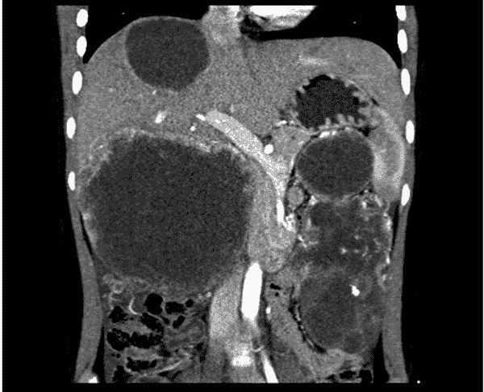

###### 图 5-12. 需要生成描述的测试图像

你可以将类似的方法用于任何图像到文本的问题。例如，你可以微调模型，使其根据图像生成产品描述，或者根据地图生成导航指令。

## 考量

让我们看看在“解决方案”一节中描述的方法的几种变体，以及几种替代方案。

### 变体

除了将适配器层单独存储并在推理时插入基础模型之外，你也可以存储合并后的模型。或者，你也可以通过模型提供商的 API 微调闭权重模型，然后由他们为你提供自定义模型 API 端点。

#### 合并模型

在我们的示例中，我们将适配器权重与基础模型分开保存。由于基础模型相当大，这使我们能够优化存储空间。然而，必须加载基础模型并插入适配器层，这会让模型部署难以管理（你需要同时拥有这两个模型），并且会略微增加延迟。

你可以将适配器和基础模型的权重合并，并按原样存储微调后的模型。在 Transformers 库中，你可以使用以下代码实现：

```
from peft import PeftModel

# Load Model base model
model = AutoModelForImageTextToText.from_pretrained(model_id,
                                                    low_cpu_mem_usage=True)

# Merge LoRA and base model and save
peft_model = PeftModel.from_pretrained(model, args.output_dir)
merged_model = peft_model.merge_and_unload()
merged_model.save_pretrained("merged_model",
                             safe_serialization=True,
                             max_shard_size="2GB")

processor = AutoProcessor.from_pretrained(args.output_dir)
processor.save_pretrained("merged_model")
```

#### 闭权重模型

我们演示了在开放权重模型上的微调。专有模型的提供商会提供完全托管的服务，由其微调模型并将微调后的模型部署到端点。你只需将微调服务指向一个符合服务指定格式的训练数据集即可。

在第 1 章中，我们演示了在 OpenAI 上的微调，因此在这里，我们将演示在 Vertex AI 上的微调。在 Vertex AI 中，数据集需要组织为消息，格式与本模式部分“示例”小节中我们用于开源模型微调的格式相同。你可以通过 REST API 调用、Python API 或直接从 Google Cloud Web 控制台启动微调作业。

在 Web 控制台上，你可以设置微调作业以创建调优模型，如图 5-13 所示。你需要指定基础模型和 epoch 数量。为了简单起见，学习率和适配器以乘数的形式配置——在图中，我们使用了推荐的学习率，并训练了一个大小为推荐值两倍的适配器。通常，只有在你有更多训练示例时，才需要使用更大的适配器。

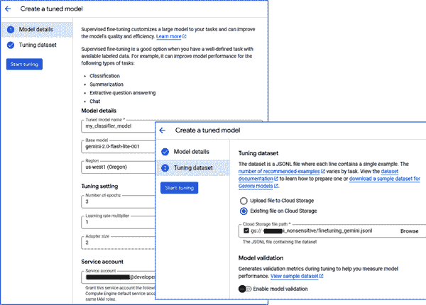

###### 图 5-13. 在 Vertex AI 上进行微调

训练完成后，调优模型将通过端点提供使用，你可以用它替代基础模型来执行特定任务。

### 替代方案

第 1 章中涵盖的所有关于微调的考量都适用于此——因此请确保你从中获得的收益大于微调带来的额外复杂性。如果你正在考虑使用适配器调优，还应考虑少样本学习、思维链（模式 13）或内容优化（模式 5）是否更适合你的需求。

如果任务比较简单，少样本学习通常就足够了。几个上下文示例可能就足以让模型模仿所需的行为，而且这种模式的数据要求要低得多。尽管由于 token 数量增加，单次查询的成本可能会更高，但你无需维护或管理模型版本。


如果任务需要可演示的逻辑步骤，思维链模式（来自第 5 章）通常就足够了。与少样本学习一样，成本可能会更高，但无需训练或管理模型可能足以弥补这一额外开销。

如果你没有现成的训练数据集来展示针对各种输入的良好响应，内容优化模式（来自第 2 章）可能是一个不错的选择。这种模式允许你基于 LLM 响应的自然变化进行引导，并学习表现最佳的内容类型。

## 参考

[Wei 等人 (2021)](https://arxiv.org/abs/2109.01652) 展示了在开发助手模型方面的关键改进，证明在未见过的任务上零样本性能有所提升。[Li 和 Liang (2021)](https://arxiv.org/abs/2101.00190) 表明，仅用一小部分可训练参数，就能在生成任务上达到与全量微调相当的性能。[Lester 等人 (2021)](https://arxiv.org/abs/2104.08691) 表明，对于数十亿参数的模型，在提示嵌入层进行适配器调优可以媲美全量微调，且只需存储少量特定于任务的提示。[Xu 等人 (2023)](https://arxiv.org/abs/2312.12148) 对这些及其他 PeFT 方法进行了综述，从参数效率和内存效率两方面进行了比较。如今，最常用的适配器调优技术是 QLoRA，它由 [Dettmers 等人 (2023)](https://arxiv.org/abs/2305.14314) 提出。

Fractional AI 使用适配器调优对 GPT-3.5 进行微调，以在 [Change.org 上执行内容审核](https://oreil.ly/WCKwO)。训练数据集由人工审核决策组成。

## 模式 16：进化指令（Evol-Instruct）

进化指令模式是创建数据集的一种高效方式，用于教预训练模型完成新的复杂任务。使用大量示例（输入-输出对）组成的数据集来教模型执行任务被称为*指令调优*，该模式之所以命名为进化指令，是因为数据集是通过进化一组初始指令（输入）而创建的。你将使用这个数据集在预训练模型上继续进行指令调优。

### 问题

尽管预训练基础模型经过训练可以执行许多任务，但这些任务往往是模型提供商已经预料到或在其面向消费者的应用中遇到过的任务。它们通常也是可以使用公开数据训练模型执行的任务。你可以让预训练模型写一首俳句，因为有足够多的人要求写俳句，所以写俳句已成为模型训练指令的一部分，而且用于训练基础模型的语料库中有足够的俳句示例。

企业任务则完全是另一回事。假设你希望模型写一份报告，评估某商业地产是否适合用作你公司产品的仓库。基础模型胜任这项任务的可能性有多大？模型提供商是否知道这样一份可行性报告应该是什么样子、应该包含哪些部分、应该涵盖哪些方面？它是否拥有进行所需评估的必要数据？

企业版基础模型通常在数据隐私政策下提供，模型提供商同意不使用提供给模型的提示及其他数据来训练或改进模型。例如，[Azure OpenAI](https://oreil.ly/YhvrA) 做出了以下（及其他）承诺：

> 你的提示（输入）和补全（输出）、你的嵌入以及你的训练数据：

*   其他客户无法获取。
*   OpenAI 无法获取。
*   不会用于改进 OpenAI 模型。
*   不会用于训练、重新训练或改进 Azure OpenAI 服务基础模型。

[Anthropic](https://oreil.ly/l5zRx) 和 [Gemini](https://oreil.ly/aPdPD) 在企业协议中也有类似政策。许多企业还在物理隔离的本地环境中使用基础模型，例如 [Google Distributed Cloud](https://oreil.ly/GsgXq) 和 [Azure Government](https://oreil.ly/gfEiW)。所有这些都意味着模型提供商不知道企业用户要求模型执行哪些任务。

即使模型提供商以某种方式获得了一份要处理的任务清单（可能来自企业用户的“需求”或客户访谈），它也会遇到第二个问题。由于企业使用通常还涉及模型提供商无法访问的机密数据，训练基础模型的人员无法训练它们执行特定领域的企业任务。

虽然这样的数据隐私要求对于促进企业采用是必要的，但它们也意味着（与消费者使用不同）模型不会随着时间的推移自动改进，以涵盖企业用户希望模型执行的那类任务。

如果你有一个基础模型表现不佳的复杂企业任务，你有什么选择？

### 解决方案

如果你希望预训练模型执行一个在 GenAI 消费者应用中没有对应物的复杂企业任务，你可能必须教它这个任务。你可以通过在自定义训练数据集上对模型进行后训练来实现这一点。

让我们讨论一下这种后训练是如何工作的，以便你了解自定义数据集中需要什么。在从几个示例开始之后，涉及四个步骤：进化指令、生成答案、评估和筛选示例，以及执行指令调优（参见图 5-14）。解决方案的第 1 步到第 3 步与数据集创建有关，因此我们将从第 4 步开始。

#### 第 4 步：指令调优

模型通过执行 SFT 来训练遵循指令。它们会看到演示示例，这些示例由输入（提示和任何必要的上下文）和输出（模型的理想响应）组成。为了教模型执行一种新类型的任务，你将创建这样一个输入-输出对的数据集并进行 SFT。

##### 针对开放权重模型的 SFT

Hugging Face 的 Transformers 库使你可以对 Llama 等开放权重模型进行 SFT。用于 SFT 的数据集中的示例如下所示：

```
{
  "instruction": "Explain the concept of supervised learning.",
  "response": "Supervised learning is a machine learning paradigm where models
learn from labeled examples..."
}
```

要进行 SFT，请加载你要调优的模型及其分词器。例如，在 Hugging Face 中，要加载 Llama-3，你可以执行以下操作：

```
model_name = "meta-llama/Llama-3-8b-hf"
model = AutoModelForCausalLM.from_pretrained(model_name, 
                                             torch_dtype=torch.bfloat16)
tokenizer = AutoTokenizer.from_pretrained(model_name)
```

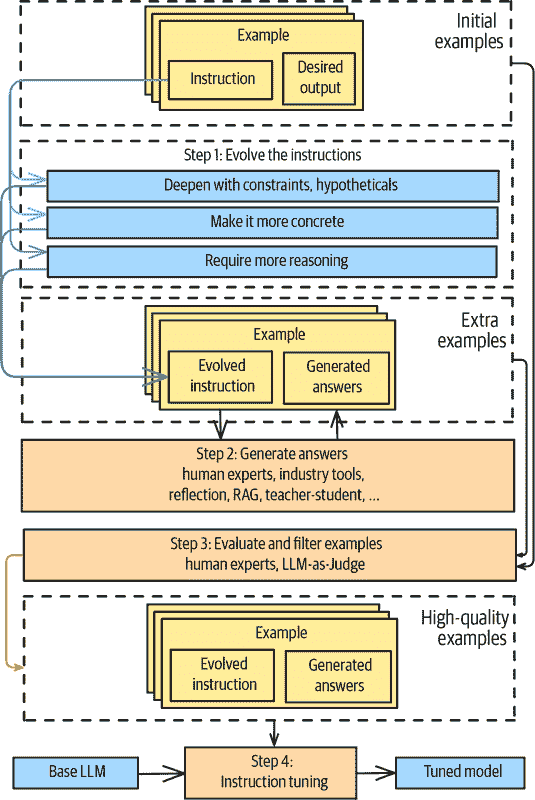

###### 图 5-14：Evol-Instruct 方法

然后，将你的数据集转换为模型所需的格式。模型的一个常见要求是训练输入必须是单个文本字符串，并以一个告诉模型停止生成的特殊标记结尾：

```
def format_and_tokenize(example):
    return tokenizer(f"""### Instruction:\n{example['instruction']}\n\n###
Response:\n{example['response']}
""" + tokenizer.eos_token)

tokenized_dataset = dataset.map(format_and_tokenize)
```

然后，从 Transformers 库设置一个 trainer，训练模型，并将其保存以用于推理：

```
training_args = TrainingArguments(
    output_dir="./trained",
 ...
    learning_rate=2e-5,
    num_train_epochs=3,
 ...
)
trainer = Trainer(
    model=model,
    args=training_args,
    train_dataset=tokenized_dataset['train'],
    eval_dataset=tokenized_dataset['valid']
)
trainer.train()
trainer.save_model()
```

与所有微调一样，灾难性遗忘是一个需要关注的问题，因此你的学习率应该较低，通常约为 `1e-5`。但是，你确实希望模型学习该任务，因此可能需要多个轮次。当然，你应该利用模型、trainer 和硬件支持的任何内存优化功能，例如量化和梯度累积。

##### PeFT

最近的创新使得 LoRA 在适配器微调（模式 15）之外也表现良好。为了让 LoRA 适用于指令微调，[Unsloth 建议](https://oreil.ly/GiRMb)对标准 LoRA 方法做一些修改。

关键一点在于，由于新任务可能涉及与原始模型训练数据相比“分布外”的数据，因此不仅要训练模型，还要训练其嵌入词元和注意力头。

进一步的实验表明，*仅*优化上下投影层（参见适配器解决方案中的架构讨论）是不够的——还需要调整一组称为*门控投影*层的层。

最后，他们发现嵌入层需要与线性层不同的学习率。有了这些改动，您也可以采用类似适配器微调的参数高效方法进行指令微调。

要使用这种参数高效的方法，请从 Unsloth 的四位量化模型开始（参见以下代码中的 `model_name`）：

```
from unsloth import FastLanguageModel
model, tokenizer = FastLanguageModel.from_pretrained(
    model_name = "unsloth/Meta-Llama-3.1-8B-bnb-4bit",
    max_seq_length = 2048,
    load_in_4bit = True,
    full_finetuning = False, # only a few layers
)
```

然后，指定要优化的模块。关键在于，这些模块应包括门控投影（`gate_proj`）、嵌入词元（`embed_tokens`）和注意力头（`lm_head`）：

```
model = FastLanguageModel.get_peft_model(
    model,
    r = 16,
    target_modules = ["q_proj", "k_proj", "v_proj", "o_proj",
                      "gate_proj",
                      "up_proj", "down_proj",
                      "embed_tokens", "lm_head",],
    lora_alpha = 32,
    use_rslora = True,  # rank stabilized LoRA
)
```

请参阅“模式 15：适配器微调”一节的“解决方案”小节，了解 `r` 和 `lora_alpha` 等参数的解释。

训练参数应采用节省内存的技巧，例如梯度累积，并且应将嵌入层的学习率与投影层的学习率解耦：

```
training_args = UnslothTrainingArguments(
        per_device_train_batch_size = 2,
        gradient_accumulation_steps = 64,
        ...
        num_train_epochs = 10,
        learning_rate = 5e-5*2,
        embedding_learning_rate = 5e-5/2,
    ),
```

然后，您应该设置一个与 Transformers 训练器非常相似的训练器（[完整代码](https://oreil.ly/PoCb3)可在 GitHub 上获取），并进行训练和保存模型。

#### 推理

要使用该模型，请从保存它的目录中加载：

```
from unsloth import FastLanguageModel
model, tokenizer = FastLanguageModel.from_pretrained(
    model_name = "./trained", # TRAINED MODEL
    max_seq_length = max_seq_length,
    dtype = dtype,
    load_in_4bit = load_in_4bit,
)
```

通过发送与微调时类似的提示来使用它：

```
from transformers import TextStreamer
FastLanguageModel.for_inference(model) # Enable native 2x faster inference
 
inputs = tokenizer(
    [
        f"### Instruction: ...\n\n### Response:\n",
    ],
    return_tensors="pt",
).to("cuda")
result = model.generate(**inputs, max_new_tokens = 128)
```

#### 准备指令微调数据集

指令微调需要比适配器微调模式大得多的数据集。适配器微调只需数百个示例即可完成，而指令微调通常需要数千个示例。

如何高效地创建大型数据集？Evol-Instruct 方法是从一个初始指令数据集开始，对该数据集中的指令进行演化，使其更加复杂。接下来各节中的步骤编号对应图 5-14 中的步骤。

##### 步骤 1：演化指令

[“WizardLM”论文](https://arxiv.org/pdf/2304.12244)的作者提出了 Evol-Instruct 的概念，他们建议使用基础模型以以下方式演化提示。首先，给定一条指令，思考如何深化它、使其更具体、添加约束或使其在某种程度上复杂化。例如，为了[使提示更具体](https://oreil.ly/PwqMj)，他们通过发送以下提示让基础模型重写初始指令：

> 我希望你扮演一个提示重写器。
>
> 你的目标是重写给定提示，使其更复杂，让那些著名的 AI 系统（例如 ChatGPT 和 GPT4）更难处理。
>
> ...
>
> 请将一般概念替换为更具体的概念。
>
> #给定提示#：
>
> `{instruction}`
>
> #重写后的提示#：

这种方法非常通用，因为 WizardLM 的作者希望尽可能广泛地具体化各种任务。然而，您通常希望训练模型执行特定任务或一系列任务。根据您的用例，往往可以做得更好。例如，2023 年[“WizardCoder”](https://arxiv.org/pdf/2306.08568)论文的作者希望教模型如何生成代码。他们让 LLM 使用以下初始提示使原始编程问题更具体：

> 将编程任务中常见的需求替换为更少见、更具体的需求。

接下来，他们使问题更加复杂：

> 提供一段错误代码作为参考，以增加误导性。

通过演化过程，您可以使用基础模型来扩展数据集中的指令集。给定一条指令，您可以非常轻松地（如“示例”部分所示）生成 10 倍数量的指令。

##### 步骤 2：生成答案

要进行指令训练，仅有指令是不够的。您还需要指令及其正确的响应。那么，在哪里可以找到这些虚构问题的正确答案呢？

以下是一些选项：

- **人类专家**：基础模型提供商雇佣人员来撰写问题的优质答案。也许您也有预算这样做。如果是这样，请付费让您所在领域的专家撰写响应。在某些领域，众包答案可能可行。
- **使用行业工具**：也许您有模拟器、制图工具或其他可以生成答案的软件。在某些情况下，您可以为人类专家提供这些工具，以帮助他们更高效地回答问题。
- **循环中的评估（反思）**：您可以让模型生成答案，将其传递给评估器，然后将错误反馈给模型并让它重试。如果经过例如三次尝试后，模型仍然没有可行的答案，您可以丢弃该指令。

  这种方法在您拥有自动化评估器时效果很好，例如编程和数学问题。对于编程问题，您可以使用编译器验证代码能否编译，并使用沙箱运行代码验证输出是否符合预期约束。例如，如果指令是编写代码对某些数据进行排序，您可以验证输出是否已排序。在某些情况下，例如数学问题，您可以将结果代入方程，确保得到了正确答案。（该技术将在第 6 章中以模式 18“反思”介绍）。

- **RAG**：有时候，你可以通过对企业数据库中的数据采用 RAG 方法（参见第 3 章和第 4 章）来生成答案。但如果你有一个能够回答该问题的 RAG 系统，为什么还要训练模型来做这项任务呢？如果出于某种原因，RAG 方法在推理过程中不可行，你可以使用指令微调，将知识直接“存储”在模型中。当模型需要在边缘设备或数据不可访问的环境中运行时，就可能出现这种情况。

- **师生训练**：你可以让一个强大的模型——可能是“思考”模型——生成答案，然后微调一个更具成本效益、低延迟的模型来执行同样的任务。这类似于蒸馏（参见第 8 章中的模式 24：小型语言模型），不过在蒸馏中，你通常要尝试复制教师模型的全部能力。

到这一步，你已经拥有了一个大型指令数据集（由小型指令数据集演化而来）以及对应的答案。

##### 第 3 步：评估与筛选

在开始训练模型之前，请确保所用数据集是干净的（没有重复项和部分回答）且正确的（没有事实错误、不可知问题或泛泛而谈的答案）。指令微调依赖于经过整理的数据集，其中包含高质量的问题和正确的答案。

数据质量对准确性至关重要。在 2023 年一篇颇具影响力的论文[“教科书就是一切”](https://arxiv.org/abs/2306.11644)中，一组微软研究人员表明，在精心策划且多样化的高质量教科书练习上训练的小模型，其表现优于在质量参差不齐的无组织数据集上训练的较大模型。

让人工专家参与评估问答对，甚至纠正它们，是非常有帮助的。在某些情况下，你可以使用 LLM 来评估示例（参见第 6 章中的模式 17：LLM 作为评判者），并且只保留好的样本用于训练。

一旦你有了训练数据集，就可以对 LLM 进行指令微调，得到一个针对你的任务进行微调的模型。这就是图 5-14 中的第 4 步，我们在上一节中已经详细讨论过。


接下来，让我们看一个 Evol-Instruct 的端到端示例。

## 示例

实际上，你之所以要进行指令微调，是因为你希望你的 LLM 能高度熟练地以适合你所在行业、客户、供应链、人才市场和竞争环境的方式执行任务。为此，你需要用机密数据、业务约束和潜在威胁来训练 LLM。不过这毕竟是一本书，我们希望你能复现我们的工作，因此我们将不得不使用公开数据。

### 目标：商业战略

为了说明 Evol-Instruct，我们将教一个 LLM 充当商业战略顾问，让它熟悉标普 500 指数中的美国大型公司。显然，由于我们将使用公开数据，前沿模型可能已经在这方面做得相当好了。

首先，我们尝试向 Claude 问了一个战略问题：

> 假设一个主要竞争对手大举扩展面向超高净值人群的财富管理服务，摩根士丹利可能面临哪些潜在的战略优势和劣势？他们应如何调整客户获取和留存策略？请用 2-3 句话回答。

这是我们从 Claude Sonnet 3.7 得到的回答：

> 如果摩根士丹利的竞争对手积极瞄准超高净值客户，那么摩根士丹利在机构专业知识和现有高触点关系方面建立的声誉将成为优势，尽管他们可能难以对抗愿意提供更具攻击性定价和创新数字服务的竞争对手。为了适应，摩根士丹利应通过专注于个性化的跨代财富规划、扩大专业另类投资产品、加强数字能力来强化其价值主张，同时保持其在这一竞争细分市场中脱颖而出的白手套式服务模式。

这个回答相当不错。Claude 了解摩根士丹利在这个特定市场中的优势和劣势，并能提出具体的领域，例如跨代财富规划，这些领域需要高触点关系，对价格不太敏感，也不太看重技术的复杂性。然而，我们询问的是客户获取和留存，而这些建议是关于公司整体定位的，并不是针对这些具体领域。

接下来，我们用一个小型模型——拥有十亿参数的 Gemma 3——尝试了同样的问题。我们得到的回答是：

> 摩根士丹利可以利用其现有的全球网络来吸引和留住超高净值客户，提供量身定制的定制化财富管理服务。

> 然而，这种战略优势将受到来自竞争对手激烈竞争的对冲，如果竞争对手的产品被认为更胜一筹，可能会导致市场份额的流失。

> 为了适应，摩根士丹利应优先考虑加强尽职调查和优质服务交付，同时探索新的合作伙伴关系和数字渠道。

这个回答没那么好。它只是词语堆砌在一起，对这家公司或市场都没有真正的洞察。如果你不信，可以把回答中的*摩根士丹利*替换成*麦当劳*，把*财富管理服务*替换成*汉堡包*。你可能会发现这个回答大体上仍然适用！这正是泛泛而谈的答案的标志。

我们的目标是教会 Gemma 3 1B 充当商业分析师，并产出与 Claude Sonnet 相当的回答。我们将使用 Evol-Instruct 模式。

### 引导初始问题

在典型的企业环境中，你已经拥有一些商业战略演示和文档作为起点。在这里，我们将从公司向美国证券交易委员会（SEC）提交的年度文件入手，并利用它们来引导生成一组初始的战略问题和答案。

这些文件可以在[一个名为 SEC 的电子数据收集、分析与检索（EDGAR）系统的在线数据库](https://www.sec.gov/search-filings)中获取。我们感兴趣的具体部分是`item_7`，即管理层讨论。这是美国各大公司的高管讨论公司财务状况和经营成果，并提供业务概览和前景展望的部分。为获取标普 500 公司的管理层讨论而进行的数据整理与本模式无关，因此我们在此略去——但如果你感兴趣，可以查看[本书的 GitHub 仓库](https://oreil.ly/AGNA_)中的代码。

尽管文件是提交给 SEC 的，但其真正的受众是潜在投资者，因此高管们会讨论有前景的领域以及他们如何管理业务面临的潜在威胁。换句话说，管理层讨论中满是商业战略的教训。以五百家公司为例，回溯四年，你就有两千份这样的管理层讨论。这足以作为我们取材的来源。

为了生成问题，我们将使用一个前沿模型（在我们的案例中是 Gemini Flash——[完整代码](https://oreil.ly/2YyOp)在 GitHub 上）：

> 你是一名 MBA 项目的教授。

> 你将获得来自`{filing['company']}`（股票代码：`{symbol}`）于`{filing['filing_date']}`提交的 SEC 文件中的一段内容。

> 基于这份文件，创建`{num_questions}`个适合公司战略课程学生学习的分析性问题。

> 好的问题应满足以下要求：

> * 独立完整。例如，确保问题中包含所引用的公司名称、产品和年份。
> * 避免询问收入或资本支出等事实性数字信息。
> * 避免询问“如何”、“为什么”、“比较”等。

> 示例问题：谷歌（GOOG）重组其硬件部门，将如何影响其在 2023 年提升 Pixel 手机市场份额的能力？

在这个提示中，我们要求模型扮演商学院教授的角色，根据其对管理层讨论的理解来出考题。我们还解释了什么样的问题才是好问题，并提供了一个示例（这就是我们在第 1 章中讨论过的少样本学习）。

结果中包括为一家名为[空气产品](https://www.airproducts.com)（股票代码为 APD）的化工公司生成的问题：

> 空气产品（APD）正在大力投资气化、碳捕集和氢能项目。能源市场的周期性特征将如何影响这些资本密集型项目的长期盈利能力和战略可行性，尤其是考虑到该公司截至 2021 年对长期合同和客户关系的依赖？

这是一个好问题！我不知道答案是什么，但空气产品的管理层已经思考过这个问题，并在其提交给 SEC 的文件中写下了答案，这很棒。

由此产生的问题（在我们这个案例中是三个）将作为 Evol-Instruct 的种子。

### 演化初始问题

正如我们在“解决方案”一节中提到的，并且如 WizardCoder 示例所示，你可以自定义演化初始指令的方式，以利用你的领域知识。为了演化初始的商业战略问题，我们将为每个初始问题生成更深入、更具体或需要更多推理的版本。

要使问题更深入，请让模型添加约束条件或假设情境，并为每种方式提供示例：

> 你正在为商业战略课程的一场极难的考试出题。

> 你的目标是针对给定问题创建`{num_to_generate}`个更难的版本，以便对学生提出更高的能力要求。

> 以下是一些可以让问题变得更难的方法：

> * 添加基于当前市场状况和竞争对手行动的约束条件。
> * 添加假设情境，例如潜在的成本超支或收购未能完成。

> 不要让问题本身变得更冗长。它应该与原始问题的长度大致相同。

要使问题更具体，请让模型要求提供细节：

> ..

> 你的目标是针对给定问题创建`{num_to_generate}`个更具体的版本，以便它们要求学生对细节有更深入的掌握。

> 以下是一些可以让问题变得更难的方法：

> * 不要问“为什么”，而是要求给出 3 个原因。
> * 不要问“如何”，而是要求给出步骤。
> * 询问为什么某个特定结果没有更大或更小。

要使问题需要更多推理，请将问题结合起来：

> 将其中两个问题结合起来，使得为了回答给定问题，必须隐式地回答出这两个问题。

以下是为空气产品生成的新问题之一。这个问题更具体；它询问盈利能力可能受到损害的具体方式：

> 空气产品（APD）正在大力投资气化、碳捕集和氢能项目。考虑到这些项目截至 2021 年对长期合同的依赖，能源市场的周期性特征可能通过哪三种具体方式损害这些项目的盈利能力？

这个问题结合了其中两个问题，一个是关于绿色能源的，另一个是关于竞争的：

> 考虑到竞争对手也在投资绿色氢能项目，且政府对可再生能源的补贴存在不确定性，竞争加剧与补贴波动的双重作用将如何影响空气产品（APD）气化、碳捕集和氢能项目的回报？如果一个大型氢能项目面临 20%的成本超支，需要做出哪些战略调整来维持盈利能力？

在我们 GitHub 上的 notebook 中，我们根据每份文件额外生成了 10 个问题。加上初始文件中的问题，现在每份文件有 13 个问题。标普 500 指数中有五百家公司，我们回溯了四年。这应该能为我们提供足够的训练问题。

### 生成答案

为了生成答案，我们将采用教师-学生方法（参见第 8 章中的模式 24：小型语言模型）和 Gemini。通常，对于教师模型，你会使用自己负担得起的最强大的模型，甚至可能是一个具有较大规模的推理模型。通过专业化，APD 也许能更好地满足个性化需求。然而，这也可能造成效率低下并减缓决策速度，尤其是在需要跨区域协调的情况下，APD 需要在专注与敏捷之间取得平衡。

总体而言，这是一个合理的答案。但它是否足够好，可以用来训练我们的模型呢？

### 评估示例

我们可以使用 LLM-as-Judge（来自第 6 章的模式 17）来评估一个示例（问答对）的质量。为此，我们将让 LLM 扮演记者的角色，由它来判断答案是否足够有见地，能否出现在文章中：

> 你是一名记者，采访了美国大型上市公司的多位华尔街分析师。我会给你一个问题以及该问题的答案。现在，你需要筛选出将出现在一篇商业战略文章中的采访问题。

> 请以 1-5 分作答，评分标准如下：

> * 1 分：问题和答案对你的受众来说显而易见，或者存在错误。
> * 5 分：问题和答案真正富有洞察力。

> 请解释你的理由。

下面是一个获得 5 分（最高分）的训练示例：

```
{"question": "Why might O'Reilly Automotive's 'good,' 'better,' 'best' product 
assortment not maximize profitability?",
"answer": "The "good, better, best" product assortment strategy may not maximize
profitability if the cost of managing the complexity of such a wide range of 
products is too high. For example, it requires more complex inventory management, 
more skilled sales staff, and more floor space, which may reduce profitability.",
"score": 5,
"explanation": "This question delves into the potential downsides of a common 
retail strategy, exploring the balance between offering customer choice and 
managing operational complexity. The answer provides a concrete explanation, 
making it insightful for readers interested in business strategy and retail 
management. Thus, it deserves a high score."}
```

下面是一个得分较低的示例：

```
{"question": "With revenue declines expected in Tommy Hilfiger and Calvin Klein 
International, how can PVH adjust marketing and distribution while balancing 
direct-to-consumer investments with wholesale partner relationships?", 
"answer": "PVH can adjust marketing through promotional deals and distribution by 
streamlining logistics to balance direct sales with wholesale partnerships amid 
revenue challenges.", 
"score": 2, 
"explanation": "The answer is very general and lacks specific insights into PVH's 
strategy. It mentions promotional deals and streamlining logistics, which are 
quite generic approaches. It doesn't delve into the complexities of balancing 
direct-to-consumer investments with wholesale relationships in the context of 
declining revenues. Therefore, it's not particularly insightful."}
```

为确保数据集的高质量，我们仅将训练数据限制为那些得分达到 4 或 5 的示例。然后按 90:10 的比例分割数据，保留 10%用于验证。这样我们就得到了大约 11,000 个训练示例。

### 训练 Gemma

既然我们已经使用 Evol-Instruct 创建了训练数据集，就可以训练 Gemma 3 1B 模型了。同样，[完整代码](https://oreil.ly/PoCb3)在 GitHub 上，但我们在这里仅展示几个要点。

我们加载 Gemma 模型，并将其转换为参数高效的形式：

```
model, tokenizer = FastLanguageModel.from_pretrained(
    model_name = "unsloth/gemma-3-1b-it-bnb-4bit",
    max_seq_length = 4096,
    load_in_4bit = True)
model = FastLanguageModel.get_peft_model(
    model,
    ...
)
```

然后，根据前几节所述的生成问题与答案，我们构建提示：

```
EOS_TOKEN = tokenizer.eos_token # Must add EOS_TOKEN
def formatting_prompts_func(examples):
    instructions = examples["question"]
    responses    = examples["answer"]
    texts = []
    for instruction, response in zip(instructions, responses):
        text = f"""Q: {instruction}
        
A: {response}""" + EOS_TOKEN
        texts.append(text)
    return { "text" : texts, }
 
dataset = dataset.map(formatting_prompts_func, batched = True,)
```

以下是用于训练模型的文本字符串示例：

> 问：2020 年新冠疫情期间，向企业对消费者（B2C）运输的转变如何影响了 UPS（UPS）的运营成本和利润率？公司又实施了哪些战略调整来缓解这些挑战？

> 答：2020 年新冠疫情期间，企业对消费者（B2C）运输激增，导致住宅配送量增加，降低了配送密度并增加了人工工时，从而推高了 UPS 的运营成本。这对营业利润率产生了负面影响。为了缓解这些挑战，UPS 专注于通过改进美国地面网络和将数字访问计划部署到电子商务平台，来增强客户重视的能力，如速度和易用性。`<end_of_turn>`

我们在一块 L4 GPU 上花费了大约三个小时，用大约 11,000 个示例对模型进行了三个周期的训练。然后我们向训练好的 Gemma 模型提出了关于摩根士丹利财富管理的相同问题，得到了如下回答：

> 摩根士丹利将通过利用其现有的全球足迹、作为长期投资公司的声誉以及管理复杂财务状况的专业知识来获得优势。然而，他们将面临显著的不利因素，包括潜在的新进入者带来的竞争加剧、客户偏好转向另类投资工具，以及监管审查。调整其客户获取和保留策略需要多管齐下的方法：在培养与互补财富管理公司的战略伙伴关系并探索新的数字平台和全渠道方法的同时，更加注重定制的、以关系为导向的策略。

这非常好。与 Claude 的回答一样，它明确聚焦于优势和劣势、对公司及其市场的洞察。与 Claude 不同的是，它还清楚回答了客户获取和保留策略应如何改变。指令调优方法使一个十亿参数的模型可以说比前沿模型还要好！

## 考虑因素

你需要的数据集大小取决于任务的复杂性和基础模型的大小。任务越复杂（例如，变化越多，或涉及的逻辑越复杂），所需的训练数据集就越大。然而，较大的模型可以从较少的示例中学习，因为它们通常能更好地泛化到新的指令。

经验法则是，对于一个中等复杂度的任务集，对十亿参数模型进行指令调优至少需要 10,000 个示例。对于参数约为`x`十亿的模型，你只需示例数量的 1 / `x`即可。因此，你可以用一千个示例对 100 亿参数模型进行指令调优。如果任务更复杂或非常多样，你需要大约按比例增加这些最小值。当然，如果你能训练的数据多于这些最小值，那就应该这么做。

你也可以使用 LoRA 方法进行指令调优，但你必须非常小心。与适配器调优不同，你还必须调整门控投影层、嵌入层和注意力头，这会增加你要调整的权重的数量。它仍然不像完全微调那样大，但也不像适配器调优那样少。因此，你需要比适配器调优更大的数据集，并且必须训练多个周期。鉴于这一点，你应该遵循机器学习最佳实践，例如频繁检查点和使用验证数据集进行早停。由于你通常训练的是模型的量化版本（QLoRA）并对其进行相当大幅度的更改，你应该完全可以预期模型会遗忘它预训练时执行的相当多的任务。因此，请确保不要在训练好的窄范围任务之外使用指令调优模型。


即使使用 LoRA，指令调优也可能变得昂贵。创建数据集涉及大量对前沿模型的调用。每个进化指令至少涉及三次 LLM 调用：第一次是进化指令，第二次是生成答案，第三次是评估示例。一个 10,000 个示例的训练数据集涉及超过 30,000 次调用，因为一些示例无法通过质量检查。此外，与适配器调优不同，指令训练在 GPU 上需要数小时，而且其结果是只能执行一小部分窄任务的模型。依赖许多此类模型的生产系统成本将很高。

因此，在投入使用 Evol-Instruct 创建训练数据集之前，请确保你确实需要指令微调。对于简单任务，少量上下文演示（使用 CoT）可能就足够了。如果前沿模型已经做得不错，那么使用适配器调优时，你可能只需要几百个示例。请*仅*在你的任务很复杂且前沿模型表现不佳，或者你无法使用前沿模型而较小模型也表现不佳时，才执行 Evol-Instruct。

### 参考资料

Evol-Instruct 的思想最早在 [“WizardLM” 论文](https://arxiv.org/abs/2304.12244)（Xu 等人，2023）中提出。[“WizardCoder” 论文](https://arxiv.org/abs/2306.08568)（Luo 等人，2025）展示了如何应用这一思想提升模型在特定领域的能力。[“Textbooks Are All You Need” 论文](https://arxiv.org/abs/2306.11644)（Gunasekar 等人，2023）证明了高质量合成数据的可行性。截至 2023 年，监督微调领域的现状可在[指令调优综述论文](https://arxiv.org/abs/2308.10792)（Zhang 等人，2023）中查阅。尽管长期以来人们一直认为 [LoRA“学得更少、忘得更少”](https://arxiv.org/abs/2405.09673)（见 Biderman 等人，2024），但 Unsloth 展示了如何以非常高效的方式对 LoRA 模型进行[全量微调](https://oreil.ly/9eLyr)和[指令微调](https://oreil.ly/oOiW2)。

## 总结

本章演示了如何将基础模型的能力扩展到预训练之外。我们向你介绍了一些可以克服这些限制的模式，重点包括思维链（CoT）推理，用于将棘手的问题分解为多个步骤；以及思维树（ToT），用于探索和评估多条推理路径。你还了解了适配器调优（Adapter Tuning），它可以使用小数据集进行高效微调；以及 Evol-Instruct，用于为新的复杂任务创建指令微调数据集。这四种模式总结在表 5-1 中。

表 5-1：扩展模型能力的模式

| 模式 | 问题 | 解决方案 | 使用场景 |
| --- | --- | --- | --- |
| **思维链（CoT）（模式 13）** | 基础模型常常难以完成多步推理任务，因此会生成不正确或虚构的答案。 | CoT 提示模型在给出最终答案之前，先将复杂问题分解为中间推理步骤。 | 复杂的数学问题、逻辑推理，以及需要逐步思考的顺序推理任务 |
| **思维树（ToT）（模式 14）** | 许多策略性或逻辑性任务无法通过单一的线性推理路径来解决，因此模型需要探索多种替代方案。 | ToT 将问题求解视为一次树搜索，生成多条推理路径，评估这些路径，并在必要时回溯。 | 涉及策略性思维、规划或创意写作的复杂任务，这些任务需要探索多种解决方案路径 |
| **适配器调优（模式 15）** | 针对专门任务对大型基础模型进行全量微调，计算成本高昂，且需要大量数据。 | 适配器调优训练小型附加神经网络层，保持原始模型权重冻结，从而高效完成专门适配。 | 使用少量（100–10 K）示例数据集，将模型适配到分类、摘要或专门聊天机器人等特定任务 |
| **Evol-Instruct（模式 16）** | 为新的复杂企业任务创建用于指令微调模型的高质量数据集既困难又耗时。 | Evol-Instruct 通过多轮 LLM 生成的任务和答案来演化指令，从而高效生成指令微调数据集。 | 教授模型预训练数据未涵盖的新的领域特定任务，尤其是在企业环境中 |

我们在这些模式中讨论了不同的技术，例如用于 CoT 的零样本、少样本和 Auto-CoT；以及用于 ToT 的想法生成、路径评估、束搜索和摘要生成。在此过程中，我们重点强调了诸如数据缺口、非顺序逻辑、实现复杂性、延迟、成本以及如何在备选方案中进行选择等重要考虑因素。本章还向你展示了适配器调优的架构、训练和推理，并强调了其效率和局限性。总体而言，本章为你提供了策略，用于教 LLM 学习新任务，并提高它们在原先未受训练的专门领域的推理能力。

^(1) 模型提供商通常会在有人指出此类错误后迅速修复，所以如果你在阅读本文时无法重现这个确切的问题，也不必惊讶。2025 年 4 月 API 调用的结果已上传至[我们的 GitHub 仓库](https://oreil.ly/wNZnC)。

这里有两个可能正确的答案。专家的做法是：如果 10 没有从右手方掉出，就先出 A，然后再出 K。如果 10 掉出了，那么你应该从另一门花色回到手中，然后进行飞牌。这考虑到了五张未出牌的持牌[概率表](https://oreil.ly/zDqqv)以及一个称为[限制选择](https://oreil.ly/d9sgj)的原则。一个相当正确的答案，也是许多中级牌手会采取的答案，是兑现 A 和 K，因为 Q 掉出的概率超过 50%，而飞牌的概率是 50%。

在 2025 年 4 月，即使是在能够访问网络搜索等工具的更强对话界面中，这个特定错误也仍然存在。以下是我们 [ChatGPT](https://oreil.ly/YxlIz)、[Gemini](https://oreil.ly/sNZUJ) 和 [Claude](https://oreil.ly/sOHxd) 会话的链接。请注意，我们以相反的顺序执行了查询，因为这些工具会维护对话状态，而我们不想向模型提示任何解题线索。

^(2) 术语*测试时计算*是指在推理时进行的计算。在学术论文中，推理只会在测试阶段进行，因此得名。

^(3) 请注意，这是 Gemini 生成的文本。这些并不代表作者或其雇主的观点。
