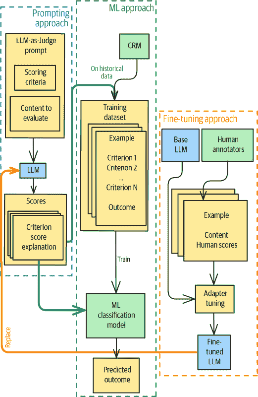
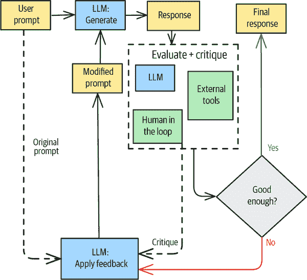
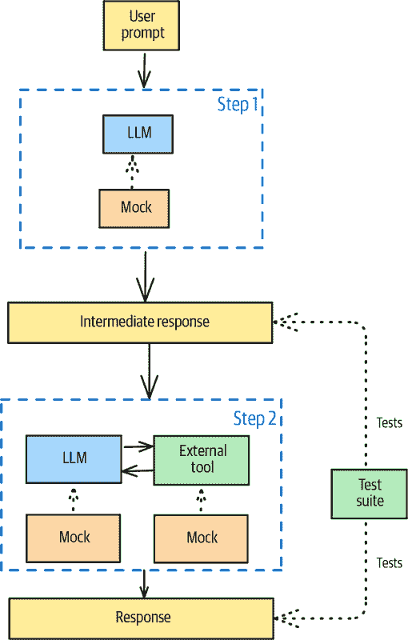
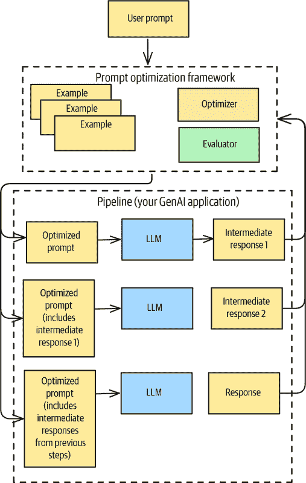

# 第 6 章：提高可靠性

基础模型本质上是*随机（stochastic）*的，这意味着它们涉及随机变量或概率。因此，构建在这些模型之上的 GenAI 应用可能会遭遇输出不一致、事实不准确和幻觉等问题。本章介绍了四种旨在缓解这些挑战的模式。

LLM 作为裁判（模式 17）通过使用 LLM——无论是直接通过提示，还是通过机器学习/微调模型——来评估输出质量，促进对输出进行系统性评估。反思（模式 18）使模型能够自我批评并迭代式地改进生成的内容。依赖注入（模式 19）通过支持模拟组件来促进可测试性和鲁棒性。最后，提示词优化（模式 20）提供了一种结构化方法来优化输入提示，从而在不同输入分布上最大化输出可靠性。

这些模式共同构成了一个框架，能够增强 GenAI 应用的可靠性。通过整合评估、自我纠正、不确定性量化、模块化设计和输入优化等机制，你可以构建更可靠的系统，并增强用户对 AI 应用所生成输出的信心。

## 模式 17：LLM 作为裁判

LLM 作为裁判（LLM-as-Judge）模式是一种提供详细、多维反馈的方式，可用于比较模型、跟踪改进并指导后续开发。LLM 作为裁判是一种很有前景的中间方案，介于全自动化指标与人工评估之间，为生成式 AI（GenAI）系统提供了可扩展且细致入微的评估能力。

### 问题

本书讨论的许多模式都包含评估步骤。例如，在内容优化（模式 5）中，你需要比较两篇内容。在节点后处理（模式 10）中，你根据相关性对检索到的文本块重新排序。在思维树（模式 14）中，你评估各条路径并选择最有希望的一条。在 Evol-Instruct（模式 16）中，你评估示例并剔除任何可能污染数据集的示例。

有效的评估是高效利用生成式 AI 的基础。它提供了推动模型改进与优化的反馈回路。没有可靠的评估，就很难判断 AI 的输出是否符合你的标准或要求。可靠的评估方法通过展示 AI 系统的能力与局限，建立用户对系统的信心。恰当的评估可以帮助你在部署模型之前识别潜在的偏见、不准确之处或有害输出。

然而，评估生成式 AI 系统的能力往往很困难，因为它们执行的任务是开放式的。评估捕鼠器的性能相对简单——你只需数一数它抓住了多少只老鼠——但评估营销内容就困难得多，因为以下几种传统的评估方法存在诸多局限：

**结果衡量**

企业评估的金标准是衡量结果。理想情况下，你可以通过衡量营销宣传册带来的销售额增长来判断其质量。然而，销售增长可能归因于众多因素。由于没有两个客户或两天是完全相同的，很难说销售量的变化中有多少是由某一条营销内容所引发的。这就是我们使用*结果代理指标*（例如参与度）的原因——代理指标让我们能够把点击归因到具体的内容条目，并且可以使用多臂老虎机等方法来缩短测试时间。

**人工评估**

次优的选择是让人类专家为营销内容打分。这种方法的好处是无需真正部署内容即可进行评估。遗憾的是，人工评估难以规模化——成本高昂、耗时费力、容易受个人偏见影响，也受制于专家的时间安排。

**自动化指标**

NLP 文献建议使用 [BLEU](https://oreil.ly/fpueP) 和 [ROUGE](https://oreil.ly/O9po8) 等指标来分别衡量内容在翻译和摘要任务上的适配度。这些指标的优势在于它们是能够以系统化方式计算得出的分数。其原理是找出生成的翻译或摘要与一组参考翻译或摘要之间共有的 n-gram。然而，这些指标无法捕捉语义含义、细微差别和事实准确性，也无法与我们要推动的实际结果相关联——你无法定制 BLEU 分数，使其更贴合“撰写营销文案以推动重型机械销售”这一任务。

在本模式中，我们将着手设计一种评估生成式 AI 响应的方法，它综合了上述三种方法的优点——也就是说，它应当能很好地作为结果的代理指标，无需真正部署模型即可使用，并且能够系统化地计算——同时还兼具快速、可扩展和可定制等优势。

### 解决方案

LLM 作为裁判利用先进语言模型的能力来评估输出。这种方法比人工评估更具可扩展性，比传统自动化指标提供更细致入微的评估，可以针对特定评估标准进行定制，并且能够一致地应用评估标准。

应用 LLM 作为裁判有三种方式。选项 1（如 图 6-1 左侧所示）是采用提示词方法；选项 2 是使用机器学习（ML）；选项 3 是使用微调后的 LLM。ML 方法和微调方法都融入了提示词方法——通常情况下，你会先从提示词方法入手，然后通过 ML 或微调来改进 LLM 作为裁判。在 ML 方法中，你把提示词方法的输出送入 ML 模型。在微调方法中，你用适配器调优（模式 15）替换提示词方法中所用的 LLM。让我们逐一来看这些方法。



###### 图 6-1. LLM 作为裁判的三种方法：提示词、机器学习和微调

#### 选项 1：提示词方法

采用 LLM 作为裁判，需要针对你的问题创建一套自定义评分细则，然后让 LLM 将这套细则应用于给定的输出。例如，你可以使用下面的提示词请 LLM 评估一段摘要：

> 给定一篇文章和一段摘要，请按以下标准分别给出 1 至 5 分的评分：
>
> - 事实准确性
> - 关键点的完整性
> - 简洁性
> - 清晰度
>
> 请为每个分数提供简短的理由。
>
> **文章**
>
> `{article}`
>
> **摘要**
>
> `{summary}`
>
> **评分**：

你需要防范同一个提示词在多次调用中针对相同输入返回不同分数的情况，因此务必确保将 `temperature` 设置为零。当分数的可复现性至关重要时，采用客户端缓存或服务端提示词/上下文缓存会有所帮助。

有助于保持一致性的一个重要步骤是对输入数据进行预处理，使其更加自足。例如，在评估对话式回答时，纳入足够多的对话轮次并总结智能体的回答，可能非常重要。

另一个有助于保持一致的实践是扩充校准细则。例如，与其只在提示词中说明你需要事实准确性，不如解释事实准确性对你而言意味着什么：

> - 事实准确性
>   - \* 如果摘要中的任何信息歪曲了文章原意，得 1 分
>   - \* 如果摘要中的所有陈述都以文章为依据，得 5 分
>
> - 关键点的完整性
>   - \* 如果遗漏了多个高影响力要点，得 1 分
>   - \* 如果所有主要要点都已包含，得 3 分
>   - \* 如果所有主要要点都已包含，且更重要的要点在摘要中得到更多篇幅，得 5 分
>
> - 简洁性
>   - \* 如果摘要包含冗余信息，得 1 分
>   - \* 如果摘要高效地传达信息、没有不必要的细节，得 5 分
>
> - 清晰度
>   - \* 如果存在生硬措辞或未加解释的技术行话，得 1 分
>   - \* 如果摘要结构良好，高一学生也能轻松理解，得 5 分

这个示例展示的是数值评分量表，但这并不是评估响应的唯一方式。在选择评估方法时，有几个关键问题需要考虑：

**你在评估什么？**

你是需要对单篇内容进行评分，还是需要 LLM 判断两个候选选项哪个更好？有时，两个选项都是生成的内容，但其中一个是参考答案（可能是由当前的非 LLM 系统生成的）。或者，除了两个选项之外，你可能需要对一组内容进行排序，其中有一个选项是参考答案。

**你将如何使用这些分数？**

你希望评估结果是二值、数值评分、排名还是类别值？指标需要与真实结果一致，还是与人类偏好一致？这取决于你将如何使用这些分数。例如，如果你计划根据模型的输出做出决策，那么二值最好，因为它能让你将分数与决策的正确性明确挂钩。

**人类将如何参与？**

如果人类会使用这些分数，你通常需要人类可解释性，因此应要求 LLM 在给出分数的同时生成解释。如果人类参与评估过程，你可以将评估设为多阶段，并提供反馈以改进评估。甚至可以是一种对话式的[“交叉询问”](https://arxiv.org/abs/2305.13281)，其中部分（或全部）反馈由 LLM 提供。

根据这些考虑因素修改你的评分标准。

#### 选项 2：机器学习（ML）

理想情况下，LLM 作为评判者（LLM-as-Judge）模式生成的分数会对你希望推动的内容保持一致，并指示你想要的结果。你可以通过创建一个 ML 模型，将 LLM-as-Judge 输出的分数合并为单个预测结果的分数来实现这一点。要使用这种方法评估营销内容，你需要遵循以下三个步骤：

**第 1 步：为提示创建评分标准**

为营销文案在推动销售方面的有效性建立明确标准。你的评分标准可能包括诸如行动号召的清晰度、价值主张的传达效果、对目标客户画像的贴合度，以及它如何描述产品的独特性并将其与竞争对手的产品区分开等标准。

**第 2 步：收集历史数据**

收集一组多样化的营销文案数据集，这些文案需要有可用的历史结果数据。如果可能，请查看你的客户关系管理（CRM）软件。例如，你可以使用 CRM 软件来识别销售人员向客户发送营销宣传册的案例，然后记录客户在收到宣传册后（比如说）30 天内是否购买了相关产品。

**第 3 步：训练分类模型**

使用 LLM-as-Judge 的提示方法对营销宣传册进行评分，并为每个分数分配一个结果，记录是否进行了购买。这样你就得到了一个由评分标准值和最终结果组成的训练数据集，可以用来训练 ML 分类模型。

这种方法的一个优点是，由于你是在 LLM 生成的评分标准和真实结果上进行训练，ML 模型会降低那些无关紧要或 LLM 不一致的标准的权重（当然，只要你不过度拟合^(1)）。

通常，你会从提示方法开始，一旦你测量了一些结果并能训练模型生成“预测”期望结果的分数，就迁移到 ML 方法。

#### 选项 3：微调

为 LLM-as-Judge 编写校准标准可能很困难。例如，是什么让营销内容“有说服力”？在这种情况下，让人类专家使用与 LLM-as-Judge 相同的评分标准对内容进行标注和评分会有所帮助。这样你就得到了一组理想的输入-响应对，可以用它们来进行适配器调优（Adapter Tuning）（参见第 5 章），以创建一个能够生成与人类专家评分相似的微调模型。

这样的微调方法适用于将医学诊断检查表应用于患者记录等场景，当你希望 LLM 模仿人类的做法时——例如，以符合医学标准以及医学专家解读观察结果的方式。

### 示例

假设你想评估选民指南中文本的质量，比如美国一份支持[2022 年华盛顿州倡议](https://oreil.ly/qmUrX)的论点：

> 华盛顿州已采取重要措施，防止枪支落入危险人士手中。但我们的法律仍存在漏洞，难以阻止枪支流向那些威胁对自己或他人施暴的人。我们知道，大多数大规模枪击案凶手和企图自杀的人都会表现出意图的迹象，但现行法律却让家庭和执法部门——通常是首先看到这些警示信号的人——无法采取拯救生命的行动。
>
> ...

反对同一倡议的论点质量如何？

> I-1491 无视了已有的州法律，这些法律已经要求对潜在危险个体进行治疗和限制。I-1491 不要求评估、治疗或监控，也没有解决根本问题。最近实施的法律实际上为对自己或他人构成危险的人提供了早期发现和干预。
>
> ...

假设你希望这些论点足够有说服力，以促使更多人分别对倡议投赞成票或反对票。你如何根据这些目标来评估论点？

#### 选择评估方法

以下传统方法在这种情况下会失效：

**结果测量**

结果是选举结果，你可以说获得最多选票的立场是更好的论点。然而，很难将这一论点的质量与其他影响结果的因素分开，如党派归属、每位选民对枪支所有权的既有看法，以及外部因素，如近期备受关注的事件或知名候选人支持某一立场。

**人工评估**

在枪支和精神疾病等情绪化话题上，人工评估往往存在极大偏见。你需要一个大型焦点小组，测试原有的偏见，并根据这些偏见进行统计校正。

**自动化指标**

目前尚不清楚衡量 n-gram 的 BLEU 或 ROUGE 分数与说服力之间的相关性。

由于公投倡议的选举每次涉及不同的问题，而且选民手册中只有两个论点（一个支持，一个反对），使用 ML 和微调方法需要大量的统计严谨性。因此，让我们采用提示方法。

该示例的[完整代码](https://oreil.ly/EGBCG)在 GitHub 上——请使用笔记本跟随操作。

#### 评分标准


数十年来对选民教育材料的研究得出了一些[设计有效材料的最佳实践](https://oreil.ly/h2n_M)和[政治说服](https://oreil.ly/oPyGx)的最佳实践，你可以将其整合为一套标准：

> - 以选民为中心：让阅读者容易理解该倡议将如何影响他们。考虑不同社会经济地位和教育水平的选民。
> - 按金字塔结构组织信息：最重要的信息放在最前面，非必要的细节和解释放在最后。
> - 易懂：使用平实的语言、简单的句子，并尽量减少术语。
> - 清晰：行动号召明确。选民为什么应该支持/反对这项倡议？
> - 迎合未决定者：提供可能影响未决定选民支持/反对该事业方向的其他信息。这可能是权威/中立团体的背书，或与竞争对手的具体比较。

这些标准可以纳入 LLM-as-judge 的提示中：

> 你将会收到一个支持或反对华盛顿州倡议的论点，该论点将出现在邮寄给所有住户的选民手册中。
>
> 请针对以下每项标准在 1-5 范围内给出评分：
>
> `{scoring_criteria}`
>
> 对于每个评分，提供简要的理由说明。
>
> **论点**:
>
> `{argument}`

使用此提示和 OpenAI 的 GPT-4o-mini 对支持该倡议的论点进行测试，我们得到了如下所示（部分）结果：

> 3. **可理解性：4**
>
> - 语言大多通俗易懂，句子直白，使论点易于理解。然而，一些读者可能仍会觉得“民事保护令”等术语有些法律化。避免使用此类短语或提供简短定义可以提升整体理解度。

完整代码和响应可在[GitHub](https://oreil.ly/EGBCG)上获取。

### 考量

LLM-as-Judge 模式存在一个关键缺陷（不一致性）和若干偏见。在某些情况下需要谨慎。

#### 不一致性

LLM 的评分是非确定性的，因为 LLM 的响应会有所不同。你可以通过缓存、将温度设置为零、使用相同的随机种子等方式来减少评分之间的不一致性。然而，仅固定生成过程还不够，因为你还希望相似的输出获得相似的评分。

另外，还可以考虑使用以下三种方法让 LLM-as-Judge 的评分更一致：

- **粗粒度评分**：避免创建过于细粒度的评分——1 到 5 的评分范围通常可以，但如果将范围设为 1 到 10 或 1 到 100，不一致性问题会变得更加尖锐。如果把这个思路推向逻辑极致，那么只要你能把评分设计成二元（是或否）问题，LLM-as-Judge 的效果会最好。
- **多重标准**：为了减少不一致性问题，可以考虑设置多个评分标准，而不是要求一个单一的总体评分——这是一种思维链（CoT）（模式 13）的形式。你可以通过提供几个示例（使用少样本学习）来改进基础提示词，帮助模型在每个标准上进行校准。在某些情况下，提供单个参考结果用于比较，可以校准模型，并让不同调用之间的输出评分保持一致。
- **多次评估**：与其只做一次评估，你可以让多个 LLM 评估响应。如果每个 LLM 扮演不同利益相关者的角色，并评估该 LLM 的响应在多大程度上符合该利益相关者的需求，这会很有用。这种方式有时被称为*LLM 陪审团*。

当然，你也可以组合这些方法。例如，在提出二元问题的同时获得细致评分的办法之一，是把它与 LLM 陪审团结合。这叫做*轮询*。

#### 宽容性

LLM 往往对评分极为[宽容](https://arxiv.org/abs/2503.19092v1)——就像给每个学生都打 A 和 B 的教授。这再加上 LLM 的非确定性本质，意味着你应避免通过比较两份内容的输出评分来排定等级。相反，通常最好让你的 LLM-as-Judge 直接比较这两个内容。比如我们在模式 5“内容优化”（见第 2 章）中做的就是这样。

解决宽容性问题的另一个方法是使用群体奖励来校准响应——这就是 DeepSeek 通过群体相对策略优化（GRPO）所做的：同时生成多个响应并逐一评分，每个响应获得的分数会按群体平均分数归一化。

处理宽容性的第三种方法是降低你对 LLM-as-Judge 用途的期望。例如，你可以只使用分数来识别问题——这样你可以用 LLM-as-Judge 评估 RAG 中的技术问题，例如上下文丢失，其得分可为 0，而不是通常的 0.95。

#### 偏见

前沿模型在 LLM-as-Judge 模式中通常表现很好，通常不需要再找其他方案。然而，LLM 在评估[自身](https://arxiv.org/abs/2410.21819v1)的响应时，往往给出过于有利的分数。这被称为*自我偏见*。因此，最好使用不同的 LLM 进行评估，而不是使用生成内容的那个 LLM。LLM 的自我偏见是 LLM 偏好看起来像其训练数据的内容的一种体现。正因为如此，它们倾向于偏好写得很好的文本（特别是[困惑度较低](https://arxiv.org/abs/2410.21819v1)的文本）——即使不准确——而不是写得不好但准确的文本。

LLM 可能还会偏好[冗长](https://arxiv.org/abs/2407.01085v3)的评论而非简洁的评论，即使两者包含同样相关的细节。LLM 可能会错过位于长文本[中间](https://arxiv.org/abs/2404.02060v3)的信息，而且倾向于关注答案开头或结尾的信息。这些偏见通常分别被称为*长度偏见*和*位置偏见*。

由于使用前沿 LLM 存在不一致性和偏见问题，考虑使用成本更低的微调小语言模型（如 [PandaLM](https://arxiv.org/abs/2306.05087)）也许值得。你可以将 [PatronusAI](https://oreil.ly/jXh3t) 等模型用于特定评估任务（如多模态响应），也可用于行业特定的自定义指标。

### 注意事项

在零样本提示中，我们要求 LLM 对评分做出解释：

> 对于每个分数，提供简要的理由。

有[一些证据](https://arxiv.org/abs/2411.15594)表明，这样做虽然提供了可解释性，但通常会对模型的评估性能和偏见缓解产生负面影响。自我解释的过程可能会引入更深的偏见。如果你不需要解释，那么你可以取生成分布的[概率加权平均](https://arxiv.org/abs/2503.03064v1)分数（而不是像通常 `temperature = 0` 时那样选择最可能的分数）。但要小心，因为这与 CoT 方法会产生一些奇怪的交互。^(2)

就评估而言，衡量结果是最好的方法，但很难把所有影响因素或*混杂变量*一一区分开。在这种情况下，基于一组容易理解且与业务目标一致的关键绩效指标（KPI）来做判断往往是次优选择，尽管你必须警惕试图玩弄指标的对抗性参与者。因此，使用 LLM-as-Judge 时，尽量让评分标准成为结果或 KPI 的代理。

### 参考文献

在 2022 年和 2023 年，研究界和实践界自然地意识到，前沿 LLM 已足够擅长遵循指令，以至于可以用它们按任意评分标准来评估内容。我们找到的第一篇学术提及是 [Bai 等人（2023）](https://arxiv.org/abs/2306.04181)，他们称这种模式为*语言模型作为考官*。[Shankar 等人（2024）](https://arxiv.org/abs/2404.12272)讨论了对齐和一致性的需求，[Balog、Metzler 和 Qin（2025）](https://arxiv.org/abs/2503.19092v1)讨论了与 LLM-as-Judge 相关的许多偏见和注意事项。知名从业者 [Hamel Husain（2024）](https://oreil.ly/ZlByT) 和 [Eugene Yan（2025）](https://oreil.ly/CpK4X) 也讨论了许多实际考量。[Gu 等人（2025）](https://arxiv.org/abs/2411.15594)对 LLM-as-judge 技术、其变体以及相关挑战进行了全面综述。

[DoorDash](https://oreil.ly/dshpE) 在基于 LLM 的 Dasher 支持自动化中实现了 LLM-as-Judge，[AWS](https://oreil.ly/RP7Be) 将其用于 Amazon Bedrock 上的模型评估。Acrolinx 使用通过 LLM-as-Judge 实现的 AI 护栏，以[保持不同内容的品牌声音一致性](https://oreil.ly/UH_Vu)。

## 模式 18：反思

反思模式是一种智能体方法，AI 系统在最终确定自己的推理、决策和输出之前，会对它们进行评估。这种自我监控过程使系统能够识别错误、改进解决方案并优化其处理问题的方法。

在这里，AI 系统*作为一个整体*正在反思和改进，而用于生成响应的基础模型保持不变。你有时会看到这个过程被称为*自我反思*，但没有任何理由要求评估必须由 LLM 来完成，更不用说由生成内容的同一个 LLM 来完成了。

### 问题

假设你正通过网络界面使用基于 LLM 的工具，如 ChatGPT 或 Perplexity。如果 LLM 生成了次优或不正确的响应，你可以提交后续问题，指出响应中的问题或建议具体修改，并让 LLM 纠正其之前的响应。

然而，当你通过 API 调用 LLM 时，这些调用是无状态的。那么，你如何让 LLM 根据反馈或批评来纠正之前的响应，又如何自动生成一份可用于纠正该 LLM 先前响应的批评意见呢？

### 解决方案

与其对 LLM 进行单次调用，不如调用两次或更多次。第一次使用用户提示词调用，但不是将响应直接发回客户端，而是将其发送给评估器（参见图 6-2）。这个评估器可以是 LLM（如模式 17：LLM 作为裁判）、外部工具，甚至可以是人类。评估器不仅仅提供分数，还提供解释响应不足之处的批评意见。然后，你利用该批评意见应用反馈并创建修改后的提示词。最后，你将修改后的提示词发送给 LLM 以生成新的响应，并再次进行评估。这个循环不断重复，直到响应达到质量要求。



###### 图 6-2. 反思为典型的 LLM 使用模式增加了一个中间批评步骤。

有几个小的变体。

#### 最大尝试次数

为了避免无限循环，你可以指定最大重试次数。恰好重试一次的特殊情况相当常见，因为这让你无需确定“足够好”的含义。如果只重试一次，可以使用零样本思维链（模式 13）方法，并让其重新考虑原始答案。

#### 对话状态

在对话系统中，你可以将评估器视为参与者之一，批评意见将成为该参与者的一条消息。然后，你可以通过简单地将消息历史（按原样或摘要形式）添加到之前的提示词中来修改提示词。例如，你可以[在 Autogen 中](https://oreil.ly/3lBpJ)这样做：

```
# Create a list of LLM messages to send to the model.
messages: List[LLMMessage] = [*self._system_messages]
for m in self._session_memory[message.session_id]:
    if isinstance(m, CodeReviewResult):
       messages.append(UserMessage(content=m.review, source="Reviewer"))
    elif isinstance(m, CodeReviewTask):
       messages.append(AssistantMessage(
                            content=m.code_writing_scratchpad,
                             source="Coder"))
    elif isinstance(m, CodeWritingTask):
       messages.append(UserMessage(content=m.task, source="User"))
    else:
       raise ValueError(f"Unexpected message type: {m}")
```

### 示例

让我们看一个使用反思来设计公司 logo 的端到端示例。完整代码在[GitHub](https://oreil.ly/6TMNI)上。

#### 评估与批评

第一步是构建一个好的评估器。你可以使用模式 17：LLM 作为裁判，并为 logo 提供评分标准：

> 分析下面为`{company}`提出的 logo。
>
> `{company_description}`
>
> 按以下标准对 logo 进行 1-5 分评分：
>
> - 从 logo 中可以清楚看出公司名称是什么。
> - logo 和图片符合公司的业务。
> - logo 不与任何知名品牌或竞争对手冲突。
> - logo 设计简洁流畅。
> - logo 突出且易于识别。
>
> 解释你的评分。

试着将上述提示词连同公司 Pydantic 的 logo（参见图 6-3）发送给 LLM（我们使用了 Claude Sonnet 3.7），使用以下代码：

```
agent = Agent(CLAUDE,
              model_settings = {
                      "temperature": 0 # for LLM-as-Judge
              })
result = agent.run_sync(prompt, ImageUrl(url="..."
```

![Pydantic 的 logo，采用风格化的几何设计，并配有标语“为你的数据带来模式和理智。”###### 图 6-3. Pydantic 公司的 logo，我们用它来演示 logo 评估器。你将获得一个包含类似如下批评意见的响应：> 适当性（4/5）：粉色的几何金字塔/三角形符号很适合数据验证库。该形状暗示了结构、验证和框架——所有这些都与 Pydantic 的核心业务相关。标语直接涉及数据验证。然而，它没有特别提及他们的 AI 智能体框架或 Logfire 可观测性平台，这就是为什么我没有给满分。### logo 设计师如果提供一些关于公司的基本信息，你可以使用多模态零样本 LLM（在我们的案例中是 Gemini 2.0）上的零样本提示词来设计 logo：> 为 Hiroshi 寿司生成一个 logo 图片。Hiroshi 寿司制作美味的日本料理，我们的主厨发办是全市最好的。> > 遵循现代设计实践。图 6-4 显示了结果。

###### 图 6-4. Gemini 为一个假设的餐厅设计的初始 logo。

将评估器应用于生成的图片后，我们得到了如下部分结果：

> 无冲突（4/5）：该设计看起来独特，不会立即让人联想到任何主要寿司连锁店的 logo。简单的握寿司插图在行业中有些常见，但整体构图与粗体排版营造出独特的外观。我给它 4 分而不是 5 分，只是因为许多寿司店使用类似的握寿司图案，尽管这个具体的设计似乎很独特。

你可以计算总分并设定阈值来决定是否继续推进。然而，很难确定一个合适的阈值。对于我们第一次评分尝试，我们计算了加权平均值：

```
def score(self) -> float:
        return (10 * self.clarity +
                10 * self.appropriateness + 
                30 * self.no_conflicts +
                30 * self.clean_design + 
                20 * self.easy_to_recognize) / 500.0
```

PydanticAI 的 logo 获得了 0.9 分，但寿司 logo 也获得了 0.9 分。令人惊讶的是，这是一个常见的问题——由于 LLM 倾向于给出宽松的分数，很难设计出一个能够区分“够好”设计和优秀设计的评分标准。

一个简单的变通方法是只进行一轮批评。这样就不需要阈值了。

#### 应用批评

下一步是应用反馈，为下一轮迭代创建改进后的提示词。你可以使用以下提示词让 Claude 为 logo 设计师生成详细说明：

> 使用以下反馈生成详细的额外说明，发送回 logo 的设计者。
>
> `{critique}`

当我们这样做时，详细说明包括以下内容：

> ## 建议的改进：
>
> 1. **增强独特性（解决唯一性 4/5 的问题）**：
> - 考虑在握寿司插画中添加一个微妙而独特的巧思，使其与其他寿司店区分开来（比如标志性的刀痕、独特的米饭形状，或*一种独特的鱼肉覆盖在米饭上的方式)*）
> - 尝试加入一个小而简单的元素，以体现 Hiroshi 特有的手法或招牌特色

请注意图 6-5 右侧斜体指令的影响。

#### 重新生成

最后，将之前生成的徽标以及需要进行修改的内容发送给徽标设计器：


# 模式 18：反思

`def design_logo(company, company_description, output_filename, previous_logo, changes_to_make) -> str:` 函数用于生成或修改徽标。该函数调用 Gemini API，根据公司描述、之前的徽标以及指定的修改要求，生成新的徽标图像。

```python
def design_logo(company, 
                company_description,
                output_filename,
                previous_logo,
                changes_to_make) -> str:
    client = genai.Client(api_key=os.environ['GEMINI_API_KEY'])
        
    prompt = f"""
        Here's a proposed logo image for {company}.
        {company_description}
        
        Please edit the image and make the following changes.
        Return only the final image after all edits.
        {changes_to_make}
    """
    previous_image = Image.open(previous_logo)
    contents = [prompt, previous_image]
   
    response = client.models.generate_content(
        model=GEMINI,
        contents=contents,
        config=types.GenerateContentConfig(
          response_modalities=['TEXT', 'IMAGE']
        )
    )
```

你可以调用这个函数来生成第二版及后续迭代版本。

接下来，我们要求它生成几个草稿：

```python
def regenerate(n=3):
    for x in range(n):
        outfile = f"output_logo_2_{x+1}.png"
        design_logo(company, company_description, outfile,
                    previous_logo=image_file,
                    changes_to_make=extra_instruction)
```

这样操作后，我们得到的其中一个草稿如图 6-5 右侧所示。它融入了评估者建议的部分修改。


###### 图 6-5. Gemini 为一个假设的餐厅设计的初始徽标（左侧），以及经过一轮反思后，融合了 Claude 生成建议的徽标（右侧）

## 注意事项

反思（Reflection）是 Andrew Ng 提出的四种核心智能体模式之一（参见第 5 章中的侧边栏）。如今，反思在现代 AI 系统中已变得愈发重要，原因包括以下几点：

- **质量与稳健性**：通过审查自身输出，AI 可以在向用户呈现结果之前发现错误。记录这些审查过程还有助于识别边缘情况和潜在故障模式。

- **缓解推理与规划能力的局限**：反思允许对推理过程进行迭代式改进。对于新颖且开放式的任务，先完成一次任务再思考如何改进，往往比提前规划好方法更容易。

- **透明度**：反思过程会生成显式的推理轨迹，从而提高可解释性。

随着 AI 系统承担越来越复杂且影响重大的任务，反思能力已成为其可靠性能的关键。

### 权衡：成本与质量

反思涉及多次 LLM 推理调用，这会增加计算成本和延迟。你需要将响应质量的潜在提升与这些成本进行权衡，然后才能决定是否增加反思轮次或提高评估阈值。

在撰写本文时，许多前沿模型 API 提供商在可用性方面存在问题。你通常需要制定重试策略才能保证首次调用成功，而反思由于需要多次调用来完成任务，可能会导致尾部延迟超出可接受范围。

成本与质量的权衡通常对不同用例产生不同影响。在代码生成中，使用反思在提交代码前评估输出可以减少语法错误和逻辑缺陷。与构建失败的成本相比，额外进行一轮反思的相对成本通常相当可观，因此这类系统往往涉及多个反思阶段，甚至可能在评估步骤中引入编译器、沙箱等外部工具。然而，在聊天机器人和实时游戏引擎等应用中，反思可能会带来不可接受的延迟。因此，针对自身业务开发一些启发式规则，以便根据问题特性、可用时间和预期质量改进的业务影响来调整反思深度，可能会对你有所帮助。

如徽标创建示例所示，你可以创建多个草稿，但这不必等到最后阶段。你甚至可以在第一步就生成多个草稿，然后采用类似束搜索的方法，对所有草稿进行编辑，并在每一步之后剪除不佳的候选方案，最后再做出最终选择。当然，这会进一步增加成本。

### 确保评估正确

反思模式最重要的部分是评估阶段，因此请确保你的评估足够稳健，并能识别出响应为何适合预期用途。

LLM 往往会对自己的工作给出较高评价，但你可以通过使用与执行实际工作不同的 LLM 来避免这种自我偏差。在我们的示例中，我们使用 Gemini 创建徽标图像，并使用 Claude 生成评论。参见“模式 17：LLM 作为裁判”中的“注意事项”一节，获取其他关于解决打分宽松问题的建议。

## 参考资料

反思在 AI 中的发展可以追溯至心理学中[通过认知监测提升元认知（Flavell, 1979）](https://oreil.ly/gqdni)的思想，以及[心智理论强化学习（Rabinowitz et al., 2018）](https://arxiv.org/abs/1802.07740)。诸如[Reflexion（Shinn et al., 2023）](https://arxiv.org/abs/2303.11366)中的口头反馈和[自我精炼（Madaan et al., 2023）](https://arxiv.org/abs/2303.17651)等方法被用于提升 RAG 系统的质量和事实性，例如[Self-RAG（Asai et al., 2023）](https://arxiv.org/abs/2310.11511)。它们也被用于减少[生成代码中的缺陷数量（Dou et al., 2024）](https://arxiv.org/abs/2407.06153v1)。

[Amazon](https://oreil.ly/x2zT_)使用反思来确保生成的产品列表完整且正确。验证 LLM 还会检查可能对列表表现产生负面影响的特征。

# 模式 19：依赖注入

依赖注入模式使得 LLM 链中每个组件的独立开发和测试变得更加容易。当你构建 LLM 调用链时，应使其易于注入模拟实现，以替换链中的任何步骤。

## 问题

开发与测试生成式 AI 应用可能很困难，原因有以下几点：

- **它们是非确定性的**：与大多数软件 API 和统计模型不同，即使输入完全相同，每次调用 LLM 也可能返回不同的输出。这使得通过提供合成输入并对照预期输出来验证代码是否正确变得困难。

- **模型变化迅速**：你通常是在升级计划未知的基础模型之上构建应用。固守某个日期的特定基础模型可以帮助锁定版本，但你会错失基础模型能力改进带来的好处。你的提示词越长越详细，面对底层技术变化时就越脆弱。

- **你的代码需要与具体 LLM 无关**：

如果你构建的模型将在多个环境中使用（例如本地部署和 Google 上，或 AWS 和 Azure 上），你通常会希望自己的提示词和代码能在多个基础模型上运行。虽然其他供应商支持 OpenAI 的 API，而且 PydanticAI 和 LangChain 等框架的可用性使你的代码具备可移植性，但它们并不能让你的*提示词*也可移植。因此，你需要测试自己的代码如何在多个 LLM 上工作。

开发和测试涉及 LLM 调用链的智能体应用尤其困难——当一个模型的输出将被嵌入到下一个模型的输入上下文中时，你如何独立地开发和测试链中的每个单元？

如果我们先讨论一个示例，这个解决方案就会更易于理解。

## 示例

假设你正在使用 LLM 来改进 O’Reilly 图书的营销描述——也就是在线书店和实体书封底上出现的描述。你将分两步实现这一目标。第一步，你会生成几个改进营销描述的想法；第二步，你会选择最佳想法并据此进行实际修改。当然，这是将模式 13「思维链」（CoT，见第 5 章）与模式 18「反思」相结合的示例。完整代码见 [GitHub](https://oreil.ly/cv47H)。

### 步骤 1：生成批评意见

在第一步中，你发送营销描述的文本并收到一条批评意见。批评意见被定义为一个结构化对象（参见第 2 章中的模式 2「语法」）：

```python
@dataclass
class Critique:
    target_audience: List[str]
    improvements: List[str]
```

接下来，你使用适当的提示词调用 LLM：

```python
def critique(in_text: str) -> Critique:
    prompt = f"""
    You are an expert marketer for technology books.
    You will be given the marketing description for a book.
    Identify the target audience by roles (eg: Data Analyst, Data Engineer)
    Suggest exactly 5 ways that the *marketing description* can be improved so
    that it appeals better to this target audience.
    Do not suggest improvements to the book itself.
    
    **Marketing Description**:
    """
    agent = Agent(GEMINI,
                  result_type=Critique)
    print(f"Invoking LLM to critique text")
    result = agent.run_sync([prompt,
                             in_text])
    return (result.data)
```

试试由你最喜欢的作者撰写的[*《机器学习设计模式》*](https://www.oreilly.com/library/view/machine-learning-design/9781098115777/)（O’Reilly）的营销描述。你会得到类似这样的结果：

> **目标受众**：
>
> 数据科学家、机器学习工程师、AI 研究员
>
> **建议的修改**：
>
> 使用更具体的职位名称（例如机器学习工程师、AI 研究员）来代替笼统的“数据科学家”。
>
> 突出设计模式的实际应用，以及它们如何直接提高他们的工作效率和有效性。
>
> 强调解决方案的可扩展性和可维护性，因为这些是部署生产级 ML 系统的专业人员所关注的关键问题。
>
> 加入一个部分，介绍本书如何帮助排查和调试常见的 ML 问题，这是从业者经常遇到的痛点。
>
> 增加机器学习领域知名人士的推荐语或背书，以建立与目标受众之间的可信度和信任感。

这看起来是正确的，但它真的是正确的吗？^(3)

#### 测试第一步

你如何确保前面的代码能够继续良好运行并且是正确的？你不会想依靠“肉眼检查”结果（这通常被贬义地称为*感觉检查*）。人工反馈——无论是显式的（例如对建议表示赞成或不赞成）还是隐式的（例如将上面的建议列表展示给用户并观察他们选择哪一个）——在产品设计中都有其用武之地，但你仍然希望你的测试套件来测试代码的正确性。

为了测试第一步，你可以对返回的响应执行断言，以确保它符合预期：

```python
def assert_critique(critique: Critique):
    assert len(critique.improvements) > 3, "Should have 4+ improvements"
    assert len(critique.target_audience) > 0, "Should have 1+ role"
```

你还可以在这里执行“LLM 作为评委”（模式 17），对生成的内容进行更细致的检查。例如，前面的第四条建议读起来像是建议向图书本身添加内容，而不仅仅是封底：

> 加入一个部分，介绍本书如何帮助排查和调试常见的 ML 问题，这是从业者经常遇到的痛点。

为了解决这个问题，你可以将断言代码放入一个你定期调用的测试套件中，例如在每次部署或每次向代码库提交之前。

#### 步骤 2：实施一条建议

第二步是实施其中一条建议。这里的结果是一个变更日志和一份改进后的营销描述：

```python
@dataclass
class Improvement:
    change: str
    reason: str
    modified_marketing_description: str
```

这一步也涉及一次 LLM 调用，但此函数的输入之一是步骤 1 中生成的 `Critique` 对象：

```python
def improve(marketing_text: str, c: Critique) -> Improvement:
    prompt = f"""
    You are a helpful marketing assistant.
    You will be given the marketing description for a book,
    its target audience, and a list of suggested changes.
 
    Pick one change from the list that best meets these criteria:
    - It does not require changing the book itself, only the marketing 
description.
    - It will make the book much more appealing to the target audience.
    - It requires only 1-5 lines to be changed in the text of the marketing
description.
    Then, make the change and return a change log and the modified description.
    
    **Marketing Description**:
    {marketing_text}
    
    {c}
    """
    print(f"Invoking LLM to improve text")
    agent = Agent(GEMINI,
                  result_type=Improvement)
    result = agent.run_sync(prompt)
    return (result.data)
```

如果你用原始的营销描述这样做，你会得到类似这样的结果：

> **变更**：
>
> 使用更具体的职位名称（例如机器学习工程师、AI 研究员）来代替笼统的“数据科学家”。
>
> **原因**：
>
> 目标受众包括机器学习工程师和 AI 研究员，因此使用这些具体的职位名称而不是笼统的“数据科学家”会使这本书对他们更有吸引力。这一修改只需要在营销描述中修改一行，而且不需要修改图书本身。
>
> **新描述**：
>
> 本书中的设计模式……经过验证的方法，可帮助机器学习工程师和 AI 研究员解决常见问题……

同样，这看起来是正确的，但它真的是正确的吗？

#### 测试第二步

你可以测试第二步，以确认所选修改是第一步中的建议之一，并且所导致的修改不会超过五行文本。

你还应该针对这两个条件添加断言，以便测试在失败时能提供有信息量的错误消息：

```python
def assert_improvement(improvement: Improvement, orig_text: str, c: Critique):
    assert improvement.change in c.improvements,
           "Chosen change not in original list" 
    nlines_changed = ... # use difflib: see GitHub for code
    assert nlines_changed > 0 and nlines_changed <= 5,
           f"{nlines_changed} lines changed, not 1-5"
```

然而，这带来一个问题：你必须在第 1 步中调用 LLM，才能获得传给第 2 步的 `Critique` 对象——因此，似乎无法独立于第 1 步来开发和测试第 2 步：

```python
def improvement_chain(a_text):
    a_critique = critique(a_text)
    improved = improve(a_text, a_critique)
    assert_improvement(improved, a_text, a_critique)
```

但是，有没有一种方法可以独立于第 1 步来测试第 2 步？

## 解决方案

解决方案是，在开发和测试第 2 步时，用一个返回硬编码结果的模拟实现替换第 1 步（参见图 6-6）。*在开发和测试其他组件时，你可以用轻量级模拟来替换 LLM 调用和外部工具。*




###### 图 6-6. 在开发第 2 步期间用模拟实现替换第 1 步

#### 可模拟的步骤

以这样一种方式定义调用链：任何一步都可以被另一个实现替换，该实现具有相同的签名（也就是说，它接收相同的输入并提供相同的输出）。例如，可以这样做：

```python
def improvement_chain(
      in_text: str,
      critique_fn: Callable[[str], Critique] = critique,
      improve_fn: Callable[[str, Critique], Improvement] = improve
                     ) -> Improvement:
    c = critique_fn(in_text)
    assert_critique(c)
    
    improved = improve_fn(in_text, c)
    assert_improvement(improved, in_text, c)
    
    return improved
```

该链*依赖*这些函数。当你调用该链时，你*注入*一个不同的实现——在这里就是一个模拟——这正是该模式名称的由来。默认的`critique_fn`是你编写的`critique()`函数，因此这个链的默认行为是两步都调用 LLM。

在 Python 中，`assert`语句在不同条件下表现不同。如果你用`-O`选项运行代码，它会关闭所有断言。这样一来，你可以在开发时启用断言、在生产时关闭断言，而无需修改代码本身。在测试环境（Pytest）中运行代码时，会对`assert`语句进行修饰，并提供断言失败处调用栈的详细信息。

#### 模拟第 1 步

当开发第 2 步或希望独立于第 1 步测试它时，你可以创建一个具有硬编码值的`critique()`函数模拟实现：

```python
def mock_critique(in_text: str) -> Critique:
    print(f"Using mock to critique text")
    return Critique(
        target_audience = """AI Engineers,Machine Learning Engineers,Software 
Engineers
        """.split(','),
        improvements = """
Use more precise language to define the problems the book solves.
Add specific examples of how the design patterns have been used to solve 
real-world problems.
Highlight the benefits of using design patterns, such as increased efficiency, 
reduced costs, and improved accuracy.
Emphasize the book's practical approach, with step-by-step instructions and code 
examples.
Include testimonials from data scientists who have used the design patterns in 
the book to improve their work.
        """.strip().split('\n')
    )
```

现在，在该链中使用这个模拟来替代`critique()`函数：

```python
improved = improvement_chain(mldp_text, critique_fn=mock_critique)
```

### 注意事项

这里我们演示了模拟函数，但你也可以模拟对象，例如使用抽象类和继承等特性。请确保在你使用的语言（Go、TypeScript 等）中以惯用的方式来进行。

随着步骤之间交互的增加，硬编码的模拟值可能难以把握。在前面的例子中，这些建议足够通用，硬编码的指令对多种书籍都适用。如果不是这种情况，选择要返回的正确模拟对象本身就成了一种挑战。

除了涉及 LLM 调用的步骤之外，你还可以模拟外部函数，以避免在开发和测试过程中受制于网络延迟和服务可用性。

### 参考资料

在软件工程中，依赖注入是一种[长期存在的模式](https://oreil.ly/jUn0N)（参见 Fowler，2024）——诸如 [Spring](https://oreil.ly/rl6iG) 之类的企业软件框架就是围绕这一概念构建的。然而，许多具有科学背景的 AI 工程师对此并不了解。在撰写本文时，没有任何 GenAI 框架原生支持依赖注入，尽管 Pydantic [已经接近](https://oreil.ly/Vi8DR)支持这一点：它可以将提示词和工具注入智能体，但不能对智能体本身进行依赖注入。我们希望这种情况会改变。

## 模式 20：提示词优化

提示词优化提供了一种系统化的方法：每当 GenAI 流水线的依赖发生变化时，就更新其中使用的提示词。它通过在示例数据集上优化提示词来实现这一点。

### 问题

构建 GenAI 应用的过程通常涉及反复试验。基础模型的输入通常是一个文本提示词。为了获得更好的结果，你首先会尝试提示工程或修改提示词——你可能会让提示词更详细、添加一些示例、调整指令的顺序，等等。

如果你更换基础模型（例如当你的模型提供商发布新版本时），那么所有试验都需要重做。这使你的整个应用对底层 LLM 的变化——或任何其他依赖（如工具链）的变化——都非常脆弱。

当依赖发生变化时，有没有一种简单的方法来更新提示词，以确保你保持相同的性能水平？

### 解决方案

有一条著名的格言，称为[软件工程基本定理](https://oreil.ly/dUg2c)，也许恰如其分的是，它的起源相当曲折。这个说法由程序员 Andrew Koenig 创造，用来描述计算机科学先驱 Butler Lampson 归功于计算机科学教授和先驱 [David J. Wheeler](https://oreil.ly/8A5IM) 的一句话。该定理是：“计算机科学中的所有问题都可以通过增加一层间接层来解决。”

也许并非所有问题，但针对特定 LLM 版本优化提示词的需求*确实*是一个额外间接层可以帮助解决的问题。

这里的额外间接层由一个框架提供，该框架可以接收一个 LLM 调用流水线，并通过注入多个提示词变体来自动优化它。提示词优化需要四个组件（另见图 6-7）：

- **步骤流水线：** 你需要建立一个由应用中关键步骤组成的流水线。该流水线接收输入，按需调用基础模型（和工具），并返回输出。框架会为各步骤注入必要的提示词。

- **数据集：** 你需要一个示例数据集，用于评估提示词的迭代版本。这些示例可以是输入和参考答案的配对（用于监督训练），也可以只包含输入。你的数据集可以小到一个示例（这样你会得到针对这一个输入的最佳提示词），也可以包含少量示例。

- **评估器：** 你需要一个能够自动评估流水线在某个输入上运行结果的评估器。这种评估可以基于将流水线结果与参考答案进行比较（用于监督训练），或计算适应度分数（如模式 17“LLM 作为裁判”；当你没有参考答案时，这很有用）。

- **优化器：** 你需要一个优化框架，它能够生成多个提示变体，在你的数据集上运行它们，并返回一个优化后的流水线。这个优化后的流水线就是输入流水线，其中的每一步都填充了在示例集上评估时表现最佳的提示。



*图 6-7. 提示优化涉及在示例数据集上为步骤流水线优化提示*

在下一节中，你将看到这些组件如何在 [DSPy](https://oreil.ly/LJ2ax) 中工作，这是一个支持提示优化的框架。

### 示例

假设你想改进 O’Reilly 图书封底上的信息。这包括图书简介、读者可以期待学到什么，以及 *推荐语*（即评论者对该书的赞誉引文）。如今，这些描述往往基于图书作者自己的草稿，而作者通常并不擅长营销自己的书。本例的完整代码在 [GitHub](https://oreil.ly/t315z) 上，请与我们一同实践。

#### 创建流水线

第一步是使用你想要用的 LLM 配置 DSPy。尽管你可以为流水线的每一步使用不同的 LLM，但为了简单起见，我们将在所有调用中使用同一个 LLM：

```
import dspy
lm = dspy.LM("claude-3-7-sonnet-latest",
             api_key=os.environ['ANTHROPIC_API_KEY'])
dspy.configure(lm=lm)
```

正如你所预料的那样，DSPy 支持所有主流 LLM。

流水线的第一步是从文本中提取各个部分。该步骤有一个输入（封底上出现的文本）和一个输出（一个 Python 数据类），因此你可以如下定义其签名：

```
class BlurbExtraction(dspy.Signature):
    text: str = dspy.InputField(desc="Text from backcover")
    blurb: Blurb = dspy.OutputField(desc="Extracted information")
```

为简单起见，我们将封底上的全部信息称为推荐语（blurb），尽管从技术上讲推荐语只是赞誉引文。按这种方式定义，O’Reilly 图书封底的推荐语包含四个部分，因此你可以如下定义输出`Blurb`类：

```
class Blurb:
    about_topic: str = Field(description="""Why the topic of book is worth 
learning""")
    about_book: str = Field(description="What book contains")
    target_audience: List[str] = Field(description="""Roles such as Data 
Engineer, Data Analyst that the book is for""")
    learning_objectives: List[str] = Field(description="""4-6 learning objectives
that complete the sentence: You will learn how to ___""")
```

如果变量名无法充分表达变量的信息，你可以像之前那样用描述字符串对其进行初始化。

要运行流水线，你可以让 DSPy 使用给定的签名自动创建一个 CoT 模块：

```
mldp_text = "The design patterns in ... fairly" # text from back cover
module = dspy.ChainOfThought(BlurbExtraction)
orig_cover_info = module(text=mldp_text)
```

这段代码将从推荐语中提取封底信息。

流水线中的下一步是改进推荐语。与`BlurbExtraction`一样，你需要为`BlurbImprovement`定义签名，其中每个字段的描述都说明了 LLM 需要做什么：

```
class BlurbImprovement(dspy.Signature):
    current_cover: Blurb = dspy.InputField(desc="Current information on book")
    about_topic: str = dspy.OutputField(desc="""More catchy statement why topic 
is worth learning""")
    about_book: str = dspy.OutputField(desc="""More appealing (to target 
audience) description of book contents""")
    target_audience: List[str] = dspy.OutputField(desc="""more aspirational list
of roles. Instead of programmer, say software engineer. Restrict to top 3.""")
    learning_objectives: List[str] = dspy.OutputField(desc="""Learning objectives
rephrased or reordered to be more appealing to target audience. Exactly 6.""")  
```

现在，将这两个步骤组合到一个模块中，以便你可以同时优化这两个步骤：

```
class BlurbPipeline(dspy.Module):
    def __init__(self):
        self.extract_info = dspy.ChainOfThought(BlurbExtraction)
        self.improve_blurb = dspy.ChainOfThought(BlurbImprovement)
        
    def forward(self, in_text: str) -> (Blurb, Blurb):
        cover_info = self.extract_info(text=in_text)
        improved_cover = self.improve_blurb( 
                                       current_cover=cover_info.blurb)
        return cover_info.blurb, make_blurb(improved_cover.toDict())
```

模块中的`forward()`方法依次调用这些步骤，将第一步的输出作为第二步的输入。

要运行流水线，请使用以下代码：

```
program = BlurbPipeline()
orig_blurb, improved_blurb = program(in_text=...)
```

它的效果如何？

#### 结果

[*机器学习设计模式*](https://www.oreilly.com/library/view/machine-learning-design/9781098115777/) 一书封底当前的文字列出了以下学习目标：

> 你将学习如何：
>
> * 在训练、评估和部署 ML 模型时识别并缓解常见挑战
> * 为不同的 ML 模型类型表示数据，包括嵌入、特征交叉等
> * 为特定问题选择正确的模型类型
> * 构建一个健壮的训练循环，使用检查点、分布式策略和超参数调优
> * 部署可扩展的 ML 系统，你可以重新训练和更新以反映新数据
> * 为利益相关者解释模型预测，并确保模型公平对待用户

你让 LLM 重新措辞并重新排序这些学习目标，以使其对目标受众更具吸引力。以下是结果中的相应部分：

> 机器学习架构师、AI 系统工程师和企业数据科学家将学习如何：
>
> * 构建能够克服常见训练、评估和部署挑战的弹性 ML 系统
> * 设计复杂的数据表示，包括嵌入和特征交叉，以释放模型性能
> * 针对你的具体业务问题和约束选择最优的模型架构
> * 实现生产级训练流水线，包括检查点、分布式训练和自动化超参数优化
> * 设计具有无缝重新训练能力和高效数据流水线集成的可扩展 ML 系统
> * 交付透明、可解释且合乎道德的 ML 解决方案，以建立利益相关者的信任

看起来它确实非常有效地做到了这一点。我们能衡量这个改动后描述的质量吗？

#### 评估推荐语

要创建一个评估器来衡量一个候选推荐语有多好，你可以使用 LLM-as-Judge。虽然你可以为推荐语的每个组成部分创建评分标准，但从“LLM-as-Judge：模式 17”的“注意事项”一节中可知，它往往相当宽松。如果一个推荐语的评分为 0.89，另一个为 0.90，^(4) 就很难相信确实有所改进。如果你将原始文本作为参考推荐语提供给 LLM，并让它将改写后的推荐语与原始文本进行比较，你会得到更好的结果。


`class BlurbScore(dspy.Signature)`:
- `reference_blurb: Blurb = dspy.InputField()`
- `blurb_to_evaluate: Blurb = dspy.InputField()`
- `topic_score: float = dspy.OutputField(desc="""-1 to 1: how much more appealing the topic description is, as compared to reference""")`
- `contents_score: float = dspy.OutputField(desc="""-1 to 1: how much more appealing (to target audience) the book content description is, as compared to reference""")`
- `objectives_score: List[float] = dspy.OutputField(desc="""-1 to 1: score of how appealing each learning objective is to target audience, as compared to reference""")`

要运行评分器模块，请将改进管线的输出传入：

```python
scorer = dspy.ChainOfThought(BlurbScore)
score_pred = scorer(orig_blurb, improved_blurb)
```

然后，对所有分数进行汇总，并对过长的书籍简介进行扣分：

```python
def calc_aggregate_score(blurb: Blurb, p: dspy.Prediction) -> float:
    result = (p.topic_score * 10 + 
              p.contents_score * 10 + 
              sum(p.objectives_score)) /
              (20 + len(p.objectives_score))
    ## cut 0.1 for every line beyond MAX_LINES
    marketing_copy = blurb.toMarketingCopy()
    num_lines = len(marketing_copy.splitlines())
    if num_lines > TARGET_MAX_LINES:
        result -= 0.1 * (num_lines - TARGET_MAX_LINES)
    if result < 0:
        result = 0
    return result
```

重写后的那段简介的适应度评分为 `0.63`，这表明它相比原始版本有了相当大的改进。

### 生成的提示词

你在这里所做的只是为每一步指定输入和期望输出的描述。实际发送给语言模型的提示词是由 DSPy 生成的。

例如，以下是在我们执行书籍简介改进步骤时生成的提示词：

> 你的输入字段包括：
>
> 1. `current_cover`（`Blurb`）：当前书籍信息
>
> 你的输出字段包括：
>
> 1. `reasoning`（`str`）
> 2. `about_topic`（`str`）：关于该主题为何值得学习的更有吸引力的表述
>
> ...

这些只是模块签名中指定的输入和输出变量（参见 [GitHub 上的完整代码](https://oreil.ly/SZvxl)），只不过在输出集合中添加了一个 `reasoning` 字段，以便实现 CoT（思维链），生成前面模板中的推理部分。

对于用作输入的那本书，生成的推理如下：

> 当前的封面信息很扎实，但还可以更有吸引力。我将通过以下方式增强它：
>
> 1. 让“关于主题”部分更加紧迫和令人兴奋，强调设计模式如何让从业者获得竞争优势
> 2. 让“关于本书”部分更具动感，突出内容实用且具有变革性的特点
> 3. 将目标受众的描述提升为更具抱负感的称谓
> 4. 重新构建学习目标，强调职业发展和实际成果，而不仅仅是技能习得

### 针对单条书籍简介进行优化

最简单的做法是让 DSPy 生成多个提示词变体，然后看看哪一个能产生最佳输出。如果你唯一想改进的书籍简介是《*机器学习设计模式*》封底上的那条简介，你可以让 DSPy 为该管线生成 10 个提示词变体，并给你最佳结果：

```python
def score_reward(args, pred) -> float:
    orig_blurb, improved_blurb = pred

    scorer = ScorerPipeline()
    return scorer(orig_blurb, improved_blurb)

optimized_pipeline = dspy.BestOfN(
    module=BlurbPipeline(),
    N=10,
    reward_fn=score_reward,
    threshold=0.95
)
```

上述代码指定了一个 `reward` 函数，用于告诉优化器每次迭代的输出 `pred` 有多好。优化会在达到 10 次迭代（`N=10`）或达到阈值性能指标（`0.95`）时停止。

当我们这样做时，得到了 `0.74` 的评分——高于之前得到的 `0.63`。以下是那条简介的开头部分：

> 机器学习设计模式是精英 AI 团队的秘密武器，将数十年来之不易的专业经验提炼成可操作的成功蓝图。在机器学习系统日益驱动关键业务决策的时代，这些模式提供了构建稳健、可扩展、合乎道德的 AI 解决方案所需的架构基础，从而避免困扰大多数项目的高成本陷阱。

作为这本书的作者，也是最初那段简介的起草者，“精英 AI 团队”这个说法让我直皱眉头。好在 LLM 没有这样的顾虑——我能看出这会对潜在买家更有吸引力。

你执行了 `N` 次试验并选择了最好的一次，试验之间的差异在于 CoT 中的推理字符串是如何构建的。这种方法的问题在于你必须运行 10 次推理。有没有办法创建一个适用于任何书籍、且只需运行一次推理的更好的提示词呢？

### 少样本优化器

除了 CoT，你还可以在提示词中加入少量示例（通过少样本学习；参见第 1 章）。其思路是，如果你有 10 个示例，你会从中选出 3 个作为示例，然后评估这个提示词在剩余 7 个示例上的效果。你可以通过每次选择一组不同的 3 个示例来引导（bootstrap），并挑选效果最好的提示词。

为此，首先要建立一个包含少量示例的数据集：

```python
with open("blurbs.txt") as ifp:
    blurbs = ifp.read()
    ...

blurbs = [
    dspy.Example(in_text=b).with_inputs("in_text")
    for b in blurbs]
```

然后，在数据集上运行优化器：

```python
optimizer = BootstrapFewShot(metric=evaluate_blurb)
optimized_pipeline = optimizer.compile(BlurbPipeline(), trainset=blurbs)
optimized_pipeline.save("optimized_pipeline", save_program=True)
```

`evaluate_metric` 函数与上一节中的 `score_reward` 类似。其结果是得到一条已注入优化后提示词的管线。如果你想改进多本书的描述，这条优化后的管线会很有效。

然后你可以保存优化后的管线，并用它进行推理：

```python
orig_blurb, optimized_blurb = optimized_pipeline(
    in_text=mldp_text
)
```

更重要的是，每当 LLM 版本发生变化，你都可以重新运行管线，获得一个在众多书籍上表现良好的提示词，然后继续使用。你的代码本身不包含提示词。

### 考量

为了让应用更易于更新，一个朴素的解决方案是使用*提示词库*。如果你将所有提示词外部化到配置文件中，日后修改提示词就会更容易。然而，这种*提示词管理*并不能解决核心问题，即每当依赖发生变化时，你仍然需要手动实验。不过，提示词管理和版本管理都是良好的实践。我们特意没有将它们列为模式，因为提示优化提供了更全面的解决方案。

你可以扩展这种提示词管理方法，保存你尝试过的所有不同提示词迭代，然后让框架在下一个 LLM 版本上重复这些步骤。然后你可以检查结果（或使用自动评估器），并选择效果最好的提示词。然而，问题在于，随着应用变化，旧的提示词也需要更新——例如，添加或移除变量。提示优化的维护要省力得多。

我们已经展示了提示优化模式如何在依赖发生变化时，通过多次试验或引导（bootstrapping）来系统地更新提示词。你不必局限于 best-of-N 或少样本学习——如果你的数据集包含数千个示例，DSPy 允许你针对这条特定管线[对 LLM 进行微调](https://oreil.ly/xchL1)。

在撰写本文时，除 DSPy 之外，其他支持提示词优化的框架还有 [AdalFlow](https://oreil.ly/U16pT) 和 [PromptWizard](https://oreil.ly/vhYPS)。PydanticAI 正在[考虑](https://oreil.ly/RIgXq)支持这一功能。我们希望，当你读到本文时，提示词优化将得到更多框架的支持。

提示词优化通常是为了持续提高 LLM 响应质量而需要采取的基础步骤。一旦你拥有了记录所有提示词和人工反馈的基础设施，更好的优化方法便会涌现。你可以将提示词和人工反馈导出到数据集中，利用提示词优化来构建一个评估提示词（LLM 作为裁判）。LLM 作为裁判为你提供了一种可扩展地评估 LLM 响应的方法；然后，你可以使用捕获到的提示词（即使是那些没有人工反馈的提示词）来创建数据集，用于对针对特定任务调优的 LLM 进行后训练。

### 参考文献

2023 年，Omar Khattab 及其在斯坦福大学的同事在论文 [《DSPy：将声明式语言模型调用编译为自我改进流水线》](https://arxiv.org/abs/2310.03714) 中提出了 DSPy。

## 摘要

在构建生成式 AI 应用时，可靠性是一个关键问题，因为其所基于的基础模型可能会产生不一致、不正确或幻觉输出，从而削弱用户信任。本章介绍了四种模式，分别应对可靠性挑战的不同方面：LLM 作为裁判通过提示、机器学习和微调方法，实现对输出的系统性评估；反思模式让模型能够批判并改进自己的回答；依赖注入创建可测试、可模拟的组件，以实现健壮的应用架构；提示词优化则系统性地优化提示词，以在各种输入上最大化可靠性。表 6-1 总结了这些模式。

表 6-1. 提高可靠性的模式

| 模式 | 问题 | 解决方案 | 使用场景 |
| --- | --- | --- | --- |
| **LLM 作为裁判（模式 17）** | 对生成式 AI 能力的评估很困难，因为生成式 AI 执行的任务是开放式的。 | 提供详细的多维度反馈，可用于比较模型、跟踪改进并指导后续开发。 | 评估是许多其他模式以及有效构建 AI 应用的核心。 |
| **反思（模式 18）** | 如何让 LLM 根据反馈或批评修正之前的回答？ | 利用反馈来修改第二次发送给 LLM 的提示词。 | 在大多数无法预先确定方法的复杂任务中实现可靠性能。 |
| **依赖注入（模式 19）** | 你需要独立开发和测试 LLM 链中的每个组件。 | 在构建 LLM 调用链时，应使其便于注入模拟实现来替换链中的任何步骤。 | 任何需要串联 LLM 调用或使用外部工具的场景。 |
| **提示词优化（模式 20）** | 当依赖项发生变化时，你需要轻松更新提示词以维持性能水平。 | 通过在示例数据集上优化提示词，系统化地设置生成式 AI 流水线中使用的提示词。 | 任何需要降低与 LLM 版本变更（及其他依赖项）相关的维护开销的场景。 |

这些模式共同构成了一个全面的工具包，可从多个维度提高 LLM 应用的可靠性。LLM 作为裁判和反思模式侧重于输出质量评估；依赖注入通过更好的测试实践解决结构可靠性问题；提示词优化则通过系统化的提示词工程确保持续稳定的性能。通过适当实施这些模式，开发人员可以显著提高 LLM 应用的可信度，从而使其更适合于可靠性至关重要的生产环境。

^(1) 在机器学习中，当模型连训练数据中的噪声和随机波动也一并学习时，就会出现*过拟合*，这使得模型难以泛化到新的未见数据。通常，当训练数据相对于模型中可训练参数的数量过少时，就会发生过拟合。

^(2) 详见 Wang 等人的文章《利用判断分布改进 LLM-as-a-Judge 推理》。

^(3) 与商业中的许多事情一样，关键在于目标受众是谁。书籍描述是为正在互联网上搜索的人写的，还是为在实体书店或在线书店看到这本书的人写的？关于目标受众的答案会改变评估标准。使用更具体的标题可能会缩小这本书触达的人群，而更通用的术语更有利于 SEO 和触达范围。

^(4) 这并非假设——这正是我们单独评估每段简介时发生的情况。
