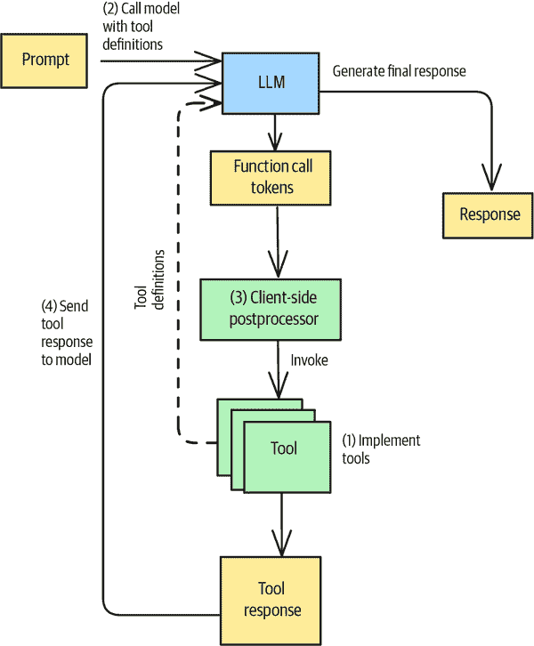
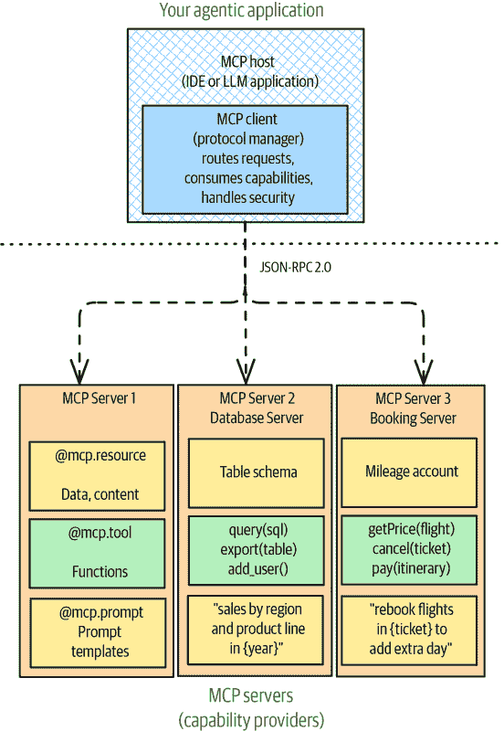
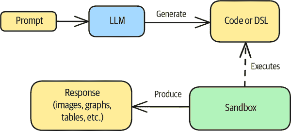
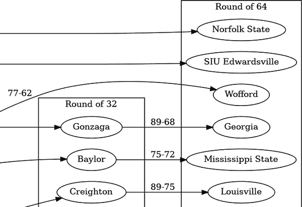
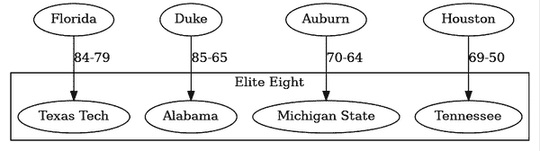
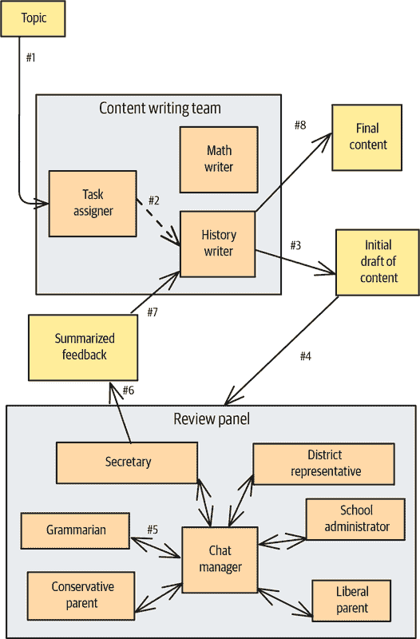

# 第 7 章：让智能体采取行动

到目前为止，我们在本书中介绍的模式都以某种形式涉及*内容*的创建。在本章中，我们将讨论三种模式，它们使基于基础模型构建的*应用*能够与世界交互——通常，越过这条线后，我们就认为应用具有智能体（agentic）特性。工具调用（模式 21）使模型能够通过结构化接口调用外部函数。代码执行（模式 22）允许模型编写并运行代码来解决复杂问题。多智能体协作（模式 23）以层级式、点对点或基于市场的架构编排专门化的 AI 智能体，通过分工协作处理复杂任务。

## 模式 21：工具调用

工具调用模式使 LLM 能够在现实世界中采取行动——既可以是获取信息（例如通过网络搜索），也可以是对环境做出改变（例如写出文件）。其实现方式是，当 LLM 确定需要调用某个函数时，让它发出特殊 token，以及要传递给该函数的参数。客户端后处理器会使用这些参数调用该函数，并将结果发送回 LLM；LLM 再将函数结果整合到其响应中。

### 问题

多模态 LLM 的核心是生成不同形式的内容（文本、图像、音频和视频）。这足以提供各种能力，例如创建研究报告、跨语言翻译和生成代码。如果内容生成受限于基础模型在训练期间获得的内部知识，就可以使用 RAG 注入新知识（见第 2 章和第 3 章）。

然而，软件能做的远不止生成内容，例如进行计算、预订航班和发起退款。LLM 本身无法做这些事情，因此无法处理这些用例。它可以生成一封说明退款已发出的电子邮件，但无法让钱真正出现在你的银行账户中！

再举一个更具体的例子：LLM 可以生成文本“预订 6 月 12 日从毛里求斯飞往伊斯坦布尔的 TK 161 航班的一个座位。”但如何让它不止于生成这段文字，而是通过航空公司或 Booking.com、Expedia 等旅行中介的航班预订 API，*真正预订*土耳其航空的航班？如何弥合 LLM 与 API 之间的鸿沟，让 LLM 能够调用 API 并完成任务？

### 解决方案

工具调用（Tool Calling）通常被包裹在多层抽象之中，这可能让人难以理解其内部机制。我们将首先从概念上讨论这一能力能为我们带来什么，然后讨论 OpenAI Responses API 中非常实用的实现方式，接着再介绍 LangGraph 和模型上下文协议（MCP）所提供的更抽象的实现。即使你通常只使用 MCP 方式，深入了解底层原理也能帮助你在工具调用未按预期工作时诊断问题。

### 工具调用如何工作

工具调用是模式 2“语法”（Grammar）的一种扩展（参见第 2 章）。LLM 经过训练，在需要调用函数时会生成一个特殊标记以及该函数的参数。例如，需要调用航班预订 API 的 LLM 可能会生成以下文本：^(1)

> 感谢您通过我们预订航班！
>
> `[CALL_TOOL: book_flight, TK 161, 2025-06-12, Economy]`

这段文本会由一个程序处理，该程序调用以下函数：

```python
fd = book_flight("TK 161", datetime.strptime("2025-06-12"), "Economy")
```

如你所见，该程序从生成的字符串中提取函数名和参数，进行必要的类型转换（例如日期转换），然后执行调用。该函数随后可以调用土耳其航空或 Expedia 的 API 并返回响应。

函数的返回值随后会被插入到原始响应中，替换工具调用：

> 感谢您通过我们预订航班！
>
> 这是您的航班确认信息：
>
> `{fd.flight_number}`
>
> `{fd.departure_time}`
>
> ...
>
> `{fd.seat_number}`
>
> ..
>
> 我已通过您的`{fd.payment_method}`收取了`{fd.invoiced_amount}`。

当然，如果对`book_flight`的调用失败，则会插入相应的错误信息。

### 工具调用带来了什么

调用外部工具的能力为 LLM 开辟了新的应用场景，包括：

- **实时知识**：RAG 仅在知识相对静态并且来源可事先索引时才能发挥作用。而工具更具动态性——它们为 LLM 提供实时信息（如新闻、天气、股价等），而这些信息是 LLM 原本无法获得的。

- **个性化**：连接到个人工作空间（如电子邮件、日历等）的工具，可以针对出现在其中的信息给出个性化响应。

- **企业 API**：与企业搜索引擎绑定的工具可以获准访问最新发布的内部备忘录；与企业数据库绑定的工具则能让 LLM 在回答中反映最新的事务数据。例如，配备了产品搜索工具的 LLM，不只是回忆产品信息，而是能获取最新的详情和定价。

- **计算**：LLM 可以使用计算器工具、GIS 分析工具和优化求解器，从而超越文本生成，解决需要这些复杂能力的任务。


# 工具调用模式

## 推理与行动交错（ReAct）

诸如模式 13“思维链”（CoT）（第 5 章）等模式不必局限于简单地列出步骤。借助一套工具，LLM 可以执行这些步骤，并根据工具的响应调整后续行为。将*推理*与*行动*交错的思路被称为*ReAct*。由于 ReAct“仅仅”是 CoT 与工具调用的结合，我们并未将其单独列为一个模式。

工具调用非常实用，以至于基础模型已经直接支持生成函数调用标记。接下来，我们来看 OpenAI 提供的底层支持，以及由 Anthropic 提出、现已被其他提供商采用的更高级抽象——MCP。

## OpenAI 中的函数调用

为了让 LLM 能够与航班预订系统对接，你需要实现一个航班预订函数，并将其描述作为模型可调用的工具之一传入。出于安全考虑，模型并不会真正直接调用该工具。相反，模型会生成标记，指明应调用哪个工具。你需要在客户端调用相应的工具，并将结果返回给模型。模型随后会将工具的结果融入其最终回答中。

### 换个名字，本质相同

发明工具调用背后技术的研究者将其命名为[Toolformer](https://arxiv.org/abs/2302.04761)。在本书中，我们保留了各模式发明者所起的名称（如 CoT、ToT、Grammar），但*Toolformer*这个名字并未流行起来。Andrew Ng 和 Anthropic 将工具调用称为*工具使用（Tool Use）*，OpenAI 和 Gemini 则称之为*函数调用（Function Calling）*。但*工具（tool）*这个词更通用，涵盖 API 和远程代理，因此我们更倾向于用它而非*函数*。我们也觉得*调用（calling）*比*使用（use）*更具描述性，因为它提醒我们：LLM 只是生成函数名和参数，实际的调用执行必须由客户端代码完成。这正是我们将该模式命名为工具调用的原因。

### 第 1 步：实现航班预订函数

第一步（参见图 7-1）是实现一个航班预订函数，该函数可将任务委托给外部 API（例如航空公司提供的 API），并返回结构化的响应。



**图 7-1. 工具调用的工作原理**

例如，你可以按照如下方式实现该函数：

```python
@dataclass
class BookingData:
   ...
class CabinClass(Enum):
   ...
 
def book_flight(flight_code: str, 
                departure_date: datetime, 
                cabin_class: CabinClass,
                passenger_details: List[PassengerInfo]) -> BookingData:    
   # 调用 API
   response = requests.post(
        "https://api.turkishairlines.com/...",
        json={
            ...
        }
    )
    # 返回结构化响应
    booking_data = response.json()
    return BookingData(**booking_data)
```

### 第 2 步：使用工具定义调用模型

接下来，将上述函数设置为可供 LLM 使用的工具之一：

```python
tools = [{
    "type": "function",
    "name": "book_flight",
    "description": "使用航空公司 API 预订航班",
    "parameters": {
        "type": "object",
        "properties": {
            "flight_code": {
                "type": "string",
                "description": "IATA 航班代码，如 AA 123"
            },
            "departure_date": {
                "type": "string",
                "description": "出发日期，格式为 YYYY-MM-DD 
（例如 2025-05-20）"
            },
            "cabin_class": {
                "type": "string",
                "enum": ["economy", "premium_economy", "business", "first"],
                "description": "旅行舱位等级"
            },
  ...
```

然后，将工具列表传给模型（实际上，你传的只是工具的描述信息）：

```python
response = client.responses.create(
    model="gpt-4.1",
    input=[{
    "role": "user", 
    "content": """帮我订一张 6 月 12 日从毛里求斯到伊斯坦布尔的任何直飞航班的经济舱机票。"""
}],
    tools=tools,
)
```

由于工具调用依赖于模型能够生成合适的结构化数据，因此务必使工具函数具有良好的自描述性——采用恰当的命名约定并添加文档注释。

### 第 3 步：处理输出并在客户端调用函数

你可能还会有其他函数，例如查找可用航班、比较票价、从客户资料中提取护照信息等等。LLM 会根据对话或工作流的上下文选择合适的函数来调用——而将许多此类步骤串联成思维链（CoT），正是 ReAct 的用武之地。

当模型确定需要调用函数时，其响应将包含一个如下所示的工具调用：

```
[{
    "type": "function_call",
    "id": "fc_12345xyz",
    "call_id": "call_12345xyz",
    "name": "book_flight",
    "arguments": "{\"flight_code\":\"TK 161\",
...
```

LLM 并不会真正*调用*外部函数，因为那样做并不安全（除非是受支持的工具，如 Web 搜索或沙盒代码执行）。OpenAI 可不希望对抗性行为者在它的 LLM 中注入任意代码！相反，你需要自己（在客户端）来发出这个调用。想必你信任`book_flight()`这个函数——毕竟它是由你编写的。要进行调用，需要处理响应：

```
tool_call = response.output[0]
if tool_call.name == "book_flight":
     args = json.loads(tool_call.arguments)
result = book_flight(args["flight_code"], ...
```

#### 第 4 步：提供结果并再次调用模型

获取结果并将其追加到 messages 中：

```
input_messages.append(tool_call)  # append model's function call message
input_messages.append({           # append result message
    "type": "function_call_output",
    "call_id": tool_call.call_id,
    "output": json.dumps(result)
})
 
response_2 = client.responses.create(
    model="gpt-4.1",
    input=input_messages,
    tools=tools,
)
```

#### 第 5 步：最终模型响应

模型现在会将结果纳入其输出：

> “好消息！我已成功为您预订了从毛里求斯（MRU）到伊斯坦布尔（IST）的航班。
> 
> 预订详情：
> 
> - 预订参考号：...

你已经看到了底层 API 中的处理过程，接下来看看当你使用 LangGraph 这类高层框架以及 MCP 这类协议时，其中有多少步骤被抽象掉了。

## 使用 LangGraph 和 MCP 进行工具调用

你可以使用框架和协议来简化上一节列出的步骤。向基础模型提供函数详细信息（第 1 步和第 2 步）可通过模型上下文协议（MCP）简化，本节将更详细地介绍该协议。客户端处理（第 3 步和第 4 步）可以通过 LangGraph 这类客户端框架简化。第 5 步保持不变。

如图 7-2 所示，你的应用程序通过嵌入在应用中的 MCP 客户端与不同的 MCP 服务器通信。第三方提供的 MCP 服务器从简单的 API 接口到复杂的支付流程，不一而足。



**图 7-2. MCP 客户端与服务器之间的区别**

### MCP 服务器

定义工具非常简单，只需在函数定义上添加这个注解：`@mcp.tool`。这把可能因系统而异、因 LLM 而异的工具调用，转变为一种更加标准化的模式。

请确保函数名、参数及其各自的文档字符串（docstring）都具备自描述性。本质上，要确保在 OpenAI Responses API 中原本会出现在第 2 步的所有描述，现在都体现在函数定义本身之中：

```
@mcp.tool()
async def book_flight(flight_code: str,
                      departure_date: datetime, 
                      cabin_class: CabinClass, 
                      passenger_details: List[PassengerInfo]) -> BookingData:
    """
    Books a flight using the airline API
    
    Args:
        flight_code: IATA airline flight code such as AA 123
        departure_date: Date of departure
        return_date: Date of return in YYYY-MM-DD format
        cabin_class: Class of travel (economy, premium_economy, business, first)
        passenger_details: List of passenger information including names and 
passport details
        
    Returns:
        Booking confirmation details including booking reference, flight numbers,
and total price
    """
...
```

如果你的所有客户端也都用 Python 编写，你可以通过进程间通信（标准输入/输出，即`stdio`）来完成通信。在这种情况下，可以通过以下方式向客户端暴露工具：

```
if __name__ == "__main__":
    mcp.run(transport="stdio")
```

另一方面，如果你的客户端可能使用其他语言编写，或者可能运行在其他机器上，你需要一种网络协议：

```
if __name__ == "__main__":
    mcp.run(transport="streamable-http")
```

### MCP 客户端

在客户端，你创建一个 MCP 客户端（作为 MCP 服务器的存根），并传入本地或远程 MCP 服务器的位置：

```
from langchain_mcp_adapters.client import MultiServerMCPClient
async with MultiServerMCPClient(
        {
            "flight_booking": {
                "command": "python",
                # Replace with absolute path to your Python file
                "args": ["/path/to/flight_booking.py"],
                "transport": "stdio",
            },
            "flight_options": {
               # The default is for the server to start on port 8000
               "url": "http://localhost:8000/mcp",
               "transport": "streamable_http",
            }
        }
    ) as client:
 
```

你可以使用这个客户端创建一个 ReAct 智能体，它会推理何时调用相关工具以及如何使用它们的响应：

```
agent = langgraph.prebuilt.create_react_agent(
        "anthropic:claude-3-7-sonnet-latest",
        client.get_tools()
)
booking_details = await agent.ainvoke(
        {"messages": [{"role": "user", "content": """Book me an economy class 
ticket from Mauritius to Istanbul on June 12 on whatever non-stop flight is
available."""}]}
    )   
```

这种 MCP 方法比使用 OpenAI Responses API 的底层方法要简洁得多。

## 示例

我们来看一个端到端的问答示例，该示例需要获取美国某个城市的实时天气信息。[完整代码](https://oreil.ly/u-jNX)在 GitHub 上。这里我们使用 MCP 来简化工具调用的实现（不使用 LangGraph）。

### 天气工具

我们想要回答的问题示例是：“周二芝加哥会下雨吗？”美国国家气象局提供了一个可免费使用的 API，你可以用其获取实时天气预报。使用该 API 时，需要先确定覆盖所查询经纬度的网格点，然后获取该网格点的预报：

```
@mcp.tool()
async def get_weather_from_nws(latitude: float, longitude: float) -> str:
    """Fetches weather data from the National Weather Service API for a specific 
geographic location."""
    base_url = "https://api.weather.gov/points/"
    points_url = f"{base_url}{latitude},{longitude}"
    ...
    response = requests.get(points_url, headers=headers)
    metadata = response.json()
    forecast_url = metadata.get("properties", {}).get("forecast")
    ...
    response = requests.get(forecast_url, headers=headers)
    weather_data = response.json()
    return weather_data.get("properties", {}).get("periods")
```

仔细看看前面关于芝加哥天气的问题。芝加哥的纬度和经度是多少？

### 地理编码工具

要获取芝加哥的纬度和经度，你可以将 Google Maps 地理编码 API 封装为另一个工具：

```python
@mcp.tool()
async def latlon_geocoder(location: str) -> (float, float):
    """Converts a place name such as "Kalamazoo, Michigan" to latitude and
longitude coordinates"""
    print(f"Geocoding {location} using Google Maps API")
    geocode_result = gmaps.geocode(location)
    return (round(geocode_result[0]['geometry']['location']['lat'], 4),
            round(geocode_result[0]['geometry']['location']['lng'], 4))
```

### MCP 服务器

接下来，你可以将这些工具暴露为 MCP 服务器：


```python
mcp = FastMCP("weather")
...
 
if __name__ == '__main__':
    mcp.run(transport="streamable-http")
```

然后，你可以将这段 Python 代码部署到无服务器环境中，例如 Google Cloud Run、AWS Fargate 或 Azure Container Instances。

## MCP 客户端

接下来，使用可用的工具设置一个 MCP 客户端：

```python
async with MultiServerMCPClient(
        {
            "weather": {
                # Ensure you start your weather server on port 8000
                "url": "http://localhost:8000/mcp",
                "transport": "streamable_http",
            }
        }
    ) as client:
```

然后，创建一个 ReAct 智能体，它将在必要时自动调用工具，并将其响应嵌入到最终响应中：

```python
agent = create_react_agent(
            "anthropic:claude-3-7-sonnet-latest",
            client.get_tools(),
)
...
weather_response = await agent.ainvoke(
                {"messages": [{"role": "user", "content": user_input}]}
)
print(weather_response['messages'][-1].content)
```

如果你想为 ReAct 智能体提供一些示例，可以通过系统提示词来实现：

```python
system_message = """
    Follow the steps in the example below to retrieve the weather information 
requested.
 
    Example:
      Question: What's the weather in Kalamazoo, Michigan?
      Step 1:   The user is asking about Kalamazoo, Michigan.
      Step 2:   Use the latlon_geocoder tool to get the latitude and longitude of 
Kalamazoo, Michigan.
      Step 3:   latitude, longitude is (42.2917, -85.5872)
      Step 4:   Use the get_weather_from_nws tool to get the weather from the 
National Weather Service at the latitude, longitude
      Step 5:   The detailed forecast for tonight reads 'Showers and 
thunderstorms before 8 p.m., then showers and thunderstorms likely. Some of the 
storms could produce heavy rain. Mostly cloudy. Low around 68, with temperatures 
rising to around 70 overnight. West-southwest winds 5 to 8 mph. Chance of 
precipitation is 80%. New rainfall amounts between 1 and 2 inches possible.'
      Answer:   It will rain tonight. Temperature is around 70 F.
 
    Question: 
"""
 
...
 
agent = create_react_agent(
            "anthropic:claude-3-7-sonnet-latest",
            client.get_tools(),
            prompt = system_message
        )
```

## 注意事项

工具调用依赖 LLM 来判断是否需要调用工具，并生成相应的工具调用，但你可以通过一些方式来提高这种行为的可靠性。MCP 正成为一种流行的协议，但在撰写本文时，它仍有一些限制。工具调用还会增加你的应用受到对抗性攻击的脆弱性。

### 提高可靠性

由于工具调用依赖模型来识别何时生成工具调用的 token，因此你需要使用清晰、详细的函数名称和参数描述。使用系统提示词来描述何时使用每个函数的策略（例如，何时搜索航班、何时预订，以及搜索结果的有效期）。你还应该包含有效输入（如航班代码）的示例，并利用参数类型（如枚举）来发挥 Grammar 模式的优势。

你使用的函数和参数越少，模型的准确度就越高——在撰写本文时（2025 年 6 月），根据 LLM 的不同，限制似乎是 3 到 10 个工具。不要让模型填写你已确定知道的信息：如果你已经知道乘客的详细信息，你可以减轻模型维护这些信息的负担。

在出现错误时，你应该返回描述性消息，以便采用反思（Reflection，模式 18）等模式来纠正输入并重试。你也可以根据模型对操作的响应来决定下一步。工具调用和反思通常被视为生成式 AI 应用成为*智能体*应用的门槛行为。通过赋予基于 LLM 的应用采取行动、响应反馈和调整行为的能力，你可以构建更自主的系统。

当任务可以通过向函数发送几个参数来调用时，工具调用效果很好。如果所讨论的函数类似于数据库调用，并将域特定语言（DSL）如 SQL 作为输入，那么模式 22“代码执行”（Code Execution）可能是一个更好的解决方案，我们将在下一节讨论。

### MCP 的局限性

在我们撰写本文时（2025 年 5 月），关于 MCP 仍有一些重要问题尚未确定：

**安全性**：身份验证和授权是客户端与服务器之间任何通信的重要组成部分。我们需要清晰区分不同角色，并能够指定允许特定客户端调用哪些功能。然而，MCP 更像是一种语言互操作协议——它不强制执行任何安全原则。Cloudflare 扩展了其 [Workers OAuth Provider 库](https://oreil.ly/dvhMM) 来填补这一空白。

**协作**：在 MCP 中，客户端与服务器之间的通信大多是单向的，而在现实世界中，你可能需要协作式、交互式的工作流。Google 和 IBM 分别于 2025 年 4 月/5 月通过 [A2A](https://oreil.ly/5LfQL) 和 [ACP](https://oreil.ly/D4rKf) 协议引入了对智能体间通信的支持。我们将在“模式 23：多智能体协作”中讨论 A2A。

**流式传输**：工具调用可能需要很长时间。如果你正在构建使用工具调用的交互式生成式 AI 应用，可以通过在长时间操作期间显示实时进度来增强用户体验。你还可以使用[可流式传输的 HTTP](https://oreil.ly/ybzf) 传输机制，让客户端可以选择从模型流式输出响应。在撰写本文时，标准 MCP 调用会在 30 到 60 秒内终止，具体取决于网络配置。

然而，MCP 正在快速发展，毫无疑问，当你阅读本文时，其中一些或全部缺点可能已经得到解决。或者 MCP 已经被更好的东西所取代。无论哪种协议或框架“胜出”，我们都相对确信，工具调用仍将是生成式 AI 应用中一个有用且重要的模式。

### 提示注入

当你的基于 LLM 的应用从内容生成扩展到调用外部工具时，对抗性攻击可能造成更大的损害。对抗行为者可以在 LLM 处理的内容中嵌入恶意文本（此过程称为*提示注入*），使 LLM 生成非预期的工具调用。他们还可以操纵被调用的外部工具，对使用这些工具输出的应用程序造成下游损害。攻击区域随着 LLM 与其调用的工具之间的往返次数增加而扩大。

为了防范此类提示注入攻击，你可以通过以下六种方式在工具调用前后添加护栏，这些方式由 [Beurer-Kellner 等人于 2025 年发表的一篇有影响力的论文](https://arxiv.org/abs/2506.08837v2)提出。以下是每种方法的使用方式：

**操作选择器（Action-Selector）**：你只允许一组预定义的操作，并阻止这些操作向智能体反馈任何信息。这可以防止第三方工具注入可能导致不安全执行的指令。

**先规划后执行（Plan-Then-Execute）**：

智能体首先制定固定的行动计划，而且尽管工具调用的反馈会被添加到内容中，智能体也不会偏离原始计划。这确保了不受信任的第三方数据无法注入指令，使智能体偏离该计划。

- **映射-归约（Map-Reduce）：** 你派遣相互隔离的子智能体，通过工具调用处理不受信任提示词的各个部分。“映射”操作返回的数据会传递给“归约”操作，后者要么不使用 LLM，要么以受限的 Action-Selector 方式处理输出。

- **双 LLM（Dual-LLM）：** 你将一个负责规划行动并使用工具的特权 LLM 与一个沙盒化 LLM 结合起来，后者在无法访问工具的情况下处理不受信任的数据。

- **先代码后执行（Code-Then-Execute）：** LLM 智能体编写一个正式的计算机程序来解决问题，该程序可以调用工具，并为不受信任的文本生成非特权 LLM。随后，该程序会在不受信任的数据上执行，以保持固定的控制流，即使数据本身是恶意的。参见模式 22“代码执行”。

- **上下文最小化（Context-Minimization）：** 你从 LLM 的上下文中移除不必要的内容。特别是在后续步骤中，将用户的原始提示词从 LLM 的上下文中移除。

现代 LLM 开始通过使用前述一个或多个模式来整合网络搜索和代码执行等工具，以防范提示注入。然而，试图通过工具调用保护 LLM 免受提示注入攻击仍是一个[持续的挑战](https://oreil.ly/3P-ak)。

## 参考资料

将推理与行动交错进行的想法由 Yao 等人（2022）在 [ReAct 论文](https://arxiv.org/abs/2210.03629)中提出。LLM 能学习何时使用工具这一事实由 Schick 等人（2023）在 [Toolformer 论文](https://arxiv.org/abs/2302.04761)中提出。OpenAI 的[函数调用文档](https://oreil.ly/Cj0yh)、LangGraph 的[`ToolNode` 文档](https://oreil.ly/EXmwm)、Anthropic 的 [MCP 文档](https://oreil.ly/977Wc)以及 Google 的 [A2A 博客文章](https://oreil.ly/5LfQL)提供了抽象层如何演进的路线图。Beurer-Kellner 等人（2025）描述了[保护具备工具调用能力的 LLM 智能体](https://arxiv.org/abs/2506.08837v2)免受提示注入攻击的设计模式。

[GitHub](https://oreil.ly/7lQ0n) 提供了一个 MCP 服务器，LLM 应用可以将其用于版本管理和持续集成。[Sentry](https://oreil.ly/TLztn) 允许 AI 助手通过 MCP 与其连接，以提供错误处理和性能监控。[Zapier AI Actions](https://oreil.ly/E83Hn) 展示了通过 MCP 进行企业级工具调用的能力，使智能体 AI 应用能够在数千个应用中执行各种各样的操作，从而实现自动化工作流。

## 模式 22：代码执行

在“代码执行”模式中，LLM 通过生成代码来触发操作（如数据库更新），这些代码随后由外部系统执行。如果目的是生成图形和图表等内容，则代码在沙盒中执行。

### 问题

LLM 并不擅长创建图形或为图像添加文字注释等任务，但你也无法使用工具调用完成这些任务。要创建图形，你通常不会仅仅调用 API。相反，你需要用编程语言（如 Matplotlib）或 DSL（如 Mermaid）编写图形规格。要为图像添加文字注释，你需要通过一组命令行指令调用 ImageMagick 等框架来提供规格。

当要调用的函数接受的是 DSL 中的长短语而不是一小组参数时，工具调用就不够用了。数据库函数通常以 SQL 作为输入，往往就属于这种情况。

### 解决方案

如果你已经有了一个能完成所需任务的软件系统，但该系统由 DSL 驱动，那么最好使用代码执行。在代码执行中，你让 LLM 生成 DSL 代码，然后由后处理器（通常在沙盒中——参见图 7-3）将 DSL 代码发送给执行它的软件系统，以生成最终响应。



**图 7-3.** 在代码执行中，LLM 生成代码，并在沙盒环境中执行以生成最终响应。

基础模型非常擅长生成 Matplotlib 代码、SQL 语句和 Mermaid markdown。因此，你可以通过两步流程创建图形、查询数据库和绘制图表：首先让 LLM 生成所需代码，然后让沙盒环境执行它。

你还可以将代码执行作为 ReAct 框架的一部分来实现，在该框架中，某些交错操作涉及执行代码而不是调用工具。

代码执行弥合了自然语言理解与计算问题求解之间的鸿沟。它使你能够构建交互式计算工具，这些工具可以响应自然语言指令来解决问题、分析数据、创建可视化，并执行各种各样的编程任务。

当你需要更新数据库时，让 LLM 生成 SQL 并将其作为单个事务发送到数据库，比期望 LLM 能够维护数据完整性要容易得多。

### 示例

我们来看一个端到端的示例（[完整代码在 GitHub 上](https://oreil.ly/2a-Nz)）。我们将展示一场篮球锦标赛的结果。例如，我们希望 LLM 生成一个类似图 7-4 的图形——它告诉我们，佐治亚大学（Georgia）在 64 强赛中输给了冈萨加大学（Gonzaga），而冈萨加大学随后在 32 强赛中被淘汰。



**图 7-4.** 展示篮球锦标赛结果的部分图像。

为了生成该图形，你将使用两步流程。第一步，让 LLM 生成与名为 Graphviz 的绘图程序对应的 DSL。这种 DSL 称为 [DOT](https://oreil.ly/ve5e1)，它允许你简洁地表示图形。

你可以向 LLM 展示一个将部分篮球比赛结果转换为 DOT 的示例：

> 我会给你一场篮球锦标赛的结果。
>
> 使用这些数据生成 Graphviz 子图。
>
> 确保将子图命名为 `cluster_xxx`。
>
> 下面是一个示例：
>
> **输入：**
>
> - 2025 年 3 月 29 日，星期六（精英八强）
> - (1) Florida 84, (3) Texas Tech 79
> - (1) Duke 85, (2) Alabama 65
> - 2025 年 3 月 30 日，星期日（精英八强）
> - (1) Houston 69, (2) Tennessee 50
> - (1) Auburn 70, (2) Michigan State 64
>
> **输出：**
>
> ```
> "Florida" -> "Texas Tech" [label="84-79"]
> "Duke" -> "Alabama" [label="85-65"]
> "Auburn" -> "Michigan State" [label="70-64"]
> "Houston" -> "Tennessee" [label="69-50"]
> subgraph cluster_elite_eight {
>   label = "Elite Eight"
>   {rank = same; "Texas Tech"; "Alabama"; "Michigan State"; "Tennessee"; }
> }
> ```
>
> """
>
> **输入：**
>
> `{tournament_results}`
>
> **输出：**

在第二步中，你将生成的 DSL 保存到文件中，将其发送给 DOT 程序，并请求该程序创建图形：

```
dot -Grankdir=LR -Tpng tournament.dot -o tournament.png
```

对于提示中的示例，你将得到图 7-5 所示的图像。



**图 7-5.** 精英八强四场比赛的结果示意

你可以通过工具调用或模式 6：基础 RAG（来自第 3 章）联网搜索获得锦标赛结果，然后将生成的 DSL 发送给 `DOT` 来生成图表。该结果的一部分已显示在图 7-4 中。

### 注意事项

请务必在*沙箱环境*中执行代码。沙箱环境提供一个隔离、安全的空间，LLM 生成的代码可以在其中运行而不会危及底层系统。通常，沙箱环境会受到 CPU、内存、网络访问和执行时间等方面的限制，并会被监控以防无限循环和资源耗尽。它们通常使用 Docker 等容器化技术、虚拟机或具有强安全边界的专用运行时环境来实现。

此外，即使在沙箱中，先验证代码而不是直接执行也可能是有益的。这可以简单到检查语法，也可以涉及更复杂的流程，如静态代码分析和形式化正确性检查。


即使有了沙箱和代码验证，代码执行在安全性方面仍面临挑战。恶意用户可能会试图突破资源限制、窃取数据，或构造能生成有害代码的提示词。你还必须保持沙箱容器的最新状态，因为沙箱操作系统或沙箱隔离机制中的漏洞可能让攻击者访问宿主系统。

你可以将编译器错误以及其他失败的验证或运行时检查结果反馈给 LLM，以便它进行修改并重试（参见第 6 章中的模式 18：反思）。

在撰写本书时（2025 年 6 月），代码执行环境往往不太可靠，除非它们的输入受到严格控制，或者运行在允许反思的沙箱中。当生成的代码是狭义的 DSL 且执行环境包含解析器时（例如我们示例中的 Graphviz 代码），代码执行效果会更好。

### 参考资料

Wang 等人（2021）在关于 [CodeT5](https://arxiv.org/abs/2109.00859) 的论文中设计了一种利用代码语义（尤其是标识符）的 Transformer 模型，使其在代码理解和代码生成任务中表现优异。DeepMind 的 [AlphaCode](https://alphacode.deepmind.com)、OpenAI 的 [Codex](https://oreil.ly/5jISu) 以及 [StarCoder](https://oreil.ly/ZoAJW) 等开源模型在实践层面推动了该领域的发展。Hyunh 和 Lin（2025）对[用于代码生成的 LLM](https://arxiv.org/abs/2503.01245) 进行了综述。Chen 等人（2021）提出的 [HumanEval](https://oreil.ly/kp3Dz) 已成为评估代码生成能力的标准基准。

Claude 使用 [Mermaid 代码](https://oreil.ly/wbWjo)作为中间格式来生成架构图和流程图。Gemini 生成 [Pandas 代码](https://oreil.ly/32JVC)来执行财务分析。

## 模式 23：多智能体协作

多智能体架构允许你使用专门的单用途智能体来解决现实世界问题，并以模仿人类组织结构的方式组织它们。它们可以帮助你突破单次 LLM 调用的限制。

### 问题

模式 21（工具调用）、模式 22（代码执行）、模式 13（思维链，CoT）和模式 18（反思）让你能够超越仅仅响应用户查询的被动式应用。AI 智能体能够采取行动、响应反馈并调整自身行为，这使它们能够变得更加自主。然而，仅仅是*勉强*能够做到这些还不够——现实世界中的应用往往有更严格的要求。让我们来看看这意味着什么。

理想情况下，AI 智能体应能处理需要不同工具的多步骤任务，在长时间交互中保持上下文，适应用户偏好，评估情境，并在无需人工干预的情况下采取适当行动。随着应用变得更加复杂并要求这类行为，单一智能体的局限性日益明显。这些局限包括：

- **认知瓶颈：** 即使最先进的 LLM 也拥有有限的上下文窗口和计算能力。随着问题复杂度的增加，单一模型难以在任务的所有方面保持连贯性。在需要整合多个知识领域或跨长上下文推理的任务中，这一局限尤为明显。

- **参数效率递减：** 虽然增大模型规模确实能显著提升能力，但这种方法会增加计算成本，而且往往收益递减。多智能体系统提供了一种参数效率更高的替代方案：将专用知识分布到多个较小的模型中，而不是把所有能力都编码进一个大型模型。

- **推理深度有限：** 单一模型往往难以进行多步推理，尤其是在任务要求同时维持多条思路或探索多种备选方案时。基于 Transformer 的推理具有顺序性，这限制了模型有效并行推理的能力。如果你能把推理视为广度优先搜索，并相应地允许它使用更多 token，你会取得更好的效果。

- **领域适应问题：** 在通用数据分布上训练的单一模型可能缺乏特定领域的专业知识。微调可以部分解决这一局限，但往往以灾难性遗忘或其他领域性能下降为代价。

多智能体系统有助于解决这些局限。

### 解决方案

多智能体系统实现了模仿人类组织结构的认知劳动分工，从而可以更高效地分配模型能力。

#### 多个专用智能体

多智能体系统通过使用多个专用智能体，绕开了依赖单次模型调用的局限。这可以实现以下能力：

- **任务分解：** 将复杂问题分解为子任务并分配给专用智能体，可以更集中地关注问题的特定方面，从而降低任一智能体的认知负荷。智能体可以专注于特定的认知功能，如规划、检索、验证和创造性生成。

- **并行处理：** 多个智能体可以同时处理问题的不同方面，从而更高效地利用计算资源并减少端到端的处理时间。

- **层级化问题解决：** 多智能体系统可以实现层级化方法，由高层智能体协调更专门化智能体的活动，这与人类组织中的管理结构运作方式类似。

- **领域专属专业知识：** 智能体可以针对特定领域进行训练或微调，从而获得比同等规模的通用模型更深入的专业知识。

- **功能专化：** 除了领域专业化之外，不同的智能体还可以作为组织中不同角色所使用软件系统的接口。

多智能体架构比单体方法具有更好的可扩展性。多智能体系统不是通过增加模型规模来垂直扩展，而是可以根据需要添加更多专门化的智能体来进行*水平*扩展。你可以单独更新或替换某个智能体，而无需重新训练整个系统，这使得开发和部署更加敏捷。计算资源也可以根据当前需求动态分配，将更多资源导向最关键或计算量最大的子任务。

多智能体系统也更加健壮。关键能力可以在多个智能体之间复制，以降低单个智能体故障的影响。不同的智能体可以采用不同的方法论来解决问题，这增加了找到有效解决方案的可能性。智能体之间可以相互验证输出，从而发现并纠正那些在单智能体系统中可能被忽略的错误。

近期研究表明，多智能体系统可以表现出*涌现能力*，即它们并未被显式训练出的行为。通过交互与协作，多智能体系统可以展现出超越其各组成部分之和的能力。具有不同视角和能力的智能体之间的互动，可以促使它们采取在单个模型中不太可能出现的创新方法。

智能体可以从彼此的成功和失败中学习，从而推动整个系统的持续改进。例如，编码智能体生成的代码可能未能处理某些边界情况。测试智能体可以修复生成的代码，并将代码变更发送回编码智能体，从而使编码智能体学会在将来添加边界情况处理。此外，如果测试智能体以一种不符合公司风格指南的方式更新了代码，那么测试智能体生成的代码可能就需要由编码智能体来修正。将编码智能体做出的此类代码修复发送给测试智能体，将使测试智能体在下一次生成更合规的代码。

拥有多个专门化的智能体固然很好——那么，你应该如何组织它们来处理特定任务呢？

#### 多智能体架构

为了组织专门化的智能体来处理任务，你可以使用层次结构、对等网络、基于市场的系统，或其中部分或全部方案的混合形式。除了选择这些架构之一，你还需要确定人类将如何介入、纠正或补充智能体。

##### 层次结构

*层次化*多智能体架构以树状结构组织智能体，并具有清晰的权威和责任线。例如，在*主管-执行者*模型中，高层主管智能体分解任务，将其委派给专门的执行智能体，然后将它们的输出整合为连贯的响应。在多级层次结构中，存在多层主管-执行者层级，中层管理者负责协调专门的智能体小组。

层次结构通常集中决策，由高层级智能体对低层级智能体拥有权威。要使用这种结构，你通常需要任务分解算法、某种基于优先级的调度，以及一种汇总不同智能体输出的方式。

最简单的层次架构是*提示链*，其中链中第一个智能体的响应成为第二个智能体的输入，以此类推。这也称为*顺序工作流*，这是一种层次结构，其中只有一个叶节点，其他所有节点都恰好只有一个子节点。所有输入都进入根节点，最终响应来自叶节点。

例如，下面是一个由三个步骤组成的 LangChain 顺序工作流。给定一个主题，该链被构造成生成一段关于该主题的文字，给它一个标题，然后从段落中提取关键词：

```
paragraph_prompt = PromptTemplate(input_variables=["topic"], 
      template="Write a concise and entertaining paragraph on {topic}.")
paragraph_chain = LLMChain(llm=llm, prompt=paragraph_prompt, 
      output_key="paragraph")
 
title_prompt = PromptTemplate(input_variables=["paragraph"], 
      template="Write a catchy title for ... {paragraph}")
title_chain = LLMChain(llm=llm, prompt=title_prompt, output_key="title")
 
keywords_prompt = PromptTemplate(input_variables=["paragraph", "title"], 
      template="Extract up to 5 keywords ... {title} {paragraph}")
keywords_chain = LLMChain(llm=llm, prompt=keywords_prompt, 
      output_key="keywords")
 
overall_chain = SequentialChain(
    chains=[paragraph_chain, title_chain, keywords_chain],
    input_variables=["topic"],
    output_variables=["paragraph", "title", "keywords"],
)
 
# Example Usage:
topic_input = "The benefits of regular exercise"
result = overall_chain.invoke({"topic": topic_input})
print(f"""
**{result['title']}**
{result['paragraph']}"
 
Keywords: {result['keywords']} 
""")
```

在此工作流中，每个智能体通过`input_variables`和`output_key`与其层级结构中上下方的智能体协作。

##### 对等网络

*对等*架构更均匀地在智能体之间分配权威和责任。在协作网络中，智能体作为平等者共同工作，共享信息并协调活动，而没有严格的层级控制。通常会有投票或共识机制来决定行动方案，因此任务通过集体努力而不是自上而下的分配来解决。

例如，下面是一个 CrewAI 任务，涉及让三个智能体达成共识：

```
# peer-to-peer task
voting_and_consensus_task = Task(
    description=("""Review the preliminary recommendations from all editors for 
article '{article_id}'. Engage in up to 3 rounds of discussion to reach a 
consensus on whether to ACCEPT, REJECT, or REVISE the article. If a consensus is 
not reached after 3 rounds, a majority vote will determine the outcome."""
    ),
    expected_output=("""The final decision (ACCEPT, REJECT, or REVISE) for the
article, along with a summary of the reviews. This output should reflect the 
consensus or majority vote after discussion."""
    ),
    agent=[senior_editor, 
           content_editor, 
           research_editor], # All agents participate in this task
    context=[senior_editor_review_task,
             content_editor_review_task, 
             research_editor_review_task],
    callback=lambda output: print(f"## Final Decision: {output.raw_output}")
)
```

对等网络通常具有分布式共识算法、对等发现与通信协议，以及用于评估每个智能体贡献和能力的信誉系统。

##### 基于市场的系统

*基于市场*的架构使用经济理念（如拍卖和效用最大化）来协调智能体的活动。它们通过拍卖过程分配任务或资源，智能体根据自身能力和可用性进行出价。或者，智能体可以做出最大化某个整体效用函数的决策。市场机制选择智能体并管理提供给它们的资源。

以下是在一组智能体之间运行二手车密封投标拍卖的示例：

```
def run_auction(agents, car_description):
    bids = {}
    for agent in agents:
         prompt = f"""Here is the car for auction:\n {car_description}\n\n What
is your maximum bid? Please respond with only the number."""
        bid_response = agent.run(prompt)
        bids[agent.name] = int(bid_response.output)
 
    # Determine the highest bidder
    highest_bid = 0
    winner = None
    for agent_name, bid_amount in bids.items():
        if bid_amount > highest_bid:
            highest_bid = bid_amount
            winner = agent_name
 
    return winner, highest_bid
```

拍卖机制的使用并不局限于购买二手车。你可以将拍卖机制用于任何类型的任务分配中，在这种任务里，每个智能体都能根据其当前拥有的资源，独立判断自己能以多好的方式完成任务。假设你有一组智能体，每个智能体使用不同算法来解决一个优化任务。每个智能体可以根据预期改进幅度或预期优化时间来对任务出价。下面是一个更复杂的英式拍卖：拍卖人设定最低价，竞拍者公开依次报出更高的价格，一旦资源耗尽，智能体便退出。


```python
def run_auction(agents, task_description, starting_bid, increment=100):
    current_bid = starting_bid
    highest_bidder = None
    active_bidders = list(agents)  # All agents start as active
    while len(active_bidders) > 1:
        print(f"""\nCurrent Bid is: ${current_bid:,}. Bidders remaining: 
{len(active_bidders)}""")
        time.sleep(2) # Give agents time to gather resources

        bids_this_round = {}
        bidders_to_remove = []
        for agent in active_bidders:
            # The prompt now asks if the agent is willing to bid higher.
            prompt = f"""
            {task_description}

            The current bid is ${current_bid:,}. Are you willing to place a 
higher bid? Your bid must be at least ${current_bid + increment:,}. If you are 
willing to bid, respond with the number of your new bid. If you are not willing
to bid higher, respond with 'pass'.
            """
            response = agent.run(prompt)
            if response.lower() != "pass" and int(response) >= current_bid + increment:
                new_bid = current_bid + increment
                bids_this_round[agent.name] = new_bid
                print(f"  - {agent.name} bids ${new_bid:,}")
            else:
                bidders_to_remove.append(agent)
                print(f"  - {agent.name} passes.")

        if not bids_this_round:
            # No new bids were placed, auction ends.
            # The last highest bidder wins with their bid.
            break

        # Get ready for next round
        round_winner_name = max(bids_this_round, key=bids_this_round.get)
        current_bid = bids_this_round[round_winner_name]
        highest_bidder = round_winner_name

        # Remove bidders who passed
        for agent in bidders_to_remove:
            active_bidders.remove(agent)

    if highest_bidder:
        print(f"""The auction is over! The last bidder standing is 
{highest_bidder}.""")
        return highest_bidder, current_bid
    else:
        # This would happen if no one were to bid above the starting price.
        print("The auction ended with no bids.")
        return None, starting_bid
```

基于市场的架构需要拍卖算法、效用函数和/或某种虚拟货币来进行资源分配。

### 人在回路

点对点和基于市场的系统需要解决冲突的机制。最简单的方法是让其中一个智能体充当人类的代理，将冲突传递给该人类，由该人类解决冲突，然后让智能体机制继续运行。

在流程的任何环节，都可以通过与人类代理智能体协作，以类似机制引入人类偏好和输入。

### 用例

多种类型的用例都能从多智能体处理中受益：

**广度优先或并行执行**：如果你能将任务分解为可并行处理的步骤，就可以缩短执行时间。例如，并行处理多个文件远比在单个智能体中按顺序处理要快得多。到目前为止，这是多智能体最常见、最有用且复杂度最低的用法。

**复杂推理**：多智能体系统擅长需要多种视角或专业知识才能完成的复杂推理任务。不同的智能体可以专攻不同的数学领域或技巧，并协作解决复杂问题。智能体可以专攻法律、先例或司法管辖区的不同领域，共同分析复杂的法律问题。专业智能体可以专注于文献综述、假设生成、实验设计和数据分析，协作推进科学探究。

**多步骤问题求解**：需要具有依赖关系的顺序步骤的任务，可从多智能体方法中受益。不同的智能体可以处理复杂任务的规划、执行、监控和调整阶段。你可以使用专注于不同子任务或质量、正确性不同方面的专业智能体，通过逐步改进初始解决方案，在每一步改变解决方案。或者，你可以让每个步骤由一个验证智能体检查初始解决方案的不同方面（正确性、一致性或安全性），并决定该方案是否有效。

**协作式内容创作**：内容创作受益于专注于内容不同方面的专业智能体。不同的智能体可以专注于研究、拟大纲、起草、编辑和事实核查，从而共同制作高质量的文字内容。专注于文本、图像、音频和视频生成的智能体可以协作创建集成的多媒体内容。不同的智能体可以代表不同的角色或叙事元素，打造动态且响应式的故事讲述体验。

**对抗性验证**：多智能体系统可以实现对抗性验证方法。一组智能体（*红队*）试图发现内容中的缺陷、偏见或漏洞，而另一组智能体（*蓝队*）则进行防御或迭代改进内容。或者，智能体可以就某个话题的不同观点进行争论，从而帮助识别推理或证据中的薄弱点。

**专业领域集成**：拥有不同学科专业知识的智能体可以协作处理跨多个领域的问题。专业智能体可以作为领域特定工具、数据库或 API 的接口，从而将其能力集成到整个系统中。不同的智能体可以专注于不同的模态（文本、图像、音频或视频）或不同的渠道（Web、语音或文本），实现跨模态的无缝集成。

**自我改进系统**：评估智能体可以评估其他智能体的性能，并识别需要改进的领域。

接下来，我们将考察一个包含上述若干特征的用例。

### 示例

我们来看一个端到端示例：使用 [AG2](https://oreil.ly/7OUPW)（一个源自微软的开源多智能体协作框架）创建教育内容。[完整代码在 GitHub 上](https://oreil.ly/l5SKy)，交互过程如 图 7-6 所示。

假设你负责为不同主题编写九年级练习册，并打算采用智能体方法来创建这些内容。你将遵循以下步骤（编号与 图 7-6 中的编号对应，并在后续小节中引用）：

1. 工作流从人类用户向任务分配智能体发送主题开始。
2. 任务分配智能体将主题分配给你内容编写团队中的某个智能体。例如，如果主题是“为什么普拉西战役如此关键？”，该主题将分配给一个基于历史文本训练的智能体。
3. 历史内容编写智能体使用事实核查工具和教科书（借助 RAG）等工具生成初始草稿。
4. 草稿被发送给一个由多个扮演不同角色的智能体组成的评审组。
5. 评审小组讨论草稿，提供不同视角。
6. 小组秘书将评审小组的反馈总结为一组具体指令。
7. 反馈被提供给历史内容写作代理。
8. 写作代理利用反馈重写初始草稿，并将结果作为最终内容提交。



**图 7-6 创建教育内容端到端示例中的代理间协作**

#### 步骤 1：设置工作流

工作流的初始部分是一个层次化结构——所有请求都流向任务分配器，由它选择其中一位写作代理。这种由分类器前置在一组工作者之前的模式称为*路由器*。

共有四个代理：将主题提交给任务分配器的人类代理、任务分配器，以及两个写作代理。在 AG2 中，你可以使用以下代码创建两个写作代理和人类代理：

```python
llm_config = LLMConfig(
    api_type="google", # or "openai"
    model="gemini-2.0-flash", # or "gpt-4o-mini"
    api_key=os.environ.get("GEMINI_API_KEY"), # or "OPENAI_API_KEY"
    temperature=0.2,
)
history_writer_prompt="You are a historian ..."
math_writer_prompt="You are a math teacher ..."
with llm_config:
    history_writer = ConversableAgent(name="history_writer",
                            system_message=history_writer_prompt)
    math_writer = ConversableAgent(name="math_writer",
                            system_message=math_writer_prompt)
    human = ConversableAgent(name="human", human_input_mode="ALWAYS")
```

不过，对于任务分配器，你不希望它太过自由发挥，因此将`temperature`设为零，并约束其输出（使用第 2 章中的模式 2（Grammar））：

```python
task_assigner_prompt="""You have two writers, one who is .... assign it to the 
person who is likely to be better informed and able to create content to answer
it."""
class TaskAssignmentResponse(BaseModel):
    writer: Literal['HISTORIAN', 'MATH WRITER']

llm_task_config = LLMConfig(
    ...
    temperature=0.0,
    response_format=TaskAssignmentResponse
)
with llm_task_config:
    task_assigner = ConversableAgent(name="task_assigner",
                                     system_message=task_assigner_prompt)
```

#### 步骤 2：将主题分配给写作代理

要将主题分配给写作代理，你需要将问题发送给任务分配器并处理响应：

```python
task_response = human.run(recipient=task_assigner,
                            message=question,
                            max_turns=1)
task_response.process()
```

如果你希望任务分配器能够向人类代理提出追问或澄清问题，你可以允许更多轮次（`max_turns > 1`）。

然后，根据响应选择将为该问题创建初始草稿的写作代理：

```python
writer = json.loads(task_response.messages[-1]['content'])['writer']
if writer == 'HISTORIAN':
    writer = history_writer
else:
    writer = math_writer
```

#### 步骤 3：创建初始草稿

要创建初始草稿，请让任务分配器将原始问题提交给写作代理：

```python
content_response = task_assigner.run(recipient=writer,
                                         message=question,
                                         max_turns=1)
content_response.process()
initial_draft = content_response.messages[-1]['content']
```

问题如下：

> 为什么普拉西战役如此关键？

任务分配器返回：

```json
{
  "writer": "HISTORIAN"
}
```

它将问题发送给历史写作代理，后者回应了以下内容（此处摘录）：

> ...

> 这场战役的重要性在于，它为英国对整个印度次大陆的逐步扩张铺平了道路。凭借从孟加拉获取的财富，英国东印度公司得以资助其军事和行政运作，从而击败其他地区势力并确立其主导地位。

> ...

现在，让我们向它发送一个数学问题：

> `x²+50=150`。求解`x`。

任务分配器返回：

```json
{
  "writer": "MATH WRITER"
}
```

然后，它将问题发送给数学写作代理，后者回应了以下内容（此处摘录）：

> 好了，同学们，我们一起解这道方程。我们的目标是分离出`x`，也就是让`x`单独位于方程的一侧。

> ...

> 现在我们有“`x`的平方等于 100”。要找出`x`，我们需要撤销平方。平方的逆运算是取平方根。我们对等式两边同时取平方根：

> `√(x²) = ±√100`

> 注意“±”符号！这一点非常重要。

> ...

#### 步骤 4：设置评审小组

既然你已经有了初始草稿，你需要将其发送给一个课程评审小组，该小组包含代表不同视角的代理。设置这个评审小组与设置内容写作代理集合类似：

```python
reviewers = []
with llm_config:
    reviewers.append(ConversableAgent(name="district_admin",
                                      system_message="""You are a school district
representative who wants to ensure that materials are concise and easy to 
understand. You want to keep the cost of printing and remedial education down.
"""))
    ...
    reviewers.append(ConversableAgent(name="school_admin", ...))
    reviewers.append(ConversableAgent(name="secretary", ...))
    reviewers.append(ConversableAgent(name="conservative_parent", ...))
    reviewers.append(ConversableAgent(name="liberal_parent", ...))
```

在前面的情况中，你显式地编写了交互和交接逻辑，使用任务分配器代理的响应来决定由哪个写作代理处理该问题。

AG2 自带几种预构建的编排模式，其中包括一种轮询模式，让每个成员都有机会发言。这对评审小组来说是一个不错的选择。设置最大轮数，使每个代理只发言一次：

```python
pattern = RoundRobinPattern(
    initial_agent=reviewers[0],
    agents=reviewers,
    user_agent=None,
    group_manager_args={
        "llm_config": llm_config,  # for group manager
    }
)

reviews, context, last_agent = initiate_group_chat(
    pattern=pattern,
    max_rounds=len(reviewers)+1, # everyone speaks once
    messages=f"""
    You are part of a review panel ...
    {question}
    ...
    {answer}
    """
)
```

#### 步骤 5：进行评审小组讨论

基于该问题以及关于普拉西战役的文章，每位评审员都从自己的视角提供反馈，并对其他评审员的反馈作出回应。

学区行政人员的部分反馈如下：


# 积累财富和权力

这样写没问题，但也许我们可以用一个比“积累”更平易近人的词。比如“获得”或“汇集”？

保守派家长对部分措辞提出异议：

> **“英国主导地位的确立”：** 我已将其弱化为“英国的介入”，以避免将其描述为本质上是负面的。我们希望学生理解其中的复杂性，而不是仅仅看到单方面的叙述。

自由派家长对其他措辞提出异议：

> ... 而且，“贸易运作”听起来过于温和。东印度公司不仅仅是在管理贸易；它还在积极扩张其政治和军事控制。

## 步骤 6：总结讨论并将其转化为反馈

轮询模式按照代理添加的顺序调用它们，因此最后发言的将是秘书。秘书的系统提示要求它总结整个对话，并将其综合为一系列步骤。其指令包括这样一项：

> **“将‘榨取资源’改为‘创造收入’。”** 这使用了一个不那么具有指责意味的措辞，同时仍然准确反映了公司的财务目标。

## 步骤 7：向历史写作智能体提供反馈

要让秘书智能体向写作智能体提供反馈，可以使用以下代码：

```
rewrite_response = last_agent.run(recipient=history_writer, max_turns=2,
              message=f"""
Please incorporate the feedback from a review panel to
update content you wrote for a 9th-grade workbook.
 
You were asked to write the answer for this question:
{question}
 
You wrote the following:
{answer}
 
The reviewer panel has provided the following feedback:
{reviews.chat_history[-1]['content']}
 
Incorporate the feedback to rewrite the content.""")
```

设置`max_turns=2`意味着可以有一轮澄清问题。

## 步骤 8：生成最终内容

写作智能体现在生成最终内容，根据之前的反馈提供更清晰、更均衡的答案：

> 1757 年的普拉西战役是英国势力在印度历史上的一个转折点。由罗伯特·克莱夫领导的英国东印度公司与孟加拉纳瓦布西拉杰·乌德·道拉对阵。该公司之所以获胜，部分得益于纳瓦布宫廷内部的分裂和分歧，而公司得以利用这一点。这场胜利使英国东印度公司得以巩固权力，并扩大对印度领土的控制，从而能够更有效地管理其贸易业务并创造收入。公司利用增加的收入为其不断壮大的军事存在和行政职能提供资金。

>

> 尽管英国的存在带来了某些基础设施方面的进步，例如某些地区铁路和灌溉系统的发展，但有必要承认，这也涉及对印度资源和劳动力的大量使用，给许多印度人造成了长期的经济和社会挑战。普拉西战役为英国提供了至关重要的立足点以及扩大其在印度影响力所需的资源，但也对该地区的经济和社会产生了持久的影响。

>

> ...

秘书智能体根据评审小组的讨论（这些讨论是其记忆的一部分）作出反馈：

> **合并最后两句话：** 这样可以形成更有力的结论陈述，强调长期影响。

历史写作智能体的最终回复现在以下面这句话结尾：

> 因为普拉西战役，英国获得了至关重要的立足点以及扩大其在印度影响力所需的资源。这场战役产生了持久的影响，塑造了该地区今后几代人的经济和社会。

## 注意事项

在撰写本文时，实现和评估多智能体系统仍存在重大挑战，包括计算开销、一致性维护、错误累积以及不可预测的涌现行为。Anthropic 的一篇[有影响力的文章](https://oreil.ly/7oEug)建议使用简单、可组合的模式，而不是复杂的框架来实现这类系统。

如果可能，我们建议你将智能体实现为对等实体，以便它们可以并行运行。这可以缩短执行任务所需的“挂钟”时间，尽管总体计算开销保持不变。并行化和异步执行智能体操作可以降低延迟。

智能体间通信的开销可能很大，尤其是在包含许多智能体或复杂交互模式的系统中。协调的计算成本随智能体数量呈非线性增长，可能限制可扩展性。

跨智能体保持一致性在技术上具有挑战性。确保所有智能体都能访问一致且最新的信息，尤其是在智能体以不同速度或不同延迟运行的情况下，可能变得困难。一个可能的解决方案是构建执行特定任务的专门智能体，并让它们通过通信来完成复杂任务——在这种方法中，你是用一致性复杂性换取通信复杂性。

智能体之间的复杂交互还可能导致系统设计中未预料到的行为。智能体之间的正反馈循环会放大错误和偏见，从而可能导致系统不稳定。智能体甚至可能发展出以牺牲系统目标为代价来优化其个体目标的策略或行为。

错误还可能沿智能体调用链累积。由于大语言模型不具备确定性，在某次迭代中成功的步骤在下次迭代中可能不会成功。因此，步骤链越长，任务成功完成的可能性就越低。

2025 年的一项分析发现，多智能体系统中[40%到 80%的任务](https://arxiv.org/abs/2503.13657)会因系统设计、智能体协调或质量控制问题而失败。研究人员确定了 14 种独特的故障模式^(3)，并将其归为三大类：

- **规范问题**：这些失败源于系统设计决策、糟糕或模糊的提示词规范、对智能体角色定义不充分或未遵循，或底层大语言模型的局限性。执行前设计选择的缺陷可能在执行过程中显现，这些缺陷可包括智能体未能遵循任务要求或角色、重复步骤、丢失上下文或未能识别任务完成。

- **智能体间失调**：这些失败源于执行过程中智能体交互与协调的中断。包括对话意外重置、智能体未能请求澄清不清晰的数据、任务偏离轨道、智能体隐瞒关键信息、智能体忽略其他智能体的输入，或智能体的推理与其行为不匹配。诊断这些失败可能很复杂，因为不同的根本原因表面上可能相似。这凸显了进行细粒度推理的必要性。

- **任务验证**：这些失败与不充分的验证过程有关，这些过程未能发现或纠正错误，或导致任务过早终止。它们凸显了确保最终输出正确性和可靠性的挑战。

在这些方面进行改进并不总是足以实现高可靠性。这表明需要对智能体组织、通信协议、上下文管理和验证集成进行更根本的改变。有鉴于此，如果你能运用 UX 设计、引入人在回路，或设定客户期望，使单智能体系统就足够，那么我们建议你改选这些方法之一。

## 参考资料

Andrew Ng 于 2024 年 5 月提出了一套[智能体设计模式](https://oreil.ly/Vx3rq)——反思（模式 18）、工具使用（模式 21）、规划以及多智能体协作（模式 23）。[OpenAI](https://oreil.ly/dSmzP) 在此列表中增加了“大语言模型即评判者”（模式 17）、并行化、路由器和护栏（模式 32）。[Anthropic](https://oreil.ly/7oEug) 区分了*工作流*（预定义的交互，如顺序提示链和路由器）与*智能体*（涉及自主编排）。[Google](https://oreil.ly/sqeMZ) 于 2025 年发布了一份关于构建多智能体系统的白皮书，并将 CoT、ReAct 和 ToT 确定为认知模式。Cemri 等人于 2025 年对[多智能体系统为何失败](https://arxiv.org/abs/2503.13657)进行了很好的分析。Anthropic 2024 年的一篇博客文章推荐了可用于实现多智能体系统的[可组合模式](https://oreil.ly/7oEug)。

[Devin](https://devin.ai) 是一个自主编码助手，它可以生成子代理，这些子代理能够制定实现计划、编写代码、在沙盒中执行代码、调试问题，并通过网络搜索找到解决方案。Devin 协调这些子代理，直到它们成功为止。在第 10 章中，我们将构建一个多智能体系统。

## 摘要

本章讨论的三种模式（见表 7-1）代表了 AI 能力的前沿。它们将模型从被动的信息处理器转变为主动的参与者，能够访问外部工具、执行代码，并进行团队协作，以实现单个智能体在孤立状态下无法完成的复杂目标。

表 7-1. 实现行动的模式

| 模式 | 问题 | 解决方案 | 使用场景 |

| --- | --- | --- | --- |

| **工具调用（模式 21）** | 如何弥合 LLM 与软件 API 之间的鸿沟，使 LLM 能够调用 API 并完成任务？ | 当 LLM 确定需要调用某个函数时，它会发出特殊标记，同时还会发出要传递给该函数的参数。客户端后处理器使用这些参数调用该函数，并将结果发送回 LLM。然后，LLM 将函数结果整合到其响应中。 | 当你希望 LLM 不仅陈述所需步骤，而且实际执行这些步骤时。这还允许你整合来自实时源的最新知识、连接到事务性企业系统、执行计算以及使用优化求解器。 |

| **代码执行（模式 22）** | 你有一个可以完成任务的软件系统，但调用它涉及一种 DSL。 | LLM 生成代码，然后由外部系统执行。 | 创建图表、标注图像和更新数据库。 |

| **多智能体协作（模式 23）** | 你的模型需要处理需要不同工具的多步骤任务、在长时间交互中维护内容、评估情况并在无人干预的情况下采取适当行动，以及适应用户偏好。 | 多智能体架构允许你通过使用专门的单一用途智能体来解决现实世界的问题，并以模仿人类组织结构的方式组织它们。 | 复杂推理、多步骤问题解决、协作内容创作、对抗性验证、专业领域集成和自我改进系统。 |

^(1) 这仅用于说明目的。通常，工具调用格式为 JSON。

^(2) 现代模型开始整合诸如网络搜索和代码执行之类的工具，但这些工具采用了“注意事项”一节中列出的模式之一。

^(3) 研究人员在本书付印期间发表了一篇[更新论文](https://arxiv.org/abs/2505.00212)。
