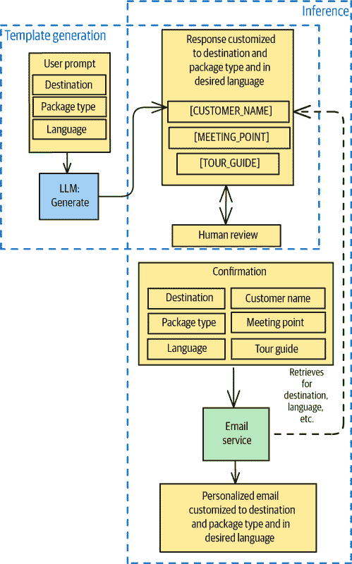
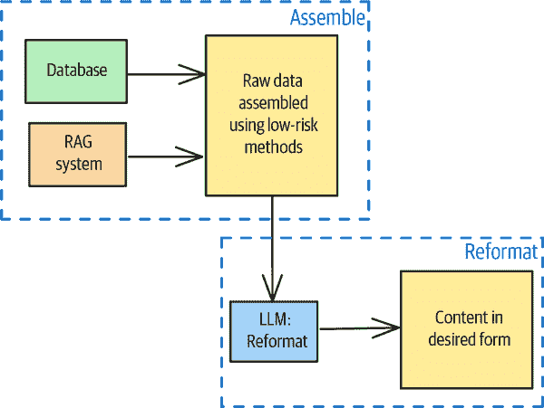
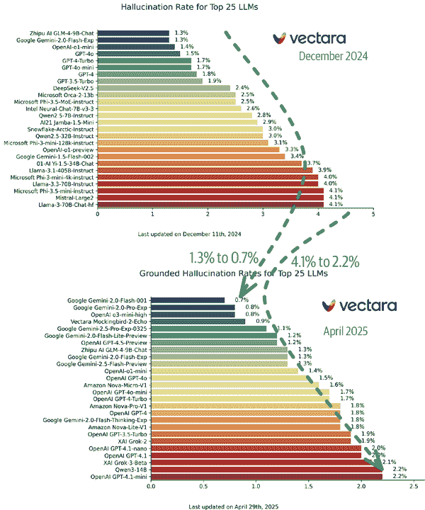
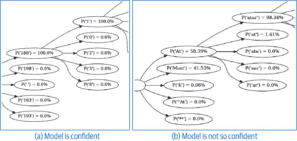
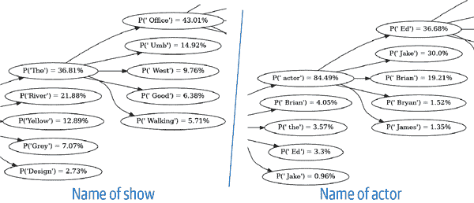
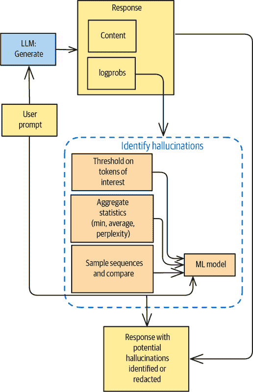
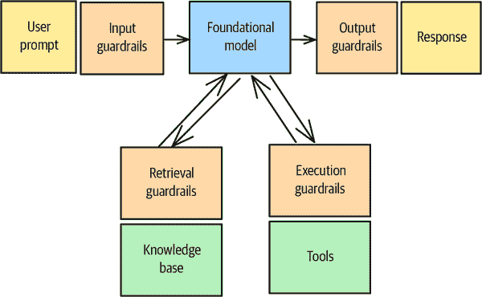

# 第 9 章 设置安全防护

GenAI 应用总是存在一定程度的风险。这是因为它们构建在基础模型之上，而基础模型是一种非确定性技术，有可能提供不准确或幻觉式的答案。基础模型也是一种通用技术，因此它们的响应不一定总是符合你的期望。

在本章中，我们将讨论四种模式，它们可以帮助你为 GenAI 应用程序设置安全防护。**模板生成**（模式 29）适用于未经人工审核就发送内容的风险非常高、但人工审核又无法应对通信量的场景。**组装重排**（模式 30）适用于内容需要以吸引人的方式呈现、但动态生成内容所带来的风险过高的场景。**自我检查**（模式 31）可以帮助你以经济高效的方式识别潜在的幻觉。最后，**安全护栏**（模式 32）是一种包罗万象的方式，可以为你的核心 GenAI 应用设置防护，确保它们在合乎道德、法律和功能的参数范围内运行。

## 模式 29：模板生成

模板生成模式通过预生成可离线审核的模板，减少了需要人工审核的项目数量。在推理时，应用程序只需对已审核的模板执行确定性的字符串替换即可。这使得最终响应无需额外审核即可安全地发送给消费者。

### 问题

LLM 是一项强大的技术，但它们并非确定性的，因此其响应总存在不准确或有害的风险。

例如，假设你是一家旅行社运营商，正在为购买了旅行套餐的顾客生成感谢信。你希望这些感谢信个性化、可读性强，甚至可能支持多种语言。你很想使用 LLM 来生成这些信件，但你深知这将使你的品牌面临相当大的风险。如果信件中包含不当语言，或试图推销不当或有争议的物品，该怎么办？你可以增加人工审核步骤，但面对每天可能数千笔的订单，人工审核的成本会变得很高。

有没有一种方法既能使用 LLM 生成感谢信，又能避免每封信都要经过人工审核的开销呢？

### 解决方案

与其直接用 LLM 生成感谢信，不如使用 LLM 为感谢信生成模板（参见图 9-1）。这些模板可以由人工审核并适当编辑。你还可以使用少样本学习以及第 2 章到第 8 章中的许多模式，来确保生成的内容有据可依、符合你的品牌风格等，从而将编辑工作量降到最低。



*图 9-1. 模板生成：创建少量可经人工审核的模板，然后在推理时直接使用*

在推理时，应用程序只需将值填入模板并发送信件即可。由于这一过程是确定性的且受限的，在此阶段引入事实错误或不良内容的可能性极低。

### 示例

你经营一家旅行套餐公司，每次预订后不久，你都会以带队导游的名义发送一封个性化感谢信，因为这往往能减少取消订单的数量。[本示例的代码可在 GitHub 上获取](https://oreil.ly/AbUr1)。

#### 预生成循环

你可以为你提供的每种旅游目的地、套餐类型和语言组合，预生成模板化的感谢信，并将这些模板存储在数据库中以便快速检索：

```
DESTINATIONS=[
    "Toledo, Spain",
    "Avila & Segovia",
    "Escorial Monastery"
]
PACKAGE_TYPES=[
    "Family",
    "Individual",
    "Group",
    "Singles"
]
LANGUAGES=[
    "English",
    "Polish"
]
for dest in DESTINATIONS:
   for package_type in PACKAGE_TYPES:
      for lang in LANGUAGES:
          template = create_template(dest, package_type, lang)
          db.insert(dest, package_type, lang, template)
```

你的业务提供三个目的地、四种套餐类型以及两种语言的旅行产品。因此，你将生成 3 × 4 × 2 = 24 个模板。你可以通过提示一个基础模型来创建每个模板。

#### 生成模板

一些占位符（例如语言）将被预生成循环替换，但生成的模板中仍会包含像客户姓名这样的占位符。这些剩余的占位符需要在发送前被填充：

```
def create_template(tour_destination, package_type, language):
    prompt=f"""
    You are a tour guide working on behalf of Tours GenAI S.L. Write a 
personalized letter in {language} to a customer who has purchased a 
{package_type} tour package to visit {tour_destination}. Sound excited to see
them and lead them on the tour. Explain some of the highlights of what they will
see there and some of the things they can do while there. In the letter, use
[CUSTOMER_NAME] to indicate the place to be replaced by their name and
[TOUR_GUIDE] to indicate the place to be replaced by your name.
    """
    template = zero_shot(GEMINI, prompt)
    # ask humans to edit/confirm ...
    template = human_edit_confirm(template)
    return template
```

为一个西班牙托莱多英语之旅生成的模板可能如下所示：

> 亲爱的 `[CUSTOMER_NAME]`，
>
> 我非常激动地欢迎你来到托莱多！我是 `[TOUR_GUIDE]`，将担任你家庭之旅的导游。我非常高兴能向你及你的家人展示这座令人惊叹的城市。
>
> ...
>
> 这里提前预览一下等待你的精彩内容：
>
> * **宏伟的托莱多大教堂：** 一座哥特式建筑的杰作，定会让你叹为观止。
> * **托莱多城堡：** 一座坚固的要塞，可以饱览城市全景。
>
> ...
>
> 我期待与你和你的家人见面，并与你们分享我对托莱多的热情。准备好迎接一场难忘的冒险吧！
>
> 期待很快见到你，
>
> `[TOUR_GUIDE]`

另一方面，一封用于西班牙阿维拉和塞哥维亚之旅的波兰语信件可能这样开头：^(1)

> Szanowni Państwo, `[CUSTOMER_NAME]`!
>
> Z ogromną radością witam Państwa w imieniu Tours GenAI S.L.! Jestem `[TOUR_GUIDE]` i będę miał przyjemność być Państwa przewodnikiem podczas rodzinnej wycieczki do Avili i Segowii!

#### 推理

每当有旅行产品被购买，或确认了该次旅行的导游后，你的应用程序将调用电子邮件服务，并传入旅行详情。应用程序将从数据库中检索相应的模板，并用会话中的字符串替换占位符，从而获得邮件正文：

```
booked_tour = ...
template = db.retrieve(booked_tour.destination,
                       booked_tour.package_type,
                       booked_tour.language)
email_body = template.replace(
               "[CUSTOMER_NAME]", booked_tour.customer_name
             ).replace(
               "[TOUR_GUIDE]", booked_tour.tour_guide.name
             )
# send out email
```

### 注意事项

模板生成帮助你在生成内容的场景中，避免对每份内容进行人工审核所产生的成本和时间延迟。只要所需模板的数量是可管理的，它就能很好地工作。如果组合数量过多，请考虑**组装重排**（本章中的模式 30）。模板生成的另一个替代方案是使用**安全护栏**（本章中的模式 32），但这会显著增加工程复杂性。

您可以在广泛的个性化和定制场景中，将模板生成与机器学习（ML）结合使用。例如，您可以使用预生成的模板构建一组个性化落地页，然后利用 ML 来决定在特定营销活动或用户画像中采用哪些模板。对于个性化推荐，您可以使用传统推荐引擎来选择向用户展示哪些产品，并为该产品提取相应的预生成内容（图像和文本）。

如果您正在为不同的客户旅程定制网站，也可以采用这种将预生成与 ML 相结合的方法。在这种情况下，您可以预先生成落地页，并使用*倾向模型*（一种预测事件（如购买）发生可能性的 ML 模型）来选择下一个最佳行动。

### 参考

*邮件合并*是一项通过将主模板与独立来源的数据结合，为批量分发个性化文档或电子邮件的功能。它[可追溯至](https://oreil.ly/uf-fS)20 世纪 80 年代名为 WordStar 的文字处理器。在 2024 年，Valliappa Lakshmanan 在一篇关于[平衡创造性与风险](https://oreil.ly/h5lpl)的 GenAI 应用文章中，提出了使用 LLM 创建这些模板而非最终文档的想法。

## 模式 30：组装式重格式化

组装式重格式化通过将内容创建任务分解为两个低风险步骤，来降低内容不准确或产生幻觉的风险。第一步涉及使用低幻觉方法（如 OCR、RAG、工具调用（模式 21）和模板生成（模式 29））来组装原始数据。第二步涉及使用 LLM 对组装后的内容进行重格式化，因为改写和总结等任务相对不太可能引入不准确信息。

### 问题

假设您正在为电子商务网站创建产品目录。产品目录需要对潜在买家和搜索引擎都具有吸引力。网站上有成千上万的产品页面，因此您希望使用 LLM 来生成目录的网页。

在这种情况下，幻觉或不准确内容会带来什么风险？例如，如果 LLM 生成的相机目录页面（该相机配有锂电池）写着电池是碱性电池，您将公司置于何种风险等级？锂电池不允许放入托运行李，因为它们可能在密闭空间中引发无法控制的火灾。如果您网站上的相机在飞机货舱中引燃或助长火灾怎么办？如果航空公司因为乘客行李中有易燃物品而拒绝其登机怎么办？我们希望您同意，这个看似简单的电池类型错误所带来的风险相当高，因此对于这个用例来说，动态生成风险过高。

有没有一种方法既能获得 LLM 生成的益处，又不会承担 LLM 可能引入不准确或幻觉信息的风险？

### 解决方案

组装式重格式化模式在以下情况下有效：您能够识别产品中若产生幻觉则会带来不可接受风险的特征，并且您可以使用低风险方法（例如从数据库读取或使用文档数据提取系统）来组装这些特征。

通过将所有对应于产品属性的文本附加在一起，或将它们放入某个预定义结构中来创建最终结果，所生成的文本是准确的，但读起来不太令人愉悦。

一旦您获得了这段准确的文本，将其放入提示的上下文中，并让 LLM 重新措辞、改写或重格式化（参见图 9-2）。由这些 LLM 任务生成的文本，其风险往往远低于从头生成的文本，且生成的文本将更加流畅，更符合该内容的用途。



###### 图 9-2. 组装式重格式化通过将任务分解为两个低风险步骤，降低了与内容创建相关的风险

### 示例

对于产品目录案例（[完整代码在 GitHub 上](https://oreil.ly/47nBo)），您可以将要收集的原始数据定义为一个数据类：

```
@dataclass
class CatalogContent:
    part_name: str = Field("Common name of part")
    part_id: str = Field("unique part id in catalog")
    part_description: str = Field("""One paragraph description of part, which is 
one of the parts of a paper machine, explaining its purpose.""")
    failure_modes: list[str] = Field("""list of common reasons why customer might
need to replace this part.""")
    warranty_period: int = Field("""number of years that the part is under 
warranty""")
    price: str = Field("price of part")
```

您可以，从数据库中检索零件名称、ID、保修期和价格，但从设备手册中获取零件描述和失效模式（见上述斜体文本）。如果您使用 LLM 进行此类数据提取，请使用较低的温度，可能是 0.1 或 0，以降低不准确的风险。

对于一个用于造纸机器的名为*湿端*的零件，目录内容可能如下所示：

```
CatalogContent
part_name='wet_end'
part_id='X34521PL'
part_description='The wet end of a paper machine is the section where the paper 
web is formed. It is arguably the most important section of the machine.'
failure_modes=['Web breaks', 'Uneven sheet formation', 'Poor drainage'], 
warranty_period=3
price='$23295'
```

从可信来源提取的失效模式已用斜体标出。通过将后续生成基于这三种失效模式，LLM 将始终包含关于这三个问题的注意事项，并且也不会包含造纸机制造商可能不希望公开的其他失效模式。

一旦您获得了提取的内容，您可以将其传递给一个更具创造性的写作引擎，该引擎将对其进行重格式化以满足您的期望目标，例如搜索引擎优化和/或对潜在买家具有说服力。


# 替换零件：湿端正品备件

编写 Markdown 格式的内容，这些内容将放在制造商网站的"替换零件"部分。为图片包含一个占位符，并包含图片描述。针对 SEO 优化内容。同时使其对潜在买家具有吸引力。

**零件信息：**

`{item}`

生成的文本利用了关于这三个"可接受"失效模式的信息，以说明您可能想要购买该零件的原因：

湿端是奇迹发生的地方——纸幅的初步形成。功能不良的湿端可能导致一系列问题，包括：

- **断纸（Web Breaks）：** 频繁断纸是停机时间和物料浪费的主要来源。
- **纸幅成形不均（Uneven Sheet Formation）：** 纸幅成形不一致会导致纸张质量降低，并可能引起客户投诉。
- **排水不良（Poor Drainage）：** 排水效率低下会降低机器速度并增加能耗。

投资购买湿端的正品替换零件，就是对您造纸生产整体效率和质量的投入。

---

# 组装式重排与自检模式

## 组装式重排

### 注意事项

尽管两个步骤（组装和重格式化）风险较低，您仍应验证结果。例如，如果可能，请用两种方式提取数据，看看是否能得到相同的结果。您也可以使用模式 31，自检（我们接下来会介绍），来达到此目的。同样，即使重格式化风险较低，您也应验证生成的内容是否保留了不应被幻觉化的原始数据。为此，您可以使用模式 17，LLM 作为评审。

如果你正在考虑使用组装式重排，请先考虑模式 29"模板生成"是否适合你的需求——它能够审查所有模板，提供额外的保障。只有在无法使用模板生成的情况下，才应选择组装式重排，也许是因为你的内容项数量多到人类无法逐一审查。

组装式重排方法适用于内容相对静态的网页（如产品目录页面）。然而，如果你想根据用户的旅程或画像来定制页面（如营销落地页），内容就需要更加动态化。为此，你需要使用模板生成。

### 参考资料

组装式重排由 Valliappa Lakshmanan 于 2024 年在[一篇关于在 GenAI 应用中平衡创造力与风险的文章](https://oreil.ly/h5Lpl)中提出。

---

## 模式 31：自检

自检模式利用词元概率来检测 LLM 响应中的幻觉。你可以将其作为一种保护措施，防止 LLM 对事实性查询给出低置信度的答案。

### 问题

当 LLM 生成不正确、无意义或虚构的内容，且这些内容与现实世界或输入上下文不一致时，我们称这种生成响应为*幻觉*。幻觉之所以发生，是因为 LLM 本质上只是统计性的词元生成器。它们并不理解自己生成内容的含义；在缺乏真实知识的情况下，它们生成的响应可能在事实上并不正确。

随着 LLM 提供商不断改进训练数据的覆盖范围和方法论，常见任务和查询的幻觉率已稳步下降。例如，[Vectara 测量了](https://oreil.ly/52Bx0)排名前 25 的 LLM 在文本摘要任务中的幻觉率，如图 9-3 所示。2024 年 12 月，表现最好的 LLM 幻觉率为 1.3%，排名第 25 的 LLM 幻觉率为 4.1%。当 Vectara 在 2025 年 4 月对同一任务进行相同测量时，幻觉率全面下降了 40%至 50%——最好的 LLM 幻觉率现在为 0.7%，排名第 25 的为 2.3%。



**图 9-3. 幻觉率正在下降（[图片](https://oreil.ly/Muubt)来自 Vectara）**

然而，在更具约束性或更复杂的情况下，幻觉仍然是一个问题。例如，假设你使用 LLM 从图像中提取数字，但其中一张图像模糊不清。如果你将响应约束为数字（参见模式 2：语法），你得到的将是一个幻觉数字。

图像模糊的情况很容易理解，但即使输入完美无瑕，问题依然存在。在撰写本文时，从图像中提取字段的准确率约为 90%至 97%。这意味着，从发票、收据等中提取的数字中有 3%至 10%是幻觉！此外，如果你将数据提取的输出作为其他 LLM 调用的输入上下文，即使你已有错误检测和纠正机制，出错的可能性也会不断累积。你的 LLM 调用链越复杂，LLM 响应出现幻觉的可能性就越大。

有没有办法判断 LLM 是否在产生幻觉？假设你有三个 LLM，它们在互不重叠的数据集上以非常不同的方式训练。你可以用这三个 LLM 生成响应并比较它们的响应。当响应不一致时，极有可能存在幻觉——尽管可能不清楚正确答案是什么，但至少你知道存在潜在问题。那么，直观来看，你可以利用 LLM 响应的变异性来识别潜在的幻觉问题点。

然而，前沿模型的训练数据集重叠度相当高，因此很难找到三个这样的非重叠 LLM。此外，使用多个 LLM 进行推理会使成本成倍增加。有没有办法通过查看 LLM 的响应来识别潜在的幻觉问题点？

### 解决方案

正如我们在第 1 章和第 2 章中所讨论的，许多 LLM 在提供生成的词元时，还会提供这些词元的*logprobs*（也称为*logits*）。根据 logprobs，你可以按如下方式计算某个特定词元成为正确词元的概率：

*e*^(*l**o**g**i**t*)

在生成的词元占据压倒性优势的情况下，这个概率会接近 100%。在存在多种可能性的情况下（参见图 1-5），"胜出"词元成为正确词元的概率会较低。

#### 请求并处理 logprobs

你可以让 OpenAI 在返回响应文本的同时返回每个词元的 logprobs。下面的代码还会请求每个步骤中排名前五的候选词元（该代码[在 GitHub 上](https://oreil.ly/gX27t)）：

```
message = client.chat.completions.create(
        model="gpt-3.5-turbo",
        messages=[
            ...
        ],
        logprobs=True,
        top_logprobs=5
    )
```

然后，你可以按如下方式检索并处理响应消息的三个请求组件：

```
response_text = message.choices[0].message.content
logprobs = message.choices[0].logprobs
for token_info in logprobs.content:
   token = token_info.token
   logprob = token_info.logprob
   probability = math.e ** logprob
   if token_info.top_logprobs:
      for alt_token in token_info.top_logprobs:
          if alt_token.token != token:
             alt_probability = math.e ** alt_token.logprob
```

#### logprobs 如何表现

假设你向 GPT-3.5 询问土耳其共和国的创始人：

> Ataturk 出生于哪一年？请用一句话回答。

模型回答如下：

> Ataturk 出生于 1881 年。

年份 1881 由两个词元表示：*188*和*1*。它们的概率如图 9-4a 所示。如你所见，模型对这个答案相当有把握。其他候选，比如他出生于 1980 年代、1830 年代或 1930 年代，其概率都接近于零。

这并不意味着所有低概率都值得怀疑。句子开头候选词元的概率如图 9-4b 所示。



**图 9-4. (a) 与生成答案年份部分对应的词元概率——(b) 与答案起始部分对应的词元概率，此处存在多种可能性**

为什么*At*这个词元的概率只有 58%？下一个候选是*Must*，这给了我们一条线索。下面也是这个问题的正确答案：

> Mustafa Kemal Atatürk 出生于 1881 年。

姓氏中*u*上方的变音符号也解释了为什么第二个位置上的第二候选词元是*at*——它为变音符号作为该名字的第三个词元出现留下了空间。^(2)

我们希望以上内容能让你深入了解，当模型充满信心时以及存在多种替代续写时，logprobs 会有怎样的表现。

#### 低置信度的答案

现在，让我们来看一个模型产生幻觉的情形。这里我们特意使用一个较老的模型，希望它尚未被修复以处理这种幻觉错误。

我们向 GPT-3.5-turbo 提出以下问题：

> 约翰·科尔·霍华德是谁？请用一句话回答。

模型回答如下：

> 约翰·科尔·霍华德（John Cole Howard）是电视剧《办公室》（***The*** *Office*）中的虚构角色，由演员**埃德**·赫尔姆斯（**Ed** Helms）饰演。

那些尽管未达到 50% 概率仍被选中的 token 是 *The* 和 *Ed*（在上一段回答中以粗体标出，见图 9-5）。



**图 9-5. 低置信度 token 的 Logprobs**

这可能是因为埃德·赫尔姆斯在《办公室》中饰演的角色是安迪·伯纳德（Andy Bernard），而并没有一个叫约翰·科尔·霍华德的名人。因此，节目名称和演员姓名的概率都很低：模型此时基本是在猜测。

### 识别幻觉

鉴于模型在需要从许多同等可能的选项中做选择时，会以较低的 `logprobs` 值生成 token，你可以对 `logprobs` 设置阈值，并将低概率用作潜在幻觉的指标。不过，你需要注意误报问题。正如阿塔图尔克（Atatürk）的示例所示，一个正确的答案完全有可能包含某些低概率的 token。

有几种方法可以用来减少误报（另见图 9-6）：

**识别关键 token**

为了减少误报，你可以只关注检查特定 token 上的 `logprobs`。当你在生成结构化输出时，这通常是可行的，因为可以确定关键值的位置来验证，然后只检查这些 token 的 `logprobs`。我们会在下面的"示例"部分中对此进行说明。

**对生成的序列进行采样**

另一种减少误报的方法是：每当遇到低概率 token 时，采用序列生成的方法（参见第 2 章中的"模式 1：Logits 掩码"，了解序列生成的详细讲解）。其思路是，你可以生成多个序列，并验证它们对答案是否一致。

在阿塔图尔克示例中，尽管句子开头可能不同，但两次生成对他的出生年份是 1881 年这一点应会达成一致。你可以通过比较两次生成的嵌入来判断答案是否实质相同。

**对所有 token 的统计数据进行归一化**

对于较长的答案，计算总体统计数据可能会低估（就平均值而言）或高估（就最小值而言）幻觉的可能性。一种能对不同长度序列的 logits 进行归一化的汇总统计量是[`perplexity`](https://oreil.ly/9e_pN)（困惑度），其定义如下：

$perplexity = e^{-\frac{1}{N}\Sigma_{i}^{N}logits_{i}}$

也就是说，困惑度是模型正在选择的候选项数量。困惑度越低，模型对生成的序列就越有信心。

**构建一个机器学习模型**

你可以将特定 token 的概率、生成序列嵌入之间的距离、汇总及归一化统计量以及上下文特征作为输入特征，输入到一个针对你的数据和特定用例训练的机器学习模型中，用于检测幻觉。

使用定制化的机器学习模型是最稳健的方法，因为它建立在这所有方法的基础之上。



**图 9-6. 使用自检机制检测幻觉**

### 示例

假设你正在编写一款软件，用于处理餐厅的签名收据。这家餐厅所在的国家/地区有给小费的习俗，并且餐厅用餐需要纳税，因此你需要从每张收据中提取四个数字：账单金额、税额、小费和总金额。

假设你的提取代码返回以下四个值：

> 312.32,28.76,60,401.08

如果你能提取全部四个数字，那么总金额就充当了*校验和*——你可以根据其他三个数字计算出总金额，从而确认提取的数值完全正确。

但假设你只能提取出三个数字（也许第四张图片模糊不清了），得到的提取结果是：

> 312.32,28.76,,400

你希望 LLM 补全无法提取的那个数字，这可以通过提示词来实现（完整代码在 [GitHub](https://oreil.ly/8eNMf) 上）：^(3)

> 你是一个乐于助人的 AI 助手，专门帮助解析餐厅收据。
>
> 我会给你一组已解析的值，每行包含以下内容：
>
> `billed_amount`, `tax`, `tip`, `paid_amount`
>
> 如果 `tax` 缺失，则将其计算为 `billed_amount` 的 9.21%。
>
> 如果 `tip` 缺失，则将其计算为 `(paid_amount - billed_amount - tax)`。
>
> 如果 `paid_amount` 缺失，则将其计算为 `(billed_amount + tax + tip)`。
>
> 不要添加任何标题或解释。

你可以按如下方式解析 LLM 返回的结果：

```
parse_result(response_text=message.choices[0].message.content, 
             logprobs=message.choices[0].logprobs)
```

内容可以解析为 Pandas `DataFrame`：

```
def parse_result(response_text, logprobs) -> pd.DataFrame:
   csv_file = StringIO(response_text)
   result_df = pd.read_csv(csv_file, header=None, 
                  names=['billed_amount', 'tax', 'tip', 'paid_amount'])        
```

模型会随内容一起返回 `logprobs`。你可以将返回的每个 token 关联到它所在的行，并据此计算该行置信度最低的 token：

```
line_no = 0
confidence_of_line = 1.0
last_col_no = len(result_df.iloc[0]) - 1
for token_info in logprobs.content:
    token = token_info.token
    logprob = token_info.logprob
    probability = (2.718281828459045 ** logprob)
    confidence_of_line = min(confidence_of_line, probability)
    result_df.iloc[line_no, last_col_no] = confidence_of_line
    if '\n' in token: # next line
       line_no = line_no + 1
       confidence_of_line = 1.0
```

让我们试一试。假设你向 LLM（此处使用的是 OpenAI 的 GPT-4o-mini）发送以下数据：

> 312.32,28.76,60,401.08
>
> 312.32,28.76,,400
>
> 312.32,28.76,60,
>
> 312.21,,50,
>
> 312.43,,,400
>
> 300,27.63,60,387.63

你可能会得到表 9-1 中显示的 Pandas `DataFrame`：

**表 9-1. GPT-4o-mini 生成的 Pandas `DataFrame`**

| `billed_amount` | Tax | Tip | `paid_amount` | 置信度 |
| --- | --- | --- | --- | --- |
| 312.32 | 28.76 | 60.0 | 401.08 | 0.962668 |
| 312.32 | 28.76 | 60.0 | 400.00 | 0.551552 |
| 312.32 | 28.76 | 60.0 | 400.08 | 0.562172 |
| 312.21 | 28.84 | 50.0 | 391.05 | 0.172516 |
| 312.43 | 28.80 | 60.0 | 401.23 | 0.170295 |
| 300.00 | 27.63 | 60.0 | 387.63 | 0.999290 |

请注意，在最后一列中，置信度*仅*在没有任何缺失值需要补全的两行中较高。仅需补全一个值的两行，置信度为中等（约 0.55）；而需要补全两个值的两行，置信度则较低（0.17）。

你可以仅通过查看置信度值，就能识别解析表中哪些行存在问题。确实，如果你计算 `paid_amount` 中的校验和误差，没有误差的行的置信度高于 0.9。在一个以受限方式生成数千个 token 的复杂链路中，你可以利用生成 LLM 自身的置信度分数来识别可能有问题的输出。

### 注意事项

一种比自检更简单的方法，在许多情况下也非常有效，就是明确地给模型一个"退路"。例如，你可以让模型在遇到超出其训练数据范围的问题时回答"我不知道"。在生成结构化输出时（参见模式 2：语法），你可以将某个字段建模为联合类型，其中一个备选值是模型不知道：

```
currency_rate: float | Literal["Unknown"]
```


自检在识别 RAG 中的不一致数据时极为有用。如果两个检索到的文本块相互矛盾，生成的响应将包含`logprobs`，表明存在两条可能的生成路径。无论选择了哪一条，你都可以查看`logprobs`来识别可能存在问题的答案。当然，存在两条路径并不意味着一定有冲突——两条路径也可能得出相同的答案。你可以使用“解决方案”一节中详细介绍的更为稳健的方法来限制误报的数量。

正如第 2 章中“模式 1：Logits 掩码”一节的“注意事项”小节所讨论的，并非所有模型都提供对其`logprobs`的访问。

### 参考文献

[Manakul、Liusie 和 Gales（2023）](https://arxiv.org/abs/2303.08896)提出了利用`logprobs`进行幻觉检测的想法。他们使用序列生成，将检测器命名为`SelfCheckGPT`，并建议在专有 LLM 本身不提供`logprobs`时，使用单独的 LLM 专门生成`logprobs`。[Quevedo 等人（2024）](https://arxiv.org/abs/2405.19648v1)在 LLM 输出的词元概率上训练了一个 ML 分类器来检测幻觉。[Valentin 等人（2024）](https://arxiv.org/abs/2407.21424v1)比较了使用`logprobs`检测幻觉的各种方法。

## 模式 32：护栏

*护栏*是代码层，对 LLM 的输入、输出、上下文和工具参数进行操作，以保护 LLM 免受恶意行为者攻击，并确保其在允许的参数范围内运行。

### 问题

在构建 AI 应用时，你通常需要确保它们在特定的伦理、法律和功能参数范围内运行。例如，你可能需要在以下方面保护你的 AI 应用：

- **安全性**：保护你的 AI 系统免受恶意输入的攻击，通常需要你防范提示注入攻击和越狱（jailbreaking）。提示注入利用了一个事实：LLM 将系统提示和用户输入都视为文本，这使得模型很难区分合法指令和恶意命令。提示注入可能是直接的，攻击者将恶意提示直接提供给 LLM；也可能是间接的，攻击者将载荷隐藏在 LLM 消费的数据中。例如，[卡内基梅隆大学的研究人员](https://oreil.ly/6B-jC)在 2023 年发现，看似随机字符的后缀可能导致 LLM 表现出意想不到的行为。

- **数据隐私**：你需要防止 AI 系统无意中暴露敏感信息，例如个人身份信息（PII）、商业机密或机密内容。如果这些敏感信息出现在 AI 系统的训练数据或用户输入的缓存版本中，[就可能发生](https://arxiv.org/abs/2402.01822v1)这种泄露。暴露敏感数据可能导致隐私泄露和潜在的法律问题。

- **内容审核**：你通常需要过滤用户输入和模型输出中的有害、有毒或不适当内容。在面向内部的应用程序中，这可能不如在面向公众的应用程序中那么必要。LLM 可能生成或响应包括仇恨言论、暴力、色情材料或其他有害内容的内容，从而可能对用户造成伤害或损害品牌声誉。

- **幻觉**：你可能需要确保 LLM 的输出准确、真实，并以可靠信息为依据。LLM 可能生成听起来合理但实际上不符合事实的信息。在准确性至关重要的应用中，例如科学、新闻、医疗、法律和金融领域，这可能尤其成问题。

- **对齐**：你可能需要确保 LLM 的输出符合特定的指南、公司政策或伦理原则。例如，你的组织可能要求所有公司通信都遵循其特定的政策、指南和品牌风格，或者要求输出避免提及竞争对手或政治、宗教等话题。你也可能在一个施加道德边界的司法管辖区或行业中运营，以防止偏见和歧视，并确保不同人口群体之间的公平。

虽然这些因素很重要，但你不会希望在应用程序代码中到处散布安全、隐私和内容检查。庞大的错误处理面将难以维护和执行。你能在保持较低维护开销的同时，在所有这些方面保护你的 AI 应用吗？

### 解决方案

通过护栏模式，你可以在基础模型与输入、输出、知识库和工具之间的对话流程中的不同点实现一层护栏，以提供全面保护（参见图 9-7）。



###### 图 9-7. 护栏是插入的层，用于保护所有进入和离开 LLM 的输入和输出

护栏涉及对进入模型的信息进行预处理，和/或对模型的输出进行后处理。该处理可能涉及修改输入或输出以纠正错误，或者直接拒绝它。

#### 预置护栏

一些 LLM 具有内置的安全功能，你可以在通过其 API 调用模型时启用这些功能。例如，在 Gemini 上，你可以使用以下代码阻止生成仇恨言论：

```
response = client.models.generate_content(
    model="gemini-2.0-flash",
    contents=[prompt, media, ...],
    config=types.GenerateContentConfig(
      safety_settings=[
        types.SafetySetting(
            category=types.HarmCategory.HARM_CATEGORY_HATE_SPEECH,
            threshold=types.HarmBlockThreshold.BLOCK_LOW_AND_ABOVE,
        ),
      ]
    )
)
```

诸如 [NVIDIA 的 NeMo](https://oreil.ly/JLZ_G)、[Guardrails AI](https://oreil.ly/OnrfD) 和 [LLM Guard](https://oreil.ly/-qfoe) 等框架为常见功能提供预置护栏，例如检查越狱、屏蔽输入中的敏感数据以及检测幻觉。

例如，下面演示如何使用 LLM Guard 扫描提示中的有毒语言：

```
from llm_guard.input_scanners import Toxicity

scanner = Toxicity(threshold=0.5, match_type=MatchType.SENTENCE)
sanitized_prompt, is_valid, _ = scanner.scan(prompt)
```

该扫描器接收字符串输入，返回输入的净化版本（例如，对于对 PII 进行脱敏的护栏很有用），并决定该输入是否应被允许。

防范提示注入的方式与此非常类似：

```
scanner = PromptInjection(threshold=0.5, match_type=MatchType.FULL)
sanitized_prompt, is_valid, _ = scanner.scan(prompt)
```

在这两种情况下，框架都使用后训练的小语言模型（SLMs）来执行任务。对于毒性检测，它使用 [`unitary/unbiased-toxic-roberta`](https://oreil.ly/Znrlr) 库；对于提示注入检测，它使用 [`ProtectAI/deberta-v3-base-prompt-injection-v2`](https://oreil.ly/oz6gO) 库。

然而，LLM Guard 还支持拒绝与正则表达式匹配的字符串：

```
scanner = Regex(
    patterns=[r"Bearer [A-Za-z0-9-._~+/]+"],  # List of regex patterns
    is_blocked=True,  # If True, patterns are treated as 'bad'   
    match_type=MatchType.SEARCH,  # Can be SEARCH or FULL_MATCH
    redact=True,  # Enable or disable redaction
)
sanitized_prompt, is_valid, risk_score = scanner.scan(prompt)
```

#### 自定义护栏

你可以通过在自己的代码中实现逻辑、提示基础模型，或对 SLM 进行后训练来构建自定义护栏。下面是一个护栏示例，演示如何使用模式 17（LLM 作为裁判）来拒绝涉及特定主题的提示：

```
banned_topics = [
        "religion", "politics", "sexual innuendo"
]
system_prompt=f"""
I will give you a piece of text. Check whether the text touches on any of these 
topics.
        
        {banned_topics}
        
Return True or False, with no preamble or special markers.
Text:
"""
llm = ...
response = llm.complete(prompt).text.strip()
is_valid = (response == "False")
```

#### 应用一组护栏

一旦你拥有了一组护栏，就可以依次应用它们：

```
def apply_guardrails(guardrails, prompt):
sanitized_prompt = prompt # initial
for scanner in guardrails:
   sanitized_prompt, is_valid, _ = scanner(sanitized_prompt)
   if not is_valid:
      raise Exception("...")
return sanitized_prompt
```

将护栏应用于输出、检索或工具参数的方式与此类似。

### 示例

让我们以一个 RAG 系统为例，该系统旨在根据简·奥斯汀的作品来回答问题。（[完整代码](https://oreil.ly/dlcOf) 在 GitHub 上。）

假设你向 RAG 系统提出如下问题：

> 你能在不招致反感的情况下给出建议吗？

你会得到类似这样的回答：

> 是的，在不招致反感的情况下给出建议是可能的。文中展示了一个例子……被描述为“在这一点上给出建议而不招致反感的绝佳实例。”

> 

> 然而，提供建议的方式似乎很重要。在另一个例子中……

#### 实现护栏

假设你希望系统防止用户向你发送个人身份信息（PII）。你希望提示中的任何专有名称都被替换为通用标识符，你可以通过自定义护栏来实现这一点：

```
def guardrail_replace_names(to_scan: str):
    llm = ...
    system_prompt="""
I will give you a piece of text. In that piece of text, replace any personal 
names with a generic identifier.
        
Example:
          Input:
            I met Sally in the store.
          Output:
            I met a woman in the store.
        
Return only the modified text, with no preamble or special markers.
    """
    sanitized_output = llm.complete(system_prompt + "\n" + to_scan).text.strip()
    no_change = (sanitized_output == to_scan)
    
    return {
        "guardrail_type": "PII Removal",
        "activated": not no_change,
        "should_stop": False,
        "sanitized_output": sanitized_output,
    }
```

类似地，你可以使用以下代码拒绝任何涉及一组被禁止主题的提示。（这里使用 LLM 来实现护栏）：

```
def guardrail_banned_topics(to_scan: str):
    banned_topics = [
        "religion", "politics", "sexual innuendo"
    ]
    llm = ...
    system_prompt=f"""
I will give you a piece of text. Check whether the text touches on any of these 
topics.
        
        {banned_topics}
        
Return True or False, with no preamble or special markers.
Text:
    """
    response = llm.complete(system_prompt + "\n" + to_scan).text.strip()
    is_banned = (response == "True")
   
    return {
        "guardrail_type": "Banned Topic",
        "activated": is_banned,
        "should_stop": is_banned,
        "sanitized_output": to_scan,
    }
```

为了更方便地应用多个护栏，你所有的护栏函数都应具有相同的签名。

#### 包装查询引擎

你可以使用一组护栏来包装`LlamaIndex`提供的查询引擎：

```
class GuardedQueryEngine(RetrieverQueryEngine):
    def __init__(self, query_engine: RetrieverQueryEngine):
        self._query_engine = query_engine
    
    def query(self, query):
        # apply guardrails to inputs
        gd = apply_guardrails(query,
                 [guardrail_replace_names, guardrail_banned_topics])
        if not gd["should_stop"]:
            print(f"Modified Query: {gd['sanitized']}")
            query_response = self._query_engine.query(gd["sanitized"])     
            gd = apply_guardrails(str(query_response), 
                                  [guardrail_banned_topics])
            if not gd["should_stop"]:
                return Response(gd["sanitized"],
                               source_nodes=query_response.source_nodes)
        return Response(str(gd))
```

包装版本会将一组护栏应用于输入，然后将净化后的提示传递给原始查询引擎。接着，它会对响应应用另一组护栏，并且仅在输入和输出都未被阻止时才返回响应。

由于宗教是被禁止的主题之一，RAG 系统会拒绝回答以下问题：

> 教区牧师是否应该成为榜样？

由于专有名称需要被编辑，以下查询在发送给 LLM 之前必须进行修改：

> 如果达西先生不富有，他还会是一个有吸引力的婚配对象吗？

修改后的版本如下：

> 如果一个男人不富有，他还会是一个有吸引力的婚配对象吗？

### 注意事项

护栏会为你的应用架构引入相当大的工程复杂性和延迟。你选择实现 GenAI 应用的最复杂方式，可能是将它与自定义的后训练护栏一起部署，因此请确保这种复杂性是值得的。也许有成本更低的方式可以防范你所担心的关键风险。

尽管示例中的护栏是通过调用前沿模型 API 来实现的，但情况未必如此：可以使用 SLM 将延迟保持在可控范围内。

没有必要按顺序运行护栏和 LLM 代码——例如，你可以将输入和/或检索护栏与传入请求[并行](https://oreil.ly/Vhh43)运行，以避免拖慢用户的请求：

```
try:
input_guardrail_results, turn_result = await asyncio.gather(
    apply_guardrails(
        ...
    ),
    llm.complete(
        ...
    ),
)
except InputGuardrailTriggered:
...
```

如果输入护栏检测到不允许的用法，它应该抛出一个错误，这将使第二个调用停止继续执行。当然，如果你这样做，LLM 并不会因执行该调用而受到保护——相反，你关注的只是保护应用程序，使其不使用恶意输入的结果。

安全性、可用性和性能之间存在固有的权衡。更严格的护栏可能会降低模型能力或增加延迟，而攻击者只要付出足够的努力，就能绕过即使是最复杂的护栏。由于攻击技术也在不断演变，你必须将护栏视为安全措施与绕过方法之间持续进行的军备竞赛。鉴于这一现实，值得将护栏视为 AI 应用外围的一层包装，每隔几个月就更换一次。与其费尽心思构建高度定制的护栏，不如构建那些可以轻松迁移到新框架或与模型无关的护栏。


策略是持续更新一个评估数据集，其中包含你想要防范的情景以及你愿意容忍的最大延迟。然后，定期测试市面上可用的护栏系统，并在必要时更换底层框架和模型。

### 参考资料

[Dong 等人（2024）](https://arxiv.org/abs/2402.01822v1) 解释了为什么针对护栏的单点解决方案不起作用，以及为什么需要采用综合性方法。OWASP 安全项目[对提示注入场景进行了分类](https://oreil.ly/QysVR)。

QED42 围绕一家法律机构的 LLM 驱动搜索应用，构建了[基于提示的护栏](https://oreil.ly/gvXPR)，其中包含策略、异常和少样本示例。这些护栏过滤掉了域外（非法律）的查询输入，并确保输出具有相关性。Acrolinx 使用以 LLM 作为评判者（LLM-as-Judge）实现的 AI 护栏，以[在各类内容中保持品牌语气的一致性](https://oreil.ly/UH_Vu)。

## 总结

在本章中，我们探讨了在 AI 应用中实现安全机制的四种模式，并解决了有关安全性、数据隐私、内容审核、幻觉预防和伦理对齐的关键问题。表 9-2 总结了这些模式。

表 9-2. 能力培养模式

| 模式 | 问题 | 解决方案 | 使用场景 |
| --- | --- | --- | --- |
| **模板生成** **（模式 29）** | 未经人工审核就发送内容的风险非常高，但人工审核无法扩展到通信量的规模。 | 预生成事先经过审核的模板。推理时只需进行确定性的字符串替换，因此可以安全地直接发送给消费者。 | 企业对消费者（B2C）场景中的个性化通信 |
| **组装重排（模式 30）** | 内容需要以有吸引力的方式呈现，但动态生成内容带来的风险太高。 | 通过将内容创建任务拆分为两个低风险步骤——首先以低风险方式组装数据，其次基于这些数据格式化内容——来降低生成不准确或幻觉内容的风险。 | 需要以有吸引力的方式呈现准确内容的情况，例如产品目录 |
| **自检（模式 31）** | 您需要以经济高效的方式识别潜在的幻觉。 | 使用 token 概率来检测 LLM 响应中的幻觉。 | 任何需要事实性（而非创造性）响应的场合 |
| **护栏（模式 32）** | 您需要针对安全性、数据隐私、内容审核、幻觉和对齐的保障措施，以确保 AI 应用在伦理、法律和功能参数范围内运行。 | 用一层代码包装 LLM 调用，对进入模型的信息进行预处理和/或对模型的输出进行后处理。知识检索和工具使用也需要受到保护。 | 任何您的应用可能受到恶意对手攻击的场合 |

^(1) 我们请一位以波兰语为母语的人校对了这份模板，她说这个模板相当不错。模板使用了 *Szanowni Państwo*，这是一种相当正式且非常适合更昂贵的旅游套餐的复数形式。不过，她说她会从两方面修改模板。首先，波兰语有语法性别，因此根据替换 `[TOUR_GUIDE]` 的内容，动词 *mieć*（拥有）必须以阳性形式 *miał* 或阴性形式 *miała* 出现。其次，对波兰受众来说，感叹号太多了。这证明了该模式的必要性——修复一个模板比审核数千封生成的信件更容易。

^(2) 从 token 概率可以合理推断，在 OpenAI 训练其模型所使用的关于这位土耳其政治家的文档中，有 98.4% 省略了他名字中的变音符号。这种训练数据泄露可能就是某些专有模型拒绝提供 `logprobs` 的原因。如果只有一篇文档曾以带变音符号的方式拼写他的名字，那就可以证明该文档被用于训练模型，即使生成的响应中从不包含变音符号。

^(3) 这是一个有点刻意构造的例子。你不会用 LLM 来做数学计算。相反，你会用计算器工具来武装 LLM（参见第 7 章中的工具调用\[模式 21\]）。不过，其他类型的生成也会产生类似的效果，只不过 LLM 响应的不确定性会使本书中的演示变得困难得多。使用这个刻意构造的例子还让我们能够自动评估 LLM 结果的正确性。
