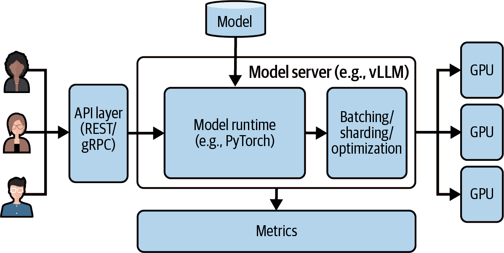
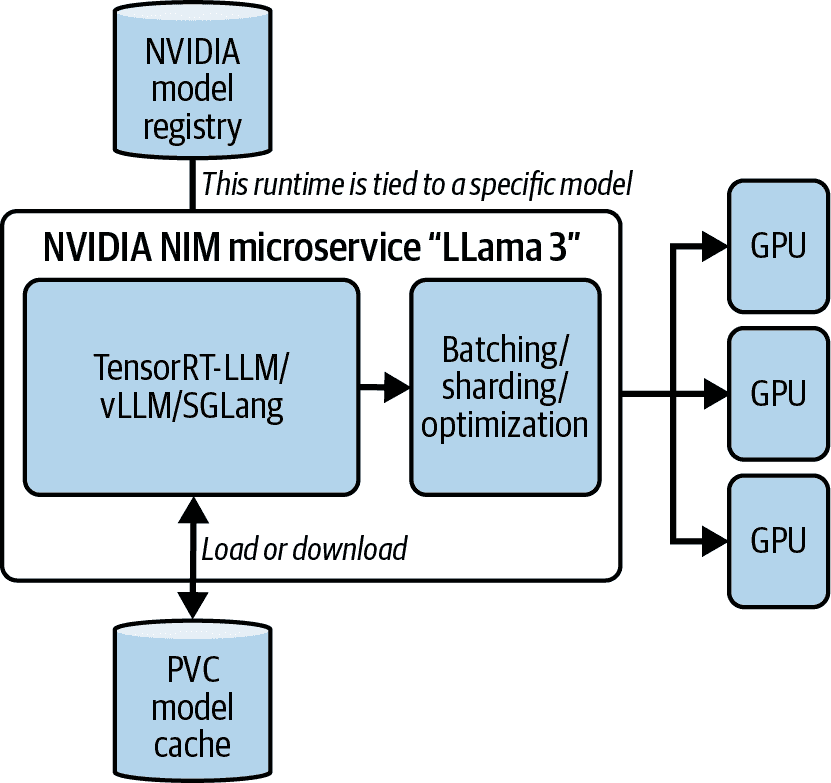
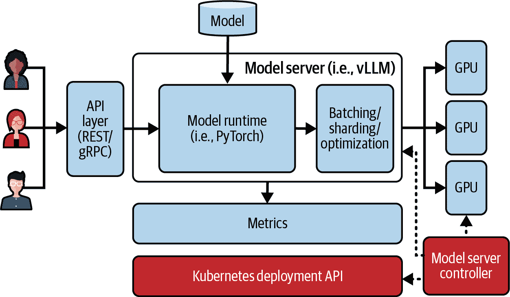
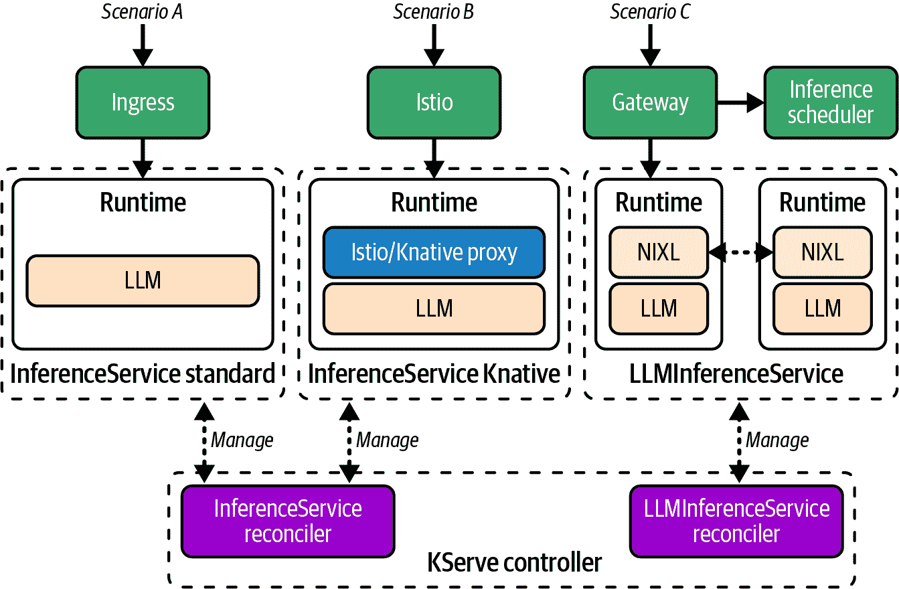
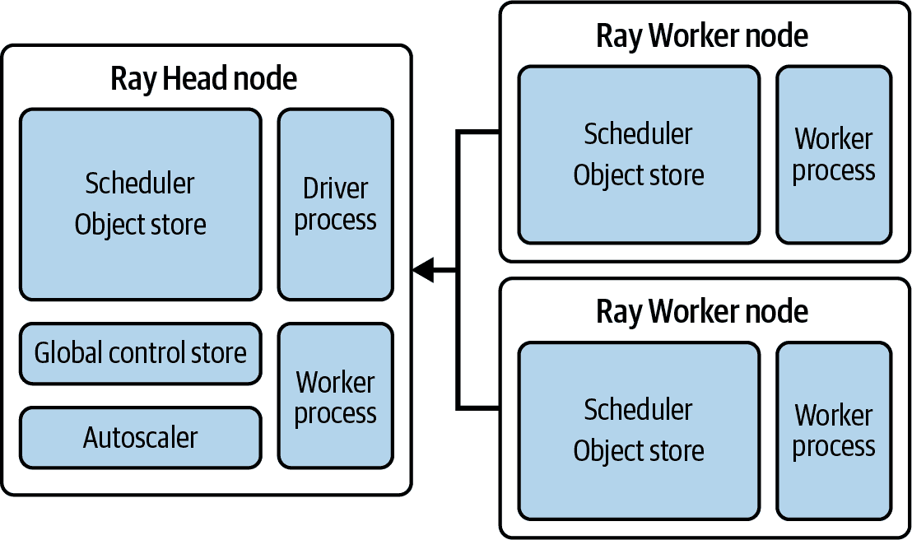

## 第 1 章：部署模型

当真实数据因隐私法规或合规要求而无法离开你的集群，或者当你需要对模型部署和性能进行更精细的控制时，在自己的集群中运行模型就变得必要。

市场上有许多不同的模型；其中很多是开源的，可以免费用于商业用途。Hugging Face 是最大的社区，你不仅可以在其中找到模型，还可以找到数据集和库。有关当前开源大语言模型的列表，请参阅第 2 章。

无论你从哪里获得模型，也无论它是否开源，在 Kubernetes 上部署模型都有一些并非模型本身所特有的方面。然而，某些方面需要仔细分析模型，以确定最佳方法。

本章描述了在运行时管理模型生命周期的不同方法和模式，重点关注一些最常用的 LLM 运行时。

在深入探讨部署细节之前，请参阅下面的边栏，了解驱动大多数现代 LLM 的 Transformer 架构背景。

### Transformer 架构与注意力机制

生成式 AI 是一个广阔的领域，不同模型类别的成熟度差异很大，其中文本生成模型使用最广泛、优化最充分。

现代 LLM 主要基于 *Transformer 架构*或其衍生架构（如*混合专家*方法），尽管 Transformer 也被用于文本之外的视觉和多模态任务。这些模型可以覆盖涉及文本处理的多种用例：聊天机器人、代码生成、翻译、摘要等。

Transformer 架构是一种深度学习架构，由 Google 于 2017 年创建并推出，旨在通过注意力机制更高效地追踪长距离依赖。与其他架构（如循环神经网络（RNN））相比，该架构的主要优势在于它没有循环单元。这意味着它不会将一个神经元的输出用作另一个神经元的输入。这使得它在训练期间高度并行化。

长距离依赖是自然语言处理中的核心概念：句子的含义会受到上下文的影响。

注意力机制通过为句子的不同组成部分分配不同的权重（或重要性）来模拟人类的注意力。具体来说，多头注意力机制会多次并行运行注意力机制，以产生不同的输出，最后将这些输出拼接并进行线性变换。

有关 Transformer 架构和注意力机制的更多信息，请参阅文章《Transformer 是如何工作的？》。

### “在我的机器上能运行”

在探索如何在 Kubernetes 集群上部署模型之前，我们先来了解如何在你自己的机器上本地运行模型。

简而言之，部署模型既需要模型本身，也需要能够加载和执行它的运行时。如前所述，基于 Transformer 的模型是最常见的 LLM。因此，你可以使用 Hugging Face 的 Transformers 库来加载和调用模型。这并不意味着每台笔记本电脑都能处理类似的工作负载，也不意味着所有大小的模型都能被加载。某些模型可以使用 CPU 执行，但性能非常有限（生成一个完整句子需要几十秒）。然而，GPU 基本上是必需的。此外，内存需求与模型的大小直接相关。具有 70 亿参数（又称 7B）的模型被认为是*小语言模型（SLM）*，需要大约 15 GB 显存的 GPU 才能加载。一个 70B 的模型需要大约 140 GB 的内存。

有关演示此方法的代码示例，请参见示例 1-1。

*示例1-1. 使用Transformers加载并执行Llama 3 1B*


# 使用 Hugging Face 模型服务器部署 LLM

## 示例 1-1：使用 `transformers` 加载模型

```python
import transformers
import torch
import os

model_id = "meta-llama/Llama-3.2-1B-Instruct"

pipeline = transformers.pipeline(
    "text-generation",
    model=model_id,
    device_map="auto",
    torch_dtype=torch.bfloat16,
    token=os.environ.get("HF_TOKEN")
)

messages = [
    {"role": "user", "content": "Hey how are you doing today?"}
]

result = pipeline(messages, max_new_tokens=256)
print(result[0]["generated_text"][-1]["content"])
```

- `model_id`：Hugging Face 格式的模型标识符。
- `pipeline()`：加载并初始化模型。
- `torch_dtype=torch.bfloat16`：使用 `bfloat16` 精度以获得更好的性能和内存效率。
- `token`：某些模型需要 Hugging Face 令牌来授权下载。请从你的 Hugging Face 个人资料设置中获取令牌。
- `print()`：仅从结果中提取并打印助手的响应。

虽然此示例演示了加载和运行模型的基本机制，但对于实际应用而言存在局限性。提示词是硬编码的，用户无法与模型交互。为了使其具备实用性，我们需要接受用户输入，并通过一个能够处理多个请求的端点来暴露模型。

## 示例 1-2：使用 FastAPI 创建生成端点

重新审视示例 1-1，我们可以通过端点接受提示词来使其更加灵活，从而更贴近真实场景。最简单的改进是避免每次启动运行时都即时下载模型。在开发和实验阶段，下载并初始化模型的模式非常常见，但有可能且通常建议让模型在无需访问互联网的情况下即可供集群使用。存在不同的文件格式、存储选项和加载技术；详见第 2 章。

下一步是通过端点暴露模型，以便提示词是动态的，并且多个用户可以调用它。一种简单的方法是使用 Python 生态系统，特别是 `FastAPI` 和 `Pydantic`。参见示例 1-2。

*示例 1-2. FastAPI 生成端点*

```python
from fastapi import FastAPI
from pydantic import BaseModel
import transformers

app = FastAPI()

class InputText(BaseModel):
    text: str

class OutputText(BaseModel):
    text: str

def get_pipeline():
    model_id = "meta-llama/Llama-3.2-1B-Instruct"
    return transformers.pipeline(
        "text-generation",
        model=model_id,
        device_map="auto"
    )

pipeline = get_pipeline()

@app.post("/generate", response_model=OutputText)
async def generate_func(prompt: InputText):
    output = pipeline(prompt.text)
    return {"text": output[0]["generated_text"]}
```

创建容器镜像并将其部署到 Kubernetes 是可行的，但生产工作负载需要更多考量。可扩展性、吞吐量、可复现性和监控对于生产部署至关重要。

同时，这个示例并非真正特定于模型。这表明我们已经在创建一些可以更通用的东西。本质上，我们正在重新创建一个模型服务器。

## 模型服务器

*模型服务器*（或服务运行时）是包含一个或多个运行时组件。它可以分布式使用多个 GPU 同时执行各种类型的模型。这些模型通过 API（REST 或 gRPC）暴露，并经过优化以最大化吞吐量和最小化延迟（图 1-1）。



*图 1-1. 模型服务器架构*

这个概念并非新事物，也并非生成式 AI 所特有。多个现有的模型服务器使用通用框架来服务于分类、回归等任务的传统机器学习模型，这些统称为预测式 AI。其中一些也在不断发展以支持生成式 AI。即使概念相同，暴露的 API 也大相径庭。在预测式 AI 中，端点通常是通用的 `/predict` 或 `/infer`，因为模型充当黑盒函数。在生成式 AI 中，它更像是一个面向任务的 API，因为相似的模型可以执行不同类型的操作，并处理不同类型的模态（参见第 8 页的“多模态模型”）：文本生成、摘要、分类、文本到图像等。

模型服务器通过客户端必须使用的 API 暴露 AI 模型。此 API 可能特定于某个模型服务器的实现，这破坏了模型服务器旨在提供的抽象，因为客户端应用程序不应依赖于特定的实现。

这个问题并非新事物，也并非生成式 AI 所特有。对于预测式 AI，KServe 的开放推理协议（OIP）定义了一个规范来标准化“推断”端点。大多数模型服务器都已采用它，并且它现在正在扩展以涵盖生成式 AI。

用于调用生成式 AI 模型的 API 总体上仍处于实验阶段，并且根据模型类型及其执行的任务而有很大差异。OpenAI 的 Chat Completions API 用于聊天补全，实际上是文本生成模型的事实标准。

从 Kubernetes 平台的角度来看，每个模型服务器在部署拓扑上通常是相似的。但是，你应该了解模型和任务的类型，因为扩展、硬件优化和要观察的指标都是特定于模型服务器的。我们将在第 5 章深入探讨这些内容。

## 多模态模型

许多 LLM 通常只处理一种模态：输入和输出均为文本。多模态模型能够处理更大范围的模态，如图像、视频、音频、数学公式等。特别是，其主要目标是混合相似的模态来执行任务，例如文本到图像，其中输入是文本查询，输出是生成的图像。也有可能做相反的操作，或者通过提供图像和查询来混合多种模态，以返回新的图像或文本。

从模型架构的角度来看，虽然许多流行的图像/音频生成模型使用*基于扩散的*架构（如 Stable Diffusion），但其他模型则使用*Transformer*架构（如 DALL-E、Imagen 和 AudioLM）。这类模型属于生成式 AI 领域，但不是 LLM。尽管它们在医疗保健、电子商务和内容创作等多个行业中被日益广泛采用，但相较于文本生成模型，围绕它们的标准化程度较低。它们通常被集成到专业产品中，如图像编辑器和聊天界面。

我们在本书中假设使用适用于更广泛用例的 LLM *Transformer* 基础。这意味着模型输出是文本，但这并不妨碍输入包含图像、音频和文本，使它们成为多模态模型。

既然我们了解了模型服务器的概念，接下来让我们研究具体的实现。我们将探讨几个流行的 LLM 模型服务器，包括 `vLLM`、`TGI`、`llama.cpp` 和 NVIDIA NIM，重点介绍它们的优势和使用场景。

## vLLM

`vLLM` 是 Linux 基金会 AI & Data 旗下的一个用于 LLM 推理和服务的项目。该项目非常活跃，拥有数千个复刻（fork）、数百名贡献者，支持五十多种模型架构，提供端到端的优化技术，并得到多家硬件厂商的支持。它是一个可以在 Python 中直接使用的库（示例 1-3），但该项目包含一个 CLI 和一个兼容 OpenAI 的服务器。

*示例 1-3：在 vLLM 中加载模型并执行推理*

```python
from vllm import LLM

# Load the model
llm = LLM(model="meta-llama/Meta-Llama-3-8B")

# Invoke the model
results = llm.generate("LLMs are great for")

# Extract the result
print(results[0].outputs[0].text)
```

我们的目标是在 Kubernetes 上为模型提供服务，因此 `vLLM` 应在容器中运行，这使得服务器成为最佳选择。启动服务器只需极少的配置。然而，需要注意的一个关键区别是：在生产级 Kubernetes 环境中，你很可能使用模型的本地副本，而不是从 Hugging Face 临时获取。你需要向服务器指定本地模型的位置。参见示例 1-4。

*示例 1-4：启动 vLLM 服务器并通过 `curl` 调用*

```bash
# start the server
vllm serve \
  --port=8080 \
  --model=/mnt/models \
  --served-model-name=meta-llama/Meta-Llama-3-8B

# invoke the model
curl http://localhost:8080/v1/completions \
  -H "Content-Type: application/json" \
  -d '{
    "model": "meta-llama/Meta-Llama-3-8B",
    "prompt": "LLMs are great for",
    "max_tokens": 10,
    "temperature": 0
  }'
```

- `vllm serve`：启动 `vLLM` 服务器。
- `--model`：包含模型的目录路径（容器本地路径）。
- `--served-model-name`：模型的名称。
- `max_tokens`：模型应生成的 token 数量。
- `temperature`：Temperature 控制采样的随机性；`0` 使生成结果具有确定性。

从 Kubernetes 平台的角度来看，许多参数用于配置运行时如何加载和执行模型，但从部署的角度来看，这相对透明。PagedAttention、FlashAttention 和投机解码（speculative decoding）等优化技术专注于高效的注意力管理和更快的执行。虽然它们不直接影响部署，但确实会影响可扩展性和资源优化。

如需深入了解这些优化技术及其影响，请参阅下面的侧边栏。

### LLM 推理优化

LLM 执行的优化是一个快速发展的领域，不断取得进步。在这一领域，学术界与引擎实现紧密耦合。

新的优化技术层出不穷，要正确评估它们的实际收益需要花费时间。

在本场景中，我们已经提到了一些关键优化，如 PagedAttention 和 FlashAttention。鉴于自注意力阶段具有二次方的时间和内存复杂度，这些优化专门用于在优化内存管理时加速自注意力。

另一个投入方向是使用多种量化技术来减小模型尺寸，同时最大限度地减少性能损失；这会减小模型权重的浮点大小。

除了运行时优化，模型蒸馏提供了另一条加速推理的途径：训练一个较小的“学生”模型来逼近较大的“教师”模型的行为。这种模型创建技术能够在保留大部分原始能力的同时显著减小模型尺寸。

投机解码是一种利用双模型方法的优化技术：一个快速的小型“草稿”模型提前预测多个 token，大型模型则一次性验证这些预测。通过减少运行开销高昂的大型模型的频率，同时保持相同的输出质量，投机解码可以将吞吐量提高 1.5 到 3 倍，具体取决于序列的可预测程度。

有关模型定制技术的更多内容，请参阅第 6 章。

优化 LLM 执行的方法有很多种。本书并不打算解释所有方法。幸运的是，从 MLOps 工程师的角度来看，你不需要成为 LLM 优化内部机制的专家。使用一个由大型社区积极开发的模型服务器，这样每一项新的优化都会被纳入其中。例如，`vLLM` 的配置通常仅限于更改运行时的启动参数，而且该项目在根据要执行的模型自动检测应应用的配置方面越来越好，因此默认值很可能就能正常工作。

某些配置（如量化）会影响模型质量，并且需要调优以找到正确的权衡点。这属于模型开发和调优的一部分，因此在推理时，配置应该已经作为部署的一部分而存在。

另一方面，作为 MLOps 工程师，你应该了解对并行化和扩展性影响较大的参数：多节点分布式服务会影响整体拓扑结构，通常需要额外的组件来管理协调，并使部署变为有状态。我们将在第 4 章更详细地讨论模型的运行。

## Hugging Face 文本生成推理（TGI）

Hugging Face 文本生成推理（Text Generation Inference，TGI）是一个开源模型服务器实现，旨在为文本生成模型提供服务，并用于驱动其产品。Hugging Face 在前文已被多次提及，因为它是最活跃的社区，你可以在其中共享生成式 AI 模型（基础模型或微调模型）以及数据集和库。许多最常用的生成式 AI 库，如 `transformers`、`peft` 或 `diffusers`，都是在这个社区中孵化的。

TGI 现在支持多种推理后端，允许你在保持一致 API 的同时，根据硬件和性能需求选择最合适的后端。受支持的后端包括 TGI 原生的 CUDA 后端（针对 NVIDIA GPU 优化）、NVIDIA TensorRT-LLM、`llama.cpp`（用于 CPU 部署）和 AWS Neuron（用于 AWS Trainium 和 Inferentia 芯片）。多后端支持是模型服务器的新兴趋势，Triton 和 TGI 等项目正在采用这种方法，以提供灵活的部署选项。其主要优势是能够为你的特定硬件和用例选择最优后端，但也存在权衡：尽管后端通过统一的 API（如 OpenAI 兼容端点）暴露，但不同后端的配置参数和调优选项差异很大。当需要在不同后端之间切换或微调性能时，这会使优化和调试变得更加复杂。

与 `vLLM` 类似，TGI 有一个启动器（launcher），可用于启动服务器并加载模型。参见示例 1-5。

*示例 1-5：通过原生 API 和 OpenAI API 启动 TGI 服务器*

```bash
# start the server
text-generation-launcher \
  --port 8080 \
  --model-id /mnt/models

# invoke the model using TGI API
curl localhost:8080/generate_stream \
  -H 'Content-Type: application/json' \
  -X POST \
  -d '{"inputs":"LLMs are great for",
    "parameters":{"max_new_tokens":10}
  }'

# invoke the model using OpenAI-compatible API
curl localhost:3000/v1/chat/completions \
  -H 'Content-Type: application/json' \
  -X POST \
  -d '{
    "model": "tgi",
    "messages": [
      {
        "role": "system",
        "content": "You are a helpful assistant."
      },
      {
        "role": "user",
        "content": "LLMs are great for"
      }
    ],
    "max_tokens": 10
  }'
```

- `text-generation-launcher`：启动器命令。
- `--model-id`：包含模型的目录路径（容器本地路径）。
- `/generate_stream`：TGI 原生 API，用于调用模型。
- `/v1/chat/completions`：TGI 现在还支持 OpenAI 兼容 API。

微调模型中最常见的类别之一是“指令”（instruct）模型，旨在遵循人类指令。在此场景中，系统提示词（system prompt）定义了模型的角色。

关于这些参数及其对 Kubernetes 的影响的讨论同样适用于 TGI。

除了 `vLLM` 和 TGI，还有其他几个模型服务器在特定用例中值得关注。

## 其他模型服务器

虽然 `vLLM` 和 TGI 是常用于 LLM 的开源模型服务器，但在特定部署场景和硬件配置下，其他实现也值得考虑。

### llama.cpp

`llama.cpp` 是一个运行 Llama 模型的 C++ 实现。它最初作为 Transformer 架构的完整 C++ 重写版本而创建，专门用于 Llama 模型。随着时间的推移，它已经发展到支持多种其他模型。其重点一直在于效率，这使它成为在笔记本电脑上本地运行类似模型时的推荐选择。虽然它仍然需要一台性能强劲的机器，但 Ollama、Ramalama 和 LM Studio 等项目已广泛使用它。虽然它并非为高并发的大规模生产部署而设计，但 `llama.cpp` 在资源受限的环境中表现出色。活跃的社区持续将其他模型服务器的优化和技术移植到 C++ 中，使 `llama.cpp` 在设备端推理和本地开发等边缘场景中越来越强大。`llama.cpp` 开发的一个成果是创造了 GGUF 文件格式，其他库现在也已采用。

除了核心库之外，还有一个 Python 服务器，它提供了与其他模型服务器类似的 OpenAI 兼容 API；参见示例 1-6。

*示例 1-6. 启动 llama.cpp Python 服务器*

```
python -m llama_cpp.server \
    --model /mnt/models
```

- `python -m llama_cpp.server`：启动 `llama.cpp` 服务器。
- `--model`：模型的位置（容器本地）。


假设你有一台性能强劲的机器，至少有 24 GB 内存，但即使没有 GPU，使用基于 `llama.cpp` 构建的工具在本地运行量化 LLM 也异常简单。

Ollama 提供了一个简单的 CLI 界面，只需一条命令即可下载和运行模型：

`ollama run llama3.2:3b`

Ramalama 也提供了类似的简单性，并支持多个模型注册表和容器运行时：

`ramalama run llama3.2:3b`


这两个工具都在后台使用 `llama.cpp` 来处理模型执行，并提供 OpenAI 兼容的 API 用于推理。`Ramalama` 通过基于容器的执行提供了更强的隔离性，而 `Ollama` 则提供了更完善的开发者体验和更简单的模型管理。两者都非常适合在部署到生产 Kubernetes 集群之前进行本地开发、实验和原型验证。

### NVIDIA NIM

NVIDIA 是 AI 领域 GPU 的领先提供商，同时提供训练和服务模型所需的软件。NVIDIA NIM 是一种为 Kubernetes 设计的解决方案，旨在简化 LLM 在 NVIDIA 硬件上的部署和优化。它采用了一种不同的方法，为每个模型系列提供精选的容器镜像，这些模型由 NVIDIA 直接测试并发布。请在文档中查看受支持的模型列表（如 Llama 和 Mistral）。这种方法旨在通过预优化的模型配置文件简化部署配置。

与 TGI 类似，NVIDIA NIM 支持多个推理后端：`TensorRT-LLM`（一个用于在 NVIDIA GPU 上优化 LLM 推理的开源库）、`vLLM` 和 `SGLang`。NIM 会根据检测到的 GPU 硬件，基于可用的模型配置文件自动选择最优后端，其优先级顺序为 `TensorRT-LLM > vLLM > SGLang`。该选择基于预优化的 TensorRT 引擎和其他参数的可用性自动进行。这种硬件感知的后端选择使用户无需手动配置即可受益于最合适的推理引擎。

除了后端选择之外，NVIDIA NIM 还因其有主见的设计而脱颖而出，提供了一些值得注意的功能：模型本地缓存和硬件优化。本地缓存由 `PersistentVolume` 支持，旨在简化和加速 LLM 模型服务中的主要痛点之一：加载时间。模型只下载一次，后续副本的创建或重启不会触发再次下载。硬件优化是另一个关键功能：NVIDIA NIM 可以检测可用的加速器，为配置选择最合适的模型变体，并相应地调整模型服务器设置。有关 NVIDIA NIM 架构的更多详细信息，请参见图 1-2。



*图 1-2. NVIDIA NIM 架构*

### SGLang

`SGLang` 是一个面向大型语言模型和视觉语言模型的开源高性能服务框架，旨在提供低延迟、高吞吐量的推理。该项目已获得广泛的行业采用，并以其先进的优化技术而著称。

许多性能改进都是由 `SGLang` 项目推动的，例如 `RadixAttention`，一种复杂的缓存机制，它将键值（KV）缓存在基数树结构中。这实现了高效的请求间前缀搜索和缓存复用，对于具有常见提示前缀的工作负载或多轮对话（可以复用先前上下文）尤其有益。

`SGLang` 支持连续批处理、推测解码和各种量化技术。

与 `vLLM` 和 `TGI` 一样，`SGLang` 提供 OpenAI 兼容的 API，并支持大多数 LLM 模型架构。

启动 `SGLang` 服务器与其他模型服务器遵循类似的模式。参见示例 1-7。

*示例 1-7. 启动 SGLang 服务器*

```
python -m sglang.launch_server \
    --model-path /mnt/models \
    --port 8080
```

`SGLang` 特别适合需要高缓存命中率的场景，例如代理多次调用相似上下文，或具有结构化提示的应用程序，其中前缀复用很常见。

## 手动将模型部署到 Kubernetes

现在我们了解了什么是模型服务器，并探讨了几种专门用于 LLM 的实现，让我们将一个模型部署到 Kubernetes。我们将从使用标准 Kubernetes 资源的手动方法开始，以了解生产部署涉及的内容。

如果你需要在控制器环境中自定义部署的每个方面，这种 DIY（自己动手）方法始终可用，有时也是必要的。

假设你想使用 `vLLM`，并且你已经有要使用的镜像。在示例 1-8 中，你可以轻松发现部署中需要考虑的大部分配置：要暴露的端口、模型所在的路径，以及执行模型所需的 GPU 配置和参数（这些本质上与模型相关）。

*示例 1-8. 使用 GPU 启动 vLLM 服务器*

```
# specify which of the available GPUs to use
CUDA_VISIBLE_DEVICES=0,1
vllm serve \
    --port=8080 \
    --model=/mnt/models \
    --served-model-name=meta-llama/Meta-Llama-3-8B
```

现在我们知道了如何创建部署、要使用的模型名称以及 GPU 要求，就可以继续了。完整的部署规范（含 `PersistentVolumeClaim`）请参见示例 1-9，并将其应用到你的集群。

*示例 1-9. 使用 GPU 部署 vLLM 服务器*

```
kind: Deployment
apiVersion: apps/v1
metadata:
  name: vllm
spec:
  replicas: 1
  template:
    spec:
      containers:
      - resources:
          limits:
            cpu: '4'
            memory: 12Gi
            nvidia.com/gpu: '1'
          requests:
            cpu: '2'
        name: vllm
        env:
        - name: HF_TOKEN
          valueFrom:
            secretKeyRef:
              name: huggingface-secret
              key: token
        args:
        - "--port"
        - "8080"
        - "--model"
        - "meta-llama/Meta-Llama-3-8B"
        - "--download-dir"
        - "/models-cache"
        ports:
        - name: http
          containerPort: 8080
          protocol: TCP
        volumeMounts:
        - name: models-cache
          mountPath: /models-cache
        image: vllm/vllm-openai:latest
      volumes:
      - name: models-cache
        persistentVolumeClaim:
          claimName: vllm-models-cache
      tolerations:
      - key: nvidia.com/gpu
        operator: Exists
        effect: NoSchedule
---
apiVersion: v1
kind: PersistentVolumeClaim
metadata:
```

```yaml
name: vllm-models-cache
spec:
  accessModes:
    - ReadWriteOnce
  volumeMode: Filesystem
  resources:
    requests:
      storage: 100Gi
```

除了传统的 CPU 和内存之外，你还可以指定模型所需的 GPU 数量。

使用 `vLLM` 的一个选项是从 Hugging Face 动态下载模型，这需要将令牌作为环境变量注入。

`vLLM` 镜像的入口点已经在启动服务器，因此只需要指定额外的参数。

动态下载时，建议指定一个持久化的模型缓存来存储模型。

要暴露的端口（然后可以通过服务和入口来暴露它）。

用作缓存的持久卷。

污点可防止非 GPU 工作负载被调度到 GPU 节点上，而容忍则允许该 GPU 工作负载被调度到这些带有污点的节点上。

此示例不涵盖 Kubernetes 中的 GPU 配置（更多内容见第 3 章）、重启策略、扩缩容或探针。它也只适用于模型可以部署到单个节点的场景，而不适用于分布式服务场景。

虽然这种手动方式可行且相当自包含，但它暴露出显著的复杂性：GPU 资源管理、容忍和污点、存储配置、密钥管理以及模型特定参数都需要显式配置。当你部署多个需求各异的模型时，这种复杂性会成倍增加。每增加一个新模型，就意味着另一个部署清单、另一个 PVC，还需要仔细协调资源请求，并手动管理配置变更。

这正是模型服务器控制器存在的原因：将这种复杂性抽象到更高级别的 API 之后，这些 API 专注于模型部署，而不是底层的 Kubernetes 基础设施细节。

## 模型服务器控制器

正如我们在手动部署方式中所见，将模型部署到 Kubernetes 需要管理大量资源：`Deployment`、持久卷声明（PVC）、GPU 配置、容忍以及模型特定参数。模型服务器控制器通过自定义资源定义（CRD）提供更高级别的抽象来简化这种复杂性。

控制器允许你在更高级别上声明意图，而无需手动编写部署清单和协调多个 Kubernetes 资源。CRD 方式还提供集中的状态信息，使监控模型部署的健康和状态更加容易。图 1-3 扩展了之前的模型服务器架构图，加入了主要控制器组件：一个或多个 Kubernetes 自定义资源定义和一个 Kubernetes 控制器。



*图 1-3. 模型服务器控制器架构*

每个模型服务器通常都会提供容器镜像，因此你无需自行构建；但同时，选择合适的容器镜像并非易事：每种加速器都有不同的驱动和框架（例如 NVIDIA 搭配 CUDA、AMD 搭配 ROCm 等），因此必须注意这一点。这个问题类似于多架构容器，你可以轻松选择架构（例如 ARM64 或 i386）并获得相应的容器版本。然而，对于加速器来说，这个过程仍然相当手动。有关 Kubernetes 如何通过设备插件管理 GPU 和加速器访问的更多信息，请参见第 3 章。

让我们探讨两种流行的模型服务器控制器方案：`KServe` 和 `Ray Serve`。

### KServe

`KServe` 是云原生计算基金会（CNCF）的一个项目，在 Kubernetes 上提供模型推理平台，旨在管理模型服务器和模型的生命周期与连接，利用 Kubernetes 组件提供可扩展性、路由、金丝雀发布、密度打包，并且通常能够暴露模型推理端点。

该项目最初以 `KFServing` 的形式在 Kubeflow 社区创建，后来成为一个独立项目（尽管它仍然是 Kubeflow 生态系统的一部分）。最初的目标是预测性 AI，直到最近才扩展到包含生成式 AI。

`KServe` 是作为 Kubernetes 原生组件构建的，扩展了 Kubernetes API，并提供多个自定义资源定义，以声明式方式映射不同概念。我们不会介绍 `KServe` 提供的所有 API 和概念，因为其中大多数仍然主要适用于预测性 AI。

从技术栈角度来看，有三种不同的部署模式：`Knative`、`Standard` 和 `ModelMesh`（见图 1-4）：

- **Knative**：`Knative` 是最全面的技术栈，使用 `Knative` 和 `Istio` 管理自动扩缩容、滚动更新、流量管理和组合（也可以通过 `Knative Eventing`）。使用此模式时，每个模型都会成为一个 `KnativeService`。

- **Standard**：`Standard` 与 `Knative` 相反，除了 Kubernetes 已提供的依赖外，没有额外依赖。使用此模式时，对于每个模型，`KServe` 都会创建一个新的 `Deployment`。`KServe` 0.16 通过 `LLMInferenceService` CRD 引入了一种新的部署方式，这是 `Standard` 部署模式的演进，用于管理高级且可扩展的 LLM 部署。

- **ModelMesh**：`ModelMesh` 解决方案专为高密度部署而设计，适用于需要在同一集群中部署许多模型（可能数千个）而单独部署的占用空间过大的场景。在此模式下，模型服务器会根据请求动态加载和卸载模型。

 

*图 1-4. KServe Standard、Knative 和 LLMInferenceService 部署架构*

从 `KServe` 0.16 开始，为了清晰起见，部署模式已更名：

- `Serverless` 现在是 `Knative`，这反映了底层技术（`Knative Serving`）。

- `RawDeployment` 现在是 `Standard`，这是对标准 Kubernetes 部署更直观的名称。

- `ModelMesh` 保持不变。

在本书中，我们使用新术语。如果你使用的是旧版 `KServe`（0.16 之前），请将“Serverless”替换为“Knative”，将“RawDeployment”替换为“Standard”。

`ModelMesh` 部署模式并不真正适用于生成式 AI：此类模型的规模和复杂性使得你无法在同一节点上部署多个模型。另一方面，`Knative` 和 `Standard` 部署模式通常适用于生成式 AI。然而，虽然较小的模型（如 `Phi`、`Gemma` 和 `Llama` 的紧凑变体，参数量低于 30B）可以在消费级硬件上运行，并可能受益于动态扩缩容，但较大的生产级 LLM 通常需要静态管理的专用 GPU 资源。这使得难以充分利用 `Knative` 模式的动态自动扩缩容优势。在本节的其余部分，我们将假设使用 `Standard` 作为部署模式。

`KServe` 提供的用于部署模型的两个主要 API 是 `ServingRuntime` 和 `InferenceService`：

**ServingRuntime**

`ServingRuntime` 相当于一个声明了模型服务器的 `Pod` 模板。它指定要使用的模型服务器镜像，以及一些参数和它可以服务的模型类型。这个概念将运行时配置与模型配置分离开来。这种分离使项目所有者能够更好地控制模型服务器版本、默认配置和运行时生命周期管理。还可以使用 `ClusterServingRuntime` 来配置对整个集群可用的运行时。参见示例 1-10。

**示例 1-10. 适用于 vLLM 的 KServe ServingRuntime**

```yaml
apiVersion: serving.kserve.io/v1alpha1
kind: ServingRuntime
metadata:
  name: vllm
spec:
  containers:
    - args:
        - --model
        - /mnt/models/
        - --port
        - "8080"
      name: kserve-container
      image: vllm/vllm-openai:latest
      ports:
        - containerPort: 8080
          name: http1
          protocol: TCP
  multiModel: false
  supportedModelFormats:
    - autoSelect: true
      name: pytorch
```

此自定义 `ServingRuntime` 的名称。`KServe` 包含预配置的 `ServingRuntime`（包括一个名为“HuggingFace Runtime”的使用 `vLLM` 的 `ServingRuntime`），可以直接使用。然而，在本示例中，我们定义自己的自定义 `vLLM` `ServingRuntime`，以便完全控制配置和参数。

这是 `podSpec`，可以在其中配置运行模型服务器所需的所有参数。

这是将要使用的镜像。注意，应用此资源不会立即部署模型服务器，但会使其在命名空间内可供使用。

与大多数模型服务器一样，`vLLM` 使用 `PyTorch` 作为模型的实际运行时，因此此配置声明该运行时能够提供 `PyTorch` 模型服务。

#### InferenceService

`InferenceService` 表示用户想要服务的模型。该对象可以指定要使用的 `ServingRuntime`，也可以根据模型格式自动选择。创建此资源将触发模型服务器的部署以及模型的接入。在同一个 `spec` 中，可以覆盖 `ServingRuntime` 中指定的默认参数，并添加可能特定于该模型的更多配置。参见示例 1-11。

**示例 1-11：使用 Standard 部署模式的 InferenceService**

```yaml
apiVersion: serving.kserve.io/v1beta1
kind: InferenceService
metadata:
  name: Meta-Llama-3-8B
  annotations:
    serving.kserve.io/deploymentMode: Standard
spec:
  predictor:
    model:
      modelFormat:
        name: pytorch
      runtime: vllm
      storageUri: pvc://llama/model
    containers:
      resources:
        limits:
          cpu: "4"
          memory: 50Gi
          nvidia.com/gpu: "1"
        requests:
          cpu: "1"
          memory: 50Gi
          nvidia.com/gpu: "1"
```

- 此注解用于选择部署模式。


- 声明模型类型可让 KServe 自动找到能够处理该模型的 `ServingRuntime`。
- 此字段按名称引用 `ServingRuntime`，它为 `InferenceService` 提供容器镜像和配置。
- 此字段指定模型的获取位置，本例中来自集群本地的 `PVC`。
- 对于每个模型，都可以覆盖资源以匹配模型的需求。

#### 其他概念和 API

KServe API 非常灵活，包含许多其他概念，这些概念并非部署 LLM 所必需，但能够支持更高级、更可组合的用例。你可以配置推理日志记录器，将模型的每个输入和输出转发到日志服务，以用于审计或训练目的；还可以进行一些预处理和后处理，甚至可以使用 `InferenceGraph` 组合不同的模型。有关更全面的文档，请参阅 KServe Control Plane API。

将 `ServingRuntime` 与 `InferenceService` 分离的主要好处之一是，在管理上所有权更加明确，因为运行时生命周期和模型生命周期非常不同。KServe 还提供了其他好处，例如支持多种存储选项：KServe 控制器会注入一个名为 storage initializer 的 `initContainer`，它读取模型的位置，执行下载（如有必要），并将模型复制到模型服务器中的文件夹中。还可以使用 `ClusterStorageContainer` API 将 storage initializer 容器替换为自定义容器，以支持自定义协议，从而集中管理可用模型目录。我们将在第 2 章更详细地介绍如何打包、注册和加载模型。

KServe 正在积极演进，通过新的 API 接口为 LLM 特定需求提供更好的支持（参见下一节）。

#### 从 InferenceService 到 LLMInferenceService

KServe 0.16 引入了一个新的 `LLMInferenceService` 自定义资源定义，专门用于管理复杂和大规模的 LLM 部署。传统的 `InferenceService` API 适用于基本的 LLM 服务，而 `LLMInferenceService` 则为生产环境生成式 AI 工作负载中常见的先进部署拓扑提供了专门能力，包括基于 KV 缓存感知调度的智能路由、分离式服务以及多节点分布式推理。

从实现角度来看，`LLMInferenceService` 使用 Standard 部署模式，创建普通的 Kubernetes `Deployment` 资源，这反映了 LLM 工作负载管理方式的根本性转变。这种演进要求重新思考传统的自动扩缩和流量管理方法，以应对长时间运行的 GPU 工作负载的独特特征：在这些工作负载中，稳定性、资源可预测性以及基于模型状态的智能路由比快速扩缩更为关键。

示例 1-12 展示了一个示例配置，突出显示了关键组件以及 `LLMInferenceServiceConfig`（作为基础模板）与 `LLMInferenceService`（引用该配置并可覆盖特定设置）之间的关系。该示例演示了用于智能路由的 `router` 部分（包含 `gateway` 和 `scheduler`），以及用于跨多个 GPU 进行分布式推理的并行设置。

表 1-1 将传统的 `InferenceService` 和 `ServingRuntime` 方案与新的 `LLMInferenceService` 和 `LLMInferenceServiceConfig` API 进行了对比，突出了能力和用例方面的关键差异。

这些功能对于部署需要多个 GPU 或复杂服务架构的超大模型（700 亿以上参数）尤为重要。有关分布式推理模式和技术的更多详细信息，请参阅 `llm-d` 项目。

我们将在第 4 章详细介绍分离式服务和高级部署拓扑。

**示例 1-12：具有分布式推理和基础配置的 LLMInferenceService**

```yaml
# Base configuration template
apiVersion: serving.kserve.io/v1alpha1
kind: LLMInferenceServiceConfig
metadata:
  name: vllm-llama-config
spec:
  template:
    containers:
    - name: kserve-container
      image: vllm/vllm-openai:latest
      args:
      - --port=8080
      - --model=/mnt/models
      resources:
        limits:
          nvidia.com/gpu: "1"
          cpu: "4"
          memory: 50Gi
    router:
      gateway: {}
      route: {}
      scheduler: {}
    parallelism:
      tensorParallelism: 2
---
# Actual LLM deployment
apiVersion: serving.kserve.io/v1alpha1
kind: LLMInferenceService
metadata:
  name: llama-3-8b
spec:
  baseRefs:
  - vllm-llama-config
  model:
    uri: pvc://llama/model
    name: meta-llama/Llama-3.1-8B-Instruct
  replicas: 3
  # Optionally override base configuration here
  ...
```

- 用于提供模型服务的 vLLM 容器镜像和启动参数。
- 路由器规范，包含 `gateway`、`route` 和 `scheduler`，用于基于 KV 缓存感知调度的智能路由。
- 用于分布式推理的并行策略：张量并行、数据并行和专家并行。
- 对基础配置模板的引用；可以引用多个配置，最后一个优先。
- 定义模型来源和特征的模型规范。
- 用于水平扩展的副本数；这可以覆盖基础配置。

**表 1-1：面向预测式 AI 和生成式 AI 的 KServe API 对比**

| 方面 | InferenceService + ServingRuntime | LLMInferenceService + LLMInferenceServiceConfig |
|---|---|---|
| 主要用例 | 预测式 AI（分类、回归） | 生成式 AI（LLM、文本生成） |
| 部署模式 | 单节点、简单扩缩 | 多节点分布式推理、分离式服务 |
| 配置模板 | ServingRuntime 定义模型服务器模板 | LLMInferenceServiceConfig 通过继承定义基础 LLM 配置 |
| 路由与调度 | 基本负载均衡 | 基于 gateway、scheduler 和 KV 缓存感知调度的高级路由 |
| 并行支持 | 有限 | 原生支持张量、数据和专家并行 |
| 典型模型规模 | 中小型模型 | 大型模型（70 亿至 4050 亿以上参数） |

KServe 采用 Kubernetes 原生方法，而 Ray 则秉承不同的理念，优先考虑 Python 优先开发，并自带编排层。

#### Ray Serve 与 KubeRay

与 KServe 相比，Ray 项目是一个更新、范围更广的项目。它是一个开源框架，旨在轻松构建和扩展机器学习应用。它非常 Pythonic，对于有 Python 经验的用户来说十分友好，并且允许你直接在 Python 代码库中配置所有活动。

Ray 并非专门用于模型服务，而是定义了一组相当通用的核心概念：任务（Task）、Actor、对象（Object）、放置组（Placement Group）和环境依赖（Environment Dependency）。这些核心概念加上 Ray 集群，定义了用于构建和扩展所有其他功能的执行模型。

图 1-5 展示了包含头节点和工作节点的 Ray 集群拓扑。

如果你需要更全面的 Ray 基础，我们推荐 Max Pumperla 等人所著的 *学习 Ray*（O’Reilly，2023）。



*图 1-5. Ray 集群拓扑*

在图 1-5 中，你可以看到 Ray 集群在设计时并未考虑 Kubernetes。它拥有独立的基础设施来管理作业的调度和编排，而这些通常可以通过 Kubernetes API 和不同的工作节点完成。其中存在头节点的概念，它是作业的入口点，作业随后被分派到一个或多个工作节点上执行。

Ray 提供的一系列功能涵盖了大多数机器学习用例；Ray Train、Ray Tune 和 Ray Serve 只是其中的一部分。Ray Serve 是我们用于服务模型所需的组件，部署在 Python 中定义，对于每个要暴露的端点或模型初始化都是相同的。

示例 1-13 是一个非常简化的场景，其中配置并部署了一个 Transformer 模型，与本章第一节类似。由于它是直接在代码中配置的，Ray Serve 非常灵活；你可以轻松找到将其与 FastAPI 集成以暴露端点，或使用像 vLLM 这样的库来部署完整模型服务器的示例。

*示例 1-13. 基于 Transformer 模型的 Ray Serve*

```python
from starlette.requests import Request
from typing import Dict
from transformers import pipeline
from ray import serve

@serve.deployment
class TransformerModelDeployment:
    def __init__(self):
        self._model = pipeline(
            "my-transformer-model"
        )
    def __call__(self, request: Request) -> Dict:
        return self._model(
            request.query_params["text"]
        )[0]

serve.run(
    TransformerModelDeployment.bind(),
    route_prefix="/my-model/"
)
```

装饰器函数，可以在其中配置大部分部署方面，例如自动缩放。`init` 方法应用于加载模型，在本例中它是一个基于 Transformer 的 pipeline。此方法使用给定的前缀部署模型。

Ray 的 API 对数据科学家或一般的 Python 开发者非常友好，但要在 Kubernetes 上部署 Ray 集群，仍然需要借助 Kubernetes 概念（如 deployment 和 ingress）将所有组件连接起来。KubeRay 项目应运而生，旨在简化从本地 Ray 执行到 Kubernetes 的过渡。这是必要的，因为 Ray 集群和 Ray 应用程序并非原生设计用于 Kubernetes，尤其是 Ray 集群有头节点和工作节点，需要使用多个正确配置且相互交互的部署。

KubeRay 以 Kubernetes `CustomResourceDefinition` 的形式提供多个 Ray API，但尤其是 `RayService` 对象，它是一个单一概念，代表一个多节点 Ray 集群以及使用该集群的 Ray Serve 应用程序。示例 1-14 并不是规范的完整示例，但它突出了主要元素。

*示例 1-14. RayService CR 片段*

```yaml
apiVersion: ray.io/v1alpha1
kind: RayService
metadata:
  name: my-transformer-model
spec:
  serveConfigV2: |
    applications:
      - name: my-transformer-model
        import_path: my-transformer-model:deployment
        runtime_env:
          working_dir: "https://my-git-repo.com/main.zip"
  rayClusterConfig:
    rayVersion: %VERSION%
    headGroupSpec:
      ...
    template:
      spec:
        containers:
          - name: ray-head
            image: rayproject/ray-ml:%VERSION%
            ports:
              ...
              - containerPort: 8000
                name: serve
    workerGroupSpecs:
      - replicas: 1
        groupName: gpu-group
        template:
          spec:
            containers:
              - name: ray-worker
                image: rayproject/ray-ml:%VERSION%
                tolerations:
                  - key: "ray.io/node-type"
                    operator: "Equal"
                    value: "worker"
                    effect: "NoSchedule"
```

此字段包含 Ray Serve 应用程序的所有配置。应用程序的代码从 `working_dir` 位置下载。规范的这一部分配置了 Ray 集群的头节点和工作节点。Ray 的版本应在此处以及要使用的镜像中指定。除了服务方面，头节点还暴露多个组件，如仪表板或客户端。与之前的一些示例一样，可以配置容忍（tolerations）和污点（taints）以匹配节点要求（例如 GPU 或专用 Ray 节点）。

从 Kubernetes 平台的角度来看，与 KServe 相比，Ray 在 API 和管理方面肯定更不熟悉，但同时它使数据科学家和 Python 开发者能够完全控制部署。这种灵活性带来了很多价值，尤其是当你需要配置更复杂的服务拓扑时，例如分布式服务或多主机训练。

### 经验教训

在本章中，我们探讨了在 Kubernetes 上部署 LLM 所需的组件，从基本模型服务到生产级编排。

像 vLLM、TGI 和 SGLang 这样的模型服务器提供了直接影响吞吐量和延迟的基本优化（PagedAttention、FlashAttention 和连续批处理）。虽然你可以使用 FastAPI 将推理代码容器化，但生产工作负载需要专门的运行时，以最大化 GPU 利用率并有效管理内存受限的解码阶段。

服务运行时配置与模型生命周期管理之间的分离反映了运营现实。KServe 为通用模型服务提供带有 `ServingRuntime` 的 `InferenceService`，并引入带有 `LLMInferenceServiceConfig` 的 `LLMInferenceService`，用于需要分布式推理和高级路由的复杂 LLM 部署。

这种分离承认运行时升级、模型部署和基础设施变更遵循不同的时间表，并由不同团队负责。平台团队可以管理运行时版本和容器镜像，而数据科学团队可以独立部署和迭代模型，从而防止冲突并实现并行工作流。

部署控制器的选择涉及根本性的权衡。KServe 与 Kubernetes 原语（deployments、services、ingress）原生集成，使平台运维人员感到熟悉，但需要额外组件来实现自动缩放等功能。Ray 提供了 Python 优先的开发体验和内置的分布式服务能力，但引入了自己的编排层，部分重复了 Kubernetes 的功能。

与 Kubernetes 重叠，在调试或管理资源时会造成运维复杂性。

在采用控制器之前，从手动部署开始对于早期项目仍然有效。理解底层的 `Deployment`、`PersistentVolumeClaim` 和 GPU 资源配置，可以弄清控制器自动化了哪些内容，并在抽象出现泄漏时帮助诊断问题。

推理基础设施就绪后，仍有一个关键部分：模型本身。下一章将应对管理模型数据的挑战，以及如何高效地将模型数据导入集群的策略。
