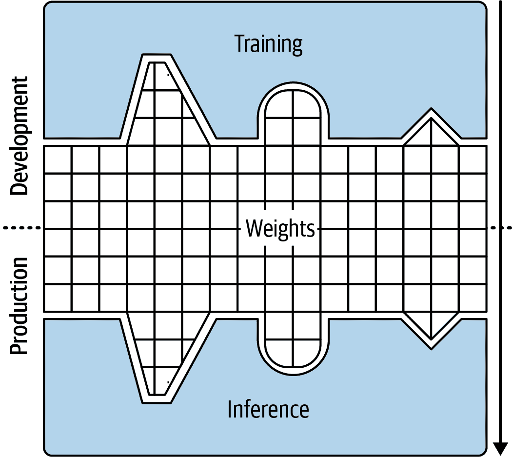
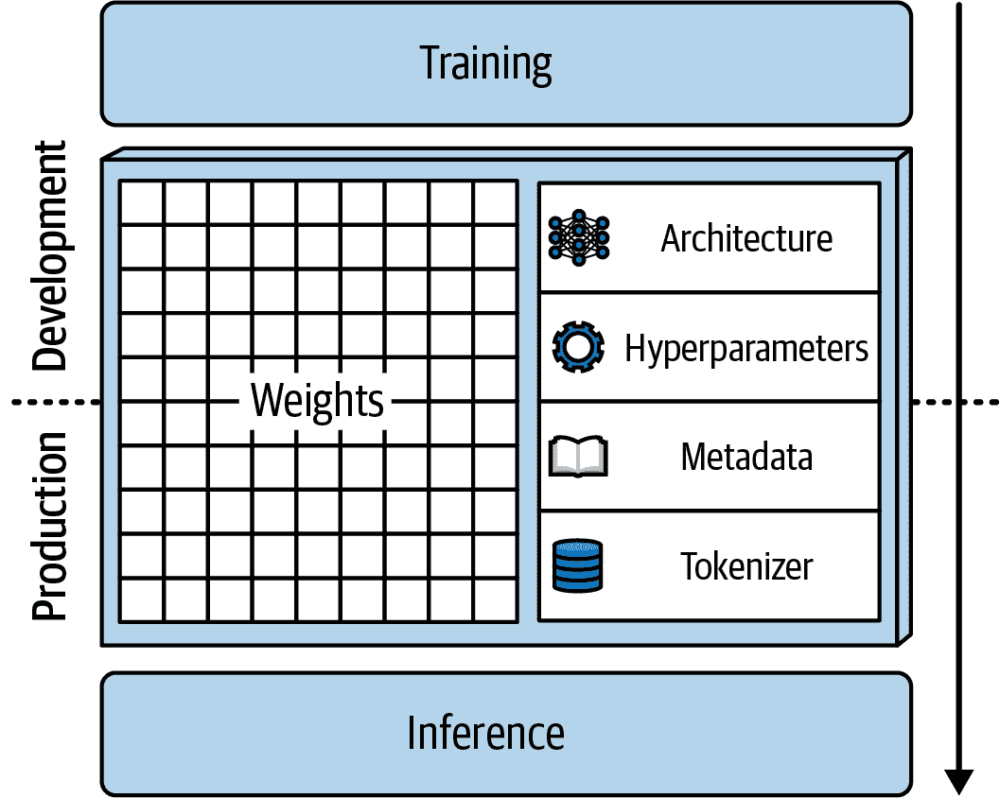
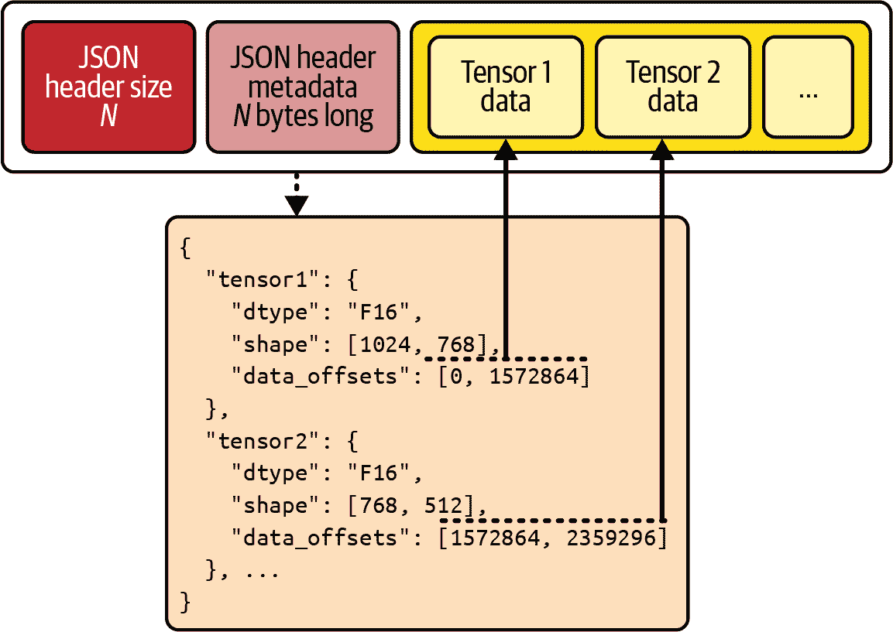
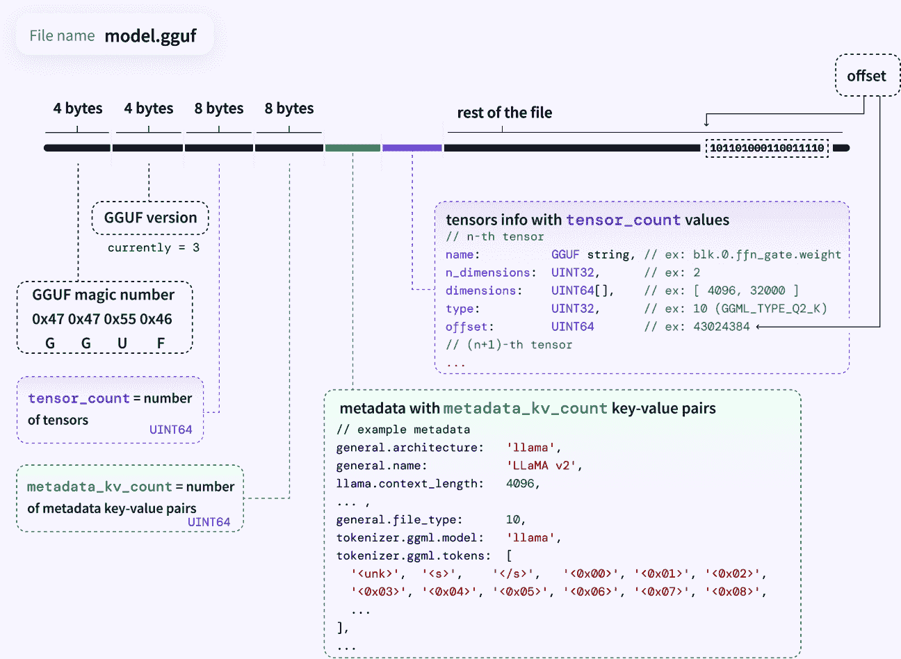
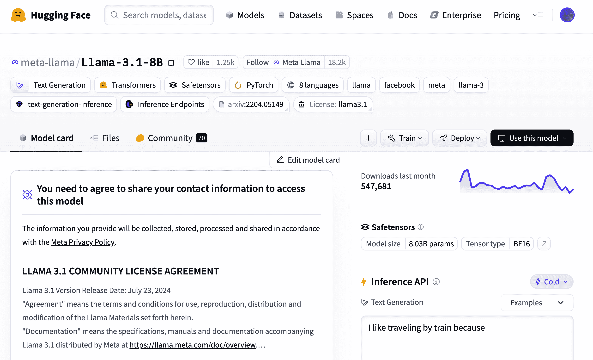
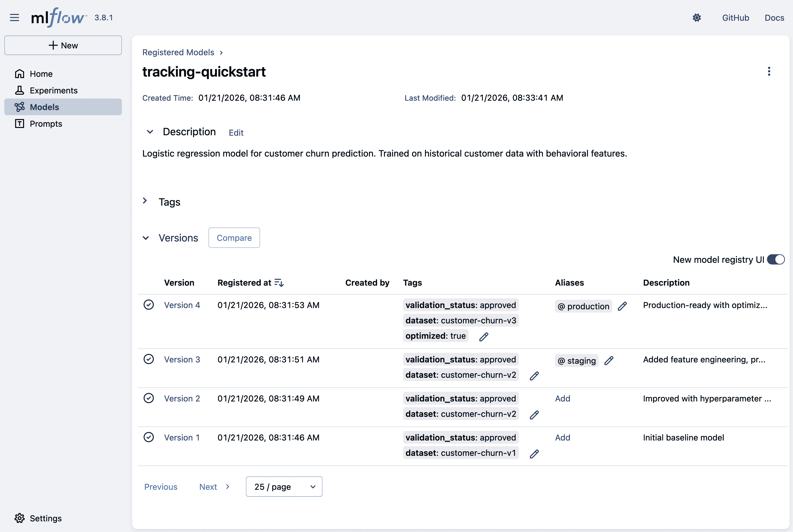
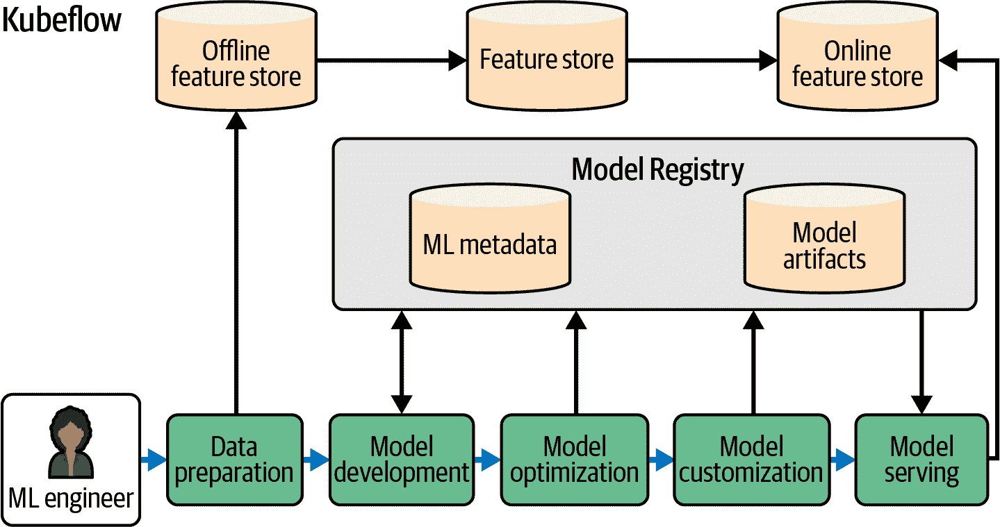
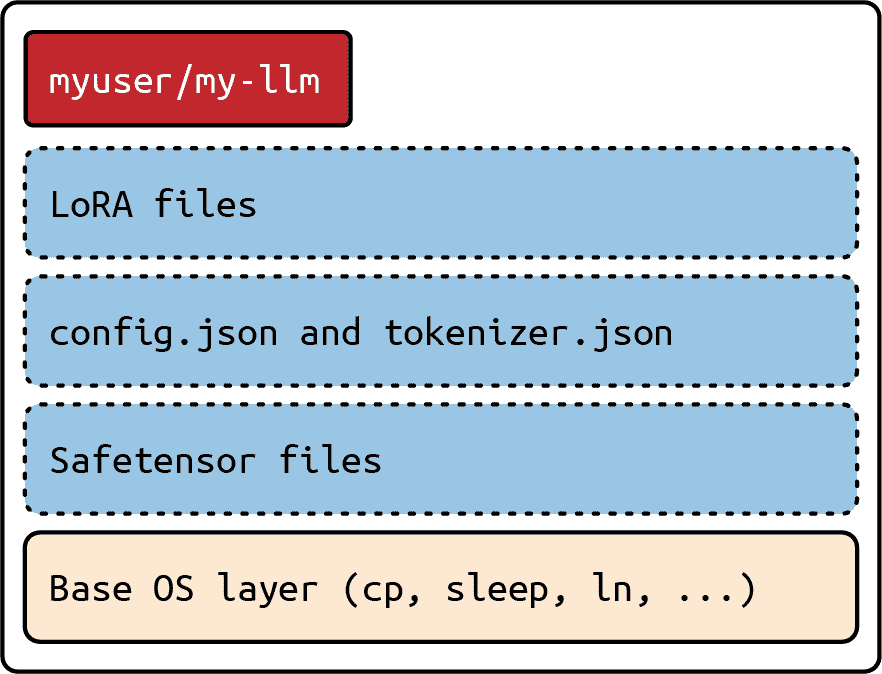
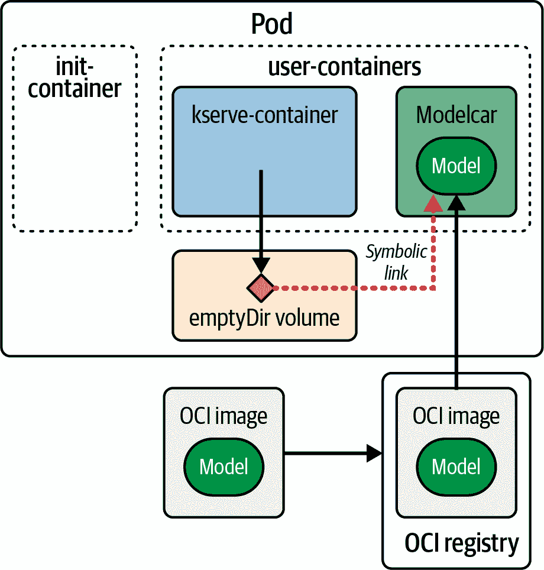

## 第 2 章 模型数据

在 Kubernetes 上运行 LLM 时，最根本的挑战之一是管理模型数据的庞大体积。LLM 的大小可以从几 GB 到近 TB 不等，而将这些数据高效地带入集群并让运行时可以访问，需要仔细考量。

这些模型的主要部分由模型参数组成，可能极其庞大。表 2-1 列出了一些可以自行运行的较知名模型及其参数数量和大小。还有更多模型，但仅从这个选择中你就能看到巨大的差异。这些模型既包括可能不适合按需使用的大型模型，也包括可以在自己集群上运行、需要时轻松下载的轻量级模型。

*表 2-1. 开源模型及其大小*

| 名称 | 厂商 | 参数 | 大小 |
| --- | --- | --- | --- |
| Llama 4 Maverick | Meta | 4000亿（MoE，170亿激活） | ~800 GB |
| DeepSeek-V3 | DeepSeek | 6710亿（MoE，370亿激活） | ~700 GB |
| Llama 3.1 405B | Meta | 4050亿 | ~750 GB |
| Qwen3-235B | 阿里巴巴 | 2350亿（MoE，220亿激活） | ~118 GB |
| Mixtral 8x22B | Mistral | 1410亿（MoE，390亿激活） | ~88 GB |
| GPT-OSS 120B | OpenAI | 1170亿（MoE，50亿激活） | ~70 GB |


| Gemma 2 27B | Google | 270亿 | ~54 GB |

| Granite 13B | IBM | 130亿 | ~26 GB |

| Falcon 2 11B | TII | 110亿 | ~22 GB |

| Mistral 7B | Mistral | 70亿 | ~14 GB |

即使是较小的模型，在集群内高效管理也会给 Kubernetes 管理员带来重大挑战。理解如何有效存储和组织这些大型数据集，对于成功的 LLM 运维至关重要。

在本章中，我们将探讨如何在 Kubernetes 集群中高效管理数据密集型工件。大多数时候，ML 模型可以被视为黑盒，由第 1 章所述的推理服务访问。然而，了解用于分发这些模型的打包格式对于成功集成仍然很有价值。下一节将概述最重要的 LLM 存储格式。

运行 LLM 的另一个关键方面是发现在哪里找到以及如何检索模型数据。*模型注册表*的概念在第 46 页的“模型注册表”中讨论，为模型发现和访问提供了一种实用的解决方案。

最后，模型必须下载到集群中才能使用。第 59 页的“在 Kubernetes 中访问模型数据”概述了 Kubernetes 原生的高效获取和访问模型数据的方法。

带着这个路线图，让我们从考察 LLM 数据如何打包和存储开始。

### 模型数据存储格式

处理 LLM 时，我们首先注意到的是它们庞大的规模，以数十亿参数计。然而，在 Hugging Face 等平台上共享的模型不仅包含原始权重参数。这些分发的模型还包括元数据，在某些情况下还包括模型架构，该架构定义了神经网络层和 Transformer 之间的连接方式。

对于运维人员来说，这些分发的模型通常感觉像黑盒。然而，了解它们以哪种格式存储至关重要，因为并非每个打包模型都能在每种运行时上运行，如第 1 章所述。有些格式非常灵活，可以由多个运行时操作，而另一些则与特定的运行时平台紧密绑定。

从高层次来看，模型存储格式可以分为两类：

- *仅权重格式*：这些格式只存储神经网络的已学习参数：权重和偏置。它们不包含架构、超参数和元数据，因此运行时在应用权重之前必须已经知道如何重建网络。

- *自包含格式*：自包含格式同时存储权重和模型架构，以及超参数和其他元数据。它们允许在不需要预先了解网络结构的情况下加载和运行模型，因此更容易作为独立工件部署。

这两类之间的界限是渐进的。一些看似自包含的格式可能仍需要外部组件，例如语言模型的分词器文件。

对于 LLM，趋势正朝着*基本自包含*的格式（如 GGUF 和 Safetensors）发展。这些格式简化了分发，但仍与专门的运行时紧密耦合。真正的运行时独立性——即无论模型训练框架如何，都可以在任何兼容环境中加载和运行模型——仍在推进中。第 67 页“CNCF ModelPack 规范”中描述的 CNCF ModelPack 规范是朝这个方向进行标准化的一次尝试。在这种方法中，模型数据被打包到 Open Container Initiative（OCI）容器镜像中（参见第 57 页“什么是 OCI？”）。

在理想情况下，就像 OCI 容器镜像抽象了应用程序内部一样，模型存储格式应该在模型数据（由数据科学家生成）和模型执行（由 MLOps/DevOps 工程师在生产中管理）之间划出清晰的界限。然而，当今的格局优先考虑快速让模型投入运行，而不是标准化运行时兼容性。随着该领域的成熟，可以预期模型创建与部署关注点之间的分离会更加明显。

### 仅权重格式

*仅权重*模型格式存储训练好的神经网络的数值参数（权重和偏置），而不包含模型架构或预处理组件。这些格式通常在开发和实验阶段使用，因为在这些阶段，灵活性和最小开销更为重要。

由于仅权重格式缺乏架构细节，运行时必须已经知道网络结构。这种知识使运行时能够正确重建模型并应用存储的权重。仅权重格式与其各自的机器学习框架紧密耦合。

最常用的仅权重格式对应于两大主流 ML 框架：PyTorch 和 TensorFlow。虽然这两个框架都提供了自己的序列化格式，但 PyTorch 已成为 LLM 开发的事实标准（更多细节见第 6 章）。用于 LLM 和其他 AI 模型的一些常见仅权重格式包括：

- *PyTorch State Dict*（`.pt`、`.pth`）：PyTorch 的原生格式，使用 `torch.nn.Module` 的 `state_dict` 方法序列化权重张量。在开发和微调阶段，它被广泛用于 Llama、GPT 和 BLOOM 等 LLM。

- *TensorFlow checkpoints*（`.ckpt`）：一种主要在 TensorFlow 生态系统中用于存储模型权重的格式。虽然它在历史上曾被用于 BERT 等模型，但随着使用自身格式的 PyTorch 在生成式 AI 领域占据主导地位，它与现代 LLM 的相关性已经下降。

- *NumPy arrays*（`.npy`、`.npz`）：NumPy 用于序列化数值数组的原生格式。虽然它对于存储较小的模型或单独的权重矩阵仍然有用，但缺乏现代 LLM 部署所需的结构和元数据。

这些格式主要存储带有最少元数据的原始张量数据，因此非常紧凑，但依赖于外部运行时代码。

如图 2-1 所示，以仅权重格式存储的模型需要在推理期间重建相同的网络架构。你必须在推理环境中手动复制训练架构，确保双方都能正确解释存储的权重张量。



*图 2-1. 以仅权重格式存储的模型示例*

虽然在开发和实验阶段，仅权重存储格式非常适合，但它们与评估这些参数的机器学习代码紧密耦合。

### 自包含格式

更适合生产部署的是以*自包含*格式存储和分发的模型，这种格式不仅包含原始权重，还捆绑了更多内容。这些格式包含关键元数据和结构信息，使得模型更易于分享，并可在多种运行环境中运行，而无需使用训练时的原始代码库。

自包含模型可以携带以下信息：

- *权重和偏置*：神经网络的数值参数，构成了模型体积的主要部分。

- *模型架构*：可以是对已知架构的引用，也可以显式描述为层组成的连接图。

- *分词器与词汇数据*：语言模型中通常包含这些数据，用于在推理前对文本进行预处理。

- *超参数*：如学习率、批量大小和训练时期数等信息。

- *其他元数据*：描述性信息，如模型来源、作者，以及有助于模型发现和复现的附加上下文。

有些自包含格式还支持*前处理和后处理*脚本，用于在推理前转换输入并在推理后将输出转换为可用形式。

图 2-2 展示了以自包含格式存储的模型，其中所有组件捆绑在一起，使运行时独立于原始训练代码。



*图 2-2. 自包含模型示例，其运行时独立于训练代码*

虽然完全自包含格式旨在封装推理所需的一切，但截至 2026 年，实际上并不存在这样的格式。如今没有任何被广泛使用的格式能够将推理所需的所有组件——模型权重、分词器、词汇数据和完整架构——打包在单个工件中。因此，即使是常被称为“自包含”的格式，也更适合归类为*大体自包含*，因为它们仍然依赖外部组件和运行时依赖。这些大体自包含的格式可能会捆绑模型权重和部分元数据，但通常会省略分词器或详细模型架构等关键组件，从而仍然受限于特定的推理运行时或框架，因为这些运行时/框架“知道”如何正确解读存储的数据。例如，Safetensors 和 GGUF（后面会详细介绍）等流行格式包含模型权重和一些元数据，但仍需要外部组件才能完成完整的模型推理。

常见的 LLM *大体自包含*格式包括：

- *Safetensors*（`.safetensors`）：一种大体自包含的格式，专为安全高效的权重存储而设计，常用于 Hugging Face 等平台上的 LLM。虽然与标准 PyTorch 权重文件相比，它在安全性和性能上有所提升，但分词器信息（如 *tokenizer.json*）和模型架构定义并未嵌入其中，因此在推理时需要额外的文件或运行时知识才能完整重建模型。更多详情请参见第 42 页的“Safetensors”。

- *GGUF/GGML*（`.gguf`、`.ggml`）：专门的自包含格式，针对量化权重的高效推理进行了优化，支持 CPU 和 GPU 执行。它们包含模型权重和基本架构元数据，但仍与 llama.cpp 和 vLLM 等运行时紧密相关，这些运行时专为高效处理量化结构而设计。GGUF 还可以存储分词器数据（如词汇数据和特殊标记）。更多关于 GGUF 的信息请参见第 44 页的“GGUF 和 GGML”。

- *ONNX*（`.onnx`）：一种用于模型互操作性的通用自包含格式。ONNX 常被描述为自包含格式，它存储模型权重、架构和元数据，但缺少对 LLM 至关重要的分词器和词汇数据等组件。这使得它只能算大体自包含，需要额外的文件才能完成完整的语言模型推理。更多详情请参见第 41 页的“ONNX”。

- TensorFlow SavedModel：一种完全自包含的、基于目录的格式，存储权重、架构和辅助文件。虽然在 TensorFlow 生态系统中很常见，但很少用于现代 LLM。

- Hugging Face Transformers：Hugging Face Transformers 格式最好被描述为一种打包约定，而不是独立的模型格式。它将模型组织到一个目录中，其中包含运行语言模型所必需的多个文件。这种约定通常包括模型权重（以 Safetensors（`*.safetensors*`）或 PyTorch 的 `state_dict`（`*.bin*`）等格式存储），以及两个关键文件：*tokenizer.json* 和 *config.json*。这些文件在确保模型能够处理输入数据并在推理时应用正确的架构方面起着至关重要的作用。

#### tokenizer.json 和 config.json

*tokenizer.json* 和 *config.json* 文件是在 Hugging Face 生态及其他环境中有效运行 LLM 的关键组件。*tokenizer.json* 文件存储标记化规则和词汇映射，用于将原始文本转换为 token ID。它定义了输入文本如何拆分为 token（使用字节对编码（BPE）等技术），并包括用于填充、序列起始和序列结束标记的特殊 token。*config.json* 文件描述模型架构和超参数，包含层数、注意力头数、隐藏大小和前馈维度等信息。它还经常指定模型类型（例如 `llama`），并影响运行时如何重建模型图。这些文件共同确保模型能够正确预处理输入（*tokenizer.json*）并构建所需的网络结构（*config.json*）。缺少它们时，运行时无法正确地对输入文本进行标记化，也无法加载模型架构进行推理。

这些文件已成为机器学习社区的事实标准，其用途已超出 Hugging Face 生态。Hugging Face 之外的框架和工具也常常采用这些约定，以实现模型互操作性和一致性。

如我们所见，当前大多数 LLM 模型格式都属于*大体自包含*的范畴，常常省略分词器、词汇数据和预处理逻辑等关键组件。尽管存在这些不足，一些格式由于其在可移植性和效率之间的平衡而获得了广泛采用。如今最常用于 LLM 部署的是 Safetensors 和 GGUF/GGML，两者都针对带元数据的高效权重存储进行了优化。虽然 ONNX 在 LLM 中使用较少，但它作为一个更有完全自包含性格式的有用参考，尽管要真正完整，它还需要分词器定义等额外元素。在接下来的章节中，我们将更详细地探讨 ONNX、Safetensors 和 GGUF/GGML。

### 追求真正的模型可移植性

接下来的三个部分将深入探讨特定模型格式的技术细节。虽然这些细节似乎与 Kubernetes 操作关系不大，但它们解决了一个基本的运维问题：实现模型数据与运行时执行之间的清晰分离。

目标是实现真正的模型可移植性，使模型能够作为自包含工件进行分发和执行，就像 Docker 彻底改变了任意软件工作负载在不同环境中的部署方式一样。达到这种可移植性水平，需要在模型文件结构和能够执行这些模型的运行时之间进行更广泛的标准统一。理想情况下，以标准化格式存储的模型可以被任何兼容的运行时加载。这将消除针对标记化、量化或架构细节的手动调整。这样的转变将赋能更多样化的工具和框架，减少对特定生态系统的锁定，同时使模型分发像容器化应用一样无缝。

这种分离是终极目标，它能让运维人员将模型视为可互换的工件，独立于执行它们的运行时。我们尚未达到这一理想状态，但审视现有格式可以揭示我们离实现真正的运行时-模型独立性还有多近。如果你对模型发现和分发的实际方面更感兴趣，而不是格式内部细节，可以直接跳到第 46 页的“模型注册表”，我们在那里讨论模型注册表。

### ONNX

开放神经网络交换格式（ONNX）由微软和 Facebook 于 2017 年共同开发，旨在作为一种与框架无关的格式来表示机器学习模型。ONNX 的目标是标准化模型在不同工具之间的共享方式，使开发者能够在一个框架中训练模型，并在另一个框架中部署，而无需进行特定于框架的转换。

ONNX 模型使用 Protocol Buffers（Protobuf）以紧凑且平台中立的方式存储在单个 `.onnx` 文件中。每个文件包含三个主要组件：第一，计算图定义网络的结构和数据流；第二，学习到的参数包括权重和偏置；第三，元数据描述输入/输出规范、算子集和版本详细信息。这种结构使 ONNX 成为自包含格式的一个很有前景的例子，因为它将架构、权重和操作元数据组合在单个工件中。

然而，ONNX 对 LLM 来说并不足够，因为它缺少分词器、词汇表数据和预处理逻辑等关键组件。对于自然语言生成等任务，这些信息的缺失使得必须随 `.onnx` 模型一起提供额外文件。没有这些组件，单独的 ONNX 模型无法将原始文本转换为分词后的输入，从而限制了它在现代 LLM 部署中的适用性。这一差距使其在语言模型场景中无法完全自包含。

ONNX 在 ONNX Runtime、TensorRT、OpenVINO 和 Triton Inference Server 等运行时上得到广泛支持，因此具有很高的可移植性，但兼容性取决于模型使用的操作集（如矩阵乘法、卷积和注意力机制）。每个运行时都支持一个已定义的算子集（`opset`），该算子集规定了模型可以使用的可用操作。如果模型依赖运行时支持集之外的操作，则可能无法加载，除非通过插件或自定义运行时扩展来扩展。这一挑战进一步使其难以用于 LLM 等复杂架构，在这些架构中，分词和文本预处理步骤是模型功能不可分割的组成部分。

尽管存在这些限制，ONNX 为 LLM 的完全自包含模型格式提供了一个概念蓝图。如果扩展更丰富的元数据并原生支持分词器定义，它可能为 LLM 用例提供更完整的解决方案。截至 2026 年，ONNX 仍然更适合计算机视觉等领域的模型，这些领域的预处理通常更简单，与模型的耦合度也更低。

接下来，我们将探讨 Safetensors，这是一种目前更常用于 LLM 部署的格式，提供优化的权重处理并包含一定程度的元数据。

### Safetensors

Safetensors 由 Hugging Face 于 2021 年开发，是一种现代模型序列化格式，旨在安全地存储和共享机器学习模型权重，同时解决 PyTorch 的 `.pt` 和 `pickle` 等早期格式的安全漏洞和性能限制。常用于 PyTorch 的 pickle 格式在反序列化模型时可以执行任意 Python 代码，在共享模型时带来重大安全风险。相比之下，Safetensors 严格专注于存储张量数据，从而避免代码执行漏洞，成为更安全、更高效的模型序列化选择。

Safetensors 文件遵循一种简单而高效的结构，如图 2-3 所示。



*图 2-3. Safetensors 模型的内部结构*

每个 `.safetensors` 文件都以一个包含元数据的头部开始，其中包括一个描述文件中存储的每个张量的序列化 JSON 对象。头部包含张量的数据类型、形状以及张量数据在文件中的字节偏移等详细信息。这种结构支持零拷贝加载，可以将张量数据直接映射到内存，而无需不必要的 CPU 开销，从而提高推理速度，尤其是在处理 LLM 时。

Safetensors 支持分片（sharding），允许将大型模型拆分到多个较小的文件中。每个分片包含模型张量的一部分，并附带一个索引文件（例如 `model.safetensors.index.json`）。索引文件将不同层中的张量名称映射到各自的分片文件。例如，Llama 4.1 405B 发布了 30 个 safetensor 文件，命名类似 `model-0000x-of-00030.safetensors`，并附带一个 `model.safetensors.index.json` 文件，如示例 2-1 所示。

*示例 2-1. 将张量映射到分片文件的索引文件*


```json
{
  "metadata": {
    "total_size": 141107412992
  },
  "weight_map": {
    "lm_head.weight": "model-00030-of-00030.safetensors",
    "model.embed_tokens.weight": "model-00001-of-00030.safetensors",
    "model.layers.0.input_layernorm.weight": "model-00001-of-00030.safetensors",
    "model.layers.0.mlp.down_proj.weight": "model-00001-of-00030.safetensors",
    "model.layers.0.mlp.gate_proj.weight": "model-00001-of-00030.safetensors",
    "model.layers.0.mlp.up_proj.weight": "model-00001-of-00030.safetensors",
    ...
    "model.layers.1.input_layernorm.weight": "model-00002-of-00030.safetensors",
    "model.layers.1.mlp.down_proj.weight": "model-00002-of-00030.safetensors",
    "model.layers.1.mlp.gate_proj.weight": "model-00001-of-00030.safetensors",
    "model.layers.1.mlp.up_proj.weight": "model-00002-of-00030.safetensors",
    ...
  }
}
```

所有模型权重的总大小（以字节为单位）（此模型约为 131 GB）。

将每个张量名称映射到包含它的特定分片文件。

示例映射显示最终输出层权重位于分片文件 30 中。

其他张量映射显示了不同层如何分布在分片文件中。

分片对于超大模型尤其有用，因为存储限制可能使单个文件变得不切实际。这种方法还支持并行加载，因为可以同时获取和处理不同的分片。

虽然 Safetensors 提高了模型权重存储的安全性和性能，但它仍然属于“大部分自包含”格式，而不是完全自包含。主要限制在于分词器信息和模型架构定义不包含在 `.safetensors` 文件本身中。语言模型推理必须单独提供 `tokenizer.json` 和 `config.json` 等关键文件，这是它仍然与提供这些额外元数据的 Hugging Face Transformers 生态系统紧密耦合的一个关键原因。

该格式的结构及其对安全序列化的关注使其越来越受欢迎，尤其是在 LLM 存储和共享方面。Safetensors 现在是 Hugging Face 上分发的许多大规模模型的默认权重格式。

接下来，我们将探讨 GGUF，这是一种更专门针对 LLM 的格式，针对基于 CPU 的推理进行了优化，旨在实现 LLM 的高效部署。

### GGUF 和 GGML

GPT 生成统一格式（GGUF）及其前身 GPT 生成模型语言（GGML）是为在 CPU 和边缘设备等资源受限硬件上优化 LLM 的存储和执行而开发的专用格式。两者都源于 Georgi Gerganov 领导的 llama.cpp 项目，专注于以最低硬件要求实现高效推理。GGML 是重要的第一步，而 GGUF 则是一项重大改进，解决了其前身的许多局限性。

GGUF 和 GGML 的一个标志性特征是它们对量化的关注，量化是一种将模型权重的精度从浮点值降低到 8 位、4 位甚至 2 位整数等低位表示的技术。通过降低精度，内存占用和计算开销都显著减少。这使得模型无需专用 GPU 也能有效运行，同时保持可接受的推理精度。

GGUF 的一个关键改进是它对向后兼容性的重视。随着 LLM 的发展及其架构变得越来越复杂，保持与现有工具的兼容性可能很困难。GGUF 的模块化设计允许较新的模型在核心组件保持不变的情况下，与较旧的运行时版本保持兼容。这有助于避免在更新模型时频繁进行格式转换。向后兼容性设计还最大限度地减少了版本之间转换的影响。当 GGUF 更新以支持新功能时，现有模型无需转换即可继续使用。

与为广泛机器学习任务设计的通用格式 ONNX 不同，GGUF 专门用于 LLM 推理。虽然最初是为基于 CPU 的推理设计的，但现在 GGUF 已通过 llama.cpp 和 vLLM 等运行时广泛支持 CPU 和 GPU 执行。

与 Safetensors 相比，GGUF 尝试将更多元数据直接捆绑在模型文件本身中，包括基本的分词器信息和运行时元数据。Safetensors 主要关注权重存储，元数据极少，并依赖外部文件提供分词器定义和模型配置，而 GGUF 则将 token 映射和模型参数存储在单个文件中。GGUF 仍然依赖特定的外部运行时来完成推理，因此它仍属于“大部分自包含”格式的范畴。

GGUF 文件由结构化的二进制布局组成。它以一个魔数和版本字段开头，用于标识文件类型。随后是一个包含量化张量数据的部分，这些数据以字节偏移量存储，以便高效访问。元数据部分描述了模型的架构、量化类型和词元映射。张量信息块定义了文件中每个张量的数据类型、形状和内存位置。这种单文件设计在 Kubernetes 环境中尤其有益，因为一致、自包含的工件可以简化编排和扩展。图 2-4 展示了 GGUF 文件的结构。



*图 2-4. GGUF 文件的内部结构（来源：@mishig25，GGUF v3）*

GGUF 代表着高效部署 LLM 的一次飞跃，尤其是在缺乏高端 GPU 的硬件上。它对量化、自包含设计和向后兼容性的关注，解决了早期格式的许多痛点。

### 当前状态与差距

虽然 ONNX 是一种适用于通用机器学习模型的自包含格式，而 GGUF 为 LLM 提供了专门的自包含解决方案，但这两种格式都暴露了模型可移植性方面的重要差距。ONNX 提供了一种结构化的模型打包方式，但缺少 LLM 所需的分词器等关键组件；而 GGUF 包含了基本的分词器元数据，但仍与 llama.cpp 等特定运行时紧密耦合。

LLM 开发的格局仍在快速演进。新的架构、优化技术和运行时改进不断涌现。每一种都会引入专门的配置，这对通用标准的概念构成了挑战。在该领域成熟之前，像 GGUF 和 Safetensors 这样大体上自包含的格式，很可能仍然是平衡性能、兼容性和灵活性的最实用选择。真正的标准化，就像 OCI 在容器领域取得的成功一样，需要运行时能力和模型表示标准的共同汇聚，这是一个仍有相当距离的里程碑。虽然 GGUF 主导着 llama.cpp 生态系统，但 Safetensors 在生产部署中越来越被采用。其多文件结构与 OCI 工件配合良好，模型组件可以作为独立层分发，从而实现高效缓存和并行下载。

理解模型文件的结构和格式有助于选择合适的工具和运行时，但归根结底，LLM 只是一组文件的集合，无论是完全自包含还是分布在多个工件中。在 Kubernetes 环境中有效管理这些文件，需要一种索引、发现和组织它们的方法，这正是我们接下来要讨论的模型注册表所扮演的角色。

### 模型注册表

模型注册表提供了一个用于管理模型、跟踪版本、治理以及存储 ML 工件元数据的中心系统。它在机器学习生命周期中扮演着关键角色，弥合了模型实验与生产部署之间的鸿沟。模型注册表既是发现机制，又是协作平台，它简化了模型在大规模下的跟踪、验证和部署方式。

与公共注册表不同，大多数组织将模型注册表部署为集群内的本地服务，并且不会把这些注册表暴露在集群之外。注册表主要管理模型元数据，而不是存储实际的模型权重或工件。相反，它们引用外部对象存储（如 AWS S3 存储桶），实际模型数据就存放在那里。这种元数据与模型存储的分离，确保在管理大型模型时具有更大的灵活性，同时使元数据在集群内易于访问。

通过为管理模型及其元数据提供结构化且安全的接口，模型注册表成为大规模落地机器学习的关键工具，尤其是在 Kubernetes 这类动态环境中。

模型注册表处于数据科学家和 MLOps 工程师职责的交汇点。对数据科学家而言，它支持在模型实验期间创建和跟踪变更、验证性能和指标跟踪、打包工件以实现可复现性，以及将已验证的模型发布到生产环境。对 MLOps 工程师而言，模型注册表有助于部署带有相关元数据的已批准模型，同时还支持对已部署模型进行持续监控，以评估性能、漂移和必要的重新训练，尽管这种可观测性水平被认为是超出模型注册表核心功能的高级特性。

关于本节提到的 ML 术语“模型实验”和“特征存储”的背景信息，请参阅下一个侧栏。

#### 模型实验与特征存储

*模型实验*指的是使用不同超参数（如学习率或批次大小等设置）训练多个模型变体的迭代过程，以找到性能最佳的配置。每次训练运行都会产生准确率或损失等指标。从 Kubernetes 的角度来看，这通常作为 GPU 密集型训练任务运行，相关内容将在第 6 章和第 7 章中介绍。实验跟踪系统会记录这些运行的参数和指标。MLflow（本章稍后介绍）在其更广泛的工具集内提供了实验跟踪功能。

机器学习中的*特征*是模型用于预测的输入变量——例如，欺诈检测系统中的“最近一小时的交易笔数”或“30 天内的平均金额”。*特征存储*统一管理这些特征在训练和推理中的计算与提供，从而防止训练-推理偏差。特征计算通常以数据管道的形式运行，这将在第 8 章讨论。对于生成式 AI 工作负载，特征不如传统机器学习中那样核心，因为 LLM 主要处理文本和嵌入，而非结构化特征。Feast 是一个领先的开源特征存储，既管理传统机器学习特征，也管理用于检索增强生成等生成式 AI 应用（参见第 274 页的“检索增强生成”）的文本嵌入。

这两个概念都凸显了协作式 ML 工作流：数据科学家进行实验和迭代，而平台团队则提供使这项工作可扩展的 Kubernetes 基础设施（GPU 节点、持久化存储、批量调度）。模型注册表充当交接点，存储成功实验的元数据，为生产部署做好准备。

以下列表概述了定义模型注册表的核心特性，为公共和本地用例提供了基本能力：

- *元数据管理*：存储关于模型准确率、数据集谱系、性能基准以及其他关键元数据的信息。

- *模型发现与搜索*：基于架构、超参数、训练数据集和性能指标等元数据搜索和检索模型。支持使用范围查询（例如准确率 > 0.95）进行过滤。

- *版本控制*：跟踪模型和训练数据集的多个版本。模型版本管理能够比较不同的模型迭代，并在必要时回滚；数据集版本管理则通过跟踪训练和评估所使用的数据版本来确保可复现性。

- *生命周期管理*：管理模型所处的阶段，如实验、预发布、生产及退役。该特性在持续开发工作流中尤为关键。

- *访问控制*：为模型可见性和使用提供细粒度权限，确保跨团队的安全协作。

- *审计与合规*：维护模型使用、审批和变更记录，以确保符合法规并可复现。

- *数据管道*：集成到 CI/CD 工作流中，自动化模型验证、工件打包和生产发布等任务。

为了更清晰地理解这些特性在实际工具中是如何实现的，我们将考察四个著名的模型注册表：Hugging Face Model Hub、MLflow Model Registry、Kubeflow Model Registry 和 OCI Registries。

#### Hugging Face Model Hub

Hugging Face Model Hub 是发现和共享开源机器学习模型（包括 LLM）的权威平台。截至 2026 年初，它总共托管了超过两百万个模型，其中 LLM 超过 31 万个，全部可公开获取。就像 GitHub 是开源软件开发的主要枢纽一样，Hugging Face 已确立了自己作为开源 ML 模型领先平台的地位。

目录中的每个模型条目都附有一张 *模型卡*。模型卡提供机器学习模型关键特征的标准化摘要，包括其预期用例、训练数据集、性能基准和局限性。它通常包含用于训练的数据集链接、评估指标和许可信息。用户还可以通过交互方式试用模型。

内置推理小部件，可以直接从 Web 界面快速测试模型，无需本地设置。图 2-5 展示了一个模型卡示例。



*图 2-5. Llama 3.1 的 Hugging Face 模型卡（来源：**Llama 3.1**）*

除了 Web 界面之外，Hugging Face 还提供了 REST API，用于以编程方式访问其仓库。这使开发人员能够查询模型、检索元数据，并将模型直接集成到自动化工作流和管道中。该 API 简化了诸如发现模型最新版本或根据特定条件筛选模型等任务。

虽然 Hugging Face Hub 非常适合公共模型共享和手动发现，但它对于生产环境的使用存在局限性。作为一个公共注册表，它不适合需要将专有模型保持私密的组织。在需要以编程方式跟踪和管理模型版本的完全自动化工作流中，它也可能会成为限制因素。对于此类场景，专用的内部模型注册表对于确保版本控制、可追溯性、隐私性以及与生产管道的更紧密集成变得至关重要。

#### MLflow 模型注册表

MLflow 是一个 Linux 基金会项目，管理机器学习生命周期，包括实验跟踪、模型打包和模型注册表。

MLflow 由 Databricks 于 2018 年创建，旨在解决跨团队和环境一致地管理机器学习实验和模型工件的挑战。自作为开源项目发布以来，MLflow 因其简单性和集成能力而在数据科学社区中被广泛采用。

MLflow 的核心要素是*跟踪服务器*，它是管理和存储所有实验元数据、指标和模型工件的主要中心。它提供了一个界面，数据科学家可以在其中记录结果、比较运行，并组织他们的模型并将其暴露在模型注册表中。丰富的可视化集允许您跟踪性能数据的变化以及不同的超参数。

在最简单的情况下，模型本身存储在本地文件系统上。对于生产环境，MLflow 支持将模型工件推送到外部存储系统（如 AWS S3）或直接从 Hugging Face Hub 下载。MLflow 通过存储在注册表元数据中的工件 URI 来管理对这些存储位置的引用。

MLflow 模型注册表是此跟踪服务器的一部分，为版本控制、跟踪和管理机器学习模型提供了一个集中式仓库。它允许数据科学家注册具有丰富元数据的模型，包括版本历史和性能指标。图 2-6 显示了 MLflow 模型注册表的 Web UI。



*图 2-6. **MLflow** 模型注册表 UI*

然而，大多数情况下，数据科学家以编程方式与 MLflow 模型注册表交互，如示例 2-2 所示。

**示例 2-2.** *使用 MLflow 以编程方式记录和注册模型*

```python
mlflow.set_tracking_uri(uri="http://localhost:8000")
mlflow.set_experiment("MLflow Demo")
params = {
    "solver": "lbfgs",
    "multi_class": "auto",
    "max_iter": 2500,
}

with mlflow.start_run():
    mlflow.log_params(params)
    model_info = mlflow.sklearn.log_model(
        sk_model=model,
        artifact_path="my_model",
        input_example=X_train,
        registered_model_name="my-model",
    )
```

设置用于记录的跟踪服务器 URI。

创建新的 MLflow 实验。

模型超参数。

记录这些超参数。

在跟踪服务器上记录模型本身。`model` 和 `X_train` 的定义在此处未显示。

对于 MLOps 工程师，MLflow 提供了可用于模型发现的 REST API。示例 2-3 展示了如何获取给定模型的详细信息。

**示例 2-3.** *通过 **MLflow** REST API 搜索和列出模型*

```bash
$ curl http://localhost:8000/api/2.0/mlflow/registered-models/search
{
    "registered_models": [
        {
            "name": "my-model",
            "creation_timestamp": 1736523034148,
            "last_updated_timestamp": 1736524822538,
            "latest_versions": [
                {
                    "name": "my-model",
                    "version": "4",
                    "creation_timestamp": 1736524822538,
                    "last_updated_timestamp": 1736524822538,
                    "current_stage": "None",
                    "description": "",
                    "source": "mlflow-artifacts:/84948067/f0dd25483e/artifacts/my_model",
                    "run_id": "f0dd25483e234400b7",
                    "status": "READY",
                    "run_link": ""
                }
            ]
        }
    ]
}
```


访问在本地机器上运行的 MLflow 服务器。

注册表中的模型是版本化的。

使用 MLflow 的 `mlflow-artifacts://` 方案对模型工件进行 URI 引用。在此本地设置中，工件存储在文件系统上，但该方案支持 S3 或 GCS 等外部存储。

MLflow 提供了与模型服务器交互的 CLI 工具，如示例 2-4 所示。这里一个有趣的选项是创建一个自包含的 OCI 容器镜像，您可以将其推送到 OCI Registry 以供稍后在 Kubernetes 集群中使用。然而，此功能并未针对需要本地存储的大量下载进行优化，因此不太适合 LLM。我们将在第 57 页的“OCI Registry”中描述如何使用 OCI Registry 存储模型数据。

**示例 2-4.** 使用 MLflow 和 Podman 创建自包含的 OCI 容器镜像

```text
$ mlflow models generate-dockerfile \
    -m mlflow-artifacts:/84948067/f0dd25483e/artifacts/my_model
... INFO mlflow.models.cli: Generating Dockerfile for model mlflow-artifacts:
    .../artifacts/my_model
... INFO mlflow.models.flavor_backend_registry: Selected backend for flavor 'python_function'
... INFO mlflow.models.cli: Generated Dockerfile in directory mlflow-dockerfile
$ cd mlflow-dockerfile
$ podman build -t my_model .
STEP 1/12: FROM python:3.13.1-slim
STEP 2/12: RUN apt-get -y update && apt-get install -y --no-install-recommends nginx
....
Successfully tagged localhost/my_model:latest
a828556afe0d53d4728d872aa51fe07eaa1d4ef4faedb5a788bac9a7a7651e73
```


使用 `mlflow` CLI 生成一个 Dockerfile，该文件描述了如何构建包含 MLflow 和模型数据的镜像。

使用 `podman` 创建名为 `my_model` 的 OCI 镜像。或者，您也可以使用 Docker 来构建镜像。

MLflow 还提供了一个 `mlflow models build-docker` 命令，将两个步骤合并为一个操作，直接创建 Docker 镜像，而无需生成单独的 Dockerfile。这里展示的 `generate-dockerfile` 方法为定制提供了更多灵活性（例如，修改基础镜像或添加构建后步骤），并且可以与 Podman 或 Docker 无缝协作。

虽然 MLflow 最初并非为 Kubernetes 而设计，但该平台可以有效地部署在 Kubernetes 上。标准方法是使用 Helm charts 等工具将其部署为 Web 服务，其中 PostgreSQL 数据库通常用作存储元数据的后端。MLflow 不引入原生的 Kubernetes CRD，这意味着它与 Kubernetes 的集成需要额外的自动化来处理诸如扩展和动态模型服务等任务。

MLflow 虽然功能丰富，但最初是为传统 ML 工作流而设计的。其元数据管理和工件处理非常适合传统 ML 用例，但 LLM 由于其规模和复杂性，通常需要专门的处理。从 3.0 版本开始，MLflow 显著改进了其对 LLM 的支持，通过 Transformers flavor 引入了内存高效的日志记录，避免在工件存储期间将大型模型加载到内存中。最近的增强功能包括：用于提示版本管理的 Prompt Registry、用于统一 LLM 提供商访问的 AI 网关、原生的 GenAI 评估能力、针对 LLM 应用的增强追踪，以及基于引用的日志记录（存储 Hugging Face Hub 引用而非完整模型权重），从而大幅减少了开发期间的存储需求。

然而，对于生产部署，通常仍然需要下载并本地存储完整的模型权重，以确保可用性和性能。话虽如此，这些方法可能会在生产环境中带来挑战，例如失去对外部仓库的访问权限，或者重复检索大型模型的缓存机制不足。因此，MLflow 的工件存储和模型处理技术虽然不断改进，但仍可能需要补充基础设施来支持大规模 LLM 管理。例如，从注册表重复下载大型模型可能变得低效，而 MLflow 当前的工件存储方法并未针对此类高容量数据处理进行优化。

总之，MLflow 主要关注 ML 生命周期中的数据科学方面，提供了丰富的功能集来跟踪数据科学实验。它最大的优点是易于使用，并且可以轻松安装在本地机器上。

虽然 MLflow 可以部署在 Kubernetes 上，但其集成仍然有限。对于更 Kubernetes 原生的解决方案，像 Kubeflow 这样的替代方案通过更深入的 Kubernetes 集成和额外的可观测性功能扩展了模型注册表的概念。

## Kubeflow 模型注册表

Kubeflow 是一个 Kubernetes 原生平台，旨在简化整个机器学习生命周期，包括模型训练、模型服务和模型注册表管理。Kubeflow 最初由 Google 开发，现在是 CNCF 下的开源项目，由以下松散连接的组件组成：

- **Kubeflow 仪表盘**：一个中央仪表盘和中心，连接 Kubeflow 和其他生态系统组件的经过认证的 Web 界面。

- **Kubeflow Notebooks**：用于在 Kubernetes 集群内通过 pod 运行基于 Web 的开发环境（如 Jupyter Notebooks）的组件。无需本地安装。

- **Kubeflow Pipelines**：Kubeflow Pipelines (KFP) 是一个使用 Kubernetes 构建和部署可移植、可扩展机器学习工作流的平台。

- **Kubeflow Trainer**：Kubeflow Trainer 是在 Kubernetes 上进行模型训练和微调的统一接口。它为 PyTorch 或 TensorFlow 等流行框架运行可扩展的分布式训练任务。

- **Kubeflow Katib**：Katib 是一个 Kubernetes 原生的自动化机器学习（AutoML）项目，支持超参数调优、早停和神经架构搜索。

- **模型服务**：KServe（以前称为 KFServing）解决了 Kubernetes 上的生产模型服务问题。它始于 Kubeflow，但后来被移到一个独立的 CNCF 项目。我们将在第 20 页的“KServe”中详细介绍 KServe。

- **模型注册表**：ML 模型的索引和目录。注册表是 Kubeflow 生态系统中的中心枢纽。本节的其余部分将重点介绍此注册表。

图 2-7 概述了模型注册表如何与 Kubeflow 的其他部分交互。

从核心来看，Kubeflow 利用了 Kubernetes 的原则，所有任务（包括模型注册和训练）都定义为容器化工作负载。与 MLflow 这种更灵活的实验跟踪和模型管理工具不同，Kubeflow 通过 CustomResourceDefinitions（CRD）、manifests 和针对每个 ML 生命周期组件的原生控制器提供了更深入的 Kubernetes 集成。



*图 2-7. Kubeflow 架构及其与模型注册表的交互*

Kubeflow 模型注册表充当管理机器学习模型及其版本和相关元数据的中央存储库。它大大简化了从实验到生产部署的过渡。

注册表的核心是使用灵活的实体-关系模型在后台关系数据库（MySQL）中存储元数据。该模型受 Google 的 ML Metadata 项目启发，为存储模型血缘、指标和参数提供了一种结构化、可扩展的方法。Kubeflow 模型注册表可以标准化元数据、实现版本控制，并在 Kubeflow 组件之间提供互操作性。这支持对模型版本进行稳健的跟踪，并重用元数据来进行部署或触发流水线。

该注册表依赖 MySQL 等外部依赖来存储元数据，并且需要持久卷以确保持久性。在生产环境中操作注册表时需要考虑这一点。它提供 REST API 和 Python SDK 以进行交互。

要使用注册表，你需要先注册一个模型及其元数据。示例 2-5 展示了如何在 Python 程序或 Jupyter Notebook 中完成此操作。

*示例 2-5. 在 Kubeflow 模型注册表注册模型*

```python
from model_registry import ModelRegistry

registry = ModelRegistry(
    server_address="http://model-registry-service.kubeflow.svc.cluster.local",
    port=8080,
    author="your name",
    is_secure=False
)

rm = registry.register_model(
    "iris",
    "gs://kfserving-examples/models/sklearn/1.0/model",
    model_format_name="sklearn",
    model_format_version="1",
    version="v1",
    description="Iris scikit-learn model",
    metadata={
        "accuracy": 3.14,
        "license": "BSD 3-Clause License",
    }
)
```

创建到集群中运行的模型注册表的代理。此代码必须在集群内的 pod 中运行，才能访问集群内部的服务地址（`.svc.cluster.local`）。

使用元数据和模型数据位置的引用（本例中为 Google Cloud Storage）注册模型。

当模型在注册表中注册后，你可以通过 Python 库调用轻松访问它。你也可以通过 REST API 直接调用该服务来访问模型，如示例 2-6 所示。

*示例 2-6. 从 pod 中使用 `curl` 查询集群内部的模型注册表*

```bash
kubectl run -it --rm curl --image=curl --restart=Never -- \
    http://model-registry-service.kubeflow.svc.cluster.local/...
```

在临时 pod 中运行 `curl` 命令，以查询集群内部的模型注册表服务。

你还可以使用 KServe InferenceService 访问 Kubeflow 模型注册表，以便使用注册表指向的模型数据初始化 InferenceService。有关如何执行此操作的示例，请参见示例 2-7。

*示例 2-7. InferenceService 从 Kubeflow 注册表访问模型数据*

```yaml
apiVersion: serving.kserve.io/v1beta1
kind: InferenceService
metadata:
  name: iris-model
spec:
  predictor:
    model:
      storageUri: "model-registry://iris/v1"
      modelFormat:
        name: "sklearn"
        version: "1"
```

引用模型 ID 和版本。实际的存储 URI 从模型注册表元数据中检索，这提供了一层额外的间接性，允许在不更新 InferenceService 的情况下更改存储位置。

指定要使用的运行时的格式。

## OCI 注册表

OCI（Open Container Initiative，开放容器倡议）注册表是一种用于存储和分发容器镜像的标准机制，通常用于 Kubernetes 环境。像 Docker Hub 和 Quay.io 这样的常见服务让 Kubernetes 用户可以轻松地存储和管理镜像，而无需自行运行注册表。某些 Kubernetes 发行版（如 Red Hat OpenShift）甚至内置了 OCI 注册表。

### 什么是 OCI？

开放容器倡议（OCI）标准化了容器化应用程序和制品的管理方式。OCI 于 2015 年由 Docker 等公司在 Linux 基金会下创立，确保容器技术的互操作性和厂商中立性。它从 Docker 的专有格式演变而来，以避免锁定，成为一个开放、可扩展的生态系统。

虽然 OCI 始于容器镜像，但现在它通过 OCI 制品规范支持各种制品，如 Helm charts 和生成式 AI 模型。这使得注册表对于现代工作负载非常通用。有关如何通过 modelcars 使用带模型数据的 OCI 镜像，请参阅第 68 页的“Modelcars”；有关 Kubernetes 中原生 OCI 镜像卷挂载，请参阅第 74 页的“OCI Image Volume Mounts”。

OCI 注册表可以存储的不只是容器镜像。随着 OCI 1.1 的引入，该规范扩展为支持 OCI 制品，这是对原始镜像格式的泛化。OCI 制品使你可以存储任意数据类型，这使得 OCI 注册表适合托管机器学习模型，包括 LLM。这意味着注册表可以管理整个模型文件，而不仅仅是引用外部存储。

OCI 注册表提供了版本控制、不可变性、持久性和高效的分发机制，非常适合 LLM 托管。与主要存储模型元数据和外部存储引用的 MLflow 和 Kubeflow 注册表相比，OCI 注册表专注于存储完整的模型数据本身。

LLM 模型镜像是“被动数据镜像”的示例。你不会执行它们；而是将它们用作推理运行时的模型权重和配置的不可变包。如示例 2-8 所示，你可以通过克隆 Hugging Face 仓库轻松创建这样的数据镜像。

*示例 2-8. 用于创建包含模型的容器镜像的 Dockerfile*

```dockerfile
FROM alpine/git
RUN git lfs install \
 && git clone --depth 1 https://huggingface.co/Qwen/Qwen2.5-0.5B-Instruct /models
ENTRYPOINT sh
```

如示例 2-9 所示，这个 Dockerfile 可以直接与 `podman` 或 `docker` 一起使用，创建一个自包含的 OCI 镜像文件，其中包含运行模型所需的所有文件。为简单起见，此示例将整个模型作为单个层添加。在生产环境中，请考虑将每个模型分块作为单独的层添加，以便容器运行时可以独立下载和缓存它们。

*示例 2-9. 使用 `podman` 构建并推送模型文件*

```shell
$ podman build -f Dockerfile.model -t quay.io/rhuss/qwen2.5-0.5b-instruct .
STEP 1/3: FROM alpine/git
Trying to pull docker.io/alpine/git:latest...
Getting image source signatures
...
Writing manifest to image destination
STEP 2/3: RUN git lfs install
 && git clone https://huggingface.co/Qwen/Qwen2.5-0.5B-Instruct
 && ln -s /git/Qwen2.5-0.5B-Instruct /models
Git LFS initialized.
Cloning into 'Qwen2.5-0.5B-Instruct'...
--> b437a8f78e49
STEP 3/3: ENTRYPOINT sh
COMMIT quay.io/rhuss/qwen2.5-0.5b-instruct
--> f680df7c975f
Successfully tagged quay.io/rhuss/qwen2.5-0.5b-instruct:latest
f680df7c975f6bfc806783574003c2b17872e9bf767944380f
$ podman push quay.io/rhuss/qwen2.5-0.5b-instruct:latest
```

构建模型镜像。它将从 Hugging Face Hub 克隆整个仓库，可能需要一些时间。

推送到你可以从 Kubernetes 集群访问的注册表。

通过利用 OCI 注册表，你可以在 Kubernetes 原生基础设施中高效地存储、版本化和分发 LLM 模型，并顺利集成到 MLOps 流水线和声明式工作流中。有关将 OCI 镜像与 modelcars 结合使用的信息，请参见第 68 页的“Modelcars”；有关原生 OCI 镜像卷挂载，请参见第 74 页的“OCI Image Volume Mounts”。这两种方法都允许 KServe InferenceServices 直接从 OCI 镜像加载模型数据。

## 在 Kubernetes 中访问模型数据

既然我们已经了解了各种模型格式以及如何注册它们以进行跟踪和便于发现的解决方案，现在让我们深入了解如何从 Kubernetes 集群内部访问模型数据。

第 1 章描述了在 Kubernetes 上提供 GenAI 模型的几种方式。它们都需要以某种方式下载模型。对于第 1 章中描述的所有运行时，都存在类似的方法来获取模型数据，但为了演示，我们以 KServe 作为典型示例。


在最简单的情况下，存储位置通过在 `InferenceService` 资源中指定一个指向模型数据位置的 `storageUri` 来定义，如示例 2-10 所示。

**示例 2-10. 从 S3 存储获取模型数据的 `InferenceService`**

```yaml
apiVersion: "serving.kserve.io/v1beta1"
kind: "InferenceService"
metadata:
  name: "mnist"
spec:
  predictor:
    serviceAccountName: sa
    tensorflow:
      storageUri: "s3://kserve-examples/mnist"
```

- 与保存身份验证凭据的 `Secret` 关联的 Kubernetes `ServiceAccount`。
- 要使用的运行时，本例中为 `TensorFlow`。
- 对保存模型数据文件的 S3 存储桶的引用。

此 URI 的方案定义了哪个后端存储模型数据以及存储在何处。每个方案都会触发一个所谓的*存储初始化器*，该组件会转换为运行时 pod 的 `init-container`。你可以使用 KServe 的 `ClusterStorageContainer` 资源创建和部署自己的存储初始化器。如示例 2-11 所示，在此资源中，你指定了对包含自定义存储初始化器的镜像的引用，以及应触发该存储初始化器的 URL 方案列表。然后，匹配这些方案的 URL 就可以用作 `InferenceService` 中的 `storageUri` 规范。

**示例 2-11. 添加 `model-registry://` 方案支持的 `ClusterStorageContainer`**

```yaml
apiVersion: serving.kserve.io/v1alpha1
kind: ClusterStorageContainer
metadata:
  name: model-registry-storage
spec:
  container:
    name: storage-initializer
    image: kubeflow/model-registry-storage-initializer
    supportedUriFormats:
    - prefix: model-registry://
```

- 用于执行初始化器逻辑的 OCI 镜像引用。
- 注册 URL 方案 `model-registry`，以便在 `InferenceService` 中使用。

Kubernetes 在模型运行时启动之前，将存储初始化器作为 `init-container` 运行；其唯一目的是让模型数据对服务运行时可用。

### Init 容器和 Sidecar

*Init 容器*和 *Sidecar* 是增强 pod 行为的强大 Kubernetes 模式。Init 容器首先运行，并执行一次性设置任务，例如用主容器所需的数据填充共享卷。另一方面，Sidecar 与主容器并行运行，通常提供辅助功能，如日志记录、数据处理或跨容器数据共享。这些模式共同实现了 pod 的灵活和模块化设计。如需更多见解，请查看 *Kubernetes Patterns* 中描述的 Init 容器和 Sidecar 模式。

表 2-2 展示了 KServe 开箱即用的存储初始化器。

**表 2-2. KServe 存储初始化器**

| 方案 | 描述 | 示例 |
| --- | --- | --- |
| `gs` | 从 Google Cloud Storage 下载 | `gs://kfserving-examples/models/sklearn/1.0/model` |
| `s3` | 从 S3 存储桶下载 | `s3://kserve-examples/mnist` |
| `https` | 使用 HTTP 下载模型数据 | `https://huggingface.co/meta-llama/Llama-3.2-3B` |
| `hdfs, webhdfs` | 从 Hadoop 分布式文件系统访问文件 | `hdfs://path/to/model` |
| `pvc` | 从给定 `PersistentVolumeClaim` 引用的 `PersistentVolume` 复制模型数据 | `pvc://${PVC_NAME}/export` |
| `oci` | 拉取包含模型数据的 OCI 镜像，并通过 modelcar 直接访问；参见第 68 页的“Modelcars”。 | `oci://quay.io/rhuss/kserving-example-sklearn:1.0` |
| `model-registry` | 访问在 Kubeflow Registry 注册的模型；有关此类模型注册表的更多详细信息，参见第 54 页的“Kubeflow Model Registry”。 | `model-registry://iris/v1` |
| `hf` | 直接从 Hugging Face Hub 下载 | `hf://meta-llama/Llama-2-7b-chat-hf` |

Kubernetes 中一种常见模式是使用专用的节点本地卷在容器之间共享数据。表 2-2 中的大多数存储初始化器将模型数据下载到节点本地目录，然后由 LLM 运行时共享和挂载，以便直接访问数据。为此，Kubernetes 提供了 `emptyDir` 卷类型，Kubernetes 会将其初始化为空目录，允许同一个 pod 中的所有容器挂载它。这包括 Init 容器（首先运行）和应用容器（在 Init 容器之后运行）。然后，模型服务运行时挂载此卷以访问准备好的数据。有关此技术的更多细节和变体，请参阅 *Kubernetes Patterns* 中的不可变配置模式。

虽然 `emptyDir` 卷提供节点本地存储，但它们需要为每个 pod 实例复制模型数据。对于多个副本服务于同一模型的场景，更节省存储的方法使用由共享分布式文件系统支持的 `PersistentVolumes`。

### 使用 PersistentVolumes 的共享存储

当你运行 `InferenceService` 的多个副本时，每个副本都需要访问相同的模型数据。我们目前看到的方法要么从远程存储下载新的副本，要么将模型打包到 OCI 镜像中（参见“用于存储的 OCI 镜像”）。持久卷（PV）提供了第三种方法：模型数据的单一共享副本可同时供多个 Pod 访问。

PV 通过 NFS 或 Ceph 等分布式文件系统提供高效的模型共享。你无需在每个节点或每个 Pod 中维护副本，只需存储模型一次，便可将其挂载到所有副本上。这种方法有三个关键优势：运行数十个副本时可节省存储成本；关注点分离，数据科学家在外部管理模型，而 Kubernetes 使用这些模型；以及通过集中式存储位置简化模型更新。

示例 2-12 展示了用于模型存储的基本 PV 和持久卷声明（PVC）配置。PV 指定了 `ReadOnlyMany` 访问模式，允许多个 Pod 同时以只读方式挂载该卷。`persistentVolumeReclaimPolicy` 决定了 PVC 被删除时会发生什么：`Retain` 保留数据（防止意外删除模型），而 `Delete` 会同时删除 PV 和底层存储。

**示例 2-12. 用于模型存储的 `PersistentVolume` 和 `PersistentVolumeClaim`**

```yaml
apiVersion: v1
kind: PersistentVolume
metadata:
  name: llama-3-8b-pv
spec:
  capacity:
    storage: 20Gi
  accessModes:
    - ReadOnlyMany
  persistentVolumeReclaimPolicy: Retain
  nfs:
    server: nfs-server.example.com
    path: /exports/models/llama-3-8b
---
apiVersion: v1
kind: PersistentVolumeClaim
metadata:
  name: llama-3-8b-pvc
  namespace: default
spec:
  accessModes:
    - ReadOnlyMany
  resources:
    requests:
      storage: 20Gi
```

- PV 的总存储容量。
- 允许多个 Pod 同时以只读方式挂载。
- PVC 被删除时保留数据（防止意外删除模型）。
- 此处以 NFS 为例；你的集群所支持的其他分布式文件系统（如 Ceph、AWS EFS、Azure Files 或 Google Cloud Filestore）也可进行类似配置。
- PVC 必须请求与 PV 兼容的访问模式。

模型服务负载通常需要只读访问模型权重和配置文件。推理引擎会读取模型参数，但不会在服务期间修改它们。这种只读特性使得 `ReadOnlyMany` 访问模式成为模型存储 PV 的理想选择。

配置只读访问发生在两个层面。在 PV 层面，`ReadOnlyMany` 访问模式允许多个 Pod 同时挂载卷以进行读取。在 Pod 层面，在卷挂载规范中设置 `readOnly: true` 可强化这一约束，并带来额外的好处。

只读挂载具有两个性能优势。首先，操作系统可以进行积极的文件系统缓存，因为它知道数据不会改变。其次，尝试并发访问的副本之间不会有锁竞争，从而消除了读写挂载时可能产生的协调开销。

KServe（见第 20 页的“KServe”）通过 `pvc://` 存储 URI 方案支持 PV，从而可直接与持久卷声明集成。示例 2-13 展示了如何将示例 2-12 中的 PV 和 PVC 与 `InferenceService` 结合使用。

**示例 2-13. 使用 `PersistentVolumeClaim` 提供模型数据的 `InferenceService`**

```yaml
apiVersion: serving.kserve.io/v1beta1
kind: InferenceService
metadata:
  name: llama-pvc
spec:
  predictor:
    model:
      modelFormat:
        name: pytorch
      storageUri: pvc://llama-3-8b-pvc/
```

- 按名称引用 PVC。KServe 会将 PVC 直接挂载到模型容器中的 `/mnt/models` 路径下。

与从远程源（如 `s3://` 或 `gs://`）下载数据的存储初始化器不同，`pvc://` 方案的工作方式有所不同。KServe 会创建一个由 PVC 支持的卷（名为 `kserve-pvc-source`），并将 PVC 直接挂载到模型容器中的 `/mnt/models`。

无需复制步骤：运行时直接从已挂载的 PVC 读取模型文件。存储初始化器仍然运行，但对于 PVC URI 来说基本上不执行任何操作，因为数据访问由卷挂载处理。

这种直接挂载的方法使 PV 区别于其他存储方法。S3 或 Google Cloud Storage 初始化器会将数据下载并复制到 `emptyDir` 卷中，而 PV 则完全消除了复制步骤。模型容器通过网络文件系统访问文件，就像访问本地文件一样，但网络延迟会影响读取性能。

节点本地存储与网络存储之间的访问性能存在显著差异。本地访问方法——init 容器复制、modelcars（见第 68 页的“Modelcars”）和 OCI 卷（见第 74 页的“OCI 镜像卷挂载”）——通过直接的节点本地 I/O 提供最快的推理性能。通过 PV 进行的网络访问会在每次读取操作中引入延迟，性能取决于网络带宽和存储后端能力。根本的权衡在于存储效率和访问速度之间的平衡。

并行访问的可扩展性取决于多个因素：后端存储性能、模型大小、推理吞吐量要求以及可用网络带宽。PV 非常适合典型的基于 GPU 的推理部署（10–20 个副本），在这些部署中，GPU 成本自然限制了规模。基于 CPU 的推理可能会扩展到更高的规模，此时存储后端性能便成为限制因素。警告信号包括存储后端的磁盘压力、I/O 等待时间增加以及响应延迟不一致。潜在瓶颈来自网络饱和、NFS 服务器负载限制和并发读取争用。

Kubernetes 生态系统将“过多 Pod 共享一个 PVC”视为一类真实存在的问题，尽管目前还没有标准阈值。Ceph 或基于云的服务（AWS EFS、Azure Files）等高性能存储系统能够比基本的 NFS 设置处理更多的并发负载。对于大规模部署或高吞吐量推理需求，请考虑采用节点本地方法，例如我们将在第 65 页的“用于存储模型数据的 OCI 镜像”中讨论的 OCI 卷。

PV 提供快速启动，因为挂载不需要复制数据，只需建立网络挂载。在缩容到零的场景中，每个 Pod 重启都需要通过网络重新挂载，而且跨 Pod 重启无法从本地缓存中获益。

在第 76 页的“经验教训”中，我们将把 PV 与其他模型数据访问方法进行比较，以帮助你选择最适合自身需求的方法。

除了持久卷之外，OCI 镜像还提供了另一种传输和存储模型数据的方法。接下来的章节将探讨如何将模型打包为 OCI 镜像，并从 LLM 运行时高效地访问它们。

### 用于存储模型数据的 OCI 镜像

2013 年，Docker 发明了一种巧妙的层式格式来存储容器蓝图。这些镜像最初的、至今仍普遍的用途是存储构成 Linux 操作系统的所有二进制文件和文件，与内核放在一起。这种层式格式使用户可以创建*基础镜像*，这些基础镜像可被不同的专用镜像重用，例如包含将在容器中运行的应用程序的镜像。多个容器在运行时如果引用相同的层，就可以共享这些层。

除了镜像的只读层之外，Docker 还使用联合文件系统，在镜像层堆栈之上添加一个读写层，这样不同的容器实例仍然可以共享相同的底层操作系统文件。这种模式的一个关键好处是只读层可以被单独缓存，这使得使用 OCI 镜像非常高效，因为只有更改过的层才需要分发。

这里我们不过多讨论具体格式，因为在将模型数据存储到这些层中时，许多方面并不相关。目前重要的是，你可以共享层，而且 OCI 镜像是按层次构建的；也就是说，这些层是堆叠在一起的。这种堆叠方式非常适合模型组合技术，例如在基础模型之上使用低秩适配（Low-Rank Adaptation, LoRA）适配器进行微调。我们将在第 187 页的“低秩适配”中进一步了解 LoRA。这些存储在基础镜像中的基础模型可以在集群节点上运行时被共享，这使得运行多个专门的微调模型非常高效。

图 2-8 展示了此类镜像的组成方式。最终，所有层会被打包成一个 tar 归档文件，并存储在 OCI 注册表中。



**图 2-8. OCI 镜像由多个文件系统层组成**

Docker 的成功最终推动了 OCI 镜像规范的标准化。

随着时间的推移，已经形成了一个完整的支持工具生态，从托管 OCI 镜像的注册表到用于检查和管理 OCI 镜像的 CLI 工具（如 `skopeo` 或 `oras`）。将 LLM 放入 OCI 镜像，可以借力于这一现有生态，并自动受益于该领域已有的工作。

在第 16 页的“手动将模型部署到 Kubernetes”中，我们看到了如何使用普通的 Kubernetes `Deployment` 资源部署 LLM 模型。示例 1-9 展示了模型数据从 Hugging Face Hub 即时下载，但我们也可以直接从 OCI 容器镜像初始化模型数据。示例 2-14 展示了类似的部署，不过这次我们引入了 `emptyDir` 卷来共享模型数据。

**示例 2-14：使用 `init-container` 将模型数据复制到 `emptyDir` 卷的部署**

```yaml
kind: Deployment
apiVersion: apps/v1
metadata:
  name: vllm
spec:
  replicas: 1
  template:
    spec:
      initContainers:
      - name: copy-model-data
        image: quay.io/rhuss/qwen2.5-0.5b-instruct:latest
        command:
        - "sh"
        - "-c"
        - "cp -a /models/. /mnt/models"
        volumeMounts:
        - name: models
          mountPath: /mnt/models
      containers:
      - name: vllm
        image: vllm/vllm-openai:latest
        args:
        - "--served-model-name"
        - "Qwen/Qwen2.5-0.5B-Instruct"
        - "--model"
        - "/mnt/models"
        volumeMounts:
        - name: models
          mountPath: /mnt/models
      volumes:
      - name: models
        emptyDir: {}
```

- 包含 Qwen 2.5 模型数据的 OCI 镜像，数据存放于 `/models` 目录（参见示例 2-9）。
- 将数据从镜像的 `/models` 目录复制到挂载的 `/mnt/models` 目录，后者由 `emptyDir` 卷提供存储。根据要复制的模型大小，此过程可能需要一些时间。
- 在 `init-container` 中将 `emptyDir` 卷挂载到 `/mnt/models`。
- 运行 vLLM，使其访问存储在 `/mnt/models` 中的模型。
- 在应用容器中将共享目录挂载到 `/mnt/models`，以访问 `init-container` 复制的数据。


# 声明一个空的节点本地目录作为卷

示例 2-14 中演示的技术展示了如何为已部署的模型初始化模型数据，无论是从 S3 存储桶下载，还是从 OCI 镜像中提取。如表 2-2 所示，KServe 的存储初始化器使用相同的 `init-container` 方法从各种来源复制模型数据。除了从某个来源下载数据外，该技术还包含一个代价高昂的复制步骤，每次启动运行时 Pod 时都会执行。

接下来的章节将演示如何通过直接访问 OCI 模型数据镜像中包含的数据，来避免复制千兆字节级的数据。

## CNCF ModelPack 规范

CNCF ModelPack 规范是一个 CNCF 沙箱项目，它扩展了 OCI 镜像规范，用于打包和分发 AI 模型。它旨在将 OCI 标准扩展为支持 AI 模型工件，包括模型权重、元数据和配置。其目标是标准化模型存储和管理，确保在不同运行时环境之间具有更好的兼容性。通过利用 OCI 的可扩展架构，它旨在简化模型部署和共享。

该举措补充了 OCI 的镜像卷挂载能力，这些能力将在第 68 页的“Modelcars”和第 74 页的“OCI 镜像卷挂载”中介绍。新注释类型的定义也是该规范的一部分。该规范于 2025 年 5 月被 CNCF 沙箱项目接纳，反映出社区和行业的浓厚兴趣与大力支持。它的成功将带来一种更统一的方法，用于在云原生环境中运维 AI 工作负载。

## Modelcars

正如我们在示例 2-14 中所见，你可以轻松访问存储在 OCI 镜像中的模型。然而，这种将所有模型数据复制到中间存储的方式存在一些缺点。

直接访问存储在 OCI 镜像中的模型数据而无需复制，将显著加快初始化速度并减少节点空间占用。一个镜像只需下载一次，但可以被多个 Pod 同时使用。此外，对于可以从 OCI 镜像的分层特性中受益的 LLM 模型（如 LoRA 微调模型），基于同一基础模型的专用模型所需的总体存储空间也会减少。基础模型的镜像层可以在专用模型之间共享，从而大幅减少所需的磁盘空间。

Kubernetes 长期以来一直缺乏对此用例的支持。尽管该功能请求早在 10 多年前就已记录在 GitHub issue 831 中，但多年来一直没有被考虑实施。

然而，随着 LLM 的出现以及将模型数据打包进 OCI 镜像的需求，情况发生了变化。从 Kubernetes 1.35 开始，你现在可以在 Pod 规范中直接使用镜像卷挂载。不过，镜像卷挂载可能需要一段时间才能走出实验阶段并被视为稳定。

我们稍后会详细讨论 OCI 镜像卷挂载，但 KServe 使用一种技术为较旧的 Kubernetes 版本实现相同的行为。如果你已经可以使用 OCI 卷挂载，可以考虑直接跳到第 74 页的“OCI 镜像卷挂载”，因为 modelcars 可以被视为你今天可以使用的一种临时解决方案。OCI 镜像卷将支持 modelcars 提供的所有功能，但它在技术上更简洁、更标准化。只要可能，就应该使用 OCI 镜像卷；如果尚不可行，则依赖 modelcars。

示例 2-15 展示了如何使用一个更简单的 `scikit-learn` 模型来说明如何在 KServe 中配置 modelcars。与示例 2-14 中的普通 Kubernetes 部署不同，KServe 的 `InferenceService` 资源会自动处理 modelcar 设置。`oci://` URL 格式是 KServe 特有的语法，用于引用包含模型数据的 OCI 镜像，并且所引用镜像中存储的模型数据将被直接访问，*无需事先复制到卷中*。Modelcars 可以大大加快模型运行时的启动速度，尤其是在处理大型数据集时。

*示例 2-15：使用来自 OCI 镜像的模型数据的 InferenceService*


```yaml
apiVersion: serving.kserve.io/v1beta1
kind: InferenceService
metadata:
  name: "sklearn-iris-oci"
spec:
  predictor:
    model:
      modelFormat:
        name: sklearn
      # OCI Registry and repository of the image holding the model data
      storageUri: "oci://rhuss/kserving-example-sklearn:1.0"
```

本节剩余部分将深入探讨 modelcars 的技术架构和实现。由于详细程度高于本书其余大部分内容，你可能希望直接跳到第 74 页的“OCI 镜像卷挂载”。然而，我们认为这项技术背后的模式在其他需要处理大量数据的场景中很有用，因此我们将其保留在这里，既为了技术乐趣，也为了教育意义。

Kubernetes 的 Pod 规范支持一个相对鲜为人知的属性 `shareProcessNamespace`。默认情况下，Kubernetes 为一个 Pod 启动的容器彼此不可见。在容器内运行 `ps aux` 只会显示该容器启动的进程。这对于保持容器隔离非常有用。将 `shareProcessNamespace` 设置为 `true` 后，容器可以“看到”来自其他容器的其他进程。你还可以通过 `/proc` 文件系统访问所有容器的 *文件系统*。

示例 2-16 展示了如何测试这种跨容器文件系统访问。

*示例 2-16：访问另一个容器的根文件系统*

```shell
$ cat spns.yaml
apiVersion: v1
kind: Pod
metadata:
  name: spns
spec:
  containers:
  - image: docker.io/httpd
    name: httpd
  - image: docker.io/busybox
    name: busybox
    command: ["sleep", "infinity"]
  shareProcessNamespace: false
$ kubectl apply -f spns.yaml
# Jump into the busybox container
$ kubectl exec -it spns -c busybox -- sh
$ ps
```

### 用于存储模型数据的 OCI 镜像

```text
PID USER TIME COMMAND
  1 root 0:00 sleep infinity
  7 root 0:00 sh
 14 root 0:00 ps aux

$ ls -d /proc/[0-9]*
/proc/1 /proc/7

# Root filesystem of PID 1
$ ls /proc/1/root/
bin  dev  etc  home  lib  lib64
proc  root  run  sys  tmp  usr  var

# Jump out of the container again
$ exit

# Change shareProcessNamespace from false to true
$ sed 's/false/true/' spns.yml | kubectl apply --force -f -

# Jump into busybox container like before
$ kubectl exec -it spns -c busybox -- sh
$ ps
PID USER TIME COMMAND
  1 root 0:00 /pause
  7 root 0:00 httpd -DFOREGROUND
 15 www-data 0:00 httpd -DFOREGROUND
 16 www-data 0:00 httpd -DFOREGROUND
 17 www-data 0:00 httpd -DFOREGROUND
 99 root 0:00 sleep infinity
126 root 0:00 sh
132 root 0:00 ps

# Show data from the other container
$ head -3 /proc/7/root/usr/local/apache2/conf/httpd.conf
#
# This is the main Apache HTTP server configuration file. It contains the
# configuration directives that give the server its instructions.
```

一个包含两个容器的简单 Pod：一个 Apache HTTP 服务器和一个永远休眠以保持容器运行的 busybox。这里未启用进程命名空间共享。

只有来自容器进程命名空间的进程可见。当启用进程命名空间隔离时，指定命令的 PID 为 1。

进程 PID 1 的根文件系统（与 `ls /` 相同）。

当启用进程命名空间共享时，也可以看到来自其他容器的 PID。


通过 `proc` 文件系统，可以从 busybox 容器访问特定于 httpd 容器的文件。

只有当 Unix 权限允许时，你才能访问其他进程的文件系统。理想情况下，所有容器中的进程使用相同的 UID，因此跨容器文件系统访问应该不是问题。然而，根据你的集群设置，其他机制如 SELinux 可能会影响访问另一个容器文件系统的能力，即使使用该 UID 或为容器使用 UID 0 也是如此。

这种跨容器共享文件系统的技术对 Kubernetes 具有通用性，可用于任何已部署的工作负载，无论你是自行部署运行时还是通过附加平台部署。

虽然没有必要理解幕后发生的事情，但了解 KServe 如何实现直接镜像挂载仍具有启发性。该技术独立于 KServe，也可以用于其他需要访问存储在 OCI 镜像中的大型数据集的场景。

图 2-9 展示了 KServe 中 modelcar 的组件和结构。



*图 2-9. Modelcar 组件*

服务运行时和 modelcar 容器并行启动。在启动过程中，modelcar 从其文件系统创建一个符号链接，指向两个容器都可访问的共享 `emptyDir` 卷。然后，modelcar 进入无限休眠以保持容器存活。

这个链接操作是 modelcar 启动命令的一部分，只需要极少的资源——保持空闲状态所需的内存不到 10 MB。需要强调的是，没有复制任何数据；只是创建了一个符号链接，以便服务运行时容器能在固定位置（例如 `/mnt/models`）找到模型数据。

示例 2-17 展示了创建 `InferenceService` 后生成的 Pod 定义。这里的关键部分是链接的创建，以及挂载共享的 `emptyDir` 卷，以便为跨容器访问提供可遵循的符号链接。

*示例 2-17. 使用 `/proc` 符号链接提供模型数据的 modelcar sidecar Pod*

```yaml
apiVersion: v1
kind: Pod
metadata:
  name: sklearn-iris-oci-predictor-00001-deployment-7fd9c7fc67-dzdsz
  namespace: default
spec:
  shareProcessNamespace: true
  containers:
  - name: kserve-container
    image: kserve/sklearnserver
    args:
    - --model_name=sklearn-iris-oci
    - --model_dir=/mnt/models
    volumeMounts:
    - mountPath: /mnt
      name: kserve-provision-location
  - name: modelcar
    image: rhuss/kserving-example-sklearn:1.0
    args:
    - sh
    - -c
    - ln -s /proc/$$$$/root/models /mnt/models && sleep infinity
    volumeMounts:
    - mountPath: /mnt
      name: kserve-provision-location
  volumes:
  - name: kserve-provision-location
    emptyDir: {}
```

- 在来自 modelcar 的模型上执行的服务运行时。

- 将共享本地目录挂载到 `/mnt`，以便从 `/mnt/models` 访问模型。

- 保存模型数据的 modelcar 镜像。

- 创建符号链接 `/mnt/models`，指向 modelcar 自身的根文件系统，该文件系统可通过 `proc` 文件系统访问。在 YAML 中，`$$$$` 会被替换为 `$$`，这是保存 modelcar shell 进程 ID 的特殊 shell 变量。链接创建后，modelcar 无限期休眠以保持容器存活。

- 声明共享的 `emptyDir` 卷，服务运行时和 modelcar 的容器声明中都引用了该卷。

虽然 modelcar 技术对于优化大语言模型（LLM）的初始化非常有价值，但它也有一些缺点：

- **启动顺序**：服务运行时通常假设模型数据在启动时已经存在。然而，使用 modelcar 时，modelcar 容器和运行时容器并行启动。这可能导致运行时在模型可用之前就启动。尽管 modelcar 容器启动很快，但当 modelcar 镜像仍需从 OCI 仓库拉取时，启动速度会变慢。可以通过 Kubernetes 1.28 起作为可选特性提供的 sidecar 支持来缓解这一问题，这样运行时只在 modelcar 初始化完成后才启动。对于未启用 sidecar 的配置，你仍然可以通过在 init 容器中预拉取 modelcar 镜像来最小化竞态条件的风险，确保当 modelcar sidecar 启动时，modelcar OCI 镜像已经存在于集群节点上。

- **安全性**：启用 `shareProcessNamespace` 可以访问为 Pod 定义的所有容器的进程命名空间和文件系统。当包含其他 sidecar 时，这一点尤其重要。一个典型的例子是使用 sidecar 提供功能的服务网格 Istio。Istio sidecar 假定它们是完全隔离的，因此它们不会采取任何预防措施来隐藏敏感信息，例如其上游 Istio 守护进程的访问配置。如该安全报告所示，本地 Istio 配置缺少额外的加密，很容易被利用。因此，理解使用 Istio 或 Knative 等执行 sidecar 注入的工具和平台时的后果至关重要。

- **启动时间不一致**：根据模型 OCI 镜像是否已经加载到 Kubernetes 节点的 OCI 运行时中，实际的服务运行时可能快速启动，也可能需要数分钟才能从仓库下载可能很大的模型 OCI 镜像。为了使启动时间更可预测，这在缩容到零（scale-to-zero）场景中尤为重要，可以利用镜像预取等优化技术。

- **多架构支持**：modelcar 需要一个活动进程来保持 sidecar 存活。这个进程特定于某种 CPU 架构，因此如果你想在多架构设置中使用 modelcar 镜像，则需要为每种受支持的 CPU 架构创建一份 modelcar 副本。这些镜像包含相同的机器学习模型，从而浪费资源。不过，`BuildKit`、`umoci` 或 `skopeo` 等工具可以通过创建带有清单列表的多架构镜像来缓解这种重复，这些列表在平台之间共享与架构无关的层（如模型数据），同时只复制特定于架构的可执行层。这种方法利用 OCI 的内容寻址存储，在推送到仓库时自动去重共享层。

所有这些问题都可以通过*真正的* OCI 镜像卷挂载来克服。幸运的是，Kubernetes 1.35 将 OCI 镜像源作为卷的 beta 特性提供。这种挂载类型还需要一段时间才能普遍可用；与此同时，modelcar 是一种很好的桥接技术，在 OCI 镜像卷挂载普及之前，它提供了一条平滑的升级路径。

## OCI 镜像卷挂载

从 Kubernetes 1.31 开始，Pod 可以直接将 OCI 容器镜像挂载为卷，无需先复制模型数据。此特性提供了一种高效的方式来访问存储在 OCI 镜像中的大型模型工件，同时减少了初始化时间和存储开销。

与 modelcar 方法（参见第 68 页的“Modelcars”）相比，直接镜像挂载的好处是避免了符号链接或进程命名空间共享的需要。取而代之的是，模型数据可以作为挂载的卷直接从镜像层读取，并受益于底层的 OCI 镜像层缓存。

示例 2-18 展示了如何使用 OCI 镜像卷挂载，直接通过 vLLM 提供模型服务。

### 示例 2-18：通过 vLLM 提供本地挂载的 LLM 的 Pod

```yaml
apiVersion: v1
kind: Pod
metadata:
  name: llm-server
spec:
  containers:
  - name: main
    image: vllm/vllm-openai:latest
    args:
    - "--served-model-name"
    - "meta-llama/Meta-Llama-3-8B"
    - "--model"
    - "/mnt/models"
    volumeMounts:
    - name: model-volume
      mountPath: /mnt/models
      subPath: models
    volumes:
    - name: model-volume
      image:
        reference: quay.io/meta-llama/meta-llama-3.2-8b
        pullPolicy: IfNotPresent
```

用于提供模型服务的运行时镜像，此处为 vLLM。


为 vLLM 指定挂载模型的绝对路径作为启动参数。

将 OCI 镜像的内容挂载到 `/mnt/models`。

`subPath` 字段仅挂载镜像中的特定子目录，而不是整个镜像根目录。使用 `models` 作为 `subPath` 符合典型的 modelcar 镜像结构，并提供前向兼容性。

`image:` 是用于挂载 OCI 镜像的卷类型。镜像的常规拉取语义同样适用：如果未提供 `pullPolicy`，且指定了 `latest` 标签，则始终拉取镜像。否则，Kubernetes 仅在节点上不存在该镜像时才会拉取。

也可以显式指定拉取策略。

镜像卷支持 `subPath` 和 `subPathExpr` 挂载，允许您挂载 OCI 镜像中的特定子目录，而不是整个镜像根目录。`subPath` 特性对于与 modelcar 的前向兼容性尤为重要（参见第 68 页的“Modelcars”）。通过将模型数据放在 `/models` 子目录中构造 OCI 镜像，并使用 `subPath: models`，您可以创建同时适用于 modelcar 方法和原生 OCI 镜像卷的镜像。这提供了一条从 modelcar 平滑迁移到原生镜像卷的路径，而无需重新构建模型镜像。

虽然这个镜像卷挂载特性简化了 OCI 镜像和 OCI 制品的大规模模型部署，但截至 2026 年初它仍然存在一些限制：

- 容器运行时支持：CRI-O v1.33+ 完全支持；containerd 需要 v2.2.0+ 才能使用 beta 特性（v2.1.0+ 提供基本支持）。
- 特性门控必须显式启用（默认仍处于禁用状态）。
- 该特性不支持可写层；卷保持只读。
- 仅支持目录挂载；无法直接挂载单个文件。

社区正在积极解决这些限制，计划在未来的版本中提供签名验证、压缩层和读写支持。随着这一特性的成熟，它最终将成为在 Kubernetes 上提供 LLM 服务的首选方法，并取代 modelcar 方法。与此同时，对于直接访问存储在 OCI 镜像中的模型数据，modelcar 是一种可靠的方法。

### 经验教训

在本章中，我们探讨了如何在 Kubernetes 中打包、存储和访问模型数据，涵盖从存储格式到部署策略的各个方面。

模型数据访问策略涉及存储效率、访问性能和运维复杂性之间的基本权衡。表 2-3 总结了每种方法的关键特征。

*表 2-3. 模型数据访问策略比较*

| 方法 | 存储效率 | 访问速度 | 启动时间 | 适用场景 | 局限性 |
| --- | --- | --- | --- | --- | --- |
| Init 容器复制 | 低 | 快 | 慢 | 每节点单副本，延迟敏感推理 | 浪费节点存储，初始 Pod 创建慢，重复复制 |
| PersistentVolume | 最高 | 中等 | 快 | 中等规模多副本，外部模型管理 | 网络依赖，基础设施开销，数百副本时面临挑战 |
| Modelcar | 高 | 快 | 中等 | 多个模型共享基础层，存储高效 | 需要 OCI 打包，进程命名空间共享，安全性考量 |
| OCI 卷挂载 | 高 | 快 | 中等 | 多个模型，Kubernetes 原生集成 | Beta 特性（K8s 1.35+），运行时支持有限 |

Init 容器复制通过节点本地 I/O 提供最快的推理性能，非常适合延迟敏感的工作负载。然而，这种方法在运行多个副本时会浪费存储，因为每个节点都维护自己的副本。对于可以容忍慢启动以换取峰值推理性能的单副本或低并发场景，请使用此策略。

PersistentVolume 通过将模型存储一次并在所有副本之间共享，提供最高的存储效率。存储效率是以每次读取模型文件时的网络延迟为代价的。PV 适用于数十个副本的规模，但在扩展到数百个副本时会因后端饱和和网络争用而面临挑战。当存储成本比峰值推理性能更重要，或者数据科学家通过分布式文件系统在外部管理模型时，请选择 PV。

基于 OCI 镜像的方法（modelcar 和卷挂载）提供了一种中间选择：通过层共享实现高存储效率，同时提供快速的本地访问。作为标准化格式，OCI 可实现跨注册表的无缝模型分发和发现。Modelcar 可立即使用，但需要进程命名空间共享，并涉及安全性考量。OCI 卷挂载作为 Kubernetes 原生特性提供了更干净的集成，但截至 Kubernetes 1.33 仍处于实验阶段。当运行多个共享同一基础模型的微调模型时，这两种方法都表现出色，因为公共层会在所有实例之间共享。

对于复杂环境，请考虑混合策略。开发环境可以使用 PersistentVolume 以便于模型更新，而生产部署则使用 OCI 卷来获得性能和可靠性。不同的模型层级可以使用不同的方法：频繁访问的模型放在 OCI 镜像中以获得速度，而不太关键的模型共享 PersistentVolume 以降低成本。随着 OCI 卷挂载逐渐成熟并获得广泛的运行时支持，它们很可能成为大多数部署的首选方法。

至此，第一部分结束。您现在已具备在 Kubernetes 上部署 LLM 的基础知识：服务运行时、生命周期控制器以及管理模型数据的策略。下一部分将在此基础上继续，讨论在生产环境中运行推理工作负载所需的工作，从 GPU 管理到扩缩容和可观测性。
