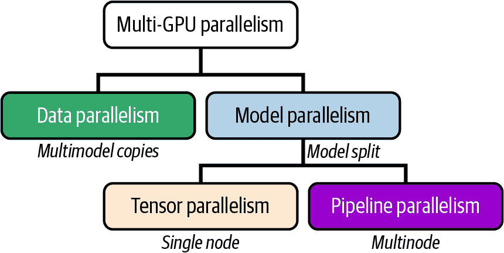
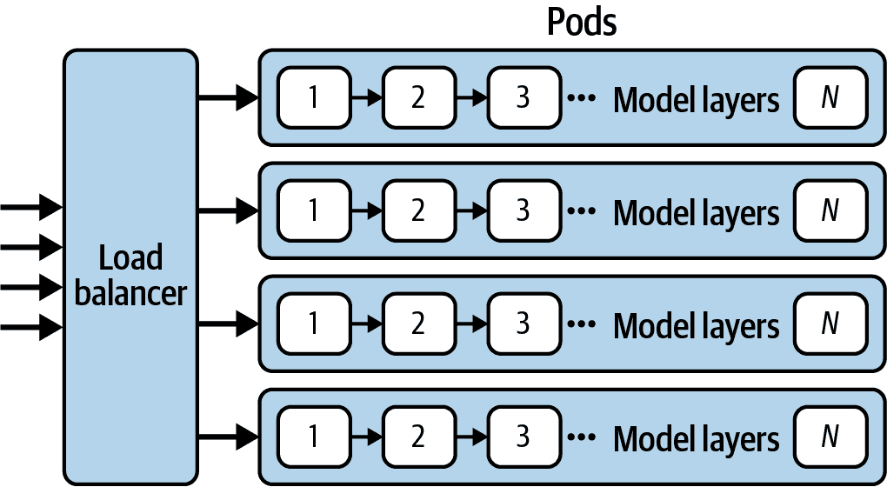
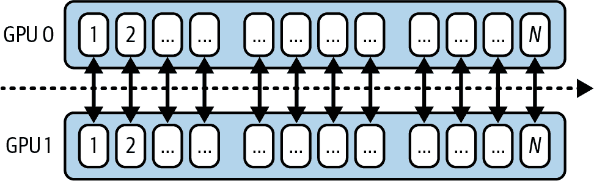
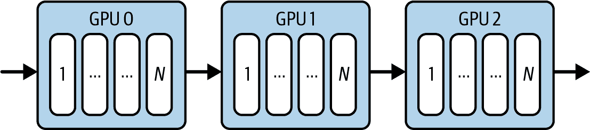
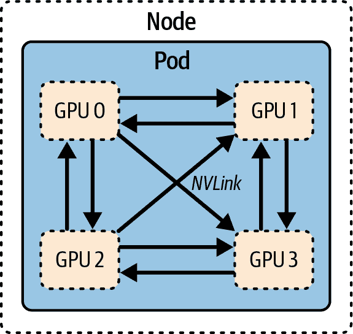
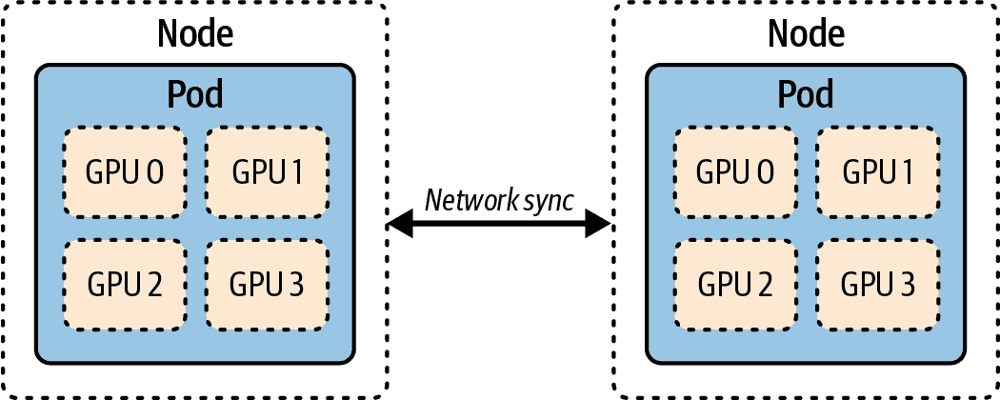

## 第 3 章：Kubernetes 与 GPU

从本质上讲，生成式 AI 涉及大量的数学计算，尤其是线性代数运算，如张量乘法。这些操作需要强大的计算能力和内存容量来处理大型数据集以及参数规模从数百亿到数千亿的模型。幸运的是，被称为图形处理器（GPU）的专用硬件已经出现，用于优化和加速这些计算工作负载。

GPU 最初设计用于渲染图形和创造沉浸式游戏体验，但由于其大规模并行架构，很快在 AI 领域找到了自己的位置。这种能力与 AI 和机器学习中涉及的大量线性代数任务的需求完美契合。

如今，GPU 是 AI 领域最主流的加速器类型，NVIDIA 以绝对优势引领市场，AMD 和 Intel 是其主要竞争对手。虽然 GPU 占据主导地位，但其他技术也各有其独特优势和理想使用场景。例如，Google 的张量处理单元（TPU）提供了令人瞩目的性能，但通常仅限于 Google 生态系统。此外，专门针对 AI 的专用集成电路（ASIC），如 Cerebras 和 Graphcore 开发的产品，以及现场可编程门阵列（FPGA），也代表了新兴但仍属小众的替代方案。

GPU 之所以仍是标准选择，主要原因在于其成熟的生态系统、广泛的可用性和经过验证的可扩展性。在将 LLM 部署到生产环境时，由于这些模型对内存和计算能力的大量需求，GPU 已成为不可或缺的设备。

默认情况下，Kubernetes 内置支持 CPU 和内存等标准计算资源。然而，利用 GPU 等专用硬件需要额外的机制。Kubernetes 通过设备插件来解决这个问题，一种可插拔的扩展框架。设备插件接口允许 Kubernetes 集成外部硬件资源并管理其生命周期，从而有效扩展 Kubernetes API 以纳入这些专用设备。

然而，GPU 需要特别关注。它们需要 Kubernetes 内部特定的发现机制和调度标准，以及专用软件栈（例如 NVIDIA 的 CUDA 库）才能正常运行。

在本章中，我们将探讨 Kubernetes 的设备集成机制，以实现高效的 GPU 访问和管理，并专门针对 NVIDIA GPU 进行介绍，因为 NVIDIA 在这一领域占据主导地位。

我们将首先考察 Kubernetes 如何使用*节点特性发现（Node Feature Discovery）*和 NVIDIA 的专用*GPU 特性发现（GPU Feature Discovery）*来发现 GPU 资源。接下来，我们将介绍 Kubernetes 的基础设备插件机制，并概述新兴的*动态资源分配*（DRA）特性，以实现更灵活的 GPU 分配。

调度 GPU 工作负载需要仔细考虑，以确保资源的高效利用。我们将讨论基于资源的 GPU 调度和基于标签的调度策略，然后再探索使用 *NVIDIA GPU Operator* 进行高级 GPU 管理。其中包括时间切片和*多实例 GPU（MIG）*等高级 GPU 分区机制，以及 *数据中心 GPU 管理器（DCGM）*导出器等全面的 GPU 监控解决方案。

本章还涵盖多 GPU 推理，重点关注单个 GPU 无法满足需求的场景。我们将介绍张量并行、流水线并行等各种技术，以便在单个或多个节点上有效利用多个 GPU。最后，我们将总结最佳实践和优化策略，帮助你高效管理 GPU 资源、防止碎片化，并最大化 Kubernetes 集群的性能。

让我们首先探索 Kubernetes 如何识别和标记 GPU 资源，为有效的 GPU 管理奠定基础。

### GPU 发现

在 Kubernetes 能够有效管理 GPU 之前，它必须首先可靠地识别哪些节点拥有 GPU，并确定其能力。准确的硬件检测可确保工作负载与提供合适 GPU 资源的节点相匹配。

Kubernetes 提供了一种名为*节点特性发现（Node Feature Discovery）*的通用解决方案，用于检测硬件特性并将相应标签应用到节点。节点特性发现提供了基础的硬件发现能力，而 NVIDIA 还提供了名为 GPU 特性发现（GPU Feature Discovery）的专用工具。该工具以节点特性发现为基础，添加了详细的、针对 GPU 的标签，从而实现专门针对 NVIDIA GPU 的细粒度调度和资源管理。

让我们先仔细看看节点特性发现的工作原理，然后再介绍 NVIDIA 的 GPU 特性发现。

#### 节点特性发现

Kubernetes 集群很少由完全相同的节点组成。相反，它们在硬件能力上通常多种多样——尤其是涉及 GPU 等专用硬件时。在此类异构环境（无论是云部署、混合环境还是裸金属集群）中，有效的调度在很大程度上取决于能否准确识别这些硬件能力。

如前所述，节点特性发现（NFD）项目提供了这种能力。NFD 检测每个节点上的硬件特性，并自动为集群中相应的节点资源打上标签。这些标签为 Kubernetes 调度器提供了关键信息，使其能够根据可用硬件智能地放置工作负载。

NFD 通过在集群中部署 DaemonSet 来运行，确保每个节点上都有一个代理。该代理检查每个节点的硬件和软件配置，识别 CPU 详细信息、网络接口以及可用的 PCI 设备（如 GPU）等属性。识别完成后，NFD 会将描述性标签应用到 Kubernetes API 中的节点资源上。

下面来看看如何部署 NFD。你有多种选择，最简单的就是通过 Kustomize 或 Helm 部署，如示例 3-1 所示。

*示例 3-1. 使用 Kustomize 安装 NFD*

```bash
NFD_REPO=https://github.com/kubernetes-sigs/node-feature-discovery
kubectl apply -k $NFD_REPO/deployment/overlays/default
```

此外，NFD Operator 提供了更为集成的管理体验，利用 Kubernetes Operator 简化生命周期管理，在生产环境中尤其有价值。

NFD 运行后会自动为节点打上标签。要查看这些标签，可以使用示例 3-2 中的命令。

*示例 3-2. 查看 NFD 添加的节点标签*

```bash
kubectl get node <node-name> -o yaml | yq .metadata.labels
feature.node.kubernetes.io/pci-0300_1d0f.present: "true" 
feature.node.kubernetes.io/pci-0302_10de.present: "true" 
feature.node.kubernetes.io/cpu-hardware_multithreading: "true"
feature.node.kubernetes.io/cpu-model.family: "6"
feature.node.kubernetes.io/cpu-model.id: "85"
feature.node.kubernetes.io/cpu-model.vendor_id: Intel
feature.node.kubernetes.io/kernel-selinux.enabled: "true"
feature.node.kubernetes.io/kernel-version.full: 5.14.0-427.62.1.el9_4.x86_64
...
```

该 PCI ID 表示 AWS（供应商 ID 1d0f，设备类别 0300）VGA 兼容显示控制器，常见于 AWS EC2 节点。

表示存在 NVIDIA GPU（供应商 ID 10de，设备类别 0302）。

NFD 标签遵循以 `feature.node.kubernetes.io/` 开头的命名约定，随后是硬件类别和特性详细信息。默认情况下，NFD 在这些标签中采用 `<class>_<vendor>` 格式。PCI 类别表示设备的一般类型，供应商通过标准化的 PCI 供应商 ID 标识。PCI 类别代码 `0302` 表示 GPU 等 3D 控制器，而供应商 ID 包括 `10de`（NVIDIA）、`1002`（AMD）和 `8086`（Intel）。如果需要更多细节（例如设备 ID 或子系统 ID）以实现更细粒度的选择，可以在 NFD 配置中自定义此类标签。

然而，NFD 标签主要表示某些硬件设备的存在，而不是详细的 GPU 规格，如 GPU 型号、内存大小或 CUDA 能力。为了更深入地了解 GPU 特定信息，NVIDIA 提供了一个名为 GPU 特性发现（GPU Feature Discovery）的专用工具，我们接下来将探讨它。

#### GPU 特性发现

NFD 提供了基本的硬件标签能力，而 NVIDIA 为更详细的 GPU 信息提供了专门的解决方案：GPU 特性发现（GFD）。

GFD 是 NVIDIA GPU Operator 的一部分（我们将在第 95 页的“NVIDIA GPU Operator”中讨论），它是一个轻量级工具，专门用于检测详细的 GPU 特性，并将其作为节点标签暴露出来，以支持高级调度。

与 NFD 类似，GFD 以 DaemonSet 形式运行在配备 GPU 的节点上。它利用 `nvidia-smi` 等工具检查每个节点上的 GPU，收集 GPU 型号、内存容量、CUDA 版本以及多实例 GPU 能力等详细信息。然后，GFD 会将这些详细的 GPU 特定数据作为 Kubernetes 节点标签应用。

表 3-1 列出了 GFD 添加的几个关键标签及其描述和示例。

**表 3-1. GFD 添加的标签**

| 标签 | 描述 | 示例 |
|---|---|---|
| `nvidia.com/gpu.count` | 节点上存在的 GPU 或 MIG 实例数量。 | 4 |
| `nvidia.com/gpu.product` | NVIDIA GPU 的型号名称或 MIG 配置文件。在 MIG 模式下，可能包含 MIG 配置文件；在时间切片模式下，可能带 `-SHARED` 后缀。 | A100-SXM4-40GB |
| `nvidia.com/gpu.memory` | 每个 GPU 或 MIG 实例的总内存（以 MiB 为单位）。 | 40537 |
| `nvidia.com/gpu.family` | GPU 架构系列（例如 Ampere、Hopper、Turing）。 | ampere |
| `nvidia.com/cuda.driver-version.full` | 已安装的 NVIDIA GPU 驱动程序的完整版本。 | 525.105.17 |
| `nvidia.com/cuda.runtime.version.full` | 可用 CUDA 运行时的完整版本。 | 12.2 |
| `nvidia.com/mig.capable` | 指示 GPU 是否支持 MIG 分区。 | true |
| `nvidia.com/mig.strategy` | MIG 分区策略（`single`、`mixed`；如果未使用 MIG，则不设置）。 | single |
| `nvidia.com/gpu.replicas` | 启用时间切片（GPU 共享）时，每个物理 GPU 对应的虚拟 GPU 数量。 | 8 |
| `nvidia.com/mig-<profile>.count` | 可用的特定 MIG 配置文件的 MIG 分区数量（使用 `mixed` 策略时存在）。 | 2（例如 `nvidia.com/mig-1g.5gb.count`） |
| `nvidia.com/gpu.machine` | 配备 GPU 的节点的机器类型或标识符。 | dgx-a100 |
| `nvidia.com/gpu.compute.major` | GPU 的主要 CUDA 计算能力版本。 | 8 |
| `nvidia.com/gpu.compute.minor` | GPU 的次要 CUDA 计算能力版本。 | 0 |

GFD 提供的详细标签使得高级调度决策成为可能，这是基本 NFD 标签无法实现的。例如，你可以使用 `nvidia.com/gpu.product: A100-SXM4-40GB-SHARED` 之类的节点选择器，来精确选择已配置为时间共享模式的 GPU（参见第 98 页的“时间切片”）。反过来，你也可以通过显式避开带有 `-SHARED` 后缀的节点，来确保 GPU 的独占访问。


在实践中，这些详细标签通常由 NVIDIA GPU Operator 的组件（如 NVIDIA 设备插件）在内部使用。通常，用户只需在其 Pod 规范的资源请求中直接请求 GPU 资源，如第 91 页的“基于资源的调度”所述。尽管如此，理解这些标签有助于深入了解 Kubernetes 的 GPU 调度机制，尤其是在复杂的 GPU 部署中。

接下来，我们来看看 GPU 在 Kubernetes 中是如何被启用和通告的，先从 Kubernetes 设备插件框架说起。

## Kubernetes GPU 设备插件

一旦你清晰地识别并标记了 GPU 能力，下一步就是将 GPU 作为可调度、可分配的资源暴露给 Kubernetes。Kubernetes 通过其设备插件框架实现这一点，该框架允许外部硬件无缝集成到 Kubernetes 资源模型中。

Kubernetes 从设计之初就具备可扩展性。虽然 CPU 和内存是原生支持的，但 Kubernetes 还提供了一个标准化且可扩展的框架——设备插件，用于集成 GPU、TPU 和其他加速器等专用硬件资源。

这些插件会在每个节点上向 Kubelet 注册，并直接将设备的可用性和健康状况通告给 Kubernetes，从而实现资源感知的调度和工作负载隔离。

设备插件接口支持多种专用硬件，包括 FPGA、网络加速器、存储控制器、加密模块、多媒体处理器和机器人硬件。对生成式 AI 而言，重要的是它还支持 GPU 和其他 AI 加速器。

设备插件机制通过四个核心功能运作：

- **设备发现**：插件检测节点上的硬件设备，并向 Kubelet 报告其清单。
- **资源分配**：当工作负载需要特定硬件资源（例如 GPU）时，设备插件负责独占分配。它会设置运行时环境、暴露必要的设备文件，并注入环境变量。
- **健康监控**：插件持续监控设备健康状态，确保 Kubernetes 能感知不健康的硬件，从而为调度决策提供信息。
- **调度器集成**：设备插件将硬件作为 Kubernetes 标准扩展资源（例如 `nvidia.com/gpu`）暴露出来。Pod 在资源声明中显式请求这些资源，从而确保精确调度到有可用设备的节点上。更多关于基于资源的调度的信息，请参阅第 91 页的“基于资源的调度”。

一些知名的设备插件为特定厂商的硬件提供了 Kubernetes 支持。这些插件各自将对应厂商的加速器集成到 Kubernetes 中，使工作负载能够将 GPU 或 TPU 资源作为 Kubernetes 集群中的一等公民来使用：

- **nvidia-device-plugin**：NVIDIA 官方插件，在 Kubernetes 中暴露支持 CUDA 的 GPU，对于 GPU 加速的 AI 工作负载至关重要。我们将在第 95 页的“NVIDIA GPU Operator”中结合 NVIDIA GPU Operator 进一步探讨 NVIDIA 设备插件。
- **amd-device-plugin**：AMD 官方插件，集成基于 ROCm 的 GPU，适用于高性能计算和 AI 工作负载。
- **intel-gpu-plugin**：Intel 的插件，用于集成式 GPU 和独立式 GPU，在 Kubernetes 环境中启用 GPU 资源。
- **google-cloud-tpu-device-plugin**：Google 的插件，用于集成张量处理单元（TPU）；TPU 是针对机器学习工作负载优化的专用硬件，仅在 Google Kubernetes Engine（GKE）中可用。

设备插件已成为将 GPU 集成到 Kubernetes 的基础构建模块。然而，这种方法也有局限性。设备插件通常将设备独占分配给单个 Pod，这常常导致资源未得到充分利用。

此外，资源分配是静态的，在调度时就已经确定，因此对于资源需求动态变化的工作负载来说不够灵活。

为了应对这些挑战，Kubernetes 正在向**动态资源分配**演进，我们将在第 92 页的“动态资源分配”中讨论这一特性。与此同时，大多数生产环境仍将继续依赖既有的资源请求模型来进行 GPU 调度。

现在，让我们进一步看看 Kubernetes 如何利用基于资源的和基于标签的技术，为 GPU 工作负载选择放置位置。

## GPU 工作负载调度

Kubernetes 提供了三种互补的方法来放置 GPU 工作负载。第一种通过节点标签和亲和性规则引导 Pod，第二种仅依赖数值型资源请求，第三种则基于动态资源分配（DRA）来影响 GPU 工作负载的自动放置。我们将分别介绍它们，以便每种方法的优势都清晰明了。

让我们从基于标签的调度开始，它为 GPU 工作负载的放置提供了细粒度的控制。

### 基于标签的调度

当集群中包含多种不同类型的 GPU，或当运维人员希望将 GPU 节点与一般工作负载隔离开时，标签就成了方向盘。

Kubernetes 提供了三种密切相关的机制，每种机制提供不同程度的控制：`nodeSelector`、节点亲和性，以及污点与容忍度。

### nodeSelector

`nodeSelector` 是最直接的方法。你为每个具备特定特征的节点附加一个固定标签，然后在 Pod 规约的 `nodeSelector` 字段中重复完全相同的键值对。除了手动创建自定义标签外，你还可以利用 NFD 和 GFD 操作器自动附加到节点上的 GPU 专用标签。有关详细信息以及可供选择的 GPU 相关标签，请参阅第 82 页的“GPU 发现”。

如示例 3-3 所示，`nodeSelector` 的优点在于简洁。只需一行配置即可将工作负载固定到目标节点池，且没有额外的调度器开销。然而，这一规则是绝对的：如果标签缺失或拼写错误，Pod 将无法被调度。`nodeSelector` 也无法表达备选方案；它只会“非 T4 不用”。

**示例 3-3：使用节点选择器直接选择节点**

```yaml
apiVersion: v1
kind: Pod
metadata:
  name: t4-inference
spec:
  containers:
  - name: server
    image: myrepo/llm-server:latest
  nodeSelector:
    # Select only nodes that are labelled for a Tesla T4 GPU
    nvidia.com/gpu.product: Tesla-T4
```

### 节点亲和性

节点亲和性建立在同样的思路之上，但支持更丰富的表达式和软性偏好。必需项（required terms）的作用类似于扩展选择器，而偏好项（preferred terms）则允许在多个节点都满足硬性约束时，将调度器引导至最佳节点。

示例 3-4 展示了这种灵活性。该示例依赖 GFD 添加的标签，如第 84 页的“GPU 特性发现”所述。

**示例 3-4：用于更细粒度选择的节点亲和性**

```yaml
apiVersion: v1
kind: Pod
metadata:
  name: a100-preferred
spec:
  containers:
  - name: llm
    image: myrepo/mt-server:latest
    resources:
      limits:
        nvidia.com/gpu: 4
  affinity:
    nodeAffinity:
      requiredDuringSchedulingIgnoredDuringExecution:
        nodeSelectorTerms:
        - matchExpressions:
          - key: nvidia.com/gpu.memory
            operator: Gt
            values: ["40000"]
      preferredDuringSchedulingIgnoredDuringExecution:
      - weight: 1
        preference:
          matchExpressions:
          - key: nvidia.com/gpu.family
            operator: In
            values: ["hopper"]
```

节点被视作调度目标所需满足的必要条件。在此示例中，GPU 至少需要 40 GB 内存。

NVIDIA H100 是首选，但如果没有 H100，也没关系。

使用亲和性时，你先强制设定一个最低内存大小，再表达对 Hopper（H100）优于 Ampere（A100）的温和偏好。如果没有 Hopper 节点可用，Kubernetes 会将 Pod 调度到满足内存要求的 Ampere 节点上。缺点在于冗长：较长的匹配表达式会让清单变得杂乱，而过多的硬性条件也可能使工作负载陷入无节点可用的困境。

### 污点与容忍度

有时，运维人员希望换一种思路，将某些节点标记为“禁区”，除非 Pod 明确选择加入。管理员添加的污点会排斥所有 Pod；只有携带匹配容忍度的 Pod 才能被调度。

在示例 3-5 中，我们向所有带有标签 `nvidia.com/gpu.count` 的节点添加一个**污点键值对** `nvidia.com/gpu=true`，其**污点效果**为 `NoSchedule`。只有显式容忍 `nvidia.com/gpu` 约束的 Pod 才能被调度到这些节点上。

**示例 3-5. 为节点打上污点，使其默认不被纳入调度考量**

```bash
# 需要 cluster-admin 权限
kubectl taint nodes -l nvidia.com/gpu.count nvidia.com/gpu=true:NoSchedule
```

示例 3-6 展示了这样一种容忍度配置，它允许带有该容忍度的 Pod 被调度到带有 `nvidia.com/gpu` 污点的节点上，而无需考虑污点的具体值。

**示例 3-6. 带有容忍 `nvidia.com/gpu` 污点配置的 Deployment**

```yaml
apiVersion: apps/v1
kind: Deployment
metadata:
  name: gpu-serving
spec:
  replicas: 2
  template:
    spec:
      containers:
        - name: tgi
          image: ghcr.io/huggingface/tgi:latest
          resources:
            limits:
              nvidia.com/gpu: 1
      tolerations:
        - key: "nvidia.com/gpu"
          operator: "Exists"
          effect: "NoSchedule"
```

该配置需要 `nvidia.com/gpu` 资源，该资源由 NVIDIA 设备插件提供。我们将在第91页的“基于资源的调度”中解释基于资源的调度方式。

容忍度会忽略 `nvidia.com/gpu` 污点，无论其值如何，因此此 Deployment 也可以部署到这些节点上。

污点非常适合将昂贵的 GPU 节点专门用于 GPU 工作负载，或用于对维护中的节点进行隔离。它们与亲和性或选择器配合使用效果很好：污点将常规 Pod 排除在外，而亲和性则决定在剩余的 GPU 节点中选择最合适的一个。

关于影响 Kubernetes 调度决策的各种方式的更多详细信息，请参阅《Kubernetes Patterns》中的 **Automated Placement**（自动放置）模式。但应该在何种场景下使用哪种放置技术呢？这取决于以下因素：

- 在规模较小、同构的 GPU 集群中，当单个标签就足够时，`nodeSelector` 表现出色。
- 当需要混合不同代际、内存大小或可用区时，节点亲和性成为首选工具。
- 污点在集群范围内保护 GPU 资源池，并自然与其他两种技术结合以实现精细放置。

这三种方法有一个共同的局限性：它们都依赖于静态标签，这些标签要么由管理员手动维护，要么由我们介绍过的发现运算符（如 NFD 和 GFD）添加，详见第82页的“GPU 发现”。

虽然这些基于标签的方法提供了细粒度的控制，但它们需要了解和维护特定的节点标签。对于任何可用 GPU 都能满足要求的更简单用例，有一种更直接的方法：基于资源的调度。

### 基于资源的调度

在 Kubernetes 中调度 GPU 工作负载的最简单方法，是直接在负载规范中声明对 GPU 的需求。当 NVIDIA 设备插件在节点上运行后，它会将每个 GPU 作为扩展资源进行通告——通常为 `nvidia.com/gpu`。如示例 3-7 所示，一个设置了资源限制（limit）的容器，会请求 Kubernetes 调度器找到一个至少有一个空闲 GPU 的节点。

**示例 3-7. 请求一个 NVIDIA GPU**

```yaml
resources:
  limits:
    nvidia.com/gpu: 1
```

调度器仅检查设备插件报告的数值可用性，然后将 Pod 绑定到符合条件的节点。kubelet 授予容器对该节点上其中一个 GPU 的独占访问权限。无需管理额外标签，无需记忆节点选择器，也无需安装额外的控制器。该机制与大家熟知的 `requests` 和 `limits` 资源模型完全集成，因此感觉就像请求 CPU 或内存一样——只是资源名称不同。

这种易用性是其最大的优势。Pod 规范中的一个字段就足以在设备文件级别隔离 GPU，防止其他 Pod 访问它，并让 CUDA 应用程序无需额外配置即可运行。对于仅有单一 GPU 类型的小型集群，或任何 GPU 都可用的开发环境，通常无需更复杂的配置。

其缺点在于缺乏精确性。对于调度器而言，所有 GPU 看起来都一样，即使集群中混合了 V100、A100 或消费级显卡。一个在 80GB A100 上运行流畅的模型可能无法在 16GB T4 上运行，但一个简单的 `nvidia.com/gpu: 1` 请求却将两者等同对待。此外，也没有内置的方法来请求特定的计算能力、将 Pod 限制在 Multi-Instance GPU 模式的 GPU 上，或请求一个节点上具有特定互连拓扑的多个 GPU。

在实践中，团队通过利用 GPU 设备插件添加的标签（例如 `nvidia.com/gpu.product`）或为节点添加自定义标签（例如 `gpu-type=A100`）来绕过此限制，然后将资源请求与 `nodeSelector` 或 `nodeAffinity` 规则结合使用，以将工作负载引导至兼容的硬件。这是一个强大的工具，但代价是需要在节点清单和工作负载定义之间进行额外的协调。

一种表达精细需求更优雅的方式是第92页“动态资源分配”中描述的动态资源分配（DRA）机制。使用 DRA，您无需硬编码标签约定或依赖静态资源请求。相反，您可以声明您需要哪种类型的 GPU，Kubernetes 将动态分配匹配的 GPU。

### 动态资源分配

Kubernetes 设备插件机制使得将 GPU 和其他专用硬件作为可调度资源暴露成为可能。通过它，工作负载可以请求诸如 `nvidia.com/gpu` 之类的加速器，Kubernetes 会在调度时将它们独占分配给 Pod。虽然这在许多场景下运行良好，但它是一个静态模型。调度器无法区分设备，在调度时固定分配，并且始终独占分配它们。在实践中，这可能导致资源利用不足、调度决策粒度粗糙，以及在处理更高级的 GPU 配置（如我们在第98页“子 GPU 分配”中讨论的 Multi-Instance GPU 或时间切片）时存在局限性。

DRA 旨在使 Kubernetes 中的设备调度更加灵活、可组合和动态，并且自 Kubernetes 1.34 版本起，它已成为一项核心、稳定的功能。DRA 不将设备分配直接绑定到 Pod 规范中的资源字段，而是引入了一组新的资源类型。这些抽象将焦点从工作负载需要“多少”设备转移到需要“什么类型”的设备。该模型受 Kubernetes 卷供给机制的启发，用户描述所需的资源，然后由平台负责解析。

使用 DRA 时，工作负载通过 `ResourceClaimTemplate` 资源声明其设备需求。这些模板充当意图声明。Kubernetes 控制平面和已安装的 DRA 驱动程序会在调度时解析它们。这实现了使用静态设备插件难以或无法实现的功能。例如，Pod 可以请求特定的设备类别，比如具有至少 40 GB（≈ 37 GiB）[^1] 内存的 A100 GPU。调度器将只把 Pod 放置在能够满足此要求的节点上。分配是即时进行的，从而实现更智能的决策和更高效的资源利用。

这种灵活性在运行需要特定 GPU 类型（例如具有 80 GB 内存的 A100）的 LLM 推理工作负载时尤为有用。使用 DRA，您可以精确请求该配置。这种方法不依赖节点标签或手动 Pod 放置。

示例 3-8 演示了这一更高级的用例。我们定义了一个 `ResourceClaimTemplate`，请求一个属于 A100 类别且内存至少为 40 GB 的 GPU。我们还明确指定了分配模式和数量。这种级别的细节是传统资源请求无法表达的。

**示例 3-8. 为部署 Pod 定义 GPU 需求的 ResourceClaimTemplate**

```yaml
apiVersion: resource.k8s.io/v1beta1
kind: ResourceClaimTemplate
metadata:
  name: a100-claim-template
spec:
  spec:
    devices:
      requests:
        - name: high-memory-gpu
          deviceClassName: gpu.nvidia.com/a100
          allocationMode: ExactCount
          count: 1
          parameters:
            minMemory: "40Gi"
            migMode: "disabled"
```


# 请求 NVIDIA A100 GPU

请求一个 NVIDIA A100 GPU。需要一个 GPU。GPU 必须至少有 40 GiB 的内存，并且必须禁用 Multi-Instance GPU 模式。

在示例 3-8 中，我们引用了一个名为 `gpu.nvidia.com/a100` 的逻辑设备类别，这是一个抽象层级，可以包含不同配置的 A100。我们还要求至少 40 GB 内存，并明确选择退出 Multi-Instance GPU 模式以确保完全访问 GPU。

示例 3-9 中定义的工作负载随后在其资源声明中引用此模板。Kubernetes 仅在调度时才分配实际的 GPU，并且只有当某个节点上有匹配的设备时才会分配。

[^1]: NVIDIA 等 GPU 制造商通常使用十进制千兆字节（GB，基于10）来宣传内存大小，而 Kubernetes 通常使用二进制吉字节（GiB，基于2）。差异较小但值得注意：40 GB ≈ 37.25 GiB，80 GB ≈ 74.5 GiB。在本章中，我们使用 GB 以符合行业惯例。

**示例 3-9：使用 ResourceClaimTemplate 进行 GPU 分配的 Deployment**

```yaml
apiVersion: batch/v1
kind: Deployment
metadata:
  name: inference-server
spec:
  template:
    spec:
      containers:
        - name: model-runner
          image: myorg/llm-inference:latest
          resources:
            claims:
              - name: high-memory-gpu
      resourceClaims:
        - name: high-memory-gpu
          resourceClaimTemplateName: a100-claim-template
```

- 引用一个资源声明，当 Deployment 创建一个或多个 Pod 时应使用该声明。
- 引用示例 3-8 中定义的 ResourceClaimTemplate。

声明与实际分配之间的分离正是 DRA 如此强大的原因。它为动态的、按需驱动的 GPU 供应打开了大门——这是传统设备插件难以或无法实现的。它还允许驱动程序在底层执行更智能的分配策略。不再是简单的“挑选第一个可用的 GPU”，分配现在可以考虑当前使用率、功耗、内存压力或其他节点级约束。

然而，也有一些注意事项。DRA 尚未在生产环境中得到广泛支持。截至 2026 年初，核心 DRA API 已普遍可用，并从 Kubernetes 1.34 起默认启用，但围绕它的生态系统仍在追赶中。NVIDIA GPU DRA 驱动程序已存在，但被标记为技术预览版，尚未支持用于生产环境。诸如部分 GPU 请求、细粒度的多实例 GPU 分区或拓扑感知调度等功能仍在成熟中，并且仍然依赖于驱动程序和平台。此外，与集群自动扩缩器或配额执行的集成也有限。

尽管如此，其潜力是显而易见的。DRA 使 Kubernetes 能够采用更智能的 GPU 放置策略，支持无需采用变通方法即可实现设备共享，并为加速器供应带来了更声明式的思维模式。你不再需要依赖静态节点标签、污点或专门的资源计数来描述工作负载的实际需求。相反，你只需表达意图，让 Kubernetes 和驱动程序处理其余部分。


随着 DRA 的成熟，它很可能成为 Kubernetes 中处理高级硬件资源的标准方式。我们期望像 NVIDIA 这样的供应商将其设备插件、GPU 操作符和运行时库与 DRA 集成，为推理和训练工作负载提供无缝体验。

然而，在 DRA 达到生产级之前，资源请求与基于标签的调度相结合仍然是 GPU 调度的标准方法。

## NVIDIA GPU 操作符

前面的章节展示了 Kubernetes 设备插件如何将 GPU 暴露为可调度资源（见第 86 页的“Kubernetes GPU 设备插件”），以及 GFD 如何用详细的 NVIDIA 特定标签丰富节点（见第 84 页的“GPU 特性发现”）。NVIDIA GPU 操作符构建在这两个组件之上，并添加了在生产环境中可靠运行 NVIDIA GPU 工作负载所需的一切。它安装驱动程序、容器运行时钩子和监控代理，并通过一个声明式接口提供两种用于子 GPU 资源分配的共享机制。

该操作符自动安装和配置所有必要组件，使 GPU 工作负载能够高效、可靠地运行。

以下组件是 NVIDIA GPU 操作符的一部分：

- **NVIDIA 驱动程序（内核模块和 CUDA）**

    GPU 启用的核心是 NVIDIA 驱动程序——即启用 CUDA 和 GPU 加速的内核模块和用户空间库。GPU 操作符可以通过运行特权驱动程序容器将官方 NVIDIA 驱动程序部署到每个 GPU 节点。该容器为节点的内核编译驱动程序，或在可用时获取预编译版本。通过容器化驱动程序安装，操作符确保所有 GPU 节点都拥有所需的驱动程序版本，无需手动干预。

    如果你希望在所有节点上依赖操作符的驱动程序容器，GPU 节点理想情况下应运行相同的操作系统内核版本。混合操作系统版本可能需要手动预装驱动程序。

    示例 3-11 中显示的操作符 ClusterPolicy CR 允许根据需要自定义驱动程序版本或使用预编译二进制文件。

- **GPU 特性发现**

    我们已经在第 84 页的“GPU 特性发现”中介绍了 GFD。该操作符将 GFD 作为 DaemonSet 部署，因此你不必自行手动安装。

- **面向 GPU 的 Kubernetes 设备插件**

    该操作符将 NVIDIA 设备插件作为 DaemonSet 部署在 GPU 节点上。我们已经在第 86 页的“Kubernetes GPU 设备插件”中介绍了 Kubernetes 设备插件架构，以及它如何引入一个新的扩展资源 `nvidia.com/gpu`，该资源可用于资源级调度，具体描述见第 91 页的“基于资源的调度”。NVIDIA Kubernetes 设备插件还允许子 GPU 分配，我们将在第 98 页的“子 GPU 分配”中看到。NVIDIA 设备插件是一个关键组件；如果它没有运行或无法工作，你的 Pod 将一直处于 Pending 状态，因为 Kubernetes 认为没有可用资源。

- **NVIDIA 容器工具包（运行时）**

    为了让容器真正使用 GPU，它们需要 NVIDIA 容器运行时（它是 NVIDIA 容器工具包的一部分）。GPU 操作符在节点上部署该工具包。容器运行时本质上是 CRI-O 和 containerd 的扩展，它知道如何在请求 GPU 时将 GPU 驱动程序和设备文件注入容器。操作符自动管理容器运行时，无需手动配置 NVIDIA 支持。结果是，任何请求 GPU 的容器都将获得必要的 `/dev/nvidia0` 设备和 GPU 驱动程序。不过，容器镜像仍必须包含应用程序所需的 CUDA 库。

- **多实例 GPU（MIG）管理器**

    在具有支持 MIG 的 GPU（例如 NVIDIA A100 或 H100 卡）的系统上，操作符包含一个 MIG 管理器组件。该服务监控节点的 MIG 配置，并可以根据期望状态重新配置 GPU 的 MIG 分区。默认情况下，它运行在支持 MIG 的节点上，并将应用你在 ClusterPolicy 中配置的 MIG 策略，正如我们在第 98 页描述 GPU 共享选项时在“子 GPU 分配”中所探讨的那样。MIG 管理器确保如果一个节点应该处于 MIG 模式并划分出特定配置，它会在启动时或发生更改时自动执行。如果没有它，管理员必须远程登录到节点并使用 `nvidia-smi` 手动设置 MIG 分区。GPU 操作符负责处理这一点，使 MIG 设置保持声明式。

- **使用 DCGM Exporter 进行 GPU 监控**

    为了完整性，GPU 操作符通常还会将数据中心 GPU 管理器（DCGM）Exporter 作为 DaemonSet 部署。DCGM 轮询每个 GPU 的利用率、内存压力、ECC 错误、温度、功耗以及大量其他计数器，并将它们转换为 Prometheus 指标。大多数用户使用集群的 Prometheus 堆栈抓取 Exporter 的指标，并在 Grafana 中展示图表。如果你遵循第 5 章的观测性指导，你已经拥有一切；该操作符只需接入 GPU 侧。

## 使用 ClusterPolicy 进行操作符配置

NVIDIA GPU 操作符可用于多种 Kubernetes 发行版，包括 OpenShift，在 OpenShift 中它作为 OperatorHub 目录的一部分开箱即用。它也可以使用 Helm charts 或 NVIDIA 提供的自定义清单安装到标准 Kubernetes 集群，如示例 3-10 所示。

**示例 3-10：使用 Helm 安装 GPU 操作符**

```bash
helm repo add nvidia https://helm.ngc.nvidia.com/nvidia
helm repo update
helm install gpu-operator nvidia/gpu-operator \
  --namespace gpu-operator \
  --create-namespace
```

你通过 ClusterPolicy 自定义资源配置该操作符。此资源控制 GPU 操作符组件的所有方面，包括设备插件配置、启用时间切片以及配置 MIG 策略。ClusterPolicy 可以引用自定义 ConfigMap 来微调设备插件行为，例如启用时间切片或其他 GPU 共享机制。在 ClusterPolicy 中，你可以指定 ConfigMap 中的一个键作为默认值，如果启用 GPU 的节点未标记有特定的 `nvidia.com/device-plugin.config=<key from configmap>` 键。

示例 3-11 显示了用于配置设备插件的自定义 ConfigMap 的路径，启用了 GPU 特性发现，并将 MIG 策略设置为 `mixed`。

**示例 3-11：NVIDIA GPU 操作符的示例配置**

```yaml
apiVersion: nvidia.com/v1
kind: ClusterPolicy
metadata:
  name: gpu-cluster-policy
spec:
  gfd:
    enabled: true
  devicePlugin:
    config:
      name: gpu-sharing-config
      default: sharing
  mig:
    strategy: mixed
```

- 启用 GPU 特性发现。
- 指向包含额外配置信息（例如用于配置时间切片）的 ConfigMap `gpu-sharing-config`。

默认值引用 ConfigMap 中的一个键。如果设置为空字符串，则不应用任何默认值，节点必须使用 `nvidia.com/device-plugin.config=<config map key>` 打标签，才能选择对应的设备插件配置。

将 MIG 策略设置为 `mixed`。有关多实例 GPU 的更多信息，请参见第 100 页的“多实例 GPU”。

## 子 GPU 分配

NVIDIA GPU Operator 支持高级 GPU 功能，可将单个 GPU 分区或切片给多个工作负载使用。虽然子 GPU 资源分配对于运行 LLM 可能没有太大意义，但理解它对于优化 GPU 使用率仍然很重要。

该 Operator 支持两种模式，也可组合使用：

- **时间切片** — 允许通过分配基于时间的切片，让多个容器共享一个 GPU。
- **MIG** — 在特定 GPU（如 A100 和 H100）上可用，可将单个 GPU 划分为隔离的实例。

NVIDIA GPU Operator 支持的一项强大功能就是在多个工作负载之间共享 GPU。这对于 AI 推理或服务多个模型尤其重要，因为每个进程不一定都需要占用整个 GPU。

下面我们来揭开它们的神秘面纱。

### 时间切片

默认情况下，如果某个 Pod 请求一个 GPU（在其资源需求中声明 `nvidia.com/gpu: 1`），Kubernetes 会授予它独占一个物理 GPU 的访问权限。时间切片是一种允许超卖 GPU 的功能——即每个物理 GPU 对外宣告多个虚拟 GPU，这样调度器可以将多个 Pod 同时调度到同一个 GPU 上。NVIDIA 设备插件（在相应配置下）会为每个真实 GPU 创建 GPU 副本。例如，你可以将一个物理 GPU 配置为四个设备，最多让四个 Pod 各自获得一个它们认为的“一个 GPU”，而实际上它们都运行在同一个硬件上。这些 Pod 的 GPU 工作负载会在单个 GPU 上按时间交错执行。可以把它想象成 CPU 时间共享：如果你有一个 16 核 CPU，你可以通过上下文切换调度超过 16 个 CPU 密集型进程。每个进程都会获得核心上的时间片，但并非所有进程都能同时全速运行。GPU 时间切片的工作原理与此相同。

要在集群中启用 GPU 时间切片，你需要通过 Operator 配置中引用的 ConfigMap 来配置设备插件，如示例 3-11 所示。对应的 ConfigMap 如示例 3-12 所示。

**示例 3-12：时间切片配置示例**

```yaml
apiVersion: v1
kind: ConfigMap
metadata:
  name: gpu-sharing-config
  namespace: gpu-operator-resources
data:
  sharing: |
    version: v1
    sharing:
      timeslicing:
        renameByDefault: true
        resources:
          - name: nvidia.com/gpu
            replicas: 8
```

当设置为 `true` 时，会将资源从 `nvidia.com/gpu` 重命名为 `nvidia.com/gpu.shared`。这样可以更轻松地区分共享 GPU 实例和独占 GPU 实例。

超卖级别，即为每个物理 GPU 提供八个虚拟 GPU。

我们指定要使用的资源名称（例如 `nvidia.com/gpu` 或 `nvidia.com/gpu.shared`）以及副本数量。通过将 `nvidia.com/gpu` 设置为 `replicas: 8`，每个物理 GPU 会暴露八个可调度单元。因此，节点的 `nvidia.com/gpu` 标签会显示虚拟 GPU 总数（一个 GPU 为 8，十个 GPU 为 80）。节点上还会添加 `gpu.replicas=8` 标签，以表示这种超卖。或者，你可以通过将 `renameByDefault` 设置为 `true`，将共享资源重命名为 `nvidia.com/gpu.shared`，以区别于真正独占的 GPU。

与 MIG 不同，时间切片不提供共享 GPU 的 Pod 之间的内存隔离或故障隔离。同一物理 GPU 上的所有 Pod 都可以访问整个 GPU 显存，并共享同一个故障域。这意味着如果一个进程导致 GPU 崩溃（例如非法内存访问引发 GPU 重置），也会影响该 GPU 上的其他工作负载。此外，如果一个 Pod 占用了大部分 GPU 显存，其他 Pod 可能无法分配内存。时间切片只保证计算时间的分配，而不保证内存配额。缺少内存隔离意味着你必须仔细规划工作负载的大小，确保它们合计不超过 GPU 的可用显存。


如果一个 Pod 请求多个时间切片 GPU（例如在 GPU 处于共享模式时请求 `nvidia.com/gpu: 2`），它并不会获得单个 GPU 两倍的性能。相反，它会在两个独立的物理 GPU 上获得共享份额，每个 GPU 都与其他工作负载共享，这通常没什么用。为避免这种混淆，可以将设备插件配置为在共享模式下拒绝超过一个 GPU 的请求。时间切片适用于每个 Pod 恰好请求一个 GPU 的场景，并应理解这个“一个 GPU”实际上代表物理 GPU 的一部分。对于多 GPU 工作负载，请将这些 GPU 保持独占状态，或使用 MIG。

时间切片非常适合在工作负载突发性强或负载较轻的环境中超卖 GPU。例如，如果你有一个强大的 GPU，但有许多小型推理任务或交互式笔记本，你可以在一个 GPU 上运行多个任务，从而提高利用率。如果这些任务确实都在争用 GPU，每个任务可能会稍慢一些，但整体吞吐量可以提高。时间切片还允许不支持 MIG 的旧 GPU 进行共享。如果你的实验室集群中有 NVIDIA T4 或 V100 GPU，运行许多较小的模型，时间切片可能让你在每个 GPU 上同时运行两到三个模型，从而最大化硬件利用率。但要注意缺乏内存隔离的问题：你必须合理调整模型大小，使它们合计能放进 GPU 显存。诚然，时间切片在 LLM 场景中可能不太有用，因为 LLM 通常非常大，需要占用 GPU 提供的全部物理显存。

对于需要更强隔离保证和每个工作负载固定内存分配的场景，NVIDIA 提供了一种基于硬件的解决方案，称为多实例 GPU（MIG）。

### 多实例 GPU

NVIDIA Ampere 及更新架构的 GPU（如 A100、A30、H100 和 Blackwell B100/B200）提供 MIG 功能，可将一个物理 GPU 划分为多个硬件隔离的实例。每个实例（或 *MIG 切片*）都有自己的专用计算核心、显存划分，甚至独立的引擎上下文——就像一张卡里有多个较小的 GPU。例如，一个 A100 40GB GPU 最多可以划分为七个 MIG 实例。最小的配置是 1g.5gb（每个实例一个 GPU 切片，5 GB 显存）。每个 MIG 设备都像一个微型 GPU，拥有有保障的显存和隔离的流式多处理器（SM）资源。

NVIDIA 设备插件可以通过两种方式将 MIG 分区暴露为可调度资源：


# GPU 共享与多 GPU 推理

## MIG 策略

- **单一 MIG 策略** — 节点上的所有 MIG 实例都通过通用的 `nvidia.com/gpu` 资源对外宣告（就像普通 GPU 一样）。此策略假设每个 GPU 的分区方式相同。例如，如果节点上的每个 A100 都划分为七个 5GB 实例，那么一个具有两个 A100 的节点会报告 `nvidia.com/gpu: 14`。当 Pod 请求一个 GPU 时，它实际获得的是一个 MIG 切片（5 GB）。节点标签（`gpu.product`、`gpu.count` 等）会相应调整以反映 MIG 状态（在此示例中你会看到 `gpu.product = ...-MIG-1g.5gb` 和 `gpu.count = 14`）。这种方法对用户来说很简单，但要求所有 GPU 上的 MIG 配置必须一致。

- **混合 MIG 策略** — MIG 实例作为不同的资源类型暴露，并以各自的 MIG 规格命名（例如 `nvidia.com/mig-1g.5gb`、`nvidia.com/mig-4g.20gb` 等）。在此模式下，如果节点上的 A100 包含多种 MIG 大小，则该节点可能会宣告多种不同资源。用户可以在 Pod 规范中使用相应的资源名称来请求特定的 MIG 大小。例如，Pod 可以请求 `nvidia.com/mig-2g.10gb: 1` 来获得一个大约 10GB 的 MIG 实例。这种策略更灵活（节点上的 GPU 可以按不同方式划分，甚至保持完整），但调度起来更复杂一些，因为用户需要知道应该请求哪种 MIG 类型。

在两种情况下，GPU Operator 的 MIG 管理器都会根据 ClusterPolicy 中的 `mig.strategy`（`single` 或 `mixed`）在 GPU 上创建 MIG 分区，如示例 3-11 所示。如果 MIG 模式关闭（`none` 策略），则 GPU 完全不进行分区。

与时间切片不同，MIG 提供强隔离。每个 MIG 实例拥有固定比例的 GPU 显存，不能超过其分配额，这可以防止一个工作负载窃取其他工作负载的显存。故障隔离也得到了改进：如果一个 MIG 实例崩溃或重置，其他实例可以继续不受影响。这使得 MIG 很适合多租户或生产环境，在这些环境中你可能希望在同一物理 GPU 上安全地运行不同应用。如果每个模型服务只需要几 GB 的 GPU 显存，这将非常理想。

这里的权衡是粒度和开销。你只能使用 NVIDIA 定义的 MIG 规格（你不能创建任意 6GB 切片，只能使用显卡提供的固定大小）。此外，如果某个任务有时本可以使用整个 GPU，MIG 分区意味着该任务被硬性限制在自己的份额内——不存在借用其他实例未使用容量的概念。相比之下，时间切片可以让一个 Pod 在其他 Pod 空闲时突发使用整个 GPU（因为没有什么能阻止它在可用时占用更多显存或计算资源，而 MIG 则会将任务限制在其份额内）。

因此，当你对 GPU 有相对稳定的并行使用需求，且每个需求都能放入一个分区时，MIG 最为适用。对于 LLM 和生成式 AI 工作负载，MIG 在推理服务场景或运行许多较小实验时尤其有用。如果你的模型很大（例如需要超过 40 GB），MIG 就帮不上忙了——你需要整个 GPU 或多块 GPU。但如果要托管多个较小模型（比如 7 个不同的语言模型，每个约需 5 GB），MIG 会非常有用，它实际上为每个模型提供了自己专属的、内存有保障的*虚拟* GPU。

有趣的是，时间切片和 MIG 并不互斥。你也可以对 MIG 实例进行时间切片。例如，你可以把一块 GPU 拆成两个 MIG 实例，然后用时间切片对每个 MIG 实例进行两倍超额订阅。这样每块 GPU 就会呈现 4 个可调度单元。这种做法比较高级，只在极端场景下才需要——但 operator 确实支持这一功能（如果两者都启用，会在 MIG 设备产品标签上追加 `-SHARED`）。如果你既想要 MIG 的内存隔离（比如两个较大的切片），又想偶尔在一个切片中运行两个 Pod，就可以这样做。不过对大多数场景而言，由于管理性能的复杂性，要么只使用 MIG，要么只使用时间共享，而不会同时使用两者。

总结一下两者的区别：MIG 将 GPU 划分为更小的专用切片（每个切片有固定的内存和算力容量），而时间切片则将整个 GPU 视为一个单一池子，由多个作业轮流使用，共享时间但不保证内存划分。MIG 提供隔离性和可预测性，时间切片则提供灵活性，并且在并非所有作业都同时繁忙时可能带来更高的利用率。对于 LLM 训练（通常占用整块或多块 GPU），一般既不会用 MIG 也不会用时间切片——你只需独占分配 GPU。但对于 LLM 推理及相关工作负载（微调较小模型、运行大量实验、服务多个模型），MIG 和时间切片都非常有用。常见的模式是：在严格多租户或生产 QA 测试中使用 MIG，在开发环境或对不重要的批处理作业使用时间切片进行超额订阅——你不介意这些作业相互拖慢。要验证你的 GPU 共享配置是否符合预期，`nvidia-smi` 是你首选的诊断工具。

### 使用 nvidia-smi 进行 GPU 诊断

`nvidia-smi` 是 NVIDIA 的系统管理接口工具，提供对 NVIDIA GPU 设备的实时监控和管理。它可以显示 GPU 利用率、内存使用、温度、功耗和活动进程等信息。执行 `nvidia-smi` 后，用户可以获取系统中所有 GPU 当前状态的快照。如需持续监控，可使用 `-l` 参数按指定间隔刷新输出（例如 `nvidia-smi -l 5` 每 5 秒更新一次）。该工具在诊断性能问题、确保 GPU 在最佳参数范围内运行，以及验证应用程序是否按预期使用 GPU 资源方面价值巨大。此外，它还能帮助检测热节流或意外内存消耗等异常情况，便于在 GPU 加速环境中主动排查问题。

如示例 3-13 所示，你也可以直接通过 `kubectl` 轻松运行它。

*示例 3-13：直接在支持 GPU 的 Kubernetes 节点上运行 nvidia-smi 的示例*

```bash
patch=$(cat <<EOT
[{
 "op":"add",
 "path":"/spec/containers/0/resources",
 "value":{"limits":{"nvidia.com/gpu":1}}
}]
EOT
)
kubectl run --rm -it gpu-pod \
 --image=nvidia/cuda:12.8.1-base-ubi9 \
 --restart=Never \
 --overrides=$patch --override-type=json -- nvidia-smi
```

时间切片或 MIG 这类子 GPU 技术，有助于将许多小型或中型模型塞进同一张显卡，但 LLM 很少属于这种情况。在实践中，瓶颈不在于如何拆分一块 GPU——而在于即使是最大的显卡也仍然太小。这就引出了相反的问题：我们不是在一张 GPU 上共享多个工作负载，而是必须把一个工作负载分布到多张 GPU 上。多 GPU 推理通过协调多块 GPU（有时跨越多个节点）来服务单个大型模型，从而应对这一挑战。

## 多 GPU 推理

在上一节中，我们学习了如何在多个工作负载之间划分单块物理 GPU。对于 LLM 来说，处理相反的情况要常见得多。运行 LLM 推理所需的内存和算力常常超过单块 GPU 所能提供的量。

在使用多块 GPU 进行 LLM 推理时，有两种基本方法，分别满足不同需求。图 3-1 展示了多 GPU 并行策略的分类。



*图 3-1：多 GPU 并行策略分类*

*数据并行* 使用多块 GPU 托管同一模型的多个副本，并行处理不同的请求，以提高每秒查询数（QPS）。相比之下，当单个模型太大而无法放入一块 GPU 的内存时，就需要*模型并行*——将模型拆分到多块 GPU 上，使每块 GPU 持有模型的一部分，并由它们共同处理一个推理请求。模型并行又可进一步分为*张量并行*（在单个节点上跨 GPU 拆分各个模型层）和*流水线并行*（将完整模型层分布到多个节点上）。

让我们从数据并行开始，逐一详细考察每种方法。

### 数据并行

数据并行通过运行多个完整的模型副本来提高整体吞吐量。在这种场景中，每块 GPU 都持有完整模型，并同时处理不同的请求。当模型对于单块 GPU 来说过大时，通过模型并行协同工作的每组 GPU 也可以运行一个独立副本。这种方法不会降低任何单个查询的延迟，但它允许更多查询并行处理，从而提升 QPS。例如，如果你有 4 块 GPU，并且有一个中等大小的 LLM 可以放入单块 GPU，那么你可以部署 4 个独立模型实例，每块 GPU 运行一个实例，以处理 4 倍的流量。Kubernetes 原生做法是运行多个副本 Pod，每个 Pod 请求一块 GPU，并在负载均衡器服务后面提供模型服务，从而实现自动负载分配。另外，一些推理框架会在单个 Pod 内使用多线程服务器，将请求分发到多块 GPU，不过这种做法在 Kubernetes 的 GPU 工作负载中不太常见。

图 3-2 展示了如何将并发请求扇出到同一模型的多个副本。



*图 3-2：数据并行：吞吐量扩展*

当你需要同时服务大量用户或 API 请求，且模型能放入单块 GPU 内存时，数据并行非常理想。例如，一个 7B 参数的 LLM 通常可以量化到 8 GB 内存，从而装入 16 GB 的 GPU——你可以在 8 块 GPU 上运行 8 个副本，以并行处理大量聊天请求。局限在于，这并不能减少单个查询的延迟。当模型未做并行化时，每个查询仍由一块 GPU 从头到尾处理，因此如果你有一个非常大的请求，单块 GPU 需要 10 秒才能处理完，那么增加 GPU 进行数据并行并不会加快这一个请求的速度——它只是允许并发处理其他请求。事实上，在多个模型副本上服务单个请求是一种浪费，因为这会消耗多块 GPU 来处理同一个输入，却不会降低延迟——这种情况下，需要的是第 106 页“模型并行”中描述的*模型并行*。

另一个局限是资源占用：运行 *N* 个副本意味着在内存中存储 *N* 份模型权重。如果模型很大且内存有限，这会很低效。有些框架支持在单个模型实例上进行多流批处理以提高利用率（例如第 8 页“vLLM”中描述的 vLLM，可以在单块 GPU 上动态批处理多个传入查询以提高吞吐量），这是完全复制的一种替代方案。总之，通过多 GPU 实现的数据并行很直接，通常体现为对 Pod 进行水平扩展，但要注意它会线性增加内存占用，而且只有在确实有足够并发负载时，才会让整体 GPU 算力饱和。如果请求速率较低，那些多余的 GPU 可能会闲置——在这种情况下，可以将工作整合到更少的 GPU 上，甚至通过时间切片或 MIG 在多个模型之间共享 GPU，详见第 98 页“子 GPU 分配”。对于动态工作负载，你还可以利用 Kubernetes 自动伸缩，根据需求自动调整副本数量（参见 *《Kubernetes 模式》* 中的 *弹性伸缩* 模式）。

### 模型并行

多 GPU 推理的第二个动机是让单个大型模型可以由多个 GPU 协同服务。与复制整个模型的数据并行不同，*模型并行*将单个模型拆分到多个 GPU 上——这对于拥有数百亿甚至数千亿参数、超出单块 GPU 内存的现代 LLM 来说是必要的。之所以可行，是因为 LLM 具有由顺序 Transformer 层构成的分层架构。这种结构允许以两种方式拆分模型：*张量并行*将每一层内的计算分配到多个 GPU 上，而*流水线并行*则将不同的层分配给不同的 GPU。对于非常大的部署，两种方法可以结合使用；在每种情况下，各 GPU 分别持有神经网络的一部分，并计算前向传播的一部分。模型并行侧重于通过并行利用多个设备来减少单个 GPU 的内存使用并（潜在地）降低单次推理延迟，代价是 GPU 之间的通信增加。高带宽互连（如 NVIDIA NVLink 或 NVSwitch，见下文侧边栏）在这里通常至关重要，以便在处理频繁数据交换时不出现瓶颈。

#### NVLink 与 NVSwitch：NVIDIA GPU 互连

NVIDIA 开发了两种互补技术，以实现模型并行场景下高速 GPU 到 GPU 通信：NVLink 用于直接连接，NVSwitch 用于基于交换结构的组网。

*NVLink* 是一种高速点对点互连，在服务器节点内提供直接的 GPU 到 GPU 通信。第五代 NVLink 5.0（随 Blackwell 架构推出）通过 18 条链路（每条 100 GBps）为每块 GPU 提供高达 1.8 TBps 的双向带宽。相比上一代 NVLink 4.0（在 H100 GPU 上为 900 GBps）提升了 2 倍，是 PCIe Gen5 带宽的 14 倍以上。早期 NVLink 代次支持连接 4 到 8 块 GPU；现代实现可扩展到 576 块 GPU，不过实际部署通常每节点使用 8 块 GPU。

*NVSwitch* 是一种高性能交换结构（一种交换网络架构），将 NVLink 连接扩展为全连接、无阻塞的网状网络，其中任何 GPU 都可以同时以全 NVLink 带宽与其他任何 GPU 通信。NVSwitch 4.0（用于 Blackwell 系统）每颗芯片具有 72 个 NVLink 5.0 端口；双芯片交换托盘提供 144 个端口和 14.4 TBps 交换容量。NVIDIA HGX H100 和 H200 系统使用 4 颗 NVSwitch 3.0 芯片互连 8 块 GPU，而 GB200 NVL72 机架级系统通过 NVLink Switch 连接多台服务器上的 72 块 GPU，提供 144 个端口和 130 TBps 的总 GPU 带宽。

关键区别：NVLink 提供物理互连链路，而 NVSwitch 提供交换基础设施，以将这些连接扩展到多块 GPU。在多服务器集群中的跨节点通信方面，系统将 NVLink/NVSwitch 用于节点内通信，将 InfiniBand 或 RoCE 网络用于节点间流量。GPUDirect RDMA 技术桥接这些层，允许跨网络边界直接进行 GPU 到 GPU 数据传输，无需 CPU 参与。

这些技术伴随着显著的成本考量。涉及基于 NVSwitch 的系统的部署可能达到数百万美元级别，并且需要大量的电力和冷却基础设施。然而，对于训练 LLM 以及在超过单 GPU 内存容量的模型上运行推理，NVLink 和 NVSwitch 的带宽和低延迟特性通常是实现可接受性能的关键。

#### 张量并行

张量并行将每一层内的计算切分到多个 GPU 上，如图 3-3 所示。在该方案中，每个 GPU 持有该层权重的一个分片（例如，将大型权重矩阵按列或按行拆分），并处理该层输入的一部分。随后 GPU 之间交换部分结果以构建该层的完整输出。例如，如果一个全连接层的权重矩阵对于单个 GPU 来说过大，可以将其分成多个切片。每个 GPU 用其权重切片与输入执行矩阵乘法。部分输出经过拼接或求和，形成完整输出。这种方法让所有 GPU 同时处理同一层（改善每个 token 的延迟），并通过并行使用多个 GPU 有效地倍增可用内存带宽。



*图 3-3. 张量并行*

张量并行直接减轻了每块 GPU 的内存负担，从而可以加载极大的模型。例如，将 70B 参数模型拆分到 2 到 4 块 GPU 上，意味着每块 GPU 仅持有 35B 到 17.5B 参数。由于 GPU 并行计算，每个 token 的延迟也更低。

这些优势使张量并行对大型模型颇具吸引力，但它需要大量开销。张量并行带来了频繁的通信开销——GPU 在处理完每一层或每个注意力头之后必须同步。如果互连不够快，通信可能主导运行时间（在分区不当的情况下，通信可能消耗推理时间的 50% 到 70%）。

因此，张量并行最好仅限于具有高带宽链路的单节点设置（如第 106 页“NVLink 与 NVSwitch：NVIDIA GPU 互连”中所述的 PCIe 配合 NVLink 或 NVSwitch）。实际上，在采用标准网络的多节点之间进行细粒度张量并行并不可取，因为延迟成本太高。我们将在后面第 110 页“单节点与多节点推理”中更详细地讨论 GPU 使用的单节点与多节点设置。在实践中，最大张量并行度通常是单台服务器中的 GPU 数量（例如，四 GPU 节点上的四路张量并行）。超过该数量后，应使用更多 GPU 的机器，或在节点之间改用流水线并行，我们接下来将探讨这一点。

#### 流水线并行

流水线并行按层纵向拆分模型，将不同的连续层分配给不同的 GPU，如图 3-4 所示。在这种方法中，GPU 0 上的前几层处理输入序列，然后将中间激活传给 GPU 1 以处理后续层。该过程像流水线一样持续经过所有流水线阶段。因此，流水线并行需要在流水线阶段存储并传输中间激活，而不像张量并行那样需要传输每一层的输出——通信仅在每个流水线阶段发生一次（每次前向传播），而不是在每个层操作时都发生。



*图 3-4. 流水线并行*

流水线并行的关键优势在于它最大限度地降低了 GPU 间通信频率。每个流水线阶段每次前向传播只需一次激活交接，因此流水线并行对较慢的互连更宽容。如前所述，当 GPU 跨越不同服务器或没有 NVLink 这类高速互连时，这种方式非常理想。它可以扩展到超过单个多 GPU 节点总内存的模型（例如，将 175B 模型分片到两个节点上）。然而，流水线并行并不能改善单请求延迟——实际上，由于其顺序性的阶段处理，还可能增加延迟。流水线还会引入空闲时间，因为流水线中的下一个 GPU 必须等前一个 GPU 处理完前一个 token 的数据后，才能开始处理下一个 token 的数据，依此类推。因此，如果不仔细管理，朴素流水线中的多块 GPU 可能得不到充分利用。

为了缓解这一问题，框架会使用微批处理或调度技术：将传入的批次或序列拆分为多个微批次，并以交错方式输入，从而使所有流水线阶段保持并行忙碌。例如，NVIDIA 的 FasterTransformer 和 vLLM 实现了带自动微批次调度的流水线，以避免空闲时间。归根结底，流水线并行擅长多节点扩展和高吞吐量批处理（在这种场景下，单个查询的延迟不那么关键）。

#### 混合并行

虽然张量并行和流水线并行各自应对不同挑战，但在生产部署中可以将两者结合起来实现最大可扩展性。许多系统采用混合并行方法：在每个节点内部使用张量并行，在节点之间使用流水线并行。这种混合方法利用快速本地链路进行节点内拆分，并使用流水线阶段跨越多台机器，而无需过多的跨节点通信。经验法则是：当网络链路较慢时，在节点之间使用流水线并行，在节点内部使用张量并行；但如果节点之间拥有非常快的互连，张量并行也可以跨节点扩展。


在所有情况下，分布式推理都需要协调——GPU必须通过集合操作（`all-reduce`、`all-gather`、`send/receive`等）通信中间结果，通常通过高速链路使用NVIDIA的`NCCL`库（见第112页“什么是NCCL和RDMA？”）。这种协调开销意味着相比单GPU运行会有一定效率损失，但它使服务空前规模的模型成为可能。还值得注意的是，如果模型并行组中的一块GPU或节点发生故障，推理将失败；对于部分缺失的模型分片，没有优雅的容错机制。因此，在Kubernetes中部署模型并行推理时，可以利用Pod亲和性/反亲和性规则（将GPU放在一起或分隔故障域），并配备适当的健康检查，以便在某一部分宕掉时重启整个组，如下方侧边栏所述。

#### 控制多GPU工作负载的Pod放置

Kubernetes的亲和性和反亲和性规则允许你控制Pod相对于彼此的位置，这对多GPU部署至关重要。

*亲和性*将Pod共置于同一节点、机架或可用区。对于GPU之间需要频繁通信的模型并行推理，可使用此功能。让张量并行的Pod保持在同一个节点上，可以最大限度地降低NVLink等快速本地互连上的延迟。

*反亲和性*将 Pod 分散到不同节点或可用区。对于需要独立模型副本以避免单点故障的吞吐量扩展部署，可以使用此策略。如果一个节点发生故障，其他节点上的副本仍可继续提供服务。

这两种机制都支持硬约束（除非满足规则，否则 Pod 不会调度）和软约束（调度器倾向于但不强制要求该放置位置）。硬规则对于正确性至关重要，例如确保模型分片部署在一起。软规则则在可能的情况下优化性能，但允许回退放置。

有关详细配置和示例，请参阅《Kubernetes 模式》中的 *自动放置* 模式。

在实践中，许多团队在可能的情况下将模型并行部署保持在单个节点上，以简化故障处理，并且仅在处理真正庞大的模型时才使用多节点。

这种偏好引出了一个重要问题：虽然我们已经介绍了如何使用张量并行和流水线并行将模型分布到 GPU 上，但我们尚未从 Kubernetes 部署的角度全面审视这些 GPU 应位于何处。您应该将所有 GPU 集中放置在单个物理节点上，还是将它们分布在多个节点上？这个拓扑决策（与您选择的并行策略无关）对性能、可靠性和运维复杂性有着深远的影响。

以下各节将详细探讨这一部署选择，重新回顾一些熟悉的 GPU 概念，但这次是从节点拓扑和 Kubernetes 资源约束的角度来看。

### 单节点与多节点推理

在 Kubernetes 上部署模型并行推理时，您面临一个基本的拓扑选择：将 GPU 集中在一个节点上，还是将它们分布在多个节点上。每种方法都有不同的权衡取舍。

*单节点多 GPU 推理*意味着用于模型或副本的所有 GPU 都位于同一台服务器中。如前所述，这具有高速本地互连的优势。在一台机器内，GPU 通常通过 PCIe 通信（如果是高端 GPU 服务器，则通过 GPU 之间的 NVLink 或 NVSwitch 通信）。例如，NVIDIA DGX 级节点具有 NVSwitch，可连接所有八个 GPU，带宽高达 900 GBps，这使得节点内通信远快于典型的网络链路。因此，涉及频繁通信的并行策略（如张量并行）在单个节点内效果非常好。在 Kubernetes 中，在一个节点上使用多个 GPU 非常简单：您在 Pod 规范中请求 `nvidia.com/gpu` 资源的数量，调度器将把 Pod 放置在具有那么多空闲 GPU 的节点上。容器可以看到分配给 Pod 的所有 GPU（例如，通过环境变量 `CUDA_VISIBLE_DEVICES`）。然后，您的推理服务器或代码可以在这些设备上初始化模型并行。

图 3-5 显示了如何在单个节点上快速访问多个 GPU。



*图 3-5. 单个节点上的多个 GPU*

虽然单节点多 GPU 设置提供了简单性和高速互连，但它们受到单个服务器 GPU 容量的限制。相比之下，*多节点多 GPU 推理*涉及将模型或服务负载拆分到位于不同机器上的 GPU 上。当模型太大以至于单个节点没有足够的 GPU 内存时（例如，一些团队已在两个或更多节点上运行 175B+ 参数模型，每个节点配备八个 A100 80-GB GPU），这种方法是必要的。在这种情况下，通信将通过节点之间的网络接口（如 InfiniBand 或 Ethernet）进行。正如在张量并行（第 104 页的“多 GPU 推理”）中所讨论的，节点之间的网络带宽（例如，100 Gbit 以太网，12.5 GBps）比节点内 NVLink（高达 900 GBps）慢一个数量级。这使得流水线并行成为跨节点的首选策略，因为它以较低的频率发送较大的数据块。

通过流水线并行，每个节点在处理大量工作负载后才将其传递给下一个节点，从而使系统对网络延迟更具弹性。此外，如果使用多节点，建议使用可用的最快网络，并确保 NCCL（NVIDIA 集体通信库）在可能的情况下配置为使用 RDMA（远程直接内存访问）。NCCL 可以在套接字或 InfiniBand 上运行；在 Kubernetes 中，您还必须确保 Pod 能够发现彼此的地址以供 NCCL 使用（有时使用 Kubernetes 服务 IP 或主机网络以获得性能）。

#### 什么是 NCCL 和 RDMA？

NCCL 是一个高性能库，专为多 GPU 和多节点环境中的高效 GPU 间通信而设计。它提供了优化的集体通信原语，例如 *all-reduce*、*broadcast*、*reduce-scatter* 和 *all-gather*，这些原语对于在张量并行和流水线并行期间同步模型参数或中间结果至关重要。NCCL 通常不直接由最终用户使用；相反，它由 vLLM 等推理运行时和 PyTorch 等框架在底层利用，这些框架通过更高级别的 API 抽象了其复杂性。

然而，在分布式 Kubernetes 部署中，高级用户可能需要调整 NCCL 相关的设置（例如 `NCCL_SOCKET_IFNAME`），以确保在特定网络接口上获得最佳性能。在可用时，NCCL 可以使用 RDMA 绕过 CPU 并直接访问远程节点上的 GPU 内存，从而显著降低延迟并提高多节点推理设置中的带宽。RDMA 通常需要专门的加速网络设备，例如 InfiniBand 或支持 RoCE 的网络适配器。如果配置得当，带有 RDMA 的 NCCL 在实现跨多个 GPU 和节点的 LLM 可扩展、高吞吐量推理方面发挥着至关重要的作用。

对于多节点推理，典型的方法是每个节点运行一个 Pod，并在外部协调它们。流行的推理运行时通常利用编排框架来简化此过程。例如，在多节点部署中，vLLM 使用 Ray（一个具有自己调度器的分布式计算框架）来协调跨多个节点的推理。在 Kubernetes 上，Ray 运行在由 KubeRay operator 管理的 Pod 内。Kubernetes 仍然负责调度和重启 Pod，而 Ray 的运行时协调跨节点的分布式 vLLM 工作进程，处理任务放置、节点发现以及一些容错问题。其他运行时，例如 Hugging Face 的 TGI，则依赖 Kubernetes 原生结构（如 StatefulSet 或 Deployment），其中一个 Pod 充当协调器（通常称为“rank-0”）并管理不同 Pod 上模型分区之间的通信。

图 3-6 说明了这种多节点架构，显示了多个节点，每个节点托管多个 GPU，由 vLLM 编排以进行推理。



*图 3-6. 多个节点上的多个 GPU*

无论选择哪种编排方法，管理 Pod 亲和性（确保 Pod 落在不同的 GPU 节点或优化位置）和服务发现（让 Pod 通过名称或 IP 地址相互解析）都是必不可少的。Kubernetes 提供了内置机制，例如 Pod 主机名和子域，以促进 Pod 发现。此外，推理运行时用于高效 GPU 通信的 NCCL 可以在节点内自动执行拓扑发现，但通常需要跨节点显式配置网络接口。

延迟和带宽的差异意味着从单节点到多节点的扩展效率（吞吐量或加速比）可能会下降。在一个节点内，您通常会看到接近线性的加速比（例如，对于优化良好的模型，四个 GPU 提供的吞吐量大约是单个 GPU 的三倍半），但如果您使用多节点，网络可能成为瓶颈，导致收益递减。另外，跨节点的集体操作（如 all-reduce）需要同步——如果某个节点稍慢或其网络延迟较高，可能会拖慢其他节点。这使得性能更难预测；这也意味着最慢的节点决定了整体节奏（例如，如果某个节点的 GPU 正忙于其他任务或出现垃圾回收暂停，该节点可能会使整个流水线停滞）。

在单节点多 GPU 推理中，节点故障自然会导致 Pod 终止，Kubernetes 可以直接处理。相比之下，多节点模型并行推理涉及显著的复杂性，因为任何一个参与 Pod 的故障通常都会由于模型分区不完整而中断整个推理任务。恢复通常需要重启整个 Pod 组，因为这些分布式推理任务在初始调度和恢复时都需要全有或全无语义（这种模式称为 gang 调度，在第 7 章中关于作业调度的部分有详细介绍）。Kubernetes 的 PodDisruptionBudget 等概念有助于在计划维护期间尽量减少中断。一些高级设置可能会考虑检查点策略来减轻此类故障，尽管这些技术对于无状态推理工作负载不太常见，而更常用于训练期间（请参阅第 6 章）。

总而言之，由于复杂度和效率方面的优势，单节点部署仍然是模型并行推理的首选。然而，在多节点部署

之所以需要（这些），是因为模型规模、流水线并行、专家并行（适用于混合专家模型）²、或其他网络高效方法，再结合 Ray.io 或 Kubernetes 原生部署模式等健壮的编排解决方案，从而确保了可靠高效的大规模推理操作。

² 专家并行是一种专门用于混合专家（MoE）架构的并行策略，其中不同的“专家”子网络分布在不同设备上。在 MoE 模型中，路由网络将输入的不同部分发送给不同的专家，因此每个输入只激活模型组件的一个子集。虽然这种技术对某些模型架构非常强大，但它超出了本书的讨论范围。

除了选择正确的并行策略和部署架构之外，最大化 GPU 基础设施的效率还需要密切关注资源管理和优化。

### GPU 资源优化

本节汇总了生产部署中的关键 GPU 优化策略，包括本章前面讨论的 MIG 和时间切片等技术，以及额外的实践建议。

在生产环境的 LLM 推理中，最大化 GPU 利用率并避免内存闲置是关键，因为 GPU 是昂贵的资源。以下是一些在 Kubernetes 环境中优化 GPU 使用的最佳实践和注意事项：

- **GPU 内存碎片整理**

  随着模型的加载和卸载，或动态推理工作负载分配内存（例如，变化的序列长度），GPU 的内存分配器可能会产生碎片。这意味着空闲内存以许多小块的形式存在，而不是一个连续的大块。这可能会阻止大型模型的加载，或者导致内存不足错误，即使总空闲内存足够，只是不连续。通常最好是预分配大块内存（例如，在启动时加载所有模型权重，并使用内存池作为临时空间），以避免堆碎片。像 PyTorch 这样的框架拥有缓存分配器可以提供帮助，但只要 pod 运行时间长了，仍然可能遭受碎片问题。如果你发现 GPU 内存在处理许多请求后增加或出现 OOM，一种策略是定期重启 pod 以清除碎片。PyTorch 提供了一个“可扩展段”功能，该功能允许分配器扩展现有内存段而不是创建新段，从而减少碎片。³ 在推理端，vLLM 的 PagedAttention 本质上是一种针对 KV 缓存的碎片整理技术。为了检测内存碎片，合适的监控设置是必不可少的。如果你发现在处理了许多请求后可用内存减少，这很可能是因为内存碎片化。

³ 参见 PyTorch 关于优化 CUDA 内存使用的文档。

- **GPU 共享与整合**

  目标就是让 GPU 保持忙碌——GPU 闲置就是在浪费钱。如果你的 LLM 只使用了单个 GPU 30% 的计算和内存，可以考虑在同一 GPU 上运行多个模型实例或其他工作负载。这可以在受支持的硬件上通过 MIG 实现清晰隔离（例如，在一块 80GB 的 A100 上运行两个 6B 参数的模型，每个模型使用一个 40GB 的 MIG 切片），或者使用时间切片。更多细节请参见第 98 页的“子 GPU 分配”。另一种方法是运行多模型服务器，将多个模型加载到同一 GPU 上并进行请求路由（前提是内存能装下）。一些服务框架如 NVIDIA Triton 或 AWS Multi-Model Server 支持每个 GPU 运行多个模型，并在必要时动态卸载使用较少的模型。最佳实践是分析你的使用情况：如果一个模型只使用了大约 50% 的 GPU 内存，那么剩余的 50% 可以容纳另一个较小的模型或第二个副本，以将吞吐量翻倍。但要小心不要超载内存——留出一些余量，因为驱动开销和碎片会消耗几个百分点。Kubernetes 本身并不知道 GPU 是否“只使用了一半”——你需要明智地使用 MIG 或通过将多个 pod 部署到同一节点来进行装箱。

- **量化与编译**

  优化模型本身可以减少 GPU 需求。对权重进行 4 位或 8 位量化等技术可以大幅减少每个模型副本的内存占用（代价是部分精度损失）。如果 LLM 可以从 16 位量化到 8 位而质量损失可忽略不计，那么所需 GPU 数量可能会减半。许多开源模型提供了 8 位或 4 位量化版本。例如，一个 70B 的模型在 4 位模式下可以装进单个 48GB 的 GPU。在全精度下，这需要 280GB（70B × 4 字节/参数），而 4 位模式下仅需约 35GB（70B × 0.5 字节/参数）。vLLM 和 TGI 服务器支持加载此类量化模型。另外，考虑使用优化过的运行时来提升单个 GPU 的推理速度。模型运行越快，意味着相同硬件可以处理更多负载，从而提高利用率。

- **自动扩缩容**

  如果部署采用模型并行，对多 GPU 进行自动扩缩容可能会很棘手。当一个模型被拆分到四块 GPU 上时，你无法缩减到两块 GPU，也无法扩展到六块 GPU。你必须按整个副本单元进行伸缩：要么移除全部四块 GPU，要么增加完整四块 GPU 的组。但对于吞吐量伸缩，基于 Kubernetes 的自动扩缩（如 KEDA、Horizontal Pod Autoscaler（HPA）或 Knative）可以根据 RPS、并发数或延迟进行有效伸缩。有关 Kubernetes 自动扩缩容模式和最佳实践的全面介绍，请参见 *Kubernetes 模式* 中的 *弹性伸缩* 模式。

- **放置与亲和性**

  对于多 GPU 节点，了解拓扑结构非常重要。在一些八 GPU 服务器上，并非所有 GPU 都直接相连——可能存在网状或分组形式的 NVLink 连接；例如，NVIDIA DGX A100 具有 NVSwitch 全互联，但其他系统可能有两个四 GPU 组。如果你的模型并行使用四块 GPU，那么将这四块 GPU 放在同一个 NVLink 组内可能会获得更好的性能。你可以使用 `nvidia-smi topo -m` 查看网状分组。Kubernetes 不会自动考虑这些，但你可以利用节点硬件知识，通过设备插件的功能按索引选择特定 GPU。手动选择 GPU 索引是一种高级优化——大多数情况下，Kubernetes 只会分配任意四块 GPU，但如果你关心节点内延迟，可以将任务固定到，比如 GPU0-3，如果它们位于该节点同一个 NVSwitch 集群内。

- **优化 I/O 与初始化**

  大型模型从磁盘或网络加载到 GPU 内存需要时间。如果你频繁伸缩 pod，每次都要付出这个代价。如果可能，让 pod 保持预热来分摊成本。我们在第 2 章中描述了优化的模型加载技术。

- **监控 GPU 健康状态**

  GPU 可能会遇到 ECC 内存错误或高温降频等问题。确保你有节点级监控和告警来应对这些事件。如果 GPU 开始出错但尚未崩溃，Kubernetes 不会自动重新调度 pod——你可能需要一个守护进程，通过 `nvidia-smi` 检查错误，然后污点该节点或重启 pod。运行 NVIDIA DCGM 并与 Kubernetes 节点健康状态集成会有所帮助。模型并行组中不稳定的 GPU 可能导致错误结果或崩溃，因此发现硬件问题非常重要。

通过遵循这些最佳实践——整理内存碎片、智能共享 GPU、利用扩缩容和优化工具，并密切监控——你可以在 Kubernetes 上实现多 GPU LLM 推理的高利用率和可靠性。

至此，我们完成了对 GPU 资源优化策略的探讨。在本章中，我们已经涵盖了 GPU 发现、调度、运维管理以及多 GPU 推理策略，现在让我们退一步，反思一下关键要点。

### 经验教训

在本章中，我们探讨了 Kubernetes 如何通过设备插件、功能发现和高级管理能力为 AI 工作负载集成 GPU 资源。

Kubernetes 通过设备插件框架扩展了其原生 CPU 和内存调度能力。节点功能发现（NFD）和 GPU 功能

GPU 特性发现（GFD）能够自动检测和标记 GPU 能力，从而基于 GPU 型号、驱动版本和硬件特性实现针对特定工作负载的调度。该发现层既为简单的基于资源的调度，也为复杂的拓扑感知放置奠定了基础。

GPU 调度需要与传统工作负载不同的策略。基于资源的调度将 GPU 作为可计数单元进行分配，而基于标签的调度则通过节点选择器、亲和性规则和污点，根据 GPU 特性实现精确放置。新兴的动态资源分配（DRA）API 有望提供更灵活的资源处理方式，尽管对于大多数部署而言，设备插件仍然是生产就绪的标准。

当完整 GPU 分配超出工作负载需求时，子 GPU 分配技术可以最大化硬件利用率。时间切片支持时间共享，多个工作负载交替访问 GPU，适用于 GPU 使用间歇性的推理工作负载。多实例 GPU（MIG）提供具有内存隔离的硬件级分区，创建具有资源保证和性能隔离的专用 GPU 切片。每种方法都需要在隔离性、开销和调度复杂性之间进行权衡。

当模型超出单 GPU 内存容量时，多 GPU 推理就变得必不可少。张量并行将单个操作分布到多个 GPU 上，需要高带宽互连和紧密同步。流水线并行将模型层拆分到多个 GPU 上，在计算分布与顺序依赖带来的气泡开销之间取得平衡。数据并行将整个模型复制到多个 GPU 上，同时处理不同的数据批次。这些策略需要在 Pod 和节点之间进行精心编排，由 Kubernetes 提供调度原语，而运行时框架处理协调逻辑。


# NVIDIA GPU Operator 与生产环境运行

NVIDIA GPU Operator 通过单个 operator 整合 GPU 管理，该 operator 部署设备插件、特性发现、监控（DCGM）和运行时组件。这种通过 `ClusterPolicy` 资源实现的声明式方法简化了 GPU 集群配置，并确保跨节点一致的 GPU 栈部署，与手动安装组件相比降低了运维复杂性。

在下一章中，我们将基于这些 GPU 和基础设施基础，探讨生产就绪性——涵盖部署策略、扩缩容模式、性能优化，以及大规模可靠运行 LLM 工作负载的运维最佳实践。

## 经验教训
