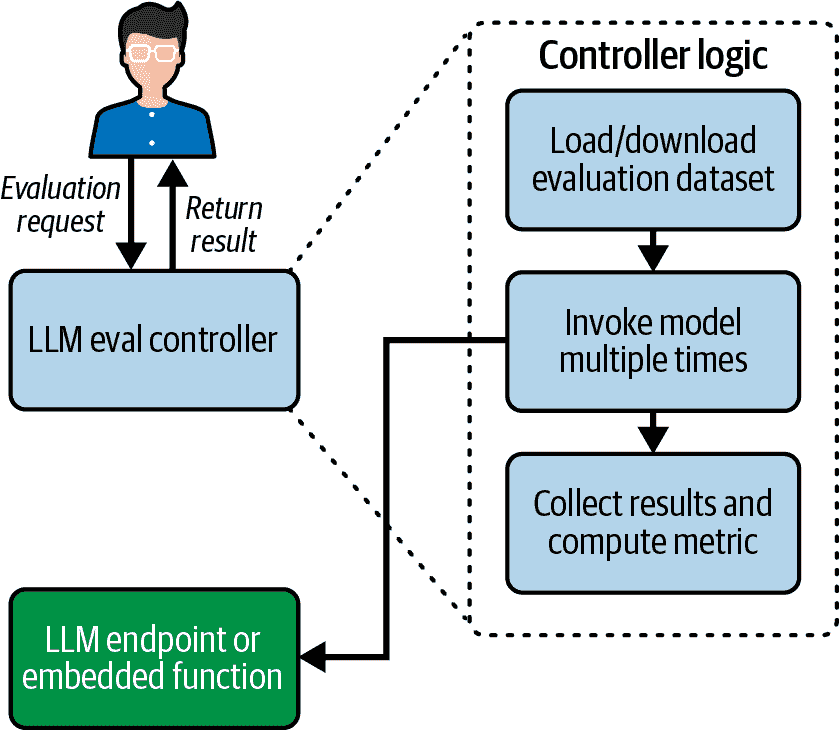
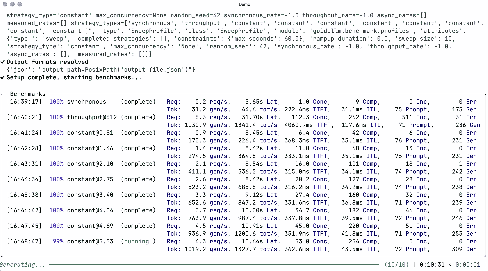
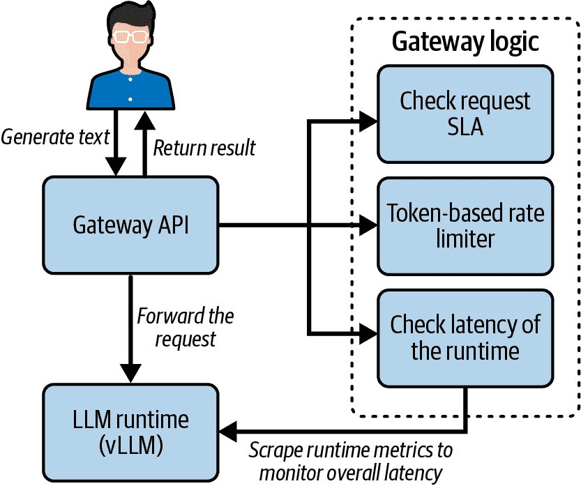
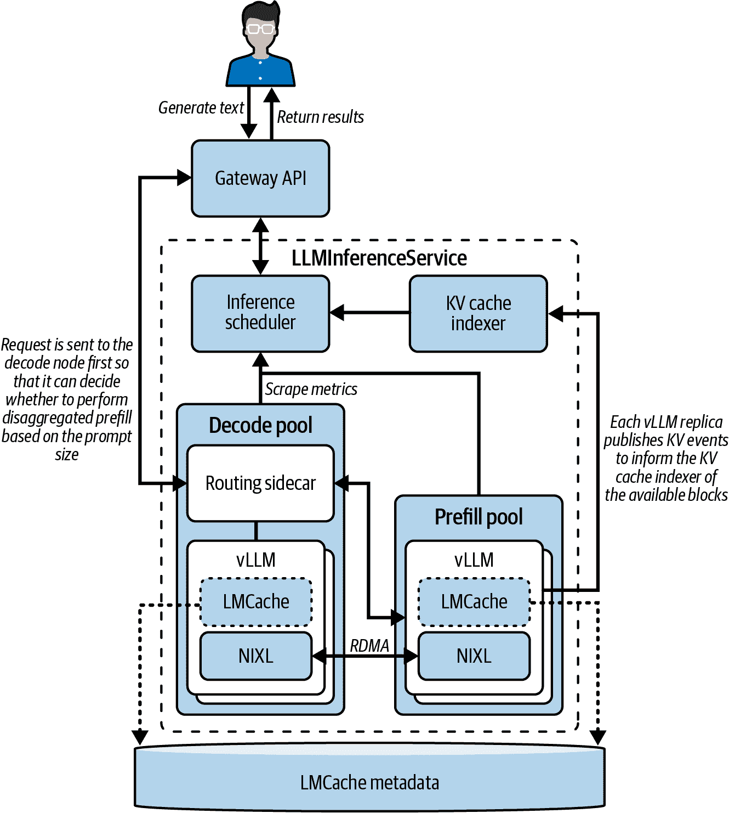

## 第 4 章：生产环境运行

到目前为止，你可能已经部署了第一个在 Kubernetes 上运行的 LLM。它能够响应请求，甚至可能具有不错的延迟。但生产环境并不是能运行一次就万事大吉——而是要在大规模和负载下持续稳定地运行。

本章全部围绕这一转变展开。本章涵盖在真实场景中使 LLM 推理稳定高效所需的内容，包括参数调优等预期主题，以及运行时内存规划、将粘性请求路由到缓存已预热的副本、模型压缩决策，以及需要专用网络配置的高级拓扑等容易被忽视的方面。

将模型服务器当作普通容器来对待是很有诱惑力的。只需设置一些资源限制、暴露一个服务，一天的工作就完成了。但 GenAI 工作负载具有独特的特征（海量模型、可变的请求成本和 GPU 密集型操作），需要专门配置。你将学习如何有效地配置平台，同时避免那些可能悄然侵蚀性能并烧光 GPU 预算的陷阱。

本章涵盖五个关键领域：

- *模型与运行时调优*：选择、评估、压缩和基准测试模型
- *自动扩缩容*：针对 LLM 工作负载的特定策略
- *优化 vLLM 启动时间*：减少部署延迟
- *LLM 感知路由*：智能请求分发
- *分离式服务*：高级分布式架构

最根本的决策是如何在不浪费计算资源的情况下，选择并调优一个与你的用例相匹配的模型。

### 模型与运行时调优

当团队着手开发第一个基于生成式 AI 的真实应用时，最需要考虑的方面可能是选择要使用的模型。大多数团队从 OpenAI 的 ChatGPT 这类托管服务开始，其配置选项有限。然而，在许多情况下，本地基础设施是必需的。此时模型的选择至关重要。这种选择基于许多不同的因素，例如任务类型、工作负载类型（即实时推理与批量推理）以及并发请求数量。

模型的大小很重要，但两个大小相同的模型可能具有不同的模型架构和训练技术，这会导致同一查询的结果从非常准确变为完全错误。

鉴于这种选择的关键性，找到一个起点颇具挑战性。可用模型的数量非常庞大，而且新模型发布频繁，使得选择过程令人望而生畏。

没有银弹，也不存在*一个模型统治所有场景*的万能模型，但选择过程不应考虑 Hugging Face 上所有可用的模型。开发预测性 AI 模型时的常见任务包括检查并比较针对同一任务训练的模型的准确性，因此找到一种或多种指标来比较 LLM 的准确性应该很有用。

传统的预测性 AI 模型经过训练以解决特定问题。相比之下，LLM 在海量数据集上进行训练，可以执行多项任务。要有效地比较 LLM，首先要确定应用的关键任务，然后基于该任务选择准确性指标。

这一阶段对于指导模型选择至关重要，使其基于具体指标而非人工测试。这个问题非常复杂，甚至存在一个关于语言模型评估的完整研究领域来解决它。

### 语言模型评估

语言模型的评估可以针对许多不同方面，例如衡量模型的知识丰富程度、模型生成无有害语言内容的能力，甚至模型在推理任务上的表现。这一定义并非 LLM 所特有；同样的原则也适用于 LLM 时代之前定义的许多传统语言模型。

语言评估最重要的应用之一是通过特定任务来验证模型安全性，以衡量模型的有害性或鲁棒性。

许多不同的项目提供一个或多个评估基准；最常用的套件之一是 EleutherAI 的 `lm-evaluation-harness`，它包含一百多个开箱即用的任务。还有其他库，并且经常定义新的评估技术，以便在日益复杂的场景中测试模型。

传统上，评估任务包括一个数据集（包含一组输入和输出，通常采用选择题问卷的形式以简化分析），以及一个用于计算指标的评价函数。这种格式使领域专家可以非常轻松地审查数据集，并且可以轻松地按子主题分组，以更好地对模型能力进行分类。

每个基准本质上都是一个过程：使用一组预定义的问题-答案对来调用目标模型并分析结果，因此运行它需要时间（甚至几个小时），而且模型必须已部署，所以执行成本可能非常高。幸运的是，对于所有最常用的模型，都可以找到在线排行榜，这些排行榜收集了多个基准的评估结果，从而可以轻松进行比较。

排行榜是一个表格，使用一个或多个指标对不同模型进行比较。同时，使用此类排行榜存在安全和信任方面的影响，因为如果不本地重新执行测试，就无法验证已发布数字的真实性。一般建议是使用排行榜进行初步评估以生成候选模型清单，然后再进行额外的分析。

一个很好的起点是 Hugging Face 网站上的排行榜页面，该页面按数学能力或模型安全性等类别对许多排行榜进行了分组链接。例如，Open LLM Leaderboard 在多个基准上对模型进行比较，包括 MMLU（知识）、HellaSwag（常识推理）和 TruthfulQA（真实性）。

当你确定要在本地评估的模型时，理解评估过程的工作原理至关重要。评估请求的执行流程见图 4-1。



*图 4-1. 语言模型评估执行流程*

由于每个任务可能需要数分钟才能完成，因此通常会在自动化流水线中异步执行。例如，TrustyAI 项目为 `lm-evaluation-harness` 库提供了一个包装器，引入了 `LMEvalJob CRD` 来执行任务并在完成时发出通知。完整的示例可在 TrustyAI LM-Eval 文档中找到。

除了数百个现有评估任务之外，你还可以创建自定义评估任务，但这样一来，你就无法轻松地使用在线排行榜来比较不同模型或模型的不同版本。

最常用的基准之一是海量多任务语言理解（MMLU），因为其数据集涵盖了来自不同知识分支的大量选择题，并按任务分组，包括非常多的主题：抽象代数、高中欧洲史、高中政府、政治等等。同样的方法也被推广到多模态模型，即海量多学科多模态理解（MMMU）。

虽然通用基准评估的是基础能力，但生产级 LLM 应用通常需要针对特定用例和风险的专用评估工具。检索增强生成（RAG）系统（见第8章）需要同时评估检索质量和生成准确性的指标，而安全导向的部署则需要漏洞扫描来识别潜在风险，如提示注入或有害输出生成。有两个框架可以满足这些专门需求：Ragas 提供了专为 RAG 应用设计的指标，用于衡量上下文相关性、答案忠实性和检索准确性；而 NVIDIA garak 则是一个漏洞扫描器，可探测 LLM 的安全弱点，测试其对提示注入、越狱尝试和有害内容生成的抵抗能力。

### 模型与运行时调优

模型选择发生在项目生命周期的早期，但评估并不止于此。在针对生产环境优化模型时，同样的评估技术变得至关重要。数据科学家和 AI 工程师首先选择模型，但在大规模运行之前，你需要对其进行优化。可以使用量化技术压缩模型，也可以收集生产数据并用其将模型蒸馏为更小的模型。

这两种压缩技术都会修改模型权重，从而影响整体准确性。因此需要再次执行评估来衡量影响。

应用类似技术可以生成体积不到原来一半的模型，在相同硬件上使运行时的吞吐量提高一倍或两倍，同时精度基本与原始模型一致。如果应用得当，压缩后的模型可以恢复原始模型 99% 以上的准确率。

#### 语言模型压缩

像 `Meta-Llama-3.1-8B-Instruct` 这样的 LLM 有八十亿个参数。这意味着有八十亿个浮点数值，每个值都用作神经网络相应输入的权重（乘数）。

每个浮点值用 16 位表示，因此加载模型所需的最小内存是 16 GB（16 位 × 80 亿）。这样的神经网络可能有很多层（例如 32 层），每个神经元的输出都会馈送到后续层，从而增加模型的总体内存占用。这被称为激活，它是另一个 16 位浮点值。

最后，KV 缓存值和中间输出结果都使用 16 位精度表示。有关此主题的更多详细信息，请参阅第 xxv 页的“理解 LLM 基础”。

所有这些浮点数构成了 LLM 在 GPU 内存中的总内存占用。压缩模型的技术称为量化（请参阅下面的侧边栏）。

#### 量化

量化是一组技术的总称，旨在使用精度较低的表示形式（如 8 位浮点数 (FP8) 或整数表示 (INT8)）来减少总内存占用。这些技术不只是简单地舍入浮点数或减少小数位，而是涉及专门设计用于在执行过程中补偿错误的机制。

仅进行模型压缩是不够的。如果运行时缺乏原生量化支持，则必须在处理过程中将压缩模型转换回 16 位精度，以便评估神经网络并产生激活。量化的最佳状态是运行时拥有优化的内核实现（GPU 函数），可以端到端处理量化数据。这才能实现可扩展性改进。

vLLM 运行时原生支持大多数量化技术，在压缩方面有 LLM compressor 项目，尤其是在运行时方面，有多个优化的内核，当运行时检测到模型已量化时会自动启用这些内核。

这一研究领域看起来非常有前景，可以使 LLM 服务更具成本效益，并可能成为未来模型和运行时的标准，但仍有一些关键问题有待解决。首先，对于正确扩展量化模型至关重要的专用内核是硬件相关的，因此并非所有 GPU 都支持；而且一般来说，量化出错时可能会导致准确性急剧下降。

尽管第一个方面（确保全面的 GPU 覆盖）可能只需要时间，但第二个方面则需要精细的控制。压缩不是无损的，因此评估压缩后的模型质量以确保准确率没有受到太大影响至关重要。

有很多模型被量化为每个浮点数使用 8 位（FP8），并恢复了原始模型 99% 以上的准确率。`llmcompressor` 库通过内置校准简化了整个流程。使用该库相当简单，但需要具备一定知识才能理解不同的参数（示例 4-1）。

*示例 4-1. 使用 `llmcompressor` 压缩 LLM*

```python
from llmcompressor.modifiers.quantization import GPTQModifier
from llmcompressor.modifiers.smoothquant import SmoothQuantModifier
from llmcompressor.transformers import oneshot

# Select quantization algorithm. In this case, we:
# * apply SmoothQuant to make the activations easier to quantize
# * quantize the weights to int8 with GPTQ (static per channel)
# * quantize the activations to int8 (dynamic per token)
recipe = [
    SmoothQuantModifier(smoothing_strength=0.8),
    GPTQModifier(scheme="W8A8", targets="Linear", ignore=["lm_head"]),
]

# Apply quantization using the built-in open_platypus dataset.
oneshot(
    model="TinyLlama/TinyLlama-1.1B-Chat-v1.0",
    dataset="open_platypus",
    recipe=recipe,
    output_dir="TinyLlama-1.1B-Chat-v1.0-INT8",
    max_seq_length=2048,
    num_calibration_samples=512,
)
```


`recipe` 定义了一个或多个技术的量化流水线。

`scheme W8A8` 表示权重和激活都用 8 位量化。

必须指定用于校准量化的数据集。

输出目录将包含压缩后的模型以及服务该模型所需的全部配置文件（`config.json`、`tokenizer.json` 等），这样 vLLM 运行时就知道如何在没有任何自定义参数的情况下加载模型。

一个良好的实践是在部署到生产环境之前，使用语言模型评估技术来计算原始模型的准确率指标。此外，将压缩直接集成到 MLOps/LLMOps 流水线中，为系统提供了一个优化的起点。这种方法无需自定义配置。

模型压缩是一个复杂的过程，风险很大。

不当的量化会严重影响模型质量，导致准确率下降、幻觉或错误的输出。虽然像 `llmcompressor` 这样的工具提供了校准功能，但要实现最佳压缩，仍需要专业知识并经过全面评估。

另一种方法是使用已经由具备压缩专业知识的组织专业压缩和验证过的模型。例如，Hugging Face 上的 Red Hat AI 发布了经过精心量化和评估的预压缩模型，提供了可直接用于生产的压缩模型，避免了不当压缩的风险。

#### 模型性能基准

第 5 章介绍如何观测 LLM，以及哪些指标对于跟踪使用情况和系统响应能力至关重要，尤其是对于聊天机器人等实时用例。快速响应对于解决延迟问题至关重要，可以通过正确配置扩缩容、速率限制，甚至用适当的错误信息拒绝新请求来实现。

### 模型与运行时调优

无论将对系统采取何种缓解措施，前提都是要在不同条件下和不同工作负载下测量系统的整体行为。

为了有效测量系统行为，你需要专门的工具。LLM 社区已经开发了几款全面的基准测试工具，接下来我们将逐一探讨。

性能和容量测试在软件开发中并不新鲜。每个成熟的发布流水线都应包含这一环节；从端到端的角度看，一个提供服务的模型也很类似：它是一个接收请求并生成响应的端点。

有多种性能测试工具可用于调用端点。运行时可以使用传统的负载生成器进行测试，这也是过去进行 LLM 性能测试的方式，并且有时仍在沿用。随着时间推移，人们开发了更专业的工具，它们能够计算更专业的指标，并将性能测试与模型评估相结合，组合不同的场景和数据集。

LLM 社区非常活跃，可用的工具也很多。其中最全面的包括：

- **GuideLLM**：GuideLLM 项目是专门为评估模型和优化 LLM 部署而创建的工具。它可以模拟不同类型的工作负载，以贴近真实场景。GuideLLM 可用作交互式工具，用于评估特定硬件配置下的性能和资源使用情况。该工具覆盖了大量可配置的速率场景，从同步场景（每个请求依次串联）到具有固定并发数的更高级场景，甚至是指定速率均值的泊松分布场景。基准测试完成后，GuideLLM 会生成包含延迟分布和其他有用信息的报告。示例 4-2 展示了如何从命令行调用 GuideLLM，其输出如图 4-2 所示。

**示例 4-2：使用 GuideLLM 运行基准测试**

```bash
guidellm benchmark \
  --target http://127.0.0.1:8000 \
  --model mistralai/Mistral-7B-Instruct-v0.2 \
  --output-path output_file.json \
  --rate-type sweep \
  --data 'prompt_tokens=256,output_tokens=128' \
  --max-seconds 400 \
  --warmup-percent 0.2
```

要测试的目标模型必须在运行测试之前完成部署。

基准测试结果存储在此 JSON 文件中。

GuideLLM 支持多种速率类型，默认是 `sweep`。这一灵活的选项涵盖多种场景，从请求序列到恒定速率，无需定义具体工作负载即可提供系统基线数据。

为了确保测试具有相关性，指定与生产环境预期相符的输入和输出大小非常重要。该工具默认使用本地副本*《傲慢与偏见》*，但也支持 Hugging Face 的数据集或自定义本地数据集。



*图 4-2：GuideLLM 运行的示例输出*

- **MLPerf Inference**：正确测试机器学习模型性能的挑战并不新鲜，也并非仅限于 LLM；实际上，已有一些社区聚集了企业、个人贡献者和学者，共同定义工具并发布结果。MLCommons 是一个 AI 工程联盟，建立在开放协作以改进 AI 系统的理念之上。该组织提供了许多不同的工具，MLPerf Inference 便是其中之一，并且随着时间的推移已扩展支持 LLM。其测试结果会定期发布在 MLCommons 网站上，涵盖数据中心配置（MLPerf Inference: Datacenter）和边缘/设备（MLPerf Inference: Edge）。

- **Inference Perf**：Inference Perf 是一个 GenAI 推理性能基准测试工具，由 Kubernetes WG-Serving 工作组提出并孵化，并获得 Kubernetes SIG Scalability 的赞助。这一社区成果得到了多家公司的支持。它专为生成式 AI 设计，你可以指定任意数据集来模拟与真实场景相似的情况。该库可以在本地运行，也可以部署在集群中，连接到一个先前已部署的模型，前提是该模型暴露了兼容 OpenAI 的 API。

- **vLLM 基准测试套件**：性能对于 vLLM 这样的推理引擎至关重要，它提供了公开可用的 nightly 基准测试任务及说明。它算不上一个正式的工具，更像是一组脚本，可用于衡量特定模型或硬件配置的性能。

如前所述，虽然也可以使用其他传统负载生成器，但这需要实现 LLM 特有的指标，例如首令牌时间（Time to First Token，TTFT）和令牌间延迟（Inter-Token Latency，ITL）。无论选择哪种工具来测量性能，将其集成到 CI/CD 系统中通常都很直接，只需创建一个部署模型并使用该工具执行测试的任务即可。最关键的一点是使用与生产集群等效的环境，尤其是在模型以及部署模型所需的 GPU 数量方面。

将性能测试集成到发布流水线并存储结果，对于合理规划集群规模、了解容量上限至关重要。这些数据对于容量规划以及配置速率限制或 API 网关都是关键。

#### vLLM 运行时参数调优


# 理解 LLM 基础知识与 vLLM 运行时调优

第 xxv 页的“理解 LLM 基础知识”解释了 LLM 推理如何运作、哪些指标需要重点监控，以及 KV 缓存对提高 LLM 服务效率的重要性。现在模型已完成压缩，随时可以部署。借助性能测试，与整体系统性能相关的数据可用于指导运行时调优。

本节专门讨论 vLLM 运行时，但其中大部分内容同样适用于其他 LLM 运行时。

vLLM 项目开发非常活跃，每周都会加入新的优化和新模型。每个版本都会实现改进后的默认配置，因此在大多数情况下无需调优，开箱即用。vLLM 无法轻松自动推断的唯一方面是工作负载类型和分配的硬件；这正是可以通过配置来帮助引擎的地方。

尽管 vLLM 的默认配置通常是一个有效的起点，你仍需要执行一些容量分析，以计算 GPU 需要多少显存（VRAM）（有关详细的计算指南，请参阅下面的侧边栏）。

## 如何计算模型内存需求

内存需求的确定涉及许多不同因素。其中大部分与模型架构、模型大小以及并发请求数相关。

决定模型内存需求的主要因素是参数量：一个拥有 80 亿（8B）参数的模型，其所需内存远少于可超过 4000 亿参数的超大模型。

在全尺寸模型中，每个参数通常占用 2 字节（16 位，`float16` 或 `bfloat16`）内存。通过压缩技术，这可以降低到每参数 1 字节（8 位，`FP8` 或 `INT8`）。参数数量乘以每个参数的字节数即可得到基线内存需求。

除了这个基线之外，与优化内核相关的一些基础设施空间也会加载到 GPU 上，通常在 300 MB 到 2 GB 之间。

执行过程中表示中间状态的激活值（activations）开销也应予以考虑。它与隐藏层大小（hidden size）和层数直接相关。这两个值都可以在模型的 `config.json` 文件中找到（例如 40 层）。当序列长度较小时（例如 512），激活内存需求可能限制在 200–300 MB；但随着序列变长，这一需求会发生巨大变化，因为其开销呈二次方增长。

最后，输出生成需要一个输出张量，其开销与词表大小、序列长度和批次大小直接相关。

以一个使用 `float16` 格式参数、上下文大小为 2048、批次大小为 1 的 8B 模型为例：基线内存需求约为 16 GB（80 亿 x 2 字节）。通常还需要考虑约 1 GB 的基础设施附加内存、约 900 MB 的激活空间（假设隐藏大小为 4096），以及最后约 400 MB 的输出层空间。

总显存需求约为 17.3 GB，这看起来是合理的。然而，仅将批次大小增加到 10 以同时处理多个请求，这一需求就几乎翻倍，推高到超过 28 GB 的显存。

这个话题远不止这个简化示例所涵盖的内容。新技术和新模型架构不断涌现，内存影响也随之改变。例如，Mamba LLM 架构等持续演进有望大幅降低 KV 缓存的大小需求。

在线工具可以帮助进行此类计算，例如 TitanML 的模型内存计算器。若想了解更多，包括所有已应用的公式，我们强烈推荐阅读 Alexander Smirnov 的这篇博文以及 EleutherAI 博客中的详细信息。

vLLM 运行时会贪婪地利用可用资源以最大化吞吐量。因此，拥有更多资源可直接提升性能。在理想情况下，vLLM 拥有足够的 GPU 内存将模型加载到显存（VRAM）中，同时也有足够的空间用于激活值（每个神经网络层的中间结果）和 KV 缓存。这确保了运行时永远不需要驱逐并重新计算仍然需要的数据。

当情况并非如此时，首要症状将是更高的 token 间延迟，以及隐式地降低吞吐量。这并不是唯一的检测方式，因为在类似场景下，vLLM 通常会在日志中明确说明。我们在示例 5-1 中查看了 vLLM 的启动日志，但示例 4-3 重点关注内存信息。

**示例 4-3：vLLM 记录内存信息**

```text
...
INFO [model_runner.py:1097] Loading model weights took 14.9888 GB
INFO [worker.py:241] Memory profiling takes 0.67 seconds
INFO [worker.py:241] the current vLLM instance can use total_gpu_memory (79.14GiB) x gpu_memory_utilization (0.90) = 71.22GiB
INFO [worker.py:241] model weights take 14.99GiB; non_torch_memory takes 0.12GiB; PyTorch activation peak memory takes 1.19GiB; the rest of the memory reserved for KV Cache is 54.93GiB.
...
WARNING [scheduler.py:1057] Sequence group 0 is preempted by PreemptionMode.SWAP mode because there is not enough KV cache space. This can affect the end-to-end performance. Increase gpu_memory_utilization or tensor_parallel_size to provide more KV cache memory. total_cumulative_preemption_cnt=1
```

在 vLLM 启动期间，模型加载到 GPU 内存后，日志会包含权重大小。

一条非常有用的日志条目说明了 vLLM 可以使用的 GPU 内存总量。

除了模型权重之外，引擎还会使用一些额外的内存。激活值也会占用一些内存：“峰值”取决于一次执行期间神经网络中有多少节点被激活。例如，在混合专家（MoE）模型架构中，每次只有模型的一部分子集被激活。

其余内存被分配给 KV 缓存。

在模型执行期间，当 KV 缓存内存不足时，会产生这条日志，因此 vLLM 必须将部分值交换到显存之外。

当分配给 KV 缓存的大小不够时，日志会明确报告这一信息。单条日志可能并不关键，但如果这种情况多次发生，最好考虑进行一些调优。

幸运的是，日志非常详细，日志消息中包含一些尝试解决该问题的建议。

## 模型与运行时调优

以下参数值得考虑：

- `gpu-memory-utilization` — 该参数的默认值为 `0.9`，表示 vLLM 可以使用的可用内存百分比。此设置限制了 vLLM 的内存消耗，防止早期版本中 vLLM 超出分配的 GPU 内存时出现的内存不足（OOM）错误。虽然 `0.9` 是一个安全阈值，但 vLLM 的稳定性已经有所提升。因此，现在通常可以安全地将该值增大到接近 `1.0`，从而访问额外 10% 的内存。

- `max-model-len` — 该参数至关重要，必须根据具体的 LLM 用例或任务进行配置。KV 缓存大小直接对应于上下文大小（输入提示词加上生成的文本）。虽然调整该值会直接影响内存使用，但过度限制上下文大小可能导致响应缺乏足够多的 token 来满足用例需求。例如，RAG 模式通常需要相当大的上下文。

- `max-num-seqs` 或 `max-num-batched-tokens` — vLLM 引擎将输入分批处理，以提高 GPU 利用率并增加吞吐量。这可能会对延迟产生一些影响，但在高并发的生产场景中，这种影响通常非常有限。同时，批处理大小越大，KV 缓存空间就越大，因此可以通过减小该值来节省一些内存。

- `tensor-parallel-size` — 与之前的参数不同，增加张量并行大小需要额外的硬件。该过程会切分模型权重，为每个 GPU 上的 KV 缓存提供更多可用内存。这需要多个 GPU，但同一节点内的 GPU 间通信通常不会成为瓶颈。专用的高速接口可避免通信延迟。对于多节点 GPU 部署和高级网络拓扑，请参阅第 7 章中的网络优化和拓扑感知调度部分。

- `pipeline-parallel-size` — 流水线并行将模型层分布到多个 GPU 上，而张量并行则拆分单个张量。这两种方法相互兼容，都能增加可用的 KV 缓存内存，但张量并行更常用于同一节点上的多 GPU 推理。

- `data-parallel-size` — 与流水线并行类似，这种方法将数据拆分为并行组，从而支持跨不同服务器上的 GPU 进行多节点服务。当集群包含多台配备 GPU 的服务器时，此技术适用。虽然它会增加可用的 KV 缓存内存，但也引入了多节点场景的复杂性，这需要专用的连接。

- `cpu-offload-gb` — 该参数将模型的一部分卸载到 CPU，从而允许部署比可用 GPU 内存更大的模型。虽然这看起来对 KV 缓存管理很有用，但它会显著影响吞吐量。由于性能大幅下降，并且会丢失对高效 LLM 服务至关重要的 GPU 专属优化（例如专用内核），因此强烈不建议在生产环境中使用。

使用这些参数并了解工作负载的特征，对于调优运行时以最大化性能并匹配预期的服务水平至关重要。当这还不够时，可以向系统添加更多 GPU，但也可以考虑借助 Kubernetes 技术栈，特别是网络部分，进行额外的优化，如第 139 页的“LLM 感知路由”所述。

## 自动扩缩容

你已经优化了模型并调整了运行时参数。但生产部署还面临另一个挑战：工作负载的动态变化。即使是经过完美调优的单实例，最终也需要多个副本来处理峰值流量。

在实时推理场景中，终端用户延迟至关重要。监控首 token 时间（TTFT）和 token 间延迟（ITL）指标，以指导路由和扩缩容决策。对于离线推理，则应专注于调整批处理大小和吞吐量。

Kubernetes 原生支持水平 Pod 自动扩缩容，可在不同副本之间动态平衡请求。然而，LLM 工作负载面临着特定的挑战：请求成本因 token 数量而有显著差异，GPU 利用率与 CPU/内存并不相关，而且启动时间可能很长。类似的挑战也适用于分布式训练工作负载，这类工作负载需要复杂的调度策略，如第 7 章中介绍的联合调度（gang scheduling）和配额管理。自动扩缩容的主要选项有：

- **Horizontal Pod Autoscaler (HPA)** — 默认的 HPA 开箱即用，无需额外依赖，但它主要监控 CPU 和内存。这使得它不太适合 LLM 工作负载，因为这类负载主要影响 GPU，因此需要更灵活的自动扩缩容解决方案。

- **Knative Pod Autoscaler (KPA)** — Knative Serving 项目提供了 KPA，这是一种更灵活的自动扩缩容器，其决策基于请求数量。其默认的“稳定”模式使用基于时间的窗口来计算并发量并进行扩缩容。同时还提供“恐慌”模式，采用更短的窗口以更快地响应工作负载变化。虽然 KPA 比 HPA 更适合 LLM，并且与 KServe 原生集成（使用 Knative 部署模式），但它是为 Pod 扩缩容速度快的微服务而设计的。不幸的是，LLM 是复杂的、依赖 GPU 的部署，根据模型大小可能需要数分钟来加载。这使得在没有大量调优的情况下，动态工作负载扩缩容不太实用（请参阅第 136 页的“优化 vLLM 启动时间”）。更重要的是，像 KPA 这样基于请求的方法没有考虑到请求数量与运行时工作负载并不直接相关。一个请求可能生成许多 token，而下一个请求可能只生成几个。

- **Kubernetes Event-driven Autoscaling (KEDA)** — KEDA 是一个为扩展事件驱动工作负载而创建的项目，在这类工作负载中，请求不是 HTTP 请求，而是（通常来自）队列的消息。KEDA 创建者必须解决的挑战与 LLM 扩缩容的挑战类似：实现事件驱动架构的技术多种多样，因此需要有一个灵活的 API 来配置如何检索信息，以衡量系统的整体压力。已实现的解决方案能够配置基于指标的查询来指导扩缩容。这是因为每个队列系统都会发布诸如队列中待处理消息数量之类的指标，但每种技术都有不同的方法（例如，基于推送与基于轮询）和不同的命名约定。这种灵活性同样适用于 vLLM，因为运行时发布了诸如 `vllm:num_requests_waiting` 之类的指标，用于衡量有多少请求仍在等待处理，或者通过 `vllm:time_to_first_token_seconds`/`vllm:time_per_output_token_seconds` 来跟踪生成每个 token 所花费的时间。KServe 通过 Knative 部署模式原生支持 KPA，但也通过标准部署模式支持 KEDA。如需了解不同部署模式的更多信息，请回到第 20 页的“KServe”。

KServe。KEDA 自动缩放器在 InferenceService 规范中配置，并定义了要执行的查询。它支持直接从 PodMetric 或外部源获取指标。如果配置的查询仅限于 Pod 本地的 vLLM 指标，这两种选项是等效的；在这种情况下，直接从 Pod 获取指标可以减少自动缩放器的延迟，使其更具响应性。外部源选项更加灵活，因为它可以从不同来源（甚至 vLLM 的不同副本）收集指标，并执行连接所有信息的更高级查询（请参见示例 4-4）。

**示例 4-4：KServe 与 KEDA 示例**

```yaml
apiVersion: serving.kserve.io/v1beta1
kind: InferenceService
metadata:
  name: Meta-Llama-3-8B
  annotations:
    serving.kserve.io/deploymentMode: Standard
    serving.kserve.io/autoscalerClass: "keda"
    sidecar.opentelemetry.io/inject: "Meta-Llama-3-8B"
spec:
  predictor:
    model:
      modelFormat:
        name: huggingface
      args:
        - --model_name=llama3
        - --model_id=meta-llama/meta-llama-3-8b
    minReplicas: 1
    maxReplicas: 5
    autoScaling:
      metrics:
        - type: PodMetric
          podmetric:
            metric:
              backend: "opentelemetry"
              metricNames:
                - vllm:num_requests_running
              query: "vllm:num_requests_running"
            target:
              type: Value
              value: "4"
# - type: External
# external:
# metric:
# backend: "prometheus"
# serverAddress: "http://prometheus.url:9092"
# query: "vllm:num_requests_running"
```

使用 KEDA 自动缩放器需要 Standard 模式。Knative 使用 KPA，这是其自身的自动缩放器。

此注解启用 KEDA 自动缩放器。

收集 Pod 本地指标的一种方式是通过 OpenTelemetry sidecar 收集器。

`PodMetric` 类型配置 KEDA 直接查询 Pod 以收集指标。

必须指定后端，因为 OpenTelemetry 和 Prometheus 在协议上有一些差异。

KEDA 用于做出决策的查询可以是单个值，也可以是遵循 PromQL 语法的更复杂查询。

在此示例中，值 `4` 表示如果 vLLM 中已有至少四个请求正在运行，KEDA 将增加副本数（在定义的 1–5 界限内），这是基于某项初步基准测试，该测试在更高并发请求数下测量了延迟分布。

这段被注释掉的规范是另一种配置，其中指标从外部源查询。

当类型为 `External` 时，必须指定执行查询的服务器地址。

LLM 服务的演进涵盖了自动缩放这一主题，并且针对最复杂的场景（如分离式预填充）正在开发新的定制技术。第 148 页的“分离式服务”描述了分离式预填充，它与传统 Kubernetes 自动缩放器定义有很大不同。它更像一个“运行时控制器”，观察系统状态并自动重新平衡副本角色或调整每个角色的副本数量。

另一种新兴方法是 llm-d 的工作负载变体自动缩放器（WVA），专门为 LLM 工作负载设计。WVA 不仅监控 CPU 或请求数量，还会考察每个 Pod 能处理的内容，考虑到不同的请求需要不同的工作量（有些生成大量 token，有些则只生成少量），并基于实际延迟目标进行缩放。这样，你可以在添加更多 Pod 之前以更高利用率运行集群，同时仍能满足性能目标。

WVA 是第 148 页“分离式服务”中讨论的 llm-d 项目的一部分。

在本节中，我们讨论了为 LLM 部署配置合适的自动缩放策略所面临的挑战。当存在多个副本时，另一个挑战需要关注：负载均衡策略的调整。如果负载均衡器不感知 LLM，它可能会产生次优的请求分布，并影响系统延迟的稳定性。这一挑战在第 139 页的“LLM 感知路由”中进行了描述和解决。

## 优化 vLLM 启动时间

在第 132 页的“自动缩放”中，我们学习了如何为 LLM 引入更专业的自动缩放器配置，但在实际场景中，如果启动一个新副本需要好几分钟，那么动态缩放就不适用了。

LLM 的规模挑战了 Kubernetes 本身的核心设计原则：一些最大的 LLM 可能仅存储模型本身就需要近 1 TB 的存储空间。它们非常庞大。

这一特性使得配置一种能检测工作负载峰值并即时扩展部署的高效自动缩放策略变得困难。传输如此大量数据所需的时间存在物理瓶颈。

在进行生产部署之前，通常最好进行适当的容量规划以及性能和可扩展性测试。对于 LLM 而言，这一通用建议更为关键。

优化模型加载时间是一项多阶段活动，从模型打包开始。这一方面在第 2 章中详细描述，但本节重点介绍从在 Kubernetes 中创建部署到运行时准备好处理请求所执行的以下步骤：

### 1. 运行时镜像预置


# vLLM 生产环境优化

与 Kubernetes 中的任何其他传统工作负载一样，vLLM 运行时被打包在容器中，该容器从镜像仓库被拉取到 Kubernetes 节点。vLLM 的镜像大小不小，通常为几个 GB（小于 5 GB），且大部分空间通常用于 GPU 框架，例如 NVIDIA 的情况下的 CUDA，因此无法移除。默认情况下，当 Pod 需要镜像时，镜像从仓库到节点的下载是即时执行的。

此活动的频率通过 `imagePullPolicy` 属性指定，并且重要的是避免使用 `Always` 值，以防止镜像为每个副本或新部署而被重新下载。在生产配置中，通常配置为 `IfNotPresent`，以便仅在首次下载；甚至可配置为 `Never`，确保镜像预先拉取到节点。当镜像已存在于节点上时，加载它的时间非常有限，因此要优化此步骤，唯一需要注意的方面是避免将 `Always` 作为 `imagePullPolicy`。此外，对于生产部署，建议使用特定版本标签（例如 `vllm/vllm-openai:v0.12.0`）而不是像 `latest` 这样的可变标签；甚至更好的是通过镜像摘要哈希（例如 `vllm/vllm-openai@sha256:abc123...`）来固定镜像，以确保在所有环境中始终部署完全相同版本的镜像。

## 模型获取与挂载

选择存储和检索模型的方法会显著影响加载性能；糟糕的设计选择可能成为主要瓶颈。常见选项包括从 Hugging Face 即时下载、存储在兼容 S3 的存储上、复制到持久卷声明（PVC）并作为卷挂载，或打包为开放容器倡议（OCI）镜像。其中，直接从 Hugging Face 下载和 S3 选项效率较低，由于数据传输和本地复制，通常需要数分钟；相反，PVC 和 OCI 方法通过将模型直接挂载为卷或 sidecar 容器来避免这种本地复制。如果特定要求必须使用 Hugging Face 或 S3，强烈建议利用 KServe 本地模型缓存选项。此功能使用模型的 `storageUri` 作为键配置本地缓存，理想情况下结合快速存储硬件，如通过非易失性内存快速通道（NVMe）协议的固态硬盘（SSD）。

得益于 KServe 本地模型缓存，Hugging Face 和 S3 的性能实际上与使用 PVC 相当。训练工作负载在管理大型数据集和模型检查点时也面临类似的存储挑战，还需要额外考虑分布式文件系统和检查点策略，这些将在第 7 章中介绍。

## 启动运行时

vLLM 的启动时间通常为一秒或更短。它会在日志中产生有用的信息，如示例 5-1 所述，但从加载时间的角度来看，这并不关键。

## 加载模型

无论选择哪种选项来获取和挂载模型，当 vLLM 运行时启动时，模型都必须可用于加载，而且大部分时间都花在将模型权重复制到 GPU 内存上。减少新运行时副本准备就绪以服务模型的时间的工作主要集中在这个特定阶段。这项工作有一个物理上限，即 GPU 内存的 I/O 带宽，因此不可能比这更快，但未优化模型的加载时间距离物理极限还很远。在基础设施层面，像 NVIDIA GPUDirect Storage 这样的技术可以通过启用 NVMe 存储和 GPU 内存之间的直接路径来显著加速数据传输，绕过 CPU。vLLM 中有三个专注于加载时间问题的项目扩展：CoreWeave Tensorizer、Run:ai Model Streamer 和 fastsafetensor。

### 优化模型加载

Run:ai Model Streamer 是一种快速、高并发的张量加载过程实现；它支持不同的文件格式（包括 safetensors）和不同的存储选项。CoreWeave 的 Tensorizer 和 fastsafetensor 都要求模型先以特定的序列化格式准备好，然后用该格式加速模型加载。一般来说，Tensorizer 和 Model Streamer 在 vLLM 中的配置和使用方式类似（参见示例 4-5），而 fastsafetensor 需要设置一些额外的环境变量。与 fastsafetensor 相比，Tensorizer 和 Model Streamer 的采用更广泛；fastsafetensor 专门用于优化从 NVMe 设备加载模型。由于 Model Streamer 不需要重新打包模型，因此它是最容易尝试的选项。不过，既然本章讨论的是生产环境优化，也值得考虑另外两个选项，并选择最适合你具体环境的那一个。

**示例 4-5：Run:ai Model Streamer 在 vLLM 中的用法**

```bash
vllm serve \
    --port=8080 \
    --model=/mnt/models \
    --served-model-name=meta-llama/Meta-Llama-3-8B \
    --load-format runai_streamer \
    --model-loader-extra-config '{"concurrency":16}'
```

将 `runai_streamer` 作为 `load-format` 参数的值，并不需要不同的序列化格式，而是会启用 Model Streamer 代码。

使用 `tensorizer` 作为值会启用 Tensorizer 加载器，但这同样要求模型使用 Tensorizer 序列化器保存。

该配置启用 16 个并发线程并行加载模型。其他可用选项可以在 Model Streamer 环境变量文档中找到。

#### 预热推理引擎

一旦权重驻留在 GPU 内存中，运行时会预先分配 KV 缓存内存池，并执行一些性能分析操作。GPU 内核是执行 GPU 数学运算的特化函数；如果逐个启动数千个内核，会在推理期间造成 CPU 瓶颈。为了消除这一开销，运行时会将内核启动捕获为可重用的序列，即 CUDA（NVIDIA）或 HIP（AMD）图。这个“预热”阶段对于高吞吐量服务至关重要，但会增加总就绪时间。近来的工作重点在于缓存图工件，并利用 GPU 快照来绕过重复的初始化。详见 vLLM 文档中的 CUDA Graphs 部分。

#### 暴露模型

当模型加载完成后，vLLM 会暴露兼容 OpenAI 的 API 以及许多其他端点，并准备好处理请求。API 列表中包括一个 `/health` 端点，可用于配置就绪探针，正如 Kubernetes 最佳实践所建议的那样。

以上是 vLLM 启动运行时、加载模型并暴露模型所执行的主要步骤。其中耗时最多的两个阶段是下载模型和将模型加载到 GPU。我们已经解释了如何通过合理配置避免下载时间，以及如何使用 vLLM 扩展之一来缩短模型加载时间。另一个建议是使用诸如 NVMe 设备之类的高速存储选项。

应用所有这些建议，可以将 vLLM 的扩容时间从几分钟缩短到几十秒，具体取决于模型的大小。

## LLM 感知路由

上一节展示了如何扩展到多个副本。现在我们面临一个新的挑战：如何在这些副本之间有效分发请求。当单个副本不再够用、需要为模型配置多个副本时，跨不同副本的请求负载均衡就开始对集群产生影响。

Kubernetes 在多个副本之间分发请求的默认策略是轮询。请求被均匀地分发，这种策略的设定考虑了微服务的工作负载；在微服务中，监控 CPU 和内存就足以了解单个副本的当前工作负载，并决定何时扩容。

实际上，当 Kubernetes 部署在具有多可用区配置的云环境中时，轮询方法已经暴露出局限性。Kubernetes 引入了拓扑感知路由，以启发式地管理负载，并将流量保持在发起流量所在的区域内。

在 LLM 服务中，Kubernetes 的边界比以往被拉伸得更远，这需要探索一种不同的方式，以优化路由和将请求负载均衡到副本。要实现专门化的请求路由，需要考虑多个因素：

- **每个请求都是不同的**

  前面的章节已经强调了这一点。输入提示的大小与模型生成的 token 数量之间没有关联，生成过程可能持续数秒。一个请求对副本的影响是不可预测的，因此路由策略必须考虑副本正在执行的实际工作，尤其是还有多少请求正在等待处理。vLLM 生成的一个特定指标 `vllm:num_requests_waiting` 会跟踪这一信息。

- **批处理**

  vLLM 会创建一批请求，批次大小可配置，以利用所有可用资源并生成更多 token。这在实时场景中对于并行处理更多请求至关重要。然而，并不总是能用请求填满整个批次，路由器可以将离线推理请求与实时请求混合在一起，以填满一个批次。

- **预填充与解码工作负载**

  我们已经解释了预填充和解码阶段对硬件产生的不同影响。特别是，预填充阶段与提示的大小直接相关，因此可以设计专用的 vLLM 实例来执行大型提示的预填充。这被称为*分离式预填充*，并在第 148 页的“分离式服务”中介绍。

- **KV 缓存复用**

  前面的章节多次提到 KV 缓存是高效 token 生成的关键因素。然而，这种影响不仅限于单个请求。模型没有记忆，每个请求看起来都是全新的。例如，在聊天机器人中，每条新消息都会携带整个对话，系统需要再次处理（预填充）之前的所有消息。AI 智能体在调用工具并将结果连同之前的提示一起发回模型时，也遵循同样的模式。一个了解每个副本 KV 缓存状态的路由器可以利用这一点来路由请求；这被称为*前缀感知路由*。

- **不同的服务级别要求**

  实时请求的优先级高于批处理请求，但对来自不同用户的请求进行优先级排序可能更为复杂。例如，当容量（等待的请求数和 KV 缓存大小）低于某个阈值时，调度逻辑可以丢弃一个不关键的请求。

- **LoRA 适配器**

  还有一种用例不太适合传统的 Kubernetes 路由模式：高效地服务微调模型。模型定制在第 184 页的“微调模型”中介绍；但一般而言，从服务的角度来看，当模型被微调时，训练任务会生成一个新的专用版本，并作为新的独立模型部署。但是，当使用一种特定技术——低秩适配（LoRA）（参见第 187 页的“低秩适配”）时，微调后的模型会保存为一个薄层，称为 LoRA 适配器，与基础模型组合在一起。这使适配器可以与基础模型部署在同一个运行时实例中，从而节省硬件资源，但打破了一个端点对应一个模型的映射。

人们对优化推理和降低推理成本有着浓厚的兴趣，各种举措都旨在解决或至少改善上面描述的两个场景中的问题。

这是一个不断发展的领域。这些计划的共同目标是获得一个能够感知 LLM 流量并对其进行优化的网关组件。图 4-3 提供了这一组件的高层视图。



*图 4-3：LLM 感知的 Gateway API*

从路由的角度来看，LoRA 适配器场景是最简单的，因为只需感知运行时实例与 LoRA 适配器之间的映射关系即可。主要挑战在于端点和模型之间不存在一一对应的映射，集群的路由逻辑应支持这种服务发现逻辑，以便将针对 LoRA 微调模型的请求转发到可用的位置。

vLLM 运行时原生支持将 LoRA 适配器与基础模型一同提供服务，使得两者可在同一端点下使用，并允许用户在请求中直接指定要执行的模型。参见示例 4-6，了解如何使用 vLLM 提供 LoRA 模型服务。

**示例 4-6：使用 vLLM 提供 LoRA 适配器服务**

```bash
vllm serve meta-llama/Meta-Llama-3-8B \
--enable-lora \
--lora-modules my-lora-model=$HOME/.cache/huggingface/
...
curl localhost:8080/v1/models | jq
{
  "object": "list",
  "data": [
    {
      "id": "meta-llama/Meta-Llama-3-8B",
      "object": "model",
      ...
    },
    {
      "id": "my-lora-model",
      "object": "model",
      ...
    }
  ]
}
...
curl localhost:8000/v1/completions \
-H "Content-Type: application/json" \
-d '{
  "model": "my-lora-model",
  "prompt": "LoRA is a",
  "max_tokens": 10,
  "temperature": 0
}' | jq
```

基础模型由 vLLM 提供服务。

应通过适当的参数启用 LoRA 支持。

该参数列出了所有要加载的 LoRA 适配器；`my-lora-model` 是模型的名称，后面跟着本地路径，即 LoRA 适配器在容器内保存的位置。由于这是一个列表，因此可以加载多个 LoRA 适配器，模型所在的文件夹也可以是从外部挂载的卷。

基础模型包含在可用模型列表中。

LoRA 模型会作为额外的可用模型出现。

在执行过程中，可以像指定基础模型一样直接指定 LoRA 模型的名称，因此从最终用户的角度来看没有任何区别。

在将 vLLM 配置为提供多个 LoRA 适配器服务后，下一步是让 Kubernetes 感知到这一点，以便在路由请求时使用该信息。Kubernetes 中有一些用于管理网络的项目，而 Kubernetes Gateway API 应成为声明和配置各类网关的标准方式。

最活跃的社区之一是专门致力于模型服务的 Kubernetes 特别兴趣小组（SIG）——WG-Serving，它孵化了 Gateway API 推理扩展（GIE）项目，该项目旨在优化 LLM 服务的路由和效率。

该项目有时也被称为推理网关。它扩展了 Kubernetes Gateway API，以引入对推理工作负载的感知（关于 Gateway API 的背景，请参见下面的侧边栏）。在深入探讨 GIE 的技术细节之前，首先需要理解 AI 网关与传统 API 网关的区别，以及它们为 LLM 工作负载提供的独特能力。

### Gateway API

Gateway API 项目是一个非常庞大且复杂的项目，专注于 Kubernetes 中的 L4 和 L7 路由。这个官方 Kubernetes 项目的最终目标是定义下一代 API，并实现 Kubernetes 入口、负载均衡和服务网格。

它是面向角色的，定义了一组不同的 API 来表示网络配置的各个方面，从基础设施提供者到暴露单个应用。Gateway API 描述了流量如何被转换到集群内的服务，但它只是*意图*，而不是实际的端点或完整规范。路由的创建是协议特定的，例如 HTTPRoute，它附加到网关，并定义了将请求转发到服务的规则。

完整规范中还包含许多其他对象和概念，但它们对解释推理扩展并不关键，因此这里不进行介绍。如需更详细的信息，请参阅 Gateway API 网站的 API 概述页面。

## 从 API 网关到 AI 网关

传统 API 网关是为无状态微服务设计的，在这些服务中，请求彼此独立，且不同端点间的资源消耗大致均匀。AI 网关架构通过针对 LLM 工作负载的特定能力扩展了这一基础，从而应对本质上不同的运维挑战。

AI 网关实现了*模型即服务*（MaaS）架构，其中 LLM 推理能力以托管 API 的形式暴露给多个用户或团队。类似于软件即服务（SaaS）通过互联网提供软件能力，MaaS 通过配置资源配额、访问控制和用量跟踪来交付模型推理服务，从而确保跨租户的公平资源分配。

### 基于令牌的速率限制与用户管理

在多租户环境中服务 LLM 时，用户跟踪对于实现公平访问和配额管理变得至关重要。与传统 API 以请求为度量单位不同，LLM 服务使用令牌作为计算的基本单位。单个请求可能生成 10 个令牌或 10,000 个令牌，消耗的 GPU 资源量和时间差异巨大。这使得传统的基于请求的速率限制对 LLM 工作负载无效。

Envoy AI 网关提供了基于令牌的速率限制能力，该能力跟踪并限制每个用户或 API 密钥的令牌消耗，从而在访问同一模型部署的多个租户之间实现公平的资源分配。类似地，Kuadrant 提供了与 Kubernetes 原生策略管理集成的令牌速率限制，允许平台管理员基于生成的令牌而不是发出的请求来定义配额。

### AI 网关能力的演进

AI 网关生态系统正在快速演进，不再局限于基本的路由和速率限制，而是包含更复杂的能力：

- **语义路由**：语义路由器项目支持根据用户请求的语义内容进行路由，将不同类型的查询引导至专门模型。这会将代码生成请求路由到代码专用模型，同时将一般对话发送到通用 LLM，从而优化成本和质量。

- **混合路由**：高级 AI 网关支持混合方法，可根据当前系统工作负载、模型可用性和 SLA 要求，将请求动态路由到本地部署的模型或远程云托管模型。例如，在峰值负载期间，可以将溢出流量路由到基于云的推理端点，同时将延迟敏感的请求保留在本地基础设施上。

- **模型组合**：新兴的 AI 网关模式支持将多个模型串联在一起，一个模型的输出成为另一个模型的输入，从而实现复杂的工作流，如检索增强生成（RAG），其中检索模型首先识别相关文档，然后由 LLM 生成响应。

这些能力将 AI 网关从简单的流量路由器转变为智能编排层，在异构模型部署中优化成本、延迟和质量。

## Gateway API 推理扩展

Gateway API 推理扩展项目通过针对 AI 推理工作负载优化的能力扩展了 Kubernetes Gateway API，包括模型感知路由（基于模型名称而非仅 URL 路径进行路由）、服务优先级，以及通过流量拆分实现增量模型发布。

核心资源是 InferencePool（v1 稳定版），它代表一组 Pod，专门用于服务共享相同计算配置、加速器类型和基础模型的 AI 模型。平台管理员可以配置 InferencePool，以根据 KV 缓存利用率、队列长度或模型特定特征等指标实现智能路由。InferenceObjective（alpha）定义了用于路由决策的服务目标和优先级，允许为不同工作负载提供差异化的服务级别。请注意，随着 API 的演进，InferenceObjective 取代了早期的 InferenceModel 资源。

一个常见用例是 LoRA 感知路由，其中 InferencePool 管理着一组 Pod，这些 Pod 在提供基础模型服务时加载了多个 LoRA 适配器，路由逻辑根据已加载的适配器智能地将请求分发到各个 Pod。有关这些 API 的用法，请参见示例 4-7。

**示例 4-7：Gateway API 推理扩展的使用示例**


# 第 4 章：生产环境运行

## LLM 感知路由

```yaml
apiVersion: inference.networking.k8s.io/v1
kind: InferencePool
metadata:
  name: vllm-llama3-8b-instruct
spec:
  targetPorts:
  - number: 8000
  selector:
    app: vllm-llama3-8b-instruct
  endpointPickerRef:
    name: vllm-llama3-8b-epp
    port: 9002
  failureMode: FailClose
---
apiVersion: inference.networking.x-k8s.io/v1alpha2
kind: InferenceObjective
metadata:
  name: high-priority-inference
spec:
  priority: 1
  poolRef:
    group: inference.networking.k8s.io
    name: vllm-llama3-8b-instruct
---
apiVersion: inference.networking.x-k8s.io/v1alpha2
kind: InferenceObjective
metadata:
  name: standard-inference
spec:
  priority: 2
  poolRef:
    group: inference.networking.k8s.io
    name: vllm-llama3-8b-instruct
---
apiVersion: v1
kind: Service
metadata:
  name: vllm-llama3-8b-epp
spec:
  selector:
    app: vllm-llama3-8b-epp
  ports:
  - port: 9002
    targetPort: 9002
```

`InferencePool` 资源使用稳定的 v1 API，所属组为 `inference.networking.k8s.io`。

`targetPorts` 字段是一个数组，用于定义模型服务器 Pod 暴露的端口，最多支持八个端口。

`selector` 字段通过标签匹配来指定哪些 Pod 属于该池。

运行 vLLM 的 Pod 配置为使用 `--enable-lora` 标志同时服务基础模型和 LoRA 模型（参见示例 4-6）。

`endpointPickerRef` 引用 Endpoint Picker 服务，该服务使用自定义算法实现智能路由逻辑，为每个请求选择最佳 Pod。

`InferenceObjective` 定义了路由决策的服务目标和优先级。该资源目前处于 alpha（`v1alpha2`）阶段。

`priority` 字段指定服务优先级，数值越高表示请求越关键，应优先处理。

Endpoint Picker 服务使用 Envoy 的 External Processing 协议实现路由逻辑。

`InferencePool` 的概念很灵活，它代表一组以推理为中心的 Pod。路由逻辑可以使用来自不同来源（如 vLLM 指标）的信息来决定应由哪个 Pod 处理请求，甚至可以根据优先级和当前工作负载拒绝请求。LoRA 感知路由是其中的关键用例之一，它允许将请求智能地分发到服务特定模型适配器的 Pod。

Gateway API Inference Extension 的设计理念是让路由决策逻辑越来越针对 LLM 工作负载进行特化。`Envoy 代理`是实现这种灵活性的核心组件。它是一个高度可扩展的 HTTP 代理实现，通过 External Processing 机制插入自定义处理逻辑，适用于许多不同的用例。External Processing（`ext_proc`）过滤器定义了一种 gRPC 协议，外部服务可以实现该协议并注册为处理步骤，从而读取和修改 HTTP 头以及请求体。

Gateway API Inference Extension 项目采用 External Processing 概念来定义 Endpoint Picker 协议（EPP）。顾名思义，Endpoint Picker 可以从 `InferencePool` 中选择一个端点，而该组件的每个实现都必须支持 Envoy 的 External Processing 协议，以便在处理过程中被 Envoy 代理调用。

最有趣的 Endpoint Picker 实现之一是 llm-d 项目中的 `inference-scheduler`（更多详情请参阅第 148 页的“分离式服务”）。这个特定的 Endpoint Picker 实现支持不同的过滤器和评分逻辑；例如，可以配置从不同 vLLM 实例抓取指标，并使用 `vllm:num_requests_waiting` 指标来选择等待请求数最少的副本。

从 Kubernetes 的角度来看，每个 Endpoint Picker 都是一个独立的 Deployment，通常部署在模型所在的同一个命名空间中，但这并非必需。唯一的要求是它能够访问运行 vLLM 的容器以收集指标，并且网关（Envoy 代理）实例能够访问 Endpoint Picker。通信可以通过 mTLS 或一般通过证书来保护。

在第 148 页的“分离式服务”中，Inference Gateway 将与其他组件一起用于更复杂的设置，以分发推理工作负载，但更智能的路由逻辑的使用已经对可扩展性产生了重大影响。

Gateway API Inference Extension 并不是唯一的选择，也不是唯一专注于创建 AI 网关的开源项目。Envoy AI Gateway 是另一个使用 Envoy 代理构建 AI 网关能力的项目，它复用了 Gateway API Inference Extension，并扩展了其他面向用户的功能，如基于令牌的速率限制和安全性。另一个例子是 vLLM Production Stack 项目，它引入了外部可共享的 KV 缓存存储，以扩展在不同实例间复用 KV 缓存内容的好处。

最后，还有前面提到的 llm-d 项目，它扩展了 Gateway API Inference Extension，使其与 vLLM 运行时越来越紧密地集成，包括分布式共享 KV 缓存和分离式预填充。它是目前可用于大规模 LLM 部署的最先进解决方案之一，并将在第 148 页的“分离式服务”中作为参考。

尽管 Gateway API Inference Extension 提供了强大的能力，但在生产部署中，`InferencePool`、`InferenceModel` 和 Endpoint Picker 的配置可能会变得复杂。KServe 的 `LLMInferenceService` API 通过提供更高级别的抽象来简化这一点，该抽象自动管理底层网关组件。`LLMInferenceServiceConfig` 充当预设模板，封装了智能路由、KV 缓存感知调度和分离式服务的常见配置模式，隐藏了底层复杂性，同时仍允许在需要时进行自定义（配置示例参见示例 1-12）。

## 分离式服务

除了 LLM 感知路由之外，还可以应用许多其他优化来在生产环境中扩展 LLM 服务。延迟和可扩展性要求越严格，配置就越复杂。

*分离式服务*方法通过将 LLM 感知路由器与分布式 KV 缓存和分离式预填充优化相结合，来分发 LLM 服务。

在深入讨论之前，有必要强调，类似的配置使部署更像一个专用设备（appliance），而不是传统的 Kubernetes 部署；它专为超大规模部署而设计，在这种部署中，单个集群中只服务少量模型。

为了实现分离式服务，已经创建了多个项目。最著名的是 NVIDIA Dynamo 和 llm-d，主要区别在于侧重点：NVIDIA Dynamo 专为 NVIDIA 硬件深度集成而优化，而 llm-d 旨在支持不同硬件并集成现有开源项目，从而利用整个生态系统。

本章到目前为止描述的所有内容都适用于至少有一个节点带有 GPU 的传统 Kubernetes 集群，但这还不足以支持分离式服务。一旦运行时被分布式部署，尤其是 KV 缓存在不同部署之间共享，用于共享 KV 缓存块的网络带宽就变得至关重要，需要专门的网络配置才能获得分布式部署的收益。

传统的 Pod 网络接口通常由以太网连接支持，带宽最高可达 10–20 Gbps，而所需带宽大约高一个数量级——约为 500–600 Gbps！

NVIDIA 开发了专门的网络栈来满足类似需求。在某些配置中，可以使用 NVLink 和 NVSwitch 连接多个 GPU，以突破 Tbps 的限制。

其他不特定于 NVIDIA 硬件的方案基于远程直接内存访问（RDMA）和融合以太网上的 RDMA（RoCE），最高可达 800 Gbps。InfiniBand 是一种著名的 RDMA 实现，早在生成式 AI 出现之前很多年就已创建，用于支持高性能计算（HPC）；现在，类似的配置不再局限于超级计算机，随着生成式 AI 工作负载的发展，可能会得到更广泛的采用。

在介绍了支持服务运行时分布式部署的额外网络需求之后，我们现在介绍两种可以在类似集群中实现的优化：分布式 KV 缓存和分离式预填充：

### 分布式 KV 缓存

KV 缓存已经被多次提及，因为它是提高 LLM 执行效率的一个非常关键的方面。分布式 KV 缓存背后的基本直觉很简单：如果我们能把 KV 块存储在某些外部缓存中，并在需要时重用它们，那就太好了。

这种方法有两个主要好处：KV 缓存实例的大小不再受可用内存的限制，并且可以在不同副本之间共享块。不难想象，只有当 KV 缓存数据从一个实例传输到另一个实例的时间非常快（毫秒级）时，这种优化才会产生积极影响。这个想法很自然，但实现非常复杂，并且有两个新项目专门针对这一方向而创建：LMCache 和 NVIDIA Inference Xfer Library（NIXL）。LMCache 的口号是“LLM 领域的 Redis”，它实现了一个用于缓存 KV 块的 API。正如预期的那样，其主要优势适用于输入提示非常长的场景（如 RAG 用例中常见的情况），这样就不需要对每个新请求都执行预填充阶段。

另一方面，NIXL 项目是一个小型库，目标更为具体：加速 AI 运行时的点对点通信，为不同类型的内存（如 GPU 和 CPU）和存储（从文件到远程对象存储）提供抽象。

这两个项目可以配合使用。llm-d 项目吸收了每个项目的优势。特别是 NIXL 非常灵活，即使不采用分离式服务也可以使用，例如，可以利用 CPU 内存作为 GPU 内存的扩展来获得更大的 KV 缓存。

KV 缓存的分布对 LLM 感知路由器组件也有影响，因为即使 KV 缓存分布到所有副本并且所有副本都可以访问，将请求转发到已经准备好必要 KV 缓存块的副本也要高效得多，这样可以避免缓存未命中和块传输。

### 分离式预填充

预填充是请求处理的第一阶段。在此阶段，输入提示词被处理，并产生第一个 token。预填充之后，解码阶段继续逐个产生 token，直到流结束。第一阶段是计算密集型的，会影响首 token 时间（Time to First Token）指标；而第二阶段是内存密集型的，会影响 token 间隔延迟（Inter-Token Latency）指标（更多细节请参见第 xxv 页的“理解 LLM 基本原理”）。鉴于工作负载的不同特性，分离式预填充将预填充阶段和解码阶段拆分到两个不同的实例池中，以便可以独立地扩展和调优这两个阶段；例如，如果工作负载主要包括长输入提示词，则预填充阶段将需要更多副本来处理它们。启用这种方法的主要挑战在于，预填充阶段负责初始化 KV 缓存，因此必须将其从预填充实例传输到解码实例才能继续生成。幸运的是，前面描述的 KV 缓存分布也可以应用于此用例。从实现的角度来看，分离式预填充需要分布式 KV 缓存和一个路由组件。

现在，构建分离式服务栈的所有要素都已介绍完毕，可以描述类似解决方案的端到端架构了。图 4-4 中描述的设计代表了整个技术栈，从 Gateway API 到 vLLM，包括所有 llm-d 组件和 KServe `LLMInferenceService`，以管理部署生命周期。



*图 4-4. llm-d 分离式服务架构*

服务栈的开发和优化远未完成。几乎每周都会定义新的模型和新的模型架构，运行时开发方面也是如此。分离式服务等解决方案引入了不同组件之间更高的耦合度，这对于超大规模部署是必要的。采用类似的解决方案会增加平台管理的复杂性，但 llm-d 社区和其他项目（如 KServe）中正在进行相关工作，以简化部署和生命周期管理。分离式服务建立在许多不同社区的贡献之上；例如，分离式预填充拓扑由 Mooncake 项目引入，随后被 NVIDIA Dynamo 和 llm-d 采用。这就是开源开发的力量！

## 经验教训

在本章中，我们探讨了生产级 LLM 推理在模型选择、运行时配置和基础设施拓扑方面所需的持续优化。

模型选择不能仅依赖参数量或通用基准。使用领域相关数据集进行针对特定任务的评估，可以揭示通用排行榜所掩盖的准确率差异。量化和剪枝等压缩技术可以减少内存占用并提高吞吐量，但质量下降程度因模型架构而异。在确定压缩策略之前，请针对您的特定工作负载进行基准测试。

LLM 工作负载的自动扩缩与传统应用的扩缩有根本不同。基于 token 的指标（TTFT、TPOT）和 KV 缓存利用率比请求速率或 CPU 使用率能提供更好的扩缩信号。由于模型加载时间以分钟而非秒计，缩容至零对大多数 LLM 部署而言仍然不切实际。预热副本并设置保守的最小副本数，可以防止破坏用户体验的冷启动延迟尖峰。

vLLM 启动优化直接影响部署速度和恢复时间。在持久卷上缓存模型、优化容器镜像以及策略性地使用 init 容器，可以将初始化时间从几分钟缩短到几秒。这些优化在滚动更新、自动扩缩事件和故障恢复期间会产生叠加效应。

请求路由策略同时影响延迟和成本。感知缓存的路由将相似请求定向到同一副本，可最大化 KV 缓存命中率，减少冗余计算。分离式服务架构将预填充和解码阶段分离到专用硬件上，从而可以对计算密集型和内存密集型工作负载进行独立扩缩。

分离式服务等高级拓扑引入了运维复杂性，需要专门的 Kubernetes 资源，如 `LeaderWorkerSet`、拓扑感知调度和高带宽网络。这些模式更类似于分布式训练工作负载，而非传统的无状态服务，要求基础设施规划在考虑计算容量的同时，还要考虑 GPU 互联拓扑和网络带宽。

在完成所有这些优化之后，下一个问题就变成了：您如何知道它们是否有效？下一章将探讨 LLM 工作负载的可观测性，涵盖指标、日志和追踪，以揭示您的生产环境是否符合预期表现。
