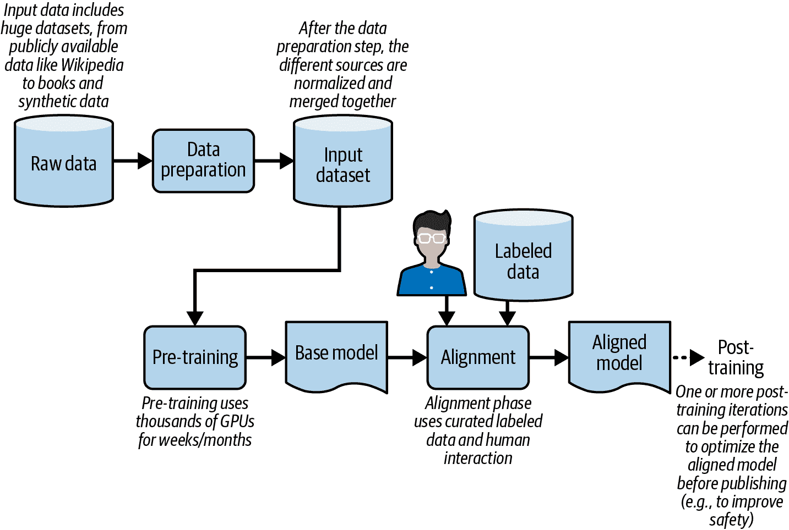
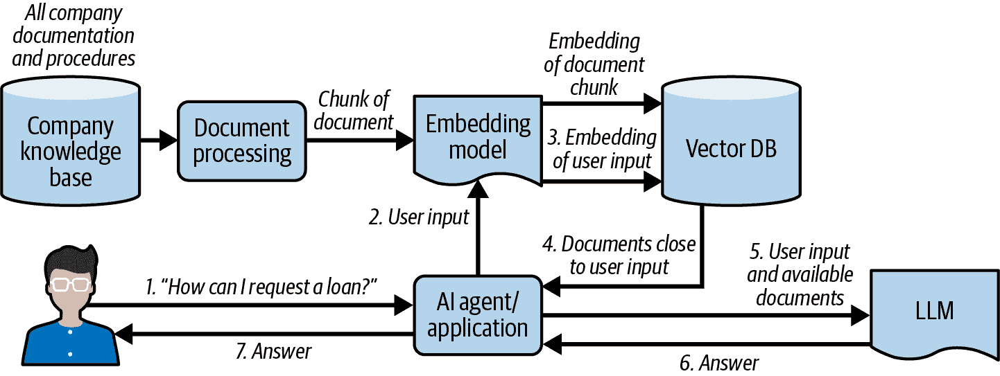
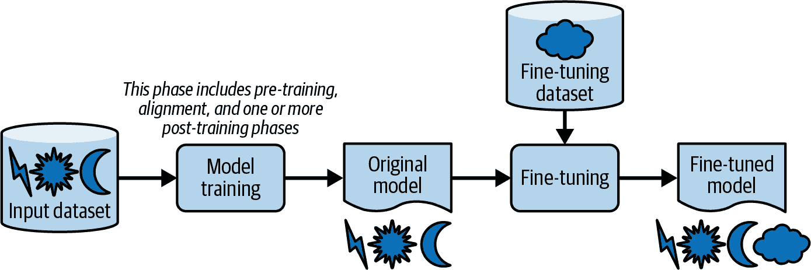
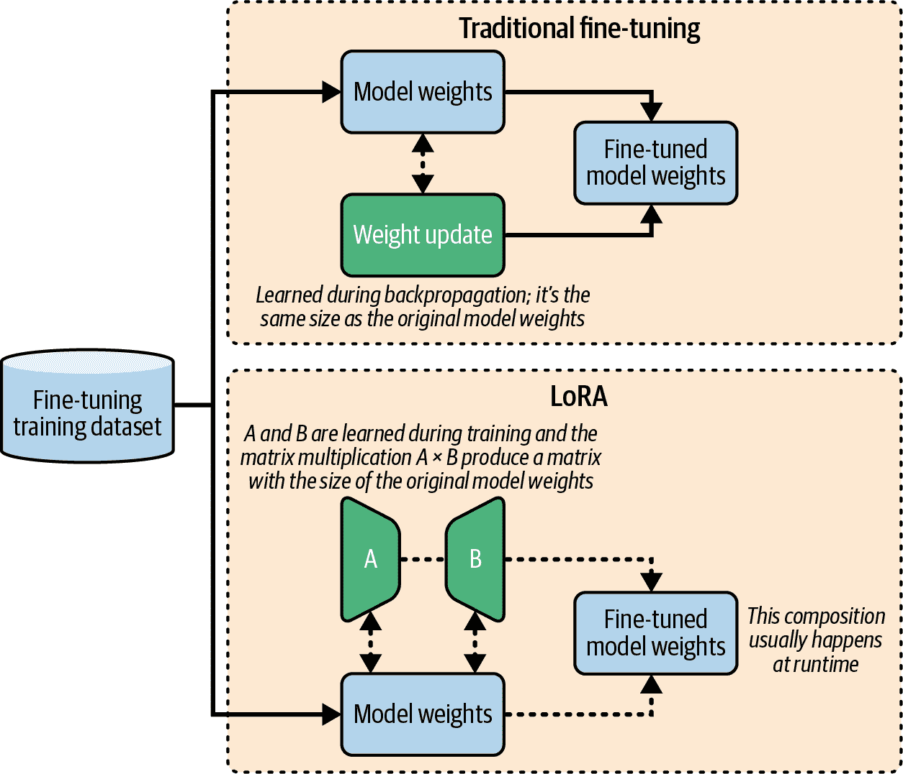
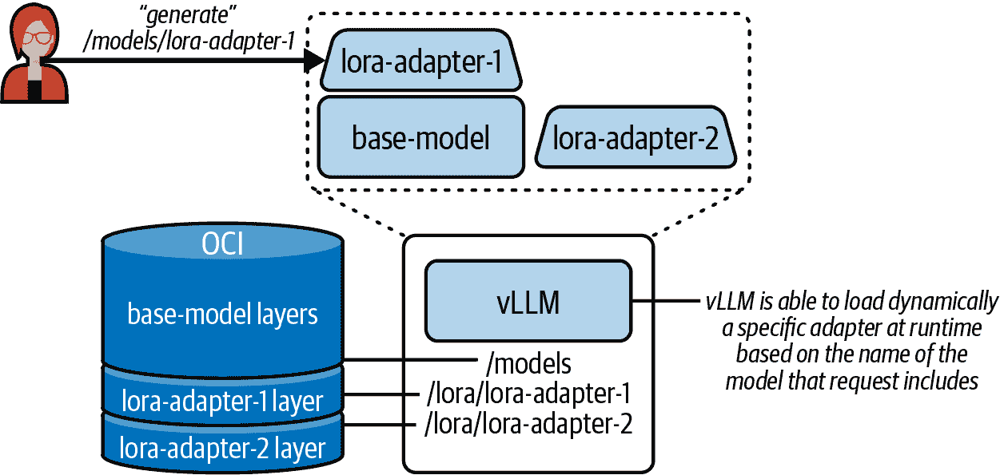
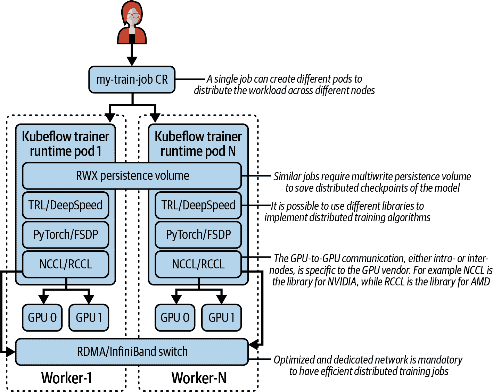
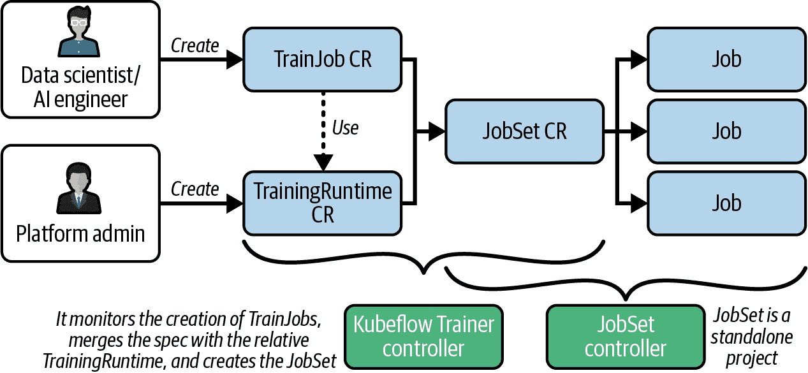
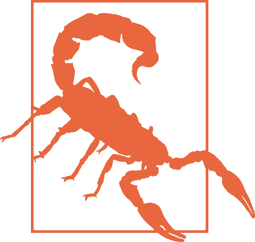

## 第 6 章：模型定制化

从头训练 LLM 需要大量的计算资源和专业知识，这是大多数组织所不具备的。本章不涉及从头创建模型，而是专注于为你的特定使用场景定制现有的 LLM。我们将介绍几种调优技术，以及可用于实施和部署相应训练作业的 Kubernetes 技术。

首先，让我们简要介绍 LLM 是如何创建的，以及定制化在整个流程中的位置。

### LLM 创建简介

LLM 训练技术在不同模型提供商之间存在显著差异，这些提供商在开发专有方法上投入了大量资源。大多数随模型发布的技术论文都会省略实现细节，使得复现变得困难。DeepSeekV3 的技术论文是一个显著的例外，其文档详细程度异乎寻常。

大部分创新集中在采用更高效注意力机制的新模型架构上。数据集整理和调优方法很少被详细披露。

训练从数据清洗和去重开始。第一阶段*预训练*消耗了大部分时间和成本：使用数千块 GPU 处理所有数据，持续数周。输出的是一个基座（base）模型或*基础（foundation）*模型，它可以预测文本，但缺乏对任务或适当内容边界的理解。

下一步是*对齐*，它教会 LLM 根据人类偏好安全、可靠地执行任务。这一阶段类似于艾萨克·阿西莫夫的机器人三定律：正如机器人需要核心原则以确保与人类的安全交互一样，LLM 也需要行为边界，以便在不造成伤害的前提下执行任务。

对齐需要经过整理的标注数据和奖励机制，由人类或专门的奖励模型来评估模型的响应。

虽然可以找到仅经过预训练阶段的基础模型，但绝大多数公开可用的模型已经完成对齐，可以直接用于特定的任务集。模型定制化，也称为*后训练*，适用于已经对齐的模型。有关这一创建流程的概览，请参见图 6-1。



*图 6-1. LLM 创建流程*

在本章中，你会遇到“模型调优”、“模型定制化”和“后训练”等术语在不同语境中的使用（请参阅下一个侧边栏，了解这些术语的说明）。

### 模型调优、模型定制化与后训练

*模型调优*是各种微调技术的通用术语，并非 LLM 所特有，因为它同样适用于预测性 AI。

*模型定制化*是一个更宽泛的术语，涵盖所有用于修改 LLM 或学习新任务的技术。其中一些方法与传统微调有所不同，可能需要多个步骤，包括人工交互。

*后训练*指的是 LLM 创建流程中发生模型定制化的特定阶段。该步骤可以多次应用，以逐步向模型注入新的策略或知识。

在本书中，这些术语经常互换使用，因为它们都涉及修改模型，并且都会在 Kubernetes 平台上带来类似的运维挑战。

LLM 与传统预测性 AI 模型的最大区别在于其多功能性。一个 LLM 可以执行大量不同的任务，而传统的机器学习模型只专精于单一任务。正是这种多功能性，使得我们先介绍了推理：你通常可以在完全不进行训练的情况下，将现有的 LLM 适配到不同的使用场景。

在深入探讨训练技术之前，有必要了解何时不需要训练。许多使用场景可以通过完全避开复杂性和成本的替代方案来解决。

### 提示词与上下文工程

LLM 的真正强大之处在于它们无需修改即可工作。通过精心设计输入和上下文，你通常可以在不训练的情况下实现目标。这些替代方案不仅更简单，而且往往是正确的选择。

*提示词工程*是精心设计详细而具体的指令（提示词）来引导 LLM 输出的过程。这组指令对于最大化响应的准确性至关重要。这一领域正逐渐成为一门独立的专业，形成了如何与 LLM 有效沟通以获得最准确结果的最佳实践。

有效的提示词工程不仅仅是明确任务，还包括描述：

- 场景（例如，“这是一家名为 ABC 的航空公司”）
- 模型应该扮演的角色（例如，“你是一个帮助客户的 AI 助手聊天机器人”）
- 任务边界，有助于减少幻觉或引导行为（例如，“你只能回复关于我们公司的内容，并且只有在确定答案时才回复”）

类似的提示通常由服务提供商指定，并作为*系统提示*对最终用户隐藏。

然而，不应将系统提示视为安全控制手段——它们可以通过提示注入或越狱技术被绕过。对于有安全要求的生产系统，应在应用层实施额外的防护措施，如输入验证、输出过滤和内容审核。

由于每个 LLM 都是在庞大但有限的数据集上训练的，提示工程的另一个用途是将额外数据注入提示中，迫使模型在生成过程中使用这些信息。

基础或手动提示工程技术已经演变成成熟的模式，使系统更加强大，甚至能让模型动态调用工具来检索信息或执行操作。这是 AI 智能体的核心原则，通常被称为*上下文工程*。这个术语反映了主要工程工作在于为 LLM 创建输入上下文，这是一个涉及复杂、多组件和迭代步骤的过程。

上下文增强最广泛采用的模式之一是检索增强生成（RAG），它根据用户的问题，将来自外部来源的相关数据注入上下文中。

在 RAG 模式中，附加数据会通过专门的嵌入模型被导入向量数据库，以嵌入向量的形式存储。当用户请求到达时，会使用相似性搜索算法（如近似最近邻）对向量数据库执行初始查询，以查找与用户输入语义*接近*的内容。然后，这些附加上下文会被包含在提示中，供模型在回答问题时使用。

这种解决方案有助于注入模型训练期间不可用的外部或最新知识，例如专有数据或在训练截止日期之后发布的信息。虽然每个模型的上下文窗口有限，但 RAG 通过仅过滤并包含与用户问题最相关的数据来解决这一问题，而不是尝试包含整个知识库。

有关 RAG 流水线的高层表示，请参见图 6-2。有关 RAG 实现模式和最佳实践的全面讨论，请参见第 274 页的“检索增强生成”。

如果你需要复习嵌入的相关知识，可以在第 xxv 页的“理解 LLM 基本原理”中找到详细信息，特别是在第 xxxi 页关于“Prefill”的部分，不过这里并不需要这些背景知识。



*图 6-2. RAG 流水线示例*

RAG 等解决方案的灵活性使它们越来越受欢迎。你可以在几分钟内用新数据更新向量数据库，*刷新*解决方案的知识。这一趋势，加上智能体 AI 模式的采用，正在占据模型定制领域的重要部分。

一个重要的方面是：所有提示和上下文工程技术都适用于通用模型和经过调优的模型。你可以将 RAG 与模型定制相结合。问题不是“二选一”，而是“哪种组合能在性能、成本和可维护性之间取得最佳平衡？”

### 何时使用模型定制

虽然 RAG 和提示工程很强大，但它们并不总是最具成本效益的解决方案。当你需要将知识或行为直接嵌入模型本身时，模型定制就变得很有价值。

通过提示和 RAG 影响模型行为的可能性是强大的，并且通常足够。但这种方法存在局限性，在某些场景下，模型定制是更好的选择。

如第 128 页的“vLLM 运行时参数调优”所述，大的上下文窗口在推理时需要更多 GPU 内存。模型定制是控制推理成本的关键工具。它允许将公司核心的、变化缓慢的知识直接嵌入模型中，从而减少每次请求都需要大型上下文窗口的需求。

例如，银行可以创建一个定制模型，其中嵌入了关于贷款、交易和信用风险等领域知识。这些信息不会频繁变化，因此将它们嵌入模型本身比在每次请求的上下文中提供它们更有意义。其结果是降低推理成本，并可能带来更好的性能。

同样的原则也适用于模型规模：一个小型专用模型（可能通过从较大模型蒸馏创建）可以与较大型未调优模型一样有效，甚至更有效。这对于需要更少资源即可服务的小语言模型（SLMs）尤其重要。SLM 通常有 80 亿到 160 亿个参数，使其成为在有限时间和资源下进行调优的良好候选。

模型蒸馏是另一种方法，利用大型教师模型来训练更小、更高效的 SLM，该 SLM 继承教师的知识，同时需要更少的计算资源。

现在我们已经了解了何时使用模型定制，接下来看看可用的实际训练技术。

### 模型调优

持续训练模型的可能性，也称为*后训练*，对机器学习来说并不新鲜。在传统的预测式 AI 中，模型通常会在第二阶段进行微调，以用新数据更新它们。在生成式 AI 的背景下，这一活动通常是为了专门化模型并提高在特定领域的性能，同时通过利用专门的较小模型而不是更大、更昂贵的替代方案来降低解决方案的总体成本。图 6-3 展示了将新知识嵌入原始模型的微调过程的高级流程。



*图 6-3. 微调概念*

虽然*微调*的复杂度和成本比预训练低一个数量级，但仍可能需要数小时甚至数天才能完成。然而，有时并不需要进行完整微调；例如，用户可能希望减少模型应能回答的领域范围，这类似于之前描述的提示工程用例，但作为模型的内置功能，并且受外部攻击的影响更小。这些更简单的选项属于一个名为*参数高效微调（PEFT）*的类别。

对于完整微调和 PEFT 两种方法，Hugging Face 提供了 Transformer 强化学习（TRL）库，其中包括 SFTTrainer，这是一个工具类，可以加载模型并执行各种调优技术，包括计算准确率的评估步骤。

#### 什么是监督微调？

SFTTrainer 这个库的名称代表的是 Supervised Fine-Tuning Trainer（监督微调训练器）。在讨论微调时，*监督*一词通常被省略，因为从业者默认这个过程是监督式的。


虽然存在一些无监督微调技术，但绝大多数方法都需要有标签的数据作为输入——即由人类或另一个模型分类过的数据。原因很简单：要让模型学习特定的策略或知识，输入数据集必须包含模型预期嵌入的特定特征。

然而，生成式模型的标签数据与分类任务不同。在分类中，标签是离散类别，如垃圾邮件/非垃圾邮件，而对于 LLM，标签是完整的预期输出文本。训练对由输入-输出序列组成，例如输入“翻译成法语：Hello”与输出“Bonjour”配对，或输入“总结：\[文章\]”与输出“文章讨论了 X、Y 和 Z。”配对。在训练过程中，模型通过预测输出序列中每一步的下一个词来学习，并在预测错误时进行调整。分类和生成都是“监督式”的，因为训练提供了正确答案，但生成预测的是词元序列，而不是单一类别。

创建监督式输入数据集通常是一项昂贵的活动。因此，这些精选数据集比用于无监督预训练的数据集要小多个数量级。

## 微调

微调模型涉及继续训练过程，以嵌入额外的知识或任务，例如指令遵循、问答或聊天能力。换句话说，完整微调会改变模型的所有参数，产生一个独特的模型，该模型虽然源自原始模型，但已完全适应新的训练数据。这种方法需要大量标注数据（至少数十万个新示例）才能对模型产生足够的影响以学习新概念。这是一项非常昂贵的活动。从 Kubernetes 平台的角度来看，它需要在训练阶段使用许多 GPU，并且需要专门的 GPU 来服务于新模型，因为在推理时没有有效的方法将其与原始模型分层或合并。虽然这是预测式 AI 的主要方法，但在生成式 AI 中，完整微调更具挑战性，由于高昂的准备成本、数据集、训练和推理的计算开销，以及诸如灾难性遗忘（即模型丢失先前学到的知识）等风险。

如前所述，可以使用 Hugging Face 的 `SFTTrainer` 来执行这种类型的微调（示例 6-1）。

**示例 6-1：使用 `SFTTrainer` 进行监督式微调**

```python
from datasets import load_dataset
from trl import SFTTrainer
from transformers import AutoModelForCausalLM

train_dataset = load_dataset("json", data_files="my_file.json")
original_model = AutoModelForCausalLM.from_pretrained(...)
trainer = SFTTrainer(
    model=original_model,
    train_dataset=train_dataset,
)
trainer.train()
trainer.save_model("target_location")
```

加载包含新内容的数据集供模型学习。这可以是 Hugging Face 的公共数据集，也可以是本地文件。

用于加载模型的函数与推理所用的函数相同。模型可以在运行时直接下载，但通常会先在本地下载。

## 参数高效微调

参数高效微调（PEFT）是一组采用不同方式调优模型的技术。原始模型保持不变，而是与一些新层组合在一起，这些新层在推理时会影响模型的运行行为。

虽然从概念上讲，PEFT 与提示工程类似，两者都是在不进行完整重训练的情况下影响模型行为，但 PEFT 是将学习到的参数直接嵌入模型架构中，而不是在运行时依赖于基于文本的提示。从 Kubernetes 平台的角度来看，PEFT 无论是在训练还是服务方面都更容易管理。训练阶段需要更少的数据样本（100 到 1,000 个带标签的示例），从而使训练任务更短、对硬件的需求也更低。服务这些微调后的模型也更加高效。得益于现代推理引擎的支持，基础模型可以在同一个部署中与一个或多个调优后的层在运行时动态组合。我们将在第 65 页的“用于存储模型数据的 OCI 镜像”中介绍高效模型存储，并在第 139 页的“感知 LLM 的路由”中介绍推理路由。PEFT 的主要缺点是，与修改所有参数的全参数微调相比，它对模型的影响范围较为有限。

使用 PEFT 时，只有一小部分参数会受到影响。例如，最流行的 PEFT 算法之一——低秩适配（LoRA），对于一个 Llama 3.1 8B 模型，可能只需调优总参数中不到 1% 的参数。Hugging Face 创建了一个名为 `peft` 的库来汇集不同的 PEFT 算法，并且它原生集成了 `SFTTrainer` 类（见示例 6-2）。

**示例 6-2：使用 `SFTTrainer` 进行 LoRA 微调**

```python
from datasets import load_dataset
from trl import SFTTrainer
from peft import LoraConfig
from transformers import AutoModelForCausalLM

train_dataset = load_dataset("json", data_files="my_file.json")
original_model = AutoModelForCausalLM.from_pretrained(...)
lora_config = LoraConfig(...)
trainer = SFTTrainer(
    model=original_model,
    train_dataset=train_dataset,
    peft_config=lora_config,
)
trainer.train()
trainer.save_model("target_location")
```

与全参数微调相比，唯一的区别在于 PEFT 配置（这里是 LoRA）的初始化。其中包含许多参数；更多细节请参阅 Hugging Face 的 PEFT 文档。

要启用 PEFT，只需将 `lora_config` 实例作为 `peft_config` 参数传入即可。

LoRA 是使用最广泛的 PEFT 技术，值得深入解释它的工作原理以及为什么如此有效（见下一节）。

## 低秩适配

低秩适配（LoRA）在微调数据集上训练相对较少数量的新参数，同时保持原始模型权重不变。这些新参数被组织为更小的矩阵，称为适配器。这些低秩矩阵学习更新，并将它们的乘积与原始权重相结合。

在传统的微调任务中，训练过程会学习一个新的、全尺寸的矩阵来表示权重更新。而 LoRA 则是分解这个大的更新。它不是学习完整的矩阵，而是训练产生两个小得多的低秩矩阵。当这两个较小的矩阵相乘时，它们的乘积近似于完整的权重更新。正是这种分解使训练过程显著高效。图 6-4 以图形方式展示了这一过程。



**图 6-4：LoRA 分解与全参数微调的对比**

LoRA 适用于大量 LLM，并且针对特定场景存在许多算法变体。两个值得注意的专门化方向是 X-LoRA（将该方法扩展到专家混合（MoE）架构）和 QLoRA（应用量化来降低微调的内存需求）。

LoRA 有两个主要优势：与全参数微调相比，训练阶段更便宜（在时间和硬件方面），并且推理方法高效。由于基础模型未被修改，适配器可以在运行时与之组合。这两个小矩阵（A 和 B）的总大小通常仅为原始模型大小的 1% 到 10%，这使得仅用支撑基础模型所需的硬件就可以服务一个基础模型和许多经过 LoRA 调优的模型。

图 6-5 直观地展示了 LoRA 适配器的服务方式。



**图 6-5：LoRA 适配器的服务**

即使这不是 LoRA 的传统用例，仍然可以在测试时将 LoRA 适配器与基础模型合并。示例 6-8 说明了如何实现这一点。

Sebastian Raschka 发表的博客文章“使用 LoRA（低秩适配）微调 LLM 的实用技巧”提供了有关 LoRA 的更多信息。

## 高级调优技术

全参数微调和 PEFT 并不是调优模型的唯一方式；新的、更复杂的技术不断涌现。许多这类新方法涉及多步骤工作流程，而不是单一的训练循环，其中可能包括使用模型在之前迭代中产生的合成数据。一些最常见的先进技术包括：群体相对策略优化（GRPO）、直接偏好优化（DPO）、模型蒸馏、模型合并和奖励建模。

本书不会详细介绍这些高级方法，因为每种技术都是一个复杂的主题。它们也各不相同；例如，GRPO 是 DeepSeek 团队的创新成果，而 InstructLAB 则是 IBM Research 提出的一种完整的*对齐调优*方法论。更多信息，请参阅 Hugging Face 的 Transformer 强化学习（TRL）库，它汇集了其中许多技术，并提供了专门的训练器类。

本书的重点是生成式 AI 的运维挑战。从 Kubernetes 平台的角度来看，这些调优方法表现为长时间运行的多部署拓扑，其中大多数组件需要专用 GPU 和安全通信能力。这种通信的安全性对于生产工作负载至关重要，相关内容见第 250 页的“训练作业安全”。

## 在 Kubernetes 上运行调优任务

在了解了不同的调优技术及其权衡之后，下一节将探讨如何在 Kubernetes 上落地这些技术。

到目前为止，我们已经介绍了创建和调优 LLM 的核心概念，从传统的全参数微调，到 PEFT 和高级调优流水线。理解这些不同的方法非常重要，因为从 Kubernetes 平台的角度来看，它们有不同的影响和挑战。

本节从实现细节转向平台需求。所有这些调优技术都至少有一个训练阶段，该阶段需要 GPU 来扩展。前面章节中针对推理所介绍的 GPU 管理原则在很大程度上同样适用于此。如需回顾如何为 Kubernetes 配置 GPU 以及如何调度需要 GPU 的工作负载，请参阅第 3 章。

尽管提供 GPU 工作负载并非新鲜事，但训练面临的一个主要额外挑战是网络很容易成为系统瓶颈。调优任务不等同于推理请求；即使是对于 SLM，调优的硬件需求也大于服务。因此，该任务很可能需要同一节点上的多个 GPU，甚至跨多个节点（图 6-6）。

在类似场景中，根据所执行的调优类型，系统会在模型执行的每一步（特别是每一层的前向和反向传播）之前收集所有 GPU 上的模型分片权重。这个动作需要 GPU 之间持续不断的数据混洗，根据模型的大小和 GPU 的数量，它可以产生每秒数 GB 的流量。

带宽是主要的可扩展性挑战，需要在整个技术栈中进行改进，从专门的网络接口和协议，到更高效的内核实现和专用的 GPU 指令。与推理优化类似，训练也有受益于专用 GPU 指令的内核实现，例如 Liger Kernel（专门为 Triton 优化）和 FlashAttention。

### 在 Kubernetes 上运行微调作业



**图 6-6. 多节点训练作业**

注意力内核是一个核心组件，通常嵌入在更高级别的、面向最终用户的库中。Hugging Face 提供了许多这样的库，例如 Transformers，其他选择还包括 DeepSpeed 和 NVIDIA 的 Megatron-LM。

尽管这些库具有不同的 API 和配置，但它们都使用 PyTorch，而 PyTorch 已成为 LLM 实现中事实上的标准深度学习库。


PyTorch 是一个开源机器学习库，最初由 Meta 创建，现在归 Linux 基金会旗下的 PyTorch 基金会所有。

它有许多不同的应用，但在 LLM 开发的语境下，它主要被用作核心深度学习库：像 Hugging Face Transformers 这样的终端用户库使用 PyTorch，并且已经弃用对 TensorFlow 或 JAX 等其他深度学习库的支持。

PyTorch 项目拥有许多不同的包，涵盖了大量的功能，从核心神经网络实现到编译器，再到以支持分布式训练作业为特定目标的分布式包。特别是，全分片数据并行（FSDP2）是最常用于在多个节点上扩展作业的库。

软件和硬件技术栈正在快速发展，人们希望其中许多复杂性最终会从平台的角度变成实现细节。然而，优化网络技术栈是一个无法回避的挑战，相关内容见第 235 页的“分布式训练的网络优化”。

规模化地管理这种复杂性需要专门的工具，将分布式训练基础设施对数据科学家屏蔽，因为他们需要专注于模型开发。

#### Kubeflow Trainer

Kubeflow Trainer 是 Kubeflow 生态系统的一个组件，专门用于管理 LLM 微调的扩展和分发。Kubeflow 项目旨在成为 *Kubernetes 上 AI 平台的基础*，并且正在从预测性 AI 的起源演变为支持生成式 AI 工作负载。我们在第 2 章中曾介绍过另一个组件 Kubeflow Model Registry（见第 54 页的“Kubeflow Model Registry”）。

Kubeflow Trainer 的唯一目的是管理配置、部署和扩展长时间运行的训练作业所需的 Kubernetes 基础组件。该项目为两种不同的角色设计 API：平台管理员通过 `TrainingRuntime` 配置集群和可用资源；数据科学家/AI 工程师则使用 `TrainJob` 提交训练作业。由于这些角色拥有不同的技能和工具，Kubeflow Trainer 提供了 Python Kubeflow SDK，对 `TrainJob` 的创建进行了抽象，因此数据科学家无需直接与 Kubernetes 资源交互。

图 6-7 展示了 Kubeflow Trainer 的完整架构。



**图 6-7. Kubeflow Trainer 架构**

`TrainingRuntime`（或用于集群级配置的 `ClusterTrainingRuntime`）等价于 KServe 的 `ServingRuntime`，后者已在第 20 页的“KServe”中针对推理场景进行了描述。它是一个模板，声明某个运行时（如 PyTorch）的可用性，包括其容器镜像和其他选项。与 `ServingRuntime` 类似，`TrainingRuntime` 仅在你创建它的命名空间中可见，`TrainJob` 必须位于同一命名空间才能使用它。然而，`ClusterTrainingRuntime` 对整个集群可见。

Kubeflow Trainer 支持多种用于分布式训练的框架，例如 PyTorch、DeepSpeed、MLX 和 MPI。由于这种多框架设计，`TrainingRuntime` 必须带有一个 `trainer.kubeflow.org/framework` 标签。SDK 使用该标签为指定框架（例如，`torch` 对应 PyTorch）及其 trainer 应用正确的配置。

trainer 表示使用该框架来定义并执行训练作业的库，它可以是 `BuiltinTrainer` 或 `CustomTrainer`。

像 TorchTune 这样的 `BuiltinTrainer` 为 LLM 微调等常见用例提供预定义的训练脚本，只需要输入数据集和 LoRA 配置的参数。虽然灵活性较低，但它更容易上手。另一方面，`CustomTrainer` 允许用户定义一个包含完整训练过程的 Python 函数，从而让用户拥有完全的控制权。这种方法为数据科学家提供了最大的灵活性，而管理员只需定义带有兼容框架的 `TrainingRuntime`。

`TrainJob` 对象定义训练代码并引用训练运行时。如前所述，SDK 简化了配置，因此数据科学家无需手动编写配置。

`TrainJob` 一旦创建，Kubeflow Trainer 控制器就会将其与 `TrainingRuntime` 合并，生成一个 `JobSet` 以及相应的 Kubernetes 作业。

`JobSet` 是一种 Kubernetes 自定义资源，代表一组 Kubernetes 作业。它源自一个独立的 JobSet 项目，该项目旨在统一在 Kubernetes 上部署高性能计算（HPC）和 AI/ML 训练工作负载的 API。

与任何其他 Kubernetes 控制器一样，Kubeflow Trainer 的安装非常简单（示例 6-3）。

**示例 6-3. 安装 Kubeflow Trainer**

```bash
export VERSION=v2.1.0
export URL="https://github.com/kubeflow/trainer.git/manifests/overlays"
kubectl apply --server-side -k "${URL}/manager?ref=${VERSION}"
kubectl apply --server-side -k "${URL}/runtimes?ref=${VERSION}"
```

将值替换为要安装的版本，即 `v2.1.0`。

虽然 Kubeflow Trainer 项目提供了一套内置的 `ClusterTrainingRuntime` 来简化入门体验，但预计管理员会为生产环境定义自己精心挑选的运行时列表。

Kubeflow Trainer 提供了一组内置的 `ClusterTrainingRuntime`，但它们是可选的。你可以跳过这一特定安装步骤，用一个或多个自定义运行时替换内置运行时（见示例 6-4）。

**示例 6-4. ClusterTrainingRuntime**


```yaml
apiVersion: trainer.kubeflow.org/v1alpha1
kind: ClusterTrainingRuntime
metadata:
  name: my-torch-distributed-runtime
  labels:
    trainer.kubeflow.org/framework: torch
spec:
  mlPolicy:
    numNodes: 1
    torch:
      numProcPerNode: auto
  template:
    spec:
      replicatedJobs:
      - name: node
        template:
          metadata:
            labels:
              trainer.kubeflow.org/trainjob-ancestor-step: trainer
          spec:
            template:
              spec:
                containers:
                - name: node
                  image: pytorch/pytorch:2.7.1-cuda12.8-cudnn9-runtime
```

将其替换为`TrainingRuntime`即可创建命名空间级的训练运行时。

数据科学家使用此名称为其作业选择所需的运行时。

SDK 使用该标签来指导`TrainJob`的配置。

`spec`可以为大部分值定义默认值；例如，这里就表示作业只能使用一个节点。

管理员可能希望通过用自定义镜像替换该值，来控制集群中使用的镜像。该镜像是特定于 GPU 的，因此在本例中适用于 NVIDIA CUDA。

集群配置完成且`TrainingRuntime`可用后，平台管理员的工作就完成了。数据科学家现在可以专注于创建训练作业（示例 6-5）。

**示例 6-5. 使用 Hugging Face TRL 作为 CustomTrainer 的 Trainer 函数**

```python
def my_custom_trainer(**kwargs):
    from datasets import load_dataset
    from transformers import AutoTokenizer, set_seed
    from trl import SFTTrainer
    # It is not mandatory to set a fixed seed but it is useful for reproducibility
    set_seed(kwargs["seed"])
    # Load tokenizer
    tokenizer = AutoTokenizer.from_pretrained(
        ...,  # kwargs[...]
        use_fast=True
    )
    # Load datasets
    train_dataset = load_dataset(
        ...,  # kwargs[...]
    )
    # Initialize Trainer
    trainer = SFTTrainer(
        model=...,
        args=...,
        train_dataset=train_dataset,
        eval_dataset=...,
```

## 第 6 章：模型定制

### 在 Kubernetes 上运行微调任务


```python
    peft_config=...,
    processing_class=tokenizer,
)
trainer.train()
trainer.save_model(
    ..., # kwargs[...]
)
```

自定义训练器函数必须是自包含的，因此`import`必须是函数体的一部分。此示例基于 Hugging Face 库：`datasets`用于训练数据集（也可用于评估数据集），`transformers`用于分词器，`trl`用于实际的训练器类。请注意，这里没有 Kubeflow Trainer 特有的代码；该函数是一个普通的 Python 训练函数，可以直接调用。

分词器与正在微调的模型相关。使用支持并发工作的快速分词器非常重要，以避免训练过程变慢。

数据集包含模型在微调期间应学习的新知识。它可以是公开可用的数据集，但更可能是自定义数据集。

`SFTTrainer`的初始化与之前的示例相同。在这里，你可以选择模型、指定数据集，并配置 PEFT 技术（例如`LoraConfig`）。

`train()`方法初始化训练过程。硬件配置（如 GPU 和 worker 的数量）不在这里指定；而是在创建作业时定义（参见示例 6-6）。

当你调用`client.train(func=my_custom_trainer)`时，SDK 会对你的 Python 函数进行序列化，并将其嵌入到`TrainJob`自定义资源中。`TrainingRuntime`的基础容器镜像（预装了 PyTorch、Transformers、PEFT）会在运行时对你的函数进行反序列化并执行。这与传统的 Kubernetes 工作流不同：你无需构建或推送自定义镜像，只需在修改函数后重新运行 SDK 命令即可。

其权衡之处在于，基础镜像必须已经包含你的所有依赖项，而且你的函数必须是可序列化的（`import`必须引用已安装的包，不能有复杂的闭包）。

在训练器函数中定义了训练逻辑和配置后，你现在可以使用 Kubeflow Python SDK 创建`TrainJob`。

**示例 6-6：通过 Kubeflow SDK 创建 TrainJob**

```python
from kubeflow.trainer import CustomTrainer, TrainerClient

client = TrainerClient()
torch_runtime = client.get_runtime("my-torch-distributed-runtime")
job_name = client.train(
    trainer=CustomTrainer(
        # The custom trainer function is injected here with its parameters
        func=my_custom_trainer,
        func_args=..., # load_args()
        num_nodes=8,
        resources_per_node={
            "cpu": 4,
            "memory": "64Gi",
            "nvidia.com/gpu": 1,
        },
    ),
    runtime=torch_runtime,
)
client.wait_for_job_status(name=job_name, status={"Running"})
_ = client.get_job_logs(job_name, follow=True)
# It is possible to get all the steps and the status for each of them
# steps = client.get_job(name=job_name).steps
# client.delete_job(job_name)
```

在此示例中，使用上一个示例中定义的自定义函数创建了`CustomTrainer`，并由`TrainerClient`提交`TrainJob`。

在提交作业时指定硬件要求。硬件要求与模型大小以及你所执行的微调类型直接相关。在此示例中，该值已用于使用 PEFT LoRA 定制 Meta-Llama-3.1-8B-Instruct 模型。

客户端可以等待特定的作业状态。这是一个阻塞调用；在示例中，代码使用它来等待作业进入运行状态。你还可以获取日志或配置 TensorBoard 的使用。TensorBoard 是一个可视化工具包，最初来自 TensorFlow 项目，现在兼容多个库，包括 PyTorch。

虽然你可以随时删除作业，甚至在作业运行期间也可以删除，但此操作也会从 Kubernetes 中移除`TrainJob`对象及其关联的元数据。如果你没有使用外部实验跟踪，请考虑保留已完成的作业，以维护训练运行的记录。

### 一些 YAML 魔法

像示例 6-6 中的训练作业需要许多参数（超过 10 个），如果作业创建代码在 Jupyter Notebook 中运行（可能使用 Kubeflow Notebooks 组件），则可以使用`yamlmagic`库轻松配置所有参数。

这个项目是一个 Python 模块，可以通过`pip install yamlmagic`在 notebook 中安装，并通过`%load_ext yamlmagic`加载；之后，可以使用以`%%yaml my_params`开头的代码块来初始化一个变量（如`my_params`）。该代码块第一行之后的每一行都会被解析为 YAML，`my_params`就变成一个可供使用的 Python 字典。示例 6-7 展示了如何在 Jupyter Notebook 中使用`yamlmagic`配置训练参数。

**示例 6-7：在 Jupyter Notebook 中使用 `yamlmagic` 进行训练配置**

```python
# In a Jupyter Notebook cell
%load_ext yamlmagic
%%yaml training_config
model_name: meta-llama/Llama-3.2-3B
dataset: openai/gsm8k
num_epochs: 3
learning_rate: 2.0e-4
output_dir: /mnt/models/llama-gsm8k
# Now use the config with Kubeflow SDK
from kubeflow.trainer import TrainingClient

client = TrainingClient()
client.train(
    name="llama-math-tuning",
    model=training_config["model_name"],
    dataset=training_config["dataset"],
    num_epochs=training_config["num_epochs"],
    learning_rate=training_config["learning_rate"],
    output_dir=training_config["output_dir"]
)
```

在 LoRA 示例中，训练过程不会产生一个全新的完整模型。相反，每个保存的检查点都是一个 LoRA 适配器，可以在运行时与基础模型动态组合。这支持高效地服务多个微调模型，如图 6-5 所述。虽然这对于高效服务来说不是最佳方法，但为了测试目的，可以将 LoRA 适配器与基础模型合并，创建一个新的独立模型。该场景在示例 6-8 中介绍。

**示例 6-8：将 LoRA 适配器与基础模型合并**

```python
from peft import PeftModel
from transformers import AutoModelForCausalLM

base_model = AutoModelForCausalLM.from_pretrained(
    ...,
    device_map="cuda"
)
finetuned_path = "/opt/app-root/Meta-Llama-3.1-8B-Instruct/checkpoint-100/"
model = PeftModel.from_pretrained(base_model, finetuned_path)
merged_model = model.merge_and_unload()
merged_model.save(...)
```

必须首先加载基础模型。`device_map`参数使模型直接加载到 GPU 上。

必须知道 LoRA 微调模型的存储路径。每个训练轮次后都会创建一个新的检查点（也称为模型候选），在此示例中选择了第 100 个检查点。

在基础模型和微调层一起加载后，可以使用`merge_and_unload()`方法进行合并，从而获得新模型。

示例 6-8 从管理员和数据科学家的角度涵盖了 Kubeflow Trainer 项目的使用，展示了他们如何在一个分布式模型定制项目上进行协作。所显示的检查点路径（如`/opt/app-root/Meta-Llama-3.1-8B-Instruct/checkpoint-100/`）需要持久存储基础设施，才能超越临时训练作业的生命周期而存留下来。有关训练工作负载存储解决方案的全面介绍，包括持久卷、对象存储和分布式文件系统，请参见第 249 页的“训练存储”。然而，这只是第一步。

从平台的角度来看，调度这些长时间运行、资源密集型的工作负载需要额外的优化，以确保集群的公平使用，并防止硬件（尤其是 GPU）利用率不足。这里未涉及的一个重大挑战是组调度。分布式工作负载通常要求系统


需要同时部署其所有 Pod 才能正确运行。这是一种“全有或全无”的语义。第 7 章将完全聚焦于这些平台优化，其中包含一个专门讨论 gang scheduling 的章节。

对于数据科学家来说，体验更加简单，因为 Kubeflow 生态系统让他们能够专注于模型定制生命周期，而对底层 Kubernetes 平台的感知有限。

Kubeflow 项目包含众多组件，以支持完整的 MLOps 或 LLMOps 生命周期。Kubeflow 模型注册表已在第 54 页的“Kubeflow Model Registry”中介绍，重点讨论了模型元数据管理，而本章将介绍 Kubeflow Trainer，以实现分布式训练任务。

数据科学家可以通过利用另外两个 Kubeflow 组件来开发和管理微调示例中包含的 Python 代码：Kubeflow Notebooks 和 Kubeflow Pipelines。

Kubeflow Notebooks 管理 Jupyter 等基于 Web 的 IDE 的基础设施，使数据科学家能够轻松自助配置环境，并试验 Kubeflow Trainer SDK。

在试验并定义训练任务之后，数据科学家可以使用 Kubeflow Pipelines 将笔记本转换为可复现的流水线。这使得该逻辑可以被多次执行以重新训练模型，既可以将代码提取为不同的步骤，也可以直接将笔记本纳入流水线中。

### 其他框架

虽然 Kubeflow Trainer 为大多数用例提供了全面的解决方案，但生态系统中还有几个值得考虑的替代方案。

Kubeflow Trainer 项目采用 Kubernetes 原生的方法来管理分布式训练任务的生命周期，使平台管理员和数据科学家都能使用他们偏好的工具。

虽然 Kubeflow Trainer 和 Hugging Face 的 TRL 为 Kubernetes 上的分布式训练提供了强大且以平台为中心的解决方案，但其他几个项目和库（如 DeepSpeed 和 Unsloth）提供了专门的工具来优化微调过程，尤其侧重于 LLM 的效率、速度和资源管理。此外，带有 KubeRay 的 Ray 提供了一种在 Kubernetes 上编排分布式训练工作负载的替代方法。

#### DeepSpeed

DeepSpeed 是一个深度学习优化库，它封装了 PyTorch 以简化训练任务的管理。将 DeepSpeed 与 Kubeflow Trainer 结合使用与之前的示例非常相似。你只需选择一个兼容 DeepSpeed 的`TrainingRuntime`（例如默认的 DeepSpeed 分布式运行时），并更新自定义的训练器逻辑（示例 6-9）。

**示例 6-9. 使用 DeepSpeed 的训练器函数**


```python
def my_custom_deepspeed_trainer(**kwargs):
    from transformers import AutoModelForCausalLM, AutoTokenizer, set_seed
    from datasets import load_dataset
    from torch.utils.data import DataLoader
    from torch.utils.data.distributed import DistributedSampler
    import deepspeed
    # Initialize DeepSpeed distributed training
    deepspeed.init_distributed(dist_backend="nccl") 
    local_rank = int(kwargs["local_rank"])
    # Set seed for reproducibility
    set_seed(kwargs["seed"])
    # Load tokenizer
    tokenizer = AutoTokenizer.from_pretrained(..., use_fast=True) # kwargs[...]
    # Load datasets
    train_dataset = load_dataset(...).with_format("torch") # kwargs[...] 
    train_loader = DataLoader(
        dataset, batch_size=16, sampler=DistributedSampler(dataset)
    )
    # DeepSpeed configuration
    ds_config = {
        ..., # kwargs[...]
    }
    # Initialize DeepSpeed engine.
    model_engine, _, _, _ = deepspeed.initialize( 
        model=model,
        config=ds_config,
        model_parameters=model.parameters(),
    )
    num_epoch = int(...) # kwargs[...] 
    for epoch in range(num_epoch):
        for batch_idx, batch in enumerate(train_loader):
            for key in batch.keys():
                batch[key] = batch[key].to(local_rank)
            outputs = model_engine(batch)
            loss = outputs.loss
            model_engine.backward(loss)
            model_engine.step()
            model_engine.module.save_pretrained(...) # kwargs[...]
            tokenizer.save_pretrained(...) # kwargs[...]
```

你必须初始化分布式训练。值`nccl`用于 NVIDIA CUDA 硬件，`local_rank`是作为参数提供给训练脚本的环境变量。

该示例使用 Hugging Face `datasets`库加载数据集，并且可以轻松转换为 PyTorch 数据集。

引擎初始化会返回多个变量，但在此示例中，只需要`model_engine`。

在此示例中，训练循环是显式的，展示了前向传播、损失计算和反向传播的计算过程。

## Ray

虽然 Kubeflow Trainer 的灵活性足以满足大多数模型定制技术，但它并不是 Kubernetes 上分布式计算的唯一框架；Ray 项目就是一个有效的替代方案。Ray 为 AI 平台提供了完整的组件生态系统，此前已在第 27 页的“Ray Serve and KubeRay”中介绍过。其核心概念（如 RayCluster（图 1-5））是通用的，同样适用于训练领域。Ray 与 Kubernetes 的集成由 KubeRay 管理，KubeRay 提供了必要的 API。这使你可以部署一个 RayCluster，然后提交一个 RayJob 来执行长时间运行的多节点计算以进行模型定制。该过程与 Kubeflow Trainer 示例类似：你创建一个包含训练逻辑的 Python 脚本，实例化一个 RayCluster（这是 Kubeflow Trainer 不需要的步骤），然后部署该任务。然而，代码交付方式有所不同：Kubeflow Trainer 会序列化并注入 Python 函数，而 Ray 要求将训练脚本打包到容器镜像中，或通过远程位置（Git 仓库、挂载卷）访问，RayJob CR 引用脚本路径而不是嵌入代码。这意味着 Ray 需要重建容器来更改代码，使其更适合已经在使用 Ray 生态系统的团队，而 Kubeflow Trainer 的即时重新执行则支持快速实验。有关使用 DeepSpeed 和 Ray 微调 LLM 的完整示例，可以在 opendatahub-io 仓库中找到，该仓库使用 CodeFlare SDK 以编程方式配置 KubeRay 资源。



重要的是不要把 Ray Tune 与 LLM 模型调优混淆。

Ray Tune 是一个专为超参数调优和优化而设计的模块，主要适用于预测性 AI。

Kubeflow 社区中对应的项目是 Kubeflow Katib。

虽然 Ray Tune 并非为模型定制而设计，但仍然可以将 Ray Tune 与 Hugging Face `transformers`库结合使用，用于基于群体的训练（PBT）等超参数优化技术，如本例所述。

## Unsloth

Unsloth 项目专门针对 LLM 定制过程，目标是在硬件要求有限的情况下使其变得简单、快速。它拥有庞大且活跃的社区。虽然它不是为 Kubernetes 上的大规模基础设施而设计的，但它非常容易上手，因为它可以作为标准 Python 包在本地安装（`pip install unsloth`）。在这方面，它可以被视为本地推理项目（如 Ollama 或 llama.cpp）在微调领域的对应物。尽管它是作为本地库设计的，但仍可以使用 AIKit 项目将其部署在 Kubernetes 上。

## 经验总结

在本章中，我们探讨了模型定制技术，从提示工程到全量微调，以及如何在 Kubernetes 上运行训练任务。

大多数组织缺乏从头训练基础模型的资源。

模型定制始于已经理解任务和安全边界的对齐基础模型，然后通过后训练技术对其进行专门化。

选择提示工程、PEFT 或全量微调取决于数据集大小、计算预算和所需的模型行为变化。

全量微调会修改所有模型参数，并产生一个独立的模型，该模型在训练和推理时都需要专门的 GPU 资源。这种方法需要数十万个标注样本，在多个 GPU 上需要数天到数周的时间，并且存在灾难性遗忘的风险，即模型会丢失先前学到的知识。从运维角度来看，每个微调后的模型都成为一个独立的部署产物，拥有自己的服务基础设施。

像 LoRA 这样的 PEFT 技术只修改不到 1% 的模型参数，创建在推理时与基础模型组合的适配器层。训练只需要 100–1,000 个标注样本，并且在数小时内完成，而不是数天。多个 LoRA 适配器可以共享一个基础模型部署，从而减少内存占用，并支持基于请求路由的动态适配器选择。

Kubeflow Trainer 提供了 Kubernetes 原生的 API 来管理微调任务。TrainJob 自定义资源负责分布式训练协调，而与 TRL 的 SFTTrainer 以及 Hugging Face PEFT 库的集成，使得训练参数的声明式配置成为可能。这种分离让平台团队能够管理作业调度和资源分配，而数据科学家则专注于数据集准备和超参数调优。

交接工作流非常直接：平台工程师预先将 TrainingRuntime（容器镜像、集群策略、可用资源）配置为集群级模板，数据科学家则使用 Kubeflow Python SDK 提交作业，提供训练函数、数据集引用、超参数和资源请求。SDK 将这些 Python API 调用转换为 TrainJob 自定义资源，无需数据科学家编写 YAML 清单或直接理解 Kubernetes 原语。平台团队监控作业执行、管理集群容量，并处理存储供给和网络优化等基础设施问题，而基于 SDK 的工作流则将这些问题从数据科学工作流中抽象出来。

训练作业管理与推理服务需要不同的运维模式。作业是带有明确完成条件的批处理负载，而不是长期运行的服务。资源分配更看重吞吐量而非延迟；检查点管理支持从被抢占中恢复；gang 调度可防止部分资源分配阻塞昂贵的 GPU 节点。

下一章将探讨如何在大规模生产环境中应对这些运维模式，包括 gang 调度、拓扑感知放置、配额管理和网络优化。
