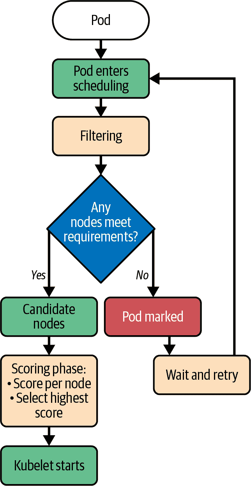
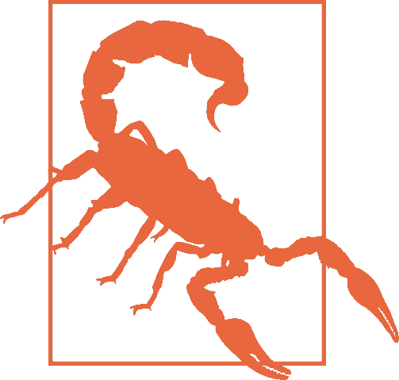
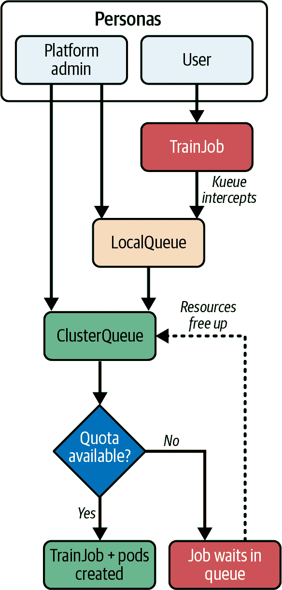
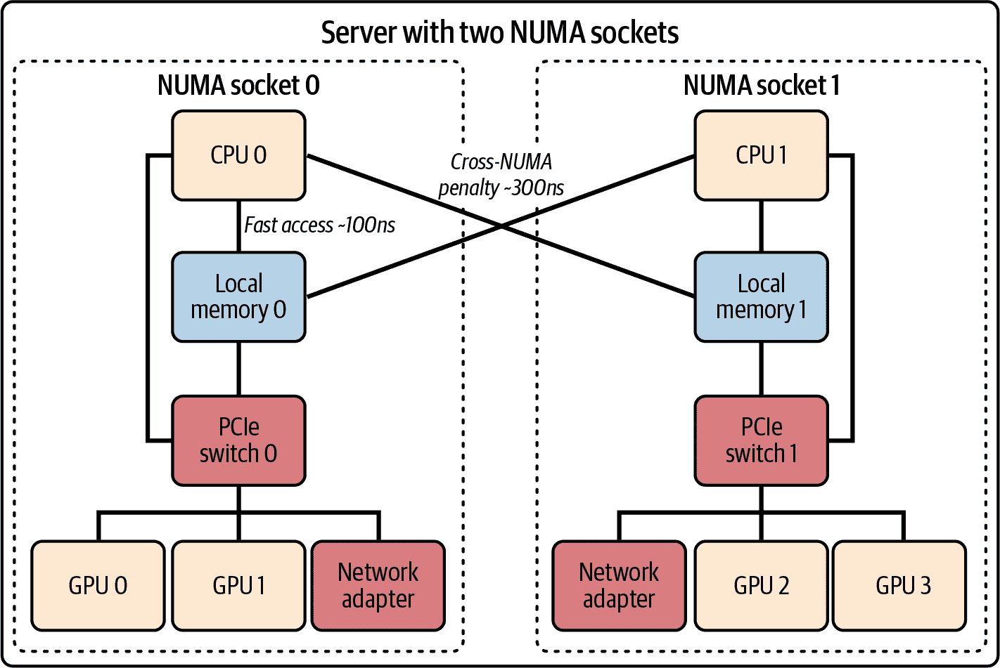
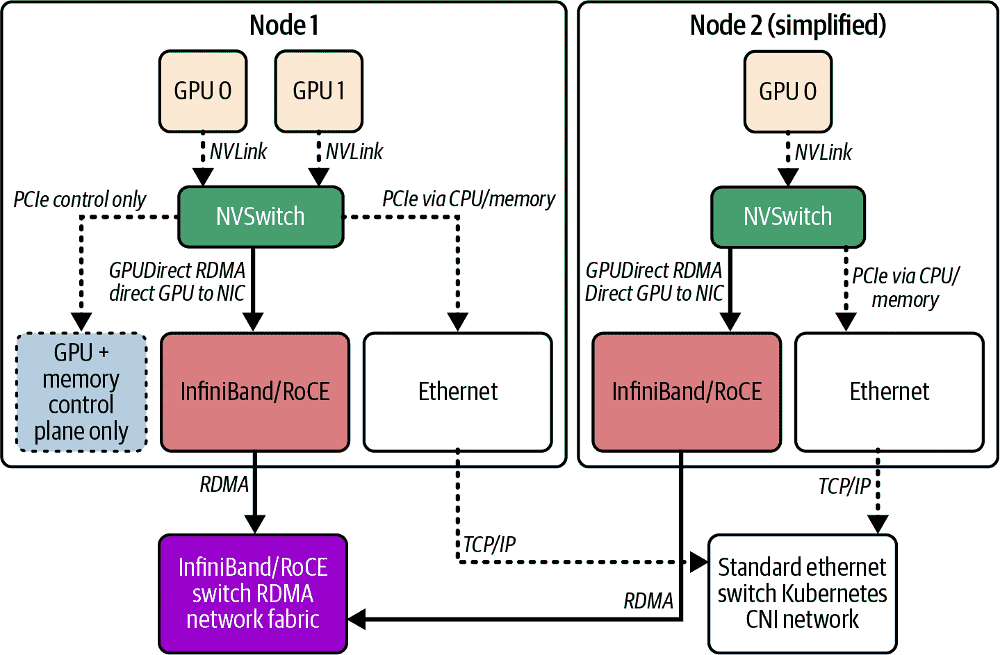

# 第 7 章：作业调度优化

虽然模型训练涵盖了整个 LLM 生命周期（从预训练到对齐再到定制化），但上一章重点关注了模型定制化——这是使用 LLM 的组织最常用、最实用的方法。

上一章介绍了不同的定制化技术和框架（例如 Kubeflow Trainer），用于在 Kubernetes 上实现分布式定制化作业。特别是，平台管理员必须应对一系列新的运维挑战，这些挑战超出了训练作业基本配置的范畴。

虽然第 3 章主要关注推理生产工作负载，但在 Kubernetes 中的 GPU 管理方面存在很大的重叠。此外，即使仅看 Kubernetes 上长期运行的作业管理，模型定制化工作负载在几个关键方面也与传统的 Kubernetes 应用有显著不同：

- 它们本质上资源密集，需要跨多个节点的专用硬件（GPU）长时间运行，有时甚至需要数天或数周。
- 它们表现出组件之间很强的相互依赖关系，这在 Kubernetes 工作负载中并不常见；例如，分布式训练作业中的所有 Pod 必须通过 *gang 调度* 一起调度。
- 它们会产生大量需要在网络上共享的数据，使网络性能成为关键瓶颈。
- 它们代表了相当大的成本（无论是时间还是资源），因此可靠且高效的资源利用率至关重要。
- GPU 在大多数集群中是稀缺且昂贵的资源，需要复杂的配额管理和调度逻辑来防止利用率不足，同时确保多个团队和项目之间的公平访问。


这些因素共同构成了每个 Kubernetes 平台管理员都必须应对的挑战。

本章通过介绍在 Kubernetes 上运行稳健的模型定制化平台所需的关键优化和配置，探讨这些生产规模下的挑战。我们从 Kubernetes 调度器优化策略开始，包括用于成本高效 GPU 利用率的装箱（bin packing），以及通过 descheduler 进行动态重新调度以保持长期优化。然后，我们探讨确保分布式训练作业的所有组件一起调度的 gang 调度解决方案、优化 GPU 互联放置的拓扑感知调度，以及用于跨团队公平分配资源的配额管理。此外，我们还介绍了减少通信瓶颈的网络优化、多用户环境的安全考虑、处理大型数据集和模型产物的存储策略，以及为长时间运行的训练工作负载提供可见性的可观测性模式。

目标是利用上一章学到的原则，将其融入一个生产就绪的平台，以支持企业级的模型定制化工作流，同时保持现代 Kubernetes 环境所期望的运维标准。

在本章中，我们使用 *训练作业* 一词来指代所有形式的 LLM 模型定制化工作负载，包括第 6 章讨论的微调和其他技术，因为它们具有相同的平台要求：用于分布式执行的 gang 调度、用于梯度同步的高性能网络、GPU 资源管理以及强大的可观测性。

虽然数据科学技术有所不同，但对于所有 LLM 模型定制化方法而言，基础设施挑战和运维模式是一致的。

本章专门针对 LLM 定制化，因为传统的预测模型（分类、回归和时间序列预测）通常规模小得多，往往可以在单个 GPU 或 CPU 上高效训练，不需要本章所描述的专业基础设施。

## Kubernetes 调度器优化

Kubernetes 调度器提供了灵活、可插拔的架构，支持复杂的配置，以针对不同的工作负载需求优化 Pod 放置。GPU 训练平台可以通过装箱（bin packing）等策略利用这种灵活性来整合工作负载并降低成本，同时结合动态重新调度以在集群状态变化时保持优化。本节介绍核心调度机制、面向成本效率的装箱策略，以及用于持续优化的 descheduler。

### 核心 Kubernetes 调度器

Kubernetes 调度器对每个 Pod 独立执行两阶段的决策过程。首先，*过滤阶段*（候选选择）会剔除无法满足 Pod 需求的节点。这包括 CPU、内存、GPU 资源不足，或无法满足污点、容忍度和亲和性规则（见第 88 页的“节点亲和性”）。

接下来是*评分阶段*（节点排序），它使用加权标准（如资源均衡、Pod 分散和亲和性偏好）对剩余的候选节点进行排序，以选择最优的放置位置。一旦选择了节点，调度器就会执行*绑定操作*，将 Pod 分配到该节点。绑定操作结束了调度阶段，该节点上运行的 Kubelet 将接管并启动容器。

Kubelet 是在每个 Kubernetes 节点上运行的代理，负责根据控制平面提供的规范在该节点上执行容器。

更多细节请参见图 7-1。



*图 7-1. Kubernetes 调度器*

### 资源装箱策略

虽然默认的 Kubernetes 调度器会将 Pod 分散到多个节点以提高可用性，但 GPU 训练平台通常受益于相反的方法：将 Pod 紧密打包到更少的节点上，以最大限度地提高利用率并实现经济高效的集群自动扩缩。这对于 GPU 集群尤其有价值，因为节点每小时的成本可能为 10–30 美元，将工作负载整合到充分利用的节点上会创建“空闲”节点，自动扩缩器可以安全地将其排空并移除。

*资源装箱*策略通过调度器的 NodeResourcesFit 评分插件实现紧密的 Pod 整合。MostAllocated 策略会在节点已有更高资源分配时给予更高评分，偏向整合而非默认的 LeastAllocated 分散行为（见示例 7-1）。

#### 示例 7-1：装箱（bin packing）的调度器配置

```yaml
apiVersion: kubescheduler.config.k8s.io/v1
kind: KubeSchedulerConfiguration
profiles:
- schedulerName: binpack-scheduler
  pluginConfig:
  - name: NodeResourcesFit
    args:
      scoringStrategy:
        type: MostAllocated
        resources:
        - name: nvidia.com/gpu
          weight: 5
        - name: cpu
          weight: 1
        - name: memory
          weight: 1
```

训练任务引用的自定义调度器名称，用于启用装箱（bin packing）行为。

MostAllocated 策略在节点已有更多资源被分配时给予更高的评分，从而倾向于整合。

GPU 资源具有更高的权重（5），使 GPU 装箱优先于 CPU 和内存，这反映了 GPU 资源成本更高且更稀缺的特点。

平台管理员必须在装箱的成本效率与可用性降低之间取得平衡，因为单个节点故障会影响更多的训练任务，而且即使 GPU 资源可用，资源争用也可能造成 CPU、内存或网络瓶颈。装箱调度尤其适合对成本敏感、可通过检查点与恢复工作流容忍中断的批量训练负载，而生产训练平台通常使用多个调度器配置文件，既为实验性任务提供装箱调度，也为需要韧性的关键负载提供分散调度。

## 使用 Descheduler 进行动态调度

前面描述的装箱策略优化了 Pod 的初始放置，但随着工作负载终止以及新任务以不同速率到达各节点，这些优化会随时间推移而逐渐劣化。Kubernetes Descheduler 作为可单独安装的组件，通过持续评估 Pod 放置情况，将处于欠优位置的 Pod 驱逐，以便调度器根据当前集群状态和策略重新调度它们，从而应对这一动态优化挑战。与针对新 Pod 创建事件做出反应的调度器不同，Descheduler 会主动识别违反放置策略或导致资源碎片化的现有 Pod，然后将它们驱逐以触发重新调度，从而提升整体集群效率。

Descheduler 作为独立组件运行（通常以 CronJob 形式部署以进行周期性优化，或以 Deployment 形式部署以进行持续监控），它应用通过 DeschedulerPolicy 自定义资源定义的可配置策略插件，来识别需要驱逐的 Pod。当 Descheduler 驱逐一个 Pod 时，它只是删除该 Pod。Pod 的控制器（ReplicaSet、StatefulSet，或者在训练任务场景下为 Kubeflow Trainer）会立即重新创建该 Pod，然后调度器根据当前的调度策略和集群状态对其进行放置。这种驱逐—重新调度循环会遵循 PodDisruptionBudgets（PDBs），确保 Descheduler 绝不会违反可用性约束，也不会在配置的容忍范围之外干扰关键工作负载，从而使 PDB 成为保护组调度训练任务免遭过早驱逐的主要机制（示例 7-2）。

#### 示例 7-2：保护组调度训练任务的 PodDisruptionBudget


```yaml
apiVersion: policy/v1
kind: PodDisruptionBudget
metadata:
  name: llm-training-pdb
spec:
  # Ensures all workers remain running simultaneously (gang scheduling requirement)
  minAvailable: 4
  selector:
    matchLabels:
      # All pods belonging to the same training job
      scheduling.x-k8s.io/pod-group: llm-training-group
```

多种 Descheduler 策略针对 GPU 训练平台的不同优化目标。这些策略在 `DeschedulerPolicy` 资源的 `profiles[].plugins` 部分中配置（见表 7-1）。

#### 表 7-1：适用于 GPU 训练平台的 Descheduler 策略

| 策略 | 行为 | 调度策略对齐 | 最适合的场景 |
| --- | --- | --- | --- |
| `HighNodeUtilization` | 从利用不足的节点驱逐 Pod，将工作负载整合到更少的节点上 | 必须与 `MostAllocated`（装箱）调度策略配合使用，以避免驱逐循环 | 使用自动扩缩的成本优化 GPU 集群、可容忍中断的批量训练工作负载、最大化 GPU 利用密度 |
| `LowNodeUtilization` | 从过度利用（高于目标阈值）的节点驱逐 Pod，将它们整合到利用不足（低于阈值）的节点上，从而支持节点缩容 | 必须与 `LeastAllocated`（分散）调度策略配合使用，以避免驱逐循环 | 与集群自动扩缩配合使用，通过集中工作负载来触发缩容；与 `HighNodeUtilization` 方法相反，但阈值语义不同 |
| `RemovePodsViolatingNodeAffinity` | 驱逐节点亲和性规则不再匹配其当前节点的 Pod | 可与任何调度器配合使用；强制执行声明式放置约束 | 节点标签会变化的动态 GPU 基础设施（GPU 类型升级、拓扑重新配置），强制执行 GPU 型号要求 |
| `RemovePodsViolatingInterPodAntiAffinity` | 驱逐违反反亲和性规则的 Pod，以实现预期的分散放置 | 可与任何调度器配合使用；修正次优的初始放置 | 需要通过副本分散实现容错的训练任务，避免相关 Pod 共置 |

反调度的主要风险是任务中断。从长时间运行的 LLM 训练任务中驱逐 Pod，会迫使其执行代价高昂的检查点与恢复循环，这可能会将训练完成时间延迟数小时甚至数天。平台管理员通过以下方式来缓解这一风险：控制部署频率（在维护窗口期间不频繁运行 Descheduler，而非为了最大化效率而持续运行）、使用 `PodDisruptionBudgets`（保护关键任务免遭驱逐），以及进行命名空间隔离（在优化实验性命名空间的同时排除生产训练命名空间）。组织应验证优化收益（通过更好的装箱降低节点成本）是否超过中断成本（因检查点而损失的训练时间）。



Descheduler 的策略必须与调度器的放置策略保持一致，否则系统会进入*驱逐循环*：Descheduler 驱逐的 Pod，调度器立即将它们放回同一节点，结果 Pod 再次被驱逐：

- 如果在 Descheduler 中使用 `HighNodeUtilization`，调度器*必须*使用 `MostAllocated`（装箱）策略。
- 如果在 Descheduler 中使用 `LowNodeUtilization`，调度器*必须*使用 `LeastAllocated`（分散）策略。
- 切勿同时启用 `HighNodeUtilization` 和 `LowNodeUtilization`。它们的目标相反，会产生冲突。

通过监控来验证一致性：如果驱逐数量持续增加而节点整合没有进展，则很可能存在驱逐循环，需要对策略进行修正。

### 组调度（Gang Scheduling）

前面介绍的调度器优化（装箱以实现成本效率、Descheduler 进行动态重新优化）解决的是单个 Pod 如何被放置和维护在节点上的问题。然而，分布式训练任务带来了一个截然不同的挑战：确保多 Pod 任务的所有组件作为一个原子单元一起被调度。默认的逐 Pod 调度模型对容器化应用和微服务来说非常高效，但在分布式训练任务面前会从根本上失效，因为调度器并不知道多个 Pod 属于同一个协调工作负载。每个 Pod 都是独立调度的。例如，调度器可能成功放置了八个 worker 中的七个，占用了已分配的 GPU 资源，而任务却在等待缺失的 worker 时发生死锁——该 worker 因资源耗尽而无法被调度；这也被称为*资源碎片化*。

大规模 LLM 训练任务需要“全有或全无”的调度方式，因为像 PyTorch 这样的框架使用*会合机制*：所有 worker 必须在训练开始前相互发现并在屏障处同步。同样，DeepSpeed 和其他框架在每次训练迭代期间都会建立通信屏障，以协调梯度同步。即使只有一个 worker 缺失，会合屏障也无法完成，导致整个任务死锁，同时已调度的 worker 仍在消耗 GPU 资源。集群的设计目标是处理多个并发用户，这些用户同时提交训练任务，并期望公平的调度策略能够保证在一定的时限/SLO 内完成执行。

### Gang 调度

*Gang 调度*，也称*协同调度*，是一种调度策略，确保属于同一分布式作业的所有 Pod 作为单个原子单元被一起调度。要么所有 Pod 同时被调度，要么一个都不被调度。该调度技术使用一个队列，在调度器能够保证集群中存在足够资源以满足整个作业需求之前，Pod 一直处于 Pending 状态，不分配资源。

Gang 调度问题对 Kubernetes 来说并不新鲜，也不是分布式训练作业所特有，但由于 GPU 稀缺和成本问题，它对这些作业的影响更大。Kubernetes 在设计上是可插拔的，可以使用不同的项目来应对这一挑战。

#### PyTorch 集合机制与 Gang 调度

PyTorch 的分布式训练依赖于一种将对等发现与屏障同步结合起来的集合（rendezvous）机制。当分布式训练作业启动时，所有 worker 都会连接到一个集合后端（通常是基于 TCP 的键值存储或 etcd），以便：

1. 发现训练作业中的所有其他 worker
2. 就完整的参与者集合达成一致，并分配 rank（0 到 `world_size-1`）
3. 在屏障处同步——在所有 worker 到达之前，任何 worker 都不会继续执行
4. 交换用于点对点通信的连接信息

这个集合屏障是原子的且具有阻塞性：如果调度器为 8 个 worker 中的 7 个分配了位置，但第 8 个由于资源碎片化而无法被调度，那么这 7 个已被调度的 worker 将在集合屏障处无限期等待。这 7 个 GPU 会保持已分配但空闲的状态，消耗成本，却不产生任何训练进展。

Gang 调度通过确保 8 个 worker 要么同时全部被调度、要么一个都不被调度来解决这个问题，从而避免在集合阶段发生死锁的部分部署。虽然 PyTorch 的弹性训练（`torch.distributed.elastic`）可以处理动态 worker 集合，但大多数 LLM 训练使用静态配置，其中 worker 数量固定且必须全部就绪。

#### Gang 调度方案对比

在 Kubernetes 上实现 Gang 调度有多种方法，每种方法运行在技术栈的不同层次，服务于不同的使用场景。表 7-2 描述了主要选项。理解这些方案之间的区别有助于平台管理员为其训练工作负载选择合适的技术。

*表 7-2. Gang 调度方案*

| 方案 | 主要目标 | 架构层 | 项目社区 | 最适合的场景 |
| --- | --- | --- | --- | --- |
| 协同调度插件（`PodGroup` CRD） | 在默认 Kubernetes 调度器中启用 Gang 调度语义 | 调度器扩展（使用插件框架扩展 `kube-scheduler`） | Kubernetes SIGs | 需要全有或全无调度的通用批处理工作负载（训练作业、Spark 等） |
| Kueue | 作业级资源管理与准入控制 | 准入控制器 + 队列管理（在调度层之上运行） | Kubernetes SIGs | 需要配额管理、优先级队列、资源借用和公平共享调度的多租户环境 |
| NVIDIA KAI Scheduler | 面向 AI/ML 工作负载的 GPU 优化调度器 | 为 GPU 集群设计的替代调度器 | NVIDIA 生态系统（原 Run:ai） | 大规模 GPU 集群、数千节点、动态 GPU 分配、分层队列、AI/ML 团队间的公平性 |
| Volcano | 具备高级作业管理的批处理调度系统 | 替代调度器（替代或补充 `kube-scheduler`） | CNCF 沙箱 | 最初为 HPC 和 AI/ML 的高性能批处理调度设计，支持高级调度策略（公平共享、装箱） |

Kubernetes 社区正在通过 KEP-4671 推进原生 Gang 调度支持。该提案引入一种新的核心 Workload 类型，直接在 Kubernetes 调度器中启用全有或全无的调度语义，允许 Pod 作为一个组被一起调度。该增强功能旨在为紧密耦合的工作负载（如分布式训练作业）提供标准调度框架，这类作业要求所有 worker 同时启动，以避免在框架同步点发生死锁。一旦 KEP 获批并实现，Volcano 和 KAI Scheduler 等替代调度器将需要更新其实现，以支持标准化的 Workload API，从而与更广泛的 Kubernetes 生态系统兼容。虽然目前仍处于提案阶段，但这一原生支持将消除基本 Gang 调度场景下对外部插件或自定义调度器的需求；不过，前文介绍的方案在当前生产环境中仍然很有价值，并提供了高级队列管理和 GPU 特定优化等额外功能。

#### 协同调度插件（PodGroup CRD）

协同调度插件为现有 Kubernetes 集群提供了实现 Gang 调度最直接的路径，它扩展默认调度器，而无需完全替换。

安装时，平台管理员需要安装 `scheduler-plugins` 包，并在 `kube-scheduler` 配置中启用协同调度插件。

安装后，需要定义一个代表调度单元的 `PodGroup` 对象，最后用 `scheduling.x-k8s.io/pod-group: groupId` 标签标记属于同一训练作业的所有 Pod，使它们作为单个调度单元进行管理（参见示例 7-3）。这种方法保留了非 Gang 调度工作负载的现有调度器行为，同时仅在需要的位置增加协同调度能力，从而更易于采用，并限制了对生产集群的影响。

`PodGroup` CRD 提供了一种非常简单的抽象来将不同部署分组，但它仍然是底层抽象；例如，无法管理作业级配额、优先级或任何其他高级调度策略。

*示例 7-3. PodGroup 配置*

```yaml
apiVersion: scheduling.x-k8s.io/v1alpha1
kind: PodGroup
metadata:
  name: llm-training-group
spec:
  minMember: 4
  scheduleTimeoutSeconds: 300
---
apiVersion: v1
kind: Pod
metadata:
  name: llm-training-0
  labels:
    scheduling.x-k8s.io/pod-group: llm-training-group
    job-role: leader
spec:
  ...
```

- 调度器必须一起调度的最小 Pod 数量。在分布式训练作业中，通常会有 driver 和 worker；此配置必须同时考虑两者。由于每个 Pod 都是独立创建的，该值向调度器指示组预期的最小规模。
- 等待所有 Pod 变为可调度状态的最长时间。
- 第一个工作负载 Pod；其他 Pod 遵循相同模式，并带有匹配的 `pod-group` 标签。
- 具有相同 `pod-group` 标签值的所有 Pod 被视为一个原子调度单元，同时保留独立的部署规范。
- `job-role` 标签不是 `PodGroup` 设计的一部分，但它是阐明每个 Pod 所扮演角色的最佳实践。

#### Kueue

Kueue 项目运行在比调度器插件更高的抽象层，提供作业级准入控制，根据可用配额和队列优先级决定集群是否应接纳工作负载。当 Kueue 接纳一个作业时，它会确保所有必需资源都存在，并与保证原子调度的底层 Gang 调度机制形成互补。

Kueue 最大的价值在于处理多租户资源管理的能力：它实现了分层资源配额、基于优先级的排队、团队间的资源借用，以及防止任何单个租户垄断集群资源的公平性策略。在跨多个团队管理共享训练集群时，平台管理员应考虑使用 Kueue，因为它提供了一个策略层（谁在何时获得资源），从而支持更通用的 GPU 即服务（GPU as a Service）用例，详见第 229 页的“配额管理与多租户：GPU 即服务”。

最后，Kueue 与 Kubeflow Trainer、RayJob 和其他 AI 项目无缝集成，使其成为实现训练作业编排的自然选择。使用 Kueue 的端到端流程涉及不同角色：平台管理员在 `ClusterQueue` 中配置全局规则，并创建 `LocalQueue`，数据科学家可使用 `LocalQueue` 访问分配的配额并预置工作负载（参见图 7-2）。

当您提交启用了 Kueue 集成的作业（使用 `kueue.x-k8s.io/queue-name` 标签）时，Kueue 会自动创建一个类型为 Workload 的自定义资源来管理准入控制。该 Workload 对象与实际作业（`TrainJob`、`Job` 等）分离，并跟踪资源需求和准入状态。

提交后检查状态：

1. 检查 Workload 对象：`kubectl get workloads -n <namespace>` 可显示您的作业是被接纳还是处于排队状态。
2. 检查实际作业：`kubectl get trainjob <name> -n <namespace>` 可显示作业状态，但在 Kueue 接纳它之前，作业将保持暂停状态。
3. 理解整个流程：作业提交 → Kueue 创建 Workload → Workload 排队 → 配额可用 → Workload 被接纳 → 作业解除暂停 → 创建 Pod。



*图 7-2：Kueue 概览：概念与角色*

Workload 对象的状态条件在被接纳时会显示“QuotaReserved”之类的消息，在排队时会显示“InsufficientQuota”，帮助您了解作业为何尚未运行（参见示例 7-4）。

*示例 7-4：Kueue Workload 对象的状态*

```yaml
status:
  conditions:
  - type: Admitted
    status: "True"
    reason: "QuotaReserved"
    message: "The workload is admitted and quota is reserved"
  admission:
    clusterQueue: "ai-training-cluster-queue"
    podSetAssignments:
    - count: 1
      flavors:
        nvidia.com/gpu: gpu-training-flavor
      name: head
    - count: 1
      flavors:
        nvidia.com/gpu: gpu-training-flavor
      name: worker
```

### 群体调度（Gang Scheduling）

#### NVIDIA KAI Scheduler

NVIDIA KAI Scheduler 是 run:ai（已被 NVIDIA 收购）开发的核心调度引擎的开源版本。它仅适用于 NVIDIA 硬件，并且采用不同的方法，因为它通过专注于 GPU 感知优化来实现集中化管理，包括分数分配、时间切片，以及带公平策略的分层队列管理。这些优化再与结合了 GPU 拓扑感知放置（NVLink 连接）的群体调度相结合，以共同部署分布式训练作业。

KAI Scheduler 支持群体调度，通常通过与某种聚合部署 API（参见第 192 页的“Kubeflow Trainer”）显式集成来执行，而不是通过聚合独立的 Pod。它是一个替代性的 Kubernetes 调度器，主要目标是通过内置的 Kubeflow 集成来最大限度地减少空闲 GPU 成本。示例 7-5 显示了使用 `PyTorchJob` 资源的配置；当使用 `TrainJob` 时，这些设置（annotations 和 `schedulerName`）在 `ClusterTrainingRuntime` 模板中配置。

*示例 7-5：KAI Scheduler 与群体调度配合使用（PyTorchJob）*


```yaml
# project with GPU quota
apiVersion: kai.run.ai/v1
kind: Project
metadata:
  name: ml-team-a
spec:
  gpuQuota: 8
---
# Distributed training job with gang scheduling
apiVersion: kubeflow.org/v1
kind: PyTorchJob
metadata:
  name: llm-training
  namespace: ml-team-a
  annotations:
    kai.run.ai/project: ml-team-a
spec:
  pytorchReplicaSpecs:
    master:
      replicas: 1
      template:
        spec:
          schedulerName: kai-scheduler
  ...
```


项目级 GPU 配额（共 8 个 GPU），用于公平共享调度。

该注解将作业与上面定义的项目绑定，以进行配额核算。

必须在 `spec` 中使用 KAI Scheduler，以便其提供 GPU 感知放置和群体调度。

本章中的示例使用 Kubeflow Training Operator（`kubeflow.org/v1` API）的 `PyTorchJob` 资源，来演示 Kubernetes 资源层的调度和网络配置。

虽然上一章介绍了 Kubeflow Trainer 更高级别的 `TrainJob` 抽象（`trainer.kubeflow.org/v1alpha1` API），但这里展示的调度概念同样适用于这两种方法。`TrainJob` 资源在内部创建 `JobSet` 工作负载，而调度配置（如调度器选择、Kueue 标签、网络注解和 NCCL 环境变量）在 `ClusterTrainingRuntime` 或 `TrainingRuntime` 模板中指定。这种分离允许平台管理员在运行时模板中配置这些生产优化，而数据科学家则通过 SDK 专注于训练逻辑。

## Volcano

Volcano 项目是一个 CNCF 沙箱项目，最初由华为创建。它为 HPC、AI/ML 和大数据工作负载（如 Apache Spark）提供了一个全面的批处理调度系统，用单体解决方案完全取代了 `kube-scheduler`。该解决方案集成了队列管理、群体调度和拓扑感知放置。

Volcano 引入了 `Queue`、`PodGroup` 和 `Job` CRD 来描述和处理高级调度算法，以及用于抢占低优先级作业的回收策略，使其适用于运行涵盖 TensorFlow、PyTorch 和 Apache Spark 等所有主要框架的复杂批处理工作流的生产环境。然而，采用 Volcano 需要完全替换默认的 Kubernetes 调度器，这比在 `kube-scheduler` 之上通过 `coscheduling` 插件分层叠加 Kueue 更具侵入性；因此，它可能不适用于存在传统工作负载的现有生产集群。


### 如何做出正确选择

在本节中，我们介绍了在 Kubernetes 上为分布式训练作业实现群体调度的不同技术及其优缺点。然而，在实际的生产集群中，组合不同的解决方案是非常常见的。

一个常见（且推荐）的场景是结合 Kueue 进行准入控制和配额管理，同时配合 `PyTorchJob`（参见第 192 页的“Kubeflow Trainer”）或 `LeaderWorkerSet` 等 AI 专用部署 API。例如，NVIDIA KAI Scheduler 可以替换默认调度器以提供 GPU 感知优化，同时仍然利用 Kueue 层提供的准入管理。

`LeaderWorkerSet`（LWS）项目可以与专用调度器一起使用，因为它解决的是不同的问题：管理具有固有 leader-worker 拓扑的工作负载，而不仅仅是确保原子调度。

虽然 LWS 假定群体调度语义（组中的所有 Pod 要么一起调度，要么根本不调度），但其主要价值在于提供一个理解 AI/ML 推理场景中常见 leader-worker 模式的工作负载 API，其中 leader Pod 协调向 worker Pod 分发工作，并且两者必须高效地共同部署或联网。这使得 LWS 相对于更通用的 `PodGroup` API 而言，是专门为 AI/ML 设计的。

虽然 `PyTorchJob` 专门用于分布式训练作业，但 LWS 的主要目标是分布式推理，尤其是多主机推理工作负载，其中 LLM 将被分片并跨多个节点上的多个设备运行。这种场景与分布式训练作业面临相同的群体调度挑战。

虽然前面讨论的群体调度解决方案确保分布式训练作业获得完整的资源分配，但它们并没有解决这些资源在集群物理基础设施中的位置问题。Pod 在具有不同 GPU 互连技术的节点之间的放置会显著影响训练性能，这使得拓扑感知成为下一个关键的调度考虑因素。

## 拓扑感知调度

虽然群体调度确保分布式训练作业中的所有 Pod 一起调度，但它并不保证这些 Pod 落在具有最佳 GPU 间通信硬件拓扑的节点上。

没有群体调度的调度器可能会部分部署作业（浪费昂贵的 GPU 资源），而没有拓扑感知的调度器则有可能将 worker 分散到不同的节点上。这会迫使 GPU 间通信使用未优化的网络连接，使 worker 不得不使用慢几个数量级的连接，从而大幅增加作业执行时间。


在此上下文中，拓扑感知指的是 GPU 之间的物理互连架构。这包括 GPU 是在单个节点内通过 NVLink 或 PCIe 连接，还是跨节点通过 InfiniBand 或 RoCE（融合以太网上的 RDMA）等高速结构连接，抑或是通过标准以太网连接。这些互连的带宽和延迟特性会显著影响分布式训练性能：NVLink 在同一节点内的 GPU 之间提供高达 900 GBps 的双向带宽（在 H100 上使用 NVLink 4.0），InfiniBand 跨节点提供 200–400 GBps 的带宽和亚微秒级延迟，而标准以太网通常只能提供 10–100 GBps 的带宽且延迟更高。关于连接不同 GPU 的带宽以及不同技术的讨论，在第 110 页的“单节点与多节点推理”中已有类似的讨论。

在网络术语中，*fabric*（结构）指的是提供多个节点或设备之间互连通信路径的底层网络基础设施。与具有离散层的传统分层网络架构不同，fabric 提供了一种网状拓扑，端点之间存在多条路径，从而实现高带宽和低延迟通信。

在 GPU 计算的上下文中，InfiniBand 或 NVSwitch（一种用于服务器内全网格 GPU 连接的交换结构）等 fabric 提供了高速互连基础设施，使 GPU 能够高效通信。这可以是在单个服务器内部（NVSwitch fabric 连接 8–16 个 GPU），也可以是跨多个服务器（InfiniBand fabric 连接数百个节点）。fabric 抽象了底层交换基础设施的复杂性，为分布式训练工作负载呈现了一个统一的高性能通信层。

*拓扑感知调度*扩展了群体调度，在做出放置决策时考虑硬件拓扑约束，确保分布式训练作业被调度到具有适合其通信模式的最优互连配置的节点上。

一个需要 8 个 GPU 的训练作业，当所有 8 个 GPU 都位于一个通过 NVLink 连接的 8-GPU 节点内时，其性能可能远优于将这些 GPU 分散在 8 个通过以太网通信的单 GPU 节点上。虽然所有分布式训练策略都能从高质量互连中受益，但敏感程度差异很大：数据并行训练需要跨 worker 进行高效的梯度同步，但张量并行和完全全分片数据并行（FSDP）对低延迟、高带宽的互联网络提出了特别严格的要求，因为它在每次前向和反向传播过程中都会进行细粒度的通信。在张量并行中，激活值必须在 GPU 之间传输，而 FSDP 会持续执行参数收集和梯度归约操作。所有这些操作的代价都与通信延迟成正比、与带宽成反比，这使得 GPU 拓扑和互联质量对训练性能至关重要，尤其是对于超越简单数据并行的先进并行策略而言。

### 分布式训练中的通信模式

主要的并行策略会产生不同的通信模式，对网络的要求也各不相同。

*数据并行*在每个 GPU 上复制完整模型，并在每个训练步骤之后同步梯度。梯度表示改进模型预测所需的调整方向和幅度：在每次训练迭代中，模型进行预测，将其与正确答案进行比较，并计算如何调整每个模型参数（权重）以减少预测误差（有关梯度下降基础知识的背景介绍，请参阅 Google 机器学习速成课程；有关分布式训练中梯度同步的基础设施细节，请参阅 PyTorch 的分布式通信文档）。每个工作节点在其训练数据子集上计算梯度，然后所有工作节点必须同步其梯度（通常通过对梯度求平均），以确保模型更新的一致性。对于拥有数十亿参数的大语言模型，每次迭代可能需要在所有工作节点之间传输数十 GB 的梯度数据。

*张量并行*将单个模型层拆分到多个 GPU 上，在前向和反向传播过程中都需要进行激活值传输。激活值是每一层产生的中间计算结果。例如，单个矩阵乘法可能被拆分到四个 GPU 上，在前向和反向传播过程中激活张量会在这些 GPU 之间传递。这使得张量并行对网络延迟尤为敏感。

*FSDP*是一种内存效率更高的数据并行替代方案，它将模型参数、梯度和优化器状态分片（拆分）到所有 GPU 上，而不是复制完整模型。每个 GPU 在计算前“即时”从其他 GPU 收集所需的参数分片，然后将其丢弃以最大限度地减少内存占用。这种频繁的全收集和归约分散通信使 FSDP 对网络带宽和延迟都特别敏感。

有关这些并行策略的详细说明，请参阅第 106 页的“模型并行”。

由于这种显著的性能影响，平台管理员需要在拓扑感知与充分利用所有可用资源、最大限度地减少资源闲置之间取得平衡。如果 GPU 未按首选拓扑排列，即使总 GPU 容量充足，作业也可能一直处于排队状态，这样可以避免调度存在严重瓶颈的作业。

### 比较拓扑感知调度解决方案

一些提供组调度能力的调度解决方案也提供不同程度的拓扑感知功能，以优化 GPU 放置和互联利用率。了解每种解决方案如何处理拓扑感知调度，有助于平台管理员选择与自身基础设施拓扑复杂性和性能要求相匹配的技术。

表 7-3 比较了主要选项。

*表 7-3. 拓扑感知调度解决方案*

| 方案 | 拓扑感知能力 | 实现方式 | 最适合的场景 |
|---|---|---|---|
| Coscheduling 插件（`PodGroup` CRD） | 无原生拓扑感知能力 | 依赖默认的 Kubernetes 节点标签和 Pod 亲和性/反亲和性提供基本放置提示 | 适用于通过手动节点标签和亲和性规则即可满足需求的简单拓扑；对于复杂的分布式训练拓扑，应辅以其他解决方案 |
| Kueue | 基于 `ResourceFlavor` 的拓扑感知 | 使用节点标签和容忍度，按拓扑特征（NVLink、InfiniBand、机架位置）定义 GPU 资源“风味” | 需要将工作负载路由到特定互联类型或故障域的多层 GPU 拓扑 |
| NVIDIA KAI Scheduler | 与组调度集成的 GPU 拓扑感知放置 | 原生理解 NVLink 连接、NVSwitch 架构和 InfiniBand 拓扑，实现多 GPU 作业的最优放置 | 以 GPU 为主的集群，其中 GPU 互联拓扑（NVLink、NVSwitch）直接影响训练性能 |
| Volcano | 内置拓扑插件 | 拓扑感知调度插件能够理解 GPU 和网络拓扑，根据作业需求自动优化放置 | 具有异构互联（NVLink + InfiniBand + 以太网）的复杂 HPC 风格拓扑 |

#### Coscheduling 插件（PodGroup CRD）

Coscheduling 插件除标准 Kubernetes 调度原语外，不提供任何原生拓扑感知能力。平台管理员可以通过手动为节点添加拓扑信息标签（例如 `rack-id`、`nvlink-enabled` 或 `infiniband-connected`），并在工作负载规范中配置 Pod 亲和性或反亲和性规则来影响放置，从而部分绕过此限制。

使用 Kubernetes 的亲和性/反亲和性功能与 Coscheduling 插件无关，完全是一个手动过程。这种方法仅适用于 GPU 互联类型较少且拓扑简单的场景，但随着拓扑复杂性的增加，它会变得难以管理，需要为每个训练作业进行大量手动配置。

#### Kueue

Kueue 通过其 `ResourceFlavor` 机制解决拓扑感知调度问题，使平台管理员能够定义多种按拓扑特征区分的 GPU 资源“风味”。该概念基于平台管理员配置的节点标签，或基于 NVIDIA GPU 功能发现（参见第 84 页的“GPU 功能发现”）等可实现自动化的工具。`ResourceFlavor` 使用 `nodeLabels`（例如 `gpu-interconnect: nvlink`、`network-fabric: infiniband`、`rack: rack-1`）和容忍度来选中节点，从而创建逻辑资源池，工作负载可通过队列配置请求这些资源池。当 `ClusterQueue` 引用具有不同拓扑特征的多个 `ResourceFlavor` 时，Kueue 的准入控制器可以通过仅在所请求风味对应的资源可用时才准入工作负载，来强制实施拓扑约束。

这种方法无需应用层修改即可实现精细的拓扑感知。工作负载只需指定队列名称，Kueue 通过与底层调度器的集成来处理拓扑感知放置。

首先，您需要定义 `ResourceFlavor`，如示例 7-6 所示。

*示例 7-6. Kueue ResourceFlavor 定义*

```yaml
# ResourceFlavor for premium GPU nodes with NVLink and InfiniBand
apiVersion: kueue.x-k8s.io/v1beta1
kind: ResourceFlavor
metadata:
  name: gpu-nvlink-infiniband
spec:
  nodeLabels:
    # Select nodes where GPUs are connected via NVLink
    gpu-interconnect: nvlink
    # Select nodes where inter-node communication happens via InfiniBand
    network-fabric: infiniband
    gpu-type: nvidia-h100
    ...
# ResourceFlavor for standard GPU nodes with Ethernet
apiVersion: kueue.x-k8s.io/v1beta1
kind: ResourceFlavor
metadata:
  name: gpu-standard-ethernet
spec:
  nodeLabels:
    # Nodes that use PCIe for GPU interconnect and Ethernet for networking
    gpu-interconnect: pcie
    network-fabric: ethernet
    gpu-type: nvidia-h100
...
```

定义好 `ResourceFlavor` 之后，你可以使用它们来配置工作队列的资源需求，如示例 7-7 所示。

*示例 7-7. 创建 Kueue ClusterQueue 和 LocalQueue*

```yaml
# ClusterQueue with topology-aware resource flavors
apiVersion: kueue.x-k8s.io/v1beta1
kind: ClusterQueue
metadata:
  name: topology-aware-cluster-queue
spec:
  namespaceSelector: {}
  resourceGroups:
  - coveredResources: ["cpu", "memory", "nvidia.com/gpu"]
    flavors:
    # The premium flavor listed first so Kueue tries this flavor first
    - name: gpu-nvlink-infiniband
      resources:
      - name: nvidia.com/gpu
        nominalQuota: 16
    ...
    # When premium quota is exhausted, this second flavor is used
    - name: gpu-standard-ethernet
      resources:
      - name: nvidia.com/gpu
        nominalQuota: 32
    ...
  flavorFungibility:
    # This option allows fallback to next flavor when the first is exhausted
    whenCanBorrow: TryNextFlavor
    whenCanPreempt: Preempt
# LocalQueue for team access
apiVersion: kueue.x-k8s.io/v1beta1
kind: LocalQueue
metadata:
  name: team-queue
spec:
  clusterQueue: topology-aware-cluster-queue
```

最后，你可以在本地队列中运行该作业，如示例 7-8 所示。

*示例 7-8. 创建与 Kueue 集成的 PyTorchJob*


```yaml
# PyTorchJob that will use topology-aware flavor selection
# (for TrainJob, apply this label to the TrainJob metadata)
apiVersion: kubeflow.org/v1
kind: PyTorchJob
metadata:
  name: llm-training
  labels:
    # This label triggers the Kueue admission controller and
    # binds the job to a specific queue
    kueue.x-k8s.io/queue-name: team-queue
spec:
  ...
```

## NVIDIA KAI 调度器

KAI Scheduler 提供了最先进的 GPU 拓扑感知能力，原生理解 NVIDIA GPU 互联技术，包括 NVLink、NVSwitch、NVLink 桥接器，以及它们与 InfiniBand 等网络架构之间的关系。

KAI Scheduler 与 NVIDIA GPU Operator（参见第 95 页的“NVIDIA GPU Operator”）紧密集成，以访问详细的 GPU 信息并做出拓扑感知调度决策，从而减少平台管理员手动打标签的需求。

该调度器在放置分布式训练作业时会分析 GPU 拓扑，自动将 worker 共同放置在具有最佳网络配置的节点上。例如，对于需要 8 个 GPU 的训练作业，最好将其放置在一个单一节点上，每个 GPU 都通过 NVSwitch 与其他 GPU 相连，而不是通过 InfiniBand 将 GPU 分散到多个节点上。Kueue 通过 ResourceFlavors 在准入层管理拓扑感知（决定使用哪一层硬件），而 KAI Scheduler 则将拓扑优化直接集成到调度决策中，并与组调度和公平共享能力一起，确保拓扑优化的放置不会违反配额策略或造成资源碎片化。

这种深度的 GPU 拓扑集成和对 NVIDIA 特有硬件的感知，使 KAI Scheduler 成为大规模 NVIDIA GPU 集群的自然之选；在这些集群中，训练性能在很大程度上取决于 GPU 互联的选择，尤其是与 NVIDIA 特有功能（如第 98 页“子 GPU 分配”一节中描述的多实例 GPU（MIG）分区和 GPU 分数分配）结合使用时。

## Volcano

Volcano 调度器包含拓扑感知调度插件，可根据节点标签提供的硬件拓扑信息优化 Pod 放置。与 Kueue 的 ResourceFlavor 方法类似，平台管理员必须为节点打上拓扑特征标签（例如 `gpu-interconnect: nvlink`、`network-fabric: infiniband`、`rack-id: rack-1`），Volcano 的拓扑插件会使用这些标签，在节点为作业的 GPU 需求提供最佳互联带宽时对其给出更高评分。

然而，Kueue 将 ResourceFlavors 用作准入阶段的抽象，将实际放置委托给底层调度器；Volcano 则将拓扑评分直接集成到其调度决策中，自动将分布式训练 worker 共同放置在同一个机架内或具有直接 NVLink 连接的节点上，而无需显式的亲和性规则。

### 如何做出正确的选择

对于需要高级拓扑感知的组织，将不同解决方案分层组合，可以构建全面的拓扑感知组调度。一种常见的架构是将 Kueue 的准入控制与 Volcano 或 KAI Scheduler 等拓扑感知调度器相结合，从而 Kueue 通过 ResourceFlavor 拓扑选择在作业级别管理准入，而底层调度器负责详细的拓扑优化 Pod 放置。这种关注点分离使平台管理员能够在准入层实施拓扑策略（请求高级互连的作业必须具备相应的配额），同时将放置优化委托给对拓扑有深入理解的专用调度器。

平台管理员通过相应地为节点打标签（机架 ID、网络架构类型、GPU 互联能力），并在所选调度器中创建拓扑感知配置，来配置拓扑信息。不同的 GPU 厂商都提供了简化这一打标签过程的工具；尤其是 NVIDIA 的工具套件先进且全面。

虽然前面讨论的调度器侧重于根据 GPU 互联特性在节点间放置 Pod 的拓扑感知，但在单个节点层面，CPU 和设备局部性也会影响性能，因此拓扑考量同样重要。Kubernetes 已通过 Topology Manager 组件解决了这一挑战（参见下面的补充说明）。

#### Kubernetes 拓扑管理器

Kubernetes Topology Manager 是一个运行在每个节点上的 Kubelet 组件，它通过协调资源分配来补充调度器级别的拓扑策略，从而确保单个 Pod 获得最佳硬件局部性。

在现代多插槽服务器上实现最佳硬件使用时，需要考虑的一个主要方面是非统一内存访问（NUMA）内存架构：每个 CPU 插槽都有自己的本地内存，访问其他插槽上的内存会产生更高的延迟。对于 GPU 密集型工作负载来说，这是一个关键考量，因为跨 NUMA 内存访问可能会显著降低性能。

在 Topology Manager 之前，Kubernetes 中的 CPU Manager 和 Device Manager 会独立做出资源分配决策，可能会将来自一个 NUMA 节点的 CPU 和来自另一个 NUMA 节点的 GPU 分配给同一个 Pod，从而迫使产生跨 NUMA 内存流量（图 7-3）。

Topology Manager 通过为单个 Pod 启用 CPU 和设备（包括 GPU）的拓扑感知来解决此问题，确保分配给 Pod 的 CPU 和 GPU 位于同一个 NUMA 节点，以最大限度地减少内存访问延迟。

平台管理员可以使用不同的策略配置 Topology Manager：`best-effort` 会尝试 NUMA 对齐但不强制执行；`restricted` 仅在资源能够正确对齐时才允许 Pod 准入；`single-numa-node` 要求 Pod 的所有资源都来自单个 NUMA 节点。这是最严格的策略，可保证最佳局部性，但在资源受限的集群中可能会降低调度灵活性。



*图 7-3：单个多插槽服务器内的 NUMA 架构：本地内存访问与跨 NUMA 内存访问的延迟对比*

虽然拓扑感知调度会针对性能优化单个作业的放置，但它并未解决在共享集群中多个团队竞争时公平分配稀缺 GPU 资源这一根本性挑战。

## 配额管理与多租户：GPU 即服务

虽然 Gang 调度确保分布式作业中的所有 Pod 被一起调度，拓扑感知调度则优化它们在具有最佳互连的硬件上的放置，但这些机制只解决单个作业如何执行的问题。它们并没有解决当多个团队竞争集群容量时，谁能获得稀缺 GPU 资源的问题。

将共享 GPU 集群作为多租户平台运营，需要精细的配额管理，以确保跨团队的公平资源分配，同时最大化整体 GPU 利用率。对于 AI/ML 工作负载，这是标准 Kubernetes ResourceQuotas 无法充分应对的挑战。

传统的 Kubernetes 配额在命名空间级别使用硬限制，配额耗尽时会阻止工作负载启动，但这种方法没有解决固定且稀缺的资源问题，在实践中导致 GPU 利用率低下。某个团队的数据科学家没有运行实验时，该团队可能有未使用的配额，而另一个团队的作业尽管有紧迫的训练截止日期，却无限期排队；昂贵的 GPU 资源因为配额边界阻止了动态共享而闲置不用。

*GPU 即服务（GPUaaS）*架构通过实现包含借用、抢占和公平性策略的分层配额管理解决了这一问题。这些策略使团队能够在集群容量可用时突破其保证配额进行突发使用，同时确保在需求超过供应时，没有任何团队能够垄断资源。其主要目标是以机会式方法最大化 GPU 使用率，同时在需要时保证既定配额。

## 对比配额管理与多租户解决方案

多种调度解决方案都提供了 GPU 资源的配额管理能力，每种方案在资源分配、公平性策略和多租户支持方面各有不同。表 7-4 对主要选项进行了比较。了解每种解决方案如何处理配额执行和资源借用，有助于平台管理员选择符合其组织跨团队公平 GPU 共享需求的技术。

*表 7-4. 配额管理与多租户解决方案*

| 解决方案 | 配额管理能力 | 多租户方法 | 实现方式 | 最适合场景 |
|---|---|---|---|---|
| Kueue | 支持借用和抢占的分层配额 | 命名空间范围的 LocalQueue 映射到集群范围的 ClusterQueue，基于队列组的跨团队共享，用于工作负载优先级的优先级类别 | 使用 ClusterQueue/LocalQueue 模型的准入控制器、基于队列组的资源借用、基于优先级的抢占 | 需要灵活配额共享、团队间资源借用以及不替换调度器的准入控制的多租户环境 |
| NVIDIA KAI Scheduler | 基于项目的 GPU 配额与公平性算法 | Project CRD 通过专用 GPU 配额隔离团队，层级队列结构支持部门与团队组织，公平份额防止垄断 | 集成调度器，使用 Project CRD 进行配额分配、公平份额调度和 GPU 特定优化 | GPU 密集型集群，需要配额策略与 GPU 感知调度决策紧密集成（分片 GPU、MIG 支持） |
| Volcano | 基于队列的配额与比例分配 | 多个具有独立资源限制的队列、队列级优先级、命名空间到队列的映射以实现团队隔离 | Queue CRD，包含资源限制、用于比例共享的权重，以及用于抢占的回收策略 | 需要在一个组件中集成队列管理和调度，并实现比例资源划分的批处理工作负载 |

### Kueue

Kueue 提供了一个专为训练作业等批处理工作负载设计的综合配额管理系统，实现了将集群级资源治理与团队级队列管理分开的两层架构。

在集群层面，ClusterQueue 定义资源池，包含 CPU、内存和 GPU 的配额限制，以及多个团队竞争有限容量时资源如何分配的策略。平台管理员可以创建代表不同资源层级的 ClusterQueue，例如，一个拥有 32 块 NVIDIA H100 GPU、用于生产训练工作负载的“gpu-training” ClusterQueue；一个拥有 8 块 GPU、用于实验的“gpu-development” ClusterQueue；以及一个使用云 Spot 实例、用于成本敏感工作负载的“gpu-spot” ClusterQueue。每个 ClusterQueue 都指定了*名义配额*（工作负载可用的保证资源）和*借用限制*（其他队列空闲时可临时借用的最大资源量），从而实现灵活的能力共享，在不牺牲公平性保证的前提下提高利用率。LocalQueue 为提交工作负载提供了面向团队的接口，映射到特定的 ClusterQueue，并支持命名空间范围的作业提交和自动配额执行。

队列组（cohort）管理功能通过将不同的 ClusterQueue 分组来实现资源借用，从而支持复杂的多租户共享策略。每个 ClusterQueue 将其保留配额贡献给队列组的总配额，因此总容量是所有这些配额之和。当团队 A 有等待中的工作负载但其 10 个 GPU 的配额已耗尽时，Kueue 允许该团队在队列组限制内借用团队 B 和团队 C 配额中的未使用容量。Kueue 会自动扩展团队 A 的有效分配以利用空闲 GPU，但当团队 B 或团队 C 提交需要其保证配额的新作业时，会立即抢占这些借用的资源。与硬配额边界相比，这种动态共享显著提高了集群利用率。只要有作业在等待，GPU 就不会闲置，同时还能维持公平性保证，确保每个团队始终能够获得其名义配额分配。此外，Kueue 支持能够模拟复杂组织结构的分层队列，允许平台管理员映射部门层级、项目团队和资源池，以反映真实的组织边界。

示例 7-9 包含了所有这些特性：队列组（cohort）、名义配额、借用限制和优先级类别。

*示例 7-9. 使用队列组和优先级类别的 Kueue 配额管理*

```yaml
apiVersion: kueue.x-k8s.io/v1beta1
kind: ClusterQueue
metadata:
  name: team-a-queue
spec:
  cohort: shared-gpu-cohort
  resourceGroups:
  - coveredResources: ["cpu", "memory", "nvidia.com/gpu"]
    flavors:
      # Using a built-in ResourceFlavor that matches all nodes.
      - name: default-flavor
        resources:
        - name: nvidia.com/gpu
          nominalQuota: 10
          borrowingLimit: 22
  queueingStrategy: BestEffortFIFO
  preemption:
    reclaimWithinCohort: Any
    withinClusterQueue: LowerPriority
---
# High-priority class for production workloads
apiVersion: kueue.x-k8s.io/v1beta1
kind: WorkloadPriorityClass
metadata:
  name: production-priority
spec:
  # Specifying a high value makes this class higher priority
  value: 10000
  description: "High priority for production training jobs"
---
# Production PyTorchJob from Team A (high priority)
apiVersion: kubeflow.org/v1
kind: PyTorchJob
metadata:
  name: production-llm-training
  namespace: team-a
  labels:
    # The definition of the LocalQueue is skipped here for brevity
    kueue.x-k8s.io/queue-name: team-a-training-queue
    kueue.x-k8s.io/priority-class: production-priority
  ...
```


多个 ClusterQueue 属于同一个队列组 `shared-gpu-cohort`，从而支持跨团队资源借用。总容量是该队列组中所有 ClusterQueue 配额之和。

`BestEffortFIFO` 排队策略按先进先出顺序处理工作负载，同时尽力高效地打包资源。当配额可用时，作业按照提交顺序被接纳。

`reclaimWithinCohort: Any` 策略允许任何团队在需要收回其名义配额时抢占借用的资源。

`withinClusterQueue: LowerPriority` 策略允许同一 ClusterQueue 内的高优先级工作负载在配额耗尽时抢占低优先级工作负载。

该生产作业使用 `production-priority`，这意味着 Kueue 会在实验作业之前接纳它，并在必要时抢占这些实验作业。

Kueue 的公平份额算法会考虑每个团队的历史资源消耗情况和当前队列深度，优先考虑最近消耗资源较少或等待接纳时间较长的团队。它实现了一种在公平性（确保所有团队都能获得资源）与效率（优先接纳能够有效利用资源的大型作业）之间取得平衡的排队策略。

这些优先级类别使紧急的生产训练作业能够抢占低优先级的实验工作负载，从而使组织能够实施服务级别协议：在需求高峰期让特定团队或作业类型获得优先访问权，同时在其它时段仍可共享容量。

## NVIDIA KAI 调度器

NVIDIA KAI Scheduler 实现了针对 GPU 的配额管理，采用为大规模 GPU 集群设计的层级队列结构。它在各团队之间提供按公平份额（fair-share）的调度，并将 GPU 拓扑感知集成到配额分配决策中。

与 Kueue（作为可与任何底层调度器配合工作的准入控制层）不同，KAI Scheduler 是一个完整的调度器替代方案，在单一组件中同时处理配额强制执行和 Pod 放置决策。这使得配额策略与 GPU 特定调度优化（例如 GPU 分数分配和 Multi-Instance GPU (MIG) 支持）之间能够实现更紧密的集成。

然而，这种紧密耦合意味着采用 KAI Scheduler 需要完全替换默认的 Kubernetes 调度器。Kueue 可以与默认的 kube-scheduler 协同工作，也可以分层叠加在 KAI Scheduler 这类专用调度器之上，从而构建出由 Kueue 管理配额和准入控制、而 KAI Scheduler 优化 GPU 放置的架构。

## Volcano

Volcano 调度器通过 Queue CRD 实现了自己的队列抽象和配额管理，这些 CRD 定义了资源限制和优先级，为 Kueue 的 ClusterQueue/LocalQueue 模型提供了另一种选择。Volcano 队列包含回收（reclaim）策略，当更高优先级的工作负载到达时，可以抢占低优先级作业；还包含按配置权重在队列间分配集群容量的比例资源分配。

与 Kueue（将准入控制与调度机制分离，并作为调度器之上的一个层工作）不同，Volcano 在单个调度器组件中同时实现了队列管理和组调度（gang scheduling）。这提供了一种更单体化的方法，需要完全替换 kube-scheduler，但可以在配额策略与调度决策之间提供更紧密的集成。

## 做出正确选择


这些配额管理方法之间的选择取决于组织需求和现有基础设施。`Kueue` 在优先保留默认 Kubernetes 调度器的云原生环境中表现出色，提供了久经考验且与 GPU 厂商无关的准入控制。`Kueue` 与 `Kubeflow Trainer` 及其他 Kubernetes 原生工具无缝集成，在策略（配额管理）与机制（调度）之间有着清晰的分离。

`NVIDIA KAI Scheduler` 适用于 GPU 密集的部署场景，在这些场景中，GPU 特定优化足以证明替换调度器的合理性，尤其是对于运行数千块 GPU 的组织而言，GPU 分数分配和拓扑感知放置可以带来可衡量的效率提升。

`Volcano` 为愿意替换 `kube-scheduler`、以换取在单一组件中实现集成式组调度和配额管理的组织提供了完整的调度解决方案。平台管理员应评估是在所选调度器之上叠加 `Kueue`（保持灵活性），还是采用内置配额管理的集成式调度器（降低架构复杂性）。同时应认识到，`Kueue` 可以通过处理准入控制来补充 `KAI Scheduler` 等 GPU 感知调度器，而调度器则负责优化 GPU 放置。

理解 `Kueue` 的 `ResourceFlavor` 选择如何与优先级类（priority classes）交互，对于配置有效的配额策略至关重要（参见下面的侧边栏）。

### Kueue 优先级类与 ResourceFlavor

`Kueue` 按照 `ResourceFlavor` 在 `ClusterQueue` 的 `flavors` 列表中出现的顺序进行评估：

1. **首次尝试** — 尝试列表中列出的第一个 flavor（在前面的示例中为 `gpu-nvlink-infiniband`）。如果在名义配额中有足够的 GPU，则将工作负载接纳到该 flavor。

2. **自动回退** — 如果第一个 flavor 的配额已耗尽，`Kueue` 会自动尝试列表中的下一个 flavor（例如 `gpu-standard-ethernet`）。

3. **借用行为** — `flavorFungibility.whenCanBorrow` 设置控制当可以从 cohort 借用资源但名义配额已耗尽时会发生什么：

   - `MayStopSearch`（默认）：如果当前 flavor 中借用可行，则使用它（停止搜索其他 flavor）。

   - `TryNextFlavor`：即使当前 flavor 中借用可行，也继续评估下一个 flavor，以优先使用名义配额而非借用资源。

4. **节点选择器注入** — 一旦 `Kueue` 选定了 flavor，它就会将该 flavor 的 `nodeLabels` 作为节点选择器注入，确保 Pod 只调度到拓扑合适的节点。

列表中 flavor 的顺序决定了偏好——高级拓扑在前，标准拓扑作为回退。这与优先级类（Priority classes）有什么关系呢？

`Kueue` 具有优先级类（`WorkloadPriorityClass` CRD）的概念，其用途与 `ResourceFlavor` 选择不同：

- **ResourceFlavor 选择：** 决定工作负载获得*何种拓扑和硬件*（由 flavor 顺序和可用性控制）。

- **优先级类：** 决定当多个工作负载处于待处理状态时，*哪个工作负载会被**首先**接纳*（由优先级值控制）。

当多个训练作业排队等待资源时，`Kueue` 使用优先级来决定接纳顺序：

- **更高优先级的工作负载：** 当配额可用时首先被接纳。

- **抢占：** 高优先级工作负载可以驱逐正在运行的低优先级工作负载，以回收配额。

- **相同优先级：** 在同一优先级级别内按 FIFO（先进先出）顺序排队。

- **公平共享：** 通过基于历史资源使用情况对工作负载进行排序来防止资源垄断，优先考虑一段时间内消耗资源较少的队列，确保即使集群繁忙，未充分利用的团队也能取得进展。

凭借组调度确保完整的资源分配、拓扑感知放置优化 GPU 互联，以及配额管理实现公平的多租户访问，调度基础设施已经完备。然而，即便是经过最优调度的分布式训练作业，仍会面临一个关键的性能瓶颈：梯度同步期间 worker 之间的网络通信。

## 分布式训练的网络优化

在之前关于拓扑感知调度的章节中，我们提到了 `NVLink`、`InfiniBand` 和 `RoCE` 等网络互联技术，它们是影响调度器放置决策的关键因素。本节重点讨论网络通信，它是分布式深度学习中最为关键的性能瓶颈之一。数据并行、张量并行和流水线并行等不同的并行策略，各自会生成具有不同性能特征和网络需求的独特通信模式。关于不同的模型并行策略，详见第 106 页的“Model Parallelism”（模型并行）。

`PyTorch FSDP` 和 `DeepSpeed` 等分布式训练框架会在每次训练迭代中执行 `all-reduce`、`all-gather`、`reduce-scatter` 和点对点传输等集合通信操作，所产生的网络流量模式与传统应用工作负载有着根本性不同。

理解这些通信模式及其网络要求，能够让平台管理员做出明智的基础设施决策，使网络拓扑与工作负载特征相匹配。

### 集合通信操作

分布式训练依赖于三种基本的集合通信模式：

- **All-reduce（全归约）：** 每个 worker 在本地计算梯度，然后所有 worker 将各自的梯度合并（通常为求和或求平均），并将结果分发回所有 worker。这是数据并行训练中最常见的操作，确保所有 worker 在应用优化器步骤之前拥有相同的梯度更新。

- **All-gather（全收集）：** 每个 worker 贡献自己的数据，所有 worker 收到来自所有参与者的完整拼接数据集。用于模型并行训练，其中不同的 worker 持有不同的模型分片，需要交换激活张量或部分结果。

- **Broadcast（广播）：** 一个 worker（通常是 `rank-0`）向所有其他 worker 发送相同的数据。用于从 `rank-0` 节点向所有 worker 分发初始模型权重、超参数或检查点数据。

这些操作同步执行，会暂停所有 worker 的工作。这使得网络延迟和带宽成为直接影响训练吞吐量的关键瓶颈。

一个典型的 LLM 训练任务使用 8 个节点和 64 块 GPU，可能每隔几秒就要同步数十亿个参数，产生以每秒数百吉比特计量的持续网络流量。通信延迟会直接影响训练吞吐量，因为 GPU 在等待同步完成期间会处于空闲状态。

硬件供应商通常会销售专用的“AI 节点”（如 `NVIDIA DGX` 系统、`Dell PowerEdge XE` 服务器或 `HPE Cray EX` 系统），这些节点将高端 GPU（每个节点最多 8 块）与 CPU、内存，以及 `NVLink` 等优化的节点内互联打包在一起，可提供每秒数百 GB 的带宽。

同一服务器内 GPU 之间的通信。这通过集成硬件设计解决了单节点通信瓶颈，而无需平台管理员手动优化 GPU 到 GPU 的连接。当训练扩展到单节点之外时，挑战会更加严峻。

标准 Kubernetes 网络是为东西向流量有限和南北向 API 调用的微服务设计的，无法提供所需的性能特征。此外，默认的 CNI 插件（如 `OVN-Kubernetes`）会引入网络虚拟化开销，进一步降低高带宽分布式训练工作负载的性能。传统的 `TCP/IP` 网络协议栈涉及内核上下文切换、缓冲区拷贝，标准以太网带宽最终成为集合操作的瓶颈。

### 东西向和南北向网络流量

- **南北向流量**

  数据中心外部客户端与内部服务之间的通信（例如，用户访问 Web 应用，或外部 API 调用）。此流量“进入”和“离开”数据中心，穿过边界防火墙。

- **东西向流量**

  数据中心内部服务之间的通信（例如，微服务之间的调用，或应用服务器对数据库的查询）。此流量在内部网络上横向流动，不会离开数据中心。

传统 Kubernetes 网络主要针对以南北向流量（处理外部请求）为主、东西向流量（内部服务通信）适中的微服务架构进行优化。分布式训练工作负载则颠覆了这种模式，它会在工作节点 Pod 之间产生大量用于梯度同步的东西向流量，而仅需极少的南北向连接。

因此，部署生产级训练平台的平台管理员必须实现专门的网络配置，绕过标准内核网络协议栈，并利用最初为高性能计算（HPC）工作负载开发的高性能互联技术。业界现在直接应用几十年来为科学计算和超级计算集群优化网络性能的经验来解决 AI 可扩展性挑战，因为分布式训练表现出与 HPC 环境长期以来所解决的相同的通信模式。

虽然本书大部分内容侧重于软件级配置和工具来支持 LLM 工作负载，但本节介绍在集群节点设置期间必须考虑的硬件选项。

### 比较 GPU 通信的网络技术

了解不同网络技术的性能特征对于选择适当的基础设施和为分布式训练工作负载配置最佳通信路径至关重要。

表 7-5 描述了不同的选项及其性能特征。

*表 7-5. GPU 通信的网络技术*

| 技术 | 范围 | 带宽 | 延迟 | 最佳应用场景 |
|---|---|---|---|---|
| `NVLink`/`AMD Infinity Fabric` | 节点内 GPU 点到点 | 每 GPU 900 GBps–1.8 TBps 聚合带宽（`NVLink 4.0–5.0`）；最高可达 896 GBps（`MI300X`） | 微秒级 | 同一节点内直接 GPU 到 GPU 通信，2–4 GPU 配置 |
| `NVSwitch` | 节点内 GPU 互连交换架构 | 每 GPU 600–900 GBps（全网格） | 微秒级 | 需要全网格 GPU 连接的 8–16 GPU 服务器，`DGX` 系统 |
| `InfiniBand` | 节点间 `RDMA` 网络 | 每端口 200–400 GBps | 亚微秒级 | 大规模 HPC 训练集群，跨数十个节点的最大规模模型，最高性能要求 |
| `RoCE`（融合以太网上的 `RDMA`） | 节点间基于以太网的 `RDMA` | 每端口 100–400 GBps | 低微秒级 | 无需专用 `InfiniBand` 基础设施的高性能训练，承载多种流量类型的融合网络 |
| 标准以太网 | 节点间 `TCP/IP` 网络 | 典型 10–25 GBps（最高可达 100 GBps） | 数十至数百微秒 | 较小规模的训练任务、通信密集型低的工作负载、无专门网络基础设施的组织 |
| `GPUDirect RDMA` | 增强 `InfiniBand`/`RoCE` | 相比传统路径延迟降低 40–60% | 不适用（延迟优化） | 需要 GPU 直接传输到网卡且不经 CPU 的通信受限训练场景 |

#### NVLink 和 AMD Infinity Fabric

高速点对点 GPU 到 GPU 互连为直接 GPU 连接提供了最高带宽、最低延迟的通信，绕过了传统 GPU 通信所受的 `PCIe`（外设组件互连快速）限制。

`NVLink` 是英伟达专有的高速互连技术，通过点对点链路创建 GPU 到 GPU、GPU 到 CPU 的直接通信通道。现代英伟达数据中心 GPU 如 `H100` 支持 `NVLink 4.0`，通过 18 条高速链路提供每 GPU 900 GBps 的聚合双向带宽，使梯度同步操作可在微秒级完成，而非毫秒级。`NVLink` 通常用于两到四 GPU 配置，其中 GPU 之间的直接点对点连接为较小规模训练工作负载提供了最佳性能。

`AMD Infinity Fabric` 是同等的 AMD 互连技术，用于其 `Instinct MI` 系列 GPU（`MI250X`、`MI300X`）。`Infinity Fabric` 提供高带宽的 GPU 到 GPU 和 GPU 到 CPU 通信，性能特征与 `NVLink` 相当，在 8-GPU `MI300X` 平台配置中支持约 900 GBps 的双向带宽。与英伟达的方法类似，AMD 的架构通过针对小型多 GPU 服务器优化的点对点链接实现 GPU 之间的直接内存访问。

`NVLink` 和 `Infinity Fabric` 连接均仅限于特定服务器配置，因为 GPU 必须通过专有线缆物理连接或安装在具有集成底板的服务器中，这使得它们主要成为节点内通信技术，用于 GPU 之间的直接链路。明显的例外包括英伟达的 `DGX SuperPOD` 架构和 AMD 基于开放加速器模块（`OAM`）的系统，这些系统使用这些互连技术进行小规模多节点训练。

#### NVSwitch

`NVSwitch` 技术作为交换基础设施，可实现 8 至 16 个 GPU 服务器内的全 mesh GPU-to-GPU 连接，使每个 GPU 能达到约 900 GBps 的聚合带宽连接到交换架构。与直接连接 GPU 对间的 `NVLink` 点对点不同，`NVSwitch` 充当集中式交换架构，其中每个 GPU 通过 `NVLink` 物理链路连接到交换机，交换机在任何 GPU 对之间提供无阻塞的路径。

这种架构出现在英伟达 `DGX` 系统和其他高端 AI 训练服务器中，`NVSwitch` 支持大规模分布式训练作业所需的全对全通信模式，这些作业需要同时跨多个 GPU 同步梯度且不产生通信瓶颈。全 mesh 拓扑确保了像 `all-reduce` 和 `all-gather` 这样的集合操作无论涉及哪些 GPU 都能以一致的带宽执行，消除了如果多个 GPU 试图通过单一的点到点链路通信时可能发生的热点争用。

### InfiniBand

`InfiniBand` 代表了高性能计算和大规模 AI 训练环境中多节点 GPU 通信的金标准，提供远程直接内存访问（`RDMA`）能力，具有亚微秒级延迟和每端口 400 GBps 的带宽扩展能力。

`InfiniBand` 是一种专为 HPC 集群设计的高速专用网络结构，允许 GPU 和 CPU 直接读写远程节点的内存，而无需涉及操作系统内核，消除了困扰 `TCP/IP` 网络的上下文切换和缓冲区拷贝。

`InfiniBand` 结构通过提供全二分带宽的 `InfiniBand` 交换机扩展至数千个节点，确保无论网络拓扑如何，任意节点对之间的通信都能达到全线速。这对于大型训练任务至关重要，因为 `all-reduce` 操作必须同时聚合来自数十或数百个 GPU 的梯度。然而，`InfiniBand` 需要独立于标准以太网数据中心网络的专用网络基础设施，从而增加了资本成本和运维复杂性。这使得它最适合那些运行大规模训练平台的组织，在这些平台上，性能优势足以证明基础设施投资的合理性。

### RoCE

`RoCE` 将 `RDMA` 能力带入标准以太网，在 `InfiniBand` 的性能与以太网的普及性和成本效益之间提供了折中方案。`RoCE` 实现了与 `InfiniBand` 相同的 `RDMA` 编程接口，但将 `RDMA` 报文封装在以太网帧中，使组织能够利用现有的以太网交换基础设施，同时仍然获得 `RDMA` 通信的旁路内核和零拷贝优势。

`RoCEv2`（截至 2026 年初的当前标准）将 `RDMA` 流量封装在 `UDP/IP` 数据包中，提供了 `InfiniBand` 二层通信所缺乏的路由能力，但这相比原生 `InfiniBand` 会引入略高的延迟。

支持 `RoCE` 的现代以太网适配器每个端口可提供 100 至 400 GBps 的带宽，延迟处于低微秒范围，在许多工作负载下接近 `InfiniBand` 的性能，同时运行在也承载标准 `TCP/IP` 流量的融合网络上。

鉴于使用 `UDP/IP` 来避免 `TCP/IP` 开销，数据包可能会丢失，从而触发在应用层管理的昂贵临时重传。缓解此问题需要采用防止数据包丢失的以太网配置（如优先流控制和增强传输选择）。

### 标准以太网

基于 `TCP/IP` 网络的以太网仍然是分布式训练中最容易获得的选项，为较小规模的任务或没有专用网络基础设施的组织提供了足够的性能。

Kubernetes 的默认网络（通过 `Calico`、`Cilium` 或 `Flannel` 等 CNI 插件）运行在标准以太网上，根据网络适配器和交换机能力，可提供 10 GBps 至 100 GBps 的带宽，延迟根据网络拓扑和拥塞情况从几十微秒到几百微秒不等。

虽然明显比 `InfiniBand` 或 `RoCE` 慢，但标准以太网对于较小规模的训练任务仍然是可行的。对于数据并行训练，当通信开销保持在总步时间 15% 以下时，标准以太网通常足以支持 2 至 8 个节点。从业人员可以通过性能剖析（profiling）来评估工作负载，测量 `all-reduce` 时间与计算时间的比率——超过 20% 至 25% 的通信开销表明需要支持 `RDMA` 的网络。阈值因模型大小和并行化策略而异：流水线并行比张量并行产生更少的网络流量，而梯度累积可以减少同步频率，但会带来收敛性方面的权衡。

标准以太网的优势在于其简单性：除了通用网络适配器外无需特殊硬件，无需复杂的网络结构配置，并且开箱即用地与 Kubernetes 网络模型完全集成。

### GPUDirect RDMA

`GPUDirect RDMA` 技术实现了 GPU 与网络适配器之间的直接内存访问，消除了传统网络通信路径中引入延迟的 CPU 参与和内存拷贝。

GPU 到 GPU 的通信已被前述技术优化，但节点间通信仍然必须经过内核和内存拷贝。`GPUDirect RDMA` 通过允许网络适配器在无需 CPU 参与的情况下直接读写 GPU 内存，绕过了这些中间步骤，显著提升了分布式训练的通信性能。

该技术支持 `InfiniBand` 和 `RoCE` 两种网络结构，与传统网络路径相比，通信延迟降低了 40% 至 60%。

然而，`GPUDirect RDMA` 需要特定的硬件（如 `NVIDIA Mellanox ConnectX` 等支持 `RDMA` 的网络适配器）、启用 `GPUDirect` 支持的 GPU 驱动程序，以及在训练框架中进行正确的 `NCCL` 配置，这使得配置更加复杂。

### 做出正确的选择

图 7-4 展示了完整的网络栈，显示了 GPU 如何通过节点内的 `NVLink`/`NVSwitch` 连接，以及节点间如何通过 `InfiniBand`、`RoCE` 或标准以太网进行多节点训练通信。



*图 7-4. GPU 网络栈：节点内 `NVLink`/`NVSwitch` 与节点间 `InfiniBand`/`RoCE`/以太网选项*

平台管理员在选择网络技术时，必须在性能需求与基础设施成本及运维复杂性之间取得平衡，其中并行策略（参见第 106 页“模型并行”）是决策过程中的一个关键考虑因素：

- *对于数据并行工作负载*

  这是分布式训练中最常见的策略。在数十个节点上训练大型模型的组织应认真考虑采用 `InfiniBand` 搭配 `GPUDirect RDMA`，凭借其优越的带宽特性加速梯度 `all-reduce` 操作；而拥有现有高性能以太网基础设施的组织可以利用 `RoCE` 搭配 `GPUDirect RDMA`，在不整体更换网络的情况下接近 `InfiniBand` 的性能。对于较小规模的数据并行训练任务（2 至 8 个节点），优化使用 100 GBps 适配器和适当的 Kubernetes 网络配置的标准以太网，可以在不需要专业网络知识的情况下带来有意义的改进。

- *对于张量并行工作负载*


NVLink和NVSwitch不再是可选项，而是必需品，因为逐层all-gather和reduce-scatter操作的延迟敏感特性使得这些工作负载在标准以太网上不切实际，即使在InfiniBand上对于多节点配置也颇具挑战。张量并行通常保持在单节点（8至16个GPU，使用NVSwitch）或使用InfiniBand的小型2至4节点集群中，这样可以满足亚微秒级的延迟要求。

- **对于流水线并行工作负载**

  阶段间通信的顺序特性更多受益于拓扑感知调度，即相邻流水线阶段放置在一起（最小化通信跳数），而非原始网络带宽。RoCE甚至优化后的以太网即可满足流水线并行需求，因为阶段间的点对点通信带宽需求适中，并且可以容忍比张量并行更高的延迟。

- **对于结合多种策略的混合并行**

  对于数据+张量+流水线的组合，InfiniBand搭配GPUDirect RDMA成为实际选择，因为这些工作负载既需要高带宽（用于数据并行梯度同步），也需要低延迟（用于张量并行层通信），并且需要在NVSwitch域内对张量并行GPU组进行仔细的拓扑感知调度，以及跨InfiniBand结构部署数据并行副本。

无论你选择哪种网络技术（InfiniBand、RoCE或优化后的以太网），在Kubernetes中实现这些高性能网络结构都需要在集群的标准容器网络接口（CNI）网络之外配置辅助网络接口。

### 在Kubernetes中使用辅助网络接口

Kubernetes最初将其网络设计为每个Pod使用单一网络接口，通过集群的CNI插件提供连接，但分布式训练工作负载需要专用的额外网络接口以及像InfiniBand或RoCE这样的专用网络结构。

Multus CNI解决了这一限制，它允许Pod同时挂载多个网络接口，这样主接口继续使用集群的标准CNI，而辅助接口为训练框架在专用网络上的通信提供专用路径。


CNI是云原生计算基金会（Cloud Native Computing Foundation）的一项规范，它定义了容器运行时与网络插件之间的标准化接口，用于在Linux容器中配置网络接口。

CNI插件通过提供Pod到Pod以及Pod到外部的通信来实现Kubernetes网络模型，每个插件负责根据集群网络需求创建网络接口、分配IP地址并建立连接。

可插拔架构允许Kubernetes集群使用不同的CNI实现，例如Calico、Cilium或Flannel，这些实现提供相同的核心网络功能，同时可能提供网络策略、加密或针对特定用例优化的数据路径等附加功能。

Multus CNI作为一个元插件运行，它根据`NetworkAttachmentDefinition`（NAD）自定义资源将网络接口创建委托给其他CNI插件，这些自定义资源指定了辅助接口的配置方式。

例如，对于InfiniBand，NAD会配置每个节点上连接到`ib0` InfiniBand设备的辅助接口，分配IP地址，并通过`rdmaIsolation: false`设置为GPUDirect等场景启用直接RDMA访问（参见示例7-10）。

**示例7-10：IP over InfiniBand（IPoIB）接口的NetworkAttachmentDefinition配置**

```yaml
apiVersion: k8s.cni.cncf.io/v1
kind: NetworkAttachmentDefinition
metadata:
  name: ib-network
spec:
  config: '{
    "cniVersion": "0.3.1",
    "type": "ipoib",
    "master": "ib0",
    "ipam": {
      "type": "whereabouts",
      "range": "10.0.0.0/24",
      "exclude": ["10.0.0.1/32"]
    }
  }'
```

使用IPAM插件来处理IP地址。

使用whereabouts插件作为IPAM。

平台管理员以DaemonSet形式在所有节点上部署Multus，然后创建描述可供Pod附加的辅助网络的NAD资源，例如使用IPoIB CNI插件的InfiniBand网络。当训练Pod通过`k8s.v1.cni.cncf.io/networks`注解请求辅助网络附加时，Multus会根据相应的NAD规范在Pod命名空间内创建并配置额外的网络接口。

对于RDMA，它需要支持RDMA的网络接口，并且配置更为复杂，因为训练框架必须访问提供内核旁路通信的RDMA设备（通常以`/dev/infiniband/`设备文件形式暴露）。专门的RDMA CNI插件与Multus协同工作，配置RDMA设备权限，并确保Pod能够访问与其所附加网络接口相对应的RDMA设备。最后，RDMA设备插件使RDMA接口作为资源对Kubernetes调度器可见，从而可以在部署规范的`resources`部分显式请求它，例如使用`rdma/hca: 1`请求一个RDMA主机通道适配器。

即使Kubernetes集群配置正确完成，仍然需要确保训练框架的通信库（主要是NVIDIA用于PyTorch工作负载的NCCL）能够发现并使用高性能网络接口，而不是默认使用Kubernetes主网络。

NCCL会自动检测网络接口，并在可用时选择具有RDMA能力的接口，但也可以通过环境变量（如`NCCL_IB_HCA`、`NCCL_SOCKET_IFNAME`和`NCCL_NET_GDR_LEVEL`）进行显式配置，从而确定性地控制NCCL为集合通信操作使用哪些网络路径（参见示例7-11）。

平台管理员协调网络接口命名非常重要，以确保辅助接口在所有节点上具有一致且可预测的名称。这样，训练作业配置就可以指定正确的接口，而无需针对每个节点进行定制。

**示例7-11：带辅助网络的PyTorchJob配置**

```yaml
# For TrainJob, configure these settings in the ClusterTrainingRuntime template
apiVersion: kubeflow.org/v1
kind: PyTorchJob
metadata:
  name: llm-training-ib
spec:
  pytorchReplicaSpecs:
    master:
      ...
      template:
        metadata:
          annotations:
            k8s.v1.cni.cncf.io/networks: ib-network
        spec:
          containers:
            - name: pytorch
              ...
              env:
                # Enable this option to get detailed information about
                # detected network interfaces and more
                - name: NCCL_DEBUG
                  value: "INFO"
                # Specifies which InfiniBand adapters NCCL should use
                - name: NCCL_IB_HCA
                  value: "mlx5_0,mlx5_1"
                # Selects the Global Identifier (GID) index for
                # InfiniBand communication (3=RoCEv2 mode on Ethernet)
                - name: NCCL_IB_GID_INDEX
                  value: "3"
                # Enables maximum GPUDirect RDMA optimization
                # allowing direct GPU-to-NIC transfers
                - name: NCCL_NET_GDR_LEVEL
                  value: "5"
                # Directs NCCL to use the secondary network interface
                # for communication instead of the default eth0
                - name: NCCL_SOCKET_IFNAME
                  value: "net1"
              resources:
                requests:
                  ...
                  # Require two RDMA host channel adapters per pod
                  rdma/hca: 2
              ...
              securityContext:
                capabilities:
                  add: ["IPC_LOCK"]
              ...
```

该注解指示Multus附加由`ib-network` NAD定义的辅助网络。

`IPC_LOCK`能力允许容器锁定内存页面，防止它们被交换到磁盘。对于需要固定内存缓冲区的RDMA通信而言，这一点至关重要。

除基本配置外，若干优化和故障排除技术可以显著提高分布式训练的辅助网络性能（参见下面的侧边栏）。

#### 辅助网络优化与故障排除

除基本辅助网络配置外，以下几种优化可以改善分布式训练工作负载的网络性能：

- **NCCL拓扑感知**：配置`NCCL_TOPO_FILE`，为NVIDIA集体通信库（NCCL）提供有关GPU和网络适配器拓扑的详细信息，从而能够选择最佳通信路径。NCCL的自动检测在标准配置下运行良好，但在复杂的多GPU、多网卡服务器中可能无法发现最快路径。在每个节点上使用`nvidia-smi topo -m`生成拓扑文件，并通过ConfigMap将其提供给训练Pod。

- **网络适配器调优**：现代RDMA适配器暴露了许多影响性能的调优参数。对于Mellanox ConnectX适配器，请考虑启用自适应路由（在子网管理器中设置`--set_adaptive_routing`），以在InfiniBand结构的多个路径之间平衡负载，并配置适当的MTU大小（InfiniBand通常为4,096）以减少数据包开销。

- **NUMA感知**：在多插槽节点上，确保训练Pod绑定到与其所用GPU和网络适配器本地的CPU，从而最大限度地减少引入延迟的跨插槽内存流量。Kubernetes拓扑管理器支持NUMA感知的Pod调度，NCCL在确定通信模式时会遵循CPU亲和性。

- **网络隔离**：在与集群其他流量隔离的专用VLAN或InfiniBand分区上部署训练工作负载，以防止不相关的工作负载造成拥塞，从而避免引入延迟波动并降低训练性能。Kubernetes网络策略提供应用层隔离，但物理网络隔离可确保高带宽训练通信获得有保证的带宽。

- **验证与故障排除**：辅助网络的配置并非易事，因此验证NCCL是否检测到并使用预期配置非常有用。更多详细信息，请参见示例7-12。

平台管理员应对启用和未启用优化网络的训练性能分别进行基准测试，以量化改进效果。使用代表性模型架构和分布式训练配置的真实基准测试可为基础设施投资决策提供可操作的数据，以证明是否……

辅助网络和RDMA配置的额外复杂性所实现的性能提升，足以证明其运维开销是合理的。

#### 示例7-12. 辅助网络故障排查命令

```bash
# Check that a secondary network interface was created on the primary node
kubectl exec -n %NAMESPACE% llm-training-ib-master-0 -- ip addr show net1

# Verify RDMA devices are accessible
kubectl exec -n %NAMESPACE% llm-training-ib-master-0 -- ls /dev/infiniband/

# Examine NCCL debug output to confirm InfiniBand usage
# "Using network IB" and "NET/IB/GDRDMA" indicates usage of InfiniBand
# with GPUDirect RDMA
kubectl logs -n %NAMESPACE% llm-training-ib-master-0 | grep "NCCL INFO"
```

### 连接HPC与Kubernetes：Slurm与Slinky

虽然Kubernetes已成为云原生工作负载的主流平台，但传统高性能计算（HPC）环境通过Slurm（简单Linux资源管理实用程序）等专用工作负载管理器，在管理大规模科学和计算工作负载方面积累了数十年的经验。

随着AI训练工作负载越来越类似于HPC批处理作业（需要集群调度、多节点协调、GPU资源管理和拓扑感知的放置），人们对在Kubernetes环境中利用HPC调度专业知识越来越感兴趣。

Slurm在全球HPC环境中占主导地位，管理着世界上最大的超算中心的计算资源，其成熟的能力是Kubernetes刚刚开始涉及的：原生集群调度确保全有或全无的资源分配，网络拓扑感知调度将作业放置在GPU互连带宽最佳的节点上，精密的记账系统跟踪GPU小时以用于计费和公平共享策略，以及支持复杂资源选择策略的插件架构。HPC社区使用Slurm管理最大规模AI模型训练工作负载的专业经验，为基于Kubernetes的训练平台提供了宝贵的借鉴。

Slinky是SchedMD创新性的项目套件，旨在连接Slurm和Kubernetes生态系统，使组织能够在Kubernetes基础设施中运行由Slurm管理的工作负载，或将Slurm的调度能力与Kubernetes编排结合使用。Slinky提供了Slurm Operator（将Slurm集群作为Kubernetes自定义资源进行管理，支持动态扩展）、REST客户端（用于将Slurm与Kubernetes控制器和Webhook集成）以及Prometheus Exporter（用于跨两个平台进行统一监控）。对于已有HPC基础设施或需要Slurm高级调度功能（复杂的GPU拓扑要求、经过验证的公平共享策略和详细的记账）的组织来说，Slinky可能提供了一条实用的迁移路径；而云原生团队应该认识到，Kubernetes正在通过集群调度插件、GPU设备插件和拓扑感知调度提案积极采纳这些HPC模式。

HPC与Kubernetes的融合代表了AI训练基础设施的演进，每个生态系统都在相互学习对方的优势。

在配置了调度、拓扑感知、配额管理和高性能网络之后，训练平台基础设施需要可靠的存储系统来支持完整的训练作业生命周期，特别是检查点管理和抢占后的恢复。

### 训练存储

可靠的持久化存储对于分布式训练工作负载至关重要，尤其是在GPU即服务环境中，配额管理和抢占策略实现了动态资源共享。在实现资源借用和基于优先级的抢占等功能时（参见第229页“配额管理与多租户：GPU即服务”），低优先级的训练作业可能会在执行中途被暂停，以将GPU回收给高优先级的工作负载，待资源可用后再恢复运行。如果没有健壮的检查点存储，被抢占的作业将丢失所有训练进度，迫使进行昂贵的重新计算。

因此，平台管理员必须配置存储基础设施，以支持频繁的检查点操作、实现从抢占或故障中恢复，并为多个并发作业提供对训练数据集的共享访问。

多种存储技术可以满足分布式训练工作负载的需求，每种技术在性能、可扩展性和运维复杂性方面都有不同的权衡。表7-6描述了主要选项。

#### 表7-6. 分布式训练的存储解决方案

| 解决方案 | 访问模式 | 性能特征 | 运维复杂性 | 最适合的场景 |
| --- | --- | --- | --- | --- |
| 网络文件系统（NFS） | RWX、RWO、ROX | 顺序读取性能好，高并发或随机I/O下性能下降 | 低（可与现有企业NFS基础设施集成） | 拥有现有NFS的本地部署中的共享数据集和检查点 |
| 分布式文件系统（Ceph/CephFS、GlusterFS、OpenShift Data Foundation） | RWX、RWO、ROX | 高吞吐量，水平扩展，对节点故障具有弹性 | 高（需要专用存储节点、容量规划、分布式系统专业知识） | 拥有专门基础设施团队、运行多个并发作业的大规模训练平台 |
| 云托管文件存储（Amazon EFS、Google Filestore、Azure Files） | RWX、RWO、ROX | 性能稳定，自动扩展 | 低（完全托管，无需运维基础设施） | 优先考虑运维简单性而非成本、且没有存储专业知识的云原生平台和团队 |
| 对象存储（S3、GCS、MinIO、Ceph RGW） | 基于API（无POSIX挂载） | 可扩展性最高，跨工作节点并行下载，消除共享存储瓶颈 | 中（需要通过S3 API进行应用集成，无文件系统挂载） | 大型数据集（TB级以上）配合流式数据加载器（PyTorch DataLoader、TensorFlow tf.data），以及对成本敏感的工作负载 |


| 本地NVMe存储 | RWO（节点本地） | 微秒级延迟，多GB/s吞吐量 | 高（需要数据暂存，将检查点复制到持久化存储，在Pod重新调度时会丢失） | 数据暂存以获得最大I/O性能，以及能够容忍重新暂存并具有健壮远程检查点策略的作业 |

生产级存储架构通常组合多种解决方案：使用对象存储配合流式API处理大型不可变数据集，使用分布式文件系统或云托管存储来存储需要在分布式工作节点之间进行ReadWriteMany（RWX）访问的共享检查点，并可选地使用本地NVMe进行数据暂存以最大化GPU利用率。

关键要求是具备RWX能力的存储用于检查点和模型工件，使不同节点上的多个工作Pod能够在分布式训练期间访问共享状态，并支持抢占后的作业恢复。

在为训练工作负载配置存储时，平台管理员必须将存储容量规划为不仅容纳最终模型工件，还要容纳训练过程中生成的所有中间检查点。存储容量规划的一个实用经验法则是 `2 × base_model_size + checkpoint_overhead`，即考虑基础模型、中间检查点（训练框架通常每*N*步保存一次）和最终输出。例如，使用LoRA适配器训练Llama 3.1 8B模型并进行频繁检查点保存，通常需要100 GB的存储空间；而全面微调70B模型可能需要500 GB或更多，具体取决于检查点频率和保留策略。

在配置存储基础设施以支持检查点管理和恢复之后，平台管理员还必须解决分布式训练框架以性能为中心的设计所带来的安全问题，特别是在不同团队共享同一GPU集群的多租户环境中。

## 训练作业安全

像Ray和PyTorch Distributed模块这样的分布式训练框架引入了独特的安全挑战，超出了传统Kubernetes工作负载安全考虑的范畴。理解这些框架的架构以及

对于部署多租户训练环境的平台管理员来说，实施适当的默认安全配置至关重要。这主要是因为设计决策将性能置于内置安全隔离之上。

这些框架假设它们在可信网络环境中运行，系统已经对参与者完成了身份验证，而不是使用应用级安全机制。这种设计理念适用于研究或单租户环境的原始用例，但并不代表传统的生产级多租户 Kubernetes 集群。

Ray 和 PyTorch 这两个框架都只提供有限的内置身份验证和授权能力，尤其是在分布式组件之间的通信方面。

任何能够与 Ray 集群或 PyTorch 训练任务建立网络连接的进程，都可以以完整的应用权限执行任意代码。这些框架默认以未加密方式发送消息、接受来自任何网络源的连接，并在不进行安全检查的情况下执行工作负载，将网络可访问性视为隐式授权。

默认配置缺乏通信加密，再加上基于 cloudpickle 的序列化机制（该机制因可执行任意 Python 代码而众所周知地不安全），进一步扩大了攻击面。

平台管理员必须认识到，这些安全限制是优先考虑训练性能而非隔离保证的基本设计选择。这些框架明确记载，分布式功能“仅用于内部通信”，并且“并非为在不可信环境中使用而构建”。试图强行添加强大的安全边界将带来性能开销，从而抵消其核心价值主张。

因此，保护分布式训练部署必须包含基础设施级别的控制。通过 Kubernetes 网络策略（NetworkPolicies）实现的网络隔离成为主要的安全机制，它创建了可信隔离区，在同一训练任务内只有经过授权的 Pod 才能相互通信。可选的加密可以通过 Ray 的 TLS 或 PyTorch 的加密 CNI 插件分层叠加，在接受性能开销的同时提供纵深防御。分布式训练框架必须被视为本质上不安全的组件，只有通过精心设计的基础设施控制进行封装，并在网络和命名空间级别强制执行安全边界，它们才会变得安全。

## Ray 安全指南

Ray 是一个分布式计算框架，通常用于强化学习、超参数调优和分布式训练工作负载。Ray 的安全模型体现了其性能优先的设计理念：它期望在可信网络环境中运行可信代码，不提供内置的访问控制或代码隔离机制。

这一设计原则应用于整个生态系统，使得任何能够通过网络访问 Ray 服务的客户端，都可以通过 Ray 作业（Ray jobs）、Ray 客户端 API（Ray Client APIs）和 Dashboard REST 端点执行任意代码。

首先要考虑的操作是按照 Ray 专属指南为 gRPC 通道启用 TLS 身份验证，该指南描述了如何在 RayCluster 自定义资源中将 TLS 配置为 `rayStartParams`，并将 TLS 证书挂载为 Kubernetes 密钥。这有助于缩小攻击面，但不能替代网络隔离的需求。

平台管理员应在专用的 Kubernetes 命名空间中部署每个 Ray 集群，并实施基础设施级别的安全控制，以便在生产环境中安全地部署 Ray。主要的安全机制是*通过 Kubernetes 网络策略（NetworkPolicies）实现网络隔离*，为 Ray 集群建立严格边界。

配置得当的网络策略应默认拒绝发往 Ray 头节点（head）和工作节点（worker）Pod 的所有入站流量，然后显式地仅允许必要的通信：在 Ray 内部端口上进行的工作节点到头节点的通信（6379 端口用于全局控制服务 GCS，8265 端口用于 Dashboard，10001 端口用于 Ray 客户端服务器）、同一 Ray 集群内用于对象存储访问的 Pod 间通信，以及通过身份验证代理对 Ray Client 或 Jobs API 的严格受控访问（参见示例 7-13）。

*示例 7-13. 用于 Ray 集群隔离的 NetworkPolicy 配置*

```yaml
# Deny all ingress traffic by default for the Ray namespace
apiVersion: networking.k8s.io/v1
kind: NetworkPolicy
metadata:
  name: ray-default-deny
  namespace: ray-cluster-team-a
spec:
  # Empty selector applies to all pods in the namespace,
  # denying all ingress by default
  podSelector: {}
  policyTypes:
  - Ingress
---
# Allow worker-to-head communication on Ray internal ports
apiVersion: networking.k8s.io/v1
kind: NetworkPolicy
metadata:
  name: ray-worker-to-head
  namespace: ray-cluster-team-a
spec:
  podSelector:
    matchLabels:
      # Select Ray head node pods to receive traffic from workers
      ray.io/node-type: head
  policyTypes:
  - Ingress
  ingress:
  - from:
    - podSelector:
        matchLabels:
          # Allow ingress only from pods with the same cluster label,
          # ensuring isolation between Ray clusters
          ray.io/cluster: ray-cluster-team-a
      ports:
      # Port 6379 for Ray GCS server
      - protocol: TCP
        port: 6379
      # Port 8265 for Ray dashboard
      - protocol: TCP
        port: 8265
      # Port 10001 for Ray client server
      - protocol: TCP
        port: 10001
---
# Allow pod-to-pod communication within same Ray cluster
apiVersion: networking.k8s.io/v1
kind: NetworkPolicy
metadata:
  name: ray-intra-cluster
  namespace: ray-cluster-team-a
spec:
  podSelector:
    matchLabels:
      ray.io/cluster: ray-cluster-team-a
  policyTypes:
  - Ingress
  ingress:
  - from:
    - podSelector:
        matchLabels:
          # Object store requires cluster-internal access
          ray.io/cluster: ray-cluster-team-a
---
# Allow controlled access to Ray Client/Jobs API through auth proxy
apiVersion: networking.k8s.io/v1
kind: NetworkPolicy
metadata:
  name: ray-api-access
  namespace: ray-cluster-team-a
spec:
  podSelector:
    matchLabels:
      ray.io/node-type: head
  policyTypes:
  - Ingress
  ingress:
  - from:
    # Only allow access from authentication proxy in a separate namespace
    - namespaceSelector:
        matchLabels:
          name: auth-proxy-namespace
      podSelector:
        matchLabels:
          app: oauth2-proxy
      ports:
      # Dashboard access through authentication proxy only
      - protocol: TCP
        port: 8265
```

## PyTorch 安全指南

PyTorch Distributed 是分布式深度学习中使用最广泛的框架，为全球大规模训练工作负载提供支持。PyTorch 的分布式数据并行（DDP）在多个进程间复制模型，并使用集合通信后端同步梯度。NCCL 用于 GPU 到 GPU 的通信，Gloo 用于基于 CPU 的通信。

PyTorch 的分布式功能与 Ray 存在相同的严重安全限制：安全策略明确声明，分布式功能“仅用于内部通信”，并且“并非为在不可信环境中使用而构建”。该框架不提供内置授权，默认以未加密方式发送消息，并接受来自任何网络源的连接。任何拥有网络访问权限的人都可以以完整权限执行任意代码。与 Ray 不同，PyTorch 分布式不提供内置的 TLS 加密，使得网络级隔离成为唯一有效的安全控制手段。

在 Kubernetes 中保护 PyTorch 分布式训练，需要实施与框架安全假设相一致的 NetworkPolicy，以创建网络隔离边界。平台管理员应利用标签选择器来限定 NetworkPolicy 的作用范围，例如，使用 `pytorch-job-name=my-training-job` 之类的标签来选择任务的 Pod，从而允许任务内部通信，同时阻止外部流量。设计良好的策略应遵循为 Ray 提供的示例的相同模式：默认拒绝所有入站流量，然后显式地仅允许必要的通信：同一 PyTorchJob 内的 Pod 间通信（NCCL 使用动态端口范围，需要任务 Pod 之间的所有 TCP 流量），以及从 Kubeflow Trainer 命名空间到 rank-0 工作节点的入站流量。

## 训练任务的可观测性

Kubernetes 上分布式训练任务的可观测性带来了超越传统应用监控的独特挑战，要求平台管理员对系统进行监控埋点，以跟踪数十或数百个执行协调工作负载的临时 Pod 上的训练进度、资源利用率和任务健康状况。

### 训练作业的可观测性

与无状态微服务不同，在无状态微服务中监控单个实例即可获得足够的可见性，而分布式训练作业则要求跨所有 worker Pod 进行关联可观测性。单个 worker 变慢可能会拖慢整个作业的进度，一个节点上的 GPU 利用率可能不理想，而其他节点却运行高效，或者梯度同步瓶颈可能只有在检查整个 worker 集合的通信模式时才会显现。

此外，训练作业会长时间运行（几小时到几周），因此必须同时捕获用于即时检测问题的实时运行指标，以及用于分析收敛行为、调试失败实验和跨多次训练运行优化超参数的历史训练指标。

平台管理员必须实现覆盖三个维度的全面可观测性：跟踪模型性能和收敛的应用级训练指标、监控资源利用率（即 GPU）和作业健康的基础设施指标，以及捕获通信模式和协调开销的分布式系统指标。

#### 分布式训练的指标收集

我们在第 164 页的“GPU 使用情况监控”中已经介绍了如何跟踪 GPU 指标，因此本节重点介绍其他组件：

- **训练指标**：训练指标捕获实际的模型性能和学习进度，帮助了解训练运行是收敛到目标精度，还是因超参数配置错误而发散。现代训练框架与实验跟踪系统集成，这些系统记录训练损失、验证损失、准确率、学习率计划，以及数据科学家定义的自定义应用特定指标。TensorBoard 是 TensorFlow 生态系统的一部分，但也已成为 PyTorch 中可视化训练指标的事实标准。它被集成到训练代码中，并使用 `torch.utils.tensorboard.SummaryWriter` 或 `tf.summary` 记录指标。TensorBoard 服务器实例读取这些日志，提供基于 Web 的仪表板，显示训练步骤和 epoch 上的指标趋势。在 Kubernetes 部署中，TensorBoard 通常作为独立的 Deployment 或 Pod 运行，挂载训练作业写入日志所使用的那同一个持久卷，从而在作业跨分布式 worker Pod 执行时，让数据科学家能够实时监控训练进度。

  TensorBoard 适用于单次运行，而跨多次训练运行比较指标则需要使用 MLflow 或 Weights & Biases 等其他工具。

- **作业级指标**：使用 Kubeflow Trainer Operator 可以简化整个作业的跟踪，监控 worker Pod 的状态、副本数量，并更新状态条件（如 Created、Running、Succeeded 或 Failed）。每个作业由多个 Pod 组成，这些 Pod 会生成可导出到 Prometheus 的常规指标，训练作业也会产生与作业生命周期相关的 Kubernetes 事件。

#### 跨分布式 Worker 的日志记录

分布式训练作业的日志记录会带来复杂性，因为有意义的日志分析需要关联多个并行执行的 worker Pod 的日志，而这些 Pod 通常会在略有不同的时间戳上生成相同的日志消息。

最直接的方法是采用*集中式日志记录*基础设施，将所有 Pod 日志收集到可搜索的日志聚合系统中，例如 Elasticsearch、Loki 或 CloudWatch Logs，并按作业名称、worker rank 和 Pod 名称标记日志，以便进行过滤和关联。

在 PyTorch 分布式训练中，标准做法是仅让 rank-0 输出详细训练日志，显示 epoch 进度、损失值和检查点操作，而其他 worker 要么完全抑制输出，要么只记录错误条件，从而减少日志量并避免重复信息。这种方法通常足以提供对作业内部状态的良好可见性，但调试分布式训练故障时，常常需要检查所有 worker 的日志，以确定具体哪个 rank 遇到错误。因此，一个好的实践是始终收集所有 worker 的日志，并默认使用工具或 UI 过滤器仅显示 rank-0 的日志。

在规模化场景下，日志量可能成为主要挑战，因为对多个作业的日志进行通用全文搜索并不是一种可管理的解决方案。这使得结构化日志记录变得至关重要：训练代码应以结构化（JSON）格式输出日志，并包含一组通用字段，如 `job_name`、`worker_rank`、`step_number`、`epoch`、`loss_value` 等。可以将 Kubernetes 日志框架（如 Fluent Bit 或 Fluentd）配置为解析日志，并使用来自 Pod 标签和注解的额外元数据丰富日志，自动添加命名空间、节点名称和 GPU 设备 ID 字段，以创建可查询的完整日志记录。

#### 追踪分布式训练操作

为了突出显示与协调或通信模式相关的瓶颈，分布式追踪可能是必要的。

PyTorch 通过 PyTorch Profiler（`torch.profiler`）提供内置的性能分析能力，它可以对训练代码进行插桩，以捕获详细的性能跟踪信息，包括 CPU 操作、GPU 内核执行、内存分配，以及对分布式训练至关重要的集合通信操作，如 all-reduce 和 all-gather。

Profiler 结果可以通过 TensorBoard 的性能分析插件进行可视化，该插件提供时间线视图（展示 GPU 利用率随时间的变化）、堆栈跟踪（用于识别训练代码中的性能瓶颈）以及分布式视图（展示跨 rank 的通信模式）。这可以帮助数据科学家优化批次大小、调整梯度累积策略，或识别制约分布式训练吞吐量的网络瓶颈。

还可以使用 NVIDIA Nsight Systems 在 CUDA 内核级别对 GPU 工作负载本身进行更底层的性能分析。然而，这种级别的分析通常保留给特定的性能优化工作，而非日常监控，因为长时间运行的分析会话生成的跟踪文件大小可能增长到 GB 级，并且分析开销本身也会影响训练性能。

#### 经验总结

在本章中，我们探讨了在 Kubernetes 上运行生产级 AI 训练工作负载所需的运维基础，从调度、网络到存储和安全。


运营生产级 AI 训练平台需要与传统无状态应用部署截然不同的方法。网络需求必须在集群配置期间就加以考虑，其选择与 GPU 型号和互连拓扑密切相关。

`Gang` 调度和拓扑感知调度变得不可或缺，因为默认调度器的逐 Pod 模型会在作业获得部分分配时造成资源碎片化，浪费昂贵的 GPU 资源。

安全和存储代表着无法在部署后重新改造的运维基础。存储需要分层解决方案：使用对象存储存放数据集，使用分布式文件系统存放共享检查点，并通过 `RWX` 访问权限支持作业在抢占后恢复；可选地，使用本地 `NVMe` 进行暂存。

平台管理员应以产品思维对待基础设施设计，以训练作业成功率和取得结果的时间而非基础设施正常运行时间作为衡量成功的标准。本章所述的调度、安全、存储和可观测性选择共同定义了数据科学家的开发者体验——将数据科学家视为客户，其工作流效率直接影响组织迭代模型开发以及将 AI 能力交付到生产环境的能力。

第三部分到此结束。有了微调基础设施的支持，你现在可以定制基础模型，并大规模运行训练工作负载。下一部分将视角从模型转向应用：如何构建完整的 AI 驱动系统，将 LLM 与向量数据库、工具调用和智能体工作流编排在一起。
