## 第 8 章：AI 驱动应用

在前几章中，我们演示了如何在 Kubernetes 上部署 `vLLM` 等模型服务器、打包模型数据，并大规模运行推理。在这一基础之上，我们现在从服务单个模型转向设计完整的 AI 驱动应用，在其中 LLM 只是众多组件之一。

本章聚焦于应用架构：请求如何在系统中流转，如何检索上下文或调用工具，以及状态如何随时间维护。我们将介绍流行的架构模式、AI 应用技术栈的关键组件，以及将 LLM 集成到实际应用中所面临的挑战。为了始终保持对架构概述的清晰关注，我们会将讨论保持在高层次。下一章将深入探讨更具体的技术发展。

LLM 以聊天机器人的形式开始了它们征服主流软件的征程，`ChatGPT` 是最突出的代表。聊天仍然是占主导地位的交互模式，但其背后的软件已经发展成熟。现代 AI 应用将 LLM 包裹在应用逻辑中，这些逻辑获取业务上下文、调用内部系统并写入状态。LLM 推理服务是一个强大的组件，但它本身不会访问数据库或调用工具。¹

¹ 截至 2026 年初，越来越多的功能责任被移交给推理平台。例如，`vLLM` 开始引入 `Responses API`，其中包括工具调用和 `MCP` 服务器调用，这一领域此前是专门留给 `Llama Stack` 等专用编排中间件的。

应用负责主导，并利用 LLM 进行生成或推理。你将看到在何处使用检索来提供依据，何时编排工具调用，以及如何在跨轮次保持状态的同时，依然掌控成本、延迟和质量。

在下一节“架构模式”（第 262 页）中，我们将看到在更广泛的运维场景中嵌入此类 AI 驱动应用的两种基本部署方式。


在架构概述之后，我们将重点介绍创建 AI 驱动应用的一些重要概念，即第 274 页“检索增强生成”中的*检索增强生成*和第 286 页“智能体工作流”中的*智能体工作流*。

到本章结束时，你将清楚了解 AI 驱动应用的类别，以及生成式 AI 工作负载如何集成到更广泛的系统中。

现在，让我们进入 Kubernetes 上 AI 驱动应用的通用架构和部署拓扑。

### 架构模式

在深入探讨 AI 应用的典型架构之前，让我们先回顾最重要的 Kubernetes 工作负载类型，以便将其映射到我们要介绍的架构组件上。

将每个职责映射到正确的 Kubernetes 原语，可以实现解耦的生命周期和发布节奏。例如，LLM 服务实例的更新调度可能与应用逻辑的部署不同。这种分离让你可以升级或扩展某一部分而不会影响其他部分，并且与现在应用于以 LLM 为中心的应用的微服务最佳实践高度契合。

> 虽然我们专注于在 Kubernetes 内部署所有组件，但 LLM 服务也可以运行在另一个集群中，或者作为托管的云服务，例如 `OpenAI`、`Anthropic` 或 `Google` 的 `Vertex AI`。考虑到 GPU 资源的限制，这种解耦在生产环境中很常见，并且提供了极大的灵活性：你的编排器和应用逻辑仍然留在 Kubernetes 中，而推理则作为服务独立扩展。正如第 4 章所述，AI 网关为自托管模型和基于云的模型提供了统一接口，让你无需更改应用程序代码即可在两者之间切换。

### Kubernetes 工作负载类型

让我们仔细看看关键的 Kubernetes 原语及其在 AI 应用中的角色。每种类型都在*Kubernetes 模式*中有更详细的描述。我们将在斜体中引用相应的模式：

- *Deployment*：用于始终运行的无状态服务，例如主应用后端或事件驱动编排器。`Deployment` 管理这些长期运行组件的滚动更新、扩缩容和重启。在 AI 应用中，AI 编排器处理请求或事件，而 LLM 推理服务器（通常带有 GPU 资源请求）处理推理。两者都作为 `Deployment` 运行，从而可以彼此独立地扩展。参见*声明式部署*模式。

- *StatefulSet*：用于需要稳定身份或持久化存储的有状态服务。示例包括数据库、缓存或保存嵌入和上下文的向量存储。`StatefulSet` 确保这些组件在重启后数据仍然完整。参见*有状态服务*模式。

- *Job/CronJob*：用于一次性或定时任务，例如离线数据摄取、报告生成或定期维护。`CronJob` 按计划触发作业，而 `Job` 运行至完成后释放资源。参见*批处理作业*和*定时任务*模式。

- *Ingress/Gateway*：为客户端请求提供进入集群的入口。标准的 Kubernetes `Ingress` 网关将外部请求路由到适当的服务。有关 AI 感知的路由和调度策略，请参阅第 139 页的“LLM 感知路由”。底层技术详见*服务发现*模式。

通过为每个功能分配正确的 Kubernetes 原语，你可以在系统中设定生命周期边界。`Deployment` 中的无状态逻辑可以独立更新和扩展，`StatefulSet` 中的有状态数据存储保持连续性，而这些临时性或定时性工作通过 `Job` 完成，仅在实际需要时产生成本。这些边界也暗示着不同的服务级别协议（`SLA`）和成本特征；例如，对话式 API 可能需要低延迟和高可用性，而夜间摘要任务则可以在更宽松的时间安排下运行。

记住这些工作负载类型，将帮助你把我们描述的架构组件映射到 Kubernetes 环境中。

让我们从最流行的 AI 应用类别开始：面向 UI 的聊天应用，如 `ChatGPT`。

### 聊天应用

图 8-1 中的第一个示例是一个面向聊天的应用。用户与 Web 或移动 UI 交互，UI 调用对话后端。该后端编排整个流程：从存储中检索相关上下文，在需要时调用领域工具或 API，构建提示词，然后调用 LLM 服务进行生成。收到模型输出后，后端对结果进行后处理，更新每个用户的记忆或其他状态，并将响应返回给客户端。这种拆分让 LLM 专注于生成，而应用则负责数据访问、副作用和策略执行。

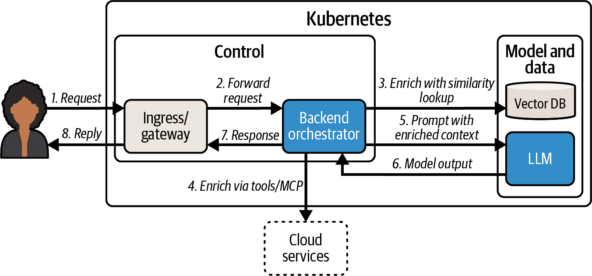

*图 8-1：典型的类聊天应用*

这种以聊天应用为代表的基于请求-响应的系统呈现出线性的交互流程。用户发出请求并等待响应。从用户的角度来看，该流程是同步的，即使后台发生了多个步骤。

在这样一个面向聊天的 AI 应用中，LLM 只是请求流程中的一个组件，而后端服务负责整体的对话逻辑。

单个用户查询的典型序列如下。对于各个组件，我们添加适当的 Kubernetes 工作负载类型（如 *Deployment*）：

1. *Gateway 或 Ingress* 将用户请求路由到后端服务（*Ingress*、*Gateway*）。
2. *AI 编排器*接收请求并控制聊天逻辑。它可能检索相关上下文（用于 `RAG`）、组装提示词，并调用 LLM 服务来生成补全。对于代理工作流，编排器可能会基于 LLM 的输出调用工具，这需要在循环中多次调用 LLM。该组件实现了聊天应用的“大脑”——例如，在其代码中使用 `LangChain` 等框架来管理提示词、记忆和工具使用。在第 274 页的“检索增强生成”和第 286 页的“代理工作流”中，我们将重点关注这个编排器组件，以及它如何被设计来交付价值（*Deployment*）。
3. *LLM 服务*执行推理并返回模型输出。编排器使用准备好的提示词调用此内部服务（或可能是外部 API，如 `OpenAI`），并等待结果。通过将 LLM 隔离在自己的服务中，我们可以独立于应用程序逻辑来扩展或更新模型。Kubernetes 管理员可能会使用 GPU 节点部署此服务，并使用自动扩缩容来处理可变负载。第 1 章介绍了如何部署和扩展模型服务器；这里我们看到它们被集成到一个应用中（*Deployment*）。
4. *状态管理*在数据库、缓存或向量存储中提供对话记忆或检索索引。此状态可以存储在数据库或缓存中，例如用于聊天历史的 `Redis` 或 `Postgres` 实例，或用于嵌入的向量存储。在 Kubernetes 上，这些有状态组件通常作为带有 `PersistentVolume` 的 `StatefulSet` 运行。编排器服务读取之前的消息或存储的向量以包含在上下文中（“检索”），在 LLM 响应后，它可能会将最新的用户查询和 LLM 回答保存到该存储中。在我们的 Kubernetes 映射中，该数据库或向量索引是一个长生命周期组件，你可以根据需要对其进行扩展或备份，如果需要高可用性，还可以进行复制（*StatefulSet*）。
5. *对客户端的响应*可能包括在发送回复之前进行后处理或最终工具调用。

这种模式让 LLM 专注于生成或推理，而应用则保留对数据访问、工具使用和副作用的控制。整个链路在单个同步请求周期内运行，这意味着低延迟是优先事项。为了满足服务级别目标（`SLO`）的要求（例如，每个响应亚秒级或几秒），Kubernetes 设置会让编排器和 LLM Pod 保持运行并就绪。可能会采用自动扩缩容等技术来处理突发流量，但你不必因启动时间而为每个请求从零启动这些服务。

面向用户的应用架构的一个好处是，它易于参与 `OAuth2` 等分布式身份验证工作流，这些工作流涉及将浏览器重定向到身份验证服务器。与处理后端服务相比，这使得安全设置更简单、更直接，如第 266 页的“后端 AI 服务”所述。

这种架构分离了关注点，使得对话逻辑（通常随着提示词和工具集成的演进而频繁更新）与 LLM 模型服务（只有在新模型或新版本可用时才会更改）解耦。数据库可以被视为很少变化的外部依赖。这种解耦意味着每个部分都可以独立升级——例如，部署一个具有改进提示词处理能力的编排器新版本，而无需触碰 LLM 部署或抹除任何已存储的数据。它还允许根据每个组件的使用情况进行扩展；例如，许多聊天会话主要给 LLM 和数据库带来负载，因此可以扩展它们，而编排器代码可能轻量且受计算限制，只需要较少的副本。

### 后端 AI 服务

第二种模式是一种互联性更强的微服务架构，其中由 LLM 驱动的服务作为更广泛系统的一部分运行，没有直接的用户界面，也不直接请求 LLM 服务。相反，LLM 逻辑由平台中其他服务的事件或调用触发。

图 8-2 展示了这种模式，一个 AI 驱动的后端服务在电商平台中执行订单风险分析，多个服务和存储被一起编排。在这个例子中，应用编排器从 *Orders*、*Payments* 和 *Catalog* 等服务接收订单事件（例如，检查产品可用性或可能表明可疑活动的定价变化）。然后，它调用一个 AI 风险分析器，该分析器使用 LLM、策略文本的向量存储以及历史案例来评估订单。分析器还可能调用领域工具，例如规则引擎或欺诈 API。最后，编排器将决策写入风险数据库，并为 *Fulfillment* 等下游服务发出事件。此后端可以通过服务调用同步实现，也可以在事件总线上异步实现。

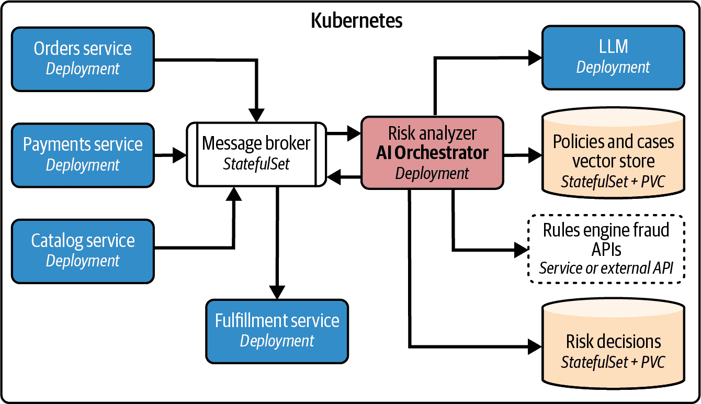

*图 8-2：事件驱动的 AI 服务*

在这种事件驱动架构中，AI 应用订阅事件，使用 LLM 执行多步骤分析，并将结果发送给其他服务：

1. *消息代理*接收来自业务服务的事件，如 `OrderPlaced` 或 `PaymentProcessed`。我们的 AI 编排器服务订阅相关事件。在 Kubernetes 中，这可以通过集群中运行的事件流平台或与外部总线的集成来完成。虽然 Kubernetes 本身不提供消息队列，但许多云原生系统为此在 K8s 上运行——或者你可能会使用 `Knative Eventing` 或 `Dapr` 发布/订阅组件。关键是 AI 服务是异步触发的，而不是通过 HTTP 请求（*StatefulSet*）。
2. *AI 编排器*在相关事件发生时被唤醒并做出相应反应。例如，在 `OrderPlaced` 事件发生时，此服务可能会从多个来源收集数据：获取订单详情、支付历史和相关的产品信息，然后调用 AI 风险分析器组件来评估欺诈风险。风险分析器本身可能涉及带上下文的 LLM 调用。在示例中，该服务使用 LLM 以及策略文档和历史欺诈案例的向量存储来评估订单。它还可能调用非 AI 工具——例如规则引擎或第三方欺诈检测 API——作为分析计划的一部分。这种编排可以被视为代理工作流（LLM 决定行动并调用工具），但被封装在单个微服务中（*Deployment*）。
3. *LLM 和工具服务*作为独立的部署或外部 API 运行。与聊天模式类似，LLM 通常是一个独立的部署（或外部 API），编排器在生成或推理步骤中调用它。用于检索的向量数据库（例如，存储欺诈案例或策略）是带有 `PersistentVolumeClaim`（`PVC`）的 `StatefulSet`，充当知识库以支持 LLM 的决策。任何领域特定的工具（如规则引擎）都可以是独立服务，通过它们自己的 API 访问。在某些情况下，工具甚至可以通过触发 Kubernetes 作业来实现——例如，如果你有一个可以异步运行的计算密集型数据处理步骤，编排器可以为其创建一个作业，然后稍后收集结果。然而，更常见的是这些工具只是对其他微服务的 HTTP/gRPC 调用。与第 263 页“聊天应用”中描述的线性模式的关键区别在于，这些调用不是直接由用户发起的，而是后端流程的一部分（*Deployment*）。
4. *状态输出*将决策持久化到数据存储中，并为下游服务发出新事件。在风险分析示例中，结果（批准/标记订单、风险评分等）被写入风险数据库（另一个用于持久化状态的 `StatefulSet`），并可能产生 `OrderFlagged` 等事件供下游服务（`Fulfillment`、`Notifications`）采取行动。这将 AI 决策转化为整个系统事件驱动架构的一部分。
5. *下游服务*做出相应反应，例如暂停履约或触发审核。从 Kubernetes 的角度来看，这些下游消费者只是处理事件的其他部署或作业。

这种架构遵循“思考-行动-观察”短循环模式。AI 服务接收输入事件，使用 LLM 进行规划并可能采取行动，更新状态，然后等待下一个输入。它实际上是微服务生态系统中的自主代理，但在定义的护栏内运行，并产生可审计的结果。AI 编排器部署可以横向扩展，如果事件负载可能很高，但如果事件需要按顺序处理，则可能需要进行协调。这种模式需要注意的一点是*幂等性*和*可靠性*。由于它是事件驱动的，通常希望 AI 服务能够优雅地处理重复事件或故障。对于可重试的任务，Kubernetes 作业在这里可能很有用，但如果我们的 AI 编排器部署崩溃或需要更新，消息队列可以缓冲事件，直到新 Pod 就绪。这种模式会以稍微增加延迟（事件会带来轻微延迟和最终一致性）为代价，换取更松散的耦合和更好的吞吐量扩展。它还可以更节省成本：AI 编排器只有在事件到达时才执行工作，甚至可以使用 `KEDA` 或 `Knative` 等框架将其缩容到零副本。

从发布的角度来看，这种模式通常涉及许多可以独立更新的移动部件，这与聊天应用模式非常相似。当业务逻辑或策略发生变化时，编排器代码可能会更新。当采用新模型或更优化的服务解决方案时（例如，从某个模型迁移到更大的模型，或切换到分布式服务方法以实现扩展），LLM 服务堆栈可能会发生变化。数据存储和消息代理也有各自的升级路径。在各组件之间设计清晰的接口（事件模式、API 契约）至关重要，这样你就可以在不破坏整个流水线的情况下升级某个服务——这再次呼应了传统微服务的最佳实践，只不过现在应用到了以 LLM 为核心的功能上。

这种 AI 后端微服务架构也有多种变体，它们并不像事件驱动方法那样与即时外部刺激相关联。

那些无头服务也可以自行异步运行，或作为更大后台工作流的一部分。这些变体包括计划任务、长时间运行的智能体循环或按需批处理任务。

#### 计划批处理作业

要启动数据摄取、夜间摘要或定期微调，可以使用 `CronJob` 来更新向量存储或派生工件。图 8-3 展示了一个使用 `CronJob` 启动摄取作业的简单设置。

我们在第 278 页“文档摄取”中描述的检索增强生成流水线的文档摄取阶段就是一个很好的例子：你可以使用 `CronJob` 定期处理新文档、生成嵌入并更新向量存储（而不是在请求路径中执行此操作）。这提高了效率，并保持了面向用户部分的快速响应。

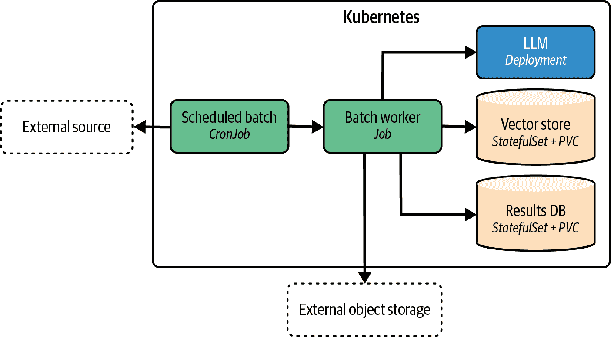

*图 8-3. 计划批处理作业*


典型的批处理作业序列如下：

1. *外部数据源*提供由 CronJob 拉取的数据集或工作列表。这可以是放入对象存储的文件、带有新数据的 API 端点，或简单的基于时间的触发器。

2. *CronJob* 按固定时间间隔（例如，每晚、每小时）调度批处理。CronJob 资源在指定时间创建作业实例。每个作业独立运行，并可配置重试策略和资源限制（*CronJob*）。

3. *批处理工作作业*执行处理逻辑。该作业可以运行一个批处理脚本，该脚本加载数据、调用 LLM（可能调用模型 API 或运行本地较小的模型）、写入结果（例如，写入文件或数据库），然后退出。因为没有用户等待，你可能会将这些作业安排到非高峰时段或较低优先级的节点上以降低成本。作业完成后释放资源（*Job*）。

4. *LLM 服务*按批处理工作器的请求执行推理。批处理作业调用与系统其他部分相同的 LLM 部署，确保模型服务的一致性（*Deployment*）。

5. *向量存储*保存批处理作业更新的嵌入或索引数据。例如，文档摄取作业生成嵌入并将其存储在此处，以便在查询时供后续检索使用（*StatefulSet + PVC*）。

6. *结果数据库*存储批处理的结果。这可以是下游系统可以查询的摘要、分类或其他派生数据（*StatefulSet + PVC*）。

7. *外部对象存储*可能接收批处理作业生成的报告、工件或文件。这些输出可以被其他系统使用或提供下载。

对于计划或触发的批处理作业，Kubernetes CronJob 和 Job 是自然的工作负载原语。它们提供故障重试、每次运行的日志以及每次运行的资源隔离。例如，你可以为夜间作业分配更大的内存或 GPU，而无需全天保持这种分配。

## 持续控制循环

作为基于时间触发器的替代方案，控制循环持续运行，监视特定条件或迭代处理任务。图 8-4 展示了这种轮询异步设置的一个示例。

例如，考虑第 298 页“环境智能体”中描述的智能体，它监视数据流（日志、社交媒体、物联网传感器读数），每当注意到异常或关键字时，它会使用 LLM 进行分析，并可能触发警报。与图 8-2 中列出的事件驱动微服务用例不同，该智能体可能会循环轮询工作（轮询来源或等待回调），而不是响应推送的事件。

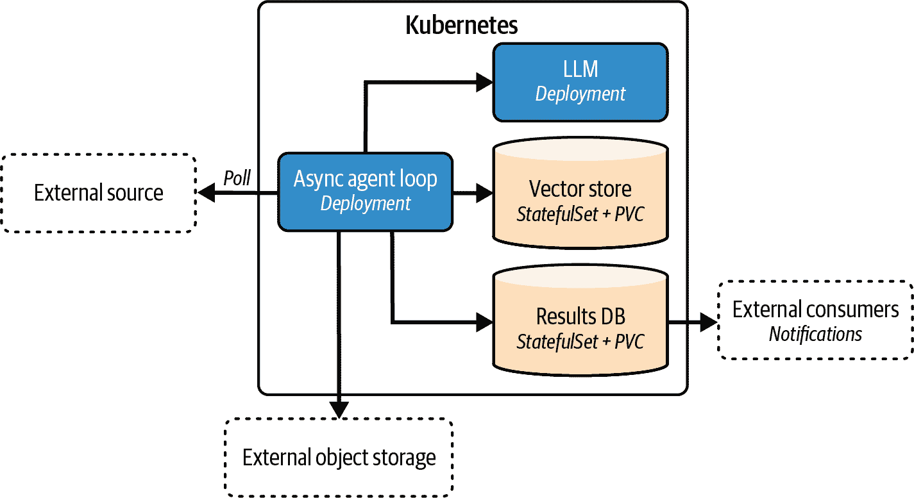

*图 8-4. 异步智能体*

持续控制循环架构的工作方式如下：

1. *外部数据源*提供智能体监视的数据或事件流。这可以是变更源、API 端点、日志流或智能体轮询新信息的任何外部来源。

2. *异步智能体循环*在部署中持续运行，轮询数据源并决定何时采取行动。该智能体可能作为单副本部署运行，本质上是循环：检查输入；如果有关注的内容，调用 LLM 或工具；产生输出；重复。这在概念上类似于 Kubernetes 控制器的工作方式（持续协调循环），区别在于这里的“控制器”可能在决策过程中使用 LLM。这样的智能体也可以以被动方式面向用户——例如，一个始终连接并在用户提到时回复的 Slack 机器人（*Deployment*）。

3. *LLM 服务*在智能体需要分析或生成内容时提供推理。智能体根据其观察到的数据按需调用 LLM（*Deployment*）。

4. *向量存储*保存智能体可能查询的嵌入或参考数据，例如策略文档、历史案例或知识库文章（*StatefulSet + PVC*）。

5. *结果数据库*存储智能体的决策、行动或观察。这提供了审计跟踪，并允许其他系统查询智能体做了什么（*StatefulSet + PVC*）。

6. *外部输出*可能包括智能体生成的工件、报告或文件。这些可以存储在对象存储中供以后检索。

7. *通知*或 *webhook* 允许智能体在采取行动时向外部系统发出警报，例如向监控系统发送警报或触发下游工作流。

对于常驻智能体，Kubernetes 工作负载类型的部署是合适的。你可能只需要一个副本，但仍能获得自动重启等好处。如果智能体不应运行多个副本，可以结合领导者选举逻辑或使用*单例*模式。一种简单的方法是将其作为副本数为 1 的部署运行，并确保不做自动缩放。另一种方法是使用大小为 1 的 StatefulSet，尽管其主要优势（稳定的网络身份）对于此类智能体通常不是必需的。你可以在*Kubernetes Patterns* 中找到更多单例策略。

## 多步骤工具自动化

异步工作流也可用于在没有人工干预的情况下完成复杂的多步骤目标。图 8-5 展示了一个规划并执行一系列动作的多步骤智能体。

例如，一个智能体（agent）可能被分配任务，负责生成并发送每周摘要邮件。一旦触发，它会规划以下步骤：查询数据库，请求 LLM 总结关键要点，可能通过绘图工具生成图表，然后通过简单邮件传输协议（SMTP）服务发送邮件。

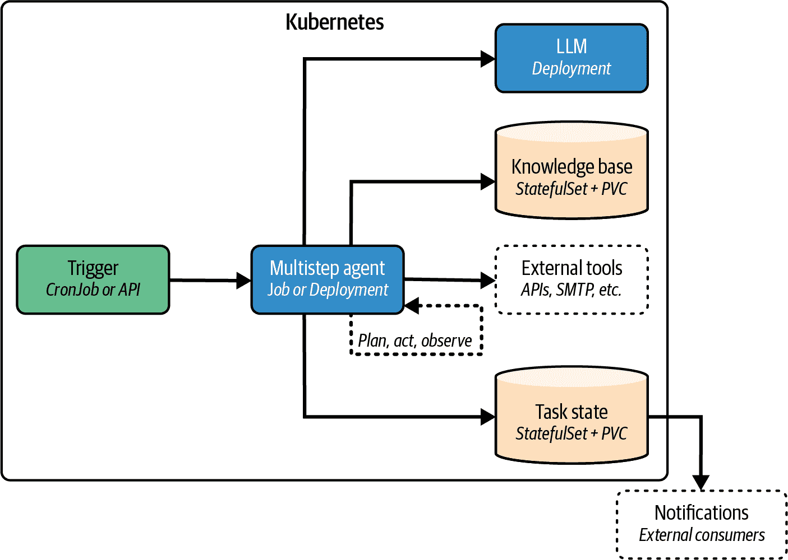

*图 8-5. 多步骤工具自动化*

多步骤自动化序列的工作原理如下：

1. *触发器*启动多步骤工作流。触发器可以是用于定时任务（如周报）的 CronJob，也可以是用于按需执行的 API 调用。触发器启动智能体的执行。

2. *多步骤智能体*使用“计划-行动-观察”（plan-act-observe）循环来编排整个工作流。智能体在内部维护自己的计划进度状态。它迭代地决定下一步行动、执行该行动、观察结果并更新计划。这可以实现为一个封装所有步骤的作业（Job）（其中包含用于智能体规划的内部循环），也可以实现为一个在任务期间运行的临时部署（Deployment）（不过对于运行到完成逻辑，作业更简单）（*Job* 或 *Deployment*）。

3. *LLM 服务*提供推理和生成能力。智能体在执行过程中多次调用 LLM：用于生成初始计划、生成内容（如摘要），或根据观察结果决定下一步行动（*Deployment*）。

4. *知识库*（向量存储）提供上下文和参考信息。智能体可以查询知识库来为决策提供依据，或检索相关信息（*StatefulSet + PVC*）。

5. *外部工具*使智能体能够与外部世界交互。这些工具可以包括要查询的数据库、用于生成图表的绘图库、用于发送邮件的 SMTP 服务，或者智能体完成目标所需的任何其他 API。第 286 页“智能体工作流”中讨论的 ReAct 模式和多智能体协调也属于这一类——它们是编排服务中的应用程序级控制流。

6. *任务状态数据库*跟踪智能体的进度和决策。它提供智能体行为的审计跟踪，并在智能体需要重启时允许恢复（*StatefulSet + PVC*）。

7. *通知/外部消费者*接收最终输出或状态更新。智能体可以在工作流完成或遇到问题时通知外部系统。

关键特征在于，这些智能体并不映射到特定的 Kubernetes 资源类型——你会在 Deployment 或 Job 工作负载中运行它们。在架构上，你必须决定每个多步骤进程是同步运行（保持用户请求打开）还是异步运行（在请求路径之外）。通常，长时间运行的多步骤智能体更安全的做法是异步运行，完成后通知用户或系统。

异步模式让你在资源使用上更加灵活。如果某项任务不紧急，你可以以较低优先级或在有可用容量时运行它。例如，如果使用 Spot 实例或空闲周期，你可以将非关键的 LLM 任务安排在那里。相反，如果常驻智能体很关键（例如监控安全入侵），你应该像对待任何重要服务一样对待它：确保其高可用且速度足够快，这可能意味着专门用一个 Pod 来在内存中保持加载 LLM 模型。始终在线的智能体会产生持续成本，因为 Pod 持续运行，而事件触发的任务只在每次使用时产生成本——这是成本效率与响应速度之间的经典权衡。我们需要有意地设置这些生命周期边界：哪些进程可以按需启动（以节省成本），哪些必须预热并等待（以满足延迟目标）。

现在我们已经介绍了设计 AI 增强应用程序的常见架构选择，接下来让我们关注 AI 编排器（AI Orchestrator）组件，它是任何 AI 应用架构的核心。为此，我们将重新审视这些常见概念，首先从一种让 LLM 以你的领域数据为基础的技术开始。

## 检索增强生成

检索增强生成（RAG）是一种设计模式，它通过在推理时获取相关信息并将其包含在提示词中，使 LLM 的输出以外部数据为依据。我们不只依赖模型固定的训练数据，而是在问答过程中给模型“一本打开的书”。结果是减少了幻觉，并且答案能够反映最新的、领域特定的知识，即使基础模型的训练数据已经过时。我们在第 6 章中简要介绍了 RAG，将其作为模型定制的一种替代方案；这里我们更深入地探讨它在 Kubernetes 上的实现。

将 RAG 与我们在第 6 章中讨论过的微调进行对比会有所帮助。微调通过更新模型权重来向模型传授新信息，非常适合希望嵌入模型的风格、语气或稳定的领域模式。然而，微调需要大量资源且速度缓慢，而且每当有新数据时都必须重复进行。RAG 通过在查询时注入知识来绕开重新训练。你用新文档更新向量数据库，下一次用户查询就可以立即检索并使用该信息。这使得 RAG 对动态知识库或快速变化的内容非常灵活，这也是它在企业中受欢迎的重要原因。

RAG 和模型微调是互补的，而不是互斥的。如果你拥有很少变化的核心知识，较小的微调模型可以将这些基础知识固化到模型中并减小提示词大小。与此同时，RAG 提供模型内置知识之外的当前或用户特定数据。如第 5 章所述，大的上下文窗口会带来内存和延迟成本，因此最小化提示词大小是有益的。在实践中，许多团队将两者结合：将长期有效的知识固化到微调模型中，并使用 RAG 获取动态或用户特定的事实。通过微调将静态知识卸载到模型中，并通过 RAG 只引入相关事实，你可以在准确性和效率之间取得平衡。

关键在于，RAG 可以与任何基础模型配合使用，无论原始模型还是微调模型，因为它纯粹通过提示词接口运作。所有基于提示词的技术，如 RAG 或工具使用，都可以与微调模型作为 LLM 后端兼容。

RAG 有两个不同的阶段，如图 8-6 所示。摄取阶段为检索准备知识：

- *文档摄取*：通过解析、分块、嵌入并将文档存储在向量数据库中来准备领域文档，如第 278 页“文档摄取”所述。

- *用户查询处理*：对用户提示词进行嵌入，检索相似分块，可选地重排序，并组装最终提示词传递给 LLM，如第 281 页“用户查询处理”所述。

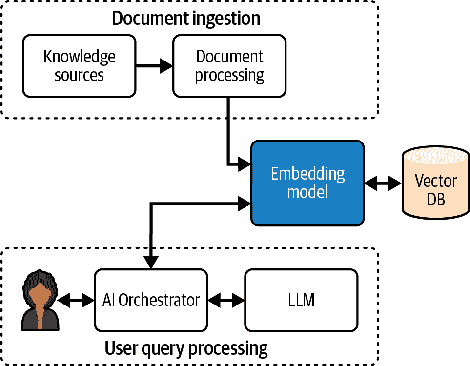

*图 8-6. RAG 的两个阶段：文档摄取与用户查询处理*

RAG 设置由多个协作组件组成。在我们了解这些组件如何在 Kubernetes 上运行之前，先来看看它们的职责。

### RAG 组件

典型的 RAG 架构由不同的服务组成，这些服务很好地映射到微服务边界。图 6-2 和图 8-6 展示了 RAG 流水线及其核心构建块的概览。这里我们将逐一仔细查看这些组件，然后在第 283 页“Kubernetes 上的 RAG”中将它们映射到合适的 Kubernetes 工作负载类型。

RAG 设置中包含以下组件：

- *向量数据库*：一种专门用于高维向量的数据存储，也称为*嵌入*（embeddings）。向量数据库以向量形式保存你的知识库，支持快速的最近邻搜索。它返回与给定查询向量最相似的文档或片段。第 277 页“向量数据库速览”提供了更多关于向量数据库的细节和指引。在 RAG 系统中，向量数据库是我们查询相关上下文的“记忆”。

#### 嵌入模型

该模型在摄取期间和查询时将文本或其他模态转换为嵌入向量。在文档摄取期间，嵌入模型将每个文档或文档块转换为数值向量，然后存储在向量数据库中。在查询时，同一个嵌入模型将用户的查询转换为向量，这样我们就可以通过查找与查询向量接近的其他嵌入向量来搜索相似文档。

这些嵌入的质量直接影响检索相关性。这里的质量指的是语义相似的文档映射到高维向量空间中彼此接近的向量。你可以使用开源的句子转换器、专有 API（例如 OpenAI 嵌入），甚至 LLM 自身的嵌入能力（如果有的话）。关键在于索引和查询使用*同一个嵌入模型*。请注意，嵌入模型可以不同于你用于生成的 LLM；许多生产级 RAG 系统使用专门的小型嵌入模型进行检索，并使用另一个通常更大的 LLM 来生成回答。一致性是关键：如果你更新或更换嵌入模型，很可能需要重新嵌入文档以保持搜索准确性。

#### 重排序器

这是一个可选组件，用于提高检索结果的相关性。通常，重排序器是一个第二阶段模型或启发式方法，它接收向量搜索的初始结果集，并根据这些结果对回答查询的可能有用程度进行排序或过滤。例如，一个简单的方法可以按相似度分数或文档元数据（如时效性或来源可信度）进行排序。更高级的设置使用交叉编码器模型，甚至 LLM 本身，来在问题的上下文中对每个候选片段进行评分。引入重排序器可以提升回答质量，确保只有最相关的信息片段进入最终提示词。代价是额外的复杂性和延迟，因此是否使用重排序器取决于你的应用需求。

#### AI 编排器

AI 编排器是 RAG 系统的粘合剂。正如我们在第 262 页的“架构模式”中所看到的，这个核心角色在所有 AI 驱动的应用中都很常见。它处理整个查询工作流。当用户请求到达时，AI 编排器负责调用嵌入模型对查询进行嵌入，执行向量数据库相似性搜索，可选地调用重排序器来优化结果，用检索到的文本构建增强提示词，调用 LLM 服务获取回答，并进行后处理，然后返回结果。AI 编排器可以是你编写的自定义 REST API 服务、诸如 Llama Stack 之类的 API 层，或者像 LangChain 这样管理调用链的本地 AI 框架。AI 编排器还经常实现特定于应用的规则或护栏，例如处理找不到相关文档的情况，或强制必须包含某些数据源。AI 编排器还可以实现*来源归属*，跟踪哪些文档块被用于生成回答，并返回指向原始源文档的链接或 ID。这种引文跟踪增强了透明度，并允许用户验证信息，典型做法是在检索和排序阶段保留块元数据（URL、标题、时间戳），并将其以脚注、行内引文或参考文献列表的形式包含在最终回答中。

#### LLM 服务

最后，LLM 本身是为最终用户生成回答的组件。LLM 接收编排器组装好的提示词（包括用户的问题加上检索到的上下文），并生成补全。在 RAG 设置中，LLM 的工作被限制为生成。它不需要在内部拥有所有知识；相反，它依赖提供的上下文获取事实。该服务可以是运行在集群中的模型部署，如我们在第 1 章中所述，也可以是对外部 API（如 OpenAI）的调用。LLM 服务应像任何其他依赖服务一样对待：你向它发送请求并收到响应，然后 AI 编排器将该响应交付给用户，通常会进行一些格式化或验证。

## 向量数据库简述

向量数据库（也称为向量存储）专门用于快速相似性搜索，使 RAG 流水线能够获取与用户查询最相似的文档块，并将其传递给 LLM。文档和查询通过嵌入模型映射到高维空间中的单个向量，语义上相近的向量彼此靠近，相似度通常用余弦相似度来评分。

余弦相似度衡量两个向量在同一方向上的程度。在二维空间中，你可以想象从原点出发的两条箭头形成一个夹角 theta，余弦相似度就是该夹角的余弦：方向相同时为 1.0，垂直时为 0.0，方向相反时为 –1.0。这种对方向的关注对文本嵌入很有用，因为缩放向量不会改变其含义，而方向保留了语义。

混合搜索将稠密向量匹配与 BM25 等词法排序相结合，从而同时捕获语义相关性和精确词元信号。引擎通常会对分数进行融合，或运行带有可选重排序器的两阶段流水线，这尤其有助于处理稀有词项、标识符和精确短语，同时保持较高的语义召回率。

现代系统使用近似最近邻索引加速搜索，并添加过滤、持久化和分布式能力，以满足生产环境 SLA。

在推荐系统和多媒体去重中，向量搜索早于 LLM 出现，而 HNSW 图和 FAISS 等突破通过牺牲完美准确性换取速度，使数十亿规模的相似性搜索变得切实可行。这些算法返回近似正确的结果，而不是保证精确的最近邻。

常用的向量数据库选择包括开源数据库（如 Milvus、Weaviate 和 Qdrant）、托管服务 Pinecone、通过 pgvector 在 PostgreSQL 中实现向量功能，以及通过稠密向量在 Elasticsearch 中实现向量功能。

这些组件协同工作以实现 RAG。重要的是，它们很好地映射到微服务边界，这对我们稍后在 Kubernetes 上部署很有用。例如，向量数据库可以是一个服务，LLM 是另一个服务，依此类推，允许每个服务独立扩展或管理。在进入部署之前，让我们先了解一下 RAG 流水线的两个不同阶段：*文档摄取*和*用户查询处理*。理解这两个流程将使我们更清楚地了解如何构建和运维 RAG 系统。

## 文档摄取

文档摄取是一个离线过程，用于准备外部数据，使其可用于检索。在这个阶段，我们获取原始文档并将其转换为存储在向量数据库中的嵌入。可以把它看作是构建应用程序稍后要查询的知识索引。该过程可以在前期进行，例如在应用上线前对大量公司文档进行索引，也可以随着新数据的到来持续进行。

摄取流水线异步运行，独立于用户查询处理。摄取与查询处理之间没有阻塞关系——用户可以在摄取作业运行时查询向量数据库，并且一旦新文档的嵌入写入存储，它们立即可用于检索。在 Kubernetes 中，你将摄取实现为 Jobs 或 CronJobs，以批量处理文档。在每个摄取作业中，处理步骤（解析、分块、嵌入、存储）为了简单起见可以在单个容器中顺序运行，也可以在需要高吞吐量时使用消息队列分发到多个 worker pod 上。流水线将结果增量写入向量数据库，使新索引的文档立即可搜索，而无需等待整个批次完成。

一个典型的摄取流水线涉及几个步骤，如图 8-7 所示。

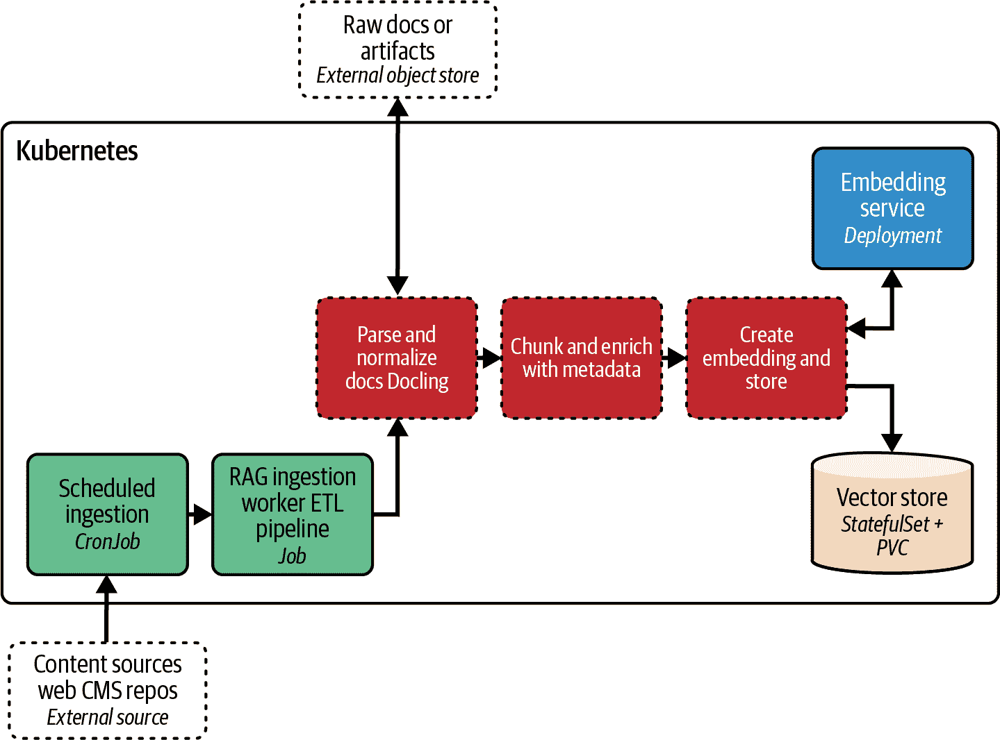

*图 8-7：RAG 文档摄取*

具体来说，步骤如下：

- *收集并解析文档*

首先，收集你希望提供给 LLM 的源数据。这些数据可以是文本文件、PDF、数据库记录、网页或转录文本，你需要将每个文档解析为纯文本。这一步通常涉及使用自定义代码或库从各种格式中提取文本。Docling 就是这样一个工具，它是一个为 AI 工作流设计的开源文档解析框架，能够摄取 PDF、Word 文件、HTML 或扫描图像等异构来源，并将其转换为结构化、机器可读的文本，同时保留标题或页码等元数据。对于 RAG 摄取而言，一致的结构化输出可以降低预处理的复杂性。

- *分块与预处理*


# 文档分块与嵌入

将整个文档作为一个整体进行嵌入通常并非理想做法，因为文档可能很长或涉及多个主题。因此，文档通常会被拆分为大小适中的块，使每个块主题连贯，并且能够与问题一起放入 LLM 的提示词中。你可以按段落或标题进行拆分，也可以使用更高级的策略，如语义分块或句边界分块，以避免在语义中途切断上下文。

如果使用 Docling，你可以直接从文档结构中派生分块，而不是使用任意窗口，因为 Docling 将句子、段落、章节标题、表格和标题说明作为一等公民暴露出来。Docling 允许你按句子、段落、标题对齐的章节或语义分组来选择分块器，并支持重叠和最大尺寸控制，以便在召回率与提示词预算之间进行权衡。它还为每个分块输出稳定的标识符和清晰的元数据模式——例如来源、时间戳、版本、章节和页码——从而保留来源信息，并在查询时实现精确过滤。

不同的分块策略适用于不同的意图：较小的句子级分块适合 FAQ 式查找，而较大的标题对齐段落则更适合需要更广泛上下文的政策或手册。生命周期管理包括在文档变更时使其失效或重新嵌入文档，确保向量存储始终保持一致。元数据可以包括源文档标题、日期、作者、章节标题，或任何日后可能用于过滤或让模型识别来源的标签。

## 嵌入分块

接下来，使用嵌入模型将每个文本块转换为数值向量，该模型通常会产生一个高维向量。例如，你可以使用 sentence transformers 模型 `all-MiniLM-L6-v2`，或调用托管 API，如 OpenAI 的 `text-embedding-ada-002`。这一步会为每个文本块生成一个向量表示。如第 275 页的“RAG 组件”所述，索引和查询时应使用相同的嵌入模型。

在实践中，你可以分批运行此步骤——例如，一次嵌入 1,000 个块——以利用 GPU 或并行处理加快速度。有关嵌入及其如何将语义表示为向量的更多背景，请参阅第 xxviii 页的“嵌入”部分。

## 将向量存储到数据库中

最后，将每个向量及其标识符和元数据插入向量数据库。标识符链接回原始文档或分块，以便你可以检索或显示源文本。元数据可以包含分块的原始文本，或从内容存储中获取该文本的引用。有些设计只存储 ID 并按需获取文本，而另一些设计则直接存储文本负载以加快检索；请根据延迟和存储之间的权衡进行选择。完成此步骤后，向量数据库中便填充了代表你知识库的向量，并准备好回答相似性查询。

为了更具体地说明，假设你正在为电商平台构建一个支持聊天机器人。你的源数据可能包括 FAQ 页面、产品手册、退货政策和故障排除指南。在摄取过程中，你将 PDF 和 HTML 转换为文本，按章节分块，嵌入每个分块，并存储带有元数据的向量，例如来源：`Product Manual X` 和 `section: 2.1 Installation`。摄取完成后，你的向量存储可能包含数万个向量，每个向量代表你文档中的一条知识。

值得注意的是，摄取可以是持续进行的。在 RAG 系统中，你需要一种策略来保持向量索引的最新状态。`Kubernetes CronJob` 可以定期获取新增或变更的文档，生成嵌入并执行 upsert（更新或插入）操作，你也可以在文档发生变化时触发事件驱动的重新索引，使存储随数据一同演进。从运维的角度来看，关键在于：向量数据库的内容不是静态的——它应随数据一同演进，你的平台应包含必要的任务或流程来管理这种演进。

现在，文档分块已存入向量数据库，接下来我们看看如何使用相似性查询来组装用于回答的 RAG 上下文。

# 用户查询处理

向量数据库加载知识后，RAG 系统就可以服务用户查询。每当有新的问题或请求到来时，查询处理流水线就会运行。它的任务是为该查询获取最相关的知识片段，将其整合到 LLM 的提示词中，并返回模型的答案。让我们分解一下这个推理阶段流水线的各个步骤。

图 8-8 展示了用户查询处理流水线的各个组件。

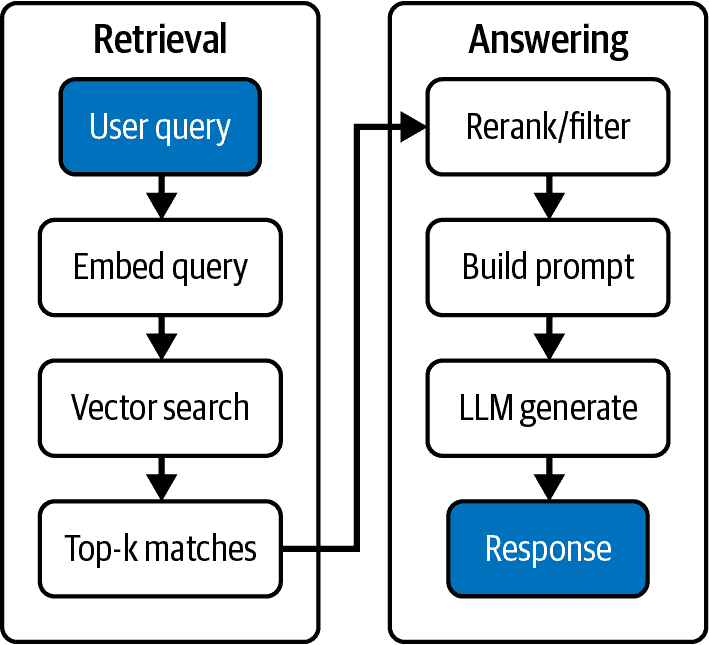

*图 8-8：RAG 用户查询处理流水线*

以下是用户查询处理流水线的各个组件：

## 用户查询到达

用户或上游服务提出一个问题或请求，交由 LLM 处理，例如“如何重置我的设备？”。该查询到达应用程序的 API，随后由编排器组件接管。

## 嵌入查询

编排器使用与摄取阶段相同的嵌入模型，将用户的查询编码为向量。这通常是一项快速操作，生成的查询嵌入与文档嵌入处于同一向量空间中。

## 向量搜索相关文档

编排器使用查询嵌入在向量数据库中进行相似性搜索。存储会按余弦相似度或距离返回 top-k 最近邻结果，通常还会附带元数据，以及（取决于配置）所存储的文本负载。你可以应用元数据过滤器，或使用带有词法评分器的混合检索，在保持语义召回的同时捕获稀有术语、标识符或精确短语。

## 重排或过滤结果

可选地，重排器会在查询上下文中对每个检索到的分块进行评分，以便你只保留提示词预算内最好的几个结果。最小相似度阈值或近期加权等简单启发式方法也很有帮助，而且在延迟预算紧张时，许多系统仅靠向量搜索就能表现良好。到这一步结束时，你会得到一小批可用于增强提示词的上下文片段。

## 使用检索到的上下文构建提示词

编排器准备最终提示词，将检索到的文本和问题插入到模板中。示例 8-1 展示了这样一个模板。提示词的具体措辞以及上下文的呈现方式可以根据需要进行调整。关键在于，我们通过向模型提供可供参考的事实，使模型能够据此作答，例如手册中包含重置步骤的段落。在我们的示例中，上下文可能包括手册中关于重置的段落，其中包含具体步骤。

*示例 8-1：根据 RAG 文档构建提示词的示例模板*

```text
Use the following context to answer the question.
If the context doesn't have the answer,
say you don't know.
Context:
{retrieved_text}
Question: {user_question}
Answer:
```

占位符 `{retrieved_text}` 替换为从向量存储中检索到的文档。参数 `{user_question}` 替换为实际的用户查询。

## LLM 生成答案

编排器通过 API 调用模型推理服务器，将组合后的提示词发送给 LLM 服务。LLM 处理提示词并生成补全内容——在此示例中，希望是一个分步回答，解释如何重置设备，并基于提供的上下文生成。由于我们包含了相关片段，模型无需编造事实；只需用自然语言清晰表述答案。我们的示例输出可能类似于：“要重置设备，**首先**按住电源按钮 10 秒直到 LED 闪烁”，这既对应了文档内容，又由 LLM 生成。

## 后处理并返回响应

编排器在将模型输出返回给调用方之前对其进行后处理。典型步骤包括格式化、附加来自元数据的来源引用、执行安全护栏以及按大小限制截断。最终答案通过 API 或 UI 返回。

从用户的角度来看，这条流水线是隐形的：他们只会得到一个引用了正确信息的有用答案。向量搜索通常足够快，因此延迟主要由 LLM 生成决定，所以实现良好的 RAG 流水线仍然感觉像是实时的。如果没有找到强相关的上下文，AI 编排器应该优雅地放弃回答，而不是冒险产生幻觉答案。有了这些步骤，LLM 的响应便以你的知识库为依据，并始终与最新事实保持一致。

# 在 Kubernetes 上运行 RAG

让我们将第 275 页“RAG 组件”中的各个组件映射到 Kubernetes 上，并展示如何将它们作为一个生产级系统来运行。生产级 RAG 栈是一组相互协作的服务，具有各自不同的生命周期和 SLO（服务级别目标），它们可以很好地适配 `Deployment`、`StatefulSet`、`Service` 和 `Job` 等 Kubernetes 资源。Kubernetes 允许你独立扩展每个部分、安全地发布更新，并在不同环境中标准化配置和安全策略。

表 8-1 快速概览了各类 RAG 特定组件、它们对应的 K8s 工作负载类型以及预期的资源需求。

**表 8-1. 在 Kubernetes 中部署的 RAG 组件概览**

| 组件 | K8s 原语 | 类型 | 资源 | 存储 |
|---|---|---|---|---|
| 向量数据库 | `StatefulSet` + `PVC` | 有状态 | 高内存/CPU，快速卷 | 持久卷 |
| Embedding | `Deployment` / `Sidecar` / 进程内 | 无状态 | 轻量模型使用 CPU；GPU 可选 | 无 |
| 编排器/API | `Deployment` + `Service` (+ `Ingress`) | 无状态 | CPU 和中等内存 | 无 |
| 数据摄入 | `CronJob` / `Job` | 批处理 | CPU，GPU 可选 | 读写向量存储 |

现在，让我们更深入地考察 Kubernetes 对每个组件的支持，并在合适的地方指出与《Kubernetes 模式》中相关模式的对应关系：

## 向量数据库

向量存储是检索的骨干。在 Kubernetes 上，它应放入 `StatefulSet`，并为每个副本配置 `PersistentVolumeClaim`，这样分片具有稳定的身份，数据也能在重启后持久保存。如果厂商提供了 operator，应加以采用，以便将集群的搭建和升级封装起来；同时要合理规划内存，让热索引常驻内存，并启用近似最近邻（ANN）索引以支持扩展。通过集群内部服务暴露它，并使用 `NetworkPolicy` 限制哪些 Pod 可以连接，然后像对待任何关键数据库一样进行快照和经过验证的恢复。这直接对应到*有状态服务*和*服务发现*模式。

## Embedding 服务

根据性能和运维需求，Embedding 模型可以有多种部署方式。最常见的生产环境做法是通过一个轻量级模型服务器提供 Embedding，并将其打包为 `Deployment`，这样你可以独立扩展它，并按需分配 CPU 或 GPU 资源。对于小型、高效的模型，直接在编排器进程内执行嵌入可能更简单，这样可以避免一次网络跳转，并保持低延迟。折中的做法是在编排器 Pod 中以 sidecar 方式运行，使其与主容器共享生命周期，同时又能独立管理模型版本，如图 8-9 所示。

关键在于摄入时和查询时的编码要保持一致；当你需要一个本地辅助组件、又不想与构建耦合时，*Sidecar* 模式非常合适。有些数据库可以在写入或查询时在数据库内部生成嵌入；例如，Weaviate 的 vectorizer 模块可以在写操作和查询时嵌入，而带 `pgvector` 的 Postgres 可以通过 SQL 触发器和扩展实现自动嵌入。这样可以让摄入和检索的编码器保持一致，但会增加数据库与模型选择之间的耦合。无论采用哪种模式，确保在摄入和查询时使用同一个 Embedding 模型和配置至关重要。

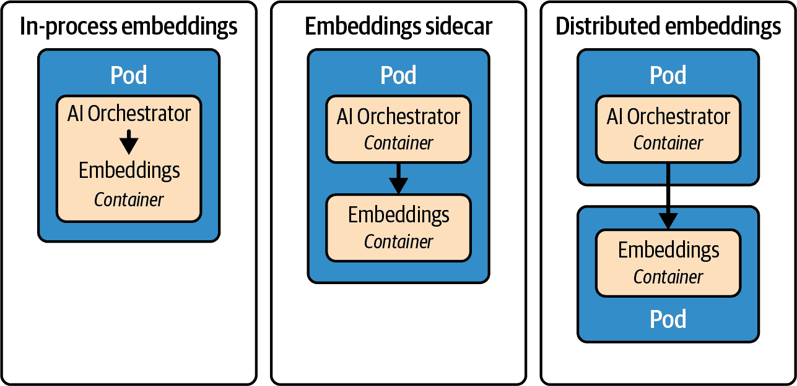

*图 8-9. 部署 Embedding 服务的多种方式*

## AI 编排器

编排器是“大脑”，负责对查询编码、检索、可选的重排序、构造提示词并调用 LLM，因此应以无状态 `Deployment` 运行，并通过 `ClusterIP` `Service` 暴露；如果面向最终用户，则通过 `Ingress` 或 API 网关暴露。由于编排器需要协调多个依赖，应进行仔细的监控埋点：在调用之间传播追踪上下文，以便度量端到端延迟并识别瓶颈。提示词模板、阈值或检索参数等配置应放在 `ConfigMap` 中，这样无需修改代码即可调整。凭据应通过 `Secret` 挂载以保障安全。*安全配置*模式提供了更多关于如何加固 `Secret` 配置的信息。

对于稳定负载，可使用水平 Pod 自动扩缩器（HPA）进行扩缩；当需要事件驱动的突发流量或空闲路径的 scale-to-zero 时，可使用 Knative 或 KEDA。请参阅*弹性伸缩*模式，了解 Knative 和 KEDA 如何支持向上和向下扩缩，包括扩缩到零。

## 重排序器（可选）

如果精度很重要，可以将 cross-encoder 或更重的重排序器作为一个独立的 `Deployment` 运行，并有选择地对高价值查询进行调用，以平衡成本和延迟。简单的启发式方法可以留在编排器中，但独立服务可以让你单独调整资源和发布节奏，遵循*无状态服务*模式。将重排序器保持为可选，可以平衡成本和质量，让你在面对高价值查询时启用它，同时让大多数流量通过更快的路径。

## 批量摄入作业

文档摄入不是一次性事件，而是一个持续进行的过程，Kubernetes 非常适合在后台运行这类任务。你可以使用 `CronJob` 来调度摄入任务，定期抓取新的或更新的源；对其进行解析、分块和嵌入，然后将结果 upsert 到向量数据库中。对于近实时的流水线，可以由文件上传或数据库更新触发事件驱动的作业。文档摄入也很适合建模为 Knative Eventing 所提供的 Event Mesh 中的一个端点。

要设置资源请求和限制，以免摄入工作负载挤占面向用户的服务资源；如果需要更严格的隔离，可以拆分命名空间或节点池。将摄入任务视为一等工作负载，并配以监控和重试，可以确保向量数据库保持最新，使 RAG 系统反映领域的最新状态。技术细节可参阅*批处理作业*和*周期作业*模式。

通过 RAG，我们了解了如何让 LLM 基于可信知识进行生成，并如何在 Kubernetes 上运维其支撑组件。现在，我们转向代理式（agentic）工作流。在这种工作流中，模型不仅消费上下文，还会规划行动、选择工具，并在“思考-行动-观察”的短循环中反复迭代，直至达成目标。

# 代理式工作流

代理式应用将模型的推理调用封装在一个小型控制循环中，该循环可以规划、调用工具、观察结果，并反复迭代直到达成目标。

通常，控制循环如图 8-10 所示，包含以下步骤：

- **感知**：读取新的信号：用户输入、工具输出和对话状态。
- **思考**：规划下一步，判断是否需要工具，并构建下一轮提示词。
- **行动**：执行动作：调用工具、运行代码、获取数据或草拟候选答案。
- **观察**：捕获工具结果或用户的后续反馈，并将其规范化为工作上下文。
- **反思**：对照目标检查进度，修订计划，并决定停止还是继续。
- **记忆**：将短期草稿项和长期事实存储到外部记忆中。

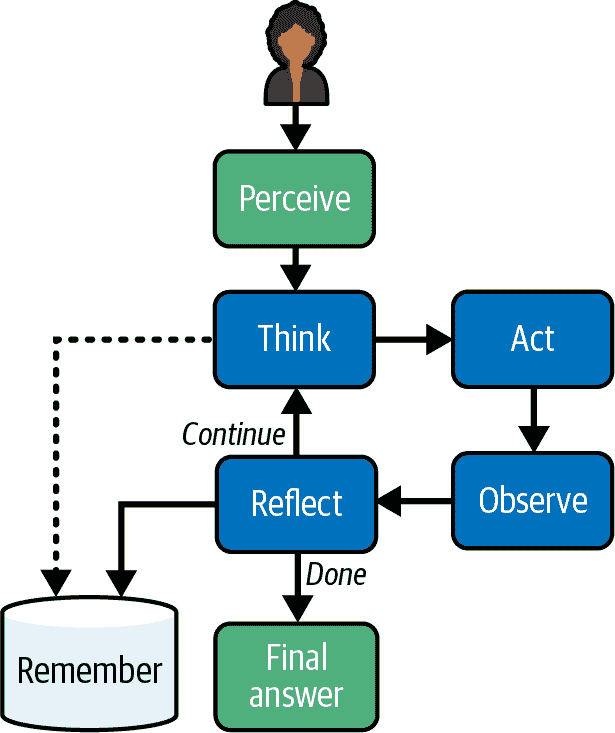

*图 8-10. 代理控制循环*

此流程是对著名的*ReAct循环*的优化，我们将在下面的侧边栏中对其进行描述。该循环适用于简单代理，并为更复杂场景（如第 295 页“多代理系统”中所述的*多代理*以及第 298 页“环境代理”中探讨的*环境代理*）奠定了基础。

# ReAct 循环

ReAct 模式将*思维链* (CoT) 推理与工具操作交织在一起，使模型能够在一个紧凑的循环中进行思考、行动、观察和重复。ReAct 最初由 Yao 等人在论文“ReAct: 在语言模型中协同推理与行动”中提出，证明当模型能够在推理和调用外部资源（如搜索 API）之间交替时，可以减少幻觉并提高成功率。

在 ReAct 代理中，LLM 会输出中间思考过程，并在需要时输出带有 JSON 参数的操作；工具执行后，观察结果会附加到上下文中，模型会继续运行，直到满足停止条件。在生产环境中，您不会向用户展示 CoT——您会将追踪信息保留在内部或用摘要替换它们——但控制流程保持不变。将每个思考、操作和观察记录为结构化记录，以便日后调试行为并将成本与质量相关联。

现在，我们暂时聚焦于代理控制循环中的*行动*部分，因为这是关键步骤，它允许引入模型训练数据中不包含的信息（无论是因过于新颖还是领域特有的信息，导致无法用于模型训练）。这些操作通常被称为*工具*，可以是任何形式，从简单的网络搜索到 API 调用，再到企业内部的中间件服务。工具的使用有两条可以在一个工作流中混合的执行路径：

## 客户端执行的功能工具

模型发出带有 JSON 参数的功能调用；您的客户端代码执行该操作并将结果（以 `call_id` 作为关联标识）回传。这是在控制平面中实现细粒度控制和审计的可移植基线。示例 8-2 展示了请求-响应流程，其中服务器响应指示客户端调用其侧的工具然后将结果发送回服务器。这种多步骤交互要求代理流程为*有状态*的，以便保留对话历史记录。由于每个代理框架对工具调用请求的格式预期都不同，因此客户端工具调用相当脆弱。

## 服务端执行工具

代理运行时（例如 LangChain、CrewAI 或类似的框架）会代表您执行工具，包括远程模型上下文协议服务器。我们将在第 303 页的“模型上下文协议”中深入探讨该标准，因为它是当今工具交互的事实标准。与客户端工具调用相比，MCP 能更好地将领域知识集成到代理流程中。目前，只需了解 MCP 是一种在服务端大幅简化工具调用和发现的协议即可。

**示例 8-2　使用 OpenAI Responses API 进行客户端函数调用**


# 初始请求，包含可用工具描述

```
curl https://api.openai.com/v1/responses \
  -d '{
    "input": [
      {"role": "user", "content": "今天在柏林我需要带伞吗?"}
    ],
    "tools": [
      {
        "type": "function",
        "name": "get_weather",
        "description": "获取指定城市和ISO日期的天气信息。",
        "parameters": {
          "type": "object",
          "properties": {
            "city": { "type": "string" },
            "date": { "type": "string", "format": "date" }
          },
          "required": ["city", "date"],
          "additionalProperties": false
        },
        "strict": true
      }
    ],
    "tool_choice": "auto"
  }'
```

# 返回响应的一部分，请求客户端执行工具调用

```
{
  ...
  "output": [
    ...,
    {
      "type": "function_call",
      "call_id": "call_wx_1",
      "name": "get_weather",
      "arguments": "{\"city\":\"Berlin\",\"date\":\"2025-09-20\"}"
    }
  ],
  "status": "incomplete"
}
```

# 第二个客户端请求的一部分，包含工具调用结果

```
curl https://api.openai.com/v1/responses \
  ...
  -d '{
    "input": [
      ...,
      {
        "type": "function_call_output",
        "call_id": "call_wx_1",
        "output": "{\"precipitation_chance\":0.80, \"summary\":\"预计下午有大雨。\"}"
      }
    ]
  }'
```

- 初始用户查询。
- 客户端工具的声明。
- 服务器响应，请求客户端调用工具。
- 用于关联工具调用响应与其请求的关联ID。
- 返回工具调用结果的第二个请求。

最初，客户端工具调用是由代理循环的调用者执行的，因此调用者负责执行实际操作。在这种情况下，当LLM在其推理阶段根据工具暴露的描述和元数据决定需要调用工具时，它会将控制权返回给调用者，要求其在多轮对话的下一步中调用该工具并返回结果。

本章其余部分在此基础上展开。在第291页的“OpenAI响应API”中，我们深入研究`Responses API`在状态、事件和审批方面的特性。在第290页的“代理框架和运行时”中，我们将客户端库与服务端运行时进行比较。在第295页的“多代理系统”中，我们将循环扩展至代理团队；在第298页的“环境代理”中，我们将该循环调整为Kubernetes上的事件驱动。

## 代理框架和运行时

从零开始构建代理工作流颇具挑战性，因此框架和运行时可以简化这项工作。总的来说，您会看到嵌入到您代码中的客户端代理库，以及作为服务公开的服务端代理运行时。我们在这里不做过多细节探讨，因为本书重点是在Kubernetes上运维代理系统，但理解如何对众多框架进行分类至关重要：

- **客户端代理框架**：这些库可帮助您在应用程序内部运行循环，让您完全控制并易于调试，但需要您自行管理编排。`LangChain`提供了跨Python和JavaScript的提示词、记忆和工具使用抽象概念，并拥有用于网络搜索、数据库和REPL的庞大生态系统。对于Java应用程序，`LangChain4j`提供了类似的功能，并已集成到带有原生代理工作流支持的`Quarkus`中。`LangGraph`将代理步骤建模为图形，使分支和并发子任务更加明确且可观察。`CrewAI`专注于通过基于角色的代理进行消息传递和委派来实现多代理协作，这在专业化分工和并行处理能带来效益时非常有用。`CrewAI`实现了用于代理通信的自定义REST端点，模糊了客户端和服务端编排之间的界限。因为这些库位于您的运行时环境内，您需要自己掌握调用LLM、执行工具、反馈结果以及决定何时停止的循环，这虽然能让您控制最大化，但同时也增加了复杂性。在生产环境中，即使是这些“客户端”框架，通常也是由Kubernetes上容器化微服务中的编排器使用，并遵循您应用于应用程序工作负载的相同打包、扩展和可观测性实践。

- **服务端代理运行时**：定制化后端服务将代理循环封装在API之后，使得客户端只需发送一个请求，后端即可执行多轮推理和工具调用。例如，OpenAI的`Responses API`提供了有状态的多轮交互、集成的工具使用、结构化输出、事件流以及用于人工介入的暂停和恢复功能，因此您无需自己编写编排循环。（下一节将详细介绍`Responses API`）。`Responses API`支持服务器端执行的工具（包括远程MCP工具），也支持当您需要将操作保留在控制平面内时的客户端执行的功能工具。`Llama Stack`提供了一个开源的、可自行托管的运行时，具备`Agents API`以及一个兼容OpenAI的端点，包括`Responses`风格的流程，这样你就可以在Kubernetes上使用你选择的模型来运行智能体后端。相比之下，`vLLM`项目运行在支持工具调用和结构化输出的OpenAI兼容服务器上；请查看当前文档，了解其与`Responses API`的功能对等随时间变化的情况。

实际区别在于智能体的编排器在哪里运行。服务端运行时将循环隐藏在网络API之后，简化了客户端代码，并集中了扩展与治理；而客户端框架则将逻辑保留在本地，以实现最大化的定制与组合能力。实践中，你可以将两者混合：在应用中使用`LangChain`，同时将`Llama Stack`后端用于推理和服务端工具；或者即使规划在服务端进行，也可以将工具作为客户端执行的函数保留在本地。

## OpenAI的Responses API

OpenAI的`Responses API`旨在通过一次有状态的API调用来支持智能体工作流。`Responses API`引入了多项简化智能体开发的功能：跨轮次的自动对话状态、结构化输出、集成的工具使用、中间工具事件的流式传输，以及内置的错误处理。

你发送用户输入和一组带有JSON Schema的工具目录，服务便可以自主地对工具调用进行排序，将观察结果反馈给模型，并返回最终答案。两种执行路径可以共存于同一流程中。*服务端工具*在OpenAI的运行时内执行，包括通过模型上下文协议（MCP）访问的工具，你无需在客户端实现循环即可接收流式事件和最终答案。关于MCP，我们在第303页的“模型上下文协议”中还会有更多介绍。*客户端执行的函数工具*让模型发出带有名称和JSON参数的函数调用；你的服务执行该操作，然后你通过提交结果来恢复，以便模型继续并完成。

重要的是，`Responses`接口正迅速成为事实标准，并由`Open Responses`倡议正式确立为开放规范。多个后端已经实现了兼容的端点。Meta的`Llama Stack`提供了一套OpenAI兼容接口和一个可用的`Responses`实现（但仍处于积极开发中），从而无需更改客户端代码即可在Kubernetes上自行托管智能体运行时。`vLLM`在其OpenAI兼容服务器中引入了`Responses`入口，并且截至2026年初进展迅速，因此绝对值得一试。OpenAI的官方cookbook和社区指南也提到`vLLM`提供了兼容`Responses`的API，这凸显了该生态在此契约上的趋同。与此同时，`LiteLLM`提供了一个代理，暴露了`/responses`端点并将请求路由到多个提供商，在各种服务器不断成熟的过程中为团队提供了兼容层。

关键在于可移植性：你可以将客户端代码标准化到`Responses API`上，同时选择在哪里运行智能体循环——OpenAI的云、自托管的`Llama Stack`，或集群上基于`vLLM`的服务——并根据运维需求的变化随时切换。

人在回路（Human-in-the-loop）自然而然地契合这一流程。你可以在模型请求的操作上暂停，向用户请求批准、收集额外输入，或在继续之前升级给审查者；你还可以对敏感工具强制执行审批关口，以便在确认之前模型无法继续。当通过MCP使用远程提供商时，API可以为这些调用呈现明确的审批请求，从而在任何副作用发生之前提供一个可审计的检查点。

简而言之，`Responses`将*智能体推理*作为一种服务提供，同时让你控制存在哪些工具、哪些调用在你方执行，以及何时需要审批。不断增长的兼容后端集使其成为可移植智能体架构的务实之选。

## Kubernetes上的智能体

在第290页的“智能体框架与运行时”中，我们对可用于实现智能体工作流的流行库和API服务进行了分类。在本节中，我们着重讨论Kubernetes上支持智能体的应用的部署模型，并展示Kubernetes原生集成在实际中的样子。我们会保持在高层次：更深入的操作细节请参阅第9章。

Kubernetes是智能体系统的自然归宿，因为它为编排器、工具和记忆提供了可组合的构建块。

现在让我们转向Kubernetes原生集成，它们通过自定义资源定义（CRD）和控制器将智能体引入控制平面。截至2026年初，这一领域发展迅速，其中较为成熟的项目之一是`Kagent`，它最初由Solo.io发起，并在云原生计算基金会（CNCF）社区中不断壮大。`Kagent`是一个Kubernetes原生操作器（operator），让你可以将智能体、工具和暴露模式声明为自定义资源，然后将它们协调为可运行的Pod。它注重工具和智能体之间交换的协议兼容性，因此你可以在不离开控制平面的情况下注册兼容MCP的工具服务器并暴露A2A技能。你可以使用与部署和作业相同的GitOps和安全实践来管理智能体。

示例8-3中的精简示例展示了这一意图：定义推理循环、通过MCP附加工具并发布A2A技能，而操作器则处理Pod、配置和状态。

**示例8-3. Kagent智能体定义示例**

```yaml
apiVersion: kagent.dev/v1alpha2
kind: Agent
metadata:
  name: k8s-a2a-agent
  namespace: kagent
spec:
  description: An example agent
  declarative:
    modelConfig: default-model-config
    systemMessage: |
      You are a helpful Kubernetes agent.
    tools:
      - type: McpServer
        mcpServer:
          name: kagent-tool-server
          kind: RemoteMCPServer
          toolNames:
            - k8s_get_resources
    a2aConfig:
      skills:
        - id: get-resources
          name: Get Resources
          inputModes: ....
          outputModes: ....
```

对智能体配置的引用。系统提示。要使用的工具列表。对在另一个资源`RemoteMCPServer`中声明的MCP服务器的引用。用于通过Google A2A协议进行连接的特定配置。

### 新兴的Kubernetes智能体实验

2025年出现的两项努力在走向生产就绪的过程中获得了关注。首先，Kubernetes社区的agent sandbox探索了一种控制器和自定义资源，用于隔离、有状态、单例风格的运行时，具有更强的边界、持久身份以及休眠和恢复能力。其目标是支持那些受益于类似虚拟机隔离的交互式或不可信智能体工作负载，同时仍能以Pod形态的资源进行管理。其次，`Kagenti`将自己定位为框架中立的中间件，提供操作器和统一的智能体接口，旨在标准化身份、配置和暴露方式，同时集成MCP和A2A等协议桥。这两个项目都在积极开发中；请评估它们的API和运维适配性是否适合你的环境。

并非每个Kubernetes智能体集成都利用自定义资源来定义智能体工作流。这里一个值得注意的例子是`Llama Stack`，它是一个用于智能体应用的通用API层，支持智能体流程，包括工具调用和多轮推理。`Llama Stack`仍然可以利用操作器来管理安装，但除此之外，它依赖自定义配置文件来配置其用于实现智能体功能的后端系统。

尽管方法不同，大多数智能体平台都在类似的Kubernetes概念上趋同：[^2]

- 在大多数智能体平台中，*自定义资源*和*控制器*扩展了Kubernetes，以声明式方式管理智能体。像`Kagent`或`Kagenti`这样的平台引入了将智能体建模为资源的CRD，让你可以使用与部署相同的GitOps工作流来管理它们。控制器将这些资源协调为Pod和服务，为AI系统带来基础设施即代码的优势。（*Controller*、*Operator*、*Declarative Deployment*）

- 长寿命的*有状态Pod*在多次交互之间维护对话上下文。与无状态服务不同，智能体通常以单例部署或单副本`StatefulSet`的形式运行，以保留会话状态。当需要扩展时，平台要么在Pod之间对会话进行分片，要么将状态外部化以实现轮询负载均衡，这些做法借鉴了有状态微服务的模式。（*Singleton Service*、*Stateful Service*）

- *批处理作业*将离散任务从主智能体循环中卸载出来，以承担繁重工作。当智能体需要生成报告或处理大型数据集时，它可以提交一个Kubernetes作业并等待结果。这种分离带来了自动重试和资源隔离，类似于机器学习流水线分解工作的方式。（*Job*、*Periodic Job*）

- *事件驱动架构（EDA）*使环境智能体能够响应系统变化。在EDA设置中，智能体被部署为监听器，对Kafka主题、Kubernetes事件或Webhook做出反应。结合`Knative Eventing`或`KEDA`等扩展平台，这些智能体可以在空闲时缩容到零，并在事件到来时爆发式扩展，将智能体视为响应式微服务而非请求-响应端点。我们将在第298页的“环境智能体”中进一步讨论。（*Elastic Scale*）

- *工具集成*对智能体应用至关重要，因为它通过服务以标准API暴露能力。工具作为独立的`Deployment`运行，并带有`ClusterIP`服务，智能体通过DNS名称调用它们。许多平台采用MCP来标准化这些接口，使任何符合MCP标准的工具都能与任何其他工具配合使用。

[^2]: 我们在适用之处于括号中加入了*Kubernetes Patterns*中对应的模式。

## 智能体工作流

兼容的智能体框架。在第303页的“模型上下文协议”中，我们会更详细地介绍如何在Kubernetes上运行MCP服务器。（*服务发现*、*声明式部署*）

- **持久化存储**用于记忆，确保智能体在重启后仍能保留知识。长期记忆的向量数据库以`StatefulSet`形式运行，而对话历史则存放在使用`PersistentVolume`的数据库中。这种外部化使得无状态的智能体Pod能够承担有状态的AI进程，遵循与任何依赖数据的微服务相同的模式。（*有状态服务*）

- 原生**Kubernetes安全**机制控制智能体可以访问的内容和可以执行的操作。具备受限智能体权限的`ServiceAccount`、对网络访问进行沙箱隔离的`NetworkPolicy`，以及以最小权限挂载凭据的`Secret`。多租户部署将智能体隔离在各自的`Namespace`中，而准入控制器则强制执行资源配额和策略合规。（*进程隔离*、*安全配置*、*访问控制*、*网络分段*）

- **可观测性**技术栈将智能体视为可度量的服务。智能体应用会暴露关于token数量和工具调用的指标，流式输出详细的推理日志以供调试，并且可以为重要操作生成Kubernetes事件。配置得当后，SRE可以使用与其他服务相同的仪表盘和告警来监控智能体。

在实践中，在Kubernetes上成功部署智能体需要结合稳健的容器化、细致的状态管理、适当的资源分配和全面的可观测性。

该平台成为你的智能体AI控制平面，管理生命周期和资源，而智能体则专注于推理和工具编排。无论你是在单个容器中部署简单的ReAct循环，还是按照我们下一节描述的方式跨命名空间协调多智能体群组，Kubernetes都提供了调度、网络和存储原语，让你能够可靠地大规模运行智能体。

### 多智能体系统

多智能体系统将多个专业化的智能体组合在一起，协作实现比任何单个智能体所能交付的更大目标。每个智能体都是一个自治服务，拥有自己的提示词、工具和护栏，并通过远程API访问一个或多个LLM。这种协作带来了有用的副效应：智能体传递中间结果、相互检查对方的工作，并对子任务进行并行化，从而提高质量和吞吐量。智能体被限定在独立任务中，因此职责清晰、耦合度低。例如，可以想象一个软件团队：*规划者*将工作分解为步骤，*编码者*起草更改，*测试者*验证行为，最后由*审查者*签字确认。³

3 一些项目直接支持这种多智能体编码流程。截至2026年初，一个流行的选择是`Claude-Flow`，这是一个使用`Claude`作为后端模型的复杂多智能体设置。


专业化让每个智能体专注于狭窄的能力范围，而整个系统则以更快的速度和更高的置信度运转。这种架构的一个主要好处是，每个专家智能体的工作上下文比单个单体智能体处理整个问题所需的上下文小得多，这使提示词更聚焦、减少了 token 用量，并提高了准确性。这些智能体通过显式的控制流进行协调，因此它们的部分结果能组合成连贯的最终输出。

多智能体系统的核心是其协调逻辑。一种常见模式是中央编排器，它将工作分配给各角色智能体并汇总结果；这就是 crew 风格框架中的形态，其中协调者将编码问题路由到编码智能体，将合规问题路由到策略智能体。图 8-11 展示了这种由一个中央规划智能体指挥多个工作智能体的设置。

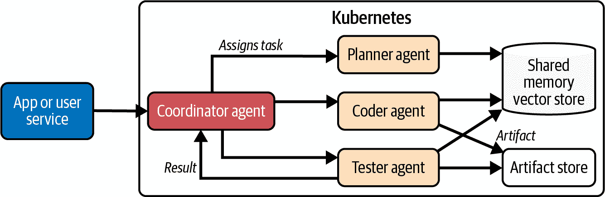

*图 8-11：由协调器编排的智能体*

另一种替代方案是点对点协调，智能体之间直接发送消息、动态发现能力，并在没有单一中心枢纽的情况下升级或委派任务，如图 8-12 所示。Google 的 A2A 协议（在“智能体到智能体协议”章节，第 329 页讨论）通过标准化发现机制、通过智能体卡片进行能力交换、任务生命周期以及跨智能体边界的工件流式传输，将这种风格形式化，从而实现跨团队和跨供应商的互操作。

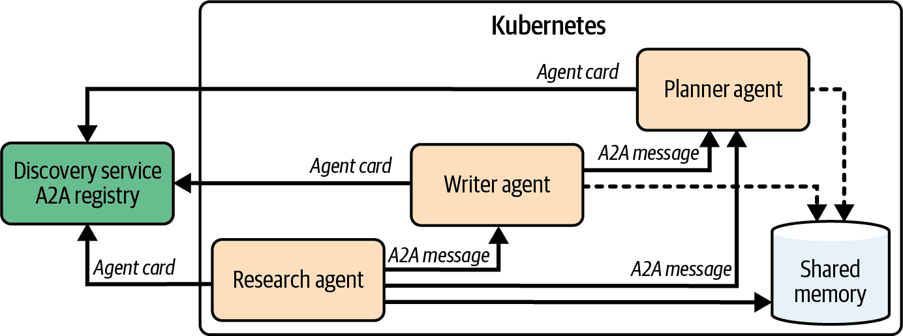

*图 8-12：智能体按需相互触发*

在这两种模型中，系统的成败取决于消息纪律——共享什么、何时共享、以何种保证共享——而不是取决于任何单个提示词。

在 Kubernetes 上，你通常将每个智能体建模为一个由 Service 支持的 Deployment，并通过 HTTP 或 gRPC 同步连接，或通过 pub/sub 消息结构异步连接。或者，当框架在进程内协调智能体对话时，多个智能体可以运行在同一个 Pod 中。这种安排简化了跨智能体的状态共享并降低了延迟，但它将生命周期和扩缩容耦合并绑定在一起，导致每个智能体都必须一起扩缩容，这限制了弹性，并且很少适用于小型或紧密绑定的团队之外。在本节的其余部分，我们将聚焦于智能体通过网络协作的分布式设计。共享内存后端提供了协作的粘合剂，使用向量存储、文档存储或黑板模式，智能体可以在上面发布发现、待办任务和工件供其他智能体消费。这种共享状态让系统能够跨智能体边界记住发生的事情，同时仍然隔离每个智能体的运行时和配额。常见的平台问题仍然适用——服务发现、重试、退避和熔断——因为智能体就是微缩的分布式系统。我们将在第 329 页的“智能体到智能体协议”中把这些内容与协议联系起来，以便你选择能够在版本变更和团队边界中存续的消息格式。

多智能体系统的一个具体示例是客户支持自动化：一个智能体监控传入的支持工单，然后将每个工单委派给合适的专业智能体——例如，一个网络故障排查（`NetworkTroubleshooter`）智能体或账单查询（`BillingInquiry`）智能体——最后由一个摘要（`Summary`）智能体编译一份已完成工作的报告。这里的协调逻辑决定哪个专家智能体参与，以及流程何时完成。

多智能体系统在此类场景中表现出色，但也带来了复杂性，需要确保所有智能体和谐协作、互不干扰。必须精心设计角色、通信渠道和故障安全机制（例如，如果两个智能体意见不一致怎么办？）。分布式系统中一个有用的模式是 *Saga 模式*，它通过补偿逻辑处理长时间运行的工作流中的故障。在多智能体编排中，你可以应用这一点：如果某个智能体在工作流中途失败，一个补偿智能体可以回滚或清理部分工作，这与 Saga 管理分布式事务的方式非常相似。这为你提供了显式的回滚路径，而不会让多智能体系统处于不一致的状态。

总而言之，多智能体就是协作智能。你组合出小巧而精准的智能体，添加一个协调层——集中的或点对点的——并用保留上下文和证据的共享内存来支撑它们。做到位的话，这就是字面意义上的*智能体编排*：众多乐器、一张乐谱、明确的指挥提示。

有了这个基础，我们现在转向环境智能体（ambient agents）以及那些监控事件流、检测条件并触发工作流的后台服务，看看它们如何与 Kubernetes 上的多智能体设计互补。

## 环境智能体

*环境智能体*在后台持续运行，对环境中的信号做出反应，而不是等待交互式提示。它们与你的系统并存，当触发器触发时采取行动：出现新文件、某行数据发生变化、传感器超过阈值，或者定时器到点。可以把它们视为在需要之前一直处于被动状态；它们不会主动发起对话，但在行动之前可以（但不是必须）询问人类。

一个实际的例子是 Kubernetes 看护者（caretaker），它监控集群的健康信号，检测崩溃循环或 CPU 压力，并立即通过查询日志和比较近期指标展开调查。如果发现的情况与已知模式匹配，智能体会尝试针对性的补救措施，比如重启 Deployment、回滚配置或扩容服务，并且仅在自动化操作失败或策略将该情况标记为高风险时，才上报给人类。图 8-13 展示了这种环境智能体设置所涉及的各组件。

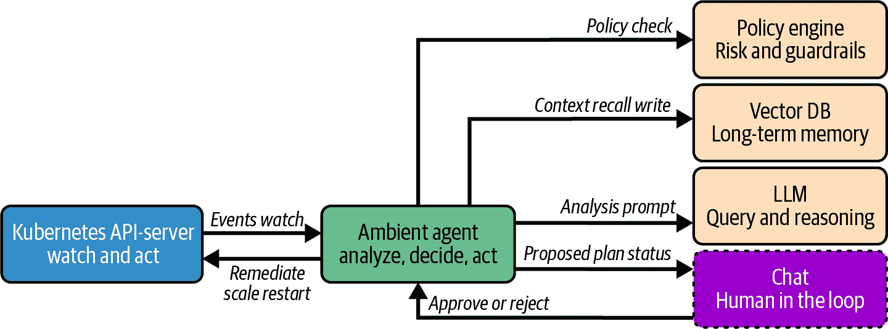

*图 8-13：监视 Kubernetes 事件的环境智能体示例*

环境智能体（Ambient agents）构建于*事件驱动架构*（EDA）之上。它们订阅队列、Webhook、文件监视器或定时触发器（如 CronJobs）；更新自己的工作上下文；决定是否采取行动；然后调用工具。例如，一个每日规划智能体可能会在每天早上 2 点运行，分析昨天的活动，生成当天的计划，并通过电子邮件发送结果，或将其发布到通知频道供人类审阅。对于敏感操作，它们会插入人工介入（HITL）检查点：智能体起草计划，将其路由给审批人，只有在收到明确的“同意”后才执行。你可以通过策略来调节自主性——仅建议、批准后执行，或对低风险操作自动执行——并且你可以通过确定性预算来约束变化，从而让重放和重试行为可预测。在输出侧，每个操作都应留下带有输入、决策和产物的证据轨迹，以确保操作可审计。

## 人工介入（Human in the Loop）

人工介入是一个有意的检查点，在此检查点中，人员会审查智能体的计划或结果，并在智能体继续之前明确授权下一步。你可以在高风险或不可逆操作、政策要求人工监督、或信号模糊且置信度较低时使用它。典型示例包括推送生产环境热修复、回滚可能导致停机的配置、批准大额金融交易，或发送大批量客户通知。可以通过 Slack 或 Teams 等聊天和消息系统收集反馈，智能体在其中发布建议的计划并等待*批准*或*拒绝*回复。一种更解耦的模式是在消息总线上发出带有关联 ID（correlation ID）的审批请求，然后监听相应的决策事件，该事件可能由专用 UI 发出。为了可审计性，智能体应将理由和差异附加到请求中，记录审批人和决策，并在执行后发布最终结果。这有助于在安全的地方保持自主性，并将判断权移交到最重要的人类手中。

对于环境智能体，平台关注点与任何分布式系统相同：服务发现、重试和退避、熔断器、幂等处理器，以及配置和密钥的明确归属。

在实践中，当环境智能体融合三门学科时，你会获得最佳效果：具有幂等操作的可靠事件处理、对不可逆变更的明确人工检查点，以及用于扩展和安全性的清晰 Kubernetes 所有权边界。这使环境智能体像其他任何微服务一样可预测，同时赋予你大规模主动运维的超能力。

## 经验教训

在本章中，我们探讨了如何在 Kubernetes 上架构完整的 AI 驱动应用程序，从聊天界面到事件驱动后端、RAG 流水线和智能体工作流。

应用程序架构分为两种主要模式，它们具有不同的运维特性。交互式聊天类应用运行同步请求路径，延迟最为关键，这要求预热的 LLM、精简的编排器以及最少的往返次数。后端事件驱动服务在微服务网格中异步运行，幂等性、缓冲和最终一致性比原始响应时间更重要。批处理作业、连续控制循环和工具驱动的自动化与这些核心模式并存，将非紧急工作移出热点路径，以提高成本效率。

当摄取和查询时流水线保持一致性和可观测性时，RAG 效果最佳。两个阶段使用同一种嵌入模型，选择与内容匹配的分块策略，并存储来源信息以实现可信的引用和过滤。向量数据库属于 StatefulSet，并配有快照和恢复计划，而摄取则以作业或 CronJob 的形式运行，避免挤占用户流量。重排序器可以提高高风险查询的精度，但应保持可选，以便按路由在成本和质量之间进行权衡。

智能体工作流在模型周围增加了显式控制循环，并使工具成为一等公民。针对高风险操作的人工介入审批门控至关重要，而不是事后才考虑的事项。捕获理由和产物，让每一步都可审计，并通过使用 MCP 等标准来提高可移植性。

有了这些模式和边界，我们准备更深入地探讨具体做法。在下一章中，我们将把这些高级设计转化为生产指南，展示如何在 Kubernetes 上搭建智能体应用，并深入探讨更棘手的挑战，如保护 MCP 和 A2A 通信。
