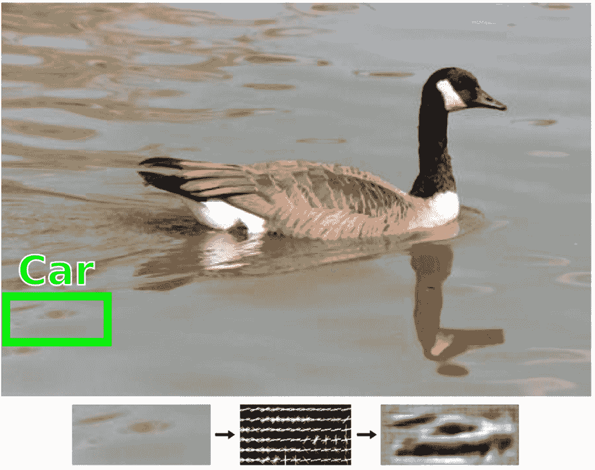
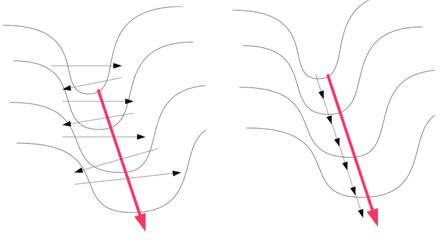
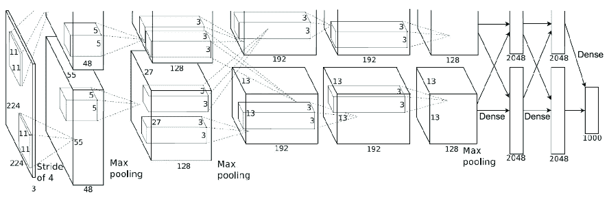
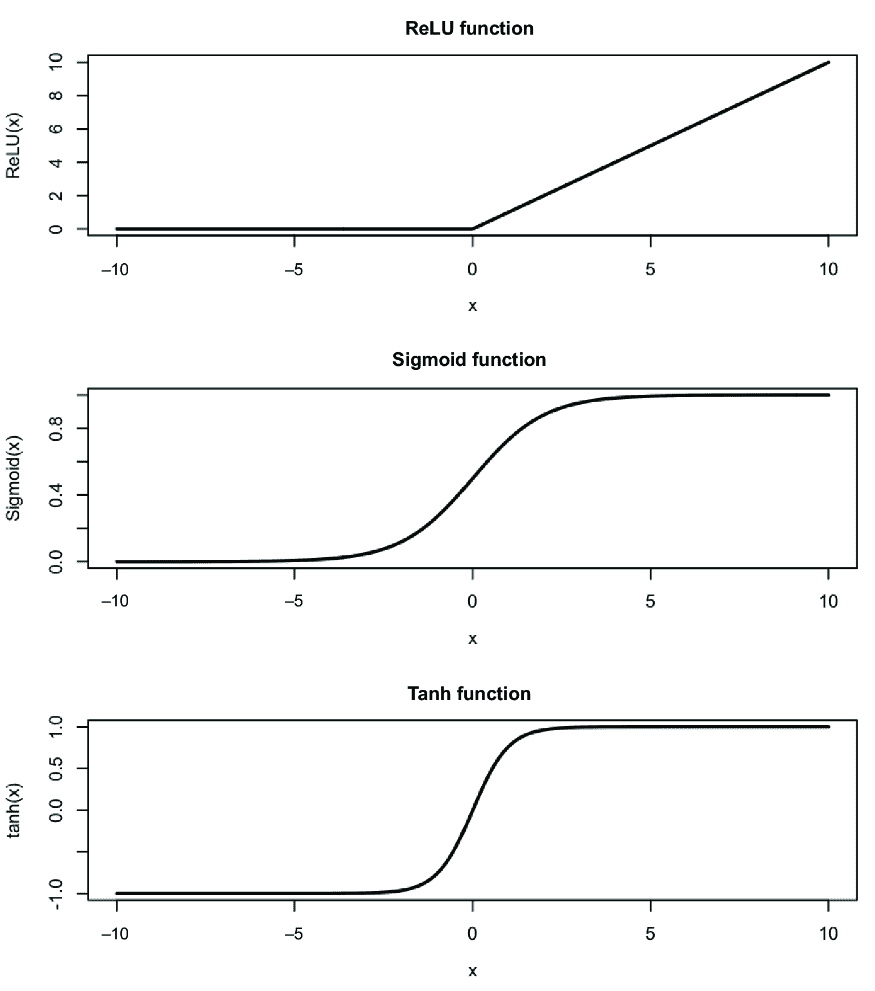
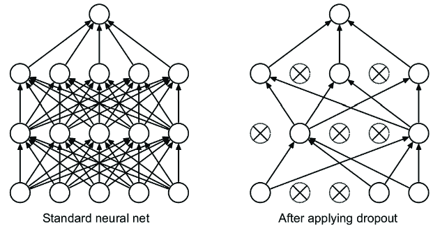
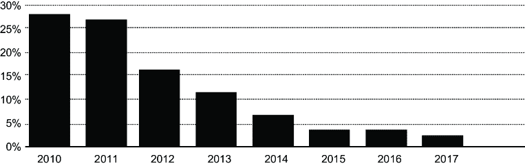

# 2 AlexNet 时刻

## 本章涵盖

* 对人工神经网络的怀疑
* AlexNet 之前的特征工程
* 训练人工神经网络的困难
* ImageNet 在 AlexNet 成功中的作用
* AlexNet 时刻和技术创新

## 论文

* *ImageNet Classification with Deep Convolutional Neural Networks* (2012) Krizhevsky, Sutskever, and Hinton

2012 年，Ilya 与 Alex Krizhevsky 和 Geoffrey Hinton 一起训练了一个卷积神经网络来分类图像。他们的网络通过显著降低新兴的 ImageNet 大规模视觉识别挑战赛（ILSVRC）中的错误率，震惊了 AI 社区。AlexNet 实现了 15% 的 top-5 错误率，显著优于依赖手工特征工程的传统方法，后者的错误率约为 26%。top-5 错误率衡量了正确答案不在模型前五个预测中的频率。

虽然原始论文没有明确命名模型，但社区采用了“AlexNet”，遵循一种非正式的传统，以主要作者命名有影响力的网络，如之前以 John Hopfield 命名的 *Hopfield Networks*（1982）、以 Yann LeCun 命名的 *LeNet*（1998）以及以 Dan Ciresan 命名的 *DanNet*（2011）\[1\]\[2\]\[3\]。后来的模型，如牛津大学视觉几何组的 VGGNet 和 ResNet（第 3 章），转向了更具描述性或品牌化的名称，通常由作者直接选择。然而，在经历了多年的失败之后，AlexNet 证明了人工神经网络（ANN）在模式识别方面非常有效\[4\]。

AlexNet 论文已成为高引论文。到 2025 年春天，它已被引用超过 174,000 次。虽然一些报告警告说这些模型仍然脆弱，需要大量数据，有时会做出奇特的错误，但那段时间的整体基调是庆祝性的。革命似乎已经到来。AlexNet 将 ANN 从投机的好奇心转变为战略投资，标志着学术界、工业界和公众认知的根本转变。可以说，这一刻将深度学习从一种小众兴趣转变为全球现象。

然而，要感受到 AlexNet 时刻的全部重量，我们必须理解它所进入的世界。这包括它所违背的假设、它之前的失败，以及那些相信它会成功的人的默默坚持。

今天，ANN 已被视为理所当然，但它们的历史往往是短暂的热情和长期的幻灭。复兴始于 1980 年代，当 David Rumelhart、Geoffrey Hinton 和 Ronald Williams 推广反向传播，这为训练多层 ANN 提供了实用算法\[5\]。当 ANN 根据训练数据的反馈调整其权重和偏差以最小化预测误差时，它就正在学习。这个学习过程由一个损失函数引导，该函数衡量模型预测与正确答案之间的差异。模型通过梯度下降迭代更新其参数，以最小化损失并提高性能。反向传播计算损失相对于网络中每个权重的梯度，使模型能够在训练中减少误差。这一突破重新燃起乐观情绪，并为现代深度学习奠定了基础。

几年后，LeNet-5，以其五层架构命名，展示了一种称为卷积神经网络（CNN）的专用 ANN 的潜力。在手写数字识别方面的令人印象深刻的性能表明，CNN 可以扩展到现实任务，但这一承诺并未实现。训练更深的网络具有挑战性，大型数据集稀缺，计算能力仍然有限。虽然连接主义技术在小问题上显示出潜力，但它们没有泛化，势头减弱。到 1990 年代末，ANN 被视为死路。一位观察者回忆说，“\[artificial\] 神经网络已成为 backwater”，“许多研究人员已经离开”\[6\]。事实上，在整个 1990 年代和 2000 年代，ANN “几乎被完全抛弃，研究人员转向其他方法”\[7\]。

学术界围绕具有坚实理论基础和有限数据上良好性能的方法组织。例如，支持向量机（SVM）是绘制类别之间清晰边界的分类器。SVM 因凸优化而流行，这是一种吸引人的数学属性，确保可以高效地找到全局最优解\[8\]。

与 SVM 相比，ANN 缺乏理论保证。它们难以分析，并被正确地视为缓慢的黑箱。在高维数据上训练多层网络可能需要几天时间，通常导致爆炸或消失梯度等问题，我们将在后续章节详细讨论。

此外，这些网络在没有大型数据集的情况下容易过拟合，而大型数据集几乎无法获得。它们还倾向于陷入糟糕的局部最小值或误差低但不是最低的点，阻止进一步改进。缺乏今天的数据、计算资源和架构改进，那个时代的 ANN 未能交付承诺的收益，促使许多研究人员放弃它们\[9\]。正如 Geoffrey Hinton、Yann LeCun 和 Yoshua Bengio 在 2015 年的一篇深度学习评论中指出的那样，即使是 1990 年代有些成功的 CNN，也“被主流计算机视觉和机器学习社区抛弃，直到 2012 年 ImageNet 竞赛”\[10\]。

只有少数信仰者在这段时间里保持了研究活力。Hinton、LeCun、Bengio、Jürgen Schmidhuber 和其他少数人在 2000 年代继续发展思想。他们的努力，包括 Hinton 在 2006 年关于深度信念网络的研究和 Bengio 在 2007 年的贪婪逐层训练，得到了承认，但未能说服更广泛的学术界，后者仍然持怀疑态度\[11\]\[12\]\[13\]。普遍的智慧更青睐更实用的方法。事后看来，这些研究人员在人工智能冬天维持了这一领域。然而，AlexNet 的关键优化见解最终弥合了这些休眠的理论思想与实际突破之间的差距。

## 2.1 特征工程

要理解 AlexNet 突破的意义，我们必须理解它所颠覆的主导范式。在 2000 年代，所有高性能计算机视觉系统都依赖手工制作的分层特征管道。局部描述符如 SIFT（尺度不变特征变换）和 SURF（加速稳健特征）用于检测和描述图像块\[14\]\[15\]\[16\]。同时，词袋模型、量化 SIFT 描述符的直方图和空间金字塔编码全局表示\[17\]。这些全局表示将局部块描述符如 SIFT 和 SURF 转化为图像的单个直方图“词汇”。研究人员随后将这些工程特征输入浅层学习算法，如 SVM 和提升决策树，这些算法直接将输入特征映射到输出，而不学习中间或分层表示。这种方法非常稳定，并在整个时期持续提供最先进的结果。即使在 2012 年，PASCAL Visual Object Classes (VOC) 挑战赛的获胜作品也使用了这种方法。

计算机视觉研究人员偏好手工特征，因为它们融入了关于视觉不变性的先验知识。例如，SIFT 被设计用于考虑尺度和旋转变化，而 HOG（梯度方向直方图）有效地捕获边缘模式以进行形状检测。这些特征被认为是可靠和可解释的，因为研究人员可以解释它们正在测量什么。

手工设计特征的稳定性伴随着隐藏的代价。它硬编码了关于“信号”应该是什么样的特定想法，当现实不符合时，模型没有能力修订这些假设。少数人，包括 Ilya Sutskever，已经开始注意到这一点\[18\]。基于 HOG 的检测器可能对无关的边缘模式做出强烈响应，或难以处理轻微的图像扭曲，例如在一片水中检测到“汽车”，而学习到的 CNN 特征可以更好地处理这种情况\[19\]。在这种情况下，分类器忠实地分离了它所获得的输入。失败是上游的，其中特征表示将类似汽车的边缘与汽车混淆了。见图 2.1。

**图 2.1** 该图显示了一只鹅在游泳（上方），其中目标检测器错误地将一小片波纹水面标记为汽车。图像下方有三个可视化，澄清了此错误的来源：水斑的特写（左）、对应的 HOG 特征（中）以及一个专门的可视化（右），显示波纹水面的特征在 HOG 特征空间中与汽车相关的特征相似。*经主要作者（Carl Vondrick）许可使用。*

相比之下，使用 ANN 的自动特征学习是不透明的，并且依赖于大型数据集。当时的普遍观点是，有效的特征*需要*通过手工创建\[20\]。少数持不同意见者认为特征应该直接从数据中学习，但没有人成功。这些论点仍然停留在理论上，因为没有学习到的特征能够匹配像 SURF、HOG 或 SIFT 这样的方法的性能\[21\]。该领域更信任人类直觉而非数据，并认为特征是设计出来的，而不是发现出来的。

可变形部件模型（DPM）体现了深度学习前时代的心态\[22\]\[23\]。HOG 和 SIFT 捕获了训练数据中存在的特定形状信息。当与 SVM 结合时，它们在诸如行人检测等任务上取得了强大的性能\[24\]。到 2000 年代末，这种方法已被改进为 DPM，它使用 HOG 特征和潜在结构化 SVM 来将物体表示为具有可学习空间关系的部件集合\[25\]。虽然 DPM 增加了一些几何灵活性，但它也引入了硬负样本挖掘，其中每个假阳性都被作为硬负样本添加回训练集。然后重新训练模型以围绕该错误雕刻出新的决策边界。DPM 不仅仅是在 PASCAL 上训练的。它的几何形状实际上是围绕数据集的统计特性塑造的。这种高性能掩盖了泛化能力差的问题。事后看来，DPM 是手工工程特征的最高水位标志\[26\]。

这些弱点无意中塑造了研究重点。2011 年，Alexei“Alyosha”Efros 和 Antonio Torralba 强调了这些问题，对最佳手工制作流程的稳健性提出质疑\[27\]\[28\]。计算机视觉已经变得由基准驱动和数据集绑定，针对人为设计的基准上的性能进行优化，而不是真实世界的泛化。无论是有意还是无意，计算机视觉正在为自身选择的成功定义进行优化。Efros 和 Torralba 暴露了整个领域的盲点，一旦多层 ANN 可以端到端训练，一切崩溃了。但最终验证他们承诺的突破仍在前方，不仅需要算法创新，还需要根本性的思维转变。

## 2.2 AlexNet 前的怀疑

在这个时代，机器学习的许多领军人物怀疑 ANN 能否与既定方法竞争。Jitendra Malik，加州大学伯克利分校著名的计算机视觉研究者，体现了定义该领域的学术怀疑。他的立场反映了更广泛的“show-me”态度，即研究者要求清晰的实验证据。意识到这种怀疑，Geoffrey Hinton 在 2011 年接近 Malik，询问什么样的证据会令人信服。Malik 回答说：“你真的想给我留下深刻印象吗？展示给我看它们能处理 PASCAL VOC 挑战”\[29\]。

Malik 的回应反映了一种类似于罗素茶壶的哲学立场，其中举证责任在于主张者，而不是他人去反驳它。毕竟，Malik 的怀疑在当时是合理的。尽管在较小的欧洲视觉挑战中取得了一些有希望的胜利（包括 DanNet），ANN 尚未在该领域最受关注的基准测试中取得明确突破，在这些基准测试中，手工制作的特征流程仍然是标准。视觉社区正在等待足够有力的证据来克服有根据的怀疑。虽然这在任何科学学科中都是健康的态度，但交流的语气也可能揭示出一个曾经受过伤害的领域。

许多人觉得，“我们在 1990 年代尝试过人工神经网络，但它们不起作用。为什么现在它们会起作用？”过去的失败历历在目，失望坚定了这种普遍情绪。社区没有忘记始于 1980 年代并在 1990 年代末“失去势头”的 ANN“第二波”\[30\]。年轻研究者继承了这种怀疑，常常将 ANN 视为过时和非正统的\[31\]。到 2011 年，该领域变得难以置信，采取了“show me, don’t tell me”的立场。任何理论承诺或轶事成功都不够；研究者要求被淹没，但不是被仅由数据驱动的改进所淹没。

一位明确表达这种怀疑的研究者是 Alyosha Efros，他认为 ANN 中许多表面上的突破更多是由更大的数据集驱动的，而不是真正的算法创新。与当时的许多人一样，Efros 不相信 ANN 从规模中受益的方式与更简单的模型根本不同。他相信，given enough data，一个更简单的方法可以表现得一样好。实际上，他的批评表明，ANN 研究者（通常被称为连接主义研究者）将他们有限的成功过多地归功于他们的架构，而过少地归功于他们的训练数据\[32\]。

Efros 回忆说，他审阅了一篇 2008 年的论文，其中 ANN 在图像定位方面优于他早期的工作。怀疑这种收益来自更大的数据集，他要求作者在相同数据集上评估一个简单的最近邻算法。该方法通过将新点与所有已知示例进行比较并根据最接近的匹配进行标记来工作。它纯粹依赖于数据相似性，而不是学习到的特征。作者发现 ANN 并不比这种简单方法更好。“如果你保持数据规模不变，花哨的\[artificial\]神经网络并不比简单的最近邻更好，”Efros 说。他补充说，“我不是说‘忘记\[artificial\]神经网络……但在这个特定设置下，确实是数据在承担所有的主要工作”\[33\]。随着该领域开始关注更大的数据集，这种观点获得了 traction。 “大数据”的兴起强化了这样一种观点，即数据规模而不是架构是进步的主要引擎，数据被称为“新石油”\[34\]\[35\]。

2009 年，在谷歌期间，Alon Halevy、Peter Norvig 和 Fernando Pereira 发表了“数据的不合理有效性”，一篇短文，至今已被引用超过 2700 次\[36\]。他们认为，对于许多自然语言处理问题，限制因素不是我们语言理论的优雅或我们建模机制的复杂性，而是覆盖范围。因此，扩大数据规模，即使它是噪声和未标注的，也使得学习重要的尾部事件成为可能，而这些事件是较小的、经过策划的语料库所无法包含的。他们的挑衅并不是说建模选择从不重要，而是说一旦训练集变得足够大，来自额外结构的边际收益会缩小。该论文直截了当地指出：“简单的模型和大量的数据胜过基于更少数据的更精细模型。”

这一立场与 Efros 的批评一致，即没有数据，“华而不实”的模型不过是精致的脚手架，而像最近邻这样的简单基线却可能显得惊人地有竞争力。在这种精神下，《数据的不合理有效性》一文将规模而非架构视为决定性因素，将数据视为通用的均衡器，并暗示任何统计方法都能从规模中受益。该论文没有提及 ANNs；相反，它强调了 n-gram 语言模型。这些简单的统计模型根据前面的短序列来预测单词（例如，“the cat” → “sat”）。这一概念在论文中出现了七次\[37\]。当时，甚至谷歌也认识到追求 ANNs 的徒劳。

教训很明确：ANNs 并非炼金术。它们不会仅凭结构就变出智能。充其量，它们反映了训练数据，这使许多人得出结论，任何拥有更多数据的方法可能就足够了。《数据的不合理有效性》和 Efros 更广泛的批评都认为，研究人员首先应该收集更多的数据。在这种观点下，更好的性能来自于给即使是普通的统计方法提供足够的材料来工作。

在民间故事《石头汤》中，一位饥饿的旅行者来到一个村庄，村民们坚持说他们没有多余的食物。旅行者毫不气馁，开始用几块石头烧水，并随口说如果加些胡萝卜、洋葱、大麦甚至鸡肉会更好吃。村民们一个接一个地贡献出缺失的配料。最后，锅变成了一顿令人愉悦的集体餐，村民们惊叹于如此美妙的汤竟然是用几块石头做的。

现代的重述中，研究人员承诺创造人工智能\[38\]\[39\]。研究人员表示，如果拥有他们的所有数据，包括图像、文本、来自人类反馈的强化学习以及日益精细的提示，它会表现得更好。用户欣然顺从。最终的系统被赞为仿佛是智能的唯一来源，尽管实质内容来自倒入锅中的集体贡献\[40\]。

这种现代重述中有相当的真理性。该领域需要更多的配料，数据并没有得到足够的信任。然而，与故事的通用配方不同，并非所有算法都能平等受益。虽然更多数据更好的信念正在合理地获得势头，但数据本身是通用均衡器的想法掩盖了一个更深层的真相：一些架构从规模中受益不成比例。ImageNet 很快将提供丰富的数据，但它并没有使该领域民主化，而是加冕了一个单一的冠军，而且它不是 SIFT+SVM、最近邻，甚至不是 n-gram。

## 2.3 ImageNet

Jitendra Malik 对 Hinton 的挑战是明确的：“证明给我看他们能处理 PASCAL VOC 挑战”\[41\]。PASCAL VOC 是一个规模适中但标注精细的数据集，也是计算机视觉算法的激烈试验场。对 Malik 来说，VOC 是一个严肃的基准，能够区分炒作与实质。“证明给我看他们\[人工神经网络\]能处理一些严肃的东西，”Malik 补充道。Hinton 回答：“没运气，它太小了。”Hinton 坚持要一个替代方案。Malik 告诉 Hinton：“好吧，如果不是 PASCAL，那就去赢 ImageNet。”如果 ANNs 要超越手工范式，这将是他们必须证明自己的地方\[42\]。挑战已发出。

人工智能研究员李飞飞于 2006 年开始在普林斯顿开发 ImageNet。该项目的灵感来自认知心理学家欧文·比德曼，他试图解释人类视觉识别的非凡效率。比德曼提出，可识别的物体如桌子、灯和杯子是由有限的基本形状组成的，即“geons”（几何图标），包括圆柱体、方块、楔形、锥体和甜甜圈形状的环\[43\]。在确定了 36 个这样的 geon 之后，他认为人类能感知大约 30,000 种有意义的形状组合，这个数字被称为“比德曼数字”。这种认知理论与大规模视觉分类的融合为 ImageNet 提供了概念基础\[44\]。ImageNet 数据集和随附的论文于 2009 年发布，首次大型比赛在次年举行。

十一支队伍参加了首届比赛，获胜作品结合了手工描述符——包括 SIFT 和局部二值模式（LBP）——与 SVM\[45\]\[46\]。2011 年的比赛只有四支队伍参赛，整体注册人数也更少。它再次由施乐欧洲研究中心的基于 SVM 的方法赢得，该方法用基于 SIFT 的压缩 Fisher 向量替代了 LBP\[47\]。李飞飞曾赌更多的数据会带来更好的性能，但早期结果令人失望。传统技术占主导，但与 PASCAL VOC 相比只取得了微小的渐进改进，而非突破。研究人员仍在手工制作特征，而 ImageNet 的规模在没有能够从其增加的大小和多样性中学习表示的架构的情况下，收益递减。ImageNet 面临着成为美丽但无用的规模纪念碑的严重风险。

李飞飞构建 ImageNet 是为了通过规模推动计算机视觉领域和视觉识别算法的极限。但李飞飞的雄心壮志遭到了包括 Malik 在内的同行的怀疑，Malik 警告她不要跳得太远，跑到领域的前头。Malik 是李飞飞的英雄之一，但他警告他的门生：“我觉得你把这个想法带得太远了……诀窍是与你的领域一起成长。不要跳得那么远”\[48\]\[49\]。这种追求被视为过度。研究人员还没有准备好，甚至对这种规模不感兴趣。

与此同时，端到端学习的早期迹象明显显现。2011 年，丹·奇雷桑的“DanNet”表明，`CNN` 一贯优于手工设计的流程。它不仅是第一个赢得计算机视觉比赛的 `CNN`，而且连续赢了四场，包括国际文档分析与识别会议（`ICDAR`，2011）、国际神经网络联合会议（`IJCNN`，2011）、`IEEE` 国际生物医学成像研讨会（`ISBI`，2012）和国际模式识别协会（`IAPR`，2012）\[50\]\[51\]\[52\]。在 `IJCNN` 交通标志挑战中，`DanNet` 达到了 99.46% 的准确率，比第二名高出 1.15 个百分点（~68% 的错误率降低）。尽管如此，`DanNet` 的成功并未引起太大关注，因为这些是小型的、专门的基准。它证明了 `CNN` 可以优于特征工程，但没有解决它们是否仍能在 `ImageNet` 规模上表现的问题。

克里热夫斯基、苏茨克维和辛顿认识到 `ImageNet` 是完美的战场。它足够大，可以允许多层人工神经网络学习特征表示。2012 年，`ImageNet` 在绝对数量上比今天小。2009 年发布时，该数据集包含 320 万张图像和超过 5,000 个类别。2012 年，`ImageNet-1k` 是 `ImageNet` 大规模视觉识别挑战（`ILSVRC`）中从 2012 年到 2017 年广泛使用的子集，包含大约 120 万张图像，涵盖 1,000 个类别。然而，相对而言，`ImageNet` 是巨大的。相比之下，2012 年，`PASCAL VOC` 包含 20 个类别和大约 11,000 张图像；`MNIST` 有 10 个类别和 70,000 张图像；`CIFAR-10` 有 10 个类别和 60,000 张图像；德国交通标志基准大约有 50,000 张图像\[53\]。如今，`ImageNet` 包含超过 1,400 万张标注图像，跨越超过 22,000 个类别，正趋于比德曼数字。

虽然 `DanNet` 的胜利在技术上令人印象深刻，但它们更容易被斥为小众演示，而非范式转移。与此同时，`AlexNet` 不仅仅赢得了一场比赛；它击败了一个被认为“超前于时代”的基准。`Hinton` 选择 `ImageNet` 并不是因为社区将其视为计算机视觉算法的终极基准或试验场，而是因为没有人认为它会奏效。`ImageNet` 被认为过度且不切实际。通过决定性地赢得 `ILSVRC`，`AlexNet` 创造了一个其胜利至关重要的舞台。这种差异最好地解释了为什么历史将 `AlexNet` 视为突破，而将 `DanNet` 视为重要的先驱\[54\]。

## 2.4 为什么训练很困难

训练 `ANN` 的一个关键因素是网络权重如何初始化。权重初始化在训练开始前为每个参数设置起始值。通常使用随机权重以确保网络中每个被称为神经元的计算块学到独特的东西。如果所有权重都初始化为相同的值——例如零或任何常数——则每层中的每个神经元在反向传播期间接收相同的梯度并相同地更新。这阻止了神经元分化并学习不同的特征，有效地将层坍缩为一个单元。随机初始化打破了这种对称性，使神经元能够专业化并建模更复杂的模式\[55\]。

但糟糕的初始化会在信号通过网络时扭曲信号。如果权重开始时太大，在应用激活函数后，神经元输出可能过度增长，导致梯度爆炸或神经元饱和。这种不稳定性阻止模型达到稳定解，即“收敛”\[56\]。如果权重初始化太小，梯度也可能消失，导致学习缓慢或停滞\[57\]。随着网络变深，这些问题变得特别明显。

要理解为什么，考虑在反向传播期间梯度是如何计算的。它们是当你在层间向后移动时多个偏导数的乘积。如果这些导数小于 1，乘积随深度缩小，导致梯度消失。结果是前面层的权重接收的更新如此之小，以至于它们实际上停止了学习。这个梯度消失问题导致许多人得出结论，认为深度本身才是问题。

相反，如果导数超过 1，梯度可能爆炸，导致不稳定的权重更新，阻止收敛。当时的研究人员认为多层网络本质上难以训练，不仅因为数据和计算的限制，还因为优化地形充满糟糕的局部最小值和鞍点，使学习不稳定。虽然 `GPU` 后来加速了训练，但它们并没有使优化更容易。

这些问题因早期激活函数如 `sigmoid` 和双曲正切（`tanh`）而加剧，它们在反向传播期间进一步削弱了梯度。结果，更深的网络不仅需要更多训练时间，而且表现更差。所有这一切强化了多层网络本质上不稳定、需要特殊技巧训练的信念。如果这些想法有些密集，没关系。我们将在本书中多次重新提及它们，每次在新的背景下，这样它们背后的直觉会自然发展。这里重要的是，在 `AlexNet` 之前，训练具有任何真正深度的网络被认为是不切实际的。

为了逃避这个困境，训练 `ANN` 的主导方法是使用逐层无监督预训练，然后进行有监督的微调。而不是一次性训练整个网络，每个层被单独训练。一层的输出作为下一层的输入，逐步构建网络。预训练使网络权重更接近好的解，使反向传播能够在以前失败的地方成功。一旦所有层都以这种方式预训练，它们被“展开”成一个单一架构\[58\]。这种初始化帮助模型避免糟糕的局部最小值，并提高训练期间的收敛。展开后，整个网络可以使用反向传播进行端到端微调。

这一策略由 `Geoffrey Hinton` 于 2006 年提出，并由 `Yoshua Bengio` 于 2007 年扩展。`Bengio` 表明，无监督预训练可以有效地解锁深度架构，否则这些架构无法用基于梯度的方法训练\[59\]\[60\]。这些结果是惊人的，但也带来了一个新的正统观念。研究人员开始相信，没有预训练，深度网络将不可避免地失败。在这种怀疑和停滞的背景下，`James Martens` 2010 年的研究论文脱颖而出。它显著影响了 `Ilya`，`Ilya` 经常引用它作为 `AlexNet` 的关键灵感来源\[61\]。`Martens` 的工作直接挑战了当时流行的信念，即无监督预训练是训练多层网络所必需的。相反，他表明模型可以通过随机初始化从头训练。

`Martens` 重新框定了问题。困难并不像广泛假设的那样源于局部最小值众多，而是源于一阶方法如梯度下降的局限，这些方法仅使用损失函数的斜率来更新权重。这些方法沿最陡下降方向移动，但对景观的曲率视而不见。相反，二阶方法还利用了关于该斜率如何变化的信息，即损失表面的曲率或“弯曲”，使它们能够更智能地调整步长和方向。

`Martens` 证明，`ANN` 经常包含“病态曲率”区域。这些区域（见图 2.2）是长而窄的谷，导致优化算法停滞。基于梯度的方法缺乏曲率意识。它们要么无用地振荡，要么采取微小的渐进步骤，这显著减缓了训练。`Martens` 提出了一种利用曲率高效穿越这些谷的二阶方法。他将其成功应用于自动编码器——直到那时，这些模型只能通过无监督逐层预训练来训练。他的洞察揭示，实际障碍不是损失景观本身，而是导航其几何的工具不足\[62\]。结果是惊人的。正如 `Martens` 在论文摘要中指出，“不使用预训练，我们获得了比 `Hinton & Salakhutdinov (2006)` 在相同任务上报告的更好的结果” \[63\]。

### 图 2.2 优化形如长而窄谷的函数的挑战。等高线表示一个谷，沿谷底运行的箭头指示最佳进展方向。较小的箭头表示梯度下降采取的步骤：左图显示大步在谷中低效振荡，而右图显示小步沿谷底缓慢进展。“病态”性质并非源于高或低的曲率，而是源于谷的横向高曲率与沿谷的低曲率的结合。*经作者（`James Martens`）许可使用。*

比结果更重要的是潜在原则。成功并非源于任何特定的模型架构或巧妙的初始化方案。它源于一个更强大的优化器，能够导航复杂的损失表面。在传统方法如梯度停滞的地方，`Martens` 的方法能更好地理解损失景观的形状，并沿更直接的路径走向更低误差。`Martens` 证明了无监督预训练并非必要。真正的障碍不是深度，而是缺乏处理曲率的工具。

`Martens` 在 2010 年的论文中致谢了 `Sutskever`，两人甚至在 2011 年合作研究了另一个训练起来出了名的困难的架构：长短期记忆（`LSTM`）`\[64\]\[65\]`。但 `Martens` 的方法计算量很大，更适合小规模问题。然而 `Sutskever` 理解了更广泛的含义。如果二阶方法可以从头训练深度网络，那么具有适当改进的一阶方法可能也能做到。

这成了 `AlexNet` 背后的赌注。改进的初始化、更好的激活函数和足够的计算能力使梯度下降能够克服曾经让深度学习看似不可能的障碍。在后来的采访中，`Sutskever` 声称他*知道* `AlexNet` 会成功。对有些人来说，这可能听起来像事后偏见，但事实并非如此。`Martens` 已经表明深度网络可以收敛。对 `Sutskever` 来说，这种信心不是理论上的，而是经验上的。他已经看到了它的发生 `\[66\]`。

## 2.5 `AlexNet`

`AlexNet` 以 15.3% 的 top-5 误差重新定义了 `ImageNet` 竞赛，这意味着正确标签出现在其前五个预测中的时间超过 84%。`AlexNet` 不仅超越了亚军（其误差为 26.2%），而且彻底击败了它。这些结果源于精心设计的架构创新，详细记录在开创性论文“`ImageNet Classification with Deep Convolutional Neural Networks`”中，通常缩写为 `KSH`，以作者 `Krizhevsky`、`Sutskever` 和 `Hinton` 的名字命名 `\[67\]`。

### 2.5.1 网络架构

`AlexNet` 显著增加了标准网络配置的深度和宽度。从结构上讲，`AlexNet` 包含 6000 万个参数和大约 65 万个所谓的“神经元”。如前所述，参数是模型的权重和偏差，在训练过程中进行调整。同时，神经元是模型的计算单元：它们接收输入，乘以权重，可能加上偏差项，然后通过激活函数将结果重新缩放到特定范围（0 到 1 或 -1 到 1）。

单个神经元用处不大。但通过跨多层连接许多神经元，网络可以从数据中学习复杂模式，例如识别猫或翻译语言。通常，研究者强调参数数量，因为它们直接影响模型训练的难度、运行成本以及过拟合的容易程度。相反，神经元数量更抽象且模糊，特别是在参数共享的卷积层中。

尽管存在这种模糊性，`KSH` 仍强调了其神经元数量。2012 年，人工神经网络研究者经常强调与生物系统的类比，以为其架构选择提供直觉和动机。`AlexNet` 通过引用神经元数量和推广局部响应归一化，坚定地置身于这一受生物启发的传统中。作者声称这一概念受到大脑侧向抑制的启发，尽管它对 `AlexNet` 的性能实际影响有限。在标准化基准取得戏剧性改进使这些类比变得 largely 不必要的时代之前，这种与生物学的平行关系提供了本质上的合法性。如今，人工神经网络通常用务实的、以工程为中心的术语来描述。尽管如此，`AlexNet` 明确的神经元数量反映了一个生物直觉对建立可信度和激发对新方法信心至关重要的时代。

`AlexNet` 成功的核心在于其前五个卷积层，它们实现了自动的分层特征提取。与传统手工方法不同，卷积层逐渐捕获越来越复杂的模式。它们从简单模式开始——如最早层中的边缘和纹理——随着网络深入演变为复杂的形状、角点和可识别的物体部分。例如，早期层可能检测猫图像中的水平和垂直边缘；下一层可能将这些边缘组合成胡须状或耳朵状的轮廓，而更深层可能将这些部分组装成猫脸的连贯表示。

每个卷积层使用多个小滤波器在输入图像上滑动，将每个片段与学习到的模式进行比较。你可以将这视为测量图像区域与滤波器的相似程度。在数学上，这种比较通过滤波器权重与输入像素之间的点积来进行。结果值形成特征图，突出显示特定视觉模式最常被检测到的位置。这些激活表明哪些滤波器对图像的不同部分响应最强烈。至关重要的是，相同的滤波器被应用于输入的每个位置，极大地减少了参数数量，并实现了平移不变性，即无论模式在图像中的位置如何都能识别的能力。例如，`AlexNet` 的第一个卷积层使用 96 个不同的滤波器，生成 96 个特征图，供更深层进一步抽象和分析。

`AlexNet` 的卷积层不仅深，而且在战略上也很宽。随着网络变深，滤波器数量从第一层的 96 增加到 256，然后 384，保持 384，最后以 256 结束，扩展了网络的容量。同时，滤波器尺寸从初始层的 11 × 11 减小到 5 × 5，然后在网络更深处减小到 3 × 3。见图 2.3。

**图 2.3** `AlexNet` 架构（在原始论文中裁剪）。数字表示每个阶段的空间尺寸和通道深度。输入图像（224 × 224 × 3 `RGB`）通过一系列卷积和池化层，逐渐减少空间分辨率（224→55→27→13），同时增加通道深度。早期下采样由第一个卷积层（11 × 11 滤波器，步长 4）驱动，随后是最大池化层（3 × 3 窗口，步长 2）进一步减少空间尺寸。步长决定滤波器在输入上每步移动多远，控制图像采样的密集程度和空间分辨率降低的速度。滤波器尺寸（11、5、3）被描绘为立方体，定义每个卷积的局部感受野。两条水平流反映了模型原始的双 `GPU` 训练设置，其中特征图在设备间拆分（例如 48 + 48 = 96 通道）。全连接层（4096 个神经元，在 `GPU` 间实现为 2048 + 2048）输入到 `ImageNet` 分类的 1000 路输出。*经主要作者 (`Alex Krizhevsky`) 许可使用。*

这种进程使 `AlexNet` 能够最初关注粗糙特征，然后将其细化为日益复杂、精细的模式。最大池化通过系统减少特征图尺寸并仅在小空间区域（通常为 3 × 3 窗口）内选择最强激活来补充这一策略。这种选择性降低减少了计算复杂性，并增强了网络对轻微位置变化和输入失真的鲁棒性。通过在更深层中缩小滤波器尺寸并增加特征图数量，`AlexNet` 扩展了每个神经元的感受野，即影响该神经元激活的输入图像区域。这使网络能够构建分层表示，捕获跨更广图像区域的日益复杂的视觉抽象。

在卷积层提取特征之后，`AlexNet` 转向三个全连接（`FC`）层。这是网络在图像分类中的最后关键步骤。与卷积层不同，`FC` 层将前一层中的每个神经元连接到每个神经元。这种密集的连接将特征图展平为单个向量，有意地丢弃空间结构，以将高级特征整合到统一的表示中。这样做，`FC` 层可以合成整个图像的信息，识别出对准确分类至关重要的全局模式。这种从空间感知特征提取到空间不可知的全局解释的转变，使 `AlexNet` 能够将复杂的视觉特征映射到精确的类别预测中。

`AlexNet` 的前两个全连接层占了模型约 6000 万个参数中的大部分。这一规模显著提高了模型的表示能力，但也引入了过拟合的风险。我们将在下一节 \[68\] 中进一步讨论。

最后一层全连接层输出一个 1000 维的向量，直接对应 `ImageNet` 数据集中的 1000 个类别。`softmax` 函数将这些原始分数转换为预测概率，最高概率决定网络的最终分类。总之，卷积层提取视觉模式，全连接层将这些模式解释为类别预测。它们共同构成了一个计算管道，尽管缺乏真正的现象学经验或视觉理解，但却使 `AlexNet` 能够以开创性的准确性将原始像素转换为对象分类。

### 2.5.2 训练创新

`AlexNet` 中一个关键的创新，源于 `Ilya Sutskever` 的见解，是在每个卷积层之后采用整流线性单元（`ReLU`）激活函数 \[69\]。与传统的激活函数如 `sigmoid` 或 `tanh`（它们将输出压缩到有限范围，并常常导致神经元饱和和梯度消失）不同，`ReLU` 在整个训练过程中保持强大的梯度流。图 2.4 显示，`ReLU` 通过将负输入映射为零，同时保持正输入不变，实现这一点，在该区域有效地充当恒等函数。因为其导数对于正值是常数，梯度可以穿过许多层而不会被反复削弱。这个看似简单的修改使 `AlexNet` 能够有效地扩展到前所未有的深度。

**图 2.4** 由作者在 `R` 中生成的 `ReLU`（顶部）、`sigmoid`（中部）和 `tanh`（底部）激活函数图。激活函数将输入值（x 轴）映射到输出值（y 轴）。例如，`ReLU` 对负输入产生 0；对于正输入，输出等于输入（x < 0 时为 0，x ≥ 0 时为线性）。`sigmoid` 函数将输入映射到 0 和 1 之间的值，类似于 S 形曲线。同样，`tanh` 函数提供平滑的 S 形曲线，但将输入映射到 –1 和 1 之间的值，以 0 为中心。

在一项受控实验中，`KSH` 证明，从传统 `tanh` 切换到 `ReLU` 激活可以加速收敛 6 倍。作者们认识到这一效率增益是多么关键，明确指出“如果我们使用传统的饱和神经元模型（即 `sigmoid` 或 `tanh` 激活函数），我们就无法为这项工作实验如此大的 [人工] 神经网络。”这一改进之所以可能，是因为 `ReLU` 激活通过避免饱和和缓解 `Martens` 所说的“病态曲率”来帮助平坦化优化景观 \[70\]。

`AlexNet` 的成功牢固地确立了 `ReLU` 作为深度网络的默认激活函数。后来的网络，如 `VGGNet`、`GoogLeNet` 和 `ResNet`，都使用了 `ReLU` 或其变体，确认非饱和激活对于扩展到更深网络至关重要。

全连接层包含了 `AlexNet` 的大部分参数，使得它们特别容易过拟合。为了应对这一弱点，作者采用了 `dropout`，它在每个训练迭代中随机禁用一部分神经元。`Dropout` 是一种正则化技术，在训练期间施加约束以防止过拟合并保持模型的泛化能力。在 `AlexNet` 的情况下，前两个全连接层（`FC6` 和 `FC7`）中 50% 的神经元在每次迭代中被丢弃。`Geoffrey Hinton`，类比教父，著名地用“共谋者”类比解释了 `dropout` 的直觉 \[71\]。如果你想找出谁犯了罪，你会分别审讯嫌疑人，而不是一起审讯。类似地，`dropout` 迫使神经元独立地学习有用的特征，而不是依赖紧密耦合的组。见图 2.5。

**图 2.5** 左：具有两个隐藏层的标准神经网络。右：对左图网络应用 `dropout` 产生的网络示例。*经主要作者 (`Nitish Srivastava`) 许可使用。*

在 `AlexNet` 成功之后，每当担心过拟合时，`dropout` 就成为标准做法——随着网络规模的增大，这种担忧变得更加频繁。在训练期间，随机关闭一部分神经元，使网络无法依赖“共谋者”。在测试时，什么都不关闭。早期的实现通过在测试时缩小层的输出来补偿，以匹配网络在训练期间看到的情况。但现代实现使用反向 `dropout`，它在训练期间应用补偿，因此不需要测试时的调整 \[72\]\[73\]。两种方法保持平均信号相同，但反向 `dropout` 已成为事实上的标准，因为它使训练和测试保持在同一尺度，并简化了部署。

KSH 指出，没有 dropout 的网络“表现出严重的过拟合”。拥有 6000 万参数和仅 120 万训练图像，网络很容易记忆而不是泛化。然而，一个副作用是训练更慢：“dropout 大致使收敛所需的迭代次数增加一倍”，论文报道。这是合理的，因为有了 dropout，每次训练更新效率稍低，每个神经元只接收其原本应接收更新次数的一半。

如前所述，AlexNet 还引入了局部响应归一化（LRN），这是一种受生物侧向抑制启发的实验性技术。LRN 将每个神经元的激活相对于相邻特征图上同一空间位置的相邻神经元进行归一化，鼓励神经元之间的竞争。这有助于抑制均匀强烈的激活，并增强独特的、有选择性的特征响应。在实践中，作者仅观察到泛化的适度改进，但他们仍然在前两个卷积层之后包含了 LRN 层。LRN 很快失宠，被更有效的归一化方法所取代，特别是 2015 年的批量归一化 [74]。尽管现代网络不再使用 LRN，但它在 AlexNet 中的包含体现了其设计的实验创新特征，即使事后看来，AlexNet 的结果并不关键地依赖于这一特定技术。

## 2.5.3 数据增强

KSH 使用了激进的数据增强来扩展 ImageNet 的有效规模和多样性。使用了两种主要技术：

1. **几何变换** — 随机裁剪和水平反射被用来训练网络具有空间不变性，使其即使在不同位置或方向出现物体时也能识别。

2. **光度畸变** — 基于 PCA 的颜色抖动通过对 RGB 像素值的主成分进行扰动，引入了亮度、对比度和色彩平衡的细微变化。该技术模拟了光照变化的效果，并增强了对光照变化的鲁棒性。

总之，这些增强策略通过模拟训练数据中真实的变异和噪声，提升了 AlexNet 的泛化能力。数据增强与 dropout 的结合有效缓解了过拟合，尽管模型高度过参数化，仅用 120 万张图像训练了 6000 万个参数。这使得网络能够充分利用其容量，精确拟合训练数据，同时仍能泛化到 ImageNet 数据集中未见过的测试图像。

## 2.5.4 高效且可扩展的训练

GPU 最初是为实时视频游戏图形设计的，但它们擅长的计算与训练人工神经网络（ANN）所需的计算非常相似。当时，NVIDIA 正在为其小众硬件寻找新的应用。在接受《麻省理工科技评论》采访时，NVIDIA 首席执行官黄仁勋说：“当你发明一项新技术时，你必须乐于接受疯狂的想法。”他接着说：“我的心态一直是在寻找古怪的东西，而 [artificial] 神经网络将改变计算机科学的想法，那是一个极其古怪的想法” [75]。

在 120 万张图像上训练一个拥有 6000 万个参数的八层网络，不仅在计算上要求很高，而且在概念上也具有挑战性。2012 年可用的 NVIDIA GTX 580 GPU 只有 3 GB 内存，不足以存储整个模型。KSH 战略性地将网络拆分到两块 GPU 上，以绕过这一限制。每块 GPU 处理每层一半的滤波器和每个训练批次一半的特征图。受到先前模型并行化研究的启发，这种双列架构通过在精心选择的层同步 GPU 通信来最小化开销：在第二层卷积层之后，以便在早期处理完成后启用跨 GPU 学习；在第五层之后，以便在过渡到网络的全连接层之前完全整合特征 [76] [77] [78] [79] [80]。

并行使用两块 GPU 使团队能够扩展网络，每层滤波器数量是较小的单 GPU 变体的两倍。这将 top-1 准确率提高了 1.7%，top-5 准确率提高了 1.2%。双 GPU 设置还实现了更大的深度，这对模型性能至关重要。KSH 发现，移除任何卷积层并重新训练都会降低准确率，尽管每个卷积层仅占模型参数的不到 1%。

这些观察结果表明，AlexNet 的优势部分源于其规模和深度的增加，从而实现了多阶段特征提取。现代卷积神经网络现在通常在 GPU 集群上训练，直接延续了 AlexNet 开创的轨迹。当时，团队明确将 GPU 内存和计算时间视为主要约束，指出网络规模“主要受限于当前 GPU 上可用的内存以及我们愿意容忍的训练时间”。他们 anticipate 进一步的改进，指出“结果可以通过简单地等待更快的 GPU 和更大的数据集可用而得到提升。”尽管他们最初的工作规模相对较小，但随后的进展完全验证了这一预测，强调了 AlexNet 对更深、更强大网络的影响。

有效训练神经网络需要平衡几个因素以确保稳定学习和最佳性能。AlexNet 使用小批量随机梯度下降（SGD）进行训练，并辅以 0.9 的动量。梯度指示损失增加最快的方向和速率，因此一阶方法沿相反方向（下坡）移动，调整权重以减少损失。换句话说，一阶优化仅使用关于函数在当前点如何变化的局部信息，而不需要诸如曲率（二阶导数）等额外细节。这种简单性使得一阶方法在计算上高效，并且在训练大型网络时很受欢迎。

想象一个孤独的登山者在雾蒙蒙的山上。由于登山者无法看到整个地形，他们扫描周围的一小块地面。这代表用于测量局部下坡方向的随机小批量图像。然后登山者沿着相反的斜坡移动一段距离。因为扫描只是一个样本，估计是有噪声的。尽管如此，动量就像惯性一样，平均最近的步骤，使登山者能够滑过浅层高原，而不是采取稍微上坡的步骤或横向摇晃。

AlexNet 的训练使用了 128 张图像的批次、0.01 的初始学习率以及一个手动计划，每当验证准确率平坦时，学习率下降 10 倍。学习率决定了模型参数在每一步对梯度的响应变化量。这使得登山者能够在早期采取大胆的步骤，而在接近谷底时采取更精细、更审慎的步骤。尽管 SGD 永远不能保证绝对最小值（即全局最小值），但在崎岖的地形中，它可以之字形移动以避免高原或鞍点。尽管如此，小批量采样、动量和衰减学习率的结合始终如一地引导 AlexNet 走向高质量的解决方案，使其能够实现突破性的 ImageNet 性能。

仔细的权重初始化也提高了 AlexNet 的训练稳定性。权重从均值为零、标准差较小（0.01）的高斯分布中初始化，确保神经元输出以稳定的平衡范围开始。此外，特定层的偏置被有意设置为 1 而不是通常的 0，在训练开始时激活 ReLU 神经元。该策略缓解了“dying ReLU”问题，其中不活跃的单元卡在输出 0 且永远无法恢复 [81]。尽管微不足道，但这种仔细的初始化对于维持健康的训练动态至关重要。

尽管 AlexNet 最终在梯度下降方面取得了成功，但许多研究人员最初怀疑这种方法能够训练多层人工神经网络。当时普遍的误解是，基于梯度的优化方法不可避免地会陷入局部最小值，从而使训练无效。研究人员将损失景观可视化为充满糟糕局部最小值的低维地形。但他们忽略了高维空间中损失表面的行为不同。此外，像 AlexNet 那样在小批量上平均梯度，进一步平滑了损失景观中的不规则性，实现了更稳定的优化。认识到这一微妙但深刻的真理对于 AlexNet 开创的深度学习革命至关重要。

## 2.5.5 效果

2012 年，ImageNet 的训练集已经比 PASCAL VOC 的大 100 倍，但 ImageNet 和 PASCAL VOC 的性能都停滞不前。从 SIFT 和 HOG 到视觉词袋流水线的手工特征，缺乏足够的改进空间。然而，AlexNet 将 ImageNet 的 top-5 错误率从 26% 降至 15%，而 PASCAL VOC 的分数几乎没有变化。AlexNet 是 2012 年竞赛中第一个也是唯一一个使用人工神经网络的模型，并将 top-5 错误率减半，证明了更多的数据是不够的。重新定义该领域的并非数据本身，而是一种能够从中提取更多含义的架构。

2013 年，ImageNet 竞赛（ILSVRC）吸引了 24 支队伍。这超过了前三年（21 支）的总和。几乎所有参赛作品都使用了 CNN，这标志着这种一年前还被认为不切实际的方法取得了显著的转变。时代精神完全转变了。人工神经网络（ANN）不仅摆脱了污名，而且它们现在正在推动最前沿的技术。在 2010 年，你可能会因为使用它们而被拒绝；到 2013 年，你可能会因为不使用它们而被拒绝。

AlexNet 的成功激发了更深、更有效的架构浪潮。2013 年，纽约大学的一支队伍实现了 11.2% 的 top-5 错误率 [82]。2014 年，准确率超过了 90%。同年，GoogLeNet 以惊人的 6.7% top-5 错误率赢得了 ILSVRC，与 AlexNet 之前的结果相比，两年内错误率大致降低了四倍。见图 2.6。到 2017 年，参加 ILSVRC 的 76%（38 支中的 29 支）队伍实现了 top-5 准确率大于 95% [83] [84] [85]。他们都使用了 CNN。

**图 2.6** 2010 年至 2017 年 ILSVRC 的 top-5 错误率。SIFT 和 SVM 在 2010 年和 2011 年获胜，但性能趋于平稳。CNN 从 2012 年到 2017 年获胜，包括 2012 年的 AlexNet，并最终使基准饱和。

在 AlexNet 成功之后，Malik 拥抱了深度学习。2014 年，他在加州大学伯克利分校的团队开发了 R-CNN，这是一种应用 CNN 实现最先进目标检测的方法 [86]。这一快速的后续行动表明，AlexNet 时刻并非侥幸。AlexNet 可以被其他人复制和扩展。2017 年，Malik 称 AlexNet 为“过去五年中机器学习和计算机视觉领域最具影响力的论文”，并将其描述为“引领计算机视觉领域拥抱深度学习”的论文 [87]。2020 年，Malik 承认对深度学习的有效性感到惊喜，并承认他“在 2010 年肯定不会相信这一点” [88]。

AlexNet 不仅仅赢得了一个基准测试；它重新定义了科技行业的优先事项。谷歌率先行动，在 2013 年初收购了 DNNresearch，扩展了谷歌大脑，然后在 2014 年收购了 DeepMind。Facebook 在 2013 年底成立了 Facebook AI Research（FAIR），任命 CNN 先驱 Yann LeCun 为其主任。最后，百度招募了 Andrew Ng 来领导一个新的语音和图像任务的 AI 实验室。Clarifai 的创始人赢得了 2013 年 ILSVRC 竞赛，它成为了商业 CNN 的供应商 [89]。

AlexNet 还戏剧性地重塑了围绕 AI 的公众叙述。《MIT Technology Review》宣布“深度学习”是其 2013 年的顶级突破之一，并补充说它“终于变得聪明” [90]。这种乐观情绪在年底激增，当时《The New York Times》在头版刊登了一篇题为“类脑计算机，从经验中学习”的报道，表明深度学习如何深刻地吸引了文化想象力 [91]。即使是批评性的报道，如《The Guardian》的“不要相信科学炒作：我们还没有创造出真正的 AI”，也间接地验证了新范式的主导地位 [92]。少数仍然表示怀疑的人是通过引用所谓的“黑箱”批评来做到这一点的，该批评认为模型不可解释或被过度炒作，而不是指出实际性能。

最终，AlexNet 推翻了十年来令人舒适的假设。ANNs 被斥为过于复杂的 curiosity，“fancy schmancy”架构，追逐着特征工程和聪明内核（即 SVMs）可以更高效地解决的问题。AlexNet 用一场来之不易的胜利证明，只要成分正确，深度学习可以战胜现有的行动手册。它刺破了“石头汤”和“数据非理性有效”叙述的自满版本。是的，数据被低估了，更多的数据提供了高性能机器学习所需的重要覆盖和对尾部事件的访问，但它并不是一个伟大的均衡器。

AlexNet 整合了一系列优化感知的选择，包括用于防止梯度消失的 ReLU 激活、用于稳定早期训练的适当权重初始化、用于平滑更新的动量、用于减少过拟合的 dropout，以及用于增加训练集有效大小的数据增强 [93]。AlexNet 还分布在两个 GPU 上。这对不起眼的 3 GB GPU 说明，*一切*都有不起眼的开始，“深度学习革命”也不例外。这些想法单独来看都没有魔力。魔力在于坚持将它们组装成一个端到端的大规模系统，然后通过工程来证明这一点。

在 AlexNet（2012 年）之后，网络架构逐渐加深。VGGNet（2014 年）有 19 层。GoogLeNet（2014 年）有 22 层。然而，尝试训练更深的网络遇到了障碍。其中主要的是持续的梯度消失和模型退化问题。AlexNet 扭转了时代精神，但要可靠地训练更深的网络，仍然需要架构和优化的创新。
