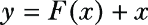
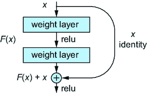
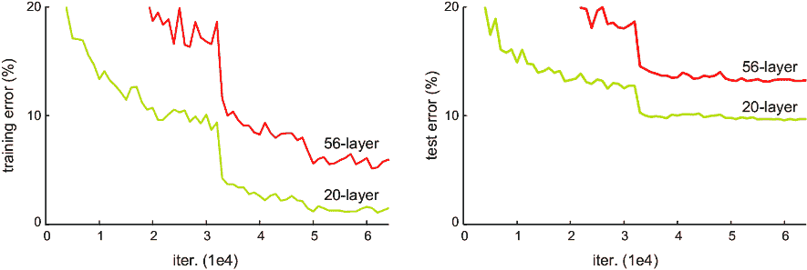
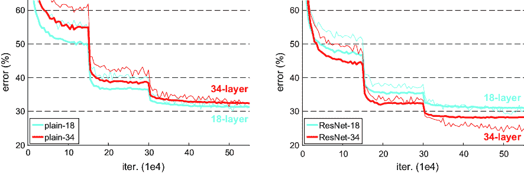
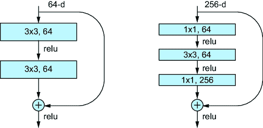
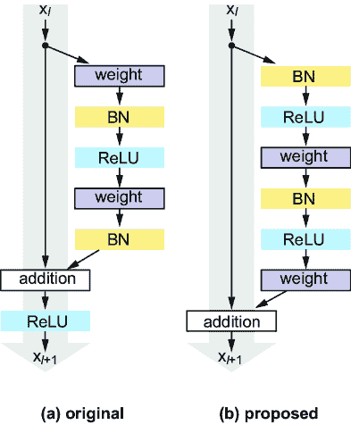
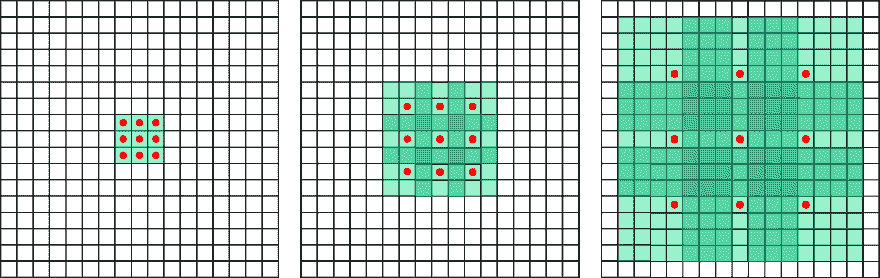
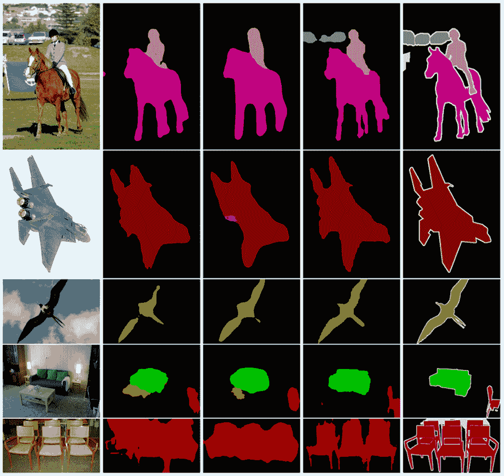

# 3  ResNet 革命

## 本章涵盖

*   训练深度神经网络的挑战
*   残差连接以及它们如何彻底改变深度学习
*   演进到 ResNet v2 以及训练超过 1000 层的网络
*   池化和步长，它们被空洞卷积取代用于密集预测任务
*   CS231n 作为斯坦福大学的第一门深度学习课程

## 论文

*   *Deep Residual Learning for Image Recognition* (2015) He, Zhang, Ren, and Sun
*   *Identity Mappings in Deep Residual Networks* (2016) He, Zhang, Ren, and Sun
*   *Multi-Scale Context Aggregation by Dilated Convolutions* (2016) Yu and Koltun
*   *Stanford CS231n* (2015) Fei-Fei Li, Andrej Karpathy, and Justin Johnson

2015 年之前，增加深度并没有立即转化为性能的提升。事实上，更深的模型往往表现出*更高*的训练误差。问题的核心是一个双重束缚。深度是表示能力所必需的，但它损害了优化。减少深度可以缓解优化，但限制了能力。就在绝望似乎合理的时候，一个看似简单却欺骗性的想法出现了。

*残差连接*通过提供保留前向信号并在反向传播中维持有效梯度路径的捷径来缓解这种紧张。在残差网络（ResNet）中实现，它们在 Sutskever 列表上赢得了一席之地，因为它们代表了设计哲学的关键转变，其中“添加残差连接”已成为机器学习工具包中不可或缺的工具[1]。

从经验上讲，ResNet 实现了性能的阶跃变化。与 AlexNet 一样，ResNet 将前一年的 top-5 错误率大致减半。在 2015 年的 ILSVRC 中，ResNet 集成实现了 3.57%的 top-5 错误率，而单个 ResNet 实现了 4.49%，超过了之前的集成结果，并在分类、定位和检测竞赛类别中获胜[2][3]。回顾这一突破，ResNet 团队负责人何恺明承认，“我们甚至不相信这个单一想法会如此重要。”这种情绪强调了机器学习中一个基本真理：一个想法的重要性与其复杂性无关。

ResNet 将“深度”从一种渴望变成了现实且高效的现实。ResNet-152 比 19 层的 VGGNet 深八倍，但需要的计算操作和模型参数却更少。突然之间，深度不再只是象征性的。原始 ResNet 论文中展示的实验策略反映了 Sutskever 的信念，即人工智能的进步源于对理念的完善和发现真正有效的方法。随后的 ResNet v2 论文也体现了这种精神。它通过完善带来有意义的提升，最显著的就是预激活残差块，而不是一个全新的架构。两者都表明，人工智能的进步并不总是需要新的概念飞跃，而且往往不需要。

## 3.1 电话游戏

在 AlexNet（2012 年，8 层）之后，架构的深度逐渐增加。VGGNet（2014 年）有 19 层。GoogLeNet（2014 年）有 22 层。然而，所有训练更深网络的尝试都遇到了障碍。其中最主要的是持续存在的梯度消失和模型退化问题 [4]。尽管有批量归一化、仔细的权重初始化和梯度裁剪等部分解决方案，但没有出现全面的解决方案。虽然批量归一化稳定了层统计信息，仔细的初始化从训练开始就保持了激活和梯度的适当缩放，但两者都没有为梯度穿过数十个非线性层提供捷径。

想象一下，信息通过一系列层传递，每层都设计为从原始数据中提取模式。当信息（如图像）通过每一层时，随机权重会轻微扭曲数据。只有几层时，这种扭曲是可控的，但随着网络变深，这些微妙的扭曲会累积。当信息到达多层网络的最后几层时，原始图像或数据实际上已被打乱成随机噪声，与最初输入系统的内容几乎失去了所有有意义的联系。这种有意义信号的退化被称为 *模型退化*。

前向传播之后，网络通过计算其输出与正确答案之间的差异来衡量性能。这种差异称为 *损失*。为了改进，网络将损失通过其层反向传播，以确定每层的权重应该如何调整。当反馈信号（即梯度）通过每一层反向传播时，由于与各层权重的重复相乘，它们会变得越来越小且扭曲。当这些梯度到达最早的层——那些最接近原始输入的层——它们已经衰减到没有有意义信息的程度，使得早期层无法有效更新其权重。这种梯度在反向传播时有效消失的现象被称为 *梯度消失问题*。

虽然退化和梯度消失问题是不同的，但它们可以在一个有害的反馈循环中相互强化，就像两个人争论到忘记或完全扭曲原始观点一样。扭曲的前向信号会破坏输出，导致反向传播时更弱的梯度。那些更弱的梯度又导致糟糕的学习，这进一步扭曲了随后的前向传递，并使研究人员陷入一个令人沮丧的循环中，其中训练误差实际上随深度增加而上升。

在这种背景下，微软研究人员引入了 ResNet。在他们开创性的论文“深度残差学习用于图像识别”中，作者们通过一个看似简单的架构创新解决了长期存在的问题：残差连接。想象一下玩“电话游戏”，其中一条消息沿着一行从一个人传到另一个人。通常，当消息到达最后一个人时，它会扭曲，因为每个参与者都会轻微听错或误解。现在想象一下，在某些点，你可以直接将纸条传递给更远的人，跳过多个中间低语者。这条捷径可以确保至少部分原始消息保持清晰和完整。

这正是残差连接背后的想法。与其强迫每个信号顺序通过许多层（其中扭曲会累积），残差连接创建了捷径，让信息既 *通过* 又 *绕过* 某些层组。这种双路径结构确保有意义的信息完整地到达更深的层，并确保清晰的梯度信号平滑地流回网络。

在前向传播期间，每个残差块沿两条并行路径计算：一条通过卷积层、批量归一化和非线性激活来提取复杂特征，而另一条则不变地传递输入，保留其原始信息。在反向传播期间，决定权重更新的梯度沿这相同的两条路径反向传播。直接的捷径有助于保持更强的梯度，减少它们反向传播时梯度消失的风险，并提高训练更深网络的稳定性。

具体来说，每个残差块在其内部层上计算一个增量调整，称为 *残差*，然后将其直接加到原始输入上。正式地，每个残差块的输出为：

这里，`F(x)` 表示块内部变换产生的输出，而 `x` 表示原始输入。见图 3.1。通过显式添加原始输入，残差连接在前向传播期间保留清晰信号，并在反向传播期间稳定梯度流。

**图 3.1** 简单 ResNet 块的图解。它说明了输入数据如何沿两条路径流动：一条 *通过* 两个带有激活步骤的变换层，另一条 *绕过* 通过一条没有变换的直接“快捷”路径。这两条路径的输出被组合在一起，得到的向量经历最后的激活步骤。这种“快捷”方式通过保留来自更早层的信息，帮助网络更有效地学习。*经主要作者（何恺明）许可使用。*

图 3.2 显示了随着深度增加，没有残差（或跳跃）连接的架构会遇到困难。一个没有残差连接的“普通”56 层网络比浅一些的 20 层网络具有更高的训练误差。这种训练误差的意外增加不是由于过拟合；它揭示了训练深层网络的根本困难。更深的网络也有更高的测试误差，表明添加更多层并不会自动提升性能。

**图 3.2** 20 层和 56 层“普通”网络在 CIFAR-10 上的训练误差（左）和测试误差（右）。更深的 56 层网络比浅一些的 20 层网络显示出更高的训练误差，表明在没有额外架构创新的情况下优化更困难。它也有更高的测试误差（右），表明简单地添加层并不能改善性能。在两个图中，`x` 轴表示以 10,000 为单位的训练迭代；每次迭代对应一次小批量更新。随着训练在大约 60,000 次迭代中进行，更深的网络持续表现不佳。*经主要作者（何恺明）许可使用。*

但当引入残差连接后，更深的网络优于其“普通”对应网络。作者比较了两个没有残差连接的“普通”网络：一个 18 层，另一个更深的 34 层版本（见图 3.3）。直观上，你可能期望更深的 34 层网络表现更好，或者至少不差，因为它原则上应该能表示较浅的 18 层网络所能表示的所有函数。也就是说，18 层网络的解空间本质上是更深的 34 层模型的一个子集。令人惊讶的是，结果恰恰相反。更深的网络在整个训练过程中表现更差。这种反直觉的结果说明了退化问题。

**图 3.3** 细误差曲线表示 ImageNet 上的训练误差，粗误差曲线表示 ImageNet 上的验证误差。左：18 层和 34 层的普通网络。右：18 层和 34 层的 ResNet。残差网络的参数数量不超过其普通对应网络。*经主要作者（Kaiming He）许可使用。*

对于没有残差连接的网络，挑战在于每一层都必须学习有用的变换。但强制层学习变换——即使在不必要时——可能会破坏训练的稳定性。残差连接通过允许层在没有找到有益变换时直接将输入向前传递不变来解决这个问题，这个过程被称为恒等映射。如果需要变换，层会学习相对于输入的残差。因此，添加额外层变得安全，因为残差连接默认不执行任何操作，从而保持性能而不是损害它。

这种行为还作为一种正则化形式，鼓励层在没有更复杂的变换提升性能时什么都不做。因此，残差网络可以在没有相应优化惩罚的情况下实现更大的深度。相反，传统架构每增加一层都会带来巨大的计算代价。ResNet-152 的深度大约是 VGG-19 的八倍，但它需要的浮点运算（FLOPs）更少，参数数量也更少。152 层的 ResNet 有 113 亿次 FLOPs，低于 VGGNet-16/19（分别为 153 亿和 196 亿次 FLOPs）。ResNet-34 只需要 36 亿次 FLOPs，大约是 VGG-19 的 196 亿次的 18%，尽管 ResNet-34 的层数几乎是 VGG-19 的两倍。这种效率主要来自 ResNet 的卷积设计，以及在更深版本中专门的“瓶颈”块。

要理解瓶颈如何工作，首先考虑*通道*在卷积网络中的作用是有帮助的。每个通道代表查看同一图像的不同方式，就像应用强调边缘、颜色或纹理的不同滤波器一样。虽然通道使模型能够捕获大范围的细节，但处理所有通道在计算上是昂贵的，而且常常是冗余的。瓶颈层通过策略性地减少然后扩展通道数量来解决这个问题，在保持表达能力的同时压缩工作负载。

首先，`1 × 1`卷积通过从原始输入学习一组更少的特征组合来减少或“压缩”通道数量（见图 3.4）。接下来，将`3 × 3`卷积应用于这个简化（即低维）的表示，从而降低计算成本，同时仍然捕获空间结构。关键的是，`3 × 3`卷积在这个缩减的空间中运行，这就是瓶颈设计高效的原因。最后，`1 × 1`卷积通过以新方式重新组合这些特征，将表示扩展回更高数量的通道。

**图 3.4** 左：ResNet-34 中使用的基本块将 64 通道输入通过两个`3 × 3`卷积，然后在应用 ReLU 之前加回原始输入。右：更深 ResNet 中使用的瓶颈块首先用`1 × 1`卷积压缩特征，用`3 × 3`层处理，然后用另一个`1 × 1`卷积恢复维度。快捷旁路保留了原始信号，确保更深的模型细化特征而不是丢失它们。*经主要作者（Kaiming He）许可使用。*

将瓶颈视为数据压缩器。它首先收缩信息，处理压缩后的版本，然后将其扩展回原始形式。由于核心计算在较少的数据量上运行，ResNet 可以在几乎不增加计算需求的情况下表现更好，这意味着它可以有更多层。事实上，仅仅三年前，AlexNet 仅用八层就将 ImageNet 上的 top-5 错误率减半。但随着性能接近饱和，再次将错误率减半需要显著更多的层。ResNet 将 top-5 错误率减半，并展示了非凡的深度是可能的，包括一个前所未有的 1202 层网络。

然而，ResNet 的深度也招致了一些批评。虽然更深的网络变得可行，但没有 principled 的方法来确定最佳深度。原始的 ResNet 论文通过经验发现 152 层对 ImageNet 是最佳的，但作者没有提供理论或分析框架来指导深度选择。从业者几乎别无选择，只能依靠试错，这表明该领域仍然缺乏将规模（即深度、宽度、数据和计算）与预期性能联系起来的定量规则。这个差距后来由经验缩放定律（第 6 章）解决。

此外，超深 ResNet 仍然需要大量的计算资源和大型数据集；否则，它们有过拟合的风险。随后的架构，包括 ResNeXt、DenseNet、ShuffleNet 和 EfficientNet，通过展示精心设计的模型可以用显著更少的参数和更少的计算来匹配或超过 ResNet 的性能，强化了这些担忧[5][6][7][8]。尽管如此，ResNet 从根本上重新定义了可能的事物。

## 3.2 与其他主要架构的比较

通过检查先前的架构如何处理网络深度、复杂性、效率和表示能力，我们可以更好地理解 ResNet 创新的意义和影响。

### 3.2.1 ResNet 与 AlexNet 和 ZFNet

在 2013 年，ZFNet 通过用较小的`7 × 7`滤波器替换 AlexNet 的第一个卷积层，而不是较大的`11 × 11`滤波器，改进了 AlexNet。性能的这一轻微提升确认了仔细的架构调整的重要性。然而，尽管取得了成就，AlexNet 和 ZFNet 由于优化问题很快遇到了限制。因此，它们无法在不出现训练不稳定或性能下降的情况下增长到大约十几层以上。

### 3.2.2 ResNet 与 VGGNet

在 AlexNet 和 ZFNet 之后，牛津大学视觉几何组的研究人员在 2014 年引入了 VGGNet。与其仔细设计每一层，VGGNet 堆叠了相同的卷积层。从哲学上讲，这种方法更接近地预示了 ResNet，后者引入了模块化的、可重复的残差块，大大简化了网络缩放。堆叠标准模块`N`次可以胜过异构设计的想法是强大的，而这种简单性是表征 Sutskever 列表上许多条目的根本创新。

VGGNet 主要采用统一的 3 × 3 卷积，并穿插池化操作，这表明持续重复一个小的构建块以增加深度可以带来性能提升。他们的 16 层 VGG-16 变体在 ImageNet 上实现了 7.3% 的 top-5 错误率。然而，尽管与 ResNet 共享模块化理念，VGGNet 仍遇到了实际限制。其大型全连接层导致参数量巨大（1.38 亿）和显著的计算需求。此外，由于梯度消失问题，堆叠超过 19 层仍然导致训练不稳定。如果没有架构创新来保持信号活跃，扩展网络还尚未可能。

### 3.2.3 ResNet 与 GoogLeNet

2014 年，Google 引入了 GoogLeNet [9]。GoogLeNet 并非堆叠相同的卷积层或依赖统一的构建块，而是以精心设计的 “Inception 模块” 为特色。一个 Inception 模块就像一个微型网络，在多个路径上并行处理输入特征。不同的卷积滤波器尺寸（通常为 1 × 1、3 × 3 和 5 × 5）和池化操作在单个模块内同时运行。这些并行路径的输出被合并，使得网络能够在单一层内捕获多尺度特征。GoogLeNet 在 ImageNet 上以 22 层和大约 680 万参数实现了令人印象深刻的 6.7% top-5 错误率。

然而，尽管 Inception 模块有效，但它需要手动调整和平衡多个并行计算路径。尽管这种方法以更少的参数实现了令人印象深刻的准确性，但其设计脆弱且难以扩展。每个新版本都需要手动调整的滤波器尺寸和并行分支，针对特定深度进行定制。

相比之下，ResNet 采用了更直接的策略。这种方法允许网络扩展（例如 ResNet-18、ResNet-34、ResNet-50、ResNet-101、ResNet-152 和 ResNet-1202）而无需重新设计。它解决了梯度消失问题，并成为无数下游模型的默认骨干。甚至 Inception 最终也效仿，在 Inception-ResNet (2016) [10] 中采用了残差连接。表 3.1 总结了 VGGNet、GoogLeNet 和 ResNet 的关键指标。它突出了深度的显著增加和准确性的提升。

### 表 3.1 VGG-19、GoogLeNet (Inception v1) 和 ResNet-152 的比较

| 架构 | 年份 | 深度（层） | 参数 | Top-5 准确率 |
| --- | --- | --- | --- | --- |
| VGG-19 | 2014 | 16 conv + 3 FC | ~1.44 亿 | ~92.7% |
| GoogLeNet (Inception v1) | 2014 | 22 | ~680 万 | ~93.3% |
| ResNet-152 | 2015 | 152 | ~6000 万 | ~95.5% |

## 3.3 实际应用

研究人员迅速从旧的架构（如基于 VGG 的模型）转向 ResNet 变体。ResNeXt-101 (2016) 和 SENet (2017) 等模型在 ImageNet 竞赛中取得了最佳成绩 [11][12]。计算机视觉的获胜公式已成为 “ResNet 加上一些调整”。例如，在 Faster R-CNN 中用 ResNet-101 替换 VGG-16，在 COCO 数据集上（一个广泛使用的物体检测和分割基准）的准确率提高了 6% 到 7% [13]。

2023 年的一项调查强调了它们在临床决策支持系统中的广泛部署，其中它们协助从 CT 扫描诊断肺部肿瘤、从乳腺 X 光片检测乳腺癌以及分类皮肤病变 [14]。ResNet 因其对自动驾驶中尺度和视角变化的鲁棒性而备受青睐。例如，特斯拉的 Autopilot 据报道使用了一个名为 HydraNet 的改进版 ResNet-50 骨干网来处理多相机输入，用于物体检测、车道识别和深度估计等任务 [15][16]。研究一致表明，像 ResNet-101 这样的更深变体优于更浅的模型，特别是在具有挑战性的任务如车道检测 [17]。

Google 将它们整合到像 Inception-ResNet [18] 这样的混合架构中。Facebook 也效仿，采用了 Mask R-CNN 和 ResNeXt 等框架。与此同时，Amazon 引入了 ResNeSt [19][20]。ResNet 成为生产级图像识别的默认骨干，应用于 Google Photos、Pinterest 和 Microsoft Azure Cognitive Services 等平台。到 2018 年，NVIDIA 的 Detectron 和 PyTorch 的 torchvision 等平台为生产流程提供了可靠的实现。其多功能性、效率以及在大规模视觉任务上的强劲性能，使 ResNet 成为行业规模计算机视觉部署的事实上的起点，并且至今仍被广泛使用。

## 3.4 ResNet v2

虽然原始的 ResNet 架构通过残差连接实现了更深网络的训练，但它并非没有缺陷。研究人员发现，在添加跳过连接*之后*放置非线性激活仍然可能破坏信号传播，特别是在非常深的网络中。这一洞察促使作者在后续论文 “Identity Mappings in Deep Residual Networks” 中重新审视他们的设计，其中他们引入了 ResNet v2。

ResNet v2 的核心创新（再次）看似简单。在每个残差块内重新排序操作保留了跳过连接的完整性。在原始设计中，每个块将变换路径（卷积和激活）与恒等路径合并，然后应用最终的 ReLU 激活。ResNet v2 消除了这种合并后激活，并将所有归一化和激活步骤*前置*到卷积之前。这一微妙的转变使跳过连接成为干净的、未改变的恒等映射，改善了梯度流动并简化了优化，特别是在超深架构中。

一个直观的类比可能有助于澄清这个想法：将残差连接想象为一条高速公路，旨在快速绕过城市（网络）移动交通（或信息）。原始的 ResNet 设计在合并两条繁忙道路（跳过连接和卷积路径）后立即放置了一个交通灯（激活函数）。这导致了拥堵，特别是当 “交通灯” 意外变红时，就像激活函数饱和时一样。意识到这个问题，作者重新设计了交叉点。他们将所有交通控制转移到卷积路径上。结果，交通可以自由流动，避免了不必要的瓶颈——这是所有通勤者在高峰时段都会羡慕的。

### 3.4.1 后激活到预激活

在原始的 ResNet 设计中，ReLU 激活是在残差和跳过路径合并后应用的，这意味着两者被一起修改。相反，在预激活设计中，激活仅在残差分支内应用，保持跳过连接不变。作者观察到，预激活 ResNet 的训练误差略高，但测试误差低于原始的后激活对应模型，他们将这一现象归因于在每个卷积层输入处应用批归一化的正则化效果。参见图 3.5。

### 图 3.5 左侧：原始残差单元显示两个 “权重” 层（即卷积层），它们之间有批归一化（BN）和 ReLU 激活，随后是一个与恒等连接合并的额外步骤。右侧：修订后的残差单元通过将 BN 和 ReLU 放置在权重层之前来重新组织操作，简化了路径。灰色箭头突出了支持信息通过残差连接顺畅前向和后向流动的直接路径（即跳过连接）。*经主要作者（何恺明）许可使用。*

### 3.4.2 消融研究

#### 消融研究

消融研究系统地移除或修改模型的各个部分，以确定它们各自的贡献。作者使用消融研究来测试对跳跃连接的若干修改，并验证保留恒等映射的重要性。即使是很小的改动，例如将跳跃路径按常数缩放（例如 0.5），或在训练期间随机丢弃它，也会导致性能下降和收敛不佳。更复杂的调整——包括可学习门控，或在跳跃路径上添加卷积层——表现更差，常常提高错误率或导致优化完全失败。在这些深度下，微小的架构决策变得成败攸关。工程上的结论很明确：最简单、未经改动的恒等跳跃连接更优雅，也有效得多。

#### 操作的位置

作者还评估了改变操作位置——例如激活函数（`ReLU`）和归一化步骤（批归一化）相对于跳跃连接的位置——如何影响性能。与原始方法（在合并路径后放置激活）相比，他们发现将批归一化直接放在相加之后会破坏跳跃路径并损害准确率。同样，在相加之前应用 `ReLU` 会将残差分支限制为仅正向调整，从而限制其有效性。在每个卷积之前单独使用 `ReLU`、不使用批归一化，也没有显著改善性能。最终，最有效的方法是完全预激活策略，即将批归一化和 `ReLU` 放在卷积之前，并在相加之后省略激活。

#### 哲学

`ResNet` v2 对保留纯恒等映射的坚持，反映了一种更广泛的哲学：重视经验清晰性而非理论新颖性。作者没有发明全新的机制，而是通过系统实验严格测试现有假设，揭示出即使是细微偏差——例如缩放或门控跳跃连接——也可能使训练脱轨。这种实验心态呼应了 Sutskever 的信念：AI 的真正进步并非来自追逐概念性突破，而是来自深入理解已知思想、在规模上改进它们，并发现真正有效的东西。`ResNet` v2 论文体现了一种与 Sutskever 观点共鸣的精神：通过迭代进步，而非发明。

#### CIFAR-10 上的超深 `ResNet`

借助预激活残差单元，作者成功在 CIFAR-10 数据集上训练了一个超深 1,001 层 `ResNet`——该基准数据集包含 10 个对象类别、60,000 张小型（32 × 32）彩色图像。有趣的是，CIFAR-10 由 Alex Krizhevsky 于 2009 年提出，他正是 `AlexNet` 名声中的那个“Alex”，这凸显了他对数据集和架构的双重影响 [21]。即便如此，1,001 层 `ResNet` 仍取得了创纪录的准确率，将分类误差降至 4.62%。相比之下，原始（后激活）1,202 层 `ResNet` 架构的错误率为 7.93%。在训练深度网络仍是一种磨难的时代，作者证明了如果精心设计，极深架构可以保持稳定。深度不再是敌人，只要架构遵守优化所施加的约束。

#### ImageNet

在更大的 ImageNet 数据集上，作者训练了一个 200 层预激活 `ResNet`，其准确率高于原始 152 层后激活版本。将原始后激活设计扩展到 200 层会降低性能，不是因为模型原则上太深，而是因为该架构无法在这种规模下支持稳定优化。这凸显出，在这种深度下，成功的余量惊人地极其微小。最小的事情都可能导致收敛崩溃。

#### 理论洞见

后续理论工作有助于解释为什么这能成功。研究表明，`ResNet` 的行为类似于许多不同深度较浅网络的集成 [22]。极深网络中的梯度传播通常通过更短、更直接的路径发生，而不是顺序遍历每一层。因此，1,000 层 `ResNet` 并不是作为一条 1,000 层的单一链起作用；相反，它包含许多用于梯度和信号的更短路径。这些更短路径有助于防止梯度消失，使训练显著更稳定。因此，可以添加额外层而不损害性能，因为未使用的层可以被绕过。恒等映射让网络能够按需选择和使用层，忽略无用的层。

#### 层移除

作者通过系统移除单个层以观察效果的实验支持了这一想法。他们发现，移除带有残差连接的单个层只会导致误差适度增加，而不是灾难性失败。这表明网络可以通过使用其他可用路径来补偿。他们的分析显示，在 110 层 `ResNet` 中，最有效的梯度流动沿较短的子网络（大约 10–34 层）发生，而非常深的路径贡献极小，并且基本上学到了恒等映射。这一解释表明，`ResNet` 的成功不仅源于拥有一个非常深的模型，还源于结合了许多由残差连接实现的更简单、重叠的模型。

#### 未来架构

到 2025 年，纯卷积网络将被基于 Transformer 或混合架构补充或部分取代，特别是在具有复杂长程依赖的建模任务中。尽管如此，即使这些先进模型也依赖残差连接。`ResNet` 的核心哲学鼓励每一层做出最小、增量的调整（“残差”），而不是完全转换数据。这些微小改进逐层累积，逐步增强表示。鉴于它对极深神经网络如何优化和训练的基础性影响，这篇论文在 Sutskever 的清单中占有一席之地也就不足为奇了。

## 3.5 用密集预测扩展 `ResNet`

`ResNet` 是为图像分类而构建的，其目标是每张图像给出一个预测（标签）。这被称为 *稀疏预测任务*。池化将局部区域聚合成单个值。步长卷积通过跳过像素对图像进行下采样。这些策略对稀疏任务很有效，因为它们将空间结构压缩为紧凑表示，并丢弃不影响全局标签的精细细节 [23][24]。

相比之下，*密集预测任务*——例如图像分割——旨在划分图像并为每个像素打标签。例如，图像分割为每个像素分配一个标签，指示它代表道路、汽车还是狗。因为目标是对象和表面的精确轮廓，而不仅仅是对图像内容的大致感觉，这些任务要求高空间保真度。因此，常用于图像分类的池化和步长卷积等技术就不太适合。那些改善全局识别的下采样，会抹去分割所依赖的边缘和位置线索。

另一种方法是跳过池化，并扩大卷积核以拓宽感受野，即模型“看到”的图像部分。更大的卷积核确实能拓宽上下文，但它们会急剧增加参数。例如，3 × 3 卷积核有九个参数，而 15 × 15 卷积核有 225 个。这是 25 倍的增长。因此，`AlexNet` 和 `VGGNet` 等架构使用小卷积核，配合池化和堆叠层来扩展感受野，而不增加计算复杂度。尽管如此，这种策略在密集预测中仍会遇到限制，因为池化和大卷积核往往会模糊逐像素标注所依赖的精细细节和边缘。

2015 年，Fisher Yu 和 Vladlen Koltun 发表的论文“Multi-Scale Context Aggregation by Dilated Convolutions”引入了空洞卷积，用于在不降低分辨率或使用池化的情况下扩大感受野\[25\]。空洞卷积通过在元素之间插入基于扩张因子的间隙来扩大感受野，而不是使用更大的核。堆叠扩张因子为 1、2、4、8 等的层可以迅速扩大视野，而不会增加每层的参数数量。因此，感受野呈指数增长，而参数数量呈线性增长。它也是 Sutskever 列表上的论文之一。

这一创新是*上下文模块*的核心，该组件专为多尺度上下文聚合而设计。通过堆叠扩张速率不断增加的空洞卷积，上下文模块使网络能够在全分辨率下捕获精细的局部结构和广泛的全局依赖性。它解决了传统类 ResNet 架构在密集预测任务中的一个核心局限，即通常以空间分辨率换取更深的抽象。上下文模块通过在不牺牲像素级细节或计算效率的情况下收集广泛的上下文来规避这种权衡。这一策略在图 3.6 中得到说明。

### 图 3.6 空洞卷积在不增加计算成本的情况下迅速扩大感受野。每个点代表一个卷积核元素。随着扩张增加（从左到右），感受野呈指数扩展，捕获更广泛的空间上下文，同时保持参数数量不变。*经主要作者（Fisher Yu）许可使用。*

作者修改了著名的 VGG-16 主干网络。由于密集像素预测需要高分辨率特征图，他们移除了池化和步长层，并用空洞卷积替换它们。这去除了以分类为中心的设计选择，产生了一个更简单的、面向分割的模型。在 PASCAL VOC 上，它在平均像素交并比（IoU）上比领先模型高出 5 个百分点以上\[26\]\[27\]。平均像素 IoU 是语义分割最常见的基准。它衡量模型预测区域与真实对象区域逐像素重叠的程度。结果表明，在不使用池化的情况下扩大感受野可以产生更清晰、更准确的分割。

图 3.7 直观地比较了不同模型在分割任务上的结果。它展示了不同模型在图像中识别和勾勒不同对象的准确程度。该图描绘了五个场景：一个人骑着马、一架战斗机在天空中翱翔、一只飞行中的鸟、客厅里的家具以及一组椅子。每个场景都带有原始照片、三种分割方法的预测以及正确的轮廓（真实标注）。方法的精度各不相同。第一种方法（FCN-8s）产生粗糙的轮廓，难以捕获细节。第二种方法（DeepLab）提高了准确性，更紧密地勾勒对象，但仍有一些不完美之处。作者提出的方法进一步细化了这些轮廓，接近真实标注的准确性和清晰度。总体而言，直观的比较突出了空洞卷积如何改善密集预测。

### 图 3.7 不同分割模型产生的语义分割。从左到右：第一列是输入图像，第二列是 FCN-8s 的预测，第三列是 DeepLab 的预测，第四列是 Yu 和 Koltun（2015）的预测，最后一列是真实标注。这些示例展示了越来越精确和准确的分割，Yu 和 Koltun（2015）的方法相比以前的方法显著改善了边界定义和对象识别。*经主要作者（Fisher Yu）许可使用。*

然而，训练空洞上下文模块被证明出乎意料地不稳定。传统的随机权重初始化效果不佳。作者在*恒等函数*中找到了一个惊人简单的补救方法。不是从随机噪声开始，每个卷积滤波器被初始化，使得每个输出通道直接复制其对应的输入通道。换句话说，每层开始时都是一个恒等映射。

这种初始化为网络提供了一个有意义的起点。在训练早期，每层只是不变地向前传递信息，即使通过多个空洞卷积也能创建稳定的信号流。优化随后专注于学习来自恒等映射的小偏差（残差），以提高预测准确性，而不是从头开始重建映射。

这一想法呼应了残差连接的逻辑，其中信号路径保持开放，学习细化差异。但在这里，稳定性不是通过显式的跳跃连接实现的，而是通过权重本身实现的。网络从接近线性的状态开始，然后随着反向传播调整滤波器，逐渐学习非线性改进。这个看似简单的“恒等初始化”使得上下文模块能够可靠地训练。尽管担心这种初始化可能使模型陷入无所作为的状态，但作者发现事实恰恰相反。网络迅速使用上下文信息，并在不改变架构的情况下实现了分割准确性的可衡量提升。这是一次极简主义、几乎 ResNet 式的操作：微妙、优雅且非常有效。

虽然 ResNet 在分类方面表现出色，但它对池化和下采样的依赖使其不适合像分割这样的密集任务，其中空间精度至关重要。突破来自于*空洞卷积*，它在不牺牲分辨率或增加参数数量的情况下扩大感受野。这导致了*上下文模块*的创建，通过堆叠扩张速率不断增加的空洞卷积，该模块在全分辨率下捕获局部细节和全局上下文。恒等初始化通过从每层处于无操作状态开始，即该层什么都不做并不变地传递其输入，进一步稳定了训练。这些设计选择共同代表了密集预测深度学习演变中的关键时刻。

## 3.6 人类衡量标准

在 2015 年的一篇博客文章中，微软报告称其基于 ResNet 的系统可以“达到有时超过人类水平的表现”\[28\]。这一成就激发了关于 AI 的公开讨论。与 AlexNet 不同，AlexNet 很大程度上是一个内部人士庆祝的私人里程碑，并以 Geoffrey Hinton 和 Jitendra Malik 等领先研究人员之间的友好打赌为标志，ResNet 开启了一个与人类基准和公开演示进行明确竞争的时期。

人类表现阈值于 2014 年底由斯坦福大学的 Fei-Fei Li 团队引入。它来自一个极其有限的样本，即两名“专家标注者”：一名在 500 张图像上训练，另一名在 100 张图像上训练\[29\]。这个小型实验报告的人类错误率为 5.1%，随后 5%被采用为人类表现的阈值。ResNet 的表现无疑令人印象深刻，但仅从如此小的数据集、只有两名标注者就达到人类水平的表现，在方法学上是可疑的。

### ImageNet 人类水平基准的争议与影响

#### 基准的可疑有效性

然而，方法论并非唯一的问题：该基准的有效性也存疑。ImageNet top-5 指标旨在衡量机器性能，如果真实标签出现在模型的前五个预测中，则预测计为正确。例如，如果给模型展示一个篮球，它返回的猜测如“croquet ball”、“bikini”、“warthog”、“basketball”和“moving van”，它仍然计为正确 \[30\]。这种宽松的评分有助于评估机器，因为认识到模型至少“接近”可以提供诊断性见解。但事后将这一标准应用于人类，充量说是令人尴尬的。

人类在区分“篮球”和“比基尼”这样简单的物品时，很少会提供多个猜测，这使得 top-5 指标在概念上与人类表现不一致。这种事后指派造成了关于“人类水平”表现究竟何意的混乱。ResNet 较少被讨论的 top-1 准确率为 78.57%，远低于人类表现的 95% 阈值 \[31\]\[32\]。

该阈值实际上捕捉到了标注者根据 ImageNet 的专业惯例标注图像的熟练程度，而非评估一般的人类视觉敏锐度。这种标注涉及独特的区分，如细粒度的犬类或鸟类品种，以及微妙的类别边界，旨在训练和评估机器学习模型，而非反映现实世界场景中的一般人类感知。

请记住，ImageNet 大规模视觉识别挑战包含 1000 个物体类别，其中包括许多细粒度类别。虽然人类擅长识别像比基尼这样的熟悉物体，但他们在面对人工类别、微妙区分或不熟悉的专业分类时却很吃力——例如，区分亲缘关系很近的犬类品种或 ImageNet 数据集中定义的稀有鸟类物种 \[33\]。

ImageNet 团队在他们 2014 年的论文中承认了这一点，描述“用 1000 个类别之一标注图像对未经训练的标注者来说是一项极其困难的任务” \[34\]。

#### 象征力量与媒体炒作

人类水平基准作为衡量人工智能进步的外部基准而具有影响力，明确将机器性能与人类认知能力联系起来。事实上，ResNet 的重要性部分源于超越了这一可疑但象征性强的阈值，将一个简单的指标转化为一个里程碑，许多人将其视为迈向“真正”人工智能的具体进展——无论其定义多么模糊。这种象征意义迅速摆脱了学术基准的束缚，在公众想象中获得了独立的生命，成为媒体的诱惑。

它经常被引用为 AI 在视觉方面已“优于人类”的证据。标题充斥着技术胜利主义：*EE Times* 发表了“微软、谷歌在图像识别上击败人类”（2015 年 2 月）；Fast Company 紧随其后发表了“微软软件识别图像优于人类” \[35\]\[36\]。*The Guardian* 在 2015 年 5 月更进一步：“计算机现在优于人类识别和分类图像” \[37\]。到 2017 年，*Entrepreneur* 问道：“人工智能能比人类更好地识别图片吗？”该文章的俏皮副标题是：“计算机用了不到一个世纪就学会人类花了 5.4 亿年才知道的东西” \[38\]。显然，进化需要雇佣更好的工程师。

这些令人喘不过气的报道很少停下来追问该基准是否捕捉了人类视觉，还是仅仅奖励机器在无人关心的分类学上超越人类标注。然而，几乎没有人停下来思考一个更深层的问题：即使该基准确实准确反映了人类水平的视觉敏锐度（这是有争议的），超越这一阈值是否意味着机器在认知或心理上的合理性？在 ImageNet 上“击败人类”是否表明了机器感知、理解或推理视觉世界的任何基本事实，还是仅仅确认它们已经掌握了训练数据和标注分类法？

#### 模型鲁棒性的失败

实际上，超越人类水平的阈值并不表明类似人类的视觉理解或一般的鲁棒性。卷积神经网络（CNNs）很快因其缺乏鲁棒性以及有限的泛化到现实世界的能力而受到批评。研究人员发现，这些模型容易受到对抗性示例的攻击：输入被轻微扰动，方式对人类不可感知，却足以欺骗网络产生自信的误分类 \[39\]。这激发了对更可解释的模型设计和事后解释技术的兴趣，因为仅仅向 CNN 添加残差连接并没有解决对模型 *为何* 做出自信决策的缺乏洞察。

鲁棒性失败超出了合成对抗性示例，并在现实世界部署中显著体现。例如，2015 年，Google Photos 错误地将黑人个体的照片标记为“大猩猩”，这说明了在声称人类水平的性能下，模型对代表性不足的示例的泛化可能多么脆弱 \[40\]。即使架构变得更深并在基准上接近人类水平的性能，它们仍然容易犯人类在遇到微妙分布偏移时不会犯的错误。

这一差异提出了关于究竟什么构成“人类水平”性能的合理问题，如果模型不像人类智能那样行为。到那时，Google 已经改进了其原始的 GoogLeNet 架构。Inception v3 在 ImageNet 上实现了 5.6% 的 top-5 错误率，在 2015 年 ILSVRC 竞赛中仅次于 ResNet 的 4.49% 排名第二。然而，与所谓人类水平基准的调情并未使这些模型对现实世界的脆弱性免疫，突出了排行榜指标与真正鲁棒性之间的持续差距 \[41\]。尽管与较浅的模型相比，深度提供了优越的表征学习，但当训练分布不完整或预测跨越敏感类别时，仅实现高准确率几乎不能提供保证。

#### 阈值的遗产

虽然 ResNet 并未建立这一阈值，但其背后的 Microsoft 团队拥抱了其象征意义。在更早的、无关的 2015 年论文中，他们写道：“我们的结果是首次在这项视觉识别挑战中超越人类水平的性能（5.1%）。”到那年晚些时候 ResNet 论文发布时，团队已经敏锐地意识到跨越该阈值的修辞力量。他们通过在论文摘要中引用原始的人类水平性能估计，使其明确化。5% 的错误率将超越一个指标，ResNet 以刻意的强调跨越了它。

尽管有其局限性，ImageNet 的 5% 人类基准在现代 AI 中具有关键意义，不是因为它在方法论上健全或有效，也不是因为它是机器首次与人类比较，而是因为它提供了一个人类性能的固定、定量的衡量标准。存在更早的人类基准，包括 IBM 的深蓝、Chinook 程序、IBM Watson 在危险边缘中的胜利、Facebook 的“DeepFace”、DeepMind 的 Agent57 和 AlphaGo。尽管如此，ImageNet 的阈值是最早定义和推动深度学习时代进展的此类指标之一。

Microsoft 研究团队顺应这一趋势，并帮助巩固了“人类水平性能”作为明确的研究目标。这激励了其他人效仿，将现代 AI 的奥弗顿窗口转向人类基线作为基准的常规使用。今天，无论在视觉、语言还是语音领域，研究人员通常都会建立人类基线，设定人类水平的阈值，并庆祝达到或超越它们的模型。虽然更早的成就暗示了这一转变，但 ResNet 的突破普及了现在普遍的信念，即人类性能是一个需要超越的基准。

从哲学角度来看，将人类能力简化为数值基准，过度简化了关于智能和人类认知的复杂问题。从社会层面来看，仅仅将人类视为需要超越的基准，会将重点从创造互补、有益的技术转向竞争，从而隐含地将人类的角色从创新者重新定义为竞争者。虽然人工智能在技术上可能已经准备好追逐基准，但大多数人还没有准备好理解超越这些基准意味着什么。

## 3.7 CS231n

斯坦福大学的 CS231n 是该校第一门完全致力于深度学习的全程课程，并且紧密反映了 ILSVRC 的突破。定义了那个时代的架构，如 AlexNet、VGGNet、GoogLeNet 和 ResNet，都是课程的一部分\[42\]\[43\] \[44\]\[45\]。该课程甚至让学生在 ImageNet 的一个子集上训练模型，强调了这种联系以及“边做边学”的理念。该课程由李飞飞、Andrej Karpathy 和 Justin Johnson 共同创建。

CS231n 在斯坦福大学之外也产生了巨大的影响。讲座幻灯片、视频、笔记和作业都可以在线免费获取。讲师们鼓励外部人员跟随学习，甚至建立了一个公共 subreddit（r/cs231n）和一个 Twitter 账号（@cs231n），学习者可以在那里讨论和提问。这种开放性帮助 CS231n 获得了全球关注并扩大了其影响力。

到 2017 年，该课程从 2015 年的 152 名斯坦福学生增加到峰值 774 人，使其成为斯坦福计算机科学最大的课程之一。作为背景，吴恩达是斯坦福教授，共同创立了 Google Brain，创立了 Coursera 和 DeepLearning.AI，并领导了百度的 AI 团队。他著名的机器学习课程 CS229 在峰值时有 869 名学生\[46\]。CS231n 同时记录并塑造了深度学习在视觉领域的崛起。这是一门拥有自己遗产的课程，继续为下一代装备知识，这就是它为什么出现在 Sutskever 的列表上。

## 3.8 扩展什么？

ResNet 的出现是对模型退化的务实回应。随着深度增加，网络表现更差。残差连接以及后来的预激活恢复了信号流。这种稳定性创造了飞轮效应：微小的架构调整解锁了更大的模型，而更大的模型又提高了架构的回报。这个飞轮是深度学习所特有的。

相比之下，支持向量机是一种浅层边缘最大化器。它在固定的特征空间（显式或核定义）中选择决策边界。没有堆叠的表示或梯度可以穿过深度传播，因此随着网络变深，没有类似于梯度消失或模型退化的现象。事实上，没有“更深”的旋钮可以转动。虽然你可以使用更多的计算来更精确地解决凸优化问题，但这不会创建深度学习风格的扩展循环。因此，这种架构使得残差连接等创新变得无关紧要。

相反，只有当架构可靠地将计算和数据转化为更丰富的学习表示时，它们才会复合。这正是残差连接在深度学习中所实现的机制。只有当模型通过基于梯度的优化在许多层上迭代地学习分层表示时，残差连接才重要。

在他 2019 年有影响力的文章《残酷的教训》中，理查德·萨顿认为，研究人员最好投资于随着计算增加而可靠改进的通用方法，而不是手动调整启发式方法或围绕关于“我们如何思考我们如何思考”的内省故事构建解决方案\[47\]。这种动态在前一章中很明显，当时 AlexNet 优于手工特征工程（例如 SIFT）。编码先验知识可以带来短期收益，但随着时间的推移，这些收益往往会被直接从数据中学习相关特征的架构所超越。

但《残酷的教训》经常被误解为暗示进步的主要驱动力是“更多的计算获胜”，而研究人员和架构的作用在减弱。正如伊利亚·苏茨克维克在采访中反复强调的那样，通常是在回应《残酷的教训》时，我们必须澄清：“我们到底在扩展什么？”\[48\]。“规模”是一个乘数，但只有当底层方法被设计为将计算资源转化为性能时，它才会变大。

类似的观点出现在阿廖沙·埃夫罗斯的“花哨”叙事中，它明确将数据视为解释惊人进步量的“无名英雄”\[49\]。他认为数据是普遍的均衡器，研究人员应该更谦逊。《残酷的教训》将计算视为普遍的均衡器，并同样敦促研究人员保持谦逊。两种叙事都强调真正的魔力不在架构中，研究人员往往给自己太多的功劳。但真的是这样吗？

数据和计算是必要的，但不够。决定性的问题不是我们是否有更多，而是架构和训练范式能否有效地使用它们。像苏茨克维克的阅读清单这样的东西之所以重要，一个原因是它使那些最初让扩展产生回报的发明以及背后的人变得清晰可见。如果《残酷的教训》告诉研究人员去扩展，那么伊利亚的回应提出了一个更可操作的研究问题：扩展什么？

最终，ResNet 及其引入的残差连接在创新和实用性之间找到了最佳点。它在计算机视觉与模式识别会议（CVPR）上获得了著名的 2016 年最佳论文奖，强调了它对一个真正感到惊讶的社区的影响。回顾这一成功，何恺明表示，ResNet“摧毁了”他以前对深度学习局限性的一些假设\[50\]。

2012 年，AlexNet 点燃了深度学习革命，将 ILSVRC 推入计算机视觉的决定性战场。然而，仅仅五年后（就在 ResNet 引入两年后），ImageNet 达到了饱和点。这场被吉特德拉·马利克视为超越时代的竞赛已经解决，促使李飞飞停止了比赛。研究人员将目光转向了新的前沿。结果，ImageNet 数据集从前沿基准变成了只是另一个基线。它现在在计算机视觉研究中占据着更具象征意义的位置，类似于 MNIST，一个手写数字数据集，长期以来一直作为入门工具和初学者的参考点，而不是持续创新的来源。

到 2025 年，原始的 ResNet 论文在学术文献中积累了超过 10 万次引用，在 Google Scholar 上大约有 25 万次，使其成为 21 世纪被引次数最多的科学论文，涵盖*所有*领域\[51\]。几乎每一篇新的计算机视觉论文都引用、比较或基于 ResNet，巩固了其作为该领域标准架构的地位。残差连接也超越了计算机视觉，推动了从 AlphaGo 对棋类游戏的掌握和 AlphaFold 对蛋白质结构预测到 GPT-2 等语言模型进步等领域的突破。通过实现深度网络，残差连接已成为现代人工智能在各个领域不可或缺的一部分。

然而，计算机视觉只是更广泛的深度学习革命中的一个前沿。随着模型扩展到序列、语音和语言，它们也变得更大、更复杂、更苛刻。这种扩展给该领域带来了新的压力，将进步从孤立的架构洞察转向训练、优化和部署大规模系统所需的工程规范。

