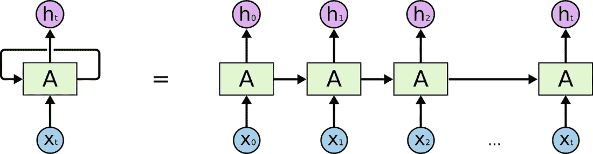
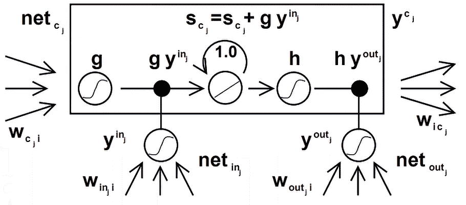
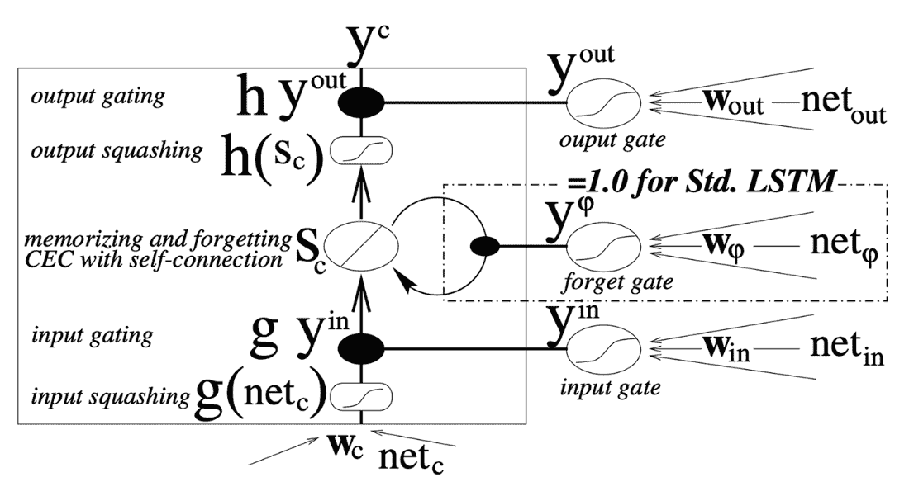

# 4  深度学习加速

## 本章涵盖

*   AlexNet 之后循环神经网络的复兴


- 卡帕西的博客如何让循环神经网络变得易于理解，激发实验热情
- 克里斯·奥拉如何用生动的视觉和比喻阐明长短期记忆
- 选择性 Dropout 如何使更深层的循环网络成为可能
- Deep Speech 2 如何证明循环神经网络的现实潜力
- AI 中的工程范式转变

## 论文

- *循环神经网络的不合理有效性*（2015）安德烈·卡帕西
- *理解 LSTM 网络*（2015）克里斯·奥拉
- *循环神经网络正则化*（2014）Zaremba、Sutskever 和 Vinyals
- *Deep Speech 2：英语和汉语的端到端语音识别*（2015）Amodei 等人

循环神经网络（RNN）是序列模型。序列模型处理有序数据，如文本、语音或时间序列，其中每个元素的位置都很重要。n-gram 是序列模型。它们通过查看先前 token 的固定窗口来捕捉短程依赖关系。RNN 通过携带整个序列历史的压缩表示扩展了这一思想。然而，尽管具有理论前景，诸如梯度消失或爆炸、对长程时间依赖关系的处理不佳以及训练效率低下等实际问题限制了其有效性。这些挑战一直持续到一种专门为循环架构设计的 dropout 方法被引入。

在此期间（2014–2016），通过有影响力的教育资源，循环网络的直观吸引力得到了广泛认可。安德烈·卡帕西用生动的例子和易懂的代码激发了开发者社区的兴趣，导致广泛的实验。作为对卡帕西平易近人见解的补充，克里斯·奥拉提供了清晰、直观的可视化，阐明了长短期记忆（LSTM）网络的内部运作。

本章以对 Deep Speech 2（DS2）的考察结束，DS2 是一个里程碑式的端到端基于 RNN 的语音识别系统，展示了精密的架构结合足够的计算资源如何能够超越人类精度。DS2 代表了伊利亚·苏茨克维所倡导的实用、可扩展的进步，将 RNN 与卷积神经网络（CNN）一起确立为深度学习革命中的基础架构。

## 4.1 循环神经网络的不合理有效性

2015 年 5 月，安德烈·卡帕西写了一篇题为“循环神经网络的不合理有效性”的博客文章 [1]。当时，对 RNN 的解释晦涩、数学繁重且难以理解。卡帕西提供了一种直观的方法，通过突出的例子和易于理解的代码示例展示 RNN 能够实现什么。

一个特别令人难忘的实验涉及向模型提供保罗·格雷厄姆创业散文的全文；格雷厄姆最出名的是共同创立 Y Combinator [2]。动机是半开玩笑的。格雷厄姆提供了永恒的创业建议，但他是一个缓慢的生成器。如果能按需合成新鲜的创业智慧就好了。

卡帕西的保罗·格雷厄姆生成器被构建为一个字符级语言模型，使用约 1 MB 的保罗·格雷厄姆散文拼接文本进行训练，总计约 100 万个字符。该模型（“char-rnn”）被实现为一个两层堆叠的 LSTM，每层包含 512 个隐藏单元，总计约 350 万个参数。它使用了比率为 0.5 的 dropout 正则化。训练后，模型通过一次预测一个字符来生成新文本，从概率分布中采样，其随机性可通过调整温度参数来控制；较低的温度产生可预测的、重复的文本，而较高的温度产生更有创造性但连贯性较差的输出。结果文本如下：


The surprised in investors weren’t going to raise money. I’m not the company with the time there are all interesting quickly, don’t have to get off the same programmers. There’s a super-angel round fundraising, why do you can do. If you have a different physical investment are become in people who reduced in a startup with the way to argument the acquirer could see them just that you’re also the founders will part of users’ affords that and an alternation to the idea. [2] Don’t work at first member to see the way kids will seem in advance of a bad successful startup. And if you have to act the big company too.

这并不算好。虽然有一些熟悉的创业陈词滥调，如超级天使、收购方和融资轮次，但创业建议明显是不连贯的。它是创业领域的恐怖谷效应：模糊熟悉但情感空洞。它甚至凭空生成了一个引用“[2]。”它试图听起来权威而非清晰，这与保罗·格雷厄姆的写作风格相反。现在读起来让人有些迷失方向。的确，它未能通过奥维德的独角兽所确立的氛围测试，这一标准 GPT-2 要再过四年才能达到。它提醒我们，曾经的期望有多低，多少人轻易就为之惊叹，以及该领域自那时以来走了多远。

出于好奇，我提示 ChatGPT（4o）“帮我重写这个”，它给出了以下回应 [3]：

> This seems like a garbled or machine-generated paragraph, but here’s an attempt to rewrite it into something coherent and meaningful, assuming it’s about startup fundraising and acquisition dynamics.
>
> Rewritten version: “Surprised investors weren’t planning to raise money. I wasn’t at the company full-time, but things were moving quickly—there wasn’t a need to hire the same kind of programmers right away. It felt more like a super-angel round than a traditional fundraise. If your investment thesis is more physical than digital, you tend to back people who can reduce complexity in a startup. That makes it easier for potential acquirers to see the long-term value. Founders who focus on user needs early tend to build stronger momentum, even if the initial product doesn’t work perfectly. And sometimes, if you’re forced to act like a big company too soon, it can kill the very thing that made the startup interesting.”

如果我们要宽容地看，“char-rnn”是在单个字符层面学习，使其难以理解的胡言乱语有些令人印象深刻。字符级模型在连贯性上挣扎，因为它们以更精细的粒度运作，一次生成一个 *字母* 的文本，而不是使用单词或子词。与处理有意义的词块的基于 token 的模型不同，字符级模型没有内置的单词或拼写概念，因此更难在句子间保持语义一致性。这意味着它们必须在更多的步骤上建模长程依赖关系，大大增加偏离主题或失去连贯性的风险。然而，即使在这个粒度水平上，模型也不是盲目地拼凑字母；它在近似语言结构和概念模式。尽管有这些固有的限制，即使是勉强连贯的文本生成在 2015 年也感觉是突破性的。

的确，卡帕西的原帖开头就捕捉到了这种惊奇感：“There’s something *magical* [sic] about Recurrent Neural Networks。”在当时，这听起来不像今天那样轻率；观看模型逐个字符生成文本是相当惊人的。卡帕西通过对比 RNN 和 CNN 来解释这种“魔力”。CNN 需要固定大小的向量作为输入，并产生固定大小的向量作为输出。这使得它们非常适合独立分析静态图像或单个视频帧，但限制了它们在涉及序列数据的任务中的有效性，如句子、音频流或连续视频序列。


从结构上讲，RNN 与其他神经网络共享基本组件，包括由神经元组成的层、连接权重、偏置、激活函数，以及通过反向传播进行训练。它们的区别特征是循环反馈回路，允许来自前一个时间步的信息影响当前输出。这个循环使 RNN 能够处理任意长度的序列，而不需要固定大小的输入，因为在每个步骤中相同的计算单元被递归应用，将上下文随时间向前传递 [4]。参见图 4.1。



**图 4.1** 这张图片来自 Chris Olah 的工作（将在下一节讨论），展示了一个代表 RNN 的链状结构。它说明了 RNN 如何顺序处理数据，一个步骤的输出输入到下一步。循环的、链接的模块反映了 RNN 传递信息的能力，使其非常适合学习随时间展开的模式，例如时间序列、文本或音频。*经作者 (Chris Olah) 许可使用*。

在每个时间步，一个简单的 RNN 接收两个输入。第一个是序列的当前元素（例如，单词、子词或字符），第二个是来自上一步的隐藏状态，它编码了所有先前输入的摘要。这个隐藏状态充当持久的内部“记忆”，在每一步更新并为后续步骤提供上下文。尽管网络在每一步生成输出，但隐藏状态而不是输出被传递到下一步。通过这种方式，RNN 随时间维持上下文，使其能够对序列数据建模。

为了更好地理解这种设计的重要性，考虑一个更简单的模型，例如 n-gram，它存储长度为 *n* 的序列的概率。例如，预测 “hel” 后面的下一个字母仅依赖于在训练数据中某些字母跟在 “hel” 后面的频率。n-gram 具有固定的、有限的记忆，无法捕获超过 *n* 步的依赖关系。相比之下，RNN 的动态隐藏状态可以编码超出固定窗口的上下文模式。RNN 不是计算序列频率，而是学习分布式表示，隐式地捕获上下文、语义和语言结构，使它们能够建模更复杂的关系。

在处理 “hello” 这个词时，RNN 不会孤立地预测每个字母。相反，它根据上下文不断更新内部表示。在遇到 “hell” 之后，模型必须确定这个词是否完整（“hell”）或者它是否应该继续构成 “hello”。至关重要的是，这个决策不仅基于从训练数据中记住的频率，还基于其隐藏状态中编码的即时上下文。简而言之，隐藏状态使模型能够记住并使用上下文来解决歧义（例如，重复的字母）并确定序列何时应该结束。

Karpathy 的核心演示集中在使用维基百科、莎士比亚、LaTeX 和 Linux 源代码等数据集进行字符级预测。维基百科模型产生了合理的 Markdown 和引用结构。莎士比亚模型成功地模仿了舞台对话的结构模式，但没有模仿其戏剧效果或诗意品质。例如：

******PANDARUS：**

*唉，我想他将会被接近，日子；*

*当小 srain 将被达到进入从未被喂养的存在。*

LaTeX 模型经常生成语法有效的方程式，但它也会犯错误。LaTeX 是一种用于撰写数学和科学文档的排版语言，其中像 *证明* 和 *引理* 这样的环境必须用匹配的命令打开和关闭。模型有时会开始一个 `\begin{proof}` 环境，却错误地用 `\end{lemma}` 关闭它。这些错误源于无法建模长期依赖。当模型到达证明的结尾时，它已经忘记了它是在处理证明还是引理。类似地，模型可能会以 `\begin{enumerate}` 打开，却记不得关闭它。随着模型变大，这些错误变得不那么频繁，但它们仍然强调了在扩展序列上维持上下文的挑战。

为了进一步阐明这些结果，Karpathy 引入了工具来解释 RNN 的内部工作。他可视化了神经元激活，揭示了对引号、URL 或 Markdown 标签做出响应的单元。一些神经元变成了范围跟踪器，而另一些似乎是引号平衡器或缩进计数器。这些可视化提供了窥探模型内部分布式计算的罕见窗口，作为学习表示中结构的早期、可访问的示例。

该博客走红，成为 *Hacker News* 上的头条，获得超过 900 分和数百条评论 [5]。这个受欢迎的技术论坛上的读者赞扬了 Karpathy 澄清复杂概念的能力；一位评论者指出，这是“我第一次理解这个领域的人…… [他] 打破了障碍。更重要的是，激情贯穿他的写作。并且可以感受到。我在阅读时感到非常兴奋” [6]。这种情绪被广泛分享。在 Reddit 上，读者惊叹于模型生成合理 LaTeX 公式的能力。“它几乎能写出有效的 LaTeX？”有人诚恳地写道。“如果这不是杰出智慧的标志，我不知道是什么。”至少对 Reddit 用户来说，“智慧”的真正标志是正确的方程格式。不管是否有效，那里有一些氛围 [7][8]。

该博客的配套开源代码在 GitHub 上积累了近 12,000 颗星和数千个 fork [9]。世界各地的开发人员开始在几乎所有可以想象的数据集上训练字符级 RNN：烹饪食谱、Eminem 歌词、爱尔兰民谣、特朗普和奥巴马的演讲，甚至圣经 [10][11][12][13][14][15]。Twitter 和 Reddit 上充满了古怪的 RNN 生成文本。这些衍生内容创造了飞轮效应：衍生内容扩大了博客的影响力，增强了其可见性，并加速了其在技术和流行领域的影响。

人工智能研究人员也扩展了该帖子的影响力。Chris Olah 在他那篇病毒式传播的文章“理解 LSTM 网络”中引用了 Karpathy 的博客 [16]。Olah 写道：“我将把对 RNN 可以实现的惊人壮举的讨论留给 Andrej Karpathy 的优秀博客文章。”这成为了一个教学时刻。Karpathy 清晰的解释、示例和代码降低了入门门槛。一位评论者抓住了这种精神：“Karpathy 是我最喜欢的作者之一……他花了很多时间让这个领域变得不神秘……这是鼓励他人探索它的一种聪明方式” [17]。Karpathy 有影响力的博客和 CS231n 课程在深度学习社区中成为了经典。

自然，并非每个人都被这种氛围所吸引。一个平行的、怀疑的对话出现了。例如，研究人员 Yoav Goldberg 撰写了一篇后续博客文章，将 Karpathy 关于字符级 RNN 的帖子与更简单的基线进行比较，例如未平滑的 n-gram 模型 [18]。

Goldberg 基本上应用了与 Efros 相同的方法论要求，但在一个不那么正式的场合。在同行评审中，Efros 推动 CNN 论文展示相对于在相同数据上训练和测试的最简单的最近邻基线的改进。Goldberg 对字符级 RNN 工作提出了类似的挑战，在将功劳归于架构或其作者之前，将其与基于频率的 n-gram 基线进行比较。背景当然不同，但原则相同。在这两种情况下，潜在的信息是相同的：给定足够的数据，更简单的模型表现惊人地好。更广泛的观点是，数据起到了均衡器的作用，中和了架构差异。


### 第四章：循环神经网络

### 4.1 RNN 之争

#### 戈德堡的批评

戈德堡认为，卡拉帕蒂博客的读者是“因错误的原因而留下深刻印象”。这一论点暗示，只有像戈德堡这样更有洞察力的读者才能看到*实际上*令人印象深刻的地方。正如戈德堡所解释的，“错误的原因”在于读者错误地认为连贯的文本生成是 RNN 等神经架构所独有的或特别的。但通过强调连贯的文本生成等结果之间的任意重叠，并忽视架构差异，戈德堡的批评制造了一种虚假的等价。这是一种在审视下会崩溃的肤浅对称。当模型收敛到相似的输出时，人们容易看到相同之处。但结果的相同并不意味着架构的相同。

#### 定量证据

托马斯·米科洛夫（Tomas Mikolov）以开发 *word2vec*（2013）而闻名，他提供了 RNN 优势的明确定量证据，包括与平滑 n-gram 模型相比，语言建模的困惑度降低 50%，语音识别中的词错误率（WER）相对降低 18% [19][20]。WER 是语音识别的标准准确性指标，衡量系统转录与参考真实情况之间的差异程度。更值得注意的是，即使 n-gram 模型获得大量更多数据，RNN 仍然保持了这一优势，突出了根本的表征优势。

#### 修辞策略

戈德堡的批评也有修辞的尖锐。将某物称为未平滑的 n-gram，旨在通过坚持性能只是任何人都可以用足够数据做到的技巧来削减其规模。虽然 RNN 还有很长的路要走，但它们展示了在学习结构方面相对于简单统计模型的质和量的飞跃。性能不是架构和数据之间的妥协，而是来自它们的综合优势。答案不在中间的某个地方；而是明确地两者都是。

#### AGI 与计算功能主义

具有讽刺意味的是，戈德堡将性能与架构等同的修辞技巧，被人工通用智能（AGI）的支持者广泛使用，他们混淆了机器和人类的性能与架构等价。这种混淆体现了计算功能主义的核心原则，这是一种哲学观点，认为如果系统执行相同的功能，则它们是等价的。例如，只要生物和计算基质保持其功能角色，它们就被认为是无关紧要的。从这个角度来看，相似的性能、行为或个体化功能使内部机制的具体细节变得无关紧要。这种推理抹平了心灵和模型之间的机制和认识论不对称。在每种情况下，修辞技巧都涉及夸大相似性以掩盖差异，在表面等价的背后伪装形而上学的差异。关键点是，像戈德堡这样的怀疑论者和 AGI 爱好者使用同样有缺陷的推理。尽管如此，卡拉帕蒂在他的原始帖子中链接了戈德堡的批评，信任读者公平地评估竞争的观点。

#### 卡拉帕蒂博客的影响

最终，戈德堡承认 RNN 是“酷”的。然而，甚至这种让步感觉不像钦佩，而更像是对他们流行吸引力的略带轻蔑的点头，好像它们是有趣的玩具而不是严肃的工具 [21]。当时，这种怀疑主义有些道理，因为 RNN 是实验性的，甚至是玩具般的。事实上，卡拉帕蒂的博客显示它们还不是严肃的工具。但 n-gram 也不是，而 RNN 至少展示了优越的性能。尽管如此，循环很快就会被基于注意力的人工神经网络（第五章）所掩盖。

与戈德堡的博客不同，卡拉帕蒂的博客激励了无数项目，因为它赞美实际的探索和工程独创性，而不是贬低它们。它出现在深度学习对大多数开发者不透明的时候，使其变得可接近、视觉化、轻松愉快，并且没有虚伪。它不仅仅是关于 RNN 产生连贯的输出；而是关于突然的可访问性。任何有 GPU 和文本文件的人都可以探索它。卡拉帕蒂的博客捕捉到那个短暂的文化窗口，当时前沿研究和业余实验之间的差距瞬间崩溃，使人工神经网络对许多人来说第一次感到有形。它表明，一个精心制作的博客可以争夺到与高引用研究论文相当的心理份额。真正“不合理的有效性”是一篇写得好的博客文章能走多远。

## 4.2 理解 LSTM 网络

虽然卡拉帕蒂展示了 RNN 能*做什么*，但克里斯·奥拉（Chris Olah）有影响力的博客“理解 LSTM 网络” [22] 生动地说明了它们是如何实现的，使用直观的视觉和令人难忘的类比。他清晰、吸引人的风格不仅简化了 LSTM；在该领域最需要的时候，它为清晰性和可访问性设立了新标准。

### 传统 RNN 与梯度消失

传统的前馈神经网络独立地处理每个输入，但许多任务，例如预测句子中的下一个单词，需要上下文。RNN 通过逐步处理数据同时维护捕获过去信息的隐藏状态来解决这个问题。与像 n-gram 这样只查看有限固定窗口的简单语言模型不同，RNN 可以捕获跨越许多步骤的依赖关系，允许早期上下文影响后来的预测 [23][24]。考虑句子“我在法国长大……我讲流利的法语。”为了准确预测“法语”，网络必须回忆起早期对“法国”的提及，即使它被许多中间词隔开。不幸的是，随着中间词之间距离的增加，RNN 难以连接信息。

训练 RNN 依赖于通过时间的反向传播，它在多个步骤上“展开”循环结构，将类似循环的递归转换为具有共享权重的深线性序列 [25]。在观察 100 个单词后预测下一个单词类似于训练具有 100 层的网络。与 CNN 一样，深度带来了挑战。例如，学习 100 个单词序列的第一个和最后一个单词之间的关系极其困难，因为指示早期输入如何影响最终预测的梯度变得微不足道，使模型几乎没有关于长程依赖关系的学习信号。随着输入和输出之间的差距增加，输入对损失的影响指数级减小，导致 RNN 忽略早期但相关的信息 [26]。

### LSTM 网络

为了克服梯度消失问题并更好地建模长程依赖关系，塞普·霍赫赖特（Sepp Hochreiter）和于尔根·施密德胡伯（Jürgen Schmidhuber）开发了一种特殊类型的 RNN：LSTM 网络 [27]。LSTM 显著提高了需要长程记忆的任务的性能，例如语言建模、语音识别和手写识别。与单个神经网络层不同，LSTM 使用四个以独特方式交互的层。奥拉著名地将 LSTM 的内部运作描述为在工厂中平稳移动的传送带，在恰好正确的时刻选择性地添加、携带和移除物品（信息）。这个类比展示了这些网络如何在长序列上有效地管理信息 [28]。

LSTM 通过专门的门管理信息流，并保持两种类型的记忆：长期和短期（因此得名长短期记忆）。细胞状态（`C[t]`）被认为是长期记忆，是 LSTM 的核心组件（见图 4.2）。它允许信息在多个步骤中几乎不变地传递，有助于防止与梯度相关的问题。这在概念上类似于残差连接，因为两者都提供允许梯度更容易流动的路径。虽然残差连接直接将输入加到输出，但 LSTM 细胞状态通过门控机制选择性地管理信息。


### 图 4.2 单个 LSTM 单元。输入是当前向量`X[t]`、前一隐藏状态`h[t]`[–1]和前一细胞状态`C[t]`[–1]。有三个学习到的门：遗忘`f[t]`、输入`i[t]`和输出`O[t]`。它们都由 sigmoid 层（“`σ`”块）产生。一个 tanh 层形成候选更新`[t]`。逐点乘法（“×”）和加法（“+”）在顶部“传送带”路径上更新细胞状态。箭头表示向量流；图例标记了逐点操作、拼接和复制。这是标准的 LSTM，强调了门控如何实现选择性记忆保留和暴露。*经作者（Chris Olah）许可使用，尽管它与原始形式略有修改*。

使用奥拉的比喻，细胞状态是传送带，是 LSTM 从序列早期保留重要信息的能力的骨干。相比之下，短期记忆（`h[t]`），或隐藏状态，在每一步都被积极调整，并对当前输入（`X[t]`）做出反应。这两条记忆路径紧密相连，使 LSTM 能够管理长期上下文和短期变化。

为了管理这个双重记忆系统（长期和短期），LSTM 使用三个门：遗忘门、输入门和输出门。

*遗忘门*（`f[t]`）决定保留多少过去的信息。它将当前输入与前一隐藏状态结合，产生介于 0 和 1 之间的值，这些值对前一细胞状态进行缩放。接近 0 的值意味着大部分或全部先前的记忆被遗忘，而接近 1 的值则保留它。

*输入门*（`i[t]`）和*候选*（```[t]`）共同工作，将新信息引入长期记忆。候选记忆使用 tanh 激活函数产生介于–1 和 1 之间的值，从而产生更丰富的表示。一个单独的 sigmoid 函数决定该候选记忆的哪些部分应该被存储。然后，这个经过过滤的候选记忆被加到长期记忆中，更新细胞状态。技术上，这种过滤是通过逐点乘法完成的：每个元素可以被单独缩放，而不是像矩阵乘法那样在所有维度上均匀缩放。

最后，*输出门*（`O[t]`）塑造短期记忆输出。在更新长期记忆后，细胞状态通过 tanh 激活函数处理以产生潜在的短期记忆。然后输出门应用另一个 sigmoid 函数来决定输出多少潜在的短期记忆。这成为当前时间步的输出。这种乘法门控使网络能够选择性地传递、更新或抑制信息。至关重要的是，当门接近 1 时，它们会在许多时间步中保留信息和梯度，帮助 LSTM 克服梯度消失问题。

同时使用 sigmoid 和 tanh 激活函数是一个特别巧妙的设计选择。sigmoid 调节信息流，产生介于 0 和 1 之间的值，决定是保留、更新还是丢弃信息。相反，tanh 将值映射到–1 和 1 之间，使模型能够表示正负信号并捕获更细微的信息。最终，sigmoid 控制信息流动的量，而 tanh 决定存储什么信息。它们相互补充。

尽管 sigmoid 和 tanh 在标准网络中可能导致梯度消失，但 LSTM 在门控加法架构中使用它们，从而在长序列中保留信息和梯度。通过将乘法门与加法更新相结合，LSTM 避免了原始 RNN 的不稳定梯度行为，同时保持了选择性。例如，在处理提到“爱丽丝”的故事时，LSTM 可以在多个句子中保留该上下文，并正确预测后来“她”这样的代词指代爱丽丝。这使得 LSTM 成为涉及广泛上下文依赖的序列建模任务的标准 RNN 变体。更准确地说，网络可以将该实体在`C[t]`中保持活跃许多步，使用`O[t]`在需要时揭示它（例如，在预测“她”时），并在上下文改变时使用`f[t]`丢弃它。

要理解为什么“Understanding LSTM Networks”看起来像是一次教学上的飞跃，有助于将其与 Hochreiter 和 Schmidhuber（1997）的原始示意图并列来看。他们的图表是为研究人员设计的。它是对“恒定误差旋转木马”的精确呈现，具有明确的门控和注释变量。那种严谨性很好地服务了其受众。对于新手来说，同样的精确性可能令人难以承受，就像在研究电线束\[29\]一样。见图 4.3。



### 图 4.3 原始的 Hochreiter–Schmidhuber（1997）LSTM 单元示意图，包括“恒定误差旋转木马”。*经其中一位作者（Jürgen Schmidhuber）许可使用*。

在原始 LSTM 之后，架构不断演进。引入了遗忘门，后来又增加了*窥视孔连接*\[30\]。这些扩展在同样精确的示意图中得到了记录。如图 4.4 所示，蓝图传统使每条路径都明确无误，从而设计清晰。尽管如此，对新学习者来说结果更密集。奥拉的处理将立足点转向信息流，使用简化的图标和传送带隐喻来突出模型*在做什么*。“Understanding LSTM Networks”在阐述上是一次进步，而不是在数学上，但它是一次最终使核心见解一览无余的进步。一起阅读，两种风格是互补的；一个精确地展示了单元是如何构建的，而另一个展示了它为什么这样行为。



### 图 4.4 一个扩展的 LSTM 示意图，显示了遗忘门与输入和输出的加权连接。*经其中一位作者（Jürgen Schmidhuber）许可使用*。

“Understanding LSTM Networks”不可能在传统的学术场所发表，因为它过于阐述性和隐喻性。这篇帖子无意中凸显了促进理解的东西——比如隐喻、阐述和直观插图——与学术论文通常强调的东西之间日益扩大的差距。在各个领域，可读性下降，行话增多，论文越来越针对形式主义、可重复性和引用指标进行优化，而不是为了沟通清晰度\[31\]。在那背景下，奥拉的文章之所以成功，恰恰因为它将解释视为研究目标。它抽象掉接线细节以突出信息流，采用稳定的视觉语言，并为新手和专家提供了共同的心理模型。

奥拉的博客出现在 Sutskever 的列表上，不是因为它引入了像 Hochreiter 或 Schmidhuber 那样的新算法，而是因为它的清晰性和广泛影响。许多当代论文针对评审者最大化可读性，而奥拉针对读者最大化可读性。对他工作的反应表明，对于复杂想法，阐述具有真正的价值。事实上，Sutskever 列表上的大多数条目都具有这一特征：它们的重要性更多来自卓越的执行和展示出的触及更大受众的能力，而不是纯粹的新颖性。

## 4.3 循环神经网络正则化

要理解为什么 Karpathy 和奥拉的博客帖子在 2015 年产生如此大的影响，有必要重新审视一年前 RNN 面临的挑战。尽管它们有理论上的前景，但每一次扩展 RNN 的尝试都遇到了过拟合。结果，在标准的序列建模基准上超越关键阈值，比如宾州树库（PTB），似乎遥不可及。一个特别可怕的障碍是 100 的困惑度。


### 困惑度与 RNN 正则化的演进

#### 困惑度：一种意外程度的度量

困惑度衡量语言模型对新词的“意外”程度：困惑度越低，模型越确定；困惑度越高，模型越困惑。一个有用的思考方式是把它看作一个多项选择题。困惑度为 100 就像模型在序列的每一步中从大约 100 个合理的下一个选项中进行选择。作为对比，如果模型只是从 50,000 个可能的标记中随机猜测，其困惑度将在 50,000 左右。所以 100 比随机好得多。这表明模型已经学到了真正的模式，即使它不太确定。然而当时，实现低于 100 的困惑度似乎是一个难以逾越的挑战。

#### Dropout 突破

2014 年，沃伊切赫·扎伦巴（Wojciech Zaremba）、伊利亚·苏茨克维（Ilya Sutskever）和奥里奥尔·维尼亚尔斯（Oriol Vinyals）通过精心设计一种针对 LSTM 架构的选择性 dropout 方法，改变了局面\[32\]。他们在一篇题为“循环神经网络正则化”的论文中引入了这项技术，解决了过拟合这一长期挑战。呼应了 AlexNet 早期严谨的方法论方法和有针对性的正则化创新，他们的工作标志着 RNN 的一个决定性转折点，RNN 长期以来一直停滞不前。

#### 背景：AlexNet 的 Dropout

回想一下，AlexNet 使用了 dropout，它暂时“关闭”一部分随机神经元，在每次训练迭代中创建一个略有不同的网络。这种随机性迫使神经元发展出稳健的特征，而不是依赖于特定的神经元组合。在推理（或测试）期间，dropout 被禁用，并且 AlexNet 中神经元的输出被缩小 0.5，作为对 dropout 训练期间创建的所有假设网络的预测进行平均的一种计算效率近似。通过这种方式，dropout 实现了类似于模型集成的效果，显著减少过拟合，而无需显式训练单独的模型。虽然 dropout 大致使训练迭代次数翻倍，但它提高了泛化能力，并减少了模型过拟合训练示例的倾向。

#### 训练 RNN 的困难

然而，训练 RNN 是出了名的令人沮丧，就像几年前训练 CNN 一样。事实上，它是如此困难，以至于那个时代最具影响力的论文之一，被引用超过 8000 次，标题是“论训练循环神经网络的困难”\[33\]。作者们找出了循环网络挣扎的原因。这在这一点上不应该感到惊讶，但是由梯度消失和梯度爆炸引起的严重训练不稳定性破坏了它们对长期依赖关系进行建模的能力。此外，当研究人员试图扩大这些网络时，他们不可避免地遇到了过拟合。虽然存在部分解决方案，例如梯度裁剪，可以驯服梯度爆炸，但梯度消失问题仍然存在，并且是训练更深 RNN 架构的重大瓶颈。

#### 规模化的困境：更深层的 RNN 及其局限性

在后续实验中，这些研究人员探索了更深层的网络，测试了具有三个循环层的架构，但仅在困惑度方面取得了微小的改进。即使是这些微小的收益也需要精细的技巧，例如快捷连接和逐层预训练，让人联想到 AlexNet 之前的策略\[34\]。他们明确警告说，随着模型变得更深，训练可能会“更加有问题”，意味着除非出现突破，否则收益递减。面对这些限制，他们明确指出 dropout 是一个有前途的未来方向。

#### 为什么传统的 dropout 对 RNN 无效

但是传统的 dropout 技术对 RNN 效果不佳。它们破坏了对维持记忆能力至关重要的敏感循环连接。这放大了循环动态中的噪声\[35\]\[36\]。因此，当时的正则化方法仅带来了适度的改进\[37\]\[38\]。结果，RNN 仍然很浅，只有一两个循环层和相对较小的参数数量。即使是那个时期最有影响力的 RNN，也仅在单个隐藏层上达到了最佳困惑度 114\[39\]。当时最大胆的尝试采用了两层网络，将困惑度适度提高到 107。但是在两层之外，研究人员不仅仅是遇到收益递减；他们撞上了一堵不可逾越的墙\[40\]。

#### 集成与混合方法

面对这一障碍，研究人员转向集成和混合方法来实现增量收益。例如，2012 年的最先进方法结合了三种不同的方法：一个捕获短且频繁词序列的 Kneser-Ney 5-gram 语言模型；一个提升最近出现词概率的基于缓存的语言模型；以及一个融合了语义主题向量的 RNN，这些向量来自潜在狄利克雷分配（LDA），提供更广泛的上下文理解。

每种方法都无法在 PTB 上将困惑度降到 100 以下。仅 Kneser-Ney 产生了 141 的困惑度，缓存增强变体为 125，RNN-LDA 组合为 114——比缓存增强的 Kneser-Ney 变体好大约 10 个点。然而，通过仔细结合它们的预测并调整每个组件的影响以平衡其优势，一个集成将困惑度降低到 92。后来，同样的作者通过整合多种神经主题模型变体以及传统模型，扩展了这种方法，最终达到了 72.9 的困惑度。虽然聪明，但这个临时拼凑的混合策略未能达到 AlexNet 推广的端到端学习的优雅承诺。

#### 单模型 LSTM 的局限性

尽管这些复杂的组合在实践中不可扩展，但它们确实降低了困惑度，强调了一个令人不安的现实：没有任何单一的 RNN 架构，甚至更稳健的 LSTM，能够自行打破 100 困惑度的障碍。事实上，在 2014 年之前，单模型 LSTMs 在 PTB 等基准测试中经常挣扎。2012 年的一项早期 LSTM 研究报告称，相对于标准 RNN，困惑度仅降低了约 8%，强调了它们有限的收益\[41\]。Zaremba、Sutskever 和 Vinyals（ZSV）指出，即使是“相对较小的 LSTMs（就参数数量而言）也很容易过拟合训练集。”没有有效的正则化，增加更多的隐藏单元或层会降低训练困惑度，但会迅速提高验证困惑度，因为过拟合。这种无法扩展意味着在 dropout 之前的时代，单模型 PTB 困惑度分数很少低于 120，使得进一步的进步似乎遥不可及。

#### AlexNet 之前的平行时期

这种“拼凑起来”的策略反映了 AlexNet 之前时代计算机视觉的状态，当时所有高性能的视觉系统都缺乏能够扩展或支持端到端学习的架构。这些 AlexNet 之前的解决方案依赖于精心设计的表示，这些表示是由手工制作的特征管道拼接而成，使用局部描述符来检测和描述图像块、量化描述符的直方图以及空间金字塔来编码全局表示。然后，这些与像支持向量机这样的浅层模型配对，或者与逐层无监督预训练随后进行有监督微调配对。通过仔细整合互补组件，计算机视觉研究人员突破了性能平台期，但这种方法后来被端到端训练的统一架构所取代，例如 DanNet 和 AlexNet。同样，早期语言模型是专门组件的拼凑。


`ZSV` 的关键洞见是将选择性 dropout 仅应用于层间的非循环连接，而绝不应用于随时间保存记忆的水平循环连接。这样，循环路径可以在不被破坏的情况下保留历史信息，因此 dropout 在不影响稳定性的前提下增强了鲁棒性。这种选择性策略提供了有效的正则化，鼓励神经元形成稳定的表示，同时确保循环连接保持完整，以便跨时间步保留和传递历史信息。通过为 `LSTM` 引入选择性 dropout 正则化，他们大幅降低了 `PTB` 困惑度。一个单独的“大型”`LSTM`（1,500 个单元，两层）配合 dropout 实现了 78.4 的测试困惑度，打破了此前记录，并优于计算量庞大的 10 模型 `RNN` 集合（其困惑度为 80）。这是一次巨大的飞跃。

作者通过四个不同的真实世界应用展示了其专用 dropout 技术的强大能力：

* *语言建模*（`PTB`）—作者测试了每层 650 个单元、dropout 率 50% 的中型 `LSTM` 网络，以及每层 1,500 个单元、dropout 率 65% 的大型网络。结果显著。dropout 将测试困惑度从基线 114.5 降至 78.4。dropout 使更大、此前不切实际的 `LSTM` 能够有效训练，呼应了 `AlexNet` 的突破。此外，结合 10 个大型 dropout 正则化模型将困惑度降至 69.5，凸显了 dropout 的可扩展性。
* *语音识别*（冰岛语语音数据集）—有限的数据集往往会导致声学建模中的过拟合，从而导致泛化能力差。dropout 直接解决了这一问题。虽然标准 `LSTM` 模型达到了 68.9% 的准确率，但经过 dropout 正则化的版本提升至 70.5%。尽管由于 dropout 引入的噪声导致训练准确率略有下降，但泛化能力显著提高，反映了 `AlexNet` 最初展示的核心洞见。
* *机器翻译*（英法 `WMT` 数据集）—正则化的 `LSTM` 改进了神经机器翻译，将 `BLEU` 分数从 25.9 提升至 29.03。`BLEU` 分数评估机器生成的翻译与人工撰写的翻译的接近程度；分数越高表示翻译质量越好。尽管当时传统统计方法仍具竞争力，但这一改进凸显了 dropout 在神经翻译中的潜力，为后来的突破奠定了基础，例如即将彻底改变机器翻译和更广泛的自然语言处理的 transformer 架构。
* *图像描述生成*（`MSCOCO` 数据集）—在图像描述实验中，dropout 将单模型 `BLEU` 分数提升至 24.3，与多个非正则化模型集合获得的 24.4 几乎相同。这一结果展示了 dropout 的效率优势：一个充分正则化的模型即可达到与集合相当的性能，同时大幅降低了计算复杂度。

“循环神经网络正则化”这篇论文篇幅不长，仅六页、不到 3,000 字。然而，论文表明当几乎停滞不前的困惑度分数突然下降时，性能障碍可以被克服。通过应对正则化挑战，`ZSV` 扩展了深度学习的实际应用，影响了后续在语音识别、机器翻译和序列建模领域的研究。

## 4.4 Deep Speech 2

虽然卷积神经网络在 `AlexNet` 中迎来了决定性时刻，但循环网络则经历了更为渐进的上升，在多个前沿上稳步取得进展。几篇重要论文几乎捕捉到了那个时刻。Sutskever、Vinyals 和 Quoc Le 在 2014 年引入了编码器-解码器架构（`seq2seq`）[42]。同年，Bahdanau 注意力在机器翻译中建立了新的性能基准 [43]。两者将在下一章中讨论。虽然这些进展对该领域具有变革性和重要意义，但它们缺乏 `AlexNet` 时刻那种鲜明的清晰度。百度的 `DS2` 由 Dario Amodei（OpenAI 的关键人物和 Anthropic 的联合创始人）领导，提供了最接近的类比。与 `AlexNet` 一样，`DS2` 令人信服地展示了大规模、基于 GPU、端到端训练的神经架构可以超越传统混合方法。

### 4.4.1 核心架构

`DS2` 在没有音标字典的情况下将音频转换为文本，而音标字典利用音标转录提供单词的发音。这些字典通常使用语言规则手工制作。由于发音可能因语言、口音和领域而异，维护音标字典既费力又容易出错。`DS2` 通过直接从音频特征映射到字母或字符（即字素）来消除对它们的需求。该模型有效地内化了旧系统必须显式编码的发音规则。听起来熟悉吗？

传统系统还依赖帧级对齐来标记每个单词的开始和结束。`DS2` 用一种称为 *连接主义时间分类*（`CTC`）的训练方法取代了它，从而消除了对这种精确对齐的需求。Alex Graves 于 2006 年引入 `CTC`，专门为了让 `RNN` 能够在没有预分段标签的情况下对齐序列 [44]。到 2015 年，`CTC` 已在较小任务上得到验证，但 `DS2` 将其应用于前所未有的规模。

在内部，`DS2` 首先将每个音频片段转换为显示声音能量随时间变化的视觉频谱图。卷积层扫描该图像以提取短的局部特征，例如音调的细微变化或背景噪声。然后结果通过几个循环层，追踪声音随时间的展开方式。最后，一个全连接层预测英语的字母对（双字母）或汉语的字符，直接将语音转换为文本。参见图 4.5。


#### 图 4.5 左：用于训练英语和汉语语音的 `DS2` 架构。作者将卷积层的数量从 1 到 3、循环层的数量从 1 到 7 进行变化。右：第一篇 Deep Speech 论文中 `RNN` 模型的结构 [45]。*经作者之一（Awni Hannun）许可使用。*

重要的是，`DS2` 引入了行卷积和步长感知输出。传统的 `RNN` 从左到右处理序列，因此每个预测仅使用过去的输入。双向 `RNN` 向前和向后运行，以便在做出预测之前使用过去和未来的上下文，这提高了准确性但阻止了实时解码。`DS2` 的行卷积在单向 `RNN` 输出之上添加了窄的时间卷积。这近似了双向性的益处，同时保持了流式传输的低延迟。

与行卷积一样，步长也是一种卷积运算。它被应用于早期卷积层以降采样数据，使循环堆栈看到的步数减少，减少量由步长因子决定。与扩张卷积（在不降低分辨率的情况下扩大感受野）不同，步长显式地降采样信号，以时间细节换取计算效率。为了以原始输出速率保留信息，`DS2` 的英语系统预测不重叠的字符双字母而非单个字母。例如，而不是分别输出“t”和“h”，单个输出标记可以是双字母“th”。同时，汉语预测字符。


使用双字进行跨步可以通过将序列长度减半来降低计算复杂度和内存使用，并有效压缩输入。没有这项创新，11 层网络可能太慢而无法训练或运行。例如，步长为 2 时，100 帧的语音产生 50 个 RNN 步。预测 50 个字符可能会丢失信息，但预测 50 个双字仍然可以覆盖 100 个字符。相比之下，行卷积主要是一种部署优化。它为实时单向流模型提供了适度的精度提升。

DS2 还引入了*序列级批归一化*。标准的批归一化（2015 年提出）在训练期间通过计算每个小批量内激活的均值和方差来归一化层输入，以确保激活分布的一致性[46]。小批量是在一次前向和后向传递中一起处理的训练数据子集。这种一致性减少了*内部协变量偏移*，即层输入的分布在整个训练过程中持续变化。通过稳定每层的输入分布，批归一化可以实现更高的学习率，降低对权重初始化的敏感性，并加速收敛。DS2 的序列级适配将这一概念具体应用于时间维度，稳定了循环网络的训练并提高了泛化能力。

### 4.4.2 训练技巧

DS2 通过跨多个 GPU 的数据并行来扩展训练。每个训练数据批次被均匀分割，以便每个 GPU 并行处理相等数量的样本。每次迭代后，梯度被平均为一个同步更新。典型的运行使用 8 到 16 个 GPU，总批量大小为 512 到 1024 个样本（每个 GPU 64 个）。

该团队设计了一个自定义的*全归约*例程（第 6 章）来替换标准的消息传递协议，从而实现直接的 GPU 到 GPU 传输，并保持 GPU 之间的数据传输通道繁忙。这比标准的、现成的 OpenMPI 设置快了 2.5 倍，完成整个训练数据集的一次完整遍历（即一个完整周期）。当 GPU 数量加倍时，训练时间大致减半，但超过 8 个设备后，随着通信开销增加，收益递减。与三年前 AlexNet 的自定义 GPU 内核一样，DS2 的工程进步（不仅在于其架构）使得在此规模下的端到端语音识别成为可能。

另一个重大改进是转向用于推理的半精度（FP16）算术。FP16 使用 16 位（半精度浮点）而不是传统的 32 位（单精度浮点）。这一变化有效地将内存占用减半，并在兼容硬件上大致使推理吞吐量翻倍，而不会显著损害精度。DS2 转向 FP16 是减少精度的一个早期且有影响力的例子——这是现在通常归入*量化的*更广泛低精度技术的先驱。量化涉及用更少的位表示网络权重、激活和计算。

量化在今天很常见，通常降到 8 位整数（INT8），有时甚至降到更低的精度格式，特别是对于边缘和移动部署，这些部署通常缺乏更强大机器的资源。尽管如此，DS2 对 FP16 的采用展示了量化技术在实际大规模实现中的可行性和益处，使其成为模型优化策略发展中的一个里程碑。

另一个改进是引入了一种称为*渐进梯度*的课程学习策略。使用*渐进梯度*，在第一个训练周期中按长度对训练序列进行排序，使网络能够随着时间的推移逐步处理更具挑战性的例子。通过首先呈现较短（通常更容易）的语音，*渐进梯度*在早期阶段确保了更稳定和高效的训练，减少了数值不稳定性，并帮助模型从一开始就可靠地收敛。序列级批归一化和*渐进梯度*使 DS2 能够训练更深的网络，并获得显著提高的转录准确性和训练稳定性。

DS2 将合成背景噪声纳入约 40%的训练样本中，提高了对现实世界噪声环境的鲁棒性和泛化能力，就像 AlexNet 使用数据增强（例如随机裁剪、翻转和颜色抖动）来提高不变性并防止过拟合一样。在这两种情况下，工程化的噪声都作为多样性的代理，迫使网络学习信号而不是记忆伪影。

DS2 令人印象深刻的结果是以巨大的数据和计算资源为代价的。作者在约 11,940 小时的英语音频和 9,400 小时的中文音频上训练了 DS2。训练单个模型需要专门的高性能计算基础设施，包括 8 或 16 个 12GB 内存的 Titan X GPU。这种暴力扩展是一把双刃剑。它证明了端到端深度学习可以实现什么，但也为其他试图在没有类似资源的情况下复制或建立在此基础上的人设置了很高的门槛。

结果令人印象深刻。作者发现，训练数据量每增加 10 倍，WER 相对降低约 40%。这些结果证实了 DS2 作为 RNN 版 AlexNet 的地位，展示了通过端到端学习、大规模训练和高性能计算技术取得的重大飞跃。

DS2 在标准基准测试中的表现值得注意，在 WSJ 和 LibriSpeech 等干净语音数据集上，其词错误率低于众包（Mechanical Turk）的人类基线。事实上，DS2 在四个测试集中有三个优于众包人类转录员（见表 4.1）。尽管如此，DS2 在更具挑战性的条件下并没有超越人类表现，包括噪声环境（CHiME）和重度口音（VoxForge）语音。

#### 表 4.1 DS2 与人类水平在朗读语音上的词错误率。CHiME 数据是在噪声环境中收集的，包括公交车、咖啡馆、街道和行人区域。

| 测试集 | DS2 | 人类 |
| --- | --- | --- |
| WSJ eval'92 | 3.60 | 5.03 |
| WSJ eval'93 | 4.98 | 8.08 |
| LibriSpeech test-clean | 5.33 | 5.83 |
| LibriSpeech test-other | 13.25 | 12.69 |
| VoxForge (American-Canadian) | 7.55 | 4.85 |
| CHiME | 21.79 | 11.84 |

### 4.4.3 语言模型与解码

拥有高达 1 亿个参数，DS2 在 2015 年不太适合设备端使用。因此，它被部署为 GPU 服务器上的交互式云服务来处理用户查询。尽管如此，一系列精心设计的优化措施旨在实现实时推理和计算效率，使部署更加实用。

*批量调度*是一种将并发用户音频流动态分组到优化批次中的技术。即使是两到四个的小批次，通过重用加载的权重，也减少了内存带宽开销。通过智能地批量处理输入，DS2 降低了分别处理单个请求的内存带宽开销，并且通常在中等系统负载下实现了 50 到 70 毫秒的延迟。

最后，该团队使用了带有启发式剪枝的束搜索解码，将模型得分的流转换为单个转录。像束搜索这样的解码策略能够高效地从概率模型中找到高质量的输出序列，而无需评估每个可能的序列，这通常是计算上不可行的。


一种朴素的策略是贪婪解码，即模型选择单个最可能的转录词。它速度很快，但限制了你的选择。束搜索（beam search）不保留最可能的选项，而是保留一份有希望的候选清单。每处理一段新的音频，它会扩展每个候选，并使用声学模型和语言模型（该语言模型偏好真实单词和合理短语）对它们进行评分。然后只保留最好的几个，丢弃其余的。最后，它选择得分最高的完整句子。

DS2 通过使用启发式剪枝使束搜索变得实用，从而尽早消除死胡同。作者在每次扩展后为英语解码器保留了得分最高的 500 个部分转录，为中文解码器保留了 200 个。他们丢弃了得分远落后于领先者的候选。这种修剪很重要，因为大部分概率质量集中在少数候选上；探索其余部分会增加成本而不提高性能。这对中文尤其有帮助，因为许多汉字共享相同的发音，使得搜索空间很大。束搜索在解决歧义方面远优于贪婪搜索，且远比穷举搜索便宜，并且可以通过调整束宽度和剪枝规则轻松进行调优。

### 4.4.4 意义与更广泛的影响

DS2 代表了语音识别领域的一项突破。然而，DS2 声称超越人类水平准确性的说法存在争议。批评者指出，人类水平的基准通常依赖于 Amazon Mechanical Turk 的转录，而非专家转录，而且单独的转录在没有额外校正的情况下是不充分的[47]。这引发了关于 DS2 在任何转录设置中是否与人类专家匹配的疑问。尽管如此，DS2 仅通过最少的修改就展示了在英语和中文方面的显著通用性。

值得注意的是，DS2 将训练加速了高达七倍，将以前需要数周的实验缩短到几天。虽然"scaling laws"（第 6 章）直到 2020 年才获得广泛流行，但 DS2 论文展示了数据集大小、计算资源和模型性能之间的经验关系。诸如逐序列批归一化、SortaGrad 课程学习以及带步长的卷积前端等创新，降低了每个样本的计算成本。DS2 还采用了 FP16 来将吞吐量翻倍，并使用剪枝启发式方法显著加速推理，这对于具有大量字符集的语言（如中文）尤其有益。实际部署策略，包括优化的 GPU 内核和"batch dispatch"系统，实现了中位延迟低于 70 毫秒的实时转录。所有这些都强调了 DS2 如何有效地将算法创新与数据和原始计算能力结合起来。

话虽如此，DS2 在束搜索解码期间仍然依赖外部语言模型（LM）。这意味着仅靠神经网络并没有*完全*解决语音识别，因为它需要一个 LM 来纠正语音错误并选择最合理的词序列。这是一个微妙的局限性。虽然 DS2 是迈向端到端自动语音识别（ASR）的重要一步，但它并没有统一所有组件。尽管如此，它标志着迈向能够在不同语言和具有挑战性的声学环境中泛化的通用自动语音识别系统的重要一步。

在 DS2 出现几年后，更新的架构开始超越它。基于 Transformer 和 transducer 的模型带来了显著的增益。Conformer 通过将卷积模块与自注意力（参见第 5 章）结合来模拟局部声学模式和长程依赖关系[48]，变得特别有影响力。Conformer 风格的编码器在以准确率为导向的 ASR 基准中仍然占据重要地位，实现了更低的错误率，但推理效率在很大程度上取决于解码器和部署设置——这些架构我们将在下一章讨论。

同样，DS2 固定的非重叠英语双音节输出在很大程度上被更灵活的输出单元所取代，如字素、词片段、字节对编码（BPE）和字节级 token，这些减少了未登录词问题，并允许模型在字符或字节回退可用时组合未见过的单词[49][50][51]。但 DS2 并不是死胡同。它对端到端训练、CTC 式序列学习、大规模数据、卷积前端和可部署性的强调演变为标准的 ASR 实践，即使具体技术如行卷积和英语双音节输出被更通用的架构和分词所取代。

### 4.4.5 工程转向

在 2010 年代，AI 研究转向了强调端到端学习的大规模、工程密集型系统。DS2 以细致的包罗万象的工程为标志，体现了这一方向。像 AlexNet 一样，这些项目结合了经验策略以实现实质性的实际性能提升，而不是依赖单一的理论突破。AlexNet 整合了已知技术——包括 GPU 加速、仔细的权重初始化、ReLU 激活、dropout 和数据增强——以实现前所未有的结果。同样，DS2 采用了务实的方法，结合架构改进、计算优化、课程学习和先进的归一化来提高性能。

然而，尽管性能令人印象深刻，但 AlexNet 和 DS2 等系统以工程为重点的方法付出了代价。这些策略遭到了更广泛科学界的怀疑。批评者将这些进步贬低为仅仅是"工程"或由"规模"或"暴力"驱动的成就，暗示这是对"真正的人工智能"追求的倒退，这个短语的矛盾性质暗示了关于真实性和人工性的更深层紧张关系。

在回顾性批评中，AlexNet 被描述为"主要是对 LeNet 的进化改进"，而不是一个根本上新的设计。但这种评估忽视了 AlexNet，*而不是*LeNet，重塑了计算机视觉领域[52]。同样，纽约大学教授加里·马库斯警告说，虽然 AlexNet 代表了"具有直接实际应用的重要工作"，但它最终只是"迈向创造真正智能机器的一小步"[53]。马库斯几乎以轻蔑的方式呈现这一点，好像经验进步是创新的一种低等形式。但进步正是该领域所缺乏的。例如，AlexNet 的作者（Krizhevsky、Sutskever 和 Hinton）展示了在该领域停滞时如何使用这项技术。从理论承诺到实际能力的转变需要许多批评者低估的经验务实主义。

虽然马库斯认为 AlexNet 没有解决智能问题是正确的，但他使用了错误的基准。根据与当代视觉系统和基准的适当基线进行评判，它重置了该领域。只有当我们混淆目的地与我们实际运行的比赛时，称其为"一小步"才成为批评。

这些叙述说明了批评者通常如何根据理想化的未来（如"真正智能机器"）来衡量进步。虽然我们经常寻求超越时代的解决方案，但这一概念几乎总是不连贯的，因为未来不是我们可以验证的知识来源。因此，我们不能根据未来来衡量进步；我们只能根据我们开始解决问题的地方来衡量进步。真正的创新通过现实世界的试错逐步出现，突出了那些"脏手"的人（受现实世界知识限制）与那些"干净手"的人（根据抽象的、通常不可达到的标准判断进步）之间的区别。


## 工程与理论：AI 研究中的张力

### DS2：突破与争议
与 AlexNet 一样，DS2 被视为一项突破。*《麻省理工科技评论》*将百度的系统评为 2016 年十大突破之一，指出它超越了人类水平 [54]。在语音研究界，研究人员感到兴奋的是，一个更简单的架构可以取代整个手工设计的流程，同时仍能超越最先进系统。但学术界怀疑论者将 DS2 视为一项工程壮举，而非灵感的来源。

#### 同行评审批评
2016 年 ICML（国际机器学习会议）上对 DS2 论文的同行评审批评了这项工作。一位审稿人写道："我对这篇论文的主要问题是，其中很多内容借鉴了现有工作……而且在新颖性方面贡献甚少，"并指出"大多数技术以前都已经被尝试过。"另一位审稿人同意 DS2 没有引入任何根本性的新方法，评论道："论文的新颖性在于规模扩展和实现，而非任何方法论上的进步" [55]。

### 工程与理论之间的张力
这种以工程为重点的方法与理论研究形成对比，后者以基础性论文为代表，例如 Martens 的 Hessian-free 优化、Rumelhart 的反向传播，或 Hochreiter 和 Schmidhuber 的 LSTM。这些贡献优先考虑概念清晰、数学优雅和新颖性。相比之下，DS2 和 AlexNet 强调解决具体的、大规模的工程挑战，并取得可衡量的结果。人们几乎可以原谅自己将研究目标误认为是制造有用的东西。最终，这里的张力显而易见：理论新颖性与实际功效。对一种方法的偏好而非另一种，揭示了研究人员价值观和智力取向的根本差异。

### AlphaGo 的里程碑与领域的转变
2016 年 AlphaGo 对围棋冠军李世石的历史性胜利展示了密集工程努力的巨大潜力。在 AlphaGo 之前，大多数 AI 进步来自小型的、以想法驱动的团队或个人：Martens 的 Hessian-free 优化只有一位作者；Rumelhart 的反向传播有三位作者；Hochreiter 的 LSTM 论文有两位作者。虽然 AlexNet 只有三位作者，但 Deep Speech 2 有 34 位，AlphaGo 有 20 位。该领域正在成熟，变得更加协作和资源密集，越来越关注大规模工程。

### Sutskever 的愿景与 OpenAI 的转型
对 Ilya Sutskever 来说，AlphaGo 使他一段时间以来一直发展的信念明确化：大规模工程将驱动 AI 的未来。这在 2010 年代中期并不明显。在 Google，Sutskever 遇到了一种与学术界偏好概念创新深度契合的文化。尽管这种方法对于产生想法很有价值，但 Sutskever 认识到，仅靠概念突破将不再足够。日益复杂的模型需要庞大的数据集、先进的 GPU 基础设施和稳健的工程实践，这超出了小型学术导向团队的能力。这些团队本质上是资源受限的，针对新颖性而非持续、可扩展、可靠的实现进行了优化 [56][57]。

Google 不是问题所在。根据 Sutskever 的说法，学术界本身存在更深层的结构性问题。学术激励鼓励研究人员"从小处思考"，奖励渐进式进步和表面新颖性，而非实际、可扩展的结果。当被问及创造全新想法与完善现有想法之间的平衡时，Sutskever 强调，概念突破只占真正进步的一小部分。真正的进步来自深刻理解现有想法、迭代改进和部署它们，以及仔细分析结果，特别是在实验产生意外结果时 [58]。认识到这种不一致，OpenAI 被设计为优先考虑实际功效和可部署性，而非渐进式新颖性和学术荣誉。

#### 作为工程驱动研究案例的 DS2
DS2 是 Sutskever 对"为新颖而新颖"持怀疑态度的一个案例研究。在 Ilya 看来，部署是一种研究工具，能产生通过纯理论或小规模研究无法获得的洞见。这种心态重视迭代的、高杠杆的改进，磨砺工程细节，并让现实来裁决。这种务实的哲学与 John Carmack 对 Keen Technologies 的愿景相似，后者刻意重新审视旧想法，以发现由现代规模或工程驱动方法启用的机会 [59]。

百度已经在 2014 年发布了 Deep Speech 1 (DS1) [60]。它是一个端到端、CTC 训练的 RNN，简化了经典的自动语音识别栈，并通过将大量数据与严格工程配对，实现了当时的最先进 WER。一年后，DS2 并没有发明一个全新的范式。它通过无情地扩展同一核心理念而获胜：更深的网络、序列级批量归一化、SortaGrad、步长和双词组输出、激进的多 GPU 同步训练，以及面向生产的技巧，如行卷积和低延迟服务的批量调度。他们甚至开源了 Warp-CTC，以便其他人能在 GPU 上快速训练，强调了"作为研究的部署"这一姿态 [61]。这强化了 DS2 的声誉，不仅作为一种模型，而且作为深度学习工程的基准。它表明，规模、工程和现实世界压力可以将一个好想法（DS1）转化为一个更好的想法（DS2）。

#### OpenAI 的工程优先文化
作为 OpenAI 的首席科学家，Sutskever 引导实验室走向以产品为导向的研究，偏好大规模实验而非论文。GPT 系列体现了这种哲学。虽然 Google 在 2017 年引入了 Transformer 架构，但 OpenAI 将其扩展为实用、可部署的产品。对 Sutskever 来说，部署给数百万人使用系统比局限于学术圈的新颖想法更有价值。在他看来，真正的进步来自理解和改进技术，而非永远追逐那些只有几十个人会读的新概念。这种哲学渗透到 OpenAI 的文化中，使其区别于纯研究组织。OpenAI 是以 AGI 为目标创立的，但在 Sutskever 的领导下，它成为了一家工程优先的公司。

### 历史教训：AGI 公司的失败
历史上，雄心勃勃的面向 AGI 的公司未能平衡抱负与实际部署。例如，在 Ben Goertzel 编辑《人工智能》一书（第 9 章）的几年前，他的公司 Intelligenesis 开发了 Webmind，该产品被设想为一个在互联网上培育的无实体"全球大脑"。媒体宣布 Webmind"愚蠢"但有着"辉煌的未来" [62][63]。《华尔街日报》和《澳大利亚金融评论》等出版物设想 Webmind 将开启一个超越人类认知优势的智能新时代 [64]。与此同时，Intelligenesis 因其"无问题可解决"的商业模式而正在走向破产。Goertzel 在一篇商业事后剖析中写道，"创造一台思考机器然后将其商业化"的目标本应该"在与任何严肃商界人士的对话中被嘲笑" [65][66]。Webmind 与 OpenAI 形成了鲜明对比。

### 结论：实用主义的胜利
Sutskever 一直专注于实验，即使底层算法如 CNN、RNN 或 Transformer 已经非常成熟。Ilya 的天才在于将那些在纸上看起来很好的想法在现实世界中实现。这种哲学分歧揭示了 Sutskever 列表背后的动机，该列表隐含地表明现代 AI 根植于一小套开创性思想，而大多数其他贡献通过引入表面变化制造噪音而非进步，从而增加了微不足道甚至负面的价值。Sutskever 的列表通过优先考虑深度和实用性而非琐碎的渐进式知识，强化了这一观点。


DS2 和选择性 Dropout 使循环网络取得了成功，Karpathy 和 Olah 使其变得可理解。然而，即使 RNN 被稳定、正则化和扩展，它们仍然通过一个脆弱的渠道将过去向前传递。下一章就从这个压力点开始。研究人员停止了试图将一切压缩到单一状态的努力，引入了注意力，使模型能够查看整个序列，而不是强行将其通过瓶颈。这是朝向一个更激进的问题迈出的第一步，即是否根本需要循环。

