# 5  注意力就是一切

## 本章涵盖

*   Transformer 如何用自注意力替代循环和卷积
*   `Q/K/V`、多头注意力以及位置编码
*   序列到序列、“思想向量”、反转技巧以及“顺序很重要”
*   Transformer 的文化影响以及“X 就是一切”的迷因
*   通用 Transformer

## 论文

*   *注意力就是一切* (2017) Vaswani et al.
*   *注解 Transformer* (2018), Alexander Rush
*   *通过联合学习对齐和翻译进行神经机器翻译* (2014) Bahdanau et al.
*   *指针网络* (2015) Vinyals et al.
*   *神经图灵机* (2014) Graves et al.
*   *顺序很重要：集合的序列到序列* (2015) Vinyals et al.

2017 年，谷歌的研究人员用一种基于*注意力*的新架构取代了循环层和卷积层，他们称之为 Transformer\[1\]。作者写道，“我们展示了 Transformer 在学术英德和英法翻译基准上优于循环和卷积模型”\[2\]。在这种严谨的学术语气之下，一场革命开始了。

Transformer 并不是第一个使用注意力的模型，但它通过整合早期的创新，包括 Bahdanau 注意力（2014）、Graves 注意力（2014）和 Luong 的改进（2015），几乎完善了这一机制\[3\]\[4\]\[5\]。这种融合是一个催化时刻，导致了诸如 GPT 模型家族等架构的出现，并最终催生了 ChatGPT。

这篇论文的标题超越了它的起源，成为了一个决定性的流行语。许多流行语已经出现，定义了现代 AI 精神的各个方面。“随机鹦鹉”批判了语言模型的模仿和缺乏理解；“苦涩的教训”强调了规模的作用以及基于我们自认为的思维方式构建解决方案的挑战；“太危险而不能发布”和“Ilya 看到了什么？”概括了这个时代对最先进模型的恐惧；“p(doom)”已成为存在风险的统称；“感受 AGI”已成为一种调侃的方式，既表达对接近人工通用智能的主张的热情，又表达怀疑；而像“氛围编码”这样的俏皮短语则捕捉了向更对话式软件开发方法的转变，这种方法因速度而受到一些人的称赞，但也因缺乏严谨性而受到另一些人的指责。然而，没有一个像“注意力就是一切”那样抓住了这个时代。它标志着神经机器翻译以及后来的神经序列建模采用新方法的关键时刻。

## 5.1 Transformer

语言模型是文本上的概率模型。取句子“The mouse ate the cheese.”。这符合语法且有意义，因此一个好的语言模型会赋予它在训练数据中出现的高概率。考虑“The the mouse ate cheese.”。这里重复的“The”破坏了语法，所以模型会赋予较低的概率。现在考虑“The cheese ate the mouse.”。这符合语法但语义上奇怪。Cheese doesn’t eat mice。一个好的模型会以更低的概率反映这一点。这些例子表明语言模型既学习语法，包括语法规则，也学习语义，即管理意义。

大型语言模型（LLM），如 ChatGPT（OpenAI）、Claude（Anthropic）和 Gemini（Google），是生成模型。也就是说，一旦模型学习了文本的分布，它就可以从中采样来生成全新的句子或段落，或者进行多轮对话。

大多数现代 LLM 被训练为自回归模型。它们逐词生成文本，根据之前的内容进行每次预测。整个句子的概率被分解为一系列条件概率：先采样第一个词，然后根据第一个词采样第二个词，依此类推。这意味着模型必须同时处理局部依赖，例如意识到“the the ...”不太可能，以及长程依赖，例如知道“cheese”通常不吃“mice。”

LLM 的自回归目标通过自监督学习实现，其中训练数据通过移动序列来提供自己的标签。因果掩码强制执行每个 token 只能关注它之前的 token 的约束，防止来自未来的信息泄露。训练通过在每个位置同时预测下一个 token 来进行，将单个序列转换为许多监督示例。

当然，说起来容易做起来难。在长序列上处理语法、语义和上下文需要一个能够同时处理短期和长期依赖的架构。正如 Paul Graham 生成器所展示的（第 4 章），这很困难，特别是对于一次处理一步文本的循环神经网络（RNN）。序列到序列（seq2seq）模型通过将 RNN 与编码器配对以表示输入句子、与解码器配对来生成其翻译，从而改进了翻译等任务，但 seq2seq 仍然难以在长距离上保留信息\[6\]\[7\]\[8\]。下一部分将更详细地探讨 seq2seq 模型。Transformer 保留了编码器-解码器架构，同时去除了循环，使模型能够并行处理整个序列，并通过一种称为“注意力”的机制将每个 token 直接连接到其他每个 token。

在编码器或解码器做任何事情之前，它必须将文本转换为 token，然后转换为数字。一个 token 并不总是一个完整的词。常见的词可能是单个 token，而稀有的词可能被分割成更小的部分。例如，像“Transformers are powerful”这样的句子可能会变成类似：

```
[4032, 17, 9821]
```

这些整数只是词汇 ID；同一个 token 在出现时总是得到相同的 ID。它们本身不包含结构或意义。

接下来是嵌入层，这是一个学习到的表格，将每个 token ID 映射到一个向量。在原始 Transformer 中，每个向量有 512 个数字，所以 512 只是模型的隐藏宽度。这 512 个数字不是手工编码的特征。它们是模型内部表示空间中学习到的坐标。结果是一个每行对应一个 token、有 512 列的矩阵。因此，当查找 token `4032`时，它被替换为一个 512 维的向量，例如：

```
[0.12, -0.77, 0.41, …]
```

如果输入句子有多个 token（通常确实如此），每个 token 都被替换为其对应的 512 维向量，其中每个维度是一个学习到的特征，捕捉意义或用法的方面。这个矩阵就是编码器接收到的输入。

每个编码器层都以一个自注意力子层开始。自注意力允许每个 token 从同一序列中的其他 token 收集信息。一个具体的例子使机制更容易理解。假设输入是“How are you?”。为了更新“are”的表示，模型将“are”与“How”、“are”和“you”进行比较，并询问它们中哪一个对于在上下文中解释“are”最重要。如果结果权重为“How”0.2，“are”0.1，“you”0.7，那么“are”的新表示就成为这三个 token 表示的加权混合，以“you”为主导。换句话说，自注意力将每个 token 转化为序列的上下文敏感摘要。


正式地，模型使用每个词元表示的三个学习到的投影来计算这些权重：一个查询 `Q`、一个键 `K` 和一个值 `V`。查询表示当前词元在寻找什么，键表示每个词元提供什么，值携带实际将要传递的信息。标准公式如下：

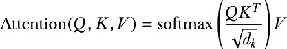

这里 `K^T` 表示 `K` 的转置，它只是将键排列以便与查询比较，`d[k]` 是键向量的大小。然后分数被缩放（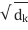）以确保它们保持在稳定范围内，然后通过 `softmax`，在那里它们变成和为 1 的权重，然后用于对值向量进行平均。

在注意力之后，每个词元通过一个前馈网络（`FFN`），它分别对其进行变换。参见图 5.1。在原始 Transformer 中，`FFN` 由两个线性变换组成，中间有一个 `ReLU` 激活。注意力跨词元混合信息，然后前馈网络在每个位置重塑混合表示。例如，一个 512 维向量通过一个线性层扩展到 2048 维，经过一个 `ReLU` 激活以添加非线性成分，然后通过第二个线性层投影回 512 维。残差连接和层归一化稳定了整个堆叠，允许模型在许多层中重复这种模式。前馈层的作用是对注意力后的表示进行非线性变换。

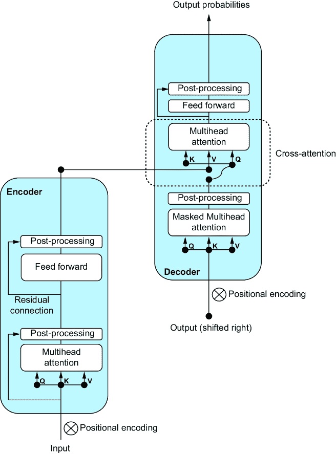

### 图 5.1 Transformer 架构的简化示意图。模型由一个编码器（左）和一个解码器（右）组成，每个都由重复的子层堆叠而成，包括多头注意力机制、前馈神经网络以及残差连接和层归一化等后处理步骤。位置编码（表示为圆圈交叉）被添加到输入嵌入中以显式表示词元顺序。该图强调了交叉注意力操作（虚线框标为“Cross-attention”），其中解码器的查询（`Q`）与编码器的键（`K`）和值（`V`）交互。在交叉注意力期间，每个解码步骤计算注意力分数以确定编码输入表示的相关性，产生引导词元生成的上下文向量。这种选择性对齐使解码器能够整合来自编码器的上下文信息，从而提高输出序列的准确性和连贯性。

解码器类似于编码器，但专为生成而构建。每个解码器层有三个主要部分：掩码自注意力、编码器-解码器注意力和一个前馈网络。与编码器一样，每个子层之后都有残差相加和层归一化。

掩码自注意力的工作方式与普通自注意力相同，除了词元只能关注较早的输出位置，绝不能关注未来的位置。这就是使下一个词元预测成为可能的原因。当生成第三个词元时，模型可以使用前两个，但不能使用第四个。这防止了解码器偷看尚未生成的未来输出词元。这是通过将未来位置的注意力分数替换为负无穷（–∞）来实现的，在 `softmax` 之后将其设为 0。此外，还添加了填充掩码（`<PAD>`）。一批中的序列通常被填充到相同长度，该掩码防止模型关注那些空白的 `<PAD>` 位置，就像它们是真实文本一样。除了掩码和填充之外，该子层的工作方式与编码器的多头自注意力相同，使解码器能够从部分输出序列构建上下文。

第二个解码器注意力块是编码器-解码器注意力，也称为交叉注意力。与自注意力（其中 `Q`、`K` 和 `V` 都来自同一序列）相反，交叉注意力使用来自解码器的 `Q` 和来自编码器的 `K` 和 `V`，使模型能够将生成的文本与输入序列对齐。一个具体的翻译例子使该机制更容易想象。假设源句子是法语的 “Je vais à l’ecole,” 而解码器已经生成了 “I am going to.” 当它即将生成 “school” 时，其当前的解码器状态形成一个查询（`Q`），它可以强烈关注 “ecole” 的编码器表示。与将整个源句子压缩成单个固定长度向量的旧式 `seq2seq` 系统不同，交叉注意力允许解码器在任何生成步骤中查阅任何编码器词元。参见图 5.1。

在交叉注意力之后，解码器应用另一个前馈网络。最后一个线性层将每个解码器向量映射到词汇表中每个词元的分数，然后 `softmax` 将这些分数转换为概率。然后模型可以选择下一个词元，将其追加到输出，并重复该过程。

在原始论文中，该架构同时具有编码器和解码器，因为主要任务是机器翻译。许多现代大型语言模型仅使用解码器的后裔，但核心思想相同：注意力构建上下文敏感的表示，使下一个词元预测有用。

这就是为什么将 Transformer 简化为“仅仅是下一个词元预测器”忽略了重点。是的，目标是下一个词元预测，但实现这一目标的机制远超简单模型中使用的表面预测。关键的设计选择包括注意力、嵌入、位置信息（稍后讨论）以及重复的非线性变换。它们共同使模型能够比早期系统（例如 `n-gram` 模型和 `RNNs`）保留更多的上下文，同时仍保持高度可并行训练。这种组合使得 Transformer 与以往的事物有了决定性的突破。最终，“仅仅”的框架将分层的、微妙的架构扁平化为漫画。事实上，“仅仅”总是暴露点。怀疑论者用它来贬低模型：“它们仅仅是下一个词元预测器。” 狂热者用它来扁平化类比的人类方面：“我们（人类）只是一束神经元”或“仅仅是大规模搜索。” 两者都犯了同样的罪过：还原主义，就像命名一个机制等同于解释它一样。

作者在两个尺度上引入了这些想法：Transformer-base（6500 万参数）和 Transformer-big（2.13 亿参数）。当从“base”扩展到“big”时，作者将模型的宽度和前馈能力都增加了一倍，并增加了注意力头的数量，同时保持每个头的维度不变。这种模块化设计使 Transformer 能够在扩展其表示能力的同时轻松扩展。正如 `ResNet` 所表明的那样，堆叠相同的块可以优于更精细的架构，Transformer 的重复模块简化了扩展，体现了 Ilya Sutskever 的少即是多的哲学，并倾向于标准化、可扩展的设计而非复杂性。

Transformer 的一个无声的革命是它处理序列顺序的方式。没有递归来逐步遍历句子，也没有卷积来扫描它，模型否则无法区分“cat fat”和“fat cat。” 为了解决这个问题，作者在应用自注意力之前向词嵌入添加了位置编码。使用不同频率的正弦函数，模型可以推断绝对位置和相对距离。这为 Transformer 提供了一种轻量级的编码词序的方式，同时仍允许注意力并行地跨越整个序列 [9]。


后续架构对这一方法进行了改进。谷歌的 BERT（2018）用可学习的位置嵌入取代了固定的正弦位置编码，使模型能够在训练过程中优化其位置表示[10]。GPT-2（2019）和 GPT-3（2020）都使用了学习到的绝对位置嵌入。T5（2019）用学习到的相对嵌入扩展了这一想法[11]。最近，LLaMA（2023）使用了旋转位置嵌入（RoPE），将相对位置直接注入注意力机制[12]。总体而言，这些创新凸显了从固定、绝对编码向相对、可扩展和可微分方案的稳步转变。

训练细节完善了论文。作者使用了 Adam 优化器，并采用了特定的学习率调度。学习率在前 4000 个预热步数内线性增加，然后与步数的反平方根成比例衰减。基础模型训练了 10 万步，而“大”模型训练了 30 万步。正则化通过 dropout（应用于子层以及嵌入和位置编码的和）和标签平滑（0.1）实现，这减少了过度自信并提高了 BLEU 分数。BLEU 分数评估机器生成的翻译与人工书写的翻译的接近程度；分数越高表示翻译质量越好。训练在一台配备 8 个 NVIDIA P100 GPU 的机器上进行，使用非常大的批次，每批次约 25000 个源语言和目标语言标记。

### 5.1.1 实验结果

Transformer 在机器翻译中创造了新的最佳水平。它在 WMT 英法基准测试上取得了 41.0 的 BLEU 分数[13]。这一结果超越了之前发表的所有单一模型，包括谷歌大脑的 1370 亿参数稀疏门控混合专家模型，该模型在一篇题为“Outrageously Large Neural Networks”的论文中得到了恰当的描述[14]。

这一结果也标志着相对于第 4 章讨论的选择性 dropout LSTM（ZSV）模型的巨大改进，该模型在相同的 WMT 英法基准测试上取得了 29.03 的 BLEU 分数。在更具挑战性的 WMT 英德基准测试上，“大”Transformer 取得了 28.4 的 BLEU 分数，超越了之前的所有方法，包括深度循环网络的集成。

这一跃变不仅限于 BLEU。第 4 章中的同一选择性 dropout LSTM 模型，使用单个两层 1500 单元模型，将 Penn Treebank 测试困惑度降低到 78.4，超越了 10 模型 RNN（非正则化）集成（80.0）。虽然令人印象深刻，但更长上下文的注意力推动了不同的前沿。2019 年，Transformer-XL 在 WikiText-103（一个单独的、更困难的语料库）上报告了约 18.3 的困惑度，强调了架构转折和规模如何重置了对下一个标记不确定性的预期[15]。

Transformer 训练速度也更快。“基础”模型在 8 个 GPU 上需要 12 小时，而“大”模型则需要约 3.5 天才能达到最先进结果。与逐个标记处理序列的循环模型不同，自注意力在每一层直接将每个标记连接到其他每个标记。这缩短了关联两个标记所需的最小计算路径长度。在实际中，距离不再增加计算成本，“奶酪”可以直接注意“老鼠”，无论它们之间隔了多少个词。这不仅改进了长程依赖的建模，也加快了训练。与需要许多堆叠层来连接远距离位置的卷积模型相比，Transformer 在单次自注意力操作中就能达到相同效果。

作者还测试了模型在翻译之外的泛化能力。他们在《华尔街日报》语料库（包含约 4 万句话）上训练了一个更小的四层 Transformer，用于英语句法分析。在没有针对特定任务的架构修改的情况下，它取得了 91.3 的 F1 分数，超越了先前基于 RNN 的 seq2seq 模型。这表明循环中嵌入的归纳偏差并不像以前认为的那样根本。事实上，循环甚至可能成为负担，增加不必要的复杂性，阻碍并行性，并限制长程依赖建模。

### 5.1.2 通用 Transformer

科学哲学家马克斯·普朗克曾著名地指出，科学范式转变缓慢，不是“通过说服对手让他们看到光明，而是因为对手最终去世……”。这通常被改述为“科学一次葬礼接一次葬礼地进步”[16]。但 AlexNet 引发了立即而决定性的回应。在一年内，ILSVRC 中几乎每个参与者（26 个中的 23 个）都采用了卷积神经网络，标志着计算机视觉的彻底转变。虽然该领域抵制了人工神经网络的理论承诺和早期轶事般的成功，但它立即对经验结果做出了回应。范式转变并没有等待对手去世。

Transformer 并没有产生同样剧烈的动荡。事实上，虽然论文在 2017 年被 NeurIPS 接受，但并没有获得完整的口头报告。相反，它被降级为海报环节和简短的“聚光灯”展示。尽管它在短短几年内重塑了自然语言处理（按历史标准仍然很快），但与 AlexNet 的影响相比，这种过渡感觉几乎可以说是渐进的。一个原因是，尽管有开源代码库，Transformer 被证明具有挑战性实现，这一困难我们将很快更详细地探讨。

另一个原因是，自注意力要求每个标记同时与其他每个标记交互，以捕捉任意距离的关系。如果一个句子有 500 个标记，那对应 25 万对交互。如果它有 1000 个标记，那跃升到 100 万。长度加倍，工作量四倍化。对于机器翻译，序列相对较短，这种二次增长是可管理的。但随着序列长度增加，成本爆炸式增长，使长上下文建模成为严重的计算障碍[17]。

这些担忧抑制了早期的热情，但最持久的反对是概念上的。虽然一些人宣称“国王已死，国王万岁！”其他人则认为 Transformer 缺乏一个关键要素：循环[18]。

这种焦虑呼应了计算机视觉中的一个更早时刻，当时连接主义研究者提出用特征学习替代手工设计的特征。现在，Transformer 去除了显式的语言偏差。批评者认为，没有循环，它是“顺序不可知”的，并将位置编码视为一种临时的权宜之计，而不是真正的替代[19][20][21][22][23]。这种抵抗很大程度上是概念上的，但一些研究人员通过随机重排句子中的单词来测试 Transformer 是否能检测到这种干扰[24]。结果证实了理论上的怀疑：即使有位置嵌入的帮助，自注意力也难以捕捉位置线索。但转折点是，当在机器翻译上训练时，一个对词序高度敏感的任务，Transformer 在学习位置信息方面表现优于循环模型。


这种矛盾揭示了理论直觉的一些问题。它们描述了架构的不足，却未能预见优化、规模和任务需求如何能够弥补这一点。虽然循环（recurrence）为序列顺序提供了优雅的理论先验，但它并非在序列任务上取得强大性能的必要条件。这种对经验清晰性的强调而非理论见解，与苏茨克维的研究哲学高度一致。进步往往源于在规模上细化想法，并通过实验揭示真正有效的方法，而不是依赖研究者仅仅觉得正确的东西。这提醒我们，在深度学习中，进步属于那些在规模竞技场中证明自身的方法。

这种对放弃循环的怀疑很快在谷歌付诸架构实践，而谷歌正是在一年前推出了 Transformer。2018 年，谷歌研究人员提出了通用 Transformer（UT），认为原始 Transformer“在许多循环模型轻松处理的简单任务上无法泛化” [25]。尽管自注意力已被证明可以替代循环，但许多研究者仍然难以释怀。

公平地说，UT 并没有破坏 Transformer 对 GPU 友好的并行性。虽然循环引入了时间步的概念，但 UT 是按深度方向且可并行的，与顺序计算不同。见图 5.2。这种深度循环在多个步骤中并行应用于所有 token，重用相同的自注意力和前馈网络层。这个过程逐步精化表示，同时自注意力在每一步混合跨 token 的信息。在某些条件下，这可以使 UT 具有图灵完备性的理论属性——即在足够的时间和内存下，能够执行传统计算机可以执行的任何计算。

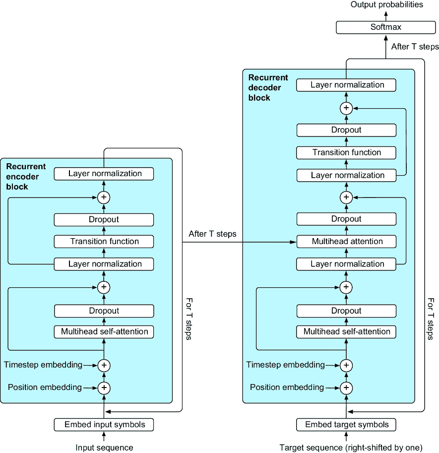

**图 5.2** *通用 Transformer。经主要作者（Mostafa Dehghani）许可使用。*

因此，UT 比循环神经网络更快。尽管如此，它仍比原始 Transformer 慢，且没有明显性能提升。其优势纯粹是概念上的，而 Transformer 所谓的弱点，如缺乏循环和粗糙的位置编码，在更大模型用更多数据训练后，其实影响较小。虽然 UT 体现了一个巧妙的想法，但深度学习更倾向于那些不使优化复杂化的简单设计。

尽管推出了 Transformer，谷歌对其规模化扩张表现出矛盾心态。谷歌的弯路虽然在智识上引人入胜，但暗示了其对标准 Transformer 之所以成为变革性突破的原因存在某种犹豫或困惑。OpenAI 凭借 GPT-2 和 GPT-3 抓住了可扩展性和经验性能。OpenAI 的成功凸显了谷歌最初忽视的一点：Transformer 的繁荣并非依靠精心设计的归纳偏置，甚至不是图灵完备性，而是通过大幅扩展的简单架构。

在 Lex Fridman 播客的一次采访中，伊利亚·苏茨克维认为，“Transformer 之所以成功，是因为它同时结合了多种想法。如果去掉任何一个想法，它的成功程度都会大打折扣。”他指出，Transformer 是可并行的，且“不是循环的……因此更容易优化。”这种分歧凸显了组织文化和领导力的差异如何塑造了现代人工智能的发展轨迹。

这种犹豫不决体现了伊利亚经常谈论的当时谷歌的文化。谷歌重视研究文化，但缺乏决定性的战略清晰度。相比之下，在苏茨克维领导下的 OpenAI 并无此类犹豫。伊利亚在论文发表后的直接反应毫不含糊：“我们现在就要做 Transformer” [26]。

## 5.2 有注释的 Transformer

原始 Transformer 在理论阐述上相对简单，谷歌甚至开源了代码 [27]。事后看来，这一决定具有历史意义，即使其影响在当时未被完全预见。然而，实际实现证明具有挑战性。谷歌的 Tensor2Tensor 库深度嵌入公司内部工具，新手难以理解 [28]。在此背景下，Alexander ‘Sasha’ Rush 的《有注释的 Transformer》脱颖而出 [29]。它通过呈现一个任何人都能理解的简单开源复现，挑战了当时新兴的共识，即 Transformer 极难实现。Rush 将其命名为“Annotated”，以致敬《The Annotated Alice》（《爱丽丝梦游仙境》的注释版），强调了该项目的教学目的。

《有注释的 Transformer》是一个经过广泛注释、逐行实现的版本，大致对应原始 Transformer 论文的各个部分。它涵盖了所有主要组件，包括编码器和解码器堆栈、多头自注意力机制、前馈网络、嵌入和位置编码层，以及训练过程，包括批处理、掩码和优化。该博客的代码与文本混合，使读者可以在概念理解和实现细节之间切换。它也是完全功能化且优化的，仅用 400 行 PyTorch 代码，就能在 4 个 GPU 上每秒处理 27,000 个 token。

Rush 在许多人都渴望理解 Transformer 的时候，为其去除了神秘色彩。这样做，它在 Transformer 领域占据了与 Andrej Karpathy 的“循环神经网络的不合理有效性”和 Chris Olah 的“理解 LSTM 网络”在 RNN 领域相同的文化和教学空间。三者都在深度学习社区准备采纳的恰好时刻，为突破性架构去除了神秘色彩。其平易近人的风格引发了一波类似的“注释”项目，包括“The Illustrated Transformer”、“The Annotated GPT-2”，甚至“The Annotated Diffusion Model” [30][31][32]。这些项目将 Rush 的工作视为对其格式和清晰度的灵感来源。在 GitHub 上获得超过 6,000 个星标和 1,300 个 fork，该代码库已被许多从业者适配用于实验、教学演示和探索 [33][34][35][36]。

## 5.3 Bahdanau 注意力

为了应对机器翻译等任务，伊利亚·苏茨克维、Oriol Vinyals 和 Quoc V. Le 在 2014 年引入了 seq2seq 架构，该架构使用基于 LSTM 的编码器将输入序列（例如英语句子）转换为固定维度的内部表示，再用解码器将该表示转换为输出序列（例如法语翻译） [37]。尽管该论文不在苏茨克维的列表上，但它为后来的突破奠定了基础，包括 Transformer。

其关键创新在于通过将整个序列压缩为一个高维的“思想向量”，实现将可变长度的输入序列映射到可变长度的输出。见图 5.3。但它也带来了瓶颈。一个序列的所有句法和语义——无论是 5 个词还是 50 个词——都必须塞进一个固定长度的向量中。句子越长，这种压缩就越吃力。

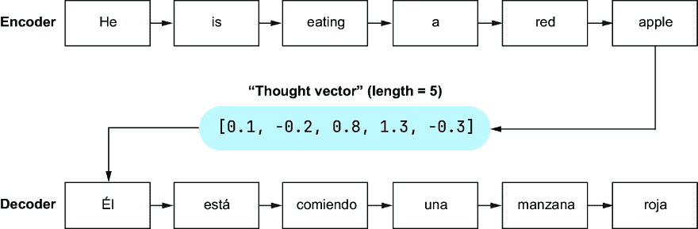

**图 5.3** 编码器在读取每个英语单词时更新隐藏状态。最终隐藏状态成为固定长度的上下文或“思想向量”。解码器使用该向量，加上其已生成的西班牙语单词，来预测下一个西班牙语单词的概率分布。在训练期间，编码器和解码器通过最小化目标翻译的预测误差，从许多成对的源语言–目标语言句子中学习这些表示。


seq2seq 的概念源于更早的嵌入方法。2013 年，Tomas Mikolov、Ilya Sutskever 和 Google 的同事们引入了 word2vec，它从大型文本语料库中学习单词的密集向量表示，使得在相似上下文中使用的单词在嵌入空间中距离更近[38]。这些嵌入因其在词类比中表现出显著的线性规律而广为人知，包括 Hinton 在内的许多人将其视为一种推理形式[39]。

例如，你可能想知道 Paris 的意大利语对应词。Rome 立刻浮现在脑海中。学习到的词嵌入支持这种类型的推断[40]。如果你取 Paris 的嵌入向量，减去 France 的向量，再加上 Italy 的向量，你可能会得到 Rome 的向量，或者至少是一个比其他未参与问题的词更接近 Rome 的向量[41]。见图 5.4。传统自然语言处理研究人员花了数十年试图定义这些概念，但分布式表示打破了这个戈尔迪之结。

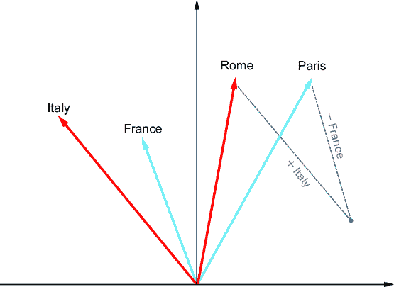

### Figure 5.4 Word-embedding vector operations: `Paris - France + Italy = Rome`

Geoffrey Hinton 普及了“思想向量”这个术语，并在 2015 年的一次采访中提出，将“意义”表示为思想向量可以使机器具有类人的推理能力[42]。这个想法虽然受到直觉支持而非证明，但具有挑衅性[43]。尽管如此，这个短语迅速成为意义神经表征的代名词。理想情况下，这个向量会总结所有必要的语义内容。在实践中，它通常会以随着序列变长和语义丰富而丢失细节的方式压缩信息[44][45]。

根本原因是 RNN 的最终隐藏状态很少能保留来自扩展序列的所有相关信息。序列的早期部分往往在编码器到达终点时被“遗忘”。单个固定维度的向量可能足以处理短句，但随着复杂性和长度的增加，压缩会变得有损。

在他们具有影响力的论文“Neural Machine Translation by Jointly Learning to Align and Translate”中，Dzmitry Bahdanau、Kyunghyun Cho 和图灵奖得主 Yoshua Bengio 引入了注意力机制，现在通常被称为 Bahdanau 注意力[46]。Bahdanau 注意力使解码器在翻译过程中能够动态地关注输入序列的不同部分，而不是依赖单一的思想向量。这一创新使该论文在 Sutskever 的榜单上占有一席之地，并为自注意力和 Transformer 的发展奠定了基础。

#### Model architecture

所提出的架构，即 RNNsearch 模型，由一个编码器和一个通过注意力机制连接的解码器组成：

*   *Encoder*—The encoder uses bidirectional gated recurrent units (GRUs). It processes the input sentence in two directions: one GRU reads it forward (left to right), and the other reads it backward (right to left). Their outputs are joined together so that each word’s representation (an “annotation”) carries information from both directions.
*   *Bahdanau attention*—The attention mechanism lets the model focus on different parts of the input sentence as it generates the translation. At each step, it scores each source word’s relevance, converts those scores into attention weights, and then builds a context vector as a weighted average. This context helps the model decide where to “look” when predicting the next word.
*   *Decoder*—The decoder is another GRU with 1,000 hidden units. At each step, it combines its previous state, the last word it produced, and the current context vector from the attention mechanism. It then produces a probability distribution over the next word in the sequence. Guided by attention, the decoder can shift its focus as needed, improving translation of long or complex sentences.

#### experimental results

The authors evaluated their approach using the WMT English-to-French benchmark. They filtered the original dataset down to about 348 million bilingual words to ensure domain relevance. Sentences were limited to 30 or 50 words. Words not included in this selection were replaced with a special “unknown” `[UNK]` placeholder.

Two baseline models were compared. The first was a basic encoder-decoder model (RNNencdec), which compresses an entire sentence into a single fixed-length vector (that is, a thought vector) before decoding it into a translation. The second was a traditional phrase-based translation system (Moses), which uses large databases of previously translated phrases and a substantial additional language model containing 418 million words.

The proposed attention-based model, RNNsearch, outperformed the basic RNNencdec across all test conditions. When trained on sentences limited to 30 words, RNNsearch-30 achieved a BLEU score of 21.5, compared with RNNencdec’s 13.93. When sentence length was extended to 50 words, RNNsearch-50 increased its advantage, scoring 26.75 against RNNencdec’s 17.82.

The authors also extended the training of the RNNsearch-50 model. They did not change the sentence length limit or the architecture; instead, they gave it more training time. This extended training increased the BLEU score from 26.75 to 28.45, approaching the 33.3 achieved by Moses. Remarkably, when evaluating only sentences without unknown words, RNNsearch-50 even surpassed Moses, achieving a BLEU score of 36.15, while RNNencdec-50 lagged far behind at 26.71. See table 5.1.

#### Table 5.1 BLEU scores for RNN encoder-decoder (RNNencdec) and attention-based (RNNsearch) models across different sentence length caps

| System | Sentence length cap | BLEU (All) | BLEU (no UNK) |
| --- | --- | --- | --- |
| RNNencdec30 | ≤30 | 13.93 | 24.19 |
| RNNsearch30 | ≤30 | 21.50 | 31.44 |
| RNNencdec50 | ≤50 | 17.82 | 26.71 |
| RNNsearch50 | ≤50 | 26.75 | 34.16 |
| RNNsearch50 (longer training) | ≤50 | 28.45 | 36.15 |
| Moses (phrasebased) | — | 33.30 | 35.63 |

As illustrated in figure 5.5, BLEU scores for RNNencdec declined sharply for sentences longer than about 20 words. By comparison, RNNsearch maintained stable performance even for sentences up to 60 words. This demonstrates that attention effectively addresses the fixed-length bottleneck inherent in the standard encoder-decoder framework.

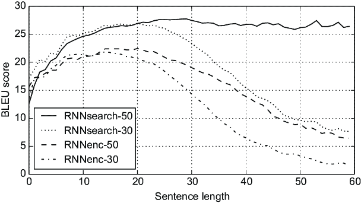

#### Figure 5.5 BLEU scores versus sentence length: the encoder-decoder scores drop steeply beyond about 20 words, while RNNsearch remains stable up to 60 words. *Used with permission granted by the lead author (Dzmitry Bahdanau).*

Another major challenge in machine translation is handling word order. English often places adjectives before nouns, as in “red apple,” whereas Spanish places many descriptive adjectives after the noun, as in “manzana roja.” English phrases can translate into German with significant shifts in word order. “To reach” becomes “zu erreichen” in German, where the verb shifts position. The visual alignments in figure 5.6 reveal mostly monotonic word order between English and French, with prominent weights along the diagonal of the matrix. Nonetheless, some notable non-monotonic alignments emerge. For example, the model translates “European Economic Area” to “zone économique européenne,” aligning “zone” with “Area” while jumping back over “European” and “Economic” as needed. The soft alignment used by RNNsearch addresses this complexity by enabling simultaneous attention to both “zone” and “Area”, resulting in the correct translation.

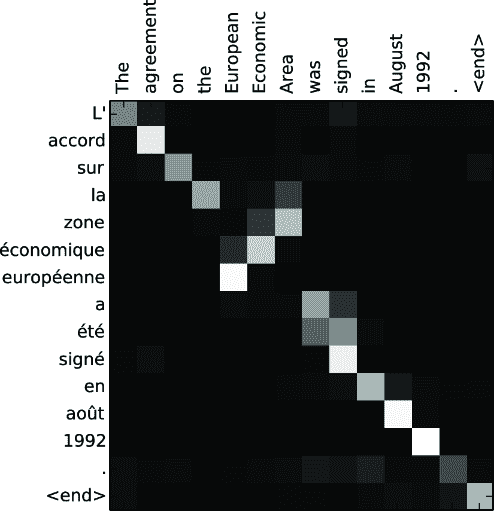


### 图 5.6 展示了由 RNNsearch-50 模型生成的样本对齐。图中的 x 轴和 y 轴分别对应源语言（英语）和目标语言（法语）句子中的单词。像素表示在预测每个目标单词时，注意力机制分配给每个源语言标注的权重，以灰度可视化（0 = 黑色，1 = 白色）。每一行显示了与标注相关的权重，表明在生成每个目标单词时，源语言句子中哪些位置是最重要的。对齐在很大程度上是单调的，每个矩阵中都有强烈的对角权重。然而，也出现了一些非单调对齐。在法语和英语中，形容词和名词的顺序往往不同。例如，“European Economic Area”这个短语被翻译为“zone économique européenne”。模型将“zone”与“Area”对齐，最初跳过“European”和“Economic”，然后重新访问前面的单词以完成整个短语。*经主要作者（Dzmitry Bahdanau）许可使用。*

### 重大意义

“Neural Machine Translation by Jointly Learning to Align and Translate”在 seq2seq 模型中引入了注意力机制，使解码器能够动态地关注输入序列的不同部分，而不是被单个固定大小的上下文向量所约束。这一转变重塑了 Geoffrey Hinton 的“思想向量”概念\[47\]。虽然意义确实可以编码为数字，但将整个句子压缩成一个向量被证明是一个瓶颈。注意力通过允许模型决定输入的哪些部分最重要来打破这一约束。在一年内，几乎所有神经机器翻译研究都采用了某种形式的注意力。

通过直接解决原始编码器-解码器 RNN（即 seq2seq 模型）的“信息瓶颈”，Bahdanau 注意力为 Transformer 奠定了基础。Transformer 可以被视为这一趋势的逻辑结论。Bahdanau 注意力将注意力与 RNN 结合，而 Transformer 将注意力与前馈块结合，没有 RNN。事实上，Bahdanau 的“神经对齐”机制是 Transformer 用于捕获长距离依赖关系而不使用循环的自注意力机制的直接前身。

在过去的十年中，这项工作积累了近 4 万次引用，并在 2025 年被认可为 ICLR Test-of-Time Award 的亚军\[48\]。该认可强调了 Bahdanau 方法动态关注源句子不同部分的概念简洁性和实际影响力。这一成就呼应了 Ilya Sutskever 在 2014 年 NeurIPS 会议上关于 seq2seq 的评论：“最小的创新，最大的效果”\[49\]。就像残差连接一样，Bahdanau 注意力是一个简单的修改，却带来了巨大的好处。

## 5.4 直接指向它！

机器翻译推动了专用架构的发展，包括 seq2seq 模型和注意力机制。这些进步源于翻译可变长度句子和处理语义重排序的结构需求。同样地，组合优化问题迫使了另一场架构飞跃。

当输出词汇表固定时，如在翻译中，seq2seq 工作得很好，但当输出选择必须从输入本身中抽取时，它就会失败。指针网络（Ptr-Net）通过适应 Bahdanau 注意力机制\[50\]解决了这个问题。而不是产生加权平均上下文向量，Ptr-Net 将注意力分数解释为输入位置上的类别分布。模型不生成新符号；而是指向它们（见图 5.7）。这使得 Ptr-Net 能够复制、重排序或动态选择元素，例如旅行商问题中的城市、凸包中的点或调度中的项目。这样做，Ptr-Net 证明了注意力可以作为一种选择机制，而不仅仅是上下文聚合器。

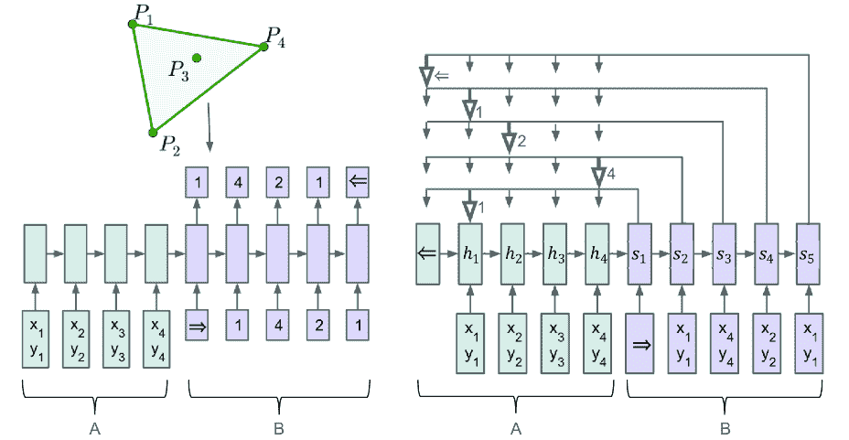

### 图 5.7 一个 seq2seq 模型（左侧）。输入序列（A）创建一个用于生成输出序列（B）的向量。输出维度由问题的维度决定，并且在训练和推理期间保持不变\[51\]。Ptr-Net（右侧）也是一个编码器-解码器。编码器和解码器的隐藏状态分别表示为（`h[1]`,…,`h[n]`）和（`s[1]`,…, `s[n]`）。Ptr-Net 将输入序列编码为一个代码（A），该代码被馈送到生成网络（B）。在每一步，解码器产生一个向量，该向量调节对输入的内容注意力机制。注意力机制输出一个 softmax 分布，其字典大小等于输入长度。*经主要作者（Oriol Vinyals）许可使用。*

### 5.4.1 实验结果

以下实验直接来自 Ptr-Net 论文，并展示了这种架构转变的影响。

#### 凸包

在凸包实验中，序列长度指呈现给模型的输入点的数量。例如，长度为 50 的序列意味着网络接收 50 个二维点，并必须识别形成凸包的子集。序列长度表示任务的复杂性。更长的序列增加了难度，因为随着添加更多点，可能的组合数量会增加。

LSTM 在这项任务中苦苦挣扎：当给定 50 个输入点时，简单的 LSTM 在不到 2%的试验中产生了正确的凸包。添加注意力机制提高了性能，将准确率提高到约 39%。这很惊人，但仍然远非可靠。突破来自 Ptr-Net，它将准确率提高到 72.6%。这确立了 Ptr-Net 作为第一种能够有效扩展到此类组合问题的架构。

更重要的是，Ptr-Net 具有泛化能力。当在一系列长度（5 到 50 个点）上进行训练时，即使在测试比训练期间看到的问题大十倍的问题时，模型仍然保持了准确性。虽然在非常大的尺度（`n` = 500）下，精确顺序准确率下降，但整体几何性能仍然稳健。见表 5.2。

#### 表 5.2 LSTM、带注意力的 LSTM 和 Ptr-Net 在凸包问题上的性能

| Model  || Trained  || Tested  || Accuracy  || Area  |
| --- | --- | --- | --- | --- |
| LSTM  || 50  || 50  || 1.9%  || FAIL  |
| LSTM + Attention  || 50  || 50  || 38.9%  || 99.7%  |
| Ptr-Net  || 50  || 50  || 72.6%  || 99.9%  |
| Ptr-Net  || 5–50  || 100  || 50.3%  || 99.9%  |
| Ptr-Net  || 5–50  || 500  || 1.3%  || 99.2%  |

#### Delaunay 三角剖分

*Delaunay triangulation* 是一种将点集划分为三角形的几何方法。其构造使得三角剖分中任何三角形的外接圆内都不包含其他点。简而言之，它以最大化最小角度的方式从点集创建三角形，避免极其狭窄或细长的三角形。Ptr-Net 在从给定点集中识别正确三角形的任务上进行了测试，本质上是根据 Delaunay 三角剖分的规则预测如何连接点，并且它学会了近似该三角剖分。由于经典的计算几何算法能够精确求解 Delaunay 三角剖分，因此性能可以直接与已知最优解进行比较。虽然网络在更大尺寸下重建整个三角形方面遇到困难，但即使在 50 个点的情况下，它仍然正确预测了超过一半的三角形。这突出了模型学习几何推理的能力，尽管随着复杂性增加，精确准确率急剧下降：

1.  `n` = 5: 准确率 80.7%，三角形覆盖率 93.0%
2.  `n` = 10: 准确率 22.6%，三角形覆盖率 81.3%
3.  `n` = 50: 完美准确率 0%，但三角形覆盖率 52.8%


### 旅行商问题

最终测试是著名的具有挑战性的旅行商问题（TSP）。TSP 是一个经典的计算挑战，涉及寻找通过一组给定城市（或点）的最短可能路线，约束是路线必须在同一城市开始和结束，并且每个城市恰好访问一次。虽然概念简单，但复杂性来自于可能的路线数量庞大，随着每个额外城市而指数增长。由于随着城市数量增加，TSP 很快变得计算上不可行，它被归类为 NP-hard 问题，意味着没有已知的多项式时间算法能够有效地解决所有实例当它们增长很大时。因此，研究人员经常依赖产生好的（如果不是总是最优的）解的启发式算法。

`Ptr-Net`是在较小 TSP 实例的已知最优解样本上进行训练的。训练后，它推广到更大的、未见过的实例。对于多达大约 30 个城市的问题，它始终识别出接近最优的路径，甚至优于它隐式学习的传统启发式算法。这一结果表明，人工神经网络可以学习复杂的优化策略，而无需显式编码它们，只需通过观察和推广先前的解。

表 5.3 显示了旅行商问题上的选定结果。`A1`是一种贪婪启发式算法，从孤立顶点开始，迭代连接两个最近的片段，直到形成单条路径。Christofides 算法（`A3`）是 TSP 广泛使用的近似方法。它构造最小生成树，并对奇数度顶点进行最小权重匹配，保证在满足三角不等式的实例中解在最优路径长度的 1.5 倍以内。

#### 表 5.3 启发式算法（`A1`和`A3`）和`Ptr-Net`在 TSP 上的性能

| 问题规模 | 最优 | `A1` | `A3` | `Ptr-Net` |
| --- | --- | --- | --- | --- |
| 5 | 2.12 | 2.18 | 2.12 | 2.12 |
| 10 | 2.87 | 3.07 | 2.87 | 2.88 |
| 25 | N/A | 4.71 | 4.24 | 4.30 |
| 50 (A1 Trained) | N/A | 6.46 | 5.79 | 6.42 |
| 50 (5–20 Trained) | N/A | 6.46 | 5.79 | 7.66 |

值得注意的是，即使在最弱的启发式算法（`A1`）上训练，`Ptr-Net`也学会了超越其老师。这表明网络正在从训练数据中提取更深入的见解，而不是仅仅模仿其来源。在较小的问题规模下，性能几乎完美，但在`n` = 50 时失效，尽管它仍然远好于随机。相比之下，对于凸包，作者能够推广 10 倍，可能是因为 TSP 更复杂。

传统架构在这些类型的任务上面临困难。`Ptr-Net`背后的突破是重新思考注意力机制。而不是仅仅使用注意力权重来创建用于从固定词汇表预测单词的“上下文向量”，`Ptr-Net`直接将注意力权重用作输入位置上的概率分布。在这里，注意力分布作为最终输出，而不是作为中间步骤。这种转变类似于“描述你所看到的”和“指向它”之间的区别。指向更直接。虽然`Ptr-Net`没有扩展到非常大的问题实例，但它证明了人工神经网络可以纯粹从示例中学习近似 NP-hard 组合优化问题的解。`Ptr-Net`还预示了 Transformer，通过展示注意力不仅是帮助循环模型的工具，而且是一种能够独立构建输出和表示的通用机制。

### 5.4.2 意义

而不是从固定词汇表产生符号，网络使用注意力权重指向输入序列中的一个元素作为输出。这种对注意力的简单而强大的修改使神经模型能够处理诸如排序、凸包检测和 TSP 等任务，在这些任务中输出是输入上的位置。

`Ptr-Net`不仅在这些组合问题上取得了令人印象深刻的结果，而且展示了推广到训练中未见过的输入长度的能力。这种指向行为也预示了后来的复制和生成机制。例如，后来的自然语言处理模型增加了复制机制，在生成输出时，使模型能够通过从源文本中选择来直接复制罕见或词汇表外的标记[52]。

指针概念本质上是注意力的应用，强化了灵活注意力寻址是这些论文中统一创新的主题。`Ptr-Net`和 Bahdanau 的注意力都说明了当神经网络能够根据需要回指特定输入元素时，表现更好，而不是将所有内容压缩到单个隐藏状态。

## 5.5 神经图灵机

神经图灵机（NTMs）由 Alex Graves、Greg Wayne 和 Ivo Danihelka 于 2014 年提出。它们将人工神经网络与外部可微记忆[53][54]配对。而不是将所有内容塞进隐藏状态，网络可以使用外部记忆作为草稿板来记录它以后可能需要的内容。这种设计使 NTMs 能够处理算法任务，如复制、排序和联想回忆。

NTM 由一个相对较小的*控制器网络*组成，最初是 LSTM，以类似于传统循环神经网络的方式处理输入和生成输出。然而，与标准 RNN 不同，计算与记忆分离。控制器通过称为头的专门机制访问记忆，这些机制类似于注意力。读头选择性地从记忆中检索信息，写头根据指令修改记忆。见图 5.8。至关重要的是，控制器与记忆之间的交互是完全可微的，意味着它们可以表示为平滑的数学函数。这一属性支持基于梯度的优化，允许系统在训练期间自动调整其参数。

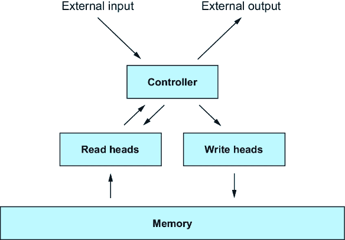

### 图 5.8 神经图灵机架构。控制器网络接收输入，产生输出，并管理外部记忆。读写头在记忆上移动以存储和检索信息。

为了选择性地访问记忆，控制器产生定义记忆位置上的概率分布或权重的向量。网络必须访问记忆的特定区域而不是全部。这种软注意力形式实现了选择性的、有针对性的记忆访问，并需要两种互补机制：

*   *基于内容的寻址*根据控制器的查询向量与记忆内容之间的相似性检索信息。这些相似性分数通过余弦相似性计算，由锐度参数缩放，并使用 softmax 函数归一化。这种方法产生可微的联想记忆，类似于后来在 Transformer 中普及的查询-键注意力机制。

*   *基于位置的寻址*按位置检索项目，从而高效处理诸如复制或排序等结构化任务。


NTM 注意力通常被称为 Graves 注意力，以主要作者（Alex Graves）命名。这是解决长期动态记忆挑战的早期尝试。Ilya Sutskever 指出，现代神经网络主要将长期知识存储在静态参数中，缺乏有效的动态记忆。在实践中，上下文窗口和检索增强系统充当了一种不可微分的短期记忆形式，部分解决了静态记忆的局限性[55][56][57][58]。

### 5.5.1 意义

NTM 将 RNN 与外部读写存储器耦合，网络可以通过注意力读写头与之交互。这种设计类似于具有可微分存储器的计算机，其中控制器使用注意力来确定读写位置。结果表明，NTM 可以从示例中学习复制、排序和召回等简单算法。尽管它们难以训练且在实践中未被广泛采用，但其可微分存储器访问的核心概念在概念上与 Transformer 相关。你可以将 Transformer 视为这一想法的更简单、隐式版本。它没有单独的存储器矩阵，但自注意力机制允许每个位置从序列中的所有其他位置读取，有效地将序列本身用作存储器。

## 5.6 顺序很重要

"顺序很重要：集合的序列到序列"由 Oriol Vinyals、Samy Bengio 和 Manjunath Kudlur 撰写，探讨了排序如何影响 seq2seq 模型的性能[59][60]。传统的 seq2seq 模型本质上假设顺序结构，例如在语言翻译或句子生成中。然而，许多现实世界任务涉及无序数据，包括组合问题和复杂图结构。作者引入了架构和训练修改，以减轻任意排序的影响。

如前所述，seq2seq 模型使用 RNN 顺序处理输入，这使得它们本质上对数据呈现的顺序敏感。Ilya Sutskever 证明，反转输入数据的顺序可以（反直觉地）提高神经机器翻译；我们稍后将更详细地探讨这一点。类似地，在指针网络中计算凸包之前对点进行排序，可以将准确率提高多达 10 个百分点。同样，RNN 训练的有效性很大程度上取决于数据呈现的顺序。选择糟糕的顺序可能会减缓甚至阻碍模型的有效学习。

为了处理无序输入，"顺序很重要"引入了读-处理-写（RPW）编码器（见图 5.9）：

*   *读取*—输入集合的每个元素被嵌入到共享存储器矩阵中，就像将所有项目写到白板上而不关心顺序一样。
*   *处理*—LSTM 控制器使用平等对待每个项目的注意力机制从此存储器重复读取。这确保了无论输入如何排列，表示都保持稳定。
*   *写入*—编码器通过注意力重新访问此存储器，将其精炼为解码器的稳定表示。

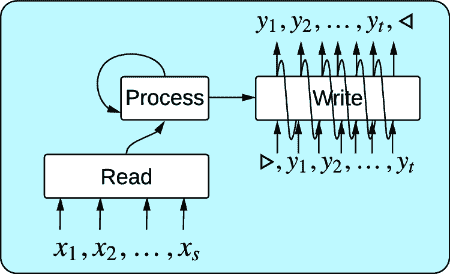

### 图 5.9 读-处理-写将输入序列读入存储器，使用基于 LSTM 的循环控制器进行处理，并写出输出序列。读取模块对输入进行编码，处理模块在关注存储器的同时迭代更新隐藏状态，写入模块一次生成一个标记的输出，并将其自身的预测反馈为输入。解码器输出之间的箭头突出了自回归循环，其中每个生成的标记都会影响下一个标记。*经主要作者（Oriol Vinyals）许可使用。*

有趣的是，将输入嵌入到存储器矩阵中也是指针网络的核心。在这种情况下，存储器充当了一个列表，解码器在生成输出时可以直接"指向"它。相比之下，`RPW`编码器主要使用其存储器来构建强大的、顺序不变的表示。

作者提供了几个例子，展示了排序如何影响模型性能。他们考虑了三种排序：自然（即"This is a sentence."）、逆序（即".sentence a is This"）和固定的三词反转（即"a is This <pad>. sentence"）。最后一种排序破坏了句子的底层结构，打乱了自然的词汇分组，使模型更难捕捉语言模式。在以下例子中，作者强调任意排序引入了不必要的复杂性，阻碍了学习过程的效率：

*   *语言建模*—当将自然顺序的句子与使用固定三词反转重新排序的句子进行比较时，模型性能下降，导致困惑度上升 10 点（从 86 到 96）。这种增加表明更大的不确定性和不太准确的预测。
*   *成分句法分析*—解析树转换为序列的方式会影响模型性能。一个选项是深度优先排序，其中模型在移动到下一个分支之前探索树的一个分支到其最深的节点。另一个是广度优先排序，它逐级进行，在移动到下一层之前覆盖给定深度的所有节点。深度优先排序保留了句子的嵌套层次结构，并产生显著更高的准确率（89.5% F1），优于广度优先排序（81.5% F1）。
*   *组合任务*—在排序数字或解决旅行商问题等问题中，输出的顺序很重要。通过强制固定的输出顺序，模型避免了在许多仅顺序不同但同样有效的解上浪费资源，例如始终以相同的起始位置列出城市。这减少了搜索空间，加速了训练，并提高了准确率。
*   *图模型似然估计*—在合成星形图上进行训练时，当中央"头部"节点首先呈现，然后是其连接的节点时，模型更容易学习。这种排序简化了模型必须捕捉的结构。在非常大或高度确定性的数据集中，这种优势会消失，因为模型可以有效地学习，无论顺序如何。在大多数情况下，选择正确的输入顺序可以使训练更快、更高效。

当输出是无序集合时，传统的 seq2seq 模型面临一个问题：它们必须致力于单一的线性顺序，尽管存在许多等价的顺序。糟糕的选择可能会减缓甚至阻碍学习。对于输入是集合但输出是序列的任务（例如数字排序），`RPW`编码器通过提供强大的表示来帮助，解码器可以从中学习自然顺序，例如升序。当输入和输出都是无序集合时，`RPW`编码器确保编码器对排列不变。同时，特别设计的损失函数让模型在训练期间发现合适的顺序。而不是提前固定一个顺序，模型首先将所有顺序视为同样可能，然后逐渐转向它预测最好的那些顺序。

在实验中，这种自适应策略始终找到最优或接近最优的顺序。例如，在涉及 5-grams 的说明性实验中，它自动识别了最优或接近最优的输出顺序，将困惑度从糟糕的固定顺序下的约 280 显著降低到学习到的最优顺序下的约 225。诸如`RPW`之类的排列不变编码器还使网络能够更有效地学习自然顺序。即使像 Transformer 这样基于注意力的模型——比 RNN 对顺序变化更稳健——仍然受益。最终，这项工作表明神经网络仍然对数据排序敏感。


《顺序至关重要》的意义在于，它揭示了序列到序列模型存在一个缺陷，即它们假定输入顺序，即使对于不存在自然顺序的问题也是如此。该论文证明，仅仅因为输入的顺序不同，模型的输出就可能发生改变。通过将这个问题框定为一个通用问题，并尝试用注意力作为补救手段，它为能够更灵活处理输入的架构奠定了基础。事后看来，它预见了注意力在将模型从关于信息必须如何结构化的僵化假设中解放出来方面将发挥的更广泛作用。

## 5.7 反转输入句子

《顺序至关重要》表明，seq2seq 将同一集合的不同排序视为不同的输入，并提出了使模型更具顺序不变性或学习规范顺序的方法。虽然该论文的具体内容与变换器有些分离，但它强化了这样一种观点，即序列模型必须考虑数据的结构特性，在这种情况下是顺序敏感性或缺乏顺序敏感性。

然而，《顺序至关重要》的教训超出了集合问题和组合任务。顺序敏感性不仅在合成实验中显而易见，在实践中也是如此。最引人注目的例子之一是由伊利亚·苏茨克维（Ilya Sutskever）及其同事在 2014 年的 seq2seq 论文中提出的\[61\]。

在目标保持不变的情况下，他们发现反转输入将 BLEU 分数提高了近 5 分，并将困惑度从 5.8 降至 4.7，这表明预测更精确，模型不确定性更低。有一段时间，这个“反转源”技巧成为了 seq2seq 翻译系统的标准做法。

例如，法语序列中的第一个单词可能对应于英语序列中的第一个单词。在标准的编码器-解码器中，解码器在编码器读完整个源句子之前不会开始生成。这意味着第一个源单词必须经过每个编码器步骤才能影响第一个目标预测。这就像沿着一长排人传递耳语：队伍越长，末端的信号就越弱。

反转源顺序缩短了这条路径。第一个单词现在位于编码器的末尾，因此它对解码器的初始状态具有最强的影响。实际上，第一个源单词在开始时就与解码器相邻，从而更容易对齐源序列和目标序列的开头。正如苏茨克维所解释的，反转输入“大大减少了”源和目标第一个单词之间的处理延迟，使反向传播在建立它们的连接方面更有效。见图 5.10。

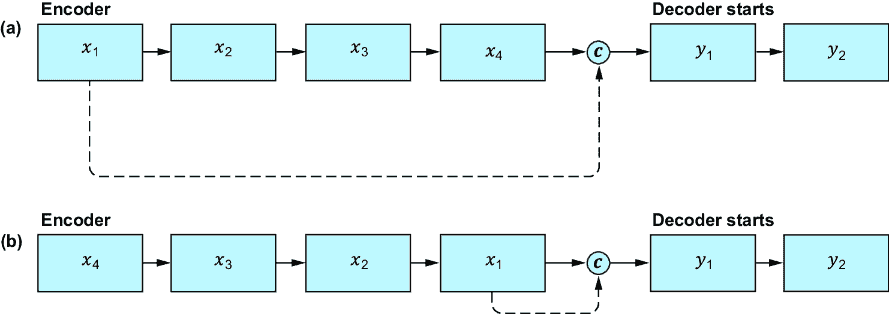

*图 5.10 反转技巧缩短了从相关源标记到解码器首次预测的路径。在没有注意力的普通 RNN 编码器-解码器（a）中，解码器从编码器的最终状态开始。反转源（b）使得对早期输出重要的标记在编码器的处理中出现得更晚，因此它们的影响更直接地到达解码器。*

模型并没有变得更聪明；它只是得到了一个更容易的优化问题，因为有用信息到达所需位置的路径更短。总体而言，更短的有效路径长度和改善的梯度流使基于 RNN 的编码器-解码器的训练问题更容易。此外，如果经常对齐的源单词更靠近解码器的初始状态，解码器就不需要维护复杂的长时记忆状态。因此，梯度下降过程面临的障碍更少，收敛更快，泛化更好。然而，反转输入也突出了架构中的弱点，并进一步推动了创新，例如注意力机制，使模型能够忽略单词顺序访问信息。

苏茨克维的 seq2seq 论文《顺序至关重要》和吴明长（Minh-Thang Luong）的论文《基于注意力的神经机器翻译的有效方法》（引入了点积注意力机制）都使用了反转技巧。吴明长报告说，在 WMT 2014 英德任务中，反转源句子将 BLEU 提高了 1.3。有一段时间，这是强制性的，就像早期卷积网络中的批归一化和早期深度全连接网络中的随机失活一样\[62\]。

随着领域的发展，研究人员分析了这种反转技巧，并引入了更复杂的方法，如双向编码器、注意力机制和位置编码，从而减少了反转序列的需求。例如，Bahdanau 注意力允许解码器在每一步关注任何编码器隐藏状态\[63\]。双向编码器以两个方向处理源，使模型能够学习长距离对齐，而不需要反转输入。到 2017 年，许多神经机器翻译（NMT）研究人员使用了双向编码器（捕捉前向和后向上下文）或某种形式的注意力。

一项实证研究检查了在许多 NMT 配置下源反转的效果。它证实，对于基于单向 RNN 的编码器，反转输入始终优于未反转版本。在单层和两层编码器中，这种效果在统计上是显著的\[64\]。这与早期的直觉一致，即仅前向的编码器受益于源的开头更靠近解码器的起点。研究人员还发现，即使后者使用反转，双向编码器也优于单向编码器。

此外，随着编码器深度增加到四层或更多层，反转序列的优势下降了。通过堆叠多个 LSTM 层并使用残差连接，模型获得了更大的保留信息的能力，减少了对手动序列反转的需求。这些发现表明，反转主要是对更简单或更浅的架构有帮助的辅助手段。

这种实践的另一个方面是它取决于语言对和词序。当源和目标大致单调时（即顺序相似），反转技巧最有效。苏茨克维的英法翻译符合这种情况，因为两者都是主谓宾语言（SVO）。但如果翻译涉及不同的词序，例如从 SVO 语言翻译成主宾谓语言，反转源可能会破坏自然对齐。

在这种情况下，源的第一个单词可能对应目标的*最后*一个单词，因此将源的第一个单词移到末尾实际上可能*错位*序列。一项针对中日 NMT（两种词序不同的语言）的实证研究发现，反转输入句子降低了翻译质量\[65\]。尽管有用，但这种技巧并非普遍有益，而是在源序列和目标序列预期按顺序对齐的任务中最有效。

变换器联合考虑所有位置，不受 RNN 从左到右记忆限制的影响。因此，它们不需要源反转，也没有基于变换器的现代 NMT 系统使用这种技术。相反，长距离依赖问题通过注意力和位置编码来解决。

尽管如此，反转输入句子的历史做法仍然是一个富有启发性的例子，说明了在注意力前和早期注意力时代，顺序确实至关重要，那里存在一种巧妙的优化技巧。这种技术在 2014 年至 2016 年的 NMT 研究中被广泛使用，并取得了切实的收益。但随着架构超越使其必要的限制，其相关性逐渐减弱。

## 5.8 效果


虽然对 Transformer 最重要的批评集中在它们缺乏循环性上，但最令人难忘的批评来自华盛顿大学的 Emily Bender，她创造了病毒式隐喻“随机鹦鹉”\[66\]。

她片面的论点强调了语言模型对概率模式匹配和记忆的依赖，而不是真正的理解。

语言模型确实在不考虑意义的情况下生成输出，并且本质上受到它们训练数据的限制。

然而，这种批评自我削弱了，因为它所谴责的东西也是它的超能力。

也就是说，Transformer 并没有失败；它们非常成功，以至于它们的输出可以欺骗我们，让我们相信它们理解了。

从这个意义上说，批评陷入了一个悖论：语言模型不是因为失败而受到批评，而是因为它们在被设计来执行的任务上表现得太好了。

毕竟，当 Andrej Karpathy 撰写关于 RNNs 的不合理有效性时，没有人这么说，当时他还在庆祝同样的概率模仿。

区别在于 RNNs 从来没有欺骗过任何人。Transformer 做到了。

“随机鹦鹉”的文化共鸣强调了 Transformer 对期望的颠覆有多深。

这个标题成为了一个流行语，被爱好者和怀疑论者 alike 使用。

爱好者将其提升为战斗口号，暗示注意力是实现通用人工智能（AGI）所需要的一切\[67\]。

怀疑论者将其扭曲为“注意力*不是*你需要的一切”，将支持者描绘为天真地相信注意力可以产生 AGI\[68\]。

但两者都歪曲了原意。这篇论文并不是关于智能的笼统陈述，也不是对 AGI 的预测。

相反，它传达了一个精确的、务实的见解：循环和卷积，以前被认为是不可或缺的架构，可以被一个更简单、更可扩展的机制所取代。

尽管如此，这个短语开始出现在许多语境中，有时作为讽刺模板，有时作为对其巨大影响的致敬。

最近对 arXiv 标题的分析发现，在戏仿“你需要的一切”的论文中呈指数增长，有超过 700 篇这样的论文\[69\]。

“注意力”是被引用最多的术语，有 28 篇论文使用了“注意力就是你需要的一切”这个短语\[70\]。

这个流行语甚至在 meme 追踪网站 Know Your Meme 上有记录\[71\]。

研究人员、专家、影响者和怀疑论者通过替换新词来改编这个公式：“数据就是你需要的一切”、“扩展就是你需要的一切”和“强化学习就是你需要的一切”\[72\]\[73\]\[74\]。

一些条目将 meme 推向了讽刺的境界。例如，“金钱就是你需要的一切”戏谑地捕捉了社区的愤世嫉俗，认为向问题扔钱就会产生最先进结果\[75\]。

同样，一篇愚人节风格的论文题为“一个 23 兆瓦的数据中心就是你需要的一切”，讽刺地暗示 AI 进步需要手头有一个闲置的 23 兆瓦数据中心\[76\]。不是每个人都有吗？

社区笑了，但这些笑话带有尖锐性。这种戏谑的评论源于广泛的猜测，即像 GPT-3 这样的模型需要数百万美元来训练，加剧了关于财务规模而非学术创新性是否已成为 AI 进步决定性因素的辩论。

事实确实如此，迹象早在 2019 年 7 月就很明显，当时微软向 OpenAI 投资了 10 亿美元\[77\]。

金钱是一个催化剂，这些 meme 预见了一个前所未有的规模时代刚刚开始。

一旦注意力解除了顺序瓶颈并实现了大规模并行训练，资本就变得决定性了。

Transformer 成为新浪潮 AI 的象征，以至于它的一位合著者（Llion Jones）在 2023 年半开玩笑地哀叹该领域围绕 Transformer“钙化”了，可能会忽视其他想法\[78\]。

换句话说，有些人怀疑 Transformer 是否变得过于主导，这证明了该架构的统治程度。

这种转变是深刻的。神经机器翻译和神经序列建模长期以来一直被循环是必不可少的假设所定义。

研究人员甚至在这个时期开玩笑说他们辛苦获得的循环神经网络专业知识突然过时了，因为注意力使其不那么相关了。

RNNs 占主导地位是因为它们自然地按顺序处理单词，并且通过巧妙的优化如分解和条件计算，它们变得更快更实用\[79\]\[80\]。

卷积方法，如 ByteNet 和 ConvS2S，也展示了处理序列数据的能力。

通过引入扩张卷积（第 3 章）来扩大上下文窗口，它们扩展了感受野，表明局部滤波器可以被拉伸以捕获更广泛的上下文。

然而，尽管它们取得了进展，但两种架构都带有结构性限制。

循环网络难以在长序列上并行化，而卷积网络则依赖于固定的、局部的交互\[81\]\[82\]。

即使有扩张，卷积编码器-解码器模型仍然有限。

这些约束为 Transformer 铺平了道路，它用一个大胆的、挑衅性的主张抛弃了两者，简洁地体现在其论文标题中。

Transformer 不依赖于循环（信息通过隐藏状态顺序传播）或卷积（通过局部交互组合上下文），而是完全依赖于序列内的自注意力。

仅靠注意力，没有循环，没有卷积，没有任何显式的序列归纳偏差，就能执行复杂序列转换的想法，不仅仅是一个技术建议；它是哲学性的。

它暗示了语言的结构，长期以来被认为需要逐步处理或局部聚合，可以从一开始就被非局部操作捕获。

不仅可以做到，而且可以做得更好、更快、更便宜。

Transformer 表明循环是一种便利而非必要，并揭示了扩展是机器学习进步的主要驱动力。

最终，循环和卷积不需要葬礼。它们进行了抵抗，但最终变得不必要。注意力可能并不是字面上的“你需要的一切”，但它肯定足以拆除关于神经序列建模中*本质*结构的根深蒂固假设。

在 Sutskever 列表中的论文中，“注意力就是你需要的一切”是最有影响力的。

它的核心想法成为了一个标志性的流行语，超越学术界被广泛认可，并且*2025 年自然*分析将这篇论文列为 21 世纪被引用次数最多的论文第七名。

Sutskever 列表中只有一篇论文排名比它高\[83\]。

虽然残差连接默默地实现了更深层的网络，但注意力重新定义了我们与技术的关系\[84\]。

在 ChatGPT 发布的前夕（2022 年 11 月 29 日），Ilya Sutskever 宣称：“Transformer 这个名字取得很好，因为它改变了一切”\[85\]。

自从 AlexNet 以来，扩展一直在后台默默运转，等待合适的架构来释放其全部潜力。

有了 Transformer，Ilya 找到了一种被设计用来*成长*的形状。

现在的问题是扩展能将这种新架构推多远，以及可能会出现什么新能力。

这些问题将是下一章的重点。

