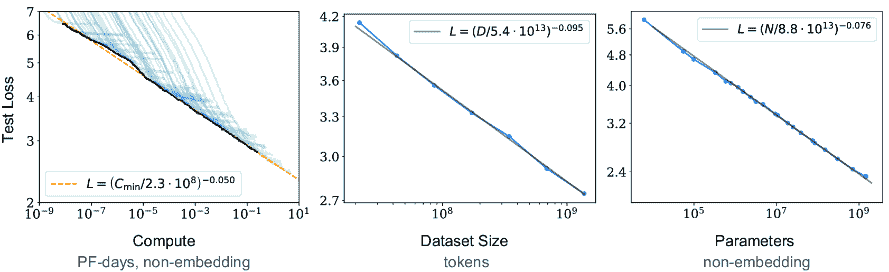
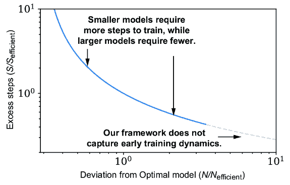
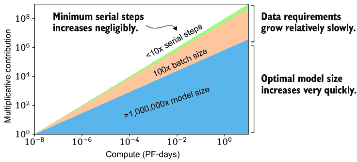
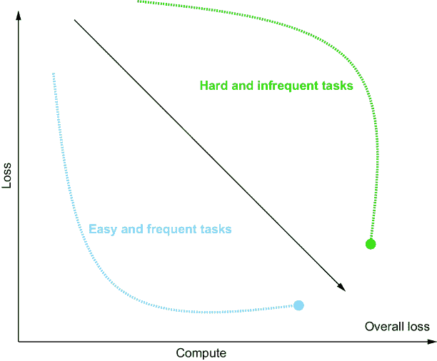
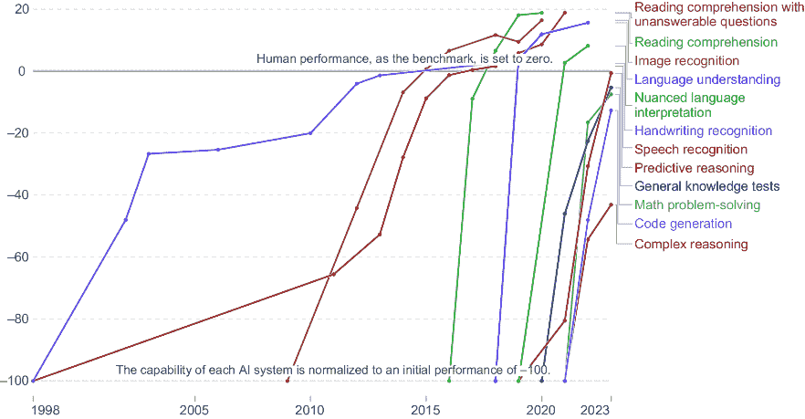
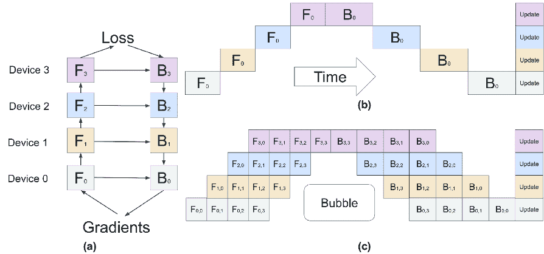

# 6 超大规模的诞生

## 本章涵盖

*   扩展准则：Kaplan、Chinchilla 和后 Chinchilla 扩展定律

*   通用人工智能的火花和涌现行为

*   平滑损失、锯齿评估和逆扩展

*   隐蔽的工作：数据和模型并行性

*   GPipe 和流水线并行性

## 论文

*   *神经语言模型的扩展定律* (2020) Kaplan 等人。

*   *GPipe：使用微批次流水线并行性的轻松扩展* (2019) Huang 等人。

现代人工智能表明，更大的模型表现更好。最明显的例证来自从 GPT-2（2019 年）到 GPT-3（2020 年）的性能飞跃。以今天的标准来看，GPT-2 相当普通：它拥有 15 亿个参数，并在一个相对狭窄的数据集 Reddit 上进行训练。尽管如此，它还是凭借诸如奥维德的独角兽（第 1 章）这样的例子吸引了公众的想象力。这篇文章在语气和风格上如此令人信服，以至于它重置了人们对机器生成文本的期望，几乎所有人都忽略了它是经过精选的，并且包含了诸如“四角独角兽”这样的矛盾修辞参考。

仅仅一年后，OpenAI 发布了 GPT-3，它在更多数据上进行训练，成本以数百万美元计 [1]。研究人员没有重新设计架构。他们只是将模型大小增加到 1750 亿个参数，大约是 GPT-2 的 117 倍。但他们这样做是充满信心的，因为他们已经发现了所谓的缩放定律。这些定律表明，随着模型大小、数据和计算资源的扩展，训练损失会平稳下降。然而，出现的结果却让人感觉完全不可预测。GPT-3 在没有任务特定微调的情况下展示了上下文学习和任务能力。

这些通常被称为 *涌现能力*：在较小模型中仅以随机水平出现的技能，但一旦达到一定的规模阈值，就会在更大的模型中涌现，通常相当突然。例子包括多步推理、多位数算术、在未明确训练过的语言之间进行翻译，或基本代码生成 [2][3][4][5][6]。然而，基准测试可以使这些能力看起来是一起到达的，而底层的损失曲线仍然 largely 平稳且可预测。因此，我们所谓的“涌现”反映的是测量的怪癖，而不是模型能力的尖锐不连续性。

尽管如此，缩放定律给了这个领域一些以前从未有过的东西。随着规模的增加，收益会递减，但这种关系足够一致，可以为研究人员提供进展的路线图 [7]。几十年来，人工智能的进展一直不均衡，其特点是偶尔的算法突破 followed 长期的平台期和偶尔的寒冬 [8]。突然之间，进展的配方变得简单。对于一个长期习惯于罕见、来之不易的收益的学科来说，这种加速是非凡的。

## 6.1 缩放经典

2017 年，百度的 Joel Hestness 及其同事绘制了深度学习在不同模型家族中如何缩放的图谱，包括 ResNets（第 3 章）、Deep Speech 2（第 4 章）和基于注意力的编码器-解码器（第 5 章）[9]。他们证明，模型误差与数据集大小之间存在可预测的幂律关系。然而，令人震惊的是，这些架构并没有改变这些曲线的斜率。改进的速度（即，随着模型在更多数据上训练，误差下降的速度）在给定的领域内保持不变。各种架构改变的是截距。

也就是说，更好的模型家族将整条曲线向下移动，带来更低的误差，但它并没有使曲线变得更陡峭。视觉领域的 ResNets，以及由此延伸的语言领域的 Transformers，整体上推动了准确性的提高，但规模决定了斜率。正如论文所说：“改进的模型架构和优化器可以改善幂律截距，但不能改善指数；单个领域的模型显示出相同的学习曲线陡峭度。”

这意味着，一旦架构规模确定，后续的进展就变成了一个预算问题。这就是为什么该领域从新颖性转向了扩展模型并为其提供更多数据和计算。虽然 Transformers 没有在 Hestness 的论文中被评估，但它为更详细的缩放定律奠定了基础。三年后，OpenAI 的 Jared Kaplan 及其团队利用这一见解构建了“神经语言模型的缩放定律”（2020 年），这是一篇入选 Sutskever 列表上的论文。

Sutskever 列表上的大多数论文都提供了一个干净利落的飞跃（例如 ResNet 或 Transformers），像 AlexNet 或 Deep Speech 2 这样的工程杰作，或者一个明确界定的实验发现，例如 Pointer Networks 或 Order Matters。Kaplan 的论文不同。它运行了近 30 页，提出了耦合的幂律，映射了损失和非嵌入参数、数据集大小、计算、训练时间和步骤之间的相互作用，以及批量大小理论、过拟合行为和形状不变性结果。本章关注的是 *什么* 和 *为什么*，同时保留了主要思想并以通俗语言进行解释。

### 6.1.1 Kaplan 缩放定律

Kaplan 缩放定律解释说，当模型大小、数据和计算协同缩放时，性能会平稳提高，尽管收益递减。例如，将参数数量（`N`）翻倍会使误差减少约 5%（技术上是 `2^(-αN)` 的因子，其中 `αN` ≈ 0.076）。将训练数据（`D`）翻倍大致带来 6% 的误差下降（`2^(-αD)`，其中 `αD` ≈ 0.095）。参见图 6.1。虽然从绝对值来看并不大，但在一个很少有稳定规律的领域中，它是稳定且可靠的。

**Figure 6.1** Language modeling performance improves smoothly as model size, dataset size, and amount of compute used for training increase. For optimal performance, all three factors must be scaled up in tandem. Empirical performance has a power-law relationship with each factor when it isn’t bottlenecked by the other two. *Used with permission granted by a coauthor (Ben Cross).*

尽管如此，有一个重要的约束。在固定大小的数据集上，通过添加参数来缩放模型最终会阻止测试损失的改善，并且推动模型收敛可能会加速收益递减，甚至引入过拟合。Kaplan 及其同事发现，这种平衡遵循其自身的方程，其中数据随模型大小次线性增长（大致为 `D α N^(0.74)`）。也就是说，如果模型参数的数量翻倍，数据集不需要翻倍。相反，它应该增长约 1.7 倍。将模型大小增加三倍，相应的数据集应该增长约 2.3 倍以保持同步。如果模型被缩放 117 倍（GPT-2 → GPT-3），数据集应该增加约 34 倍。这种关系帮助研究人员使更大的模型更高效。

最后，计算的问题。与数据集一样，训练预算通常是有限的，本能的做法是训练一个较小的模型直到收敛。但 Kaplan 的分析显示了相反的情况。在固定预算下，从业者最好训练一个大得多的模型，但只训练更少的步骤。更大的模型更有效地吸收数据；每个计算单位带来的改善比在更小的系统中更大。这意味着进步不仅仅是关于原始马力，还关乎如何明智地在参数、数据和训练时间之间分配规模。参见图 6.2。

**Figure 6.2** Models larger than the compute-efficient size require fewer training steps, potentially enabling faster training if sufficient additional parallelism is possible. *Used with permission granted by a coauthor (Ben Cross).*

这项研究专注于仅解码器的 transformers。谷歌在 2018 年引入了仅解码器的 transformer，即在原始 Transformer 之后的一年。它比原始版本更好地处理长输入序列，并且比其编码器-解码器对应物更容易扩展 [10]。作者在仅解码器的模型旁边训练了几个基线 [11]。

实验涵盖了广泛的模型和数据集规模，从 7.68 亿到 15 亿非嵌入参数，以及从 2200 万到近 230 亿训练令牌。作者将模型大小定义为非嵌入参数的数量，因为令牌和位置嵌入在较小模型中可能主导参数数量，而不会显著增加模型容量。相比之下，非嵌入参数的数量取决于网络的深度和层宽度。批大小（在每个训练步骤中并行处理的令牌数量）随模型和数据集规模而变化；最大的运行使用了约 500,000 令牌的批。

为了将规模与形状隔离，作者改变了层数、前馈子层的宽度以及注意力头的数量，同时保持与当时常见设计实践一致的比例。他们还改变了内部向量表示的维度，即模型的隐藏大小（`d[model]`）或每个令牌特征向量的长度。这些架构变化使作者能够研究每个变量的孤立效应，同时保持现实的架构规模和形状[12]。

训练通常持续约 250,000 步，或者直到分配的计算预算耗尽，如果验证损失稳定，则提前结束运行。大多数模型使用 Adam 优化器进行训练，但最大的模型（超过 10 亿参数）使用 Adafactor 来减少内存使用[13]。学习率采用了 3,000 步预热，然后余弦衰减至零，作者发现，只要值合理，最终性能对确切的时间表并不高度敏感。

### 6.1.2 形状重要吗？

研究表明，性能强烈依赖于规模，而对形状的依赖较弱。这里，形状指的是参数在架构内的分布方式。例如，他们比较了少量宽层与许多薄层的配置，所有配置的参数数量相同。他们还调整了前馈层相对于隐藏大小的宽度。最后，他们改变了自注意力头的数量。

在这些变化中，损失仅变化了几个百分点。只有极端的形状，例如少于两层的形状，才表现出显著的性能下降。这些结果强调了早期创新的重要性，例如注意力机制和残差连接，这些首先使得训练深度、宽度的模型成为可能。同样关键的是批归一化、仔细的权重初始化、优化器创新、层缩放技巧（如学习率预热以稳定训练），甚至随机失活。有了这些突破，确切的排列和参数比例就不那么重要了；决定性因素是模型中的参数数量。

### 6.1.3 随数据和模型规模扩展

模型在 WebText2 上训练。原始 WebText 数据集随 GPT-2 引入，并由 Ovid's Unicorn 推广。WebText2 将该集合扩展到约 2000 万文档。分词后，语料库包含约 230 亿令牌，即模型在训练期间处理的输入单元。

当模型大小保持恒定而训练数据量变化时，性能遵循一条平滑、可预测的曲线，更多数据改善结果。数据扩展的曲线比模型大小的曲线略陡，表明增加数据集大小比单独增加参数带来更大的改进。但每次数据增加仍导致损失的逐渐减小。这种模式不仅对 WebText2 成立，而且在维基百科和书籍等分布外语料库上的相同模型也成立。这些数据集的改进曲线与分布内曲线大致平行（在对数尺度上），并偏移一个常数间隙，表明扩展的好处很好地转移到新的数据源。

当模型大小、数据和计算一起扩展时，作者还揭示了一些更微妙的东西：那些递减回报的速率可以被管理。作者通过将结果与*无限数据极限*进行比较，该极限代表模型在无限训练数据下可能达到的最佳性能，使得过拟合不可能发生。在实践中，当模型超出数据集并开始记忆时，就会发生过拟合。

Kaplan 量化了如何保持该曲线的弯曲不过早出现。每次模型参数增加约八倍时，数据集大小必须增加约五倍（`D` `α` `N^(0.74)`）以保持泛化。这个 8 倍参数、5 倍数据规则表明数据需求随模型大小亚线性扩展，使得越来越大的模型可行，而不需要数据一对一增长。在 2020 年，这是一个大事件。它提供了第一个直接、定量的配方，用于一起扩展模型和数据集。更大的模型不需要成比例的数据增长，使得训练千亿参数模型成为可想象的事，这正是 OpenAI 用 GPT-3 所做的。

该框架还为研究人员提供了一个诊断工具，以确定模型是否仍在扩展曲线上。如果性能开始比定律预测下降得更快，则表明扩展机制之外的某些东西出了问题。“扩展机制”保持所有变量（例如，架构、目标、分词器、上下文长度、优化器时间表和数据分布）恒定。每个机制都有其自己的曲线，具有不同的斜率。可能存在数据质量问题、过度重复的令牌或优化瓶颈导致性能漂移。例如，假设一个 500 亿参数的模型相比 200 亿参数的模型没有改进。那就是一个危险信号，表明设置已偏离了预期的斜率。

### 6.1.4 扩展计算

最终问题是性能如何随计算扩展，以及如何花费固定预算。首先，有*最佳批大小*[14]。回想一下，批大小指的是在每个训练或优化步骤中并行处理的令牌数量。训练步骤是单次参数更新。模型获取一批训练示例，计算该批的损失和梯度，然后让优化器（例如 Adam）更新一次权重。如果批太小，模型就会爬行前进。进展嘈杂，需要太多微小的更新。如果批太大，每一步都会对越来越多冗余示例求平均。作为一般规则，在最佳点附近训练可以使硬件保持忙碌，浪费很少。在实践中，该点通常位于达到目标精度所需的最小步骤数的约 2 倍和最小唯一数据量的约 2 倍。

其次，存在*数据量的极限*，这指导如何在增加模型大小和延长训练时间之间分配计算预算。对于任何固定预算，都有一个合适大小的模型和一个合适长度的训练运行。构建一个太大的模型并训练它太短暂，你会为未使用的容量付费。保持一个太小的模型并永远训练它，你是在打磨一个无法表达其训练数据的模型。这些边界之间的路径描绘了一条前沿。随着预算增长，必须同时增加模型大小和训练时间以保持平衡。后来的工作表明，许多前沿模型处于大但训练不足的一侧，需要重新平衡以每个参数更多数据来产生更好的结果。我们稍后会讨论这一点。

在语言建模的计算最优区间内，将总计算量翻倍只会使损失降低 3%至 4%，这小于通过扩展数据或参数所带来的收益。然而，更大的模型更具样本效率。也就是说，它们可以用更少的标记和更少的参数更新达到给定的损失，从每个单位数据中提取更多信息。关键结论是，将计算分配用于延长小模型的训练是低效的，而将其分配用于容量（并相应增加数据）则会产生复合收益。

Kaplan 还表明，计算高效的训练在远未达到收敛之前就停止。收敛意味着训练运行已基本稳定，额外的周期几乎不产生任何改进。计算高效的模型训练的步数较少，但可以优于一直训练到完成的更小模型。在这种情况下，早停起到了正则化的作用，抑制了记忆化，同时仍允许更大的网络利用其容量 [15]。净效果是直觉的逆转。进展并非来自训练到收敛，而是来自规模。聪明的投入应该用于容量，而不是将一个小模型拖过终点线。

为了说明这一点，作者们询问了如果计算预算增加十亿倍会发生什么。大部分计算应该用于使模型更大，因为更大的模型更具样本效率，并且每个标记提取更多信息。数据集大小只需适度增加数倍即可避免过拟合，而以步数衡量的训练时间几乎不会变化。见图 6.3。

**图 6.3** 作者展示了在计算量增加十亿倍的情况下如何分配训练资源。为了实现最优的计算高效训练，大部分增长应该用于扩大模型大小。只需要相对少量的数据增长就可以防止重复使用。在额外的数据中，大部分可以通过使用更大的批次大小来增加并行性，这只需要极少地增加串行训练时间。*经合著者（Ben Cross）许可使用。*

### 6.1.5 架构比较

Kaplan 团队将仅解码器的 transformer 与 GPT-1（另一个仅解码器模型）、原始 Transformer、长短期记忆（LSTM）和循环通用 Transformer 进行了比较。LSTM 尽管在非常短的序列上表现相当，但很快趋于平庸，显示出无法利用长上下文或随参数数量扩展。通用 Transformer 凭借其循环精炼机制和参数复用，实现了略高的每参数效率，但在相同规模下需要更多的计算。这些结果表明，扩展曲线并非单一架构的产物。相反，它们反映了语言建模的更普遍规律。同时，它们澄清了仅解码器 transformer 特别擅长的地方，尤其是在跨长上下文保持性能以及在规模上更高的计算效率 [16]。

### 6.1.6 扩展假设

尽管是量化的“定律”和稳步改进，但卡普兰曲线在小范围的内部人士之外基本未被注意到。最早理解其重要性的外部人士之一是 Gwern Branwen，这是一个远离主要实验室的独立研究者的笔名。2020 年 5 月，他发表了一篇题为“扩展假设”的博客文章。该文章病毒式传播，推测智能可能仅仅从规模中涌现 [17]。

然而，卡普兰的论文是一项实证研究。它不是一份宣言。Gwern 将这些曲线转化为一种激进的智能理论，远远超出了卡普兰的谨慎框架。他的挑衅引发了人们对扩展的极大热情，并且似乎在几周后 GPT-3 发布时获得了势头，它似乎体现了扩展假设和“规模的祝福” [18][19]。

这一论点在 2023 年的 GPT-4 中达到了顶峰，据报道它拥有近 2 万亿个参数 [20]。微软研究人员在一系列任务中测试了它，包括数学、法律、编程、计算机视觉和推理。他们的报告“人工智能通用智能的火花”表明，规模已经将语言模型推向了狭窄专业化之外的领域，一度看起来令人不安地接近通用智能 [21]。

此后不久，研究人员用更平淡的术语重新诠释了那些所谓的“火花”。一篇题为“自回归的余烬”的论文表明，看起来像通用人工智能（AGI）的“火花”的东西更好理解为自回归训练的“余烬” [22]。“自回归的余烬”认为，推理和抽象的惊人闪光不是通用智能的标志，而是将这种下一词预测过程扩展到极端维度的副作用。结合起来看，*火花*和*余烬*突出了这个时期的扩展叙事；一个捕捉了涌现能力的兴奋，而另一个提醒我们，智能不仅仅是扩展自回归模型的问题。

尽管如此，扩展定律是机器学习中最接近免费午餐的东西，不是因为它们便宜，而是因为它们将进步从发现转移到执行。与“没有免费午餐”定理形成对比，该定理表明没有优化方法在所有问题上都普遍优越，扩展定律表明规模可以可靠地推动改进，而无需新架构 [23]。至关重要的是，这些定律之所以重要，只是因为早期的突破已经提供了一个可扩展的架构。卡普兰及其同事只是正式化了经济论点，即更大的模型是计算的更好利用，而不是追求新架构。萨顿的“苦涩教训”认为使用更多计算的通用方法优于手工制作的解决方案，提供了方法论的对应物 [24]。它们共同创造了一个理由，为什么该领域应该押注规模，而 OpenAI 抓住了这一点，将规模不仅视为一种训练策略，而且是一种企业哲学。

### 6.1.7 Chinchilla 和后 Chinchilla

扩展的清晰图景并没有持续太久。2022 年，DeepMind 的 Jordan Hoffman 和同事们用 Chinchilla 扩展定律挑战了卡普兰的处方。卡普兰已经表明，训练步数更少的大模型可以优于训练到完成的小模型。这推动了领域向更大的模型和比例更多的数据发展，而不是更长的训练运行。但 Chinchilla 揭示，许多这些模型训练不足，添加数据可以释放架构中的空间 [25]。

通过分析超过 400 个 transformer 模型，大小从 7000 万到 160 亿不等，训练标记高达 5000 亿，DeepMind 发现对于那个时代的 transformer，最优的标记到参数比大约是 20:1 [26]。这一结论挑战了卡普兰对模型大小的偏见。但教训本身并不新鲜。“不要让模型挨饿数据”正是 Halevy、Norvig 和 Pereira 在 2009 年关于“数据的不合理有效性”的文章中给出的建议，与 Efros 的“花哨”叙事精神相呼应。发生改变的是现在可以测量这些权衡的规模和精度。

使用这种最优的 token 与参数比例，作者们证明，拥有 1750 亿参数、在 3000 亿 token 上训练的 GPT-3 远非最优，每个参数大约有 1.7 个 token。根据 Chinchilla 论文，GPT-3 本应要么小得多，大约 150 亿参数，要么在大约 3.5 万亿 token 上训练，以充分利用其参数。这种不匹配解释了为什么 Chinchilla 最优模型经常优于更大的同类模型，包括 Megatron-Turing NLG（530B）、Gopher（280B）、Jurassic-1（178B），甚至 GPT-3（175B），所有这些模型都曾饱受数据匮乏之苦。

这一洞察改变了行业。“Chinchilla-optimal” 成为有效平衡大小和数据的模型的代名词。据报道，OpenAI 训练 GPT-4 时每个参数使用的数据量远超以往模型 [27]。Meta 的 LLaMA 2（2023）采用了相同的方法，为一个 700 亿参数的模型使用了 2 万亿 token（每个参数约 30 个 token）。这是 GPT-3 训练数据的六倍 [28]。LLaMA 3.1 的训练 token 数量几乎是 LLaMA 2 的 10 倍，这促使该领域质疑 Chinchilla 的比例是严格规则还是仅仅是指导方针 [29]。甚至有人宣称 Chinchilla 已经死了 [30]。

TinyLlama 是推动 Chinchilla 缩放定律的一次尝试，它使用 3 万亿 token 训练一个仅 11 亿参数的模型，每个参数产生近 3000 个 token [31]。然而，在 2023 年底进行的为期数月的现场实验中，TinyLlama 仅达到了与类似大小模型相当的水平。这表明模型能有多小存在极限：低于该点，训练数据无法弥补参数的缺乏，缩放定律可能不适用于模型大小与数据集大小的极端比例。

这一时期可能被称为后 Chinchilla 缩放定律，重点在于训练每个参数使用远多于 Chinchilla 建议的 token 的模型。2024 年 4 月，Llama 3 在 15 万亿 token 上训练 [32]。对于 80 亿参数的模型，Chinchilla 最优 token 数量约为 1600 亿，对于 700 亿参数的模型，则约为 1.4 万亿。然而，Meta 训练的模型中，80 亿参数模型的 token 与参数比例约为 1875:1，700 亿参数模型的比例约为 214:1。

与 Kaplan 原始定律的对比很有启发性。Kaplan 假设了“无限数据极限”，并在实验上限为 230 亿 token 的情况下，得出结论认为扩展参数是前进的最佳途径。Chinchilla 将范围扩展到 5000 亿 token，并证明对于中等大小的模型，性能随着更多数据而继续提升，向数据方向转移了平衡。但随后发生的事情，包括 TinyLlama 和 LLaMA 3，并不是对 Chinchilla 的否定，而是对其边界的探索。Kaplan 强调参数；Chinchilla 恢复了一些平衡；后 Chinchilla 实验测试了其极限。

随着 DeepSeek，缩放再次发生了转变。2025 年 1 月，DeepSeek 向公众发布，它展示了高端模型可以以数百万而非数十亿的成本进行训练，震惊了世界 [33][34]。DeepSeek 将成本降低了 40% 以上，并将吞吐量提高了近六倍 [35][36]。捕捉这种情绪，一篇直截了当地题为“够了！不要再扩展 LLM 了！让我们专注于降级”的论文敦促研究人员通过更具创新性、更低成本的策略来追求规模收益 [37]。

如今，关于前沿缩放的讨论已经安静下来。Kaplan 和 Chinchilla 是公开的里程碑，但来自万亿 token 训练运行的新见解因企业知识产权而丢失。在数十亿美元的风险下，实验室不再分享他们的曲线。我们只能通过泄露和推断间接地看到它们。虽然“缩放定律”仍然是一个活跃的研究领域，每年都有多部作品发表，但前沿缩放定律的时代几乎在一开始就结束了 [38]。

## 6.2 缩放绕道

批评者迅速指出，缩放定律并非一成不变。2022 年，Gary Marcus 写了一篇题为“深度学习正在撞墙”的博客文章。该文章走红。其中他说：“所谓的缩放定律不是像引力那样的普遍定律，而只是可能不会永远有效的观察。”他补充说：“的确，我们可能已经在深度学习中遇到了缩放极限，也许已经接近收益递减的点” [39]。

Marcus 是对的。缩放定律不像引力，尽管没有人认为它们像引力。它们是经验性的稳定改进规律，但需要注意。但援引“收益递减”并未抓住关键。曲线已经表明收益递减，但它们预测了可靠的进步。实际的问题不是“我们是否在接近收益递减的点？”而是“下一个能力增量是否值得边际成本？”在规模的早期年代，答案是明确的肯定，而且轻松的胜利无处不在。近年来，斜率已经下滑，从业者已经转移了杠杆，关注数据质量、上下文长度、指令调整、工具使用和推理等方面（第 7 章），同时保持缩放主干完好 [40][41]。

对缩放定律更深层的挑战不在于它们所谓的短暂性或有充分记录的收益递减，而在于它们不均匀的行为。缩放定律在纸上看起来平滑，但在实践中它们是嘈杂、脆弱和不均匀的。训练损失表现得像统计平均值，并且可以从上游损失以惊人的精度预测，这在这种混乱的经验科学中是罕见的。但特定能力和下游性能的可预测性就差得多。涌现能力可能突然出现，而逆缩放则表明某些任务在规模上表现更差。在 GPT-2 和 GPT-3 的发展过程中，研究人员提出了诸如“算术何时会出现？”或“模型何时开始编码？”等问题。答案不是渐进的改进，而是突然的阈值，一旦模型跨过这些阈值，能力似乎就打开了。

一项元分析发现，在只有 39% 的案例中，与线性缩放定律有紧密的拟合 [42]。在其余 61% 中，曲线不可预测地弯曲；一些任务进入平台期，一些下降，另一些在长期的平坦表现后急剧上升 [43]。简而言之，缩放定律提供了有价值的经验指南，但从未保证。

### 6.2.1 锯齿状

缩放定律描述了随着参数、数据和计算资源的增加，训练损失如何下降，但仅在特定的体制内。最终，训练运行会遇到障碍：它可能耗尽数据，分词器或优化器可能改变，或者规则本身可能改变。在对数-对数图上，这看起来像拼接在一起的直线段。然而，它不是一条单一的通用直线；它是分段的，有扭结和新段。关于*断裂缩放定律*的工作将这些体制变化形式化，并展示了为什么即使在体制内损失曲线看起来稳定，能力也可能跳跃 [44]。

这也解释了为什么能力似乎出现涌现。大多数评估是阈值化的，包括精确匹配和胜率。交叉熵的微小平滑下降可以使许多临界项目从几乎正确翻转为正确，因此测试分数跳跃，即使训练曲线看起来良好。OpenAI 联合创始人 Greg Brockman 推文说：“评估令人惊讶地往往就是你需要的一切” [45]。虽然曲线大致平滑，但重要的是评估所揭示的内容。曲线告诉你在哪里投入计算；评估告诉你何时跨越体制边界以及哪些能力真正开启了。

模型级评估，如测量大规模多任务语言理解（MMLU）、小学数学 8K（GSM8K）、BIG-bench 和人类最后的考试，报告了在问答、数学、指令遵循和代码方面的准确率或通过率[46][47][48][49][50][51]。在数千个项目中，即使训练损失仍然平滑，这样的波动也会导致任务性能出现台阶、平台和下降。进步感觉就像在爬一个缺了台阶的楼梯，而不是一条平滑的下坡路。对于更广泛的受众，这些分数被进一步重新表述为人类可读的阈值，这些阈值隐藏的和暴露的一样多：“通过了律师资格考试”[52]、“SAT 分数”、“博士水平”[53]、“比放射科医生更好”[54]。这些标签将多维的能力概况压缩为单一的社会信号。它们有用但不完整。

没有基准测试能覆盖现代模型可能输入的空间，评估不可避免地只对更大分布的一小部分进行采样。这种采样差距解释了为什么新的优势和新的失败模式经常在部署后出现。它还澄清了如何解释预训练中明显的“魔力”或“火花”[55]。下一标记预测训练了一个文本模型，而世界只能间接进入，通过人类选择写、注意和重复的内容进行过滤。

从这种意义上说，语言模型可以近似一个世界模型，足以产生类似理解的行为，但这种理解是通过语言介导的，并且仍然受分布限制。因此，性能与训练分布紧密相连。该分布包括人类生成的对世界的描述，而不是直接访问世界，并且系统并没有系统地超越它（至少目前还没有）。因此，数据中频繁出现的模式被更完整地学习，而罕见的、缺失的或系统性描述不足的模式仍然薄弱。见图 6.4。

**图 6.4** 模型会更容易学习一些任务，而不是其他任务。简单的任务在密集数据中频繁出现，而困难的任务在稀疏数据中很少出现。

即使两个任务看起来同样复杂，模型也会偏向在训练数据中表示更好的那个，因为即使在确定性提示下，输出概率也会引导响应。这可能导致不均衡的能力。多位算术可能在`n`位数字下有效，而在`n + 1`位时失败。检索可能保持`L`个标记的上下文，而在`L + 1`个时出错。推理可能链接`k`步，而在`k + 1`步时步履蹒跚。在代码中，模型可能构建一个以变色美国国旗为特色的简单网站，却无法生成一个播放“生日快乐”的蛋糕，尽管在任务复杂性上显然相似[56]。有时，这就像知道如何系右鞋带，却不会系左鞋带。这一悖论引发了关于可靠性和鲁棒性的争论，尽管模型变得更加一致。

有时差异更大。在某些基准测试中，更大的模型随着规模扩大表现更差，至少在一段时间内是这样。当更大的模型在额外的规模、改进的数据或精炼的训练方法恢复之前，更自信地抓住虚假模式时，就会出现这种反向缩放和相关的 U 形曲线。这就是为什么缩放定律能很好地预测损失，但难以预测下游任务的性能。然而，准确率可能会起伏不定、平台期、反转，然后继续攀升[57][58]。

最终，缩放定律以惊人的精确度预测，随着参数、数据和计算的增加，训练损失将如何下降。这使得它们对于规划预算和预测总体进展非常宝贵。它们没有告诉我们模型何时会突然处理算术、编写代码或可靠地计划。这些能力出现得不均匀。通用基准测试让我们更好地了解下游性能，但它们只能走这么远。

### 6.2.2 污染

在评估语言模型性能方面也存在方法论上的障碍。例如，当训练数据无意中包含测试集中的元素时，就会发生数据泄漏（测试集污染）。生成模型在互联网规模的数据上进行训练，已经见过数万亿个标记。随着模型规模的扩大，它们获得了更大的容量来存储和重现训练文本，但记忆不仅由大小驱动。重复、冗余和训练持续时间强烈影响哪些内容被逐字保留。因此，越来越难以确定一个基准测试是否在预训练期间被有效地“看到”，无论是直接还是通过训练语料中的密切变体。

第一代基准测试，如 ImageNet，讲述了一个进步的故事。AlexNet 在 2012 年的突破将错误率减半。在几年内，ResNet 超越了人类标注者，基准测试很快饱和。污染不是一个问题。数据集是受控的并被广泛研究。重要的是架构和优化。一旦饱和，这些基准测试就不再是有用的进步指标。

更新的语言基准测试（例如 SQuAD 和 GLUE）分布在 GitHub 仓库、机器学习教程和 Hugging Face 库中。随着网络规模预训练的兴起，来自 SQuAD 或 GLUE 的示例越来越有可能被直接纳入训练语料。结果，重叠是可能的，一些收益——特别是在广泛流传的项目上——被部分夸大。这种影响是真实的但不是彻底的，因为规模和架构仍然占收益的很大一部分。

即使是部分污染也会夸大结果。一旦发布就饱和的基准测试失去了其诊断能力。见图 6.5 [59]。它们变得脆弱，容易被规模和数据泄漏所利用。这些数据集的可见性使得它们可用于可重复性，也使得它们容易渗透[60][61]。来自*LM 污染指数*的分析表明，许多著名的评估数据集被证实受到污染，而许多其他数据集看起来可疑[62]。这意味着，当定量进展报告仅基于语料库衍生的基准测试时，它们可能不如看起来那样可信。

**图 6.5** 折线图（1998–2023）显示了多个序列，在 2018 年后急剧上升，朝着阅读理解、代码生成、数学问题解决和复杂推理的“人类表现=0”线前进，表明基准测试快速饱和。

研究人员现在正在设计更具挑战性和全面的测试。目标是探测推理、抽象和泛化。这催生了诸如 HELM、MMLU、BIG-Bench Hard、GSM8K、人类最后的考试和 ARC 挑战赛等基准测试[63]。这些更困难的基准测试揭示了能力悬垂问题。模型通常具有直到有人测试它们才显现的能力。但一旦经过测试，它们就不再是可靠的衡量标准，这是一类“古德哈特定律”的形式[64]。

## 6.3 并行性

缩放可能听起来很简单。但每一步尺寸的增加都会暴露内存、计算和通信方面的新瓶颈。虽然缩放曲线暗示了不可避免性，但工程上并非如此。

早期的缩放策略是*数据并行*。数据通过在每个 GPU 上复制整个网络来保持模型同步。通常，每个模型副本被喂入一批不同的数据，然后梯度通过“全归约”操作求和，以确保每个副本保持同步[65][66]。数据并行是高效且直接的，但一旦参数数量超过单个设备的内存容量，复制就变得不可行[67]。

Unlike data parallelism, which replicates the whole model on every GPU, *model parallelism* splits a single model across multiple devices. AlexNet demonstrated an early form of model parallelism. ImageNet was large enough to justify a larger model, so Krizhevsky, Sutskever, and Hinton split AlexNet across two GPUs, with each GPU handling half of the feature maps and cross-GPU communication limited to the third convolutional layer, where the two halves reconnect. They limited communication to specific layers to keep it inexpensive. More connections meant more communication; fewer connections meant cheaper transfers. They chose a pattern that kept communication a small fraction of the total computation while still allowing information to mix when needed. This was a crude early form of tensor sharding done by hand.

A quick note on tensors: a *tensor* is a container for numbers. A single number is a zero-dimensional tensor, a list of numbers is a one-dimensional tensor (that is, a vector), a grid of numbers is a two-dimensional tensor (that is, a matrix), and higher-dimensional tensors are stacks or cubes of numbers. Deep learning models store their weights, activations, and data in tensors. *Sharding a tensor* means splitting those numbers across devices so no single GPU has to store everything. AlexNet hand-rolled this sharding, which suggests that early scaling limits emerged first in VRAM and interconnect bandwidth. Later systems, such as GPipe (2018) and Megatron-LM (2019), generalized these ad hoc tricks into principled forms of pipeline and tensor parallelism.

## 6.3.1 GPipe

GPipe introduced pipeline parallelism. Instead of having every GPU carry the full model, GPipe sliced the model into stages and spread them across devices. Training batches were then split into many smaller “micro-batches” that moved through the stages in a steady stream. While one stage was handling one micro-batch, another stage was already working on the next. This overlapping schedule kept accelerators busy and increased throughput. See figure 6.6.

**Figure 6.6** Pipeline parallelism compared to naive model parallelism. (a) A simple neural network partitioned across four accelerators, with forward passes *F*[0] – *F*[3] flowing upward and backward passes *B*[0] – *B*[3] flowing downward to compute gradients. (b) In naive model parallelism, layers are split sequentially across devices. Because each stage must wait for the previous stage to complete, much of the hardware remains idle, leading to low utilization. (c) Pipeline parallelism mitigates this inefficiency by splitting each mini-batch into smaller micro-batches. These micro-batches flow through the pipeline in a staggered fashion, keeping devices busy by processing different micro-batches simultaneously. While idle-time bubbles still appear during the pipeline “fill” and “drain” phases, overall utilization improves significantly. Gradients are accumulated across micro-batches, and updates are applied synchronously at the end of each full batch. *Used with permission granted by the lead author (Yanping Huang).*

GPipe solved two major challenges that earlier model-parallel approaches struggled with. First, it avoided “stale weights.” Rather than updating parameters at different times in different places, GPipe accumulated gradients from all the micro-batches and applied a single, synchronized update at the end of each full batch. Second, it tackled memory limits through activation checkpointing (i.e., recomputation). Instead of storing every intermediate activation, it recomputed selected activations during backpropagation. This trade-off of a little extra compute for a lot of saved memory, unlocked models that would otherwise be impossible to fit.

The paper “GPipe: Efficient Training of Giant Neural Networks Using Pipeline Parallelism” appears on Sutskever’s List and was the first to show researchers that scaling wasn’t just about more GPUs or more data. It could also come from rethinking how to organize the work. The results were striking.

## 6.3.2 Results

The authors evaluated GPipe’s performance and scalability on two architectures: a convolutional neural network (AmoebaNet) and a Transformer. The experiments focus on how much GPipe improves training speed as more accelerators are used, how it enables larger models by alleviating memory constraints, and the overhead it incurs (for example, idle time and communication overhead).

The most immediate advantage of pipeline parallelism was its reduced memory usage. Without GPipe, a single GPU with 8 GB of memory could train only a modest AmoebaNet of about 82 million parameters before running out of space. By partitioning the model across eight GPUs, GPipe stretched this limit more than 20-fold, to a 1.8-billion-parameter AmoebaNet.

The gains were even more dramatic for Transformers. On TPU hardware, a single 16 GB device can store approximately 282 million parameters. A tensor processing unit (TPU) is Google’s custom-built hardware accelerator designed to run and train artificial neural networks. With GPipe and 128 TPU partitions, the team trained a Transformer with 83.9 billion parameters across 128 layers. This is nearly 300 times the size achievable on a single device.

As mentioned firstly, the authors split the model’s parameters across multiple devices. Secondly, they used rematerialization. Together, these techniques enabled models that, at the time, were almost unimaginably large.

Throughput was the other half of the story. Pipelining allows different micro-batches to be in different parts of the network simultaneously, keeping devices busy. The authors demonstrated that as long as the number of micro-batches was at least equal to the number of partitions, idle time (or “bubbles”) could be almost eliminated. In practice, this meant that adding more accelerators yielded nearly proportional increases in training speed. For the Transformer experiments, an eight-partition pipeline achieved a 6.3× speedup over a single partition, approaching the ideal eightfold speedup. The uniformity of the Transformer layers made it easy to divide work evenly, further improving scaling efficiency.

AmoebaNet, by contrast, scaled less cleanly. Convolutional networks have layers with differing computational costs, making partitions harder to balance. On eight GPUs, the authors observed a 3.5-fold speedup rather than the ideal eightfold. Yet even here, GPipe delivered meaningful gains as long as enough micro-batches were used to keep the pipeline full. But the experiments also highlighted a downside: if only one micro-batch was used per step, there was no pipelining, and all but one accelerator remained idle.

The paper also demonstrated GPipe’s ability to achieve state-of-the-art results through its scale. The authors trained AmoebaNet-B, scaling it to 557 million parameters [68]. Partitioned into four stages and trained across four accelerators, the model reached 84.4% top-1 accuracy on ImageNet-2012. At the time, this set a new benchmark for single-model performance on ImageNet.

The team also tested transfer learning. The 557-million-parameter AmoebaNet-B, trained on ImageNet, was fine-tuned on a range of other vision datasets, including CIFAR-10 and CIFAR-100, Stanford Cars, Oxford Pets, Food-101, FGVC Aircraft, and Birdsnap. The large ImageNet-pretrained model consistently outperformed or matched the state of the art, often by comfortable margins. On CIFAR-100, for example, the error rate dropped from 10.7% to 8.7%. These findings reinforced the idea that a better ImageNet model yields better transfer results, and GPipe enabled the training of even better ImageNet models by easing size constraints [69].

Transformer 实验扩展到了多语言机器翻译。团队训练了一个单一的 Transformer 来将 102 种语言翻译成英语。数据集包括 250 亿个示例，涵盖了高资源语言和低资源语言。在 GPipe 之前，完成这项任务所需的模型规模太大，无法高效训练。借助 GPipe，研究人员训练了几个规模逐渐增大的模型。他们从一个基线 Transformer 开始，大约有 4 亿参数，约为 Transformer-big（“Attention Is All You Need”中介绍的最大模型）的两倍，然后进一步扩展。其他模型规模包括一个深度为 128 层的 Transformer，拥有 13 亿参数；一个宽度为 13 亿参数的模型，具有更大的隐藏维度但层数更少；一个 30 亿参数的模型；以及最后一个结合了深度和宽度的 60 亿参数模型。结果很明确：更大的模型在几乎每对语言上都产生了更好的翻译质量。最大的改进出现在从 4 亿参数增加到 13 亿参数时，尽管收益持续到 60 亿参数，但回报递减。

最显著的结果出现在低资源语言上。虽然高资源语言对如预期那样有所提升，但低数据语言相比双语基线看到了“巨大的质量改进”。在这些场景中，深度 13 亿参数模型优于宽度模型，表明额外的层——而不是简单地更宽的层——为更具挑战性的泛化任务提供了所需的表示深度。支持 GPipe 的 60 亿参数多语言 Transformer 在超过 100 个语言对上优于所有单独的双语模型。这表明，在足够的规模下，单个模型可以同时学习 100 多个任务，并优于针对每个任务专门设计的模型。

GPipe 不仅展示了一个巧妙的调度技巧。它促成了新的科学成果，包括最先进的 ImageNet 准确率、迁移学习的广泛改进，以及一个重写了单个网络能够实现什么的期望的多语言翻译模型。它的技术贡献直接导致了经验上的突破。教训是，并行性不仅仅是一个工程问题，而是一个科学的使能者，使社区能够提出新的问题并构建以前无法企及的模型。

### 6.3.3 管道化明智吗？

在 2024 年 NeurIPS 上，Ilya Sutskever 回顾管道并行时，用了一句感觉像来自克尔凯郭尔的话：“管道化明智吗？”他问道。“我们现在知道，管道化并不明智。但我们那时并没有现在这么明智……” [70][71]。十年前，Ilya 在八个 GPU 上管道化序列到序列，实现了 3.5 倍的加速，并超越了单个加速器的内存限制。当时，这感觉像是巧妙的工程。事后看来，他看到了短期的收益，但也留下了一串低效。

第一个问题是代码本身。实现管道意味着拆开干净的训练循环，并用微批次调度、跨设备通信以及前向和后向传递的编排重新组装它们。理论上听起来简单的东西很快使代码变得脆弱。即使它们工作，管道也浪费计算。在一批的“填充”和“排空”阶段，设备处于空闲状态 [72]。后续研究表明，气泡可能消耗 15% 到 30% 的训练时间，在某些情况下，超过一半的 GPU 小时被浪费在等待上 [73]。

NVIDIA 的 Megatron-LM (2019) 提供了管道并行的替代方案。Megatron 不是在设备之间垂直划分层，而是在层内进行切片 [74]。矩阵乘法在 GPU 之间被分区，产生部分结果，然后组合。这种“模型并行”避免了管道的一些气泡低效，并打开了训练数十亿参数的大规模 transformer 的大门。它还与管道并行正交，允许两种方法结合。例如，在 GPU 上进行八个管道阶段，每个阶段本身以两种方式分布，产生了有效的 16 路并行。

然而，Megatron 的张量切片仍然是针对特定类型 transformer 层的手工配方。因此，Google 的一条并行工作线推广了这一想法。Mesh-TensorFlow (2018) 允许工程师决定将哪些张量轴分片到哪些网格轴上。拆分批次产生数据并行。拆分词汇表或前馈维度产生张量并行。在专家混合模型中拆分专家维度产生专家并行。管道并行略有不同，因为它拆分计算阶段而不是张量轴，但它属于同一个更广泛的网格家族。

结果是戏剧性的。Megatron-LM 在 512 个 GPU 上训练了一个 83 亿参数的 GPT-2 风格 transformer。它实现了大约 76% 的效率和 15 petaflops 的吞吐量。浮点运算 (FLOP) 是大规模 AI 训练中的标准衡量指标。作为吞吐量指标，一个 petaflop 是 1 quadrillion FLOPs。这一成就不仅证明了数十亿参数模型的可行性，还建立了 GPT-3 将用来扩展到数千个 GPU 的模板。

但这并没有解决根本的内存问题，因为一个 500 亿参数模型的 16 位精度副本仅参数就需要 100 GB 的存储。这超过了单个 GPU 所能提供的，甚至在考虑梯度和优化器状态之前。并行性有助于分配计算，但没有减少内存冗余。在数据并行设置中，每个 GPU 仍然承载着模型的全部重量。

内存分片有所帮助。Microsoft 的 Zero Redundancy Optimizer (ZeRO) 直接解决了这个问题，在数据并行进程中消除了重复存储 [75]。而不是让每个 GPU 保存完整的参数、梯度和优化器状态集，ZeRO (2019) 将它们在设备间分区。每个 GPU 只存储一个分片，按需进行通信以重新创建完整性的幻觉。

借助 ZeRO，一个由 16 个 GPU 组成的集群原则上可以训练比以前大 16 倍的模型，因为每个 GPU 只承担一部分内存负担。Microsoft 展示了在仅 400 个 GPU 上训练 1000 亿参数的模型，达到 15 PFLOPs 的吞吐量，甚至显示出超线性扩展。换句话说，随着更多设备的加入，效率得到了提高，因为并行性得到了更好的平衡。

ZeRO 还使得无需模型并行即可训练 130 亿参数的模型，这一壮举以前被认为是不可能的。打破内存墙也使访问民主化。那些发现管道或模型并行代码令人畏惧的研究人员现在可以用更熟悉的工作流程训练大模型。不久之后，这些技术为 Turing-NLG 提供了动力，这是一个 170 亿参数的模型，是当时最大的模型，但四个月后就被 GPT-3 超越 [76]。

尽管如此，拆分层是有代价的。GPU 必须不断交换部分结果，这些通信成本不断累积。研究人员转向更智能的调度。广度优先管道并行 (2022) 重新想象了微批次流 [77]。而不是经典的单向前向、单向后向 (1F1B) 调度，它遍历模型“逐层”，在最早的阶段并行处理微批次（即“广度优先”）。这种重新排序最大化了计算和通信之间的重叠，与完全分片的数据并行自然结合。在使用小的每 GPU 批次时，它在 520 亿参数的模型上实现了比 Megatron 的调度高 43% 的吞吐量。教训是，更好的管道编排——不仅仅是蛮力——可以带来真正的效率提升。

综合来看，流水线分段、张量切片和内存分片将缩放定律转化为实际工程。GPipe 展示了如何让微批次在流水线中错峰流动；Megatron 展示了如何高效地手工切分 Transformer 层；Mesh-TensorFlow 则将分片变成了网格上的布局问题。ZeRO 消除了冗余存储，并提高了内存上限。每一项突破都扩展了模型规模和性能的可行边界。现代 AI 继承了所有这些思想。它们共同将愿景变成了万亿参数训练运行。

缩放定律本身可能很简单，但将其落地并不简单。通信必须与计算仔细重叠，以让加速器保持忙碌；集合操作需要调优到微秒级；而运行数周的作业必须经受住不可避免的硬件故障和网络抖动 \[78\]。缩放定律图表中看起来平滑的东西，实际上是艰苦工程的结果，这些工程让每台设备都持续获得数据并具备容错能力。

共识很明确：纯流水线并行已被降格为不得已时的最后手段。现代大规模训练依赖混合方案：用浅层流水线将超大模型分布到各设备上，而大部分繁重工作由数据和张量并行完成。流水线仍然被使用，只是因为有些模型太大，不这样做就无法容纳，工程师通常尽可能避免使用它。这正是 Sutskever 那句话所捕捉到的观点。流水线并行在其时代是聪明的，帮助实现了向巨型模型的跨越，但它留下了脆弱的代码、浪费的算力和无尽的工程开销。事后看来，它从来都不是真正明智的，但它是必要的。

## 6.4 舍入误差

Epoch AI 在 2024 年的一项研究估计，近期语言模型性能提升中有三分之二归因于数据和算力的扩展 \[79\]。虽然这似乎印证了“苦涩的教训”，但我们也必须记得问一句：“扩展什么？”尽管如此，规模化的理由已经确立。更大的模型、更多的数据、更多的算力，确实能可靠地带来更好的结果。

然而，许多人对这意味着什么有话要说，而缩放已成为 AI 领域最嘈杂的讨论之一。Gwern Branwen 和微软的研究人员将其重新解释为智能的一种假设（或火花），许多热心者在其失败时说：“这已经是最差的时候了” \[80\] \[81\]\[82\]\[83\]。奇点主义者说：“我们正在创造上帝” \[84\]。活动人士希望冻结比当今更大的系统 \[85\]。大部分噪音源于表现的不均衡。结果，有些人将 AI 贬低为“随机鹦鹉”，或将其拔高为准备取代人类思维的原始人 \[86\] \[87\]。有人说它只是互联网的压缩版本，尽管它有时会生成从未出现在互联网上的内容 \[88\]\[89\]。

然而，规模化既没有造出上帝，也没有造出鹦鹉。规模化为机器学习提供了有史以来最接近免费午餐的东西，带来了稳定的进步，并将进步转化为工程问题。这与 Ilya 两个最深层的直觉一致：（1）务实的工程，以及（2）在规模上以更少做更多。规模化既非神圣也非琐碎，但它促成了该领域历史上最成功的时期。七十年后，AI 终于成为主流，而这一切都归功于规模化。即便如此，规模化并未产生可靠的多步推理或规划能力。这一局限为从扩展预训练转向承诺推理的系统奠定了基础。这一转向是下一章的重点。

