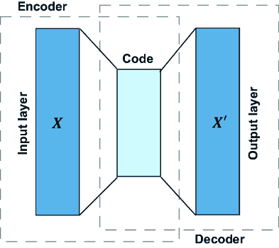
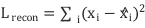
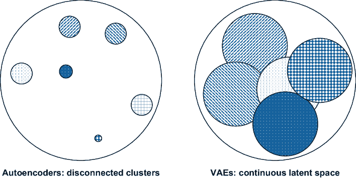
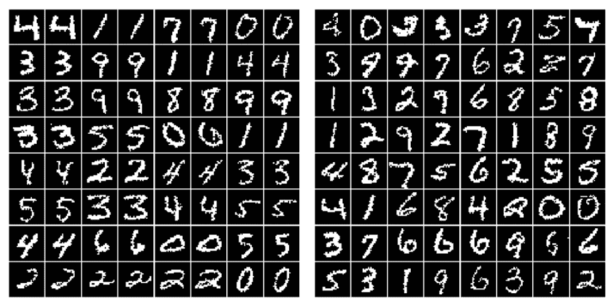
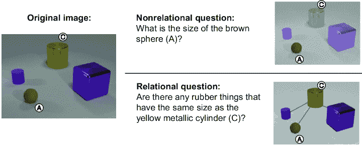
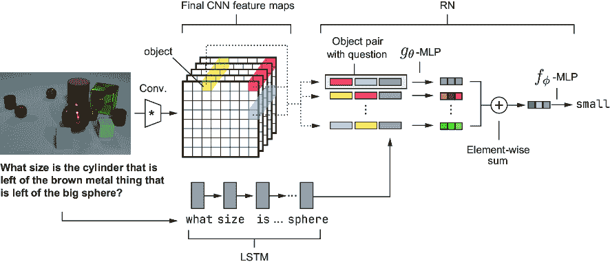
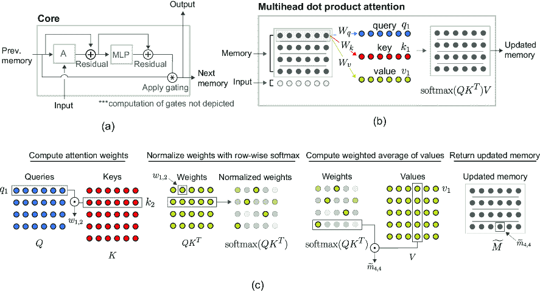
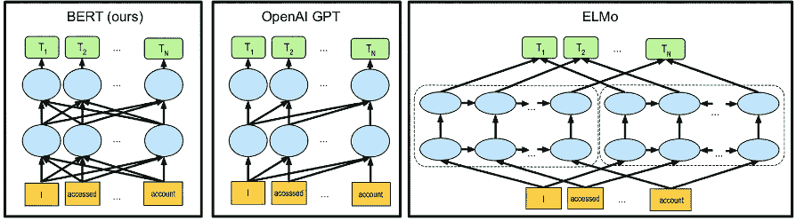
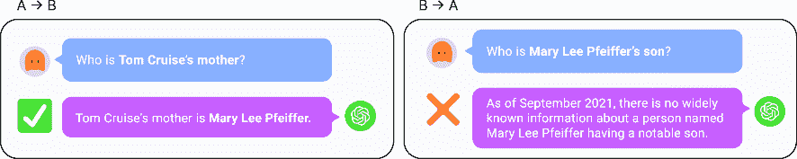

# 7 转向推理

## 本章涵盖

* 变分有损自编码器
* CLEVR 和 bAbI 上的关系网络
* QM9 上的消息传递神经网络
* 跨基准序列推理的关系记忆核心
* 论文与活生生的疑虑

### 论文

* *Variational Lossy Autoencoder* (2016) Chen et al.
* *A Simple Neural Network Module for Relational Reasoning* (2017) Santoro et al.
* *Neural Message Passing for Quantum Chemistry* (2017) Gilmer et al.
* *Relational Recurrent Neural Networks* (2018) Santoro et al.

OpenAI 没有选择扩展到拥有数万亿参数的 GPT-5，而是投资于“测试时计算”等技术，即让模型在推理期间“思考”更多 \[1\]。这一转向反映了整个领域更广泛的认识：仅靠扩展预训练所带来的回报正在递减，尤其是在需要推理的任务上。事实上，即使是最响亮的规模化拥护者也开始讨论其局限性。2024 年，Ilya 表示“2010 年代是规模化的时代；现在我们又回到了惊奇与发现的时代。”Sutskever 补充道：“现在，扩展正确的东西比以往任何时候都更重要” \[2\]。

本章不是关于某一个“解决”了推理的架构。它关乎瓶颈、对象对、图消息、记忆槽，以及最后的测试时计算。这些都是改进人工神经网络计算结构的尝试。变分有损自编码器（VLAE）追问应该将什么信息强制写入潜在编码。关系网络追问模型如何比较对象。消息传递神经网络（MPNN）追问信息应该如何沿图流动。关系记忆核心（RMC）追问记忆如何随时间交互。现代推理模型继承了同样的主题：智能的提升不仅在于模型变得更大，还在于计算被组织得使比较、约束检查和抽象变得更容易。

## 7.1 变分有损自编码器

序列到序列（seq2seq）模型使用编码器-解码器架构进行机器翻译（第 5 章）。回想一下，编码器将输入映射为潜在表示，解码器用它生成翻译后的句子。*自编码器*保持相同的架构，但改变了训练目标。它不翻译文本，而是学习重建自己的输入。编码器将输入数据映射为低维表示，称为*潜在编码*。这个潜在编码可以是图像的向量表示，编码了颜色和形状，也可以是文本的固定长度句子嵌入。解码器使用该潜在编码重建原始输入。见图 7.1。

### 图 7.1 自编码器由编码器和解码器组成，编码器将消息映射为编码，解码器从编码重建消息。

由于输入数据经过低维瓶颈，模型无法记住独特的细节。相反，它必须保留准确重建输入所需的特征，通过最小化重建目标 ，其中 *x* 是原始输入，** 是解码器产生的重建。通过缩小两者之间的差距，模型学习到保留数据基本结构的潜在表示。以手写数字为例，它可能学习到边缘、环和笔画方向等特征，这些特征后来证明对分类等下游任务有用，尽管分类从来不是训练目标的一部分。

普通自动编码器（AE）的潜在空间是聚类的而非连续的，这意味着有效的潜在表示占据的是不连通的区域。因此，在它们之间进行插值或采样并不能可靠地产生有意义的输出。这被称为*流形外采样*。例如，MNIST 是一个手写数字（0-9）数据集，常用于训练机器学习算法。一个训练来重建 MNIST 的模型会将输入数据划分成每个数字的聚类，但这些聚类之间的间隙是巨大的且很大程度上未知。参见图 7.2（左）。这对于解码已知示例（如手写数字）来说没问题，但当解码器必须跨过这些间隙采样时，它就缺乏指导，性能会迅速下降。AE 可以压缩输入并揭示有意义的结构，但它们在潜在空间中排列数据的方式很笨拙。

### 图 7.2 左：普通自动编码器在潜在空间中产生不相交的聚类，留下显著的间隙。插值必须穿越流形外区域。右：VAE 产生连续、重叠的区域，能够实现平滑插值和可靠采样。

*变分自动编码器*（VAE）通过强制潜在空间中连续、重叠的区域来解决这个流形外采样问题，从而实现平滑插值和可靠采样。编码器不输出单个代码。相反，它预测代码分布上的参数（均值向量 `μ` 和尺度向量 `σ`）。在训练期间，从该分布中抽取一个潜在向量并传递给解码器 \[3\]。对于序列，解码器逐个标记地生成输出，基于先前生成的标记（前缀）和潜在样本进行条件。一旦潜在空间具有合适的几何结构，该模型就成为在示例之间进行采样和插值的工具。参见图 7.2（右）。

### 7.1.1 什么是 VLAE？

然而，当解码器过于强大时，VAE 可能无法使用其潜在代码。在 VAE 中，潜在变量是隐藏值，通常写为向量 `z`，由编码器从输入中推断，解码器应将其用作该输入的压缩描述。但是，当解码器有足够的容量自行对数据进行建模时，它可能忽略 `z`，导致潜在代码携带的信息很少或没有信息。这种现象被称为*后验崩溃*。

VLAE 通过控制模型各部分能够表示的信息来解决这个问题。鼓励潜在代码存储全局布局和身份，包括高级信息，例如存在哪些物体、它们的粗略形状、姿态、位置和整体排列。它不打算存储每个局部纹理、边缘或像素级细节。这些细节由图像解码器处理，例如 `PixelCNN`。VLAE 由 Peter (Xi) Chen、Ilya Sutskever 和 OpenAI 的同事于 2016 年提出，并在 Sutskever 的列表 \[4\] 中。

VLAE 对潜在代码使用*自回归先验*。先验是在生成数据之前从中采样潜在变量的分布。但作者没有使用简单的因子化高斯先验（假设所有潜在维度独立），而是引入了一种自回归先验，一次对分布的一个分量进行建模，允许后面的分量依赖于前面的分量。作者将这个过程描述为“信息的显式放置”。实际上，VLAE 使潜在代码负责图像的全局语义结构（防止后验崩溃），而 `PixelCNN` 风格的解码器则填充合理的局部细节。

### 7.1.2 结果

VLAE 的表现与当时最强的 VAE 相当或更好，并在 MNIST、Omniglot 和 Caltech-101 Silhouettes 等基准上接近领先的自回归模型的准确率，同时在 CIFAR-10 上保持了坚实的性能。在 MNIST 基准上，VLAE 实现了 79.03 nats 的负对数似然，比以前最好的 VAE 结果好约 0.27 nats。负对数似然（NLL）是对数据“惊讶”程度的惩罚。如果模型对实际发生的事件赋予高概率，惩罚就小；如果赋予低概率，惩罚就大。Nat 是使用自然对数计算该惩罚时的单位。例如，如果模型对正确结果赋予概率 0.5，惩罚为 -log 0.5 = 0.69 nats。如果赋予概率 0.1，惩罚为 -log 0.1 = 2.30 nats。因此，较低的 NLL 表明模型对数据的预测更好。79.03 nats 的分数意味着模型的预测比其前驱对数据的“惊讶”程度略小。尽管很小，但这是一个有意义的改进。

VLAE 在 Omniglot 上获得了 90.98 nats 的分数，Omniglot 是一个由数十种字母表中超过 1,600 个字符组成的手写语料库。它在该数据集上击败了所有先前模型。经过微调，分数略有提升至 89.83。Caltech-101 Silhouettes 是 Caltech-101 物体数据集的仅形状版本；它强调全局结构而非纹理。在此之上，VLAE 实现了 77.36 nats，远好于先前最好的 88.5 nats。在 CIFAR-10 上，一个由十个日常物体类别组成的彩色图像基准，VLAE 接近了领先的全自回归基线（`PixelCNN++`），且每位维度仅差几个比特。这证实了 VLAE 尽管有潜在约束，但并未牺牲太多生成性能。

能够保持可用的潜在表示而不牺牲性能或质量，这一点很重要，因为 VLAE 是有损的。它们故意在潜在代码中仅存储基本要素，让解码器恢复局部细节。在 MNIST 上，潜在代码携带的平均信息明显低于具有无约束解码器的可比 VAE。此外，来自真实图像的重建在不复制每个像素的情况下保留了身份和形状，确保了全局结构得以保留，并且合理地填充了精细纹理。样本和重建整体上不那么模糊、更连贯，缩小了与竞争架构和纯自回归模型的差距 \[5\]。传统的 VAE 缺少这一组件，导致输出模糊。参见图 7.3。

### 图 7.3 原始 MNIST 图像（左）和来自 VLAE 有损代码的“解压”版本（右）。*经主要作者（Peter (Xi) Chen）许可使用。*

### 7.1.3 自回归先验

VLAE 从两个角度解决了后验崩溃问题。首先，它通过赋予解码器一个小的接受域来削弱解码器，迫使它只关注局部细节。其次，作者通过使用自回归流来增强先验，该流迭代地变换高斯噪声，使得每个潜在变量依赖于其前驱。结果是一种适应于编码后潜在变量真实分布的先验，而不是施加定义因子化高斯的严格独立假设。作者通过比较三种设置从经验上证明了这一点：(1) 无先验的小接受域（RF）`PixelCNN`；(2) 具有高斯先验的小 RF `PixelCNN`；以及 (3) 具有自回归先验的小 RF `PixelCNN`。参见表 7.1。

### 表 7.1 相同小接受域 `PixelCNN` 配合不同先验

| 模型 | NLL (nats) |
| --- | --- |
| `PixelCNN` 解码器 | 87.55 |
| `PixelCNN` 解码器 + 高斯先验 | 79.48 |
| `PixelCNN` 解码器 + 自回归流先验 | 78.94 |

即使是一个简单的高斯先验，相对于无条件解码器，也能显著提高性能。`NLL` 从 87.55 降至 79.48。这表明解码器在隐编码上操作。用自回归先验替代高斯先验进一步提高了性能，更重要的是，这意味着传输的隐变量包含更多信息 [6]。`VLAE` 澄清了新兴的观点，即 `VAE` 中的信息流受先验和解码器的共同支配，并通过干净的消融实验证明了这一点。

对 `AE`、`VAE` 和 `VLAE` 的讨论可能显得有些生硬。到目前为止，我们讨论了如何防止离流形采样、如何避免解码器用自回归先验压倒隐编码，以及如何将负对数似然的几个 nats 的改进视为真正的进展。这是技术性的，可能很难看出它到底是什么。尽管如此，它表明架构可以决定记住哪些信息、丢弃哪些信息，以及在模型内部使哪些信息可重用。此外，`VLAE` 表明架构可以决定这些信息的存储位置。现代神经网络系统表明，信息可以存在于权重、内存、草稿纸、图或测试时搜索中。

## 7.2 关系推理

到 2017 年，深度学习在识别图像和文本模式方面表现出色，但当答案依赖于实体之间的关系时，它就遇到了困难。早期解决这个问题的尝试分为两个截然不同的阵营。符号系统使用规则表示实体和关系，使推理明确，但它们脆弱且手工制作。人工神经网络（`ANN`）从数据中学习，具有灵活性，但当关系结构稀疏且组合时，它们往往无法识别 [7]。一个 `ANN` 可以识别红色立方体或绿色球体，但当被问及哪个更大时却失败了。扩大数据和参数规模提高了识别能力，但没有提高关系理解能力。

Adam Santoro 和 Google DeepMind 的同事们的“一种用于关系推理的简单神经网络模块”表明，关系网络（`RN`）可以解决之前架构无法解决的任务 [8]。`RN` 计算图像中每对对象或故事中每对实体之间的交互，并聚合它们以回答关于这些关系的查询。参见图 7.4。

##### 图 7.4 来自 CLEVR 数据集的图像，展示了四个对象以及配对的问题：一个是非关系的（关于对象的属性），一个是关系的（关于对象之间的关系）。注意：为便于黑白打印，原始图像中添加了字母。*经主要作者（Adam Santoro）许可使用。

考虑这个问题：“在大球左侧的棕色金属物体左侧的圆柱体是什么尺寸？”标准的卷积神经网络（`CNN`；第 2 章和第 3 章）可以检测局部视觉特征，但答案取决于一系列关系。`RN` 形成候选对象对。一对可能为“棕色金属物体在大球左侧”提供证据。另一对可能为“圆柱体在该棕色金属物体左侧”提供证据。网络并没有显式地编写符号程序，但成对函数 `g[θ]` 在问题的上下文中对所有对象对进行评分。当这些成对分数相加时，相关的关系证据就会累积。最终的网络 `f[φ]` 将累积的证据映射到答案“小”。参见图 7.5。

##### 图 7.5 CLEVR 的图像与一个推理问题配对。`CNN` 提取对象特征，长短期记忆编码问题，`RN` 根据该问题比较每个对象对。结果被聚合并传递给另一个网络，该网络输出答案（这里是“小”）。注意：为便于黑白打印，原始图像中添加了字母。*经主要作者（Adam Santoro）许可使用。

### 7.2.1 基准评估

为了测试 `RN` 是否捕捉到了推理关系的能力，而不是仅仅记忆模式，作者在不同的设置下对其进行了评估，每个设置都探测了推理的一个不同方面。

#### CLEVR

CLEVR 是一个合成的视觉问答基准，包含 100,000 个渲染的三维场景和大约 100 万个详细问题。正如人们可能预期的那样，它旨在评估组合语言理解和基本视觉推理，特别是模型在对象属性、关系和比较方面的推理能力 [9]。在 CLEVR 上，`RN` 达到了 95.5% 的准确率，优于当时最好的基于 `CNN` + 长短期记忆（`LSTM`）的基线（约 68.5%）和人类表现（约 92.6%）。最显著的提升出现在比较属性、比较数字和计数任务中，这些任务最直接地依赖于强大的关系推理。参见表 7.2。

#### 表 7.2 CLEVR 测试准确率按问题类型

| Model | Overall | Count | Exist | Compare numbers | Query attribute | Compare attribute |
| --- | --- | --- | --- | --- | --- | --- |
| Human | 92.6 | 86.7 | 96.6 | 86.5 | 95.0 | 96.0 |
| Q-type baseline | 41.8 | 34.6 | 41.7 | 43.7 | 52.2 | 64.4 |
| LSTM | 46.8 | 50.2 | 61.1 | 65.2 | 71.1 | 82.7 |
| CNN+LSTM | 52.3 | 51.0 | 69.8 | 67.1 | 73.5 | 77.4 |
| CNN+LSTM+SA | 68.5 | 36.0 | 36.8 | 49.3 | 85.3 | 82.6 |
| CNN+LSTM+SA* | 76.6 | 51.3 | 51.8 | 53.0 | 52.3 | 75.4 |
| CNN+LSTM+RN | 95.5 | 90.1 | 97.8 | 93.6 | 97.9 | 97.1 |

#### 状态描述

作者还用状态描述替换了 CLEVR 中的图像。状态描述是结构化的符号表，其中每行明确列出一个对象的属性，包括其位置（`x`、`y`、`z`）、颜色（`r`、`g`、`b`）、形状、材质和尺寸。使用这些符号输入，`RN` 达到了 96.4% 的准确率（未在表 7.2 中显示）。这证实了关系模块可以对场景的抽象、分解表示进行推理，而不仅仅是原始像素。

#### bAbI

bAbI 是一个基于文本的问答数据集 [10]。有 20 个任务，每个任务与特定类型的推理相关，例如演绎、归纳或计数。每个问题都有一组支持事实。例如，“Sandra 捡起了足球”和“Sandra 去了办公室”这两个事实支持问题“足球在哪里？”答案是“办公室”。如果模型的表现超过 95%，则该任务成功。`RN` 通过了 20 个 bAbI 任务中的 18 个，包括具有挑战性的归纳任务，该任务之前曾难倒早期的增强记忆模型，例如 DeepMind 的神经图灵机（第 5 章）。剩下的两个任务仅差几分。

#### Sort-of-CLEVR 和物理任务

Sort-of-CLEVR 将 CLEVR 简化为二维彩色形状，以便作者可以将关系问题与非关系问题隔离开来。普通的、现成的 `CNN` 可以回答基本的非关系问题，但在关系问题上停滞在 63% 左右。添加 `RN` 缩小了差距，在两个任务上的准确率都提高到 94% 以上。这一结果表明，没有专用模块的标准网络缺乏推理关系的固有能力。

作者还开发了一个彩色球体在桌面上移动的数据集。一些球体独立移动，并自由地与其他球体和障碍墙碰撞。其他随机选择的球体对由隐形弹簧或刚性约束连接。关系网络（RN）以 93%的准确率推断出弹跳球体之间的隐藏连接，并以 95%的准确率识别出连通分量，而大小匹配的网络则表现随机。

总之，这些不同的设置表明关系网络（RN）并不局限于任何输入类型。它提供了一个通用的关系运算符，可以集成到标准神经管道中，并立即揭示网络是理解了关系还是仅仅理解了模式。关系网络（RN）的成功还表明，当“正确”的架构到位时，网络可以推断抽象关系的成对比较[11]。它与其他几种同时期推动结构化推理的方法并存[12][13]。

## 7.3 神经消息传递用于量子化学

现代化学和材料科学在极端的组合约束下运行。可能分子的空间是巨大的，据估计化学空间中有 10⁶⁰种不同的分子[14][15]。这远远多于实验上可能枚举的数量。因此，化学家依赖于使用基于计算机的方法的虚拟筛选，将搜索缩小到一组可管理的、有前途的化合物以供后续研究。这种方法在广泛使用的量子化学基准中是明确的，这些基准需要计算探索，因为否则对化合物空间的无偏探索是不可行的[16]。传统上，这意味着基于物理的模拟。但到 2017 年，它已经意味着机器学习（ML）。

这种转变由两种力量驱动。首先，大型、精心策划的分子数据集的供应不断增加。其次，机器学习已经变得足够准确，可以近似曾经需要昂贵模拟或实验室工作的性质。例如，机器学习可以预测分子是否对人类有毒，是否与特定蛋白质结合（药物发现的核心问题），或估计用于材料设计的量子性质。价值主张不是完美的准确性，而是具有更快性能的良好准确性，允许从业者探索和过滤比暴力方法更多的化学空间。

在此背景下，Google Brain 和 DeepMind 的 Justin Gilmer 及其同事引入了一种直接从分子数据学习的通用方法。他们的方法（消息传递神经网络，MPNNs）与化学中的特征工程形成对比，后者依赖于手工设计的分子描述符。分子描述符是化学中的 SIFT/HOG（第 2 章）。它们是领域专家的产物，直到表示学习使它们过时。这篇题为“用于量子化学的神经消息传递”的论文在 Sutskever 的列表上[17]。

## 7.3.1 准确性作为瓶颈

消息传递神经网络的一个主要动机是量子化学的高昂成本。量子力学提供了理论上预测分子行为的方程。但这些方程如此难以解决，以至于研究者不直接为真实分子解决它们。密度泛函理论（DFT）为化学家提供了一个捷径。

密度泛函理论（DFT）是一种用于近似分子许多量子性质的数值方法。与该方法相关的一位发明者因这项工作获得了诺贝尔化学奖，并且 DFT 是史上被引用次数最多的 10 篇论文中的两篇的负责者[18][19]。它被广泛使用是因为它在速度和准确性之间取得了良好的平衡，但关键点是它对于大规模搜索仍然太慢。正如 Gilmer 及其同事所指出的，对一个小有机分子的单次 DFT 计算可能需要在单个 CPU 核心上大约一小时，而仅仅多几个原子的分子可能需要许多小时，因为 DFT 随电子数的三次方缩放。

当任务不是评估单个分子而是探索化学空间时，这很快变得 prohibitively 昂贵。在药物发现或材料设计中，对数十万或数百万个候选分子的暴力筛选是常见的，但如果直接使用 DFT，它将需要多年的计算时间。我们寻求解决的科学问题是组合性和探索性的，而我们依赖的工具却是缓慢且串行的。

## 7.3.2 消息传递神经网络

分子不是图像或序列。虽然卷积神经网络（CNNs）在网格上操作，如图像，而循环神经网络（RNNs）在序列上操作，如文本，但分子更自然地被表示为图，其中原子是节点，边是携带空间距离信息的键，并且三维方向被编码在成对关系中。消息传递神经网络（MPNNs）提供了一个用于图数据监督学习的框架，它扩展了早期的图神经网络模型，如门控图神经网络（GGNN），它作为基线[20]。

在消息传递神经网络中，图中的每个节点维护一个隐藏状态向量，该向量通过交换消息被迭代更新。将每个原子视为与其邻居共享笔记。在消息传递阶段，每个原子向其邻居发送一个学习到的消息，并根据接收到的消息更新其隐藏状态。经过许多轮后，每个原子的状态总结了其局部邻域。在读出阶段，模型通过池化操作将所有原子状态聚合到一个单一向量中，以预测分子级别的性质（例如，能量、偶极矩、能隙）。目标是让这些节点表示捕捉整个图的结构和特征，从而实现准确的图级别预测。一个有用的心理模型是每个原子向其邻居传递信息。经过连续迭代，分子陷入对其自身的学习总结。

图网络中的一个挑战是在节点之间高效传播信息，特别是当图很大或稀疏连接时。如果重要信息驻留在远离另一个节点的节点上（在图距离上），可能需要许多轮消息传递才能让信息到达那里。实际上，这是一个通信问题。作者探索了虚拟边和主节点来加速这个过程并提高其保真度。“虚拟”边的想法是在每对原本不连接的节点之间添加一种特殊类型的边。实际上，你通过添加携带消息的虚拟连接临时使图完全连接，这些虚拟连接具有不同的标签或权重，以便模型知道这些不是真正的物理边而是长程捷径。

好处是信息可以在更少的步骤中传播长距离。模型可以学习使用这些虚拟边或根据需要忽略它们。即使分子中的两个原子没有直接键合，网络仍然可以通过一个专门的虚拟通道在它们之间传输消息，实现全局通信。这类似于跳过连接（第 3 章），但虚拟边不是跨深度的捷径，而是跨节点表示的捷径。将残差连接视为在楼层（层）之间添加电梯，而虚拟边则是在遥远的房间（节点）之间添加新的走廊。

另一种促进长程交互的方法是引入一个额外的人工节点，称为“主”节点。你可以将其视为一个枢纽，从所有节点收集信息然后广播回去。在消息传递神经网络中，主节点作为一个全局暂存空间，捕捉整个图的高级聚合信息，并在下一步将其提供给所有节点。在这方面，主节点方法类似于神经图灵机。

经过几轮消息传递后，MPNN 必须产生一个输出。在许多应用中（例如量子化学），期望的输出是整个图的属性（例如分子的能量或稳定性），而不仅仅是一个节点。因此，我们需要一个读出函数，将所有节点的最终状态组合成一个单一的、固定大小的图级别表示。作者实验了两种类型的读出函数。

最简单的方法，继承自 GGNN 基线，是将所有节点的最终隐藏向量求和（或求平均），然后对得到的向量应用一个前馈网络。求和很方便，因为它对节点顺序不变。也就是说，节点可以按任意顺序列出，但总和保持不变，从而保留了图的同一性。但求和可能会丢失信息，不同的分布可能产生相同的总和。GGNN 的读出可能通过在求和之前或之后应用非线性变换来缓解这个问题（原始论文为此指定了一个方程），但它仍然产生相对粗糙的聚合。

为了捕捉节点状态集合更复杂的属性，作者转向了《Order Matters》论文（第 5 章）中引入的 Read-Process-and-Write (RPW) 模型。回想一下，RPW 是 seq2seq 模型（第 5 章）的扩展，它使用带有注意力机制的循环神经网络来迭代地关注不同的节点，构建无序集合的表示，这解释了为什么 Gilmer 等人将该模型称为 `set2set` 或 `s2s`。在 MPNN 的上下文中，这个集合是最终节点特征向量的集合。从理论上讲，这种读出比简单求和更具表达能力，它可以学习为重要的节点或节点特征组合分配适当的权重。Gilmer 和同事们期望，通过允许网络捕捉简单的置换不变求和可能遗漏的复杂全局图属性，该模型能产生更好的性能，他们是对的。

以乙醇作为一个玩具示例。开始时，每个原子只有局部特征，如原子类型、键类型，也许还有距离信息。经过一步消息传递后，氧原子知道与其键合的碳和氢，每个碳知道其直接邻居。经过两步后，第一个碳可以通过中间碳间接获得关于氧的信息。经过几步后，每个原子的隐藏状态成为其化学环境的学习摘要。然后读出函数将原子状态池化为分子级表示，可用于预测诸如能量、偶极矩或电子能隙等属性。该模型没有解决量子力学。相反，它已经学会了对昂贵的量子化学计算产生的答案的快速基于图的近似。

### 7.3.3 训练与结果

QM9 数据集提供了大约 134,000 个小分子的 DFT 计算属性。QM9 中的每个分子最多有九个重原子（例如碳、氮、氧或氟）和 13 个 DFT 计算目标。作者随机尝试了 50 种不同的超参数训练设置，并保留了表现最好的那些。所有模型都使用相同的通用配方进行训练，包括小批量、长训练时间以及逐渐降低的学习率。作者拆分了 QM9 数据集，预留 10,000 个分子用于验证以确定何时停止训练以及保留哪个模型版本，另外 10,000 个用于最终测试。其余所有数据都用于训练。

为了实现强大的性能，作者系统地评估了 MPNN 变体和输入表示。最重要的两个选择是包含键类型加上空间距离，以及将氢原子视为分子图中的显式节点。作者还发现，每个模型训练一个属性比多任务训练效果好高达 40%。最强的单模型使用了带有显式氢的边网络消息函数。通过集成（平均）验证误差最低的五个模型的预测，测试准确率进一步提高。表现最佳的单模型（`enn-s2s`）及其五模型集成（`enn -s2s-ens5`）在所有 13 个目标上创造了新的最佳结果 [21]。作者在 11 个目标上达到了化学精度，优于五个手工设计的描述符流水线和两个先前的图神经网络。参见表 7.3。化学精度是指每个目标的平均绝对误差低于化学标准阈值时达到的。最引人注目的是，作者强调神经消息传递可以在毫秒级而不是小时级完成推理。

#### 表 7.3 跨越 13 个分子目标的 QM9 基准比较。行列出预测属性：偶极矩 (mu)、极化率 (alpha)、HOMO、LUMO、能隙、电子空间范围 (R2)、零点振动能 (ZPVE)、原子化能目标 (`U[0]`)、U、H、G、热容 (Cv) 和最高振动频率 (Omega)。列比较了手工设计的描述符方法、先前的基于图的基线以及论文的最佳消息传递模型。每个单元格报告的误差与目标的化学精度阈值的比值，因此低于 1.0 的值表示化学精度。带有显式氢的边网络（`enn`）+ `set2set`（`s2s`）模型（`enn-s2s`）是所有目标中最佳的单模型，而五模型集成（`enn -s2s-ens5`）进一步提高了性能。

| 目标 | BAML | BOB | CM | ECFP4 | HDAD | GC | GG-NN | DTNN | enn-s2s | enn-s2s-ens5 |
| --- | --- | --- | --- | --- | --- | --- | --- | --- | --- | --- |
| mu | 4.34 | 4.23 | 4.49 | 4.82 | 3.34 | 0.70 | 1.22 | - | 0.30 | 0.20 |
| alpha | 3.01 | 2.98 | 4.33 | 34.54 | 1.75 | 2.27 | 1.55 | - | 0.92 | 0.68 |
| HOMO | 2.20 | 2.20 | 3.09 | 2.89 | 1.54 | 1.18 | 1.17 | - | 0.99 | 0.74 |
| LUMO | 2.76 | 2.74 | 4.26 | 3.10 | 1.96 | 1.10 | 1.08 | - | 0.87 | 0.65 |
| gap | 3.28 | 3.41 | 5.32 | 3.86 | 2.49 | 1.78 | 1.70 | - | 1.60 | 1.23 |
| R2 | 3.25 | 0.80 | 2.83 | 90.68 | 1.35 | 4.73 | 3.99 | - | 0.15 | 0.14 |
| ZPVE | 3.31 | 3.40 | 4.80 | 241.58 | 1.91 | 9.75 | 2.52 | - | 1.27 | 1.10 |
| U0 | 1.21 | 1.43 | 2.98 | 85.01 | 0.58 | 3.02 | 0.83 | - | 0.45 | 0.33 |
| U | 1.22 | 1.44 | 2.99 | 85.59 | 0.59 | 3.16 | 0.86 | - | 0.45 | 0.34 |
| H | 1.22 | 1.44 | 2.99 | 86.21 | 0.59 | 3.19 | 0.81 | - | 0.39 | 0.30 |
| G | 1.20 | 1.42 | 2.97 | 78.36 | 0.59 | 2.95 | 0.78 | 0.84 ^() | 0.44 | 0.34 |
| Cv | 1.64 | 1.83 | 2.36 | 30.29 | 0.88 | 1.45 | 1.19 | - | 0.80 | 0.62 |
| Omega | 0.27 | 0.35 | 1.32 | 1.47 | 0.34 | 0.32 | 0.53 | - | 0.19 | 0.15 |
| Average | 2.17 | 2.08 | 3.37 | 53.97 | 1.35 | 2.59 | 1.36 | - | 0.68 | 0.52 |

### 7.3.4 塔式架构

扩展图网络遇到了根本性的瓶颈。当图网络密集或其内部表示宽泛时，单个消息传递步骤可能需要大量计算，减缓训练和推理。如果每个节点使用宽隐藏状态与其他每个节点通信，成本会迅速膨胀。为了缓解这一负担，作者将每个节点的大型隐藏表示拆分为几个较小的“塔”。每个塔使用自己轻量级的参数执行消息传递步骤，产生临时更新。随后，一个小型前馈网络混合并重组塔输出，为每个节点形成单一表示。这就像几个窄图神经网络并行工作，每轮之间有一次简短的会议。

回报是效率。大部分繁重的计算发生在每个切片内，因此增加塔数量会在步骤的昂贵部分带来大致成比例的加速，而混合的开销很小。这种设计保留了图模型通常的排列不变性，同时允许信息在混合阶段跨塔流动。它还通过使用多个窄消息传递提高了效率，简短的混合比单次非常宽的传递更便宜。

在他们的 QM9 设置中，对 200 维状态使用八个塔，大致实现了 `2×` 的加速，且没有明显的精度损失。作者指出，这种方法对于更大的分子（例如来自 GDB-17）尤其有益，因为计算节省会累积。该结构还充当了温和的正则化器。因为每个塔学习略微不同的视图，并且它们被周期性地混合在一起，模型的行为有点像集成，并且泛化能力略优于相同总大小的单个宽网络。

虽然化学应用是专门的，但教训是通用的。MPNN 表明，当世界是关系性和无序的时，模型应该在实体和链接上计算，而不是被强制放入有序网格或序列。分子只是一个例子，但同样的抽象出现在知识图谱、社交网络、程序分析、物理模拟、机器人和多智能体系统中。该论文的重要性不仅在于它加速了分子预测。它帮助使人工神经网络可以通过在无序世界模型上传递学习到的消息来进行推理这一观念正常化。

### 7.3.5 影响

使用 QM9 分子数据集，作者表明 MPNN 可以以与昂贵的密度泛函理论（DFT）计算几乎相同的精度预测分子的量子力学性质。至关重要的是，它实现这一精度的速度远快于运行量子模拟。DFT 计算可能需要 `~10³ seconds`，而 MPNN 可以在 `~10^(-2) seconds` 内产生预测。该比率是 `~10⁵`，即快 100,000 倍。但论文指出，MPNN 推理比 DFT 计算快约 300,000 倍，这表明实际的 DFT 计算更接近 `3-4 × 10³ seconds`。

在实践中，这往往比精度的小幅提升更具变革性。通过高速提供高精度，MPNN 使新的工作流程成为可能，研究人员可以在极短的时间内筛选庞大的分子库并迭代实验。这种对速度以及精度的强调，预示了 AI 将如何通过实现以前不可能的快速实验来改变学术研究。

原始 MPNN 的成功促使了一波改进模型的浪潮，这些模型保留了其核心架构，但融入了额外的物理知识。SchNet (2017) 是最早在 QM9 数据集上实现化学精度的模型之一，具有更高的速度和精度 \[22\]。它引入了连续滤波卷积层，以更好地捕捉原子之间平滑的基于距离的相互作用，并添加了残差连接（第 3 章）以在消息传递过程中保留信息。

在此基础上，DimeNet 通过建模键角融入了角度信息 \[23\]。在 DimeNet 中，消息不仅沿着键传递，还在原子三元组之间传递，以考虑键角，使用球谐函数等技术编码这些角度。这些受物理启发的创新使 DimeNet 能够优于早期基于图的人工神经网络。例如，与之前的图网络相比，DimeNet 在 QM9 上的预测误差降低了约 31%。简而言之，通过注入几何和物理上下文（例如距离和角度），MPNN 的后继者在 QM9 等基准任务上实现了比原始 MPNN 更高的精度，同时保留了消息传递框架的效率优势。

由 2017 年原始 MPNN 论文普及的消息传递框架已被证明具有显著影响力。它表明可以使用相同的端到端学习方法来处理图，这种方法彻底改变了图像和文本。从那时起，纯消息传递门控图神经网络不再是所有问题的最先进水平。尽管如此，MPNN 引入的接口仍然是当今大多数领先图模型的基础。事实上，许多最新的“图 Transformer”或几何深度学习模型可以被视为 MPNN 主题的变体。它们可能用注意力或物理方程替换或增强消息函数。然而，它们仍然是关于节点通过边传递信息并以顺序不变的方式聚合信息。

## 7.4 关系循环神经网络

标准 RNN，例如 LSTM（第 4 章），甚至先进的增强记忆模型，包括神经图灵机（第 5 章），都擅长随时间存储信息，但它们缺乏对信息内部关系进行推理的能力。在“关系循环神经网络”中，DeepMind 的 Adam Santoro 和同事观察到，经典的基于记忆的网络在强调这些关系的任务上挣扎。好的记忆不仅仅是存储和检索；它是比较。他们引入了 *关系记忆核心* (RMC)，一种 RNN，允许其内部“记忆”相互作用。它没有将记忆视为单一的整体隐藏状态，而是维护多个记忆槽，保存不同的信息片段，并让它们在每个时间步相互通信。

在 RMC 中，记忆到记忆的通信是通过 Transformer 风格的多头点积注意力（第 5 章）实现的。简而言之，注意力让模型可以动态地关注其数据的不同部分。RMC 并行使用多个注意力头，以同时捕捉不同的关系。RMC 中的每个记忆槽产生一个注意力查询 `Q`，所有槽产生键 `K` 和值 `V`。通过点积匹配查询和键，RMC 确定哪些其他记忆槽最相关，然后读取相应的值。见图 7.6。

### 图 7.6 (a) RMC 接收先前的记忆矩阵和当前输入，并应用标记为 A 的多头点积注意力 (MHDPA) 模块，使记忆槽能够相互之间以及与输入交换信息。然后，它使用一个小型前馈网络 (MLP) 细化每个槽，并通过门控写入结果，以产生该步的输出和下一个记忆状态。(b) 对于每个记忆槽和输入，模型形成 *查询、键,* 和 *值*，使多个“头”能够从不同视角查看关系。(c) *查询* 和 *键* 之间的相似性产生归一化的注意力权重，用于计算值的加权组合。结果更新记忆矩阵，使每个槽整合来自其他槽的最相关信息。MLP 和门控然后确定下一步保留的内容。*经主要作者 (Adam Santoro) 许可使用。*

要理解 RMC 的运行机制，可以想象 `n^(th)` 最远任务。模型接收一个向量序列，然后必须回答诸如“哪个向量距离向量 `M` 第二远？”之类的问题。在每个时间步，新向量与之前的记忆矩阵相结合。注意力模块从记忆槽位和当前输入中形成查询、键和值。一个学会了追踪参考向量的槽位可以关注候选向量；另一个槽位则可以积累关于相对距离或排名的证据。注意力输出更新记忆槽位，而门控决定保留多少旧信息。在序列结束时，模型不仅存储了向量——它还在记忆内部反复比较了它们。

这种设计明确鼓励记忆交互和共享信息，这是关系推理的关键一步。RMC 在单个时间步内融入了这些交互，与传统 RNN 注意力不同，后者只关注之前的时间步。在注意力阶段之后，RMC 对每个记忆槽位更新后的内容应用一个小型前馈网络，并使用门控将新信息与旧信息混合。实际上，RMC 在其记忆槽位之间扩展了类似 LSTM 的主干，并加入了自注意力机制，使模型具有天生的推理记忆项之间关系的能力。结果是一种循环架构，它不仅存储和检索信息，还理解这些信息片段如何相互关联以解决复杂问题。

RMC 源于外部记忆系统。神经图灵机（NTMs）表明，具有可微分记忆的控制器可以比普通 LSTM 更好地学习算法任务，如复制、排序和联想回忆。但 NTMs 从孤立的单元读取和写入，这些单元不会相互交叉引用。RMC 保留了记忆矩阵的想法，同时通过允许槽位通过多头点积注意力并行交互来升级接口。实际上，控制器和记忆是协作的，而不是控制器独自完成所有工作。

两个实际注意事项。第一，RMC 引入了明确的容量调节，包括槽位的数量和宽度。如果槽位太少，会出现模型瓶颈。如果太多，则会浪费计算，或者模型可能过拟合。第二，槽位间注意力在实践中是稳定的，使用常见的技巧，如残差连接、层归一化和仔细的权重初始化。净效果是 RMC 提供了一条中间路径。它比 LSTM 更具关系性，比完整的 Transformer 注意力更可预测计算，特别适合流式、算法和关系工作负载，在这些工作负载中，比较是进步的通用语言。

### 7.4.1 实验方法和实证结果

作者在多种需要序列关系推理的挑战性任务上验证了 RMC 的效用。一个说明性的例子是 `n^(th)` 最远问题，这是一个合成任务，旨在引出随时间的关系推理。模型被给定一个向量序列，在最后被要求回答诸如“哪个向量是距离向量 `M` 第 `n^(th)` 远？”的问题。例如，“哪个物品距离物品 `X` 第二远？”解决这个问题并非易事，因为网络必须有效地计算参考向量（`M`）与其他向量之间的所有成对距离，进行排序，并识别出第 `N^(th)` 远的向量。

仅仅记忆序列是不够的；模型必须通过比较距离来关联物品。传统的记忆网络在这方面很困难。事实上，作者发现，标准的 LSTM 甚至可微分神经计算机（DNC）——一种升级版的神经图灵机——都无法达到远高于随机水平的准确率 \[24\]。在这个任务上，它们的准确率停滞在 30% 以下。

相比之下，RMC 表现出色，得益于其关系记忆槽位和注意力。它学会了理清这些距离，并在相同任务上达到了约 91% 的准确率。这种鲜明的对比凸显了在循环模型中启用显式关系推理可以解决此前这些架构无法企及的任务。即使在使用更高维向量使任务变得更难时，RMC 仍保持了强大的性能，这需要更高保真度的记忆。话虽如此，在这些更困难的设置下，极高的准确率一致性稍差。尽管如此，它在 `N^(th)` 最远任务上的成功有力地证明了网络当时在推理关系（即物品之间的距离），而不仅仅是存储和回忆数据。

关系记忆的好处也体现在程序评估基准中。作者在源自“学习执行”的任务上评估了 RMC，这是 Zaremba 和 Sutskever 2014 年的工作，训练循环网络读取短程序并逐个字符预测其输出 \[25\]。这些任务测试序列模型是否能执行简单的符号操作，如加法、跟踪、复制和反转序列。在 RMC 论文中，该模型匹配或超过了强大的基线，包括 LSTM、DNC 以及类似于循环实体网络（EntNet）的 LSTM \[26\]。它在更简单的任务如加法、复制和反转上实现了近乎完美的逐字符准确率，并在更难的完整程序任务上显著优于基线，尽管该任务仍远未解决。重点不在于模型完美地执行了每个程序，而是一个具有关系记忆的单一循环核心能够处理一系列符号序列任务，而无需针对特定任务的手工设计。见表 7.4。

#### 表 7.4 程序评估和记忆任务的准确率

| 模型   | 加法 | 控制 | 程序 | 复制 | 反转 | 双倍 |
| ---    | ---  | ---  | ---  | ---  | ---  | ---  |
| LSTM   | 99.8 | 97.4 | 66.1 | 99.8 | 99.7 | 99.7 |
| EntNet | 98.4 | 98.0 | 73.4 | 91.8 | 100.0| 62.3 |
| DNC    | 99.4 | 83.8 | 69.5 | 100.0| 100.0| 100.0|
| RMC    | 99.9 | 99.6 | 79.0 | 100.0| 100.0| 99.8 |

只有一个子任务（“双重记忆”）中，基线模型匹配或超过了 RMC，但两个模型本质上都解决了该任务。值得注意的是，RMC 并未依赖教师在训练期间提供真实标签，而是以纯粹的顺序自回归方式进行训练，作者认为这可能有助于在这些程序执行任务上的泛化。结论是，即使在涉及逻辑指令的场景中，向记忆核心注入关系推理也能带来相当或更好的性能，因为模型可以更轻松地跟踪变量、条件和顺序状态之间的关系。

在强化学习中，RMC 也带来了改进。作者们实验了一个部分可观测版本的经典游戏 Mini-Pacman，以测试 RMC 随时间记忆和整合信息的能力。Mini-Pacman 是 20 世纪 80 年代街机游戏 Pac-Man 的简化版，其中智能体在迷宫中导航，收集豆子获得分数，并避开幽灵，如果幽灵碰到智能体则游戏结束。该设置提供了一个紧凑的世界，包含奖励、惩罚和移动的对手，使其成为研究学习和记忆的理想环境。在 Mini-Pacman 中，智能体具有有限的视野（一个视口），必须依赖记忆来回忆豆子、墙壁或幽灵的位置，特别是当它们移出视线之后。基于 LSTM 的智能体可以记住一些信息，但基于 RMC 的智能体也可以推断关系。例如，它可以对移动的幽灵与最近看到的豆子之间的空间关系进行建模。在实验中，RMC 智能体获得了比基于 LSTM 的智能体更高的分数，在有限视野设置下得分 677 对 550，即高出 127 分。

当被允许观察整个迷宫时，RMC 的优势甚至更大。事实上，它几乎将 LSTM 智能体的分数翻了一番（1159 对 598）。这表明 RMC 的关系记忆对于理解游戏布局和随时间发生的事件至关重要，并且比标准循环记忆更有效地拼凑信息，例如 Pac-Man 上次看到幽灵的位置以及它现在可能在哪里。虽然 Mini-Pacman 是一个简化的环境（5 × 5 视口），但这些结果暗示关系循环网络可以在复杂的部分可观测世界中提供好处，在这些世界中，理解过去事件之间的关系是做出良好决策的关键。

最后，RMC 在标准语言模型基准测试上进行了评估，包括 WikiText-103（一个大型维基百科语料库）、Project Gutenberg 和 GigaWord。语言建模是预测序列中下一个词的任务。性能以困惑度报告，它是负对数似然（NLL）的重新缩放版本。与 NLL 一样，困惑度越低，模型对下一个标记的“惊讶”程度越小，这意味着它为正确的词分配了更高的概率。

#### 表 7.5 WikiText-103、Project Gutenberg 和 GigaWord 的验证和测试困惑度

| 模型 | WikiText-103 验证集 | WikiText-103 测试集 | Gutenberg 验证集 | Gutenberg 测试集 | GigaWord 测试集 |
| --- | --- | --- | --- | --- | --- |
| LSTM ²⁵ | – | 48.7 | – | – | – |
| Temporal CNN ²⁶ | – | 45.2 | – | – | – |
| Gated CNN ²⁷ | – | 37.2 | – | – | – |
| LSTM ²⁸ | 34.1 | 34.3 | 41.8 | 45.5 | 43.7 |
| Quasi-RNN ²⁹ | 32 | 33 | – | – | – |
| RMC | 30.8 | 31.6 | 39.2 | 42.0 | 38.3 |

[25] Edouard Grave, Armand Joulin, and Nicolas Usunier, "Improving neural language models with a continuous cache," arXiv preprint, arXiv:1612.04426, 2016

[26] S. Bai, J. Z. Kolter, and V. Koltun, “Convolutional sequence modeling revisited,” OpenReview (ICLR Workshop), 2018. [`openreview.net/forum?id=rk8wKk-R-`](https://openreview.net/forum?id=rk8wKk-R-)

[27] Y. N. Dauphin, A. Fan, M. Auli, and D. Grangier, “Language modeling with gated convolutional networks,” arXiv preprint, arXiv:1612.08083, 2016. [`arxiv.org/abs/1612.08083`](http://arxiv.org/abs/1612.08083)

[28] J. W. Rae, C. Dyer, P. Dayan, and T. P. Lillicrap, “Fast parametric learning with activation memorization,” arXiv preprint, arXiv:1803.10049, 2018. http://arxiv.org/abs/1803.10049.

[29] S. Merity, N. S. Keskar, J. Bradbury, and R. Socher, “Scalable language modeling: WikiText-103 on a single GPU in 12 hours,” 2018, doi: 10.1002/j.2334-1234.2018.12159.x. [`mlsys.org/Conferences/doc/2018/50.pdf`](https://mlsys.org/Conferences/doc/2018/50.pdf)

RMC 在这些数据集上取得了最先进的结果，在困惑度方面优于以前的基于 LSTM 和基于卷积的模型。例如，在 WikiText-103 上，RMC 获得了约 31.6 的测试困惑度，而强大的 LSTM 基线为 34.3。尽管绝对值很小（困惑度下降 1.4-5.4 分），但相对于之前最佳结果，RMC 将困惑度降低了约 5%到 12%。从角度来看，困惑度降低 5%到 12%意味着模型在预测下一个词方面更好，这在语言建模中是难得的进步。这种改进在不同大小和风格的数据集上是一致的。见表 7.5。

作者指出，这些收益主要来自对频繁词的更好建模。RMC 似乎特别擅长捕捉文本中的短期关系，这些关系有助于预测上下文中的常见词。有趣的是，RMC 使用相对较少的记忆槽实现了这些结果。例如，WikiText-103 仅使用一个记忆槽，有效地将 RMC 变成了单槽自注意力 LSTM。然而，即使只有一个槽，多头注意力机制也可以关注最近上下文中的不同位置，其功能就像 Transformer 一样。RMC 在评估期间使用较短的上下文窗口也表现良好。它不需要像 LSTM 那样多的回溯来保持低困惑度，这表明它强调了文本中最相关的最近关系。这一特征与 RMC 具有强关系归纳偏置的观点一致：它不会不加区分地吸收长历史，而是关注最近过去中的显著联系。

《关系循环神经网络》表明，添加结构化的记忆交互可以提高模型的推理能力。通过明确允许记忆相互关联，RMC 解决了一个使传统模型困惑的关系任务，在算法程序执行上匹配或超过了最先进的模型，在游戏环境中提升了智能体的性能，并在语言建模中创造了新的高分。这些收益源于同样的直觉：许多问题需要理解信息片段如何连接，而不仅仅是孤立地存储它们。值得注意的是，这些改进并不是简单地通过扩大 LSTM 的规模得到的。

### 7.4.2 历史背景

《关系循环神经网络》是 Sutskever 列表上引用最少的论文之一。部分原因在于时机：RMC 于 2018 年中期发布，恰好当时领域正在从循环架构转向纯注意力架构。Transformer 的势头势不可挡。在几个月内，BERT 和 GPT-2 将证明无监督预训练和规模可以掩盖架构上的细微差别。在此背景下，RMC 的贡献看起来像是向复杂性的倒退。

RMC 的引用量不大，反映了研究格局变化之快。Transformer-XL（第 5 章）在 transformer 片段之间引入了循环链接，并很快在相同的语言基准测试上超越了 RMC。通用 Transformer（第 5 章）在 RMC 发布仅一个月后发布，为在自注意力中添加循环同时保持并行性提出了更有力的论据。两者都比 RMC 扩展得更好。社区奖励了那些能够在数十亿标记上进行训练且架构摩擦最小的方法，而 RMC 的顺序计算使其相对缺乏吸引力。因此，随着预训练被证明可以跨任务泛化，对专用记忆模块的兴趣逐渐减弱。

### RMC

虽然 RMC 没有成为主导架构，但它对内存做出了一个有用的赌注：它不应该被动。存储的信息应该在模型行动之前进行交互。Transformers 在更大的规模上做出了类似的赌注，用序列中的 token-to-token 注意力取代了循环记忆槽。从这个意义上说，RMC 并不是一个失败的支线任务。与 NTMs 一起，它探索了模型如何随时间存储和操纵结构化信息。RMC 的纳入弥合了循环模型的时代与注意力的现代主导地位，说明了关于记忆和推理的想法是如何演变而不是消失的。

## 7.5 推理模型

今天，语言模型（LMs）可以处理形式逻辑问题和谜题，并取得了一些成功。例如，GPT-4 可以比以前的模型更有效地处理复杂的三段论和演绎论证 \[27\]。语言模型在许多常识基准测试上也取得了进展，包括 HellaSwag，它需要为日常情况选择一个合理的延续。GPT-4 在 10 次射击评估中达到了 95.3% 的准确率，远高于以前的模型（GPT-3.5 约为 85%）\[28\]。

推理也通过代词消歧进行测试。例如，考虑这对句子：

* 市政委员会成员拒绝给示威者发放许可证，因为他们害怕暴力。
* 市政委员会成员拒绝给示威者发放许可证，因为他们倡导暴力。

在第一个句子中，代词“他们”自然指的是市政委员会成员。在第二个中，它指的是示威者。两个句子之间的唯一区别是第一个有“害怕”，第二个有“倡导” \[29\]。这种代词消歧需要理解直观上下文和可能的结果。在 WinoGrande 上，GPT-4 达到了 87.5%（5 次射击），这很强，但仍低于人类表现（约 94%）。尽管如此，这表明 GPT-4 可以推断句子中的指代（例如，“他”或“她”在故事中指的是谁）。

GSM8K 提供了人工编写的、逐步的数学问题解决方案，使模型能够学习“展示他们的工作”。使用少样本链式思维推理，GPT-4 正确回答了大约 92% 的问题，这是从 GPT-3.5 的约 57% 的巨大跳跃，甚至超过了微调的专家模型 \[30\]。例如，GPT-4 可以解决多步算术应用题，如“如果一个农场有 23 头牛和 17 只鸡，总共有多少条腿？”通过逐步解决，而较小的模型往往做错这类问题。

2022 年，谷歌的 Minerva 被明确训练用于定量推理，并在 MATH 基准测试上达到了约 50% 的准确率，该基准测试由困难的高中奥林匹克和竞赛数学问题组成 \[31\]。到 2025 年，谷歌和 OpenAI 都宣布，实验性推理模型在类似人类的条件下，在 2025 年国际数学奥林匹克问题上达到了金牌级别的表现，包括两个 4.5 小时的会议，没有工具或互联网，以及自然语言证明 \[32\]。

当今最好的模型可以在一系列基准测试中胜任推理，有时在受控条件下能与专家表现相媲美。但他们对真正抽象的、分布外推理的掌握仍然是有条件的。在少样本学习、链式思维提示和测试时计算等支架下，它更强，但当规则改变时，它仍然脆弱。

### 7.5.1 分布脆弱性

提示语言模型很重要。一个精心制作的提示可以在不修改模型本身的情况下，将模型性能提高大约 5% 到 15% \[33\]。但语言模型也受到它们在训练期间看到的模式的频率和多样性的影响。常见的模式很容易；罕见的模式很脆弱。这创造了一种分布引力，其中模型的能力偏向于它经常遇到的内容。给一个熟悉的谜题添加扰动，解决方案可能会突然崩溃。“杀手提示”可以改变几率，但它不能创造新能力。相反，它帮助模型揭示它已经知道的内容。

这可能很模糊，所以让我们考虑一个例子。狼、羊和卷心菜问题是一个流行的谜题，在线被引用了很多次。它甚至有一个专门的维基百科页面，由于其高质量文本，在训练数据中被过采样 \[34\]。这个谜题涉及一个农民必须带着狼、羊和卷心菜过河，但船一次只能载一个。挑战是将它们全部运过河，而不留下它们无人看管，这样狼就不能吃羊，羊就不能吃卷心菜。要解决这个谜题，你需要使用任务调度、创造性思考并应用推理。

这个谜题有一个版本，其中羊可以吃卷心菜，狼可以吃卷心菜，而狼不会吃羊 \[35\]。这个变体对像 ChatGPT 这样的语言模型构成了挑战。模型想把羊带过河并留在另一边，尽管狼会吃卷心菜。在这种设置下，ChatGPT 没有从头重新计算约束，而是表现得像一个被拉向熟悉解决方案模板的系统。因此，它往往对这个具有新约束的谜题变体视而不见。它失败是因为这个变体在训练数据中代表性不足。这个限制突出了适应新信息的挑战，并可能阻碍语言模型在训练数据中未充分表示的上下文中的规划和推理能力。

当一个谜题很常见时，模型通常会反复看到其规范解决方案。这使得正确的答案很容易作为模式检索出来。但检索与重新计算不是一回事。当约束被扰动时，模型的行为往往揭示出它正在寻找一个熟悉的模板，而不是从第一原理推理。人类通常将这种扰动视为正常情况。

传教士和食人者谜题要求解题者协调搜索和反事实推理。在标准表述中，三个传教士（`m`）和三个食人者（`c`）必须乘坐一艘两人的船（`b`）过河。安全约束很简单：如果有任何传教士在场，他们不能被食人者数量超过；否则，食人者会吃掉传教士。所以，你不能贪婪地让人过河 \[36\]。过河问题在人工智能中相当常见。

具有逐步推理的规范版本对大多数语言模型来说很容易。现在考虑同一个问题的扰动：例如，船仍然载两个人，但一个人不能划船。这是一个微小的变化，但它改变了合法动作的集合。主要检索过河脚本的模型往往会继续产生标准序列，然后用事后解释修补它。这是因为计划周围的文本比计划本身更容易适应。结果是一个在修辞上一致但在逻辑上不一致的语言模型。

解决一个扰动实例需要一种非单调的方法，当新约束到达时更新默认策略 \[37\]。人类自然地这样做。我们对这类谜题使用标准脚本或内部模型，并将其视为临时的，如果约束阻止它，则重新计算它。相比之下，纯语言模型表现得好像默认脚本更接近单调真理。

### 7.5.2 逆转诅咒

这些渡河示例展示了一种脆弱性。一个更微妙的诊断是逆转诅咒，即模型可能以一个方向编码“事实”，却无法利用对应的逆关系。《顺序重要》（第 5 章）讨论了序列模型如何不将事实视为无序命题，而是作为有序预测问题，并且改变否则类似信息的序列化方式会改变困惑度和准确性。此外，请记住，反转源句子通过缩短源和目标之间的有效路径提高了翻译性能。逆转诅咒是这种方向依赖性的类比。

在仅解码器的语言模型（如 OpenAI 的 GPT 系列）中，文本是从左到右自回归建模的，因此当预测一个词元`x[t]`时，模型仅通过掩码自注意力条件于前面的词元`x[<t]`。Transformer 本身是前馈的，但其训练目标是自回归的。相反，像`BERT`这样的模型被训练为产生双向表示，允许每个词元在每一层融合左右上下文。在这两种情况下，自注意力计算成对分数并进行聚合，但可用的上下文在不同架构中有所不同。参见图 7.7。

#### Figure 7.7 `BERT`是深度双向的，OpenAI 的`GPT`是单向的，`ELMo`是浅层双向的。

这种方向条件有助于解释为什么语言模型能够为同一关联学习不同的映射，而这完全取决于查询的方向。在图 7.8 中，GPT-4 正确识别了汤姆·克鲁斯母亲的名字（左）。但当以母亲的名字作为提示时，它未能检索出“汤姆·克鲁斯”（右）[38]。这种不对称性并非因为模型完全缺乏该事实，而是因为事实是通过学习到的使用模式被访问的。语料库中大量出现的是“汤姆·克鲁斯 | 玛丽·李·费弗尔”这一组合，因此反向查询在零样本设置下是脆弱的。如果你先在提示中陈述正向事实，模型就能可靠地回答逆向问题——这是上下文学习的一个例子。但如果模型的“知识”主要存储在最常见措辞下的学习表示中，那么当查询以非典型方向提出时，模型可能显得有知识，但实际上仍然脆弱。

#### Figure 7.8 GPT-4 正确给出了汤姆·克鲁斯母亲的名字（左）。但当被提示她的名字时，它无法检索到“汤姆·克鲁斯”（右）。基于“A is B”训练的模型（例如，“汤姆·克鲁斯的母亲是玛丽·李·费弗尔”）不会自动推断出“B is A”。

### 7.5.3 提示作为推理接口

如果约翰·麦卡锡（他创造了“人工智能”一词）读到这些例子，他可能不会对这些失败感到惊讶[39][40]。他毕生主张，智能行为依赖于对行动、因果关系和默认假设的显式表征，而非模式关联。当前系统所表明的是，大规模训练足以近似推理的表面形式，从而在熟悉的场景中显得能够进行规划。但一旦世界模型需要修正，这种近似就会变得显而易见。

也就是说，你可以通过提示模型采用更显式的表征来提高可靠性。例如，你可以使用一个提示，将每个状态表示为三元组（`m`、`c`、`b`），列举合法移动，并在每次过河后验证安全约束。在许多情况下，这有助于模型检测无效步骤，使计划更稳定。

另一个有影响力的技术是思维链（CoT）提示，它指导语言模型在最终确定答案之前用自然语言生成显式的中间推理轨迹[41]。CoT 是对非正式零样本技巧的回应，例如提示模型“大声思考”。这些技巧，以及添加“让我们逐步思考”这样的短语，在没有额外训练的情况下，在多步推理任务上取得了显著改进[42]。

换句话说，我们不是要求模型直接跳到解决方案，而是提示它将复杂问题分解为一步一步的“链”更简单的推理。例如，给定一个数学应用题或逻辑谜题，模型被鼓励一步一步地解决解决方案，就像一个人可能在纸上潦草地写下笔记或步骤一样，然后才产生最终答案。这种简单的提示策略可以显著提高需要多步推理或规划的任务的性能。

在最初的谷歌大脑研究（2022 年）中，CoT 提示使足够大的模型能够解决数学应用题和常识推理谜题，这些谜题在标准提示下使相同的模型困惑[43]。通过将查询分解为子任务并模仿直观的思维过程，模型在推理过程中有效地使用了自己的内部暂存器。值得注意的是，该方法不需要更改模型的架构或参数。因此，CoT 提示体现了向运行时显式推理结构的转变。从经验来看，当与具有数千亿参数的非常大的模型结合使用时，CoT 被证明特别有效，其中遵循逻辑思路的能力似乎随着规模而出现。

CoT 是向推理中注入更多推理的一种方式，但现代方法通常在测试时给语言模型额外的计算或思考时间，以在不需要用户提示的情况下处理复杂问题。一种技术为同一问题生成多个推理链，然后允许模型搜索这些链并选择最一致的答案。这有效地利用了模型“思想”之间的投票来提高可靠性[44][45]。

实际意义不在于语言模型没有价值，或者提示无用。提示是引发现有功能的不完美接口。当任务在分布中时，好的提示可以减少方差并暴露模型已经“知道”的更多内容。当任务需要在新约束下重新计算时，提示是一个微弱的杠杆。它可以提高概率，但它不能替代真正执行搜索、强制不变量或显式表示默认值和异常的机制。

更广泛的教训是，语言模型失败不是因为它们缺乏推理的每一种成分。它们失败是因为它们的推理与问题、事实和解决方案出现的形式分布不均匀地耦合。在熟悉的环境中，这种耦合可以看起来非常智能，模型会检索有用的抽象，遵循学习的程序，并产生令人信服的中间步骤。但当任务被逆转、扰动或使其依赖于新引入的约束时，同一系统可能揭示出它更稳健地学习了推理的表面轨迹，而不是基本的不变量。

这就是为什么现代推理模型最好被理解为不是与语言建模的彻底决裂，而是一次使推理减少对任务最熟悉措辞的依赖的尝试。测试时计算、搜索、验证和显式中间表示都朝着这个方向推进。目标不仅仅是产生更好的答案，而是使通往这些答案的路径在变化下更加稳定。

## 7.6 论文疑问

推理模型的出现重新点燃了 AI 领域长期存在的争论\[46\]。在经典的（通常被称为“老式 AI”或“GOFAI”）理性主义观点中，智能建立在离散的、组合的符号以及转换这些符号的规则之上\[47\]。AI 先驱艾伦·纽厄尔和赫伯特·西蒙曾著名地论证说“符号位于智能行为的根源”，从而将*物理符号系统*形式化\[48\]。这种假设将推理视为必须用逻辑来指定的东西，通常是以牺牲灵活性为代价，当世界的混乱细节或基础未被充分指定时。

联结主义者认为智能是从通过基于梯度的方法对统计规律和分布式表示的经验学习中涌现出来的。批评者认为，这样的系统缺乏组合性。杰里·A·福多尔和泽农·皮利申尖锐地提出了这一点：如果思想和语言是组合性的，那么认知架构必须解释这种结构，而不仅仅是近似它\[49\]。但保罗·斯莫伦斯基阐述的一个关键的联结主义回应是，“硬规则”可以是对底层“软约束”的更高层次的描述，因此类符号的能力可以从神经计算中涌现出来，而不是从被预先指定中产生\[50\]。

理性主义与经验主义的分裂是关于推理所需结构的哲学分歧。理性主义者认为明确的符号程序是必要的，而经验主义传统则倾向于由数据和归纳偏见塑造的学习表示。但最终解决这场争论的不是决定性的哲学论证，而是标准化的基准、共享的数据集以及针对强基线的测量差异。马利克-辛顿的赌注（第 2 章）最好被解读为关于这种规范的寓言。

吉特德拉·马利克对杰弗里·辛顿的挑战很简单：不要告诉我人工神经网络有多伟大；*在一个像 PASCAL 这样的真实基准上展示给我*。马利克对理论承诺、轶事成功或哲学论证不感兴趣。辛顿用 ImageNet 来回应，而 AlexNet（第 2 章）交付了结果。没有人质疑卷积网络是否*真的*能看见或*真的*能理解；争论的焦点是深度学习是否能优于支持向量机和手工制作的数据管道。这场赌注是经验性的，不是哲学性的。成功是与最佳现有基线对比来衡量的。这种经验标准使深度学习合法化，并重置了领域。

同样的模式在可微分推理的研究中重复出现。RNs 在关系问答中达到了人类水平的表现（约 95%），并通过了 20 个 bAbI 任务中的 18 个。消息传递神经网络在所有 13 个 QM9 目标上创造了新的最佳结果，并在其中 11 个上达到了化学精度。关系记忆核心在基准测试中将语言模型的困惑度降低了 5%到 12%。这三者都提供了可测量的差异，这就是为什么它们被包含在苏茨克弗的列表中。

相比之下，胶囊网络带来了希望。2017 年，图灵奖获得者（也是未来的诺贝尔奖获得者）杰弗里·辛顿在一片喧嚣中引入了它们，它们可能最终通过在图像中纳入对实体的推理来取代 CNN。虽然胶囊网络在 smallNORB 等基准上取得了最先进（SOTA）的结果，并在 MNIST 上接近 SOTA，但它们被证明难以训练和扩展，并且从未在 CIFAR 和 ImageNet 等主流基准上匹配最佳 CNN 的性能。

事后看来，胶囊网络揭示了即使是传奇人物也可能在纸上发表一个漂亮的主意，但却无法通过经验审计。在 AI 领域，声望是通过工作系统赢得的，荣誉和希望并不能免除它们接受这种测试。胶囊网络仍然是一个警示故事：一个优雅的主意在纸上看起来很棒，但如果没有竞争性的结果，它很快就会从聚光灯中消失。

2018 年，加里·马库斯发表了一篇题为“深度学习：批判性评估”的评论。这篇评论虽然片面，但编目了网络目前还不擅长的事情，包括推理、组合性和抽象\[52\]。这篇论文是在 Transformer 的影响传播之前写的，没有包括本章中探索的面向推理的架构。虽然评论澄清了深度学习的差距，但它也证实了研究中一个常见的愚蠢假设，即识别缺点等同于解决它们。但命名一个恶魔是廉价的；驱魔则不是\[53\]。任何问题最容易的部分就是命名它。

一个多世纪前，查尔斯·S·皮尔士区分了*纸面怀疑*和*活生生的怀疑*。纸面怀疑是为了论证而声称的。它们用语言表达，通常是一面之词，并且不会打断任何人的信心。研究人员可以撰写一篇关于 AI 缺点的尖锐评论（或推特风暴），但这纯粹是智力练习，世界上没有任何改变。纸面怀疑不会推动前沿，因为强烈的陈述通常不会改变架构、基线、基准、排行榜或部署。相反，活生生的怀疑是一种本能的不确定性，它动摇了思想并迫使调查。

用今天的话说，“当前深度学习不能推理”这样的说法，如果不受到挑战，就是一种纸面怀疑。这是一个可以雄辩地论证而无需承诺任何东西的立场。它可能与假设的怀疑者展开讨论，但它不会改变行为。活生生的怀疑则会破坏社区的自满情绪并激励行动。我们已经看到，网络缺乏关系推理的活生生的怀疑如何直接导致了 RNs 和 Transformer，对数学抽象的担忧如何导致了像 GSM8K（用于算术推理）这样的基准，以及对视觉推理的担忧如何导致了 CLEVR。

弗朗索瓦·乔莱特的抽象与推理语料库，简称 ARC-AGI，是一个活生生的怀疑的典型例子\[54\]\[55\]。乔莱特在 2019 年引入了 ARC，作为人类水平通用智能的基准。该基准由小型、神秘的基于网格的谜题组成，以测试机器从几个例子中推理的能力。人类轻松解决这些任务，因为这些谜题不需要专业知识。但 AI 不能依赖暴力预训练。每个任务都是独特的，只提供几个演示，需要非单调推理。也就是说，机器必须在飞行中推断规则并将其应用于新情况，这是纯语言模型所 struggled with 的任务。

原始的 GPT-3 模型在公共评估中得分 0%。GPT-4.1 大致管理了 5% \[58\]。2024 年底，ARC Prize 报告了 OpenAI 的 o3-preview 系统的一个重大跳跃，该系统在 ARC-AGI 的低于 10,000 美元计算规则下的半私有评估中得分 75.7%，更高配置的配置达到了 87.5%，但成本要高得多。有那么一瞬间，似乎乔莱特的挑战已经被满足，我们正处于通用推理解决方案的边缘\[59\]。但仅仅几个月后，随着 ARC-AGI-2 的发布，同一系模型的准确率降到了 3%以下\[60\]。

表面上的巨大跳跃，部分反映了一种过度特化。ARC-AGI-2 被专门设计为使任何可能太紧密地适应 ARC-AGI-1 的技巧都无法达到。这是最纯粹形式的活生生的怀疑。ARC-AGI-1 上的快速进展并不意味着一般抽象问题已经解决；相反，它表明该基准在其特定条件下已经被征服。

乔莱特的“活生生的怀疑”是一种操作化的怀疑，而非假设性的怀疑。通过不断增加难度并引入真正新颖的任务，它迫使研究人员和工程师直面他们的系统是否真的在学习他们声称学习的内容，还是仅仅在学习测试的怪癖。ARC-AGI-2 需要更高水平的泛化能力，而目前，这种怀疑仍未解决。这是一种促使人们做得更好的挑战，而不仅仅是纸面上的批评。

“活生生的怀疑”视角也有助于解读另一个人物。苏茨克维尔（Sutskever）在认为 GPT2 太危险而不宜发布后，支持分阶段发布（第 1 章）。这种担忧并非假设性的或表演性的。多年后，他加入了董事会行动，短暂罢免了山姆·奥特曼（第 1 章）。这些行动不是纸面上的怀疑，而是我们能看到的怀疑。这增加了伊利亚（Ilya）的神秘感。他通过构建有效的解决方案并使其一致，来活出他的希望和怀疑。如果纸面上的希望是没有证据的承诺，那么活生生的希望就是想法可行的证据，就像 CNN 和 Transformer 一样。正是这种严肃性推动并挑战了进步，而不是仅仅为了争论而支持或反对 [61]。

然而，即使是这种经验主义、结果驱动、精英主义的叙述也有裂痕。虽然基准测试至关重要，是人工智能进步的基石，但它们并非无懈可击。它们是建立在关于测量什么的假设之上的工具。它们所测量的内容必须根据稳定、可重复的效果进行操作性定义。ARC-AGI-2 和 ARC-AGI-3 的发布强调了这一点。在 ARC-AGI-1 上看似快速的进步，部分归因于对基准的熟悉和过度专业化的搜索 [62]。

公平地说，ARC-AGI-2 不仅是一个更新的基准，也是一个更难的基准，旨在衡量 AGI 而非传统机器学习的表现 [63][64][65][66]。尽管如此，更广泛的观点仍然成立：人工智能需要收据，这些收据必须被仔细审查。它不在乎你的名字或你的纸面怀疑；没有活生生的希望它无法前进，没有活生生的怀疑它无法安全。收据是在能够承受分布转移并转移到新基准的对照下，针对强基线的可复现收益。能够迁移的鲁棒性比单一排行榜的胜利更有价值 [67]。

虽然苏茨克维尔的清单记录了有效的方法，但我们仍然难以确定我们能从中合法地理解什么。在接下来的章节中，我们超越工程学，直面这些成就意味着什么。这不是偏离苏茨克维尔的清单，而是它的顶点。
