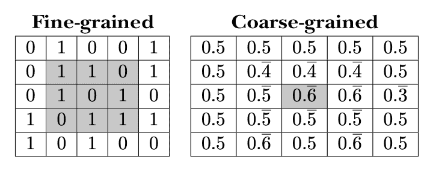
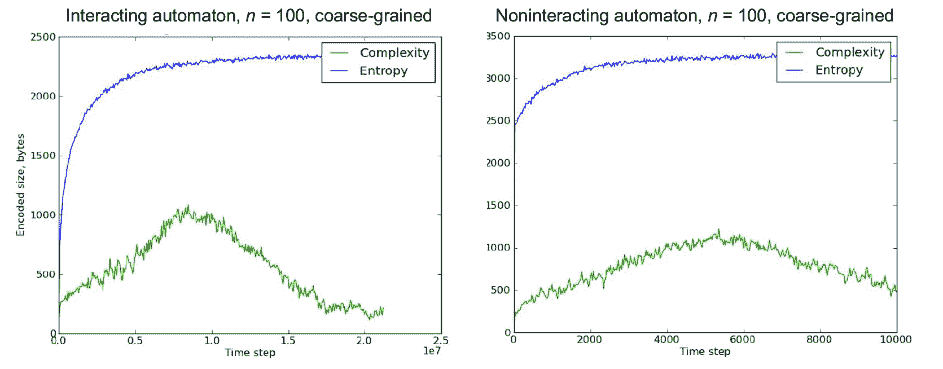
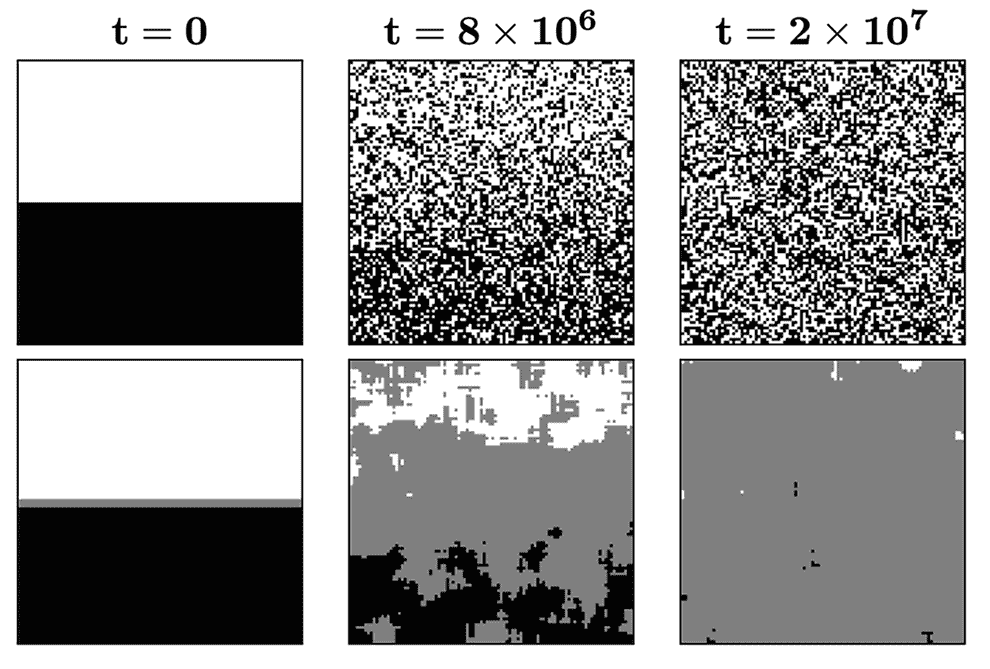
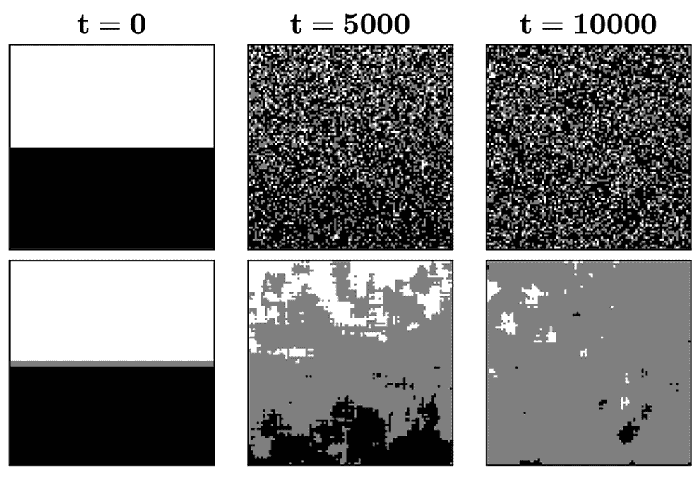
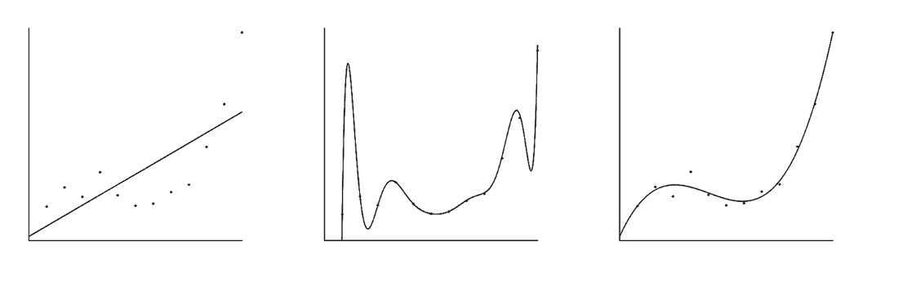
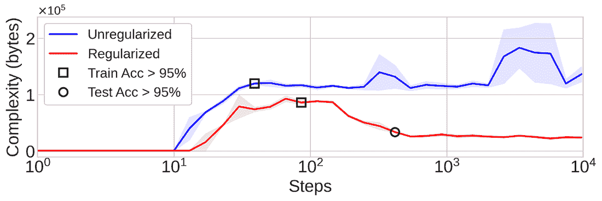
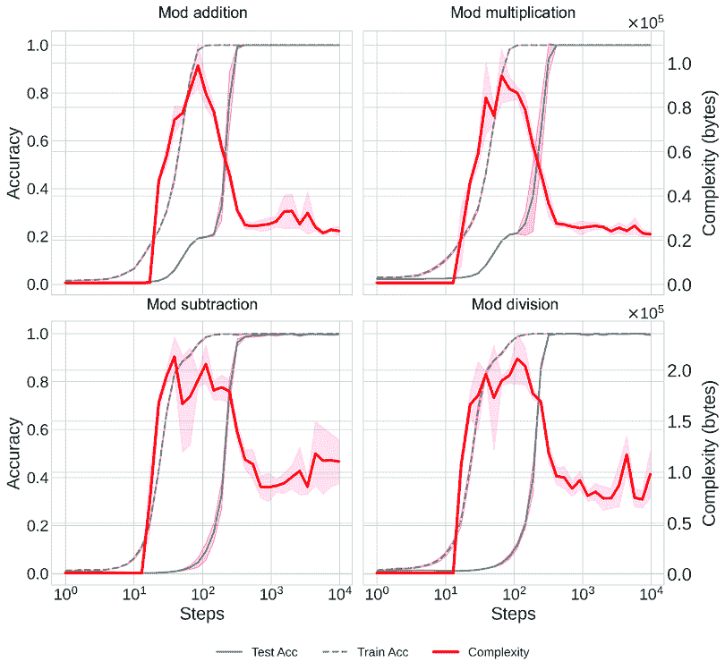
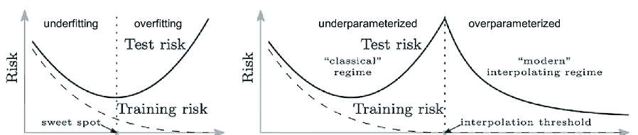
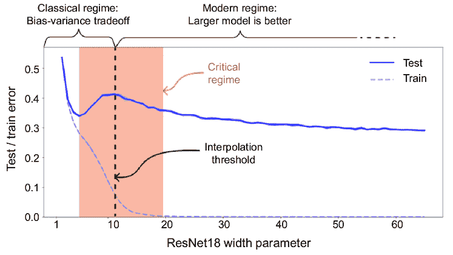

# 8 简洁，隐藏在复杂性中

## 本章涵盖

*   压缩如何揭示秘密结构
*   复杂性如何在秩序与噪声之间达到峰值
*   简洁如何战胜过拟合
*   领悟（或记忆，然后简化）
*   语言模型是否只是互联网的模糊 JPEG 的问题

## 论文

*   *量化封闭系统中复杂性的兴衰：咖啡自动机* (2014) Aaronson, Carroll, and Ouellette
*   *复杂动力学第一定律* (2011) Scott Aaronson
*   *柯尔莫哥洛夫复杂度与算法随机性* (2017) Uspensky, Shen, and Vereshchagin
*   *最小描述长度原理教程导论* (2004) Peter Grünwald
*   *通过最小化权重的描述长度来保持神经网络简单* (1993) Geoffrey Hinton and Drew van Camp

苏茨克维尔认为，任何好的预测模型隐含地是一个好的压缩器，反之亦然 [1]。在一次演讲中，他引用了 2017 年关于“情感神经元”的研究，其中 OpenAI 研究人员——包括苏茨克维尔——训练了一个长短期记忆（LSTM）网络来预测亚马逊产品评论的下一个字符，但发现一个神经元就捕捉了评论的情感 [2]。情感神经元的出现是因为预测下一个字符迫使模型在潜在变量中编码情感。

苏茨克维尔经常使用的一句话是，好的压缩揭示了数据中的“秘密”。*秘密* 是潜在变量或隐藏因素，如评论中的情感、语言中的语法结构、机器翻译中的思想向量，或视觉数据中的物理规律，这些没有被标记但影响预测。模型似乎“知道”事实和常识知识，因为它必须编码它们以压缩数据。

但在我们到达那里之前，我们首先追踪结构如何往往存在于秩序与噪声之间的复杂区域。斯科特·亚伦森、肖恩·卡罗琳和劳伦·奥莱特的“咖啡自动机”展示了复杂性如何在系统均质化时上升、达到峰值然后下降。这幅图景延续到人工神经网络，其中杰弗里·辛顿和德鲁·范·坎普训练网络以最小化描述长度，从而提高性能。

此外，关于“领悟”和双下降的工作反映了这些模式：复杂性首先随着网络记忆训练样本而增加，然后一旦发现简单的底层规则就崩溃，测试性能突然提高。同时，双下降表明，随着模型采用更简单、泛化能力更好的解决方案，测试误差先恶化然后再次改善。总的来说，这些想法汇聚成一幅图景，其中简洁出现在我们最意想不到的地方。

## 8.1 咖啡自动机

在 2011 年的一篇文章《复杂动力学第一定律》中，斯科特·亚伦森猜测，封闭系统中的复杂性从接近零开始，在中间时刻达到峰值，然后回到接近零，而熵则继续单调增加。他将这种行为称为“复杂熵”（complextropy），是复杂性和熵的混合词。这个从秩序到混乱、从简单到复杂再回来的谜题，促使亚伦森在 2014 年与肖恩·卡罗琳和劳伦·奥莱特重新探讨这个问题，论文标题为《量化封闭系统中复杂性的兴衰：咖啡自动机》。两篇论文都在苏茨克维尔的清单上。

热力学第二定律告诉我们，封闭系统的熵永远不会减少。*熵* 通常被描述为衡量混乱、随机性或能量和物质在这样一个系统中的分散程度。它解释了为什么系统倾向于从有序状态向混沌状态移动，比如冰融化。最终，熵与系统在给定宏观状态下可以拥有的微观配置数量有关。然而，经验表明，复杂性并不简单地追踪熵。宇宙始于一个光滑、严格约束、低熵的远离平衡状态，最终将结束于高熵的热寂，几乎没有任何可见结构。但在这些端点之间，我们经历了星系、生命和其他组织形式。一杯咖啡的行为类似，但存在负担较小。

倒入奶油，你开始时有两层干净的液体。混合过程中形成漩涡和细丝。随着可见结构达到峰值，熵上升。随着时间推移，杯子变成均匀的米色，反映出高熵状态，梯度被抹去，几乎没有可控结构。熵始终在增加，而复杂性则随着中等尺度模式的出现先上升，然后随着混合结束而下降。见图 8.1。

### 图 8.1（左）低熵低复杂性；（中）中熵高复杂性；（右）高熵低复杂性。*经主要作者（斯科特·亚伦森）许可使用。*

### 8.1.1 方法论

为了研究复杂性，作者构建了一个随机细胞自动机，作为咖啡杯的模型。细胞自动机是一个大小为 `n` × `n` 的二维网格（通常 `n` = 100）。每个单元格的值表示奶油（`1`）或咖啡（`0`）的局部存在。在初始状态下，网格的上半部分填满 `1`（奶油），下半部分填满 `0`（咖啡），代表一杯未混合的咖啡，具有清晰的奶油-咖啡边界。从这个起点出发，自动机根据两套规则之一在离散的时间步长中更新，对应两种物理状态：一个相互作用模型和一个非相互作用模型。

相互作用模型意味着每个单元格一次只能被咖啡或奶油占据。在每个时间步长中，自动机随机选择一对相邻的奶油-咖啡，两个粒子交换位置，模仿粒子无法相互穿过的扩散。该规则反映了产生大规模模式的物理约束。随着时间推移，许多随机交换使奶油扩散到咖啡中，但因为每个时间步长只发生一次交换，且远处的奶油粒子必须等待附近粒子移动，混合是渐进的。

非相互作用模型假设奶油粒子之间互不相互作用，自由移动。任意数量的奶油粒子可以占据同一个单元格。在每个时间步长中，每个奶油粒子独立跳转到随机选择的相邻单元格。因为多个粒子可以堆叠，它们不会相互阻挡或作用。

作者引入了一个两步过程。他们不分析由 `0` 和 `1` 组成的原始网格（随着混合进行，该网格在微观层面本质上变得随机），而是将状态平滑（或降采样）为粗粒化数组，即一个捕捉宏观模式的网格。通过对网格进行粗粒化，微小的斑点消失，只留下大的漩涡和奶油丝状物。同时，作者通过测量完整细粒化状态的可压缩程度来估计熵，这作为拟合观测数据的隐藏排列数量的代理。

作者使用每个单元格周围的一个小邻域并对其中的值求平均。他们对每个邻域求平均，其中接近 0 的值表示主要是咖啡，接近 1 的值表示主要是奶油，中间值表示混合物。然后将这些平均值量化为几个离散标签，如咖啡、奶油和混合。通过粗粒化，作者有意丢弃细粒化的随机性，专注于结构化特征，如定义模式复杂性的奶油-咖啡边界的形状。本质上，粗粒化数组是杯子的一个模糊、量化的“宏观状态”视图，类似于人类可能看到的景象。图 8.2 在一个小例子上说明了这一过程。

Figure 8.2 Illustration of the construction of the coarse-grained array using an example grain size of 3. The values of the shaded cells on the left are averaged to produce the value of the shaded cell on the right. *Used with permission granted by the lead author (Scott Aaronson).*

下一步是通过压缩估计描述长度。将粗粒化数组写入文件并输入标准压缩器（例如 `gzip` 或 `bzip2`），记录得到的压缩后大小。压缩文件的大小被作为该宏观状态的柯尔莫哥洛夫复杂度的估计值。柯尔莫哥洛夫复杂度是生成给定对象的最短程序的长度。简短的描述表示简单；长的描述表示复杂。具有可见结构的状态，如漩涡和簇，是“有趣的”，但往往压缩效果差，因此具有更长的描述长度；无特征或直接的状态压缩良好，具有更短的描述。作者将这一量称为 *表观复杂度*，并将其用作真实柯尔莫哥洛夫复杂度的实用替代，而真实柯尔莫哥洛夫复杂度在实践中是不可计算的。

想象两封 10,000 个字符的电子邮件：

*   *随机邮件*——你通过抛一枚公平的硬币 10,000 次并写“H”表示正面、“T”表示反面来生成它。这条消息具有高熵，在实践中不可压缩。由于它不包含结构，其柯尔莫哥洛夫复杂度很高。重现精确序列的最短程序就是序列本身。

*   *结构化邮件*——你写“HTHT … HT”，重复“HT” 5,000 次。这条消息具有较低的熵且高度可压缩。其柯尔莫哥洛夫复杂度很低，因为一个短程序，如“打印‘HT’ 5,000 次”，就能重现它。

为了与热力学形成对比，作者还压缩了原始的、未平滑的二进制网格来估计熵。一个彻底混合的咖啡杯在微观层面看起来是随机的，因此细粒化文件几乎不可压缩，其大小接近未压缩的大小。在中间时间步长中，细网格可能仍看起来随机，但粗视图可以揭示清晰的大尺度秩序。关键在于，熵反映微观层面的无序，而表观复杂度捕捉宏观层面的结构。

### 8.1.2 结果

作者发现，随着奶油和咖啡混合，熵（顶部曲线）稳定增加，反映不断增长的无序。见图 8.3。同时，复杂度（底部曲线）在开始时很低，只有两个简单的层；它在中间时间上升到峰值，此时出现复杂的混合模式，然后随着混合变得均匀而下降。换句话说，系统在中点处算法上变得最复杂，恰恰是在可见的“牛奶触须”和类似湍流的结构存在时，尽管这既不是最低熵点（初始状态）也不是最高熵点（最终状态）。这表明一个封闭系统如何能够在仍然遵守热力学第二定律 \[3\] 的同时，表现出表观复杂度的暂时上升。

Figure 8.3 In the simulation of coffee and cream mixing, entropy (top, monotonic curve) steadily increases toward a maximum as the fluids randomize, in accord with the Second Law. Apparent complexity (bottom, nonmonotonic curve) first increases, then decreases, peaking at an intermediate time when the system’s state is most “interesting,” or structured. *Used with permission granted by the lead author (Scott Aaronson)*.

为了强化直觉，该论文提供了相互作用和非相互作用模型在不同时间的杯子状态的灰度图像。在粗粒化实验中，两个模型都表现出估计复杂度的初始上升和最终下降，在中间时间达到峰值。图 8.4 显示了相互作用自动机的三个快照。顶行描绘了细粒化状态，其中每个像素为黑色或白色，表示咖啡或奶油，底行说明了粗粒化状态，其中像素的灰色阴影表示局部混合比例。最初，粗图像是一种简单的块结构，一半黑一半白。在复杂度峰值处，中间图像显示了一个中间混合状态，具有不规则的灰色区域，其中咖啡和奶油的局部比例在整个杯子中变化。最后，粗图像是一个均匀的中灰色；触须已扩散消失，留下均匀性，几乎到处都是 50/50 的混合。

Figure 8.4 Visualization of the interacting automaton’s state over time. *Used with permission granted by the lead author (Scott Aaronson)*.

图 8.5 展示了非相互作用自动机。其中间细粒度和粗粒度图像的结构远不如相互作用模型。复杂度峰值小得多（图 8.3，右）。这些图强化了相互作用动力学产生难以压缩的状态，而独立扩散则没有。咖啡自动机也提醒我们，系统可以是高熵但平淡无奇，或是中熵却结构化。

### 图 8.5 非相互作用模型的相同可视化。中间图像的结构不如相互作用模型，复杂度峰值更小。*经主要作者（Scott Aaronson）许可使用*。

在咖啡自动机中，杯子开始时简单，变得复杂，然后再次简单，即使微观无序度持续上升。使这一点可见的技巧是对模拟进行粗粒化。作者不跟踪每个微态，而是观察保留漩涡的模糊宏观态。因此，熵是对细粒度微态的陈述，而“表观复杂度”是对粗粒度宏观态的陈述。

在人工神经网络中，微态可能是完整的权重矩阵，直到最后一位小数。然而，微态层面过于详细。我们关心的是宏观态，包括咖啡中的漩涡模式或模型学到的函数和表示。如果你查看正确的粗粒度变量，训练看起来就像一个系统先探索，然后自我组织，然后简化。这为讨论 AI 如何在其学习结构中表现出越来越复杂的特性，随后通过泛化简化，奠定了概念基础。

通过根据算法信息和描述长度定义复杂度，作者架起了物理与信息理论之间的桥梁，展示了来自计算机科学的概念，如柯尔莫哥洛夫复杂度，如何启发物理学，反之物理学如何启发计算机科学。作者将一个抽象概念，如柯尔莫哥洛夫复杂度，定量应用于一个具体的物理场景。他们对现实世界压缩算法的使用也很清晰，并避免了不可计算性问题。人们确实可以重建粗粒度图像并看到导致复杂度的模式。这种教学上的清晰性使作品对广泛的、具备技术素养的受众来说易于理解，就像 Chris Olah 的作品一样（第 4 章）。

## 8.2 柯尔莫哥洛夫复杂度与算法随机性

*《柯尔莫哥洛夫复杂度与算法随机性》*于 2017 年出版\[4\]。前半部分是教科书式的核心概念阐述，后半部分展示了来自莫斯科“柯尔莫哥洛夫研讨会”及其研究人员的更先进、近期的成果。弗拉基米尔·A·乌斯宾斯基（1930–2018）是安德烈·柯尔莫哥洛夫的学生，这位苏联数学家开创了该领域\[5\]。乌斯宾斯基领导了莫斯科国立大学的数学逻辑与算法系，并在柯尔莫哥洛夫著名的 20 世纪 80 年代算法复杂性研讨会中发挥了重要作用。亚历山大·申和尼古拉·韦列夏金在莫斯科的算法信息论学派接受培训，并对柯尔莫哥洛夫复杂度研究领域做出了重要贡献\[6\]\[7\]。

柯尔莫哥洛夫复杂度将对象的信息内容定义为输出该对象的最短程序的长度，而算法随机性是指对象没有比对象本身更短的描述的性质。这与压缩观点一致，并与香农熵不同，香农熵衡量概率分布或源的平均不确定性\[8\]。克劳德·香农问的是在结果已知之前平均需要多少比特，而柯尔莫哥洛夫复杂度问的是在指定之后，多短的描述可以重现这个特定结果。如前所述，重复序列不是算法随机的\[9\]。相反，回到我们之前的例子，一个典型足够长的公平抛硬币结果序列是不可压缩的：很可能，没有比序列本身短得多的程序能输出它。这是算法随机性的压缩观点\[10\]。一个真正看起来随机的序列没有这样的短程序，这是柯尔莫哥洛夫和独立地雷·所罗门诺夫引入的关键思想\[11\]。

在这个框架中，随机性是不可压缩性。它是不存在任何更短的代码来解释数据如何产生。然而，即使一个只包含一点随机性的微小描述，也可能掩盖显著的计算复杂性。描述的简单性与涌现行为之间的张力在该领域最引人注目的构造之一中体现。想象一个遵循简单规则的程序，比如读取一个方格、写入一个符号和切换状态。在这些程序中，许多很快停止，一些运行很长时间，另一些无限循环。拉多的“忙碌海狸”函数是停止前完成最多工作的程序。但确定哪个程序是“忙碌海狸”是一个巨大的问题，因为你必须回答机器是否停止，以及如果停止，它运行多长时间。回答这个问题需要解决著名的停机问题，我们已经知道一般情况下无法解决。这意味着“忙碌海狸”函数是不可计算的\[12\]。

这在关于压缩和随机性的章节中重要的原因是，忙碌海狸是短描述不保证简单行为的最清晰证明。随机数据复杂是因为它抵抗压缩；没有更短的描述。但忙碌海狸在相反方向上是复杂的。它在“描述长度”上很短，因此高度可压缩。然而当你运行它时，它可能花费比任何可计算边界更长的时间。就像一颗小种子长成一棵巨树，但你只有让它生长才能发现它有多大。

因此，当随机性是无法缩短描述时，忙碌海狸是对“最短代码”思维的警告。如果一个简短的解释只有在经过不可知的长计算后才能产生我们想要的东西，那么它可能是无用的。这正是为什么像阿伦森这样的研究人员强调资源受限的思想，这些复杂度度量不仅关心你的解释占用多少比特，还关心将其转化为你试图解释的内容需要多少计算。

### 8.2.1 算法统计

本书还研究了更专业的主题。例如，算法统计研究如何在单个数据集中将结构与噪声分离。它使用柯尔莫哥洛夫复杂度来识别捕捉该结构的最简单模型。这个主题如此相关，以至于伊利亚·苏茨克维夫明确推荐了本书的最后一章，标题为“算法统计”\[13\]。

那一章以算法术语构建科学解释。一个好的理论应该简洁且不令人意外。作者使用柯尔莫哥洛夫复杂度作为简单性的标杆，以及随机性缺陷作为典型性的标杆，将这一点形式化。如果一个模型能将数据生成为众多结果中不起眼的一个，那么数据就是典型的。简单性意味着对低复杂度模型的简短描述；通常，数据看起来像来自该模型的正常样本，因此具有低随机性缺陷。这些想法共同将“好的科学解释”的直观概念转化为我们几乎可以量化的东西。

将随机性缺陷视为一种衡量异常性的工具。高缺陷表明数据点不太可能出现，而低缺陷表明在该模型下数据是可预期的。正式地说，如果我们把模型视为一组可能的结果或概率分布，随机性缺陷衡量数据与模型通常会产生的情况之间的差距。假设你的模型是“所有天鹅都是白色的”，而你的数据点是一只黑天鹅。那只黑天鹅对模型来说是非典型的；它相对于“所有天鹅都是白色的”具有高随机性缺陷。如果你的模型是“天鹅可以是黑色或白色”，那么黑天鹅具有低缺陷，并且在模型下是正常的。从算法的角度来看，本章将随机性缺陷大致定义为模型对结果的预期复杂性与特定数据的实际复杂性之间的差距。如果缺陷很小，数据符合模型的预期。如果缺陷很大，数据就是一个尴尬的不匹配。

在这个框架中，一个好的解释将简单的模型与低随机性缺陷配对。模型应该简洁，数据应该相对于该模型是典型的。这正式化了科学理论的两个支柱：模型的简单性和数据相对于模型的典型性。如果任何一个支柱失败，例如，模型简单但数据在它看来不合理，那么解释就不令人满意。模型可能过于简单以至于无法使数据典型，或者数据可能仅仅因为模型过于复杂而完美拟合。

2025 年末，陶哲轩评论说，Gemini Deep Research 在对埃尔德什问题#481 进行文献综述时，复制了一个本质上正确的论证，尽管报告似乎没有认识到它已经建立了结果 [14]。该问题后来被标记为已证明，并在 Lean 中验证了证明 [15]。用算法统计的语言，可以将这一事件视为类似压缩机的行为，因为模型在数学话语上训练后，可以从简短的提示中重建结构化的证明。

将有损压缩想象为图像的 JPEG 或音频的 MP3，尽管在正式设置中，我们实际上并没有丢弃信息。理论是，有意义的内容可以被存储，而无意义的噪声可以被丢弃或平均掉。在一个引人注目的结果中，作者表明，如果你能找到数据的最优两部分描述，那么第二部分（噪声）不包含有用的信息。你已经将所有的意义挤进了模型中。例如，他们描述了一个场景，你获取一个长记录（比如说，所有世界观测编码成一个字符串）并为其找到最优模型；其余部分将是不可压缩的噪声，而模型的输出将是世界数据的“去噪”版本。这是一个理论理想，因为在实践中，完美地做到这一点是不可能的。尽管如此，这是一个美妙的见解。最好的解释不仅解释，而且清理数据。它识别出数据的哪些部分遵循类似规律的结构，哪些是偶然的随机性。

从哲学上讲，这关系到我们如何进行科学。当多个理论可以解释数据时，我们倾向于更喜欢更简单的那个（奥卡姆剃刀）以及不让数据看起来奇迹般的那个。算法统计提供了一种语言来以数量精度讨论这一点。在现代人工智能中也不难看到这一点的回响。当我们训练模型，特别是无监督模型时，我们实际上是在做压缩。例如，人工智能中的世界模型，比如那些学习环境物理的模型，将观测历史压缩成一组规则。一个好的世界模型可以生成与真实世界分布匹配的典型结果，就像算法统计中的一个好的解释为埃尔德什问题生成典型数据一样。

同样，本章的思想与机器学习的泛化联系在一起，如果模型捕捉底层模式而忽略噪声，它就能很好地泛化。一个好的模型不会过拟合噪声，因为那样会使描述膨胀，并且它在可能时压缩规律性。这意味着任何学习或解释的系统——无论是科学家、压缩算法还是人工智能——都面临算法统计所捕获的相同的权衡。它必须通过在保持缺陷小的同时最小化模型复杂性来平衡模型的复杂性与数据的拟合。

一个特别有说服力的后果是，我们可以将人工智能和压缩视为同一目标的两个版本。例如，像 DALL-E 或 GPT 这样的人工智能在训练期间压缩知识，然后生成输出。它使用一个内部模型，从某种意义上说，它是世界的两部分代码：模型及其权重，加上产生特定图像或句子时的残差随机性。如果该模型过拟合数据，它就像携带一个巨大的查找表。没有学习。如果它欠拟合，它太简单，无法捕捉结构，导致大的错误，例如使用直线来拟合复杂的曲线。最佳点是一个刚好足够丰富以捕捉规律性的模型，但又不至于如此丰富以至于它开始将随机性视为规律性来捕捉。

### 8.2.2 意义

与本章中的其他著作不同，*《柯尔莫哥洛夫复杂性与算法随机性》* 的意义不在于它引入了基础定义或定理。在算法信息论已经成为一个成熟领域之后出版，这本书将主题汇编成对复杂性、随机性、概率和熵的系统性阐述，然后才进入更专业的主题，如共同信息、多源算法信息论、信息与逻辑以及算法统计。

它也是历史性的。在李和维塔尼的《柯尔莫哥洛夫复杂性及其应用导论》成为标准广泛参考的地方，沈、乌斯宾斯基和韦尔希宁的书延续了莫斯科学派的视角，包括与柯尔莫哥洛夫研讨会相关的工作。因此，它对苏茨克弗列表的意义与原始研究论文不同。它保留了一种技术传统，同时澄清了基于压缩的随机性观点如何与概率、信息论、逻辑和统计解释联系起来。

## 8.3 最小描述长度原理教程介绍

最小描述长度（MDL）断言，对数据的最佳解释是实现最大压缩的解释。简单来说，如果数据包含模式或结构，我们可以用更少的位来描述它，而完全随机的数据是不可压缩的。彼得·格伦瓦尔德的论文《最小描述长度原理的教程介绍》以三个 10000 位序列开头。第一个是 `0001` 重复 2500 次；第二个是硬币翻转序列；第三个大致有四倍于 1 的 0。第一个序列非常规则。与其写所有的 10000 位，可以说“`0001` × `2500`”并传达相同的信息。随机序列没有明显的模式。因此，不可能有比完整序列更短的描述。第三个序列是中间的。它不是确定性地有模式，但它表现出统计规律性，因为它对 0 的偏向可以用于压缩。这说明了 MDL 的核心思想。当我们在数据中发现规律或结构时，我们可以压缩它；相反，成功的压缩提供了我们已经捕捉到该结构的证据。

MDL 与柯尔莫哥洛夫复杂度相关，后者是简单性的终极度量。实际上，MDL 近似于柯尔莫哥洛夫复杂度。虽然我们失去了找到数据最短描述的保证，但我们获得了一个可行的模型选择过程。正如格伦瓦尔德所说，我们为实用 MDL 方法付出的代价是，总是会存在一些我们无法用给定模型类捕获的规律。这是不可避免的。没有通用学习器能够捕获*每一个*可能的规律。MDL 提供了一种方法，通过平衡模型复杂度和数据拟合，用手头的模型捕获尽可能多的规律。

MDL 的优点之一是它自然地防止过拟合。当模型捕获了数据的底层结构及其噪声时，就会发生过拟合，导致泛化能力差。MDL 通过显式地惩罚复杂度来防止这一点。即使模型通过完美匹配每个数据点达到零训练误差，总代码长度（结合模型描述和数据）最终也会更长，因为需要更多比特来指定模型的所有复杂细节。相反，更简单的模型可能不能完美拟合数据，可能留下残差误差。但它仍然可以导致更短的总描述，因为模型简单性节省的比特超过了描述这些残差所需的额外比特。

格伦瓦尔德用一个多项式曲线拟合场景来说明这一点（见图 8.6）。线性模型（左）很简单，但对数据欠拟合，因为它在残差中留下了系统性模式，未能捕获数据的弯曲。高次多项式（中间）很复杂。虽然它可以插值每个数据点并留下零训练误差，但它会浪费比特来描述噪声。最优折衷是中等次数的多项式，它捕获总体趋势而不捕获噪声（右）。MDL 会选择这个模型，因为它产生最短的描述，这又是一个相对简单的函数形式加上对适度残差的简短编码。

### 图 8.6 简单多项式（左）对数据欠拟合，复杂多项式（中间）可以达到零训练误差但浪费比特描述噪声，而折衷多项式（右）识别总体趋势而不包含噪声。*经主要作者（彼得·格伦瓦尔德）许可使用。*

该论文的基本主张是学习就是寻找规律，这表现为可压缩性。每当我们能缩短数据的代码时，我们就揭示了其中的结构；当我们不能时，数据就可能是噪声。一个捕获了规律的模型将既能压缩过去又能很好地预测未来。格伦瓦尔德的教程将复杂性视为模型推理的*工具*，而不仅仅是我们*研究*的东西（即柯尔莫哥洛夫理论）。这连接了压缩与预测，并与预测建模相吻合。

苏茨克维耶的下一个令牌预测视角符合这一图景。诸如下一个令牌预测之类的训练目标迫使人工神经网络将其训练数据压缩到柯尔莫哥洛夫复杂度。虽然真正的柯尔莫哥洛夫复杂度是不可计算的，但说法是，用梯度下降训练的大型网络比其他模型更能近似这一理想，使它们成为 MDL 核心压缩-预测联系的实用实例\[16\]。

伊利亚在采访中分享了 OpenAI 的 iGPT（2020）实验的结果。iGPT 是一个 GPT 风格的变换器，在低分辨率图像上无标签训练以预测下一个像素，并在单独的监督分类任务上评估\[17\]\[18\]。尽管从未接受过分类训练，该模型学习了强大的内部表示。在 CIFAR-10 上，iGPT 达到 96.3%，优于 ResNet-152（第 3 章）。

更深层的意义在于最有用的表示所在之处。在监督学习中，优化`P(Y|X)`促进网络顶部的线性可分性。最好的特征在那里被发现，因为最后一层鼓励网络丢弃无助于预测标签`Y`的信息。然而 iGPT 的无监督训练目标更接近于对`P(X)`建模。该目标不需要类别分离，因此模型学习任何最好地减少像素不确定性的结构，包括语义结构和低级细节。

有趣的是，相对于网络中间的最佳层，最终层的准确率下降了约 2.4%。作者将这一差距描述为“基线与最先进结果之间的差异”。意义在于，最有用的分类特征在网络中间达到峰值，而不是在末端。这种深度剖面类似于复杂动力学，有趣性在中间达到峰值，然后在顶层逐渐消失，特别是当它们专门用于分类时。

iGPT 的成功支持了下一令牌或下一像素预测迫使模型找到有意义结构的论点。如果网络能压缩其训练数据，它就提取了数据所包含的任何“秘密”。一个由格伦瓦尔德的教程强调的推论是，MDL 对真相是不可知的。MDL 风格的模型选择不是本体论或认识论的承诺。这并不意味着数据背后没有“世界模型”或“世界模型”是无稽之谈。在 MDL 术语中，世界模型只是对底层数据生成过程的一种特别好的压缩方案。

当数据流锚定在我们关心的世界中时，在描述长度上胜出的模型正是那些内部结构反映该世界关键方面的模型。追求单一可重用“世界模型”的项目——比如在丰富环境流上训练的 JEPA 风格架构，而不是仅文本——本质上是赌一个共享压缩机将比一堆特定任务的压缩机更便宜且更有用\[19\]。

这样看，当今语言模型产生幻觉的事实就不再神秘了。它们的训练目标（即下一令牌）并不强制对世界进行忠实的数字孪生。相反，它是一个精细的、MDL 风格的压缩目标。在模型达到近似最优压缩的程度上，它必须表示数据的大量潜在结构，但不一定包括存在或最终重要的所有结构。这产生了工具性可靠性，但它从不询问生成的内容是否准确对应外部世界。换句话说，我们通过预测压缩来判断它，而不是通过关于真实世界的先验真相声明。

这种情况类似于前面讨论的 VLAE 架构（第 7 章），其中潜在代码保留了图像的大规模结构，而 PixelCNN 解码器填充局部合理的细节。这种分工之所以有效，是因为许多细粒度图像与同一粗略描述兼容。语言模型对文本执行类似的操作。它们的参数和上下文编码了语言和概念规律的压缩模型，而生成则逐个令牌地填充剩余的细节。危险在于，名称、引用、判例法、因果机制和数学步骤不仅仅是视觉纹理。一个续写在模型下可能非常典型，因此相对于它的随机性缺陷很低，但仍可能无法对应外部世界。

这类研究也说明了为什么确定性软件并不优于人工智能。只是不同而已。传统程序可能反复出错，因为它每次都应用相同的错误规则，或者因为正确规则只在其设计者预期的狭窄条件下应用而显得脆弱。相反，人工神经网络通过收敛于数据中的潜在规律来得到正确答案。用 MDL 的话来说，重要的不是精确的表面可重复性，而是系统是否捕获了足够的潜在结构以泛化。可重复的错误可能更容易调试，但这并不是关于正确性的普遍论点。这就是为什么“它只是下一个 token 预测”是正确的却空洞。它命名了训练信号，而不是模型必须学习产生该信号的结构。

## 8.4 保持人工神经网络简单

1993 年，Geoffrey Hinton 和 Drew van Camp 在《Keeping Neural Networks Simple by Minimizing the Description Length of the Weights》一文中认为，当权重的描述长度最小时，人工神经网络的泛化能力更好。通俗地说，网络不仅从数据中学习，还学习关于其自身复杂性的知识。结果是一个模型以最少的权重在新数据上实现高精度。这是一次发明性的演示，表明柯尔莫哥洛夫复杂性的抽象概念可以在人工神经网络中得以实现。通过最小化权重描述的长度，Hinton 和 van Camp 的工作体现了在复杂性中追求简单性的主题。他们表明，即使复杂的神经网络也可以通过遵循信息论过滤器向最小描述长度方向而变得更简单、更好。

该论文介绍了一种根据描述长度来量化和最小化网络复杂性的方法。每个权重值被视为我们可能需要用比特来传达的东西。更复杂的权重配置需要更多比特来指定。通过在训练目标中添加一个可微的比特成本项，作者鼓励网络使用更少的比特，从而压缩自身，而不是量化或硬编码权重，这会使优化复杂化。Hinton 和 van Camp 向每个权重注入高斯噪声。噪声量在训练过程中调整，使得不重要的权重可以承受噪声，而真正关键的权重则被更精确地调整。这种策略提供了一种在精度和简单性之间进行折衷的平滑方式，允许基于梯度的优化来确定每个权重需要多少细节。

### 8.4.1 方法论

论文的核心是一个优雅的训练目标，最小化总描述长度，定义为编码模型权重所需的比特数与编码训练数据上的残差错误所需的比特数之和。正式地，作者通过将权重视为要传输的消息，以及对网络输出的校正，使这一目标与 MDL 对齐。网络的损失函数被扩展，包括一个以比特衡量的模型复杂性项。

Hinton 和 van Camp 表明，在他们的方案下，指定权重的期望成本（以比特为单位）是 Kullback–Leibler（KL）散度。KL 散度衡量两个分布之间的差异，并估计当一个分布近似另一个分布时丢失的信息量。KL 散度有效地衡量了学习到的权重相对于先验有多“令人惊讶”或信息丰富。通过对所有权重的散度求和，作者得到了网络复杂性的比特数值度量。最小化这个项以及通常的数据误差，等价于寻找最佳联合压缩权重和误差的最小描述长度模型。

为了使其可行，每个权重被视为具有高斯分布的随机变量。在训练期间向权重注入噪声隐式地探索了大量附近的网络，平衡了精度和简单性。高变异性权重在比特上“便宜”，但降低精度；低变异性权重改善拟合但增加复杂性。训练调整均值和变异性以最小化总描述长度。

### 8.4.2 结果

Hinton 和 van Camp 在他们的 MDL 训练方法上在一个要求很高的肽活性预测问题进行了测试。数据集仅包含 105 个训练样本和 420 个测试样本，刻意保持较小以确保任何容易过拟合的方法都会遇到困难。他们使用的网络有四个隐藏单元和 521 个权重，远超数据点的数量。这种设置使其成为平衡精度和模型复杂性的正则化器的理想试验台。

结果是惊人的。当使用基于 MDL 的惩罚进行训练时，网络在测试集上实现了 0.286 的相对误差。相对误差是一个归一化指标，其中较低的值表示更好的泛化，而预测平均目标值的基线得分为 1.0。相反，在没有 MDL 项的情况下训练的同一网络实现了 0.967 的相对误差，仅略好于平凡的基线。这种差异展示了 MDL 目标如何防止模型记忆小训练集中的噪声。通过对每个过于精确的权重收取“额外比特”，该方法自动限制了模型过拟合的能力。

为了与熟悉的方法进行基准比较，作者将 MDL 与权重衰减进行了比较，权重衰减是一种经典的正则化技术（由`AlexNet`推广），用于惩罚大的权重。经过仔细调整，权重衰减产生了 0.317 的相对误差，相比未正则化的训练有显著改善，但仍比 MDL 达到的 0.286 差。达到 0.317 需要反复试验以确定合适的惩罚系数，并且在实践中，必须使用一些训练数据进行验证。Hinton 和 van Camp 指出，如果有人“偷看”测试集来调整这个超参数，最佳的权重衰减模型可以达到约 0.291，仍然较差。MDL 方法自动找到了这种最优折衷，无需外部调整。

他们还包括了一个线性回归基线作为参考。没有正则化，线性模型灾难性地过拟合了 105 个数据点，产生了 35.6 的测试误差，比人工神经网络差数百倍。但添加强的岭正则化（惩罚大系数）将其降低到约 0.291，与调整后的权重衰减网络相当。这表明，在强正则化下，非线性网络的隐藏单元表现得像线性一样。这种方法之间的收敛强化了这样一种直觉，即这里成功的泛化来自简化模型的内部表示，而不是利用其非线性能力。

除了数值指标，作者还强调了定性证据，表明网络在 MDL 框架下更有效地组织了其知识。到训练结束时，许多权重已经分组到几个不同的簇中。学习到的编码先验被建模为五个高斯分布的混合，重新形成以适应这些簇。换句话说，大多数权重落入了几个可预测的值，每个值只需用很少的比特即可编码。

这种自我压缩正是 MDL 原则所预测的：最小化总描述长度推动模型走向与数据一致的最简单表示。网络不仅在未见的分子上泛化得更好，而且还发明了自己紧凑的内部语言来表示所学的内容。这些结果强烈支持 Hinton 和 van Camp 的论点，即作为压缩的学习能够产生既高效又稳健的模型。

### 8.4.3 局限性

尽管该方法优雅，但也存在一些局限性。首先，算法的复杂度并不简单。与标准反向传播不同，它需要为每个权重维护和更新一个分布，包括其均值和方差，而且在作者的实现中，甚至需要维护混合先验的参数。这至少将可训练参数的数量翻了一番，并且需要计算不确定性如何通过非线性激活传播。Hinton 和 van Camp 不得不使用近似表并进行仔细的数值检查，以正确实现梯度，这说明了这项工作是多么繁琐。这种复杂性会阻碍扩展到更大的网络或数据集，尤其是在 1993 年该论文发表时。事实上，该论文仅报告了具有单个隐藏层和相对适中参数数量的实验。

此外，评估是有限的。作者将他们的结果描述为“初步的”，并未与其他正则化方法或更大的基准进行详尽的比较。后续研究发现，更简单的技术，如调优的权重衰减或提前停止，往往能以少得多的麻烦达到类似的结果 [20][21]。这解释了为什么 MDL 方法在实践中没有流行起来。

### 8.4.4 文化影响

就文化影响而言，本文并未彻底改变网络训练。虽然这项研究领先于时代，但 1993 年的社区缺乏采用如此复杂的正则化方法的计算资源或紧迫性。但其以比特为中心的视角在现代实践中很明显，如模型压缩和量化网络。今天，我们使用了这一思想的变体，如权重衰减、随机失活、稀疏先验、剪枝、量化和蒸馏，这些都缩小了模型的描述。本文值得列入 Sutskever 榜单，因为它体现了对简洁性的统一追求，其中以比特或描述长度衡量的简洁性是实现更好性能的关键。

## 8.5 Grokking

我们已经看到复杂度在物理系统、单个字符串以及通过 MDL 定义的模型中的定义。最后一节探讨现代深度神经网络是如何训练的，将我们之前的话题与 grokking 和双下降联系起来。

*Grokking* 描述了人工神经网络如何在完美记忆其训练数据后发现可泛化的解决方案 [22][23]。这是一个引人注目的现象，其中测试准确率在模型过度拟合训练集很久之后，从猜测跃升至接近 100%。这个延迟的“啊哈！”时刻引发了关于网络从暴力记忆到泛化转变过程中内部变化的问题。

论文《Complexity Dynamics of Grokking》通过测量模型在训练期间学到的表征的内在复杂度来解决这一谜题 [24]。Branton DeMoss 及其同事发现，网络的内部复杂度在 grokking 过程中经历相变：随着网络记忆数据而上升，然后一旦学会更简单的潜在模式以实现泛化便急剧下降。至关重要的是，这种升降模式仅在充分正则化下出现。未经正则化的网络保持高度复杂，本质上记忆每个细节，且永不泛化。见图 8.7。

### 图 8.7 在模乘法 grokking 实验中，未正则化（顶部）和已正则化（底部）神经网络的复杂度动态。标记表示记忆（**□**）和泛化（**○**）发生的时间。在正则化网络中，泛化发生在复杂度在记忆峰值后下降时，而未正则化网络永不泛化，其复杂度保持高位。三个种子的均值；阴影表示标准误差。*经主要作者 (Branton DeMoss) 授权使用*。

作者明确引用咖啡自动机的“表观复杂度”作为灵感。仿佛人工神经网络在“混合”原始数据时变得更复杂，然后进入更简单的宏观构想。中间的时期对应网络权重或表征处于最大复杂度之时，就在网络简化为可泛化的解决方案之前。虽然这不在咖啡自动机论文中，但它扩展了论文的思想，强调了其不仅与物理相关，也与机器学习和泛化相关。

作者的核心论点是，当模型真正学到一般规则时，它比仅仅记忆时更“简单”且更可压缩。当网络捕获训练集的特质特征时，它实际上是在“记忆”，这需要大量信息容量并增加复杂性。在此阶段训练准确率上升，但压缩模型大小也上升，因为网络编码更多信息以捕获每个训练样例。

但在多次迭代后，模型发现了潜在模式。此时，测试准确率提高，而模型复杂度下降。模型已过渡到更简单的内部表征，不再记忆单个样例，而是编码一般规则。学习算法现在为数据找到了更短的描述。研究人员表明，这一转变与“清理阶段”一致，在此阶段模型移除早期训练时依赖的记忆样例 [25]。本质上，网络“遗忘”随机细节，只关注本质。

这与像 SIFT+SVM（第 2 章）这样的旧流水线非常不同，后者固定特征并仅学习类别间的决策边界。如果那些固定特征未能揭示真实结构，分类器必须存储许多逐样例的怪癖，导致高复杂度和差泛化。相反，深度网络直接学习特征，重组表征使规则变短。用 MDL 的话说，深度学习获胜是因为它能通过改进表征来压缩总描述长度，而不仅仅是在顶部拟合边界。

值得重提 Alyosha Efros 的笑话（第 2 章），关于“‘花哨’的人工神经网络……并不比简单的最近邻好多少”，以及数据的不合理有效性，这两者都将数据定位为伟大的均衡器。也就是说，只要有足够的数据，即使简单方法也能走得很远。但该结论假设了一个固定表征，其中“最近”已经意味着某些有用的东西。然而深度学习是一个重写特征空间的解决方案。它通过学习和压缩表征来简化问题本身。最终，架构很重要，在扩展时我们必须始终询问，“扩展什么？”重要的扩展问题不仅是“多少数据？”，还包括架构和学到的表征。毕竟相当 *fancy schmancy*。

在他们的实验中，DeMoss 等人聚焦于小型算法任务，如模运算，这些任务已知会表现出 grokking 行为。他们表明，网络的描述长度（以比特为单位）在过度拟合期间达到峰值，然后在 grokking 时刻崩溃，此时测试性能激增。见图 8.8。这种行为类似于物理中的相变，就像水沸腾或磁铁失去磁化一样。学习系统从以高复杂度和记忆为特征的状态过渡到以低复杂度和泛化为特征的状态。论文的论点是，当网络停止记忆并开始学习时，它有效地找到了数据的更短描述。正如作者所说，“泛化最好的模型就是压缩数据最好且自身最可压缩的模型。”

### 图 8.8 模算术任务中涌现时的复杂度

灰色曲线显示训练和测试准确率；粗曲线显示学习表示的估计复杂度。在模加法、乘法、减法和除法中，复杂度在记忆到泛化的过渡期间上升，然后在模型陷入更简单的类规则解时下降。峰值出现在训练准确率（虚线灰色）已经很高但测试准确率（实线灰色）尚未完全赶上的区间附近。随着模型记忆，复杂度增加；随着它们泛化，复杂度（以字节为单位）下降。*经主要作者（Branton DeMoss）许可使用。*

### 8.5.1 压缩

作者开发了一种自定义压缩方案，在保持准确性在很小容差内的同时，模糊掉非本质的细节。他们不仅是在缩小网络的权重；他们正在简化网络*所做的事情*。这意味着压缩发生在函数空间中，而不仅仅是在参数空间中。因此，两个行为几乎相同（即它们做出几乎相同的预测）的网络被视为等价的，即使它们的内部参数不同。结果是一种更有意义的压缩形式，优先考虑模型的行为而不是其微观细节，呼应了 Aaronson、Carroll 和 Ouellette 的工作。

压缩流水线有两个主要步骤。首先，权重量化将浮点权重映射到一小组离散值（例如，8 位码）。为了保持准确性，*量化感知训练* 在训练期间注入噪声或模拟舍入，使网络对错误更健壮。这个想法追溯到 Hinton 和 van Camp 的 MDL 框架，如 DeMoss 等人所引用。训练后，模型可以以最小的准确性损失进行量化。直观地说，这消除了对微小的、逐样本的权重调整的依赖，保留了重要的粗粒度结构。

另一步是低秩近似。一个大的权重矩阵可能包含许多参数，但如果其行和列主要重新组合一组较小的基础模式，则仍然可以被一个低得多的秩矩阵很好地近似。在这种情况下，矩阵可以分解为更薄的矩阵，保留主导方向而丢弃冗余的。这松散地联系到 Hinton 的 dropout 理由（第 2 章），它通过在训练期间随机将神经元设置为零来破坏这种共适应，迫使特征在不同上下文中保持有用。两种方法都阻碍了脆弱的依赖，但方式不同。Dropout 使表示对任何特定单元的依赖减少；低秩近似是事后进行的，并压缩剩余的共享结构。

值得注意的是，作者实现了 30× 到 40× 的压缩比。事实上，一个朴素的压缩器只捕获了训练动态的一小部分。假设你在训练的不同点 `gzip` 模型。在这种情况下，文件大小大致相同，因为它由初始化和随机训练程序留下的随机位主导。相比之下，他们复杂的有损压缩足够敏感，能够检测模型真实复杂度的细微变化。在一个例子中，当网络学习模乘法时，其压缩长度最初增加，表明它正在编码更特定的信息以拟合训练数据。然后，在涌现点，压缩长度骤降，表明网络找到了乘法规则的更简单表示。这提供了网络已有效地将数据集压缩为简单规则而不是记忆每个例子的证据。

### 8.5.2 从理论到实践再回到理论

从历史上看，从业者了解到模型性能的整洁图景。随着模型容量的增长，训练误差（即训练集上的损失）下降，而测试误差（即保留数据上的损失）遵循 U 形曲线。许多从业者（包括我）将这一点内化为一个因果故事，其中小模型欠拟合（即高偏差），中型模型达到最佳点，而大型模型过拟合（即高方差）。所谓的偏差-方差权衡的教科书演示是多项式拟合，类似于 Grünwald 的演示（图 8.6）。直线对抛物线数据欠拟合；二次函数拟合数据；而高阶多项式追逐噪声。正则化被理解为通过限制容量或提高健壮性来减轻这种行为。这个教训的经典解释是将模型复杂度与数据复杂度匹配并保持在 U 的底部附近。参见图 8.9（左）。

### 图 8.9 左：经典的偏差-方差权衡。训练误差（在此图中称为“风险”）显示为虚线。它单调下降，而测试误差（实线）是 U 形的，底部是最优的。右：在插值阈值之外，测试误差在过参数化（插值）区域中先上升后再下降，而训练风险保持接近零。*经主要作者（Mikhail Belkin）许可使用。*

`AlexNet`（2012）拥有 6000 万个参数，作者担心训练期间的过拟合。他们使用了数据增强、dropout 和权重衰减，因为没有这些技术，过拟合似乎很明显。结论是，如此大的网络在 U 的右侧的过拟合区域中运行，必须通过正则化拉回中间。然而，随着深度学习的扩展，出现了非同寻常的现象。更大、更深的模型即使在适度或没有显式正则化的情况下仍继续泛化。

在现代过参数化设置中，传统的 U 形曲线是不完整的。在插值阈值之外，测试误差可以再次下降，正则化通常使非常大的模型能够很好地泛化。参见图 8.9（右）。这里，“过参数化”意味着模型拥有远超拟合训练数据所需的参数，因此它可以完美插值，精确地拟合每个训练示例。插值阈值是变得可能的容量点。在那之后，许多现代网络仍然泛化得很好，因为显式正则化器和优化器的隐式偏差引导它们走向精确拟合数据但仍然足够简单以便在新数据上表现良好的函数。

2016 年，Chiyuan Zhang 及其同事通过随机化 CIFAR-10 和 ImageNet 的标签突出了这一分歧，结果令人惊讶 [26]。在 CIFAR-10 数据集上，一个较小的 `AlexNet` 模型在 50,000 张图像的训练集上达到了 99.82% 的准确率。见表 8.1。

### 表 8.1 较小版本 `AlexNet` 在 CIFAR-10 数据集上的训练和测试准确率。原始 `AlexNet` 有 6000 万个参数。

| Model | Number of parameters | Labels | Random crop | Weight decay | Train accuracy | Test accuracy |
| --- | --- | --- | --- | --- | --- | --- |
| `AlexNet` | 1,387,786 | true | yes | yes | 99.90 | 81.22 |
| | | true | yes | no | 99.82 | 79.66 |
| | | true | no | yes | 100.0 | 77.36 |
| | | true | no | no | 100.0 | 76.07 |
| | | random | no | no | 99.82 | 9.86 |

在 ImageNet 数据集上，`AlexNet` 达到了 95.20%（top-1）训练准确率，考虑到 1000 个类别中有超过 100 万个随机标签，这高得令人惊讶。如表 8.2 所示，结果表明深度网络可以有效地记忆*随机*标签。

### 表 8.2 较小 `AlexNet` 在 ImageNet 数据集上的训练和测试准确率

| 标签 | 数据增强 | Dropout | 权重衰减 | 训练 Top-1 | 训练 Top-5 | 测试 Top-1 | 测试 Top-5 |
| --- | --- | --- | --- | --- | --- | --- | --- |
| 真 | 是 | 是 | 是 | 92.18 | 99.21 | 77.84 | 93.92 |
| 真 | 是 | 否 | 否 | 92.33 | 99.17 | 72.95 | 90.43 |
| 真 | 否 | 否 | 是 | 90.60 | 100.0 | 67.18 (72.57) | 86.44 (91.31) |
| 真 | 否 | 否 | 否 | 99.53 | 100.0 | 59.80 (63.16) | 80.38 (84.49) |
| 真 | AlexNet (KSH, 2012) | – | – | – | – | – | 83.6 |
| 随机 | 否 | 是 | 是 | 91.18 | 97.95 | 0.09 | 0.49 |
| 随机 | 否 | 否 | 是 | 87.81 | 96.15 | 0.12 | 0.50 |
| 随机 | 否 | 否 | 否 | 95.20 | 99.14 | 0.11 | 0.5 |

虽然这很容易说，但其影响是深远的。这意味着人工神经网络即使在有正则化的情况下，也能记住整个带有随机标签的数据集。事实上，移除数据增强、Dropout 和权重衰减只会轻微降低测试准确率。在“过拟合状态”中，训练误差降低与测试误差升高之间的所谓紧密耦合开始显得可疑。此外，作者表明这种记忆是相对容易的。与在真实标签上训练相比，训练时间仅略有增加（此处未显示）。实验表明，低训练损失并不意味着学习到了有意义的结构，而且架构偏差不足以防止记忆化；否则，网络就不会如此好地拟合随机标签。

### 8.5.3 双下降

2018 年，Mikhail Belkin 及其同事的一篇论文表明，这些模型表现出了经典的偏差-方差权衡曲线，但随着模型尺寸的进一步增加，它们突然转移到了一个新的状态，测试集性能显著提升，并超过了经典状态下的性能 [27]。他们将这种现象命名为“双下降”。他们的假设很有说服力，但它没有回答双下降是否可以在全尺度深度模型中复制，或者是什么潜在机制导致了这种行为。幸运的是，我们没有等待太久就得到了答案。

2019 年，Ilya Sutskever 和哈佛大学的研究人员在三类架构中具体展示了双下降，包括卷积神经网络（第 2 章）、ResNets（第 3 章）和 Transformers（第 5 章）。他们表明，测试误差与模型大小的关系可以下降、在插值阈值附近上升，然后再次下降 [28]。作者解释了正在发生的事情：

> 非正式地，我们的直觉是，对于处于插值阈值的模型大小，实际上只有一个模型能够拟合训练数据，而这个插值模型对训练集中的噪声和/或模型设定错误非常敏感。也就是说，由于模型刚刚能够拟合训练数据，强迫它拟合哪怕稍微有噪声或设定错误的标签都会破坏其全局结构，导致高测试误差。相反，对于过参数化模型，有许多能够拟合训练集的插值模型，随机梯度下降（SGD）可以找到一个“记忆化”（或“吸收”）噪声同时在分布上仍然表现良好的模型。

换句话说，当模型刚好足够拟合训练集时，它只有一个非常脆弱的解决方案，因此任何噪声都会破坏测试准确率。但随着模型大小的增加，有许多解决方案，SGD 会找到一个抑制噪声的方案，导致误差的第二次下降。

从复杂性的角度来看，一个勉强拟合数据的中等大小模型会以复杂的方式做到这一点。相反，更大的模型有足够的容量找到一个能够拟合所有数据的更简单解释。换句话说，更大的模型并不是因为它们使用了所有额外参数来记忆更多东西而更好；它们更好是因为它们可以利用这种容量找到一种数据压缩，而较小的模型无法表示这种压缩。DeMoss 等人借鉴了 Aaronson 的概念，称之为“算法热力学”。这种上升-下降的模式可能是自组织复杂系统的一个普遍特征，它们首先探索，然后随着复杂性的增加而压缩。

双下降改变了我们传统上对模型容量的看法。如果引导得当，一个大型网络可以选择表现得像一个更小、更简单的网络，但小型网络无法决定表现得比自己实际更大，正如我们在第 6 章中看到的 TinyLlama 那样。因此，在现代深度学习中，更大更好，因为——经过适当的训练——大型模型最终可能比处于插值阈值的中等大小模型更简单、更不复杂（见图 8.10）。这将 grokking 和扩展的成功联系在了一起。在这两种情况下，简单性获胜，但有时你需要变大或训练更长时间才能找到它。

##### 图 8.10 随着宽度增加，ResNet 的测试误差（实线）和训练误差（虚线）。在插值阈值附近的一个峰值（虚线；阴影“关键”带）说明了双下降，其中误差随着模型拟合数据而上升，然后在更大宽度下再次下降。*经主要作者（Preetum Nakkiran）许可使用。*

深度双下降也可能有助于解释缩放定律。当模型的容量与数据集匹配时，模型的复杂性就会增长。这就是插值阈值，测试误差会在那里短暂尖峰（见图 8.10）。现代缩放定律明确避免了那个峰值。Kaplan 的缩放（第 6 章）提前停止训练，将复杂性保持在阈值以下，从而产生平滑的幂律曲线。Chinchilla 的方案（第 6 章）更进一步，平衡参数和数据，使模型保持在数据丰富的状态，其中峰值永远不会出现。当研究人员遵循这些规则时，损失随规模而下降。如果违反它们，固定模型大小、让模型缺乏数据，或训练到完美拟合，峰值就会重新出现。今天许多被赞美的缩放曲线并不是深度双下降的例外；它们表明我们已经学会了绕过它。

在 2019 年的一篇文章中，Andrej Karpathy 描述了他不小心让一个网络在冬季假期期间训练，当他在一月回来时，发现模型已经达到了最先进水平 [29]。根据 Karpathy 的经验，“网络会持续训练一段反直觉的长时间”。这个轶事是对那些一旦验证损失稳定就停止训练的从业者的警告。这样做可能会太早，导致他们错过后来出现的增益。

这种惊喜是 Ilya Sutskever 在讨论双下降时指出的一部分。在 Lex Fridman 的播客中，Ilya 证实只有少数研究人员注意到了一些奇怪的情况，即更大的模型表现更好，这似乎违背了标准理论。他还说，他的团队表明，当没有标准正则化时，双下降会出现在“几乎所有实际深度学习系统”中。他强调了这是多么“反直觉”，因为你会期望性能是单调的，正如经典直觉所示，并评论说这种效应“被忽视了这么久” [30][31]。这些观察强调，双下降不仅仅是一个理论上的好奇心，而是现实世界网络训练的一个固有特征，隐藏在看似平坦或完成的动态之后，直到它们变得有趣。

的确，正如 OpenAI 关于该论文的博客文章所指出的，研究人员常常会错过那个标志性的峰值，因为如果他们不越过插值点去看，它可能“很小，很容易被忽略” \[32\]。这表明，数十年来通过正则化和早停来避免过拟合的关注，使该领域忽视了双下降曲线。最终，双下降并没有完全否定偏差-方差权衡，但它确实表明后者是不完整的。同样能说明问题的是，Sutskever 的名字出现在那篇在全规模模型上复现双下降的论文上。毕竟，他亲历了卷积神经网络、循环神经网络和 Transformer 的扩展。他也在那些跨过插值阈值并报告另一侧情况的人之中，这恰如其分。

## 8.6 模糊的 JPEG

在与 NVIDIA CEO 黄仁勋的炉边谈话中，Ilya Sutskever 提到了 Ted Chiang 2023 年 *New Yorker* 文章“ChatGPT Is a Blurry JPEG of the Web” \[33\]。Sutskever 同意压缩隐喻，但通过不同的概念框架来解读它。Chiang 说，“当你拥有原件时，模糊的网络副本没有用处。”他的论证可追溯到柏拉图的洞穴寓言，该寓言勾勒了对象与其表征之间的关系。同一传统也以其他说法表达，如“地图不是疆域”（Alfred Korzybski）、“所有模型都是错的”（George Box）和“菜单不是饭菜”（Alan Watts）。

但 Chiang 的框架忽略了一些模型是有用的。并不是地图、模型和菜单无用；而是与疆域同样大小的地图在实践中没有用。地图不是它所表示的地域，但相似的结构使其有价值。内布拉斯加州大小的地图就是内布拉斯加州，那是不可处理的。但一张能放进你手套箱的内布拉斯加州地图，会帮你找到去林肯市的路。同样，网络是难以处理的，除非你确切知道想去哪里以及如何到达、偏好盲目探索，或者有一张地图，否则它不能直接提供帮助。

然而 Chiang 误判了这是哪种地图——这是许多怀疑者落入的常见陷阱。他们似乎把“网络的模糊副本”视为有损备份，其中“损”意味着不可靠。但从我们一直在发展的柯尔莫哥洛夫和 MDL 视角看，“模糊的 JPEG”不是糟糕的档案，而是网络生成过程的短程序，其中损失意味着抽象。这些是不同的类别，将语言模型视为档案必然会导致低估其价值。

从压缩角度看，模糊副本是一种新界面，将分散的文档转化为综合答案和行动。当模型被迫进行无依据生成时，对这种综合的信心应该更低，即使 MDL 式预测可以在工具上有用。最终，变得不那么相关的不是网络本身，而是人类导航它的方式以及我们围绕它建立的机器。搜索引擎、网站、浏览器，以及大部分“searchandstitch”软件开发——主要就是查东西并把片段粘在一起——今天都因为 AI 学习有效数据压缩的能力而价值降低。从 Chiang 的视角看，这种损失是缺陷，压缩是档案；从 Sutskever 的视角看，压缩是新界面而非副本。当我们驱动机器进行预测和压缩时，简单性在压倒性的复杂性中浮现。

